## 13.31 Expression

An expression is an arbitrarily complex combination of operands (variables, constants, literals, operators, function invocations, and placeholders) and operators.

The simplest expression is a single variable.

The PL/SQL compiler determines the data type of an expression from the types of the operands and operators that comprise the expression. Every time the expression is evaluated, a single value of that type results.

### Topics

- Syntax

- Semantics

- Examples

- Related Topics

### Syntax

### expression ::=

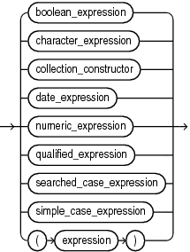
[Description of the illustration expression.eps](img_text/expression.md)

(boolean_expression ::=, character_expression ::=, collection_constructor ::=, date_expression ::=, numeric_expression ::=, qualified_expression ::= , searched_case_expression ::=, simple_case_expression ::=)

### boolean_expression ::=

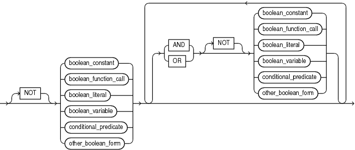
[Description of the illustration boolean_expression.eps](img_text/boolean_expression.md)

(function_call ::=)

### boolean_literal ::=

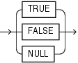
[Description of the illustration boolean_literal.eps](img_text/boolean_literal.md)

### conditional_predicate ::=

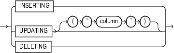
[Description of the illustration conditional_predicate.eps](img_text/conditional_predicate.md)

### other_boolean_form ::=

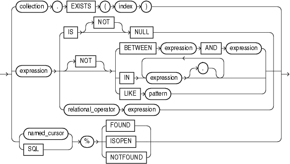
[Description of the illustration other_boolean_form.eps](img_text/other_boolean_form.md)

(expression ::=, [named_cursor ::=](named-cursor-attribute.md))

### character_expression ::=

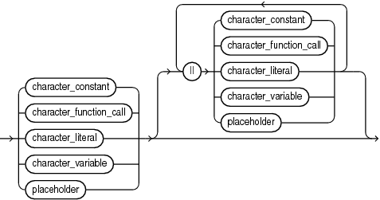
[Description of the illustration character_expression.eps](img_text/character_expression.md)

(function_call ::=, [placeholder ::=](assignment-statement.md))

### collection_constructor ::=

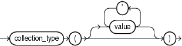
[Description of the illustration collection_constructor.eps](img_text/collection_constructor.md)

### date_expression ::=

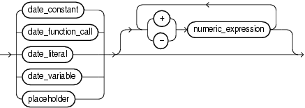
[Description of the illustration date_expression.eps](img_text/date_expression.md)

(function_call ::=, [placeholder ::=](assignment-statement.md))

### numeric_expression ::=

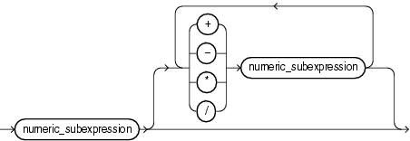
[Description of the illustration numeric_expression.eps](img_text/numeric_expression.md)

### numeric_subexpression ::=

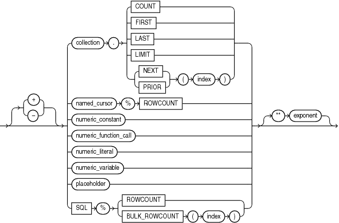
[Description of the illustration numeric_subexpression.eps](img_text/numeric_subexpression.md)

(function_call ::=, [named_cursor ::=](named-cursor-attribute.md), [placeholder ::=](assignment-statement.md))

### function_call ::=

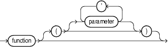
[Description of the illustration function_call.eps](img_text/function_call.md)

### qualified_expression ::=

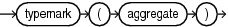
[Description of the illustration qualified_expression.eps](img_text/qualified_expression.md)

### typemark ::=

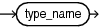
[Description of the illustration typemark.eps](img_text/typemark.md)

### type_name ::=

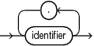
[Description of the illustration type_name.eps](img_text/type_name.md)

### aggregate ::=

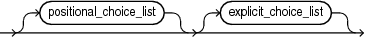
[Description of the illustration aggregate.eps](img_text/aggregate.md)

### positional_choice_list ::=

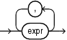
[Description of the illustration positional_choice_list.eps](img_text/positional_choice_list.md)

### explicit_choice_list ::=

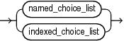
[Description of the illustration explicit_choice_list.eps](img_text/explicit_choice_list.md)

### named_choice_list ::=

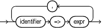
[Description of the illustration named_choice_list.eps](img_text/named_choice_list.md)

### indexed_choice_list ::=

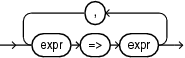
[Description of the illustration indexed_choice_list.eps](img_text/indexed_choice_list.md)

### searched_case_expression ::=

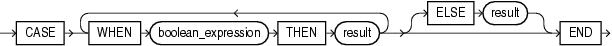
[Description of the illustration searched_case_expression.eps](img_text/searched_case_expression.md)

(boolean_expression ::=)

### simple_case_expression ::=

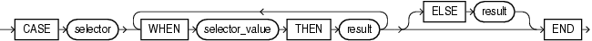
[Description of the illustration simple_case_expression.eps](img_text/simple_case_expression.md)

### Semantics

### boolean_expression

Expression whose value is `TRUE`, `FALSE`, or `NULL`. For more information, see "[BOOLEAN Expressions](expressions.md)".

Restriction on boolean_expression

Because SQL has no data type equivalent to `BOOLEAN`, you cannot:

- Assign a `BOOLEAN` value to a database table column

- Select or fetch the value of a database table column into a `BOOLEAN` variable

- Use a `BOOLEAN` value in a SQL function

  (However, a SQL query can invoke a PL/SQL function that has a `BOOLEAN` parameter, as in [Example 3-3](boolean-data-type.md).)

- Use a `BOOLEAN` expression in a SQL statement, except as an argument to a PL/SQL function invoked in a SQL query, or in a PL/SQL anonymous block.

  **Note:**

  An argument to a PL/SQL function invoked in a static SQL query cannot be a `BOOLEAN` literal. The workaround is to assign the literal to a variable and then pass the variable to the function, as in [Example 3-3](boolean-data-type.md).

### NOT, AND, OR

See "[Logical Operators](expressions.md)".

### boolean_constant

Name of a constant of type `BOOLEAN`.

### boolean_function_call

Invocation of a previously defined function that returns a `BOOLEAN` value. For more semantic information, see "function_call".

### boolean_variable

Name of a variable of type `BOOLEAN`.

### conditional_predicate

See "[Conditional Predicates for Detecting Triggering DML Statement](dml-triggers.md)".

### other_boolean_form

collection

Name of a collection variable.

EXISTS

Collection method (function) that returns `TRUE` if the `index`th element of `collection` exists and `FALSE` otherwise. For more information, see "[EXISTS Collection Method](collection-methods.md)".

Restriction on EXISTS

You cannot use `EXISTS` if `collection` is an associative array.

index

Numeric expression whose data type either is `PLS_INTEGER` or can be implicitly converted to `PLS_INTEGER` (for information about the latter, see "[Predefined PLS_INTEGER Subtypes](pls_integer-and-binary_integer-data-types.md)").

IS \[NOT\] NULL

See "[IS \[NOT\] NULL Operator](expressions.md)".

BETWEEN expression AND expression

See "[BETWEEN Operator](expressions.md)".

IN expression \[, expression \]...

See "[IN Operator](expressions.md)".

LIKE pattern

See "[LIKE Operator](expressions.md)".

relational_operator

See "[Relational Operators](expressions.md)".

SQL

Implicit cursor associated with the most recently run `SELECT` or DML statement. For more information, see "[Implicit Cursors](cursors-overview.md)".

%FOUND, %ISOPEN, %NOTFOUND

Cursor attributes explained in "[Implicit Cursor Attribute](implicit-cursor-attribute.md)" and "[Named Cursor Attribute](named-cursor-attribute.md)".

### character_expression

Expression whose value has a character data type (that is, a data type in the `CHAR` family, described in "[CHAR Data Type Family](plsql-predefined-data-types.md)").

character_constant

Name of a constant that has a character data type.

character_function_call

Invocation of a previously defined function that returns a value that either has a character data type or can be implicitly converted to a character data type. For more semantic information, see "function_call".

character_literal

Literal of a character data type.

character_variable

Name of a variable that has a character data type.

\|\|

Concatenation operator, which appends one string operand to another. For more information, see "[Concatenation Operator](expressions.md)".

### collection_constructor

Constructs a collection of the specified type with elements that have the specified values.

For more information, see "[Collection Constructors](collection-constructors.md)".

collection_type

Name of a previously declared nested table type or `VARRAY` type (not an associative array type).

value

Valid value for an element of a collection of `collection_type`.

If `collection_type` is a varray type, then it has a maximum size, which the number of values cannot exceed. If `collection_type` is a nested table type, then it has no maximum size.

If you specify no values, then the constructed collection is empty but not null (for the difference between empty and null, see "[Collection Types](collection-types.md)").

### date_expression

Expression whose value has a date data type (that is, a data type in the `DATE` family, described in "[DATE Data Type Family](plsql-predefined-data-types.md)").

date_constant

Name of a constant that has a date data type.

date_function_call

Invocation of a previously defined function that returns a value that either has a date data type or can be implicitly converted to a date data type. For more semantic information, see "function_call".

date_literal

Literal whose value either has a date data type or can be implicitly converted to a date data type.

date_variable

Name of a variable that has a date data type.

+, -

Addition and subtraction operators.

### numeric_expression

Expression whose value has a date numeric type (that is, a data type in the `DATE` family, described in "[NUMBER Data Type Family](plsql-predefined-data-types.md)").

+, -, /, \*, \*\*

Addition, subtraction, division, multiplication, and exponentiation operators.

### numeric_subexpression

collection

Name of a collection variable.

COUNT, FIRST, LAST, LIMIT, NEXT, PRIOR

Collection methods explained in "[Collection Method Invocation](collection-method.md)".

named_cursor%ROWCOUNT

See "[Named Cursor Attribute](named-cursor-attribute.md)".

numeric_constant

Name of a constant that has a numeric data type.

numeric_function_call

Invocation of a previously defined function that returns a value that either has a numeric data type or can be implicitly converted to a numeric data type. For more semantic information, see "function_call".

numeric_literal

Literal of a numeric data type.

numeric_variable

Name of variable that has a numeric data type.

SQL%ROWCOUNT

Cursor attribute explained in "[Implicit Cursor Attribute](implicit-cursor-attribute.md)".

SQL%BULK_ROWCOUNT\]

Cursor attribute explained in "[SQL%BULK_ROWCOUNT](implicit-cursor-attribute.md)".

exponent

Numeric expression.

### function_call

function

Name of a previously defined function.

parameter \[, parameter \]...

List of actual parameters for the function being called. The data type of each actual parameter must be compatible with the data type of the corresponding formal parameter. The mode of the formal parameter determines what the actual parameter can be:

| Formal Parameter Mode | Actual Parameter                                                   |
|:----------------------|:-------------------------------------------------------------------|
| `IN`                  | Constant, initialized variable, literal, or expression             |
| `OUT`                 | Variable whose data type is not defined as `NOT` `NULL`            |
| `IN` `OUT`            | Variable (typically, it is a string buffer or numeric accumulator) |

If the function specifies a default value for a parameter, you can omit that parameter from the parameter list. If the function has no parameters, or specifies a default value for every parameter, you can either omit the parameter list or specify an empty parameter list.

**See Also:**

"[Positional, Named, and Mixed Notation for Actual Parameters](subprogram-parameters.md)"

### qualified_expression

Qualified expressions for `RECORD` types are allowed in any context where an expression of `RECORD` type is allowed.

Qualified expressions for associative array types are allowed in any context where an expression of associative array type is allowed.

typemark ( aggregate )

Specifies explicitly the type of the aggregate (qualified items).

### typemark

### type_name

Qualified expressions use an explicit type indication to provide the type of the qualified item. This explicit indication is known as a typemark.

identifier \[ . \]

Indicates the type of the qualified item.

### aggregate

A qualified expression combines expression elements to create values of a `RECORD` type, or associative array type.

### positional_choice_list

expr \[ , \]

Positional association is allowed for qualified expressions of `RECORD` type.

A positional association may not follow a named association in the same construct (and vice versa).

### explicit_choice_list

named_choice_list \| indexed_choice_list

Named choices must use names of fields from the qualifying structure type. Index key values must be compatible with the index type for the qualifying vector type.

### named_choice_list

A named choice applies only to structured types

identifier =\> expr \[ , \]

Named association is allowed for qualified expressions of `RECORD` type.

### indexed_choice_list

An index choice applies only to vector types.

expr =\> expr \[ , \]

Indexed choices (key-value pairs) is allowed for qualified expressions of associative array types. Both the key and the value may be expressions.

Using `NULL` as an index key value is not permitted with associative array type constructs.

### searched_case_expression

WHEN boolean_expression THEN result

The `boolean_expression`s are evaluated sequentially. If a `boolean_expression` has the value `TRUE`, then the `result` associated with that `boolean_expression` is returned. Subsequent `boolean_expression`s are not evaluated.

ELSE result

The `result` is returned if and only if no `boolean_expression` has the value `TRUE`.

If you omit the `ELSE` clause, the searched case expression returns `NULL`.

**See Also:**

"[Searched CASE Statement](conditional-selection-statements.md)"

### simple_case_expression

selector

An expression of any PL/SQL type except `BLOB`, `BFILE`, or a user-defined type. The `selector` is evaluated once.

WHEN selector_value THEN result

The `selector_value`s are evaluated sequentially. If a `selector_value` is the value of `selector`, then the `result` associated with that `selector_value` is returned. Subsequent `selector_value`s are not evaluated.

A `selector_value` can be of any PL/SQL type except `BLOB`, `BFILE`, an ADT, a PL/SQL record, an associative array, a varray, or a nested table.

ELSE result

The `result` is returned if and only if no `selector_value` has the same value as `selector`.

If you omit the `ELSE` clause, the simple case expression returns `NULL`.

**Note:**

If you specify the literal `NULL` for every `result` (including the `result` in the `ELSE` clause), then error PLS-00617 occurs.

**See Also:**

"[Simple CASE Statement](conditional-selection-statements.md)"

### Examples

- [Example 2-28](expressions.md), "Concatenation Operator Examples"

- [Example 2-30](expressions.md), "Controlling Evaluation Order with Parentheses"

- [Example 2-31](expressions.md), "Expression with Nested Parentheses"

- [Example 2-32](expressions.md), "Improving Readability with Parentheses"

- [Example 2-33](expressions.md), "Operator Precedence"

- [Example 2-43](expressions.md), "Relational Operators in Expressions"

- [Example 2-44](expressions.md), "LIKE Operator in Expression"

- [Example 2-46](expressions.md), "BETWEEN Operator in Expressions"

- [Example 2-47](expressions.md), "IN Operator in Expressions"

- [Example 2-50](expressions.md), "Simple CASE Expression"

- [Example 2-52](expressions.md), "Searched CASE Expression"

- [Example 9-1](dml-triggers.md), "Trigger Uses Conditional Predicates to Detect Triggering Statement"

### Related Topics

In this chapter:

- "[Collection Method Invocation](collection-method.md)"

- "[Constant Declaration](constant-declaration.md)"

- "[Scalar Variable Declaration](scalar-variable-declaration.md)"

In other chapters:

- "[Qualified Expressions Overview](qualified-expressions-overview.md)" for more information and examples

- "[Literals](lexical-units.md)"

- "[Expressions](expressions.md)"

- "[Operator Precedence](expressions.md)"

- "[PL/SQL Data Types](plsql-data-types.md)"

- "[Subprogram Parameters](subprogram-parameters.md)"
