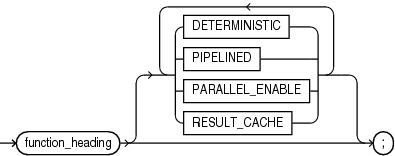
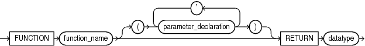
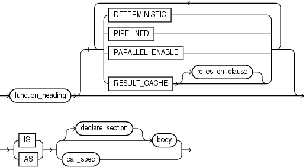

## 13.36 Function Declaration and Definition

Before invoking a function, you must declare and define it. You can either declare it first (with function_declaration) and then define it later in the same block, subprogram, or package (with function_definition) or declare and define it at the same time (with function_definition).

A function is a subprogram that returns a value. The data type of the value is the data type of the function. A function invocation (or call) is an expression, whose data type is that of the function.

A function declaration is also called a function specification or function spec.

**Note:**

This topic applies to nested functions.

For information about standalone functions, see "[CREATE FUNCTION Statement](CREATE-FUNCTION-statement.md)".

For information about package functions, see "[CREATE PACKAGE Statement](CREATE-PACKAGE-statement.md)".

### Topics

- Syntax

- Semantics

- Examples

- Related Topics

### Syntax

### function_declaration ::=

[Description of the illustration function_declaration.eps](img_text/function_declaration.md)

### function_heading ::=

[Description of the illustration function_heading.eps](img_text/function_heading.md)

( [datatype ::=](datatype-attribute.md) , [parameter_declaration ::=](formal-parameter-declaration.md) )

### function_definition ::=

[Description of the illustration function_definition.eps](img_text/function_definition.md)

( [body ::=](block.md) , [declare_section ::=](block.md) , [pipelined_clause ::=](PIPELINED-clause.md) , [deterministic_clause ::=](DETERMINISTIC-clause.md) , [parallel_enable_clause ::=](PARALLEL_ENABLE-clause.md) , [result_cache_clause ::=](RESULT_CACHE-clause.md) , [call_spec ::=](call-specification.md) )

### Semantics

### function_declaration

Declares a function, but does not define it. The definition must appear later in the same block, subprogram, or package as the declaration.

### function_heading

The function heading specifies the function name and its parameter list.

function_name

Name of the function that you are declaring or defining.

RETURN datatype

Specifies the data type of the value that the function returns, which can be any PL/SQL data type (see [PL/SQL Data Types](plsql-data-types.md)).

Restriction on datatype

You cannot constrain this data type (with `NOT` `NULL`, for example). If `datatype` is a constrained subtype, then the returned value does not inherit the constraints of the subtype (see "[Formal Parameters of Constrained Subtypes](subprogram-parameters.md)").

### function_definition

Either defines a function that was declared earlier or both declares and defines a function.

declare_section

Declares items that are local to the function, can be referenced in `body`, and cease to exist when the function completes execution.

body

Required executable part and optional exception-handling part of the function. In the executable part, at least one execution path must lead to a `RETURN` statement; otherwise, a runtime error occurs.

### Examples

- [Example 8-2](subprogram-parts.md), "Declaring, Defining, and Invoking a Simple PL/SQL Function"

### Related Topics

- [Formal Parameter Declaration](formal-parameter-declaration.md)

- [Procedure Declaration and Definition](procedure-declaration-and-definition.md)

- [PL/SQL Subprograms](plsql-subprograms.md)
