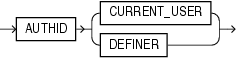

## 13.41 Invoker’s Rights and Definer’s Rights Clause

Specifies the `AUTHID` property of a stored PL/SQL subprogram. The AUTHID property affects the name resolution and privilege checking of SQL statements that the unit issues at run time. 

The invoker_rights_clause can appear in the following SQL statements :

- [ALTER TYPE Statement](ALTER-TYPE-statement.md)

- [CREATE FUNCTION Statement](CREATE-FUNCTION-statement.md)

- [CREATE PACKAGE Statement](CREATE-PACKAGE-statement.md)

- [CREATE PROCEDURE Statement](CREATE-PROCEDURE-statement.md)

- [CREATE TYPE Statement](CREATE-TYPE-statement.md)

- [CREATE TYPE BODY Statement](CREATE-TYPE-BODY-statement.md)

### Topics

- Syntax

- Semantics

- Related Topics

### Syntax

### invoker_rights_clause ::=

[Description of the illustration invoker_rights_clause.eps](img_text/invoker_rights_clause.md)

### Semantics

### invoker_rights_clause

When it appears in the package declaration, it specifies the `AUTHID` property of functions and procedures in the package, and of the explicit cursors declared in the package specification.

When it appears in a standalone function declaration, it specifies the `AUTHID` property of the function.

When it appears in a standalone procedure declaration, it specifies the `AUTHID` property of the procedure.

The invoker_rights_clause can appear only once in a subprogram declaration.

When it appears in an ADT, it specifies the `AUTHID` property of the member functions and procedures of the ADT.

### Restrictions on invoker_rights_clause

The following restrictions apply for types:

- This clause is valid only for ADTs, not for a nested table or `VARRAY` type.

- You can specify this clause for clarity if you are creating a subtype. However, a subtype inherits the `AUTHID` property of its supertype, so you cannot specify a different value than was specified for the supertype.

- If the supertype was created with `AUTHID` `DEFINER`, then you must create the subtype in the same schema as the supertype.

### Related Topics

In this book:

- "[Invoker's Rights and Definer's Rights (AUTHID Property)](invokers-rights-and-definers-rights-authid-property.md)"for information about the `AUTHID` property

- "[Subprogram Properties](subprogram-properties.md)"
