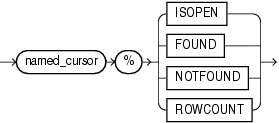
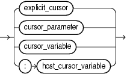

## 13.43 Named Cursor Attribute

Every named cursor (explicit cursor or cursor variable) has four attributes, each of which returns information about the execution of a DML statement.

**Note:**

You can use cursor attributes only in procedural statements, not in SQL statements.

### Topics

- Syntax

- Semantics

- Examples

- Related Topics

### Syntax

### named_cursor_attribute ::=

[Description of the illustration named_cursor_attribute.eps](img_text/named_cursor_attribute.md)

### named_cursor ::=

[Description of the illustration named_cursor.eps](img_text/named_cursor.md)

### Semantics

### named_cursor_attribute

%ISOPEN

`named_cursor``%ISOPEN` has the value `TRUE` if the cursor is open, and `FALSE` if it is not open.

%FOUND

`named_cursor``%FOUND` has one of these values:

- If the cursor is not open, `INVALID_CURSOR`

- If cursor is open but no fetch was tried, `NULL`.

- If the most recent fetch returned a row, `TRUE`.

- If the most recent fetch did not return a row, `FALSE`.

%NOTFOUND

`named_cursor``%NOTFOUND` has one of these values:

- If cursor is not open, `INVALID_CURSOR`.

- If cursor is open but no fetch was tried, `NULL`.

- If the most recent fetch returned a row, `FALSE`.

- If the most recent fetch did not return a row, `TRUE`.

%ROWCOUNT

`named_cursor``%ROWCOUNT` has one of these values:

- If cursor is not open, `INVALID_CURSOR`.

- If cursor is open, the number of rows fetched so far.

### named_cursor

explicit_cursor

Name of an explicit cursor.

cursor_parameter

Name of a formal cursor parameter.

cursor_variable

Name of a cursor variable.

:host_cursor_variable

Name of a cursor variable that was declared in a PL/SQL host environment and passed to PL/SQL as a bind variable. Do not put space between the colon (:) and `host_cursor_variable`.

### Examples

- [Example 6-14](cursors-overview.md), "%ISOPEN Explicit Cursor Attribute"

- [Example 6-15](cursors-overview.md), "%FOUND Explicit Cursor Attribute"

- [Example 6-16](cursors-overview.md), "%NOTFOUND Explicit Cursor Attribute"

- [Example 6-17](cursors-overview.md), "%ROWCOUNT Explicit Cursor Attribute"

### Related Topics

In this chapter:

- "[Cursor Variable Declaration](cursor-variable-declaration.md)"

- "[Explicit Cursor Declaration and Definition](explicit-cursor-declaration-and-definition.md)"

- "[Implicit Cursor Attribute](implicit-cursor-attribute.md)"

In other chapters:

- "[Explicit Cursor Attributes](cursors-overview.md)"
