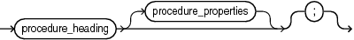
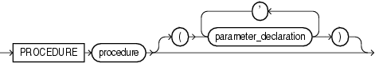
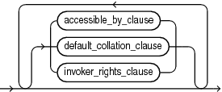
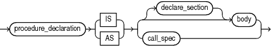

## 13.50 Procedure Declaration and Definition

Before invoking a procedure, you must declare and define it. You can either declare it first (with procedure_declaration) and then define it later in the same block, subprogram, or package (with procedure_definition) or declare and define it at the same time (with procedure_definition).

A procedure is a subprogram that performs a specific action. A procedure invocation (or call) is a statement.

A procedure declaration is also called a procedure specification or procedure spec.

**Note:**

For more information about standalone procedures, see "[CREATE PROCEDURE Statement](CREATE-PROCEDURE-statement.md)". For more information about package procedures, see "[CREATE PACKAGE Statement](CREATE-PACKAGE-statement.md)".

### Topics

- Syntax

- Semantics

- Examples

- Related Topics

### Syntax

### procedure_declaration ::=

[Description of the illustration procedure_declaration.eps](img_text/procedure_declaration.md)

( procedure_properties ::= )

### procedure_heading ::=

[Description of the illustration procedure_heading.eps](img_text/procedure_heading.md)

See "[parameter_declaration ::=](formal-parameter-declaration.md)".

### procedure_properties ::=

[Description of the illustration procedure_properties.eps](img_text/procedure_properties.md)

( [accessible_by_clause ::=](ACCESSIBLE-BY-clause.md) , [default_collation_clause ::=](DEFAULT-COLLATION-clause.md) , [invoker_rights_clause ::=](invokers_rights_clause.md) )

### procedure_definition ::=

[Description of the illustration procedure_definition.eps](img_text/procedure_definition.md)

( [body ::=](block.md) , [declare_section ::=](block.md) , [call_spec ::=](call-specification.md) )

### Semantics

### procedure_declaration

Declares a procedure, but does not define it. The definition must appear later in the same block, subprogram, or package as the declaration.

### procedure_heading

procedure

Name of the procedure that you are declaring or defining.

### procedure_properties

Each procedure property can appear only once in the procedure declaration. The properties can appear in any order. Properties appear before the `IS` or `AS` keyword in the heading. The properties cannot appear in nested procedures. Only the `ACCESSIBLE BY` property can appear in package procedures.

Standalone procedures may have the following properties in their declaration.

- [ACCESSIBLE BY Clause](ACCESSIBLE-BY-clause.md)

- [DEFAULT COLLATION Clause](DEFAULT-COLLATION-clause.md)

- [Invoker's Rights and Definer's Rights (AUTHID Property)](invokers-rights-and-definers-rights-authid-property.md)

### procedure_definition

Either defines a procedure that was declared earlier or both declares and defines a procedure.

declare_section

Declares items that are local to the procedure, can be referenced in `body`, and cease to exist when the procedure completes execution.

body

Required executable part and optional exception-handling part of the procedure.

### Examples

- [Example 8-1](subprogram-parts.md), "Declaring, Defining, and Invoking a Simple PL/SQL Procedure"

### Related Topics

In this chapter:

- "[Formal Parameter Declaration](formal-parameter-declaration.md)"

- "[Function Declaration and Definition](function-declaration-and-definition.md)"

In other chapters:

- "[PL/SQL Subprograms](plsql-subprograms.md)"

- "[CREATE PROCEDURE Statement](CREATE-PROCEDURE-statement.md)"
