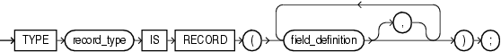
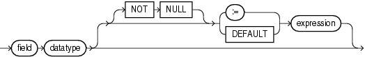
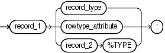

## 13.52 Record Variable Declaration

A record variable is a composite variable whose internal components, called fields, can have different data types. The value of a record variable and the values of its fields can change.

You reference an entire record variable by its name. You reference a record field with the syntax `record.field`.

You can create a record variable in any of these ways:

- Define a record type and then declare a variable of that type.

- Use `%ROWTYPE` to declare a record variable that represents either a full or partial row of a database table or view.

- Use `%TYPE` to declare a record variable of the same type as a previously declared record variable.

### Topics

- Syntax

- Semantics

- Examples

- Related Topics

### Syntax

### record_type_definition ::=

[Description of the illustration record_type_definition.eps](img_text/record_type_definition.md)

### field_definition ::=

[Description of the illustration field_definition.eps](img_text/field_definition.md)

( [datatype ::=](datatype-attribute.md) , [expression ::=](expression.md) )

### record_variable_declaration ::=

[Description of the illustration record_variable_declaration.eps](img_text/record_variable_declaration.md)

( [rowtype_attribute ::=](ROWTYPE-attribute.md))

### Semantics

### record_type_definition

record_type

Name of the record type that you are defining.

### field_definition

field

Name of the field that you are defining.

datatype

Data type of the field that you are defining.

NOT NULL

Imposes the `NOT` `NULL` constraint on the field that you are defining.

For information about this constraint, see "[NOT NULL Constraint](declarations.md)".

expression

Expression whose data type is compatible with `datatype`. When `record_variable_declaration` is elaborated, the value of `expression` is assigned to `record`.`field`. This value is the initial value of the field.

### record_variable_declaration

record_1

Name of the record variable that you are declaring.

record_type

Name of a previously defined record type. `record_type` is the data type of `record_1`.

rowtype_attribute

See "[%ROWTYPE Attribute](ROWTYPE-attribute.md)".

record_2

Name of a previously declared record variable.

%TYPE

See "[%TYPE Attribute](TYPE-attribute.md)".

### Examples

- [Example 5-36](record-variables.md), "RECORD Type Definition and Variable Declaration"

- [Example 5-37](record-variables.md), "RECORD Type with RECORD Field (Nested Record)"

- [Example 5-38](record-variables.md), "RECORD Type with Varray Field"

### Related Topics

In this chapter:

- "[Collection Variable Declaration](collection-variable.md)"

- "[%ROWTYPE Attribute](ROWTYPE-attribute.md)"

In other chapters:

- "[Record Topics](plsql-collections-and-records.md)"
