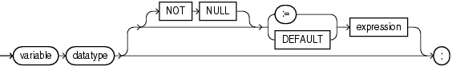

## 13.58 Scalar Variable Declaration

A scalar variable stores a value with no internal components. The value can change. A scalar variable declaration specifies the name and data type of the variable and allocates storage for it.

The declaration can also assign an initial value and impose the `NOT` `NULL` constraint.

You reference a scalar variable by its name.

### Topics

- Syntax

- Semantics

- Examples

- Related Topics

### Syntax

### variable_declaration ::=

[Description of the illustration variable_declaration.eps](img_text/variable_declaration.md)

( [expression ::=](expression.md) )

### Semantics

### variable_declaration

variable

Name of the variable that you are declaring.

datatype

Name of a scalar data type, including any qualifiers for size, precision, and character or byte semantics.

For information about scalar data types, see "[PL/SQL Data Types](plsql-data-types.md)".

NOT NULL

Imposes the `NOT` `NULL` constraint on the variable. For information about this constraint, see "[NOT NULL Constraint](declarations.md)".

expression

Value to be assigned to the variable when the declaration is elaborated. `expression` and `variable` must have compatible data types.

### Examples

- [Example 2-11](declarations.md), "Scalar Variable Declarations"

- [Example 2-13](declarations.md), "Variable and Constant Declarations with Initial Values"

- [Example 2-14](declarations.md), "Variable Initialized to NULL by Default"

- [Example 2-9](declarations.md), "Variable Declaration with NOT NULL Constraint"

### Related Topics

In this chapter:

- "[Assignment Statement](assignment-statement.md)"

- "[Collection Variable Declaration](collection-variable.md)"

- "[Constant Declaration](constant-declaration.md)"

- "[Expression](expression.md)"

- "[Record Variable Declaration](record-variable-declaration.md)"

- "[%ROWTYPE Attribute](ROWTYPE-attribute.md)"

- "[%TYPE Attribute](TYPE-attribute.md)"

In other chapters:

- "[Declaring Variables](declarations.md)"

- "[PL/SQL Data Types](plsql-data-types.md)"
