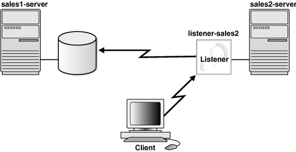

## 9 Configuring and Administering Oracle Net Listener

Oracle Net Listener is a separate process that runs on the database server. It receives incoming client connection requests and manages the traffic of these requests to the database server. Find out how to configure the listener to accept client connections.

- Overview of Oracle Net Listener
  A listener is configured with one or more listening protocol addresses, information about supported services, and parameters that control its runtime behavior. The listener configuration is stored in a configuration file named `listener.ora`.
- Configuring Dynamic Service Registration
  Service registration allows processes, such as an Oracle database, to identify their available services to the listener, which then acts as a port mapper for those services.
- Configuring Oracle Net Listener During Installation
  Oracle Universal Installer launches Oracle Net Configuration Assistant during installation. Oracle Net Configuration Assistant configures the listening protocol address and service information for Oracle Database.
- Customizing Oracle Net Listener Configuration
  If the default or installed configuration is not adequate for a particular environment, then you can use Oracle Net Manager to customize the `listener.ora` configuration.
- Administering the Listener
  After the listener is configured, you can administer it with the Listener Control utility, Oracle Enterprise Manager Cloud Control, and the Server Control utility (SRVCTL).
- Understanding Listener Redirects
  The listener redirect feature allows a client to connect to a pluggable database (PDB) using an unchanged connect descriptor even after the PDB is migrated to a new location in the Oracle Public Cloud.

**Related Topics**

- [Identifying and Accessing the Database](identifying-and-accessing-database.md)
- [Understanding the Communication Layers](understanding-communication-layers.md)

**Parent topic:** [Configuration and Administration of Oracle Net Services](part-II-config-and-admin-of-oracle-net-services.md)

### 9.1 Overview of Oracle Net Listener

A listener is configured with one or more listening protocol addresses, information about supported services, and parameters that control its runtime behavior. The listener configuration is stored in a configuration file named `listener.ora`.

**Note:**

The release of the listener must be the same as or later than the latest release of all Oracle databases being serviced through the listener.

Because the configuration parameters have default values, it is possible to start and use a listener with no configuration. This default listener has a name of `LISTENER`, supports no services on startup, and listens on the following TCP/IP protocol address:

    (ADDRESS=(PROTOCOL=tcp)(HOST=host_name)(PORT=1521))

The listener forwards client requests to supported services. These services are dynamically registered with the listener. This dynamic registration feature is called [service registration](glossary.md). The registration is performed by the Listener Registration (LREG) process. Dynamic service registration does not require any manual configuration in the `listener.ora` file.

Service registration offers the following benefits:

- Connect-time failover

  Because the listener always monitors the state of the instances, service registration facilitates automatic failover of a client connect request to a different instance if one instance is down.

- Connection load balancing

  Service registration enables the listener to forward client connect requests to the least-loaded instance and [dispatcher](glossary.md) or [dedicated server](glossary.md). Service registration balances the load across the [service handler](glossary.md)s and nodes.

- High-availability for Oracle Real Application Clusters and Oracle Data Guard

**Related Topics**

- [Understanding Oracle Net Architecture](understanding-oracle-net-architecture.md)
- Configuring Dynamic Service Registration
- [About the Address List Parameters](enabling-advanced-features.md)
- [Understanding Connection Load Balancing](enabling-advanced-features.md)

**Parent topic:** Configuring and Administering Oracle Net Listener

### 9.2 Configuring Dynamic Service Registration

Service registration allows processes, such as an Oracle database, to identify their available services to the listener, which then acts as a port mapper for those services.

The listener uses the dynamic service information about the database and instance received through service registration.

Dynamic service registration is configured in the database initialization file. It does not require any configuration in the `listener.ora` file. However, listener configuration must be set to listen on the ports named in the database initialization file, and must not have parameters set that prevent automatic registration, such as `COST` parameters.

- Setting Initialization Parameters for Service Registration
- Registering Information with a Local Listener
- Registering Information with a Remote Listener
- Registering Information with All Listeners in a Network
- Configuring a Naming Method

**Parent topic:** Configuring and Administering Oracle Net Listener

#### 9.2.1 Setting Initialization Parameters for Service Registration

To ensure service registration works properly, the initialization parameter file should contain the following parameters:

- SERVICE_NAMES for the database service name

- INSTANCE_NAME for the instance name

- LOCAL_LISTENER for the local listener

- REMOTE_LISTENER for the remote listener, if any

- FORWARD_LISTENER for the forward listener

For example:

    SERVICE_NAMES=sales.us.example.com
    INSTANCE_NAME=sales

The value for the SERVICE_NAMES parameter defaults to the [global database name](glossary.md), a name comprising the DB_NAME and DB_DOMAIN parameters in the initialization parameter file. The value for the INSTANCE_NAME parameter defaults to the Oracle system identifier (SID).

**Note:**

Starting with Oracle Database 19c, customer use of the `SERVICE_NAMES` parameter is deprecated. To manage your services, Oracle recommends that you use the `SRVCTL` or `GDSCTL` command line utilities, or the `DBMS_SERVICE` package.

**See Also:**

[Oracle Database Reference](../refrn/SERVICE_NAMES.md) for additional information about the SERVICE_NAMES and INSTANCE_NAME parameters

**Parent topic:** Configuring Dynamic Service Registration

#### 9.2.2 Registering Information with a Local Listener

By default, the LREG process registers service information with its local listener on the default local address of TCP/IP, port 1521. If the listener configuration is synchronized with the database configuration, then LREG can register service information with a nondefault local listener or a remote listener on another node. Synchronization occurs when the protocol address of the listener is specified in the `listener.ora` file and the location of the listener is specified in the initialization parameter file.

To have the LREG process register with a local listener that does not use TCP/IP, port 1521, configure the LOCAL_LISTENER parameter in the initialization parameter file to locate the local listener.

For a shared server environment, you can use the `LISTENER` attribute of the DISPATCHERS parameter in the initialization parameter file to register the dispatchers with a nondefault local listener. Because the LOCAL_LISTENER parameter and the `LISTENER` attribute enable LREG to register dispatcher information with the listener, it is not necessary to specify both the parameter and the attribute if the listener values are the same.

LOCAL_LISTENER is a comma-delimited list parameter. If a comma appears in the string, then the entire string must be enclosed in double quotation marks. Set the LOCAL_LISTENER parameter as follows:

    ALTER SYSTEM SET LOCAL_LISTENER=["]listener_address["][,...];

For example, if the listener address `"ab,cd"` is entered, then it resolves to one listener address. If the address is entered as `ab,cd`, then it resolves to two listener addresses, `ab` and `cd`.

For shared server connections, set the `LISTENER` attribute as follows:

    ALTER SYSTEM SET DISPATCHERS="(PROTOCOL=tcp)(LISTENER=listener_address)";

In the preceding command, listener_address is resolved to the listener protocol addresses through a naming method, such as a `tnsnames.ora` file on the database server.

**Note:**

- To dynamically update the LOCAL_LISTENER parameter, use the SQL statement `ALTER SYSTEM` as follows:

      ALTER SYSTEM SET LOCAL_LISTENER=["]listener_address["][,...]

  If you set the parameter to null using the following statement, then the default local address of TCP/IP, port 1521 is assumed:

      ALTER SYSTEM SET LOCAL_LISTENER=''

<!-- -->

- The `LISTENER` attribute overrides the LOCAL_LISTENER parameter. As a result, the SQL statement `ALTER SYSTEM SET LOCAL_LISTENER` does not affect the setting of this attribute.

In Example 9-1, a database resides on host `sales1-server`. The listener on this host is named `listener_sales1` and is configured to listen on port 1421 instead of port 1521.

Example 9-1 Registering a Local Listener in a Dedicated Server Environment

1.  On the host where the local listener resides, configure the `listener.ora` file with the protocol address of the listener using Oracle Net Manager.

2.  On the database, set the LOCAL_LISTENER parameter in the database initialization parameter file to the alias of the local listener. For example:

        ALTER SYSTEM SET LOCAL_LISTENER=listener_sales1;

    If the database is configured for shared server connections, then you could set the `LISTENER` attribute as follows:

        ALTER SYSTEM SET DISPATCHERS="(PROTOCOL=tcp)(LISTENER=listener_sales1)";

3.  Resolve the listener name alias for the `LOCAL_LISTENER` setting through a `tnsnames.ora` file on the database host using a text editor, as follows:

        listener_sales1=
         (DESCRIPTION =
          (ADDRESS = (PROTOCOL=tcp)(HOST=sales-server)(PORT=1421)))

    **Note:**

    - If you are registering a local listener and use Oracle Connection Manager, then do not include `(DESCRIPTION =` or its closing parenthesis.

    - A network service name entry can be created for the protocol address without the CONNECT_DATA section of the connect descriptor.

**See Also:**

- See [Oracle Database SQL Reference](../sqlrf/ALTER-SYSTEM.md) for additional information about the `ALTER SYSTEM` statement.

- "Configuring Listening Protocol Addresses"

- "Configuring a Naming Method"

**Parent topic:** Configuring Dynamic Service Registration

#### 9.2.3 Registering Information with a Remote Listener

A remote listener is a listener residing on one computer that redirects connections to a database instance on another computer. Remote listeners are typically used in an Oracle Real Application Clusters (Oracle RAC) environment. You can configure registration to remote listeners, such as with Oracle RAC, for dedicated or shared server environments.

In a dedicated server environment, you must enable the LREG background process to register with a remote listener. You do this by configuring the REMOTE_LISTENER parameter, which is a comma-delimited list parameter, in the initialization parameter file. The syntax of REMOTE_LISTENER is as follows:

    ALTER SYSTEM SET REMOTE_LISTENER=["]listener_address["][,...];

In the preceding command, listener_address is resolved to the listener protocol addresses through a naming method such as a `tnsnames.ora` file on the database host. If a comma appears in the listener address, then the entire string must be enclosed in quotation marks.

In a shared server environment, you can use the same registration technique as for a dedicated server environment. Alternatively, you can set the `LISTENER` attribute of the DISPATCHERS parameter in the initialization parameter file to register the dispatchers with any listener. The syntax of the `LISTENER` attribute is as follows:

    ALTER SYSTEM SET DISPATCHERS="(PROTOCOL=tcp)(LISTENER=listener_address)";

**Note:**

The `LISTENER` attribute overrides the REMOTE_LISTENER initialization parameter. Because the REMOTE_LISTENER initialization parameter and the `LISTENER` attribute enable LREG to register dispatcher information with the listener, you do not need specify both the parameter and the attribute if the listener values are the same.

For example, assume that a remote listener named `listener-sales2` listens on port 1521 on host `sales2-server`, and a database resides on host `sales1-server`. You want the listener on `sales2-server` to redirect connection requests to this database. Figure 9-1 illustrates this scenario.

Figure 9-1 Remote Listener

[Description of "Figure 9-1 Remote Listener"](img_text/netag141.md)

**See Also:**

[Oracle Database SQL Reference](../sqlrf/ALTER-SYSTEM.md) for additional information about the `ALTER SYSTEM SET` statement

Example 9-2 shows how to register a remote listener in a dedicated server environment. In the example, the remote listener is `sales2-server`.

Example 9-2 Registering a Remote Listener in a Dedicated Server Environment

1.  On the host where the remote listener resides, use Oracle Net Manager to configure the `listener.ora` file with the protocol addresses of the remote listener.

2.  On the database to which you want requests to be redirected, set the REMOTE_LISTENER parameter in the database initialization parameter file to the alias of the remote listener, for example:

        ALTER SYSTEM SET REMOTE_LISTENER=listener_sales2;

    For shared server connections, set the DISPATCHER parameter in the initialization file for the database on host `sales1-server` as follows:

        ALTER SYSTEM SET DISPATCHERS="(PROTOCOL=tcp)(LISTENER=listeners_sales2)";

    **Note:**

    To statically update the REMOTE_LISTENER initialization parameter, use a text editor to de-register the information with the remote listener which it had previously registered information.

3.  Resolve the listener name alias for the remote listener through a `tnsnames.ora` file on the database host. For example:

        listener_sales2=
         (DESCRIPTION=
           (ADDRESS=(PROTOCOL=tcp)(HOST=sales2-server)(PORT=1521)))

**See Also:**

- "Configuring a Naming Method"

- "Configuring Listening Protocol Addresses"

- [Oracle Database Reference](../refrn/REMOTE_LISTENER.md) to learn about the REMOTE_LISTENER initialization parameter

- [Oracle Real Application Clusters Administration and Deployment Guide](../racad/ensuring-application-continuity.md) to learn how to configure remote listeners (also called SCAN listeners) in an Oracle RAC environment

**Parent topic:** Configuring Dynamic Service Registration

#### 9.2.4 Registering Information with All Listeners in a Network

A network may contain multiple local and remote listeners. By default, all listeners are cross-registered with each other. By specifying a set of listeners in the LISTENER_NETWORKS initialization parameter, you can designate a subset of local listeners with a subset of remote listeners. Listeners specified by the LISTENER_NETWORKS parameter should not be specified by the LOCAL_LISTENER and REMOTE_LISTENER parameters.

The syntax of LISTENER_NETWORKS parameter is as follows:

    LISTENER_NETWORKS = '((NAME=network_name)
                          (LOCAL_LISTENER=["]listener_address[,...]["])
                          [(REMOTE_LISTENER=["]listener_address[,...]["])])'

In the preceding syntax, listener_address is resolved according to the rules of LOCAL_LISTENER and REMOTE_LISTENER.

Example 9-3 Using Two Networks on a Subnet

Assume there are two distinct networks, `network1` and `network2`. On `network1`, there is a local listener named `local1`, and a remote listener named `remote1`. On `network2`, there is a local listener named `local2`, and a remote listener named `remote2`. The following syntax sets up registration so that the listeners only redirect connections to listeners on the same network.

    LISTENER_NETWORKS =
        '((NAME=network1) (LOCAL_LISTENER=local1) (REMOTE_LISTENER=remote1))',
        '((NAME=network2) (LOCAL_LISTENER=local2) (REMOTE_LISTENER=remote2))'

In the preceding example, `local1` is registered only with `remote1`, and `remote1` only redirects connections to `local1`. The listener `local2` is registered only with `remote2`, and `remote2` only redirects connections to `local2`.

Example 9-4 Configuring Multiple Listeners

Assume that multiple listeners are listening on a network named `sales-network`. The following conditions are true:

- A database configured for dedicated server connections resides on host `sales1-server`. It is the only database in the network.

- A local listener resides on `sales1-server` and listens on nondefault port 1421.

- A remote listener named resides on host `sales2-server` and listens on port 1521.

- Another remote listener resides on host `sales3-server` and listens on port 1521.

The following procedure describes how to register information with all listeners in a dedicated server environment:

1.  On the hosts where the remote listeners reside (in this example, `sales2-server` and `sales3-server`), configure the `listener.ora` file with the protocol addresses of the remote listener.

2.  On the database to which you want requests to be redirected, set the REMOTE_LISTENER parameter in the database initialization parameter file to the alias of the remote listeners, and the LOCAL_LISTENER parameter to the alias of the local listener.

    Set the parameters in the initialization file for the database on host `sales1-server` as follows:

        REMOTE_LISTENER="listener_sales2,listener_sales3"
        LOCAL_LISTENER=listener_sales1

3.  Resolve the listener name alias for the LOCAL_LISTENER and REMOTE_LISTENER setting through a `tnsnames.ora` file on the database host.

    In the `tnsnames.ora` on `sales1-server`, resolve the local listener alias and remote listener aliases` listener_sales1`, `listener_sales2`, and `listener_sales3` as follows:

        listener_sales1=
         (DESCRIPTION=
          (ADDRESS=(PROTOCOL=TCP)(HOST=sales1-server)(PORT=1421)))

        listener_sales2=
         (DESCRIPTION=
          (ADDRESS=(PROTOCOL=TCP)(HOST=sales2-server)(PORT=1521)))

        listener_sales3=
         (DESCRIPTION=
          (ADDRESS=(PROTOCOL=TCP)(HOST=sales3-server)(PORT=1521)))

        listener_sales_local=
         (DESCRIPTION=
          (ADDRESS=(PROTOCOL=tcp)(HOST=salesl-server)(PORT=1421)))

        listener_sales_remote=
        (DESCRIPTION_LIST=
          (DESCRIPTION=(ADDRESS=(PROTOCOL=tcp)(HOST=sales2-server)(PORT=1521)))
          (DESCRIPTION=(ADDRESS=(PROTOCOL=tcp)(HOST=sales3-server)(PORT=1521))))

**See Also:**

- "Configuring a Naming Method"

- "Configuring Listening Protocol Addresses"

- [Oracle Database Reference](../refrn/REMOTE_LISTENER.md) for additional information about the REMOTE_LISTENER initialization parameter

**Parent topic:** Configuring Dynamic Service Registration

#### 9.2.5 Configuring a Naming Method

The listener name alias specified for the LOCAL_LISTENER or REMOTE_LISTENER initialization parameters, or `LISTENER` attribute can be resolved using a `tnsnames.ora` file. For example, a listener can be defined in the `init.ora` file as the following:

    LOCAL_LISTENER = (ADDRESS=(PROTOCOL=tcp)(HOST=sales-server)(PORT=1421))

To use an alias for the listener, it can be defined in the `init.ora` and the `tnsnames.ora` files as follows:

- In the `init.ora` file:

      LOCAL_LISTENER = listener_sales1

- In the `tnsnames.ora` file:

      listener_sales1 = (ADDRESS=(PROTOCOL=tcp)(HOST=sales-server)(PORT=1421))

The CONNECT_DATA information should not be included in the network service entry in the `tnsnames.ora` file. However, Oracle Enterprise Manager Cloud Control and Oracle Net Manager cannot configure a `tnsnames.ora` file without the CONNECT_DATA information. To use listener name aliases, Oracle recommends you modify the `tnsnames.ora` file using a text editor.

**Note:**

- Multiple addresses are supported, but connect-time failover and client load balancing features are not supported.

- If the listener alias specified in the LOCAL_LISTENER parameter is invalid or not resolved, then the LREG process does not allow the database to start. The following errors occur:

      ORA-00119: invalid specification for system parameter
                 LOCAL_LISTENER
      ORA-00132: syntax error or unresolved network name '%s'

**See Also:**

[Enabling Advanced Features of Oracle Net Services](enabling-advanced-features.md) for additional information about multiple address configuration

**Parent topic:** Configuring Dynamic Service Registration

### 9.3 Configuring Oracle Net Listener During Installation

Oracle Universal Installer launches Oracle Net Configuration Assistant during installation. Oracle Net Configuration Assistant configures the listening protocol address and service information for Oracle Database.

During an Enterprise Edition or Standard Edition installation on the database server, Oracle Net Configuration Assistant automatically configures a listener with a name of `LISTENER` that has a TCP/IP listening protocol address for Oracle Database. During a Custom installation, Oracle Net Configuration Assistant prompts for the listener name and protocol address.

A listening IPC protocol address for external procedure calls is automatically configured, regardless of the installation type. Oracle Net Configuration Assistant also automatically configures service information for the external procedures in the `listener.ora` file.

If you are using the IPC protocol, then you can improve performance by specifying the maximum number of concurrent IPC connection requests to match your expected connection requests.

**Parent topic:** Configuring and Administering Oracle Net Listener

### 9.4 Customizing Oracle Net Listener Configuration

If the default or installed configuration is not adequate for a particular environment, then you can use Oracle Net Manager to customize the `listener.ora` configuration.

- Configuring Listening Protocol Addresses
- Handling Large Volumes of Concurrent Connection Requests
- Managing Oracle Net Listener Security
  By default, Oracle Net Listener permits only local administration for security reasons. As a policy, the listener can be administered only by the user who started it. This is enforced through local operating system authentication.

**Parent topic:** Configuring and Administering Oracle Net Listener

#### 9.4.1 Configuring Listening Protocol Addresses

Oracle Enterprise Manager Cloud Control and Oracle Net Manager can be used to configure protocol support for the listener.

The Oracle Net Listener endpoint address configuration accepts both IPv6 addresses and host names that resolve to IPv6 addresses, as explained in "[IPv6 Interface and Address Configurations](understanding-communication-layers.md)". This technique can create listening endpoints that service IPv6 clients.

- Configuring Listening Protocol Addresses Using Oracle Enterprise Manager Cloud Control
  Configure protocol addresses for the listener from the Net Services Administration page in Oracle Enterprise Manager Cloud Control.
- Configuring Listening Protocol Addresses Using Oracle Net Manager

**Parent topic:** Customizing Oracle Net Listener Configuration

##### 9.4.1.1 Configuring Listening Protocol Addresses Using Oracle Enterprise Manager Cloud Control

Configure protocol addresses for the listener from the Net Services Administration page in Oracle Enterprise Manager Cloud Control.

1.  Access the Net Services Administration page in Oracle Enterprise Manager Cloud Control.

2.  Click Edit. You may be prompted to log in to the database server.

    The Edit Listener page appears.

3.  In the Addresses section, configure protocol support:

    1.  Click Add.

        The Add Address page appears.

    2.  From the Protocol list, select the protocol on which the listener is configured to listen.

        For TCP/IP, if the computer has more than one IP address and you want the listener to listen on all available IP addresses, then select TCP/IP or TCP/IP with TLS and enter the host name of the computer in the Host field.

    3.  In Port, enter the port number.

        When configuring the listener to listen on TCP/IP, enter the default port of 1521. Otherwise, you must configure the LOCAL_LISTENER parameter in the initialization parameter file and the non-default port number must be specified for use by any naming method.

    4.  In Host, enter the host address.

    5.  (Optional) In the Advanced Parameters section, specify the I/O buffer space limit for send and receive operations of sessions in the Total Send Buffer Size and Total Receive Buffer Size fields.

    6.  Click OK.

        The protocol address is added to the Addresses section.

4.  Repeat Step 3 for additional protocols.

**Related Topics**

- [Accessing the Net Services Administration Page](managing-oracle-net-services.md)
- [Configuring I/O Buffer Space](optimizing-performance.md)
- [Oracle Database Net Services Reference](../netrf/protocol-address-configuration.md)

**Parent topic:** Configuring Listening Protocol Addresses

##### 9.4.1.2 Configuring Listening Protocol Addresses Using Oracle Net Manager

The following procedure describes how to configure protocol addresses for the listener using Oracle Net Manager:

1.  Start Oracle Net Manager.

    **See Also:**

    "[Using Oracle Net Manager to Configure Oracle Net Services](managing-oracle-net-services.md)"

2.  In the navigator pane, expand Local, and then select Listeners.

3.  Select the listener.

4.  From the list in the right pane, select Listener Locations.

5.  Select the protocol from the Protocol list.

6.  Enter the host name for the listener in the Host field.

7.  Enter the port number in the Port field.

8.  If you want to set send and receive buffer sizes, then click Show Advanced, and then enter the sizes in the appropriate fields.

9.  Select Save Network Configuration from the File menu to save the changes.

**Parent topic:** Configuring Listening Protocol Addresses

#### 9.4.2 Handling Large Volumes of Concurrent Connection Requests

If you expect the listener to handle large volumes of concurrent connection requests, then you can specify a listener queue size for its TCP/IP or IPC listening endpoints.

To specify the listener queue size, do the following:

- Specify the `QUEUESIZE` parameter at the end of the protocol address with its value set to the expected number of concurrent requests.

  The following example sets the queue size to 20:

      LISTENER=
       (DESCRIPTION=
        (ADDRESS=(PROTOCOL=tcp)(HOST=sales-server)(PORT=1521)(QUEUESIZE=20)))

  **Note:**

  The default number of concurrent connection requests is operating system-specific. The defaults for TCP/IP on the Linux operating system and Microsoft Windows follow:

  - Linux operating system: 128

  - Microsoft Windows XP Professional SP2: 10

  - Microsoft Windows Server Enterprise Edition: 200

**Parent topic:** Customizing Oracle Net Listener Configuration

#### 9.4.3 Managing Oracle Net Listener Security

By default, Oracle Net Listener permits only local administration for security reasons. As a policy, the listener can be administered only by the user who started it. This is enforced through local operating system authentication.

    lsnrctl

For example, if `user1` starts the listener, then only `user1` can administer it. Any other user trying to administer the listener gets an error. The super user is the only exception.

Oracle recommends that you perform listener administration in the default mode (secure by means of local operating system authentication), and access the system remotely using a remote login. Oracle Enterprise Manager Cloud Control can also be used for remote administration.

Connections coming to listener on an IP (TCP, TCPS, and SDP) based endpoint with firewall functionality enabled, go through service ACL validation. The listener after receiving the service name validates the connection IP with ACL list.

A new attribute FIREWALL is added in the endpoint to enable firewall functionality.

    (ADDRESS=(PROTOCOL=TCP)(HOST=)(PORT=1521)(FIREWALL=ON))

You can configure the `FIREWALL` parameter as follows:

- `(FIREWALL=ON)` is explicitly set in endpoint: This enables strict ACL validation of all connections coming on this endpoint. If no ACLs are configured for a service, all connections are rejected for that service.

- `FIREWALL` is not set in endpoint: This implies relaxed validation. If ACL is configured for a service, validation is done for that service. In the absence of ACLs, no validation is done and all connections for that service are accepted.

- `(FIREWALL=OFF)` is set in endpoint: No validation is done and all connections are accepted from this endpoint.

The server also enforces the ACLs.

The `DBMS_SFW_ACL_ADMIN` package provides interfaces for administering and managing the access control policies.

- Specifying Valid Nodes and Subnets

**Related Topics**

- [Access Control Lists](managing-network-address-information.md)
- [Firewall](../netrf/oracle-net-listener-parameters-in-listener-ora.md)
- [LOCAL_REGISTRATION_ADDRESS_listener_name](../netrf/oracle-net-listener-parameters-in-listener-ora.md)
- [DBMS_SFW_ACL_ADMIN](../arpls/DBMS_SFW_ACL_ADMIN.md)

**Parent topic:** Customizing Oracle Net Listener Configuration

##### 9.4.3.1 Specifying Valid Nodes and Subnets

Listener registration should be restricted to valid nodes and subnets. Valid nodes and subnets can be specified for registration, and excluded nodes can also be specified for registration. By default, every incoming connection for registration at the listener is subjected to IP-based filtering. A connection is only allowed if it originates from the local machine. If the other nodes and subnets are specified for registration, then the local machine and the ones specified are allowed. The following parameters can be set in the `listener.ora` file to specify valid and restricted nodes and subnets:

- `REGISTRATION_INVITED_NODES_``listener_name`: Specifies the nodes that can register with the listener. The list can be host names, or CIDR notation for IPv4 and IPv6 addresses. Presence of a host name in the list results in all IP addresses mapped to it being invited.

- `REGISTRATION_EXCLUDED_NODES_``listener_name`: Specifies the nodes that cannot register with the listener. Nodes not specified on the list are allowed to register with the listener.

If both parameters are set, then `REGISTRATION_EXCLUDED_NODES_``listener_name` is ignored.

By default, the SCAN listener agent sets `REMOTE_ADDRESS_REGISTRATION_``listener_name` to a private IP endpoint. The SCAN listener accepts registration requests only from the private network. Remote nodes that are not accessible to the private network of the SCAN listener must be included in the list of valid nodes by using the `registration_invited_nodes_``alias` parameter in the `listener.ora` file, or by modifying the SCAN listener using the command-line interface, SRVCTL.

**Note:**

Starting with Oracle Grid Infrastructure 12c, for a SCAN listener, if the `VALID_NODE_CHECKING_REGISTRATION_``listener_name` and `REGISTRATION_INVITED_NODES_``listener_name` parameters are set in the `listener.ora` file, then the listener agent overwrites these parameters.

If you use the SRVCTL utility to set the `invitednodes` and `invitedsubnets` values, then the listener agent automatically sets `VALID_NODE_CHECKING_REGISTRATION_``listener_name` to SUBNET and sets `REGISTRATION_INVITED_NODES_``listener_name` to the specified list in the `listener.ora` file.

For other listeners managed by CRS, the listener agent sets `VALID_NODE_CHECKING_REGISTRATION_``listener_name` to be SUBNET in the `listener.ora` file only if it is not already set in the `listener.ora` file. The SRVCTL utility does not support setting the `invitednodes` and `invitedsubnets` values for a non-SCAN listener. The listener agent does not update `REGISTRATION_INVITED_NODES_``listener_name` in the `listener.ora` file for a non SCAN listener.

**See Also:**

[Oracle Database Net Services Reference](../netrf/oracle-net-listener-parameters-in-listener-ora.md) for more information about the `VALID_NODE_CHECKING_REGISTRATION_``listener_name`, `REGISTRATION_INVITED_NODES_``listener_name`, and `REGISTRATION_EXCLUDED_NODES_``listener_name` parameters

**Parent topic:** Managing Oracle Net Listener Security

### 9.5 Administering the Listener

After the listener is configured, you can administer it with the Listener Control utility, Oracle Enterprise Manager Cloud Control, and the Server Control utility (SRVCTL).

For a complete list of the Listener Control utility commands, see [Oracle Database Net Services Reference](../netrf/listener-control-utility.md). Also refer to the Oracle Enterprise Manager Cloud Control online help.

- Starting and Stopping a Listener
- Managing a Listener in an Oracle Restart Configuration
- Determining the Current Status of a Listener
- Monitoring Services of a Listener
- Monitoring Listener Log Files

**Parent topic:** Configuring and Administering Oracle Net Listener

#### 9.5.1 Starting and Stopping a Listener

To stop or start a listener, use one of the following methods:

**Note:**

You can configure the listener to start automatically whenever the computer is running or is restarted. Refer to "Managing a Listener in an Oracle Restart Configuration" for additional information.

- Starting or Stopping a Listener Using the Listener Control Utility
- Starting or Stopping a Listener Using Oracle Enterprise Manager Cloud Control

**Parent topic:** Administering the Listener

##### 9.5.1.1 Starting or Stopping a Listener Using the Listener Control Utility

To start the listener from the command line, enter:

    lsnrctl START [listener_name]

In the preceding command, listener_name is the name of the listener defined in the `listener.ora` file. It is not necessary to identify the listener if you are using the default listener name `LISTENER`.

In addition to starting the listener, the Listener Control utility verifies connectivity to the listener.

To stop a listener from the command line, enter:

    lsnrctl STOP [listener_name]

In the preceding command, listener_name is the name of the listener defined in the `listener.ora` file. It is not necessary to identify the listener if you are using the default listener name `LISTENER`.

**Note:**

When using the Oracle Home User, the listener control utility prompts for a password on Microsoft Windows systems. This password is the operating system password for the Oracle Home User. The password prompt is displayed only if the listener service does not exist and needs to be created as part of starting the listener.

**See Also:**

[Oracle Database Platform Guide for Microsoft Windows](https://docs.oracle.com/pls/topic/lookup?ctx=en/database/oracle/oracle-database/19/netag&id=NTQRF-GUID-99C29A12-2836-4B1A-924A-35E70502035D) for information about the Oracle Home User

**Parent topic:** Starting and Stopping a Listener

##### 9.5.1.2 Starting or Stopping a Listener Using Oracle Enterprise Manager Cloud Control

The following procedure describes how to start or stop a listener from Oracle Enterprise Manager Cloud Control:

1.  Access the Net Services Administration page in Oracle Enterprise Manager Cloud Control.

    **See Also:**

    "[Using Oracle Enterprise Manager Cloud Control to Configure Oracle Net Services](managing-oracle-net-services.md)"

2.  Select Listeners from the Administer list, and then select the Oracle home that contains the location of the configuration files.

3.  Click Go.

    The Listeners page appears.

4.  Select the listener.

5.  From the Actions list, select Start/Stop.

6.  Click Go.

    The Start/Stop page appears.

7.  Depending on the current status of the selected listener, select either Stop or Start, and then click OK.

**Parent topic:** Starting and Stopping a Listener

#### 9.5.2 Managing a Listener in an Oracle Restart Configuration

The Oracle Restart feature enhances availability for the processes and applications in a single-instance database environment. The Oracle Restart agents monitor the health of added components by periodically running check operations and restarting the components when necessary.

You can add the listener as a component to the Oracle Restart configuration. The listener is then automatically started by Oracle Restart when it fails or is not running. For example, if you restart the database instance after a planned restart of the computer, then Oracle Restart restarts the listener. Server Control (SRVCTL) is a command-line interface that you can use to manage listeners in an Oracle Restart configuration.

- Viewing Configured Listeners Using the SRVCTL Utility
- Adding or Removing a Listener Using the SRVCTL Utility
- Starting or Stopping a Listener Using the SRVCTL Utility

**Parent topic:** Administering the Listener

##### 9.5.2.1 Viewing Configured Listeners Using the SRVCTL Utility

To view all configured listeners, use the following command:

    % srvctl config listener

**See Also:**

[Oracle Database Administrator's Guide](../admin/configuring-automatic-restart-of-an-oracle-database.md) to learn how to configure Oracle Restart and for SRVCTL syntax and semantics

**Parent topic:** Managing a Listener in an Oracle Restart Configuration

##### 9.5.2.2 Adding or Removing a Listener Using the SRVCTL Utility

Adding a listener as an entry to the grid infrastructure enables the agent to monitor the listener. Similarly, removing a listener removes as an entry. Use the `srvctl` command at the operating system command line as follows:

- To add the listener, enter `srvctl add listener`

  The following command adds an entry for `listener_sales1` to the grid infrastructure:

      % srvctl add listener -listener listener_sales1

- To remove the listener, enter `srvctl remove listener`

  The following command removes the entry for `listener_sales1` from the grid infrastructure:

      % srvctl remove listener -listener listener_sales1

**Parent topic:** Managing a Listener in an Oracle Restart Configuration

##### 9.5.2.3 Starting or Stopping a Listener Using the SRVCTL Utility

The SRVCTL utility enables you to stop and start the listener. If you do not specify the `-listener` parameter, then the SRVCTL utility starts and stops the default listener.

- To start a listener, enter `srvctl start listener`

  In the following example, the first command starts the default listener, and the second command starts `listener1` and `listener2`:

      % srvctl start listener
      % srvctl start listener -listener listener1,listener2

- To stop a listener, enter `srvctl stop listener`

  In the following example, the first command stops the default listener, and the second command stops `listener1` and `listener2`:

      % srvctl stop listener
      % srvctl stop listener -listener listener1,listener2

**Parent topic:** Managing a Listener in an Oracle Restart Configuration

#### 9.5.3 Determining the Current Status of a Listener

To show the current status of a listener, use either the `STATUS` command of the Listener Control utility or Oracle Enterprise Manager Cloud Control. The status output provides basic status information about a listener, a summary of listener configuration settings, the listening protocol addresses, and a summary of services registered with the listener.

- Showing Status Using Listener Control
- Showing Status Using Oracle Enterprise Manager Cloud Control

**Parent topic:** Administering the Listener

##### 9.5.3.1 Showing Status Using Listener Control

To show the status the listener from the command line, enter the following command:

    lsnrctl STATUS [listener_name]

In the preceding command, listener_name is the name of the listener defined in the `listener.ora` file. It is not necessary to identify the listener if you are using the default listener name `LISTENER`.

Example 9-5 shows example output of the `STATUS` command.

Example 9-5 Listener Control Utility's STATUS Command Output

    Connecting to (DESCRIPTION=(ADDRESS=(PROTOCOL=ipc)(KEY=net)))
    STATUS of the LISTENER
    ------------------------
    Alias                     LISTENER
    Version                   TNSLSNR for Linux: Version 18.0.0.0.0
    Start Date                15-MAY-2017 20:22:00
    Uptime                    65 days 10 hr. 5 min. 22 sec
    Trace Level               support
    Security                  OFF
    Listener Parameter File   /oracle/admin/listener.ora
    Listener Log File         /oracle/network/log/listener.log
    Listener Trace File       /oracle/network/trace/listener.trc
    Listening Endpoints Summary...
      (DESCRIPTION=(ADDRESS=(PROTOCOL=ipc)(KEY=net)))
      (DESCRIPTION=(ADDRESS=(PROTOCOL=tcp)(HOST=sales-server)(PORT=1521)))
      (DESCRIPTION=(ADDRESS=(PROTOCOL=tcps)(HOST=sales-server)(PORT=2484)))

    Services Summary...
    Service "sales.us.example.com" has 1 instance(s).
      Instance "sales", status READY, has 3 handler(s) for this service...
    Service "hr.us.example.com" has 1 instance(s).
      Instance "hr", status READY, has 2 handler(s) for this service...
    The command completed successfully

The `STATUS` command output includes the sections described in Table 9-1.

Table 9-1 Listener Control Utility STATUS Command

| Output Section              | Description                                                                                                                                                                                                                                                                                                                                                                                                                                                                                                                                                                                                                                                                                                                               |
|:----------------------------|:------------------------------------------------------------------------------------------------------------------------------------------------------------------------------------------------------------------------------------------------------------------------------------------------------------------------------------------------------------------------------------------------------------------------------------------------------------------------------------------------------------------------------------------------------------------------------------------------------------------------------------------------------------------------------------------------------------------------------------------|
| STATUS of the LISTENER      | Status of the listener, including the following: • Alias of the listener • Version of listener • Start time and up time • Trace level • `listener.ora` file being used • Logging and tracing configuration settings                                                                                                                                                                                                                                                                                                                                                                                                                                                                                                     |
| Listening Endpoints Summary | The protocol addresses the listener is configured to listen on.                                                                                                                                                                                                                                                                                                                                                                                                                                                                                                                                                                                                                                                                           |
| Services Summary            | A summary of the services registered with the listener and the service handlers allocated to each service.                                                                                                                                                                                                                                                                                                                                                                                                                                                                                                                                                                                                                                |
| Service                     | The registered service.                                                                                                                                                                                                                                                                                                                                                                                                                                                                                                                                                                                                                                                                                                                   |
| Instance                    | The name of the instance associated with the service. The status field indicates if the instance can accept connections. • `READY` means that the instance can accept connections. • `BLOCKED` means that the instance cannot accept connections. • `READY/SECONDARY` means that this is a secondary instance in an Oracle Real Application Clusters primary/secondary configuration, and is ready to accept connections. • `RESTRICTED` means the instance is in restricted mode. The listener blocks all connections to this instance. • `UNKNOWN` means that the instance is registered statically in the `listener.ora` file rather than dynamically with service registration. Therefore, the status is not known. |

**Parent topic:** Determining the Current Status of a Listener

##### 9.5.3.2 Showing Status Using Oracle Enterprise Manager Cloud Control

The following procedure describes how to show the status of a listener using Oracle Enterprise Manager Cloud Control:

1.  Access the Net Services Administration page in Oracle Enterprise Manager Cloud Control.

    **See Also:**

    "[Using Oracle Enterprise Manager Cloud Control to Configure Oracle Net Services](managing-oracle-net-services.md)"

2.  Select Listeners from the Administer list, and then select the Oracle home that contains the location of the configuration files.

3.  Click Go. You may be prompted to log in to the database server.

    The Listeners page appears.

4.  Select a listener.

5.  From the Actions list, select Show Listener Control Status.

6.  Click Go.

    The Listener Control Status page appears.

7.  After viewing the content, click the listener link at the top of the page.

**Parent topic:** Determining the Current Status of a Listener

#### 9.5.4 Monitoring Services of a Listener

The `SERVICES` command of the Listener Control utility provides detailed information about the services and instances registered with a listener and the service handlers allocated to each instance. To show information about the services and instances from the command line, enter:

    lsnrctl SERVICES [listener_name]

Example 9-6 shows example output of the `SERVICES` command.

Example 9-6 Listener Control Utility's SERVICES Command Output

    Connecting to (DESCRIPTION=(ADDRESS=(PROTOCOL=ipc)(KEY=net)))
    Services Summary...
    Service "sales.us.example.com" has 1 instance(s).
      Instance "sales", status READY, has 3 handler(s) for this service...
        Handler(s):
          "DEDICATED" established:0 refused:0 state:ready
             LOCAL SERVER
          "D000" established:0 refused:0 current:0 max:10000 state:ready
             DISPATCHER <machine: sales-server, pid: 1689>
             (ADDRESS=(PROTOCOL=tcp)(HOST=sales-server)(PORT=52414))
          "D001" established:0 refused:0 current:0 max:10000 state:ready
             DISPATCHER <machine: sales-server, pid: 1691>
             (ADDRESS=(PROTOCOL=tcp)(HOST=sales-server)(PORT=52415))
    Service "hr.us.example.com" has 1 instance(s).
      Instance "hr", status READY, has 2 handler(s) for this service...
        Handler(s):
          "DEDICATED" established:0 refused:0 state:ready
             LOCAL SERVER
          "D000" established:0 refused:0 current:0 max:10000 state:ready
             DISPATCHER <machine: sales-server, pid: 11326>
             (ADDRESS=(PROTOCOL=tcp)(HOST=sales-server)(PORT=58361))
    The command completed successfully

This output shows that two database services, `sales.us.example.com` and `hr.us.example.com`, are registered with the listener.

Client connection requests to `sales.us.example.com` are handled by two dispatchers named `D000` and `D001` and one dedicated server. All handlers have a status of `ready`, indicating that they are ready to receive connections.

Client connection requests to `hr.us.example.com` are handled by one dispatcher named `D001` and one dedicated server.

The `SERVICES` command generates output with the following information as described in Table 9-2.

Table 9-2 Listener Control Utility SERVICES Command

| Output Section | Description                                                                                                                                                                                                                                                                                                                                                                                                                                                                                                                                                                                                                                                                                                                                             |
|:---------------|:--------------------------------------------------------------------------------------------------------------------------------------------------------------------------------------------------------------------------------------------------------------------------------------------------------------------------------------------------------------------------------------------------------------------------------------------------------------------------------------------------------------------------------------------------------------------------------------------------------------------------------------------------------------------------------------------------------------------------------------------------------|
| Services       | The registered service.                                                                                                                                                                                                                                                                                                                                                                                                                                                                                                                                                                                                                                                                                                                                 |
| Instance       | The name of the instance associated with the service The status field indicates if the instance can accept connections. • `READY` means the instance can accept connections. • `BLOCKED` means the instance cannot accept connections. • `READY/SECONDARY` means the is a secondary instance in an Oracle Real Application Clusters primary/secondary configuration and is ready to accept connections. • `RESTRICTED` means the instance is in restricted mode. The listener blocks all connections to this instance. • `UNKNOWN` means the instance is registered statically in the `listener.ora` file rather than dynamically with service registration. Therefore, the status is non known.                                      |
| Handlers       | The name of the service handler. Dispatchers are named `D000` through `D999`. Dedicated servers have the name of `DEDICATED`. This section also identifies the following about the service handler: • `established`: The number of client connections this service handler has established. • `refused`: The number of client connections it has refused. • `current`: The number of client connections it is handling, that is, its current load. • `max`: The maximum number of connections for the service handler, that is, its maximum load. • `state`: The state of the handler: • - `READY` means the service handler can accept new connections. • - `BLOCKED` means the service handler cannot accept new connections. |

**Parent topic:** Administering the Listener

#### 9.5.5 Monitoring Listener Log Files

When you notice any of the following conditions, review the listener log file for error information:

- Long connection establishment times

- Connectivity problems and refusals

- Unexpected shutdown of the listener that could indicate a denial-of-service attack

**See Also:**

"[Analyzing Listener Log Files](troubleshooting-oracle-net-services.md)"

**Parent topic:** Administering the Listener

### 9.6 Understanding Listener Redirects

The listener redirect feature allows a client to connect to a pluggable database (PDB) using an unchanged connect descriptor even after the PDB is migrated to a new location in the Oracle Public Cloud.

The Listener Registration (LREG) process registers a new handler with the local listener for the PDB or the service which is in the process of migration. This handler contains the new listener address of the database where the PDB or the service is migrated. The new listener address can be that of a Single Client Access Name (SCAN) listener in case of an Oracle RAC database or a local listener in case of a single-instance database. The listener then redirects the client to the new address.

If a local listener redirects to a SCAN listener in an Oracle RAC configuration, then this listener may need to further redirect the client connection request to another cluster node. Such multiple redirects are not supported by Oracle Net listeners by default. To allow the SCAN listener to forward the already redirected client connection request, add the `ALLOW_MULTIPLE_REDIRECTS_`listener_name parameter to its `listener.ora` file. Set the parameter to `TRUE`. Do not set this parameter for node listeners because it may allow infinite redirection loops in certain network configurations.

**Parent topic:** Configuring and Administering Oracle Net Listener
