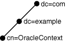

## 8 Configuring Naming Methods

Find out how to configure connectivity information for client connections to the database server.

- Configuring the Easy Connect Naming Method
  The Easy Connect naming method eliminates the need for service name lookup in `tnsnames.ora` files for TCP/IP environments. In fact, no naming or directory system is required when using this method.
- Configuring the Local Naming Method
  The local naming method adds network service names to the `tnsnames.ora` file. Each network service name maps to a connect descriptor.
- Configuring the Directory Naming Method
  With this naming method, connect identifiers are mapped to connect descriptors contained in an LDAP-compliant directory server, such as Oracle Internet Directory or Microsoft Active Directory.
- Configuring External Naming Methods

**Related Topics**

- [Understanding Naming Methods](identifying-and-accessing-database.md)

**Parent topic:** [Configuration and Administration of Oracle Net Services](part-II-config-and-admin-of-oracle-net-services.md)

### 8.1 Configuring the Easy Connect Naming Method

The Easy Connect naming method eliminates the need for service name lookup in `tnsnames.ora` files for TCP/IP environments. In fact, no naming or directory system is required when using this method.

- Understanding the Easy Connect Naming Method
  The Easy Connect naming method provides out-of-the-box TCP/IP connectivity to databases.
- Support for Easy Connect Plus
  Starting with Oracle Database 19c, the Easy Connect syntax that applications use to connect to Oracle Database supports an enhanced functionality known as Easy Connect Plus.
- Examples of Easy Connect Naming Method
  Examples show Easy Connect Naming syntax and how each string converts into a connect descriptor.
- Configuring Easy Connect Naming on the Client
  Learn about the required conditions and configuration tasks that clients need to ensure before using the Easy Connect naming method.
- Configuring Easy Connect Naming to Use a DNS Alias
  You can optionally configure a DNS alias for the host name, as provided with the host naming method.

**Parent topic:** Configuring Naming Methods

#### 8.1.1 Understanding the Easy Connect Naming Method

The Easy Connect naming method provides out-of-the-box TCP/IP connectivity to databases.

##### Overview

This naming method extends the functionality of the host naming method by enabling clients to connect to a database server with an optional port and service name in addition to the host name of the database:

    CONNECT username@[//]host[:port][/[service_name][:server_type][/instance_name]]
    Enter password: password

The connect identifier converts to the following connect descriptor:

    (DESCRIPTION=
      (ADDRESS=(PROTOCOL=tcp)(HOST=host)(PORT=port))
      (CONNECT_DATA=
        (SERVICE_NAME=service_name)
        (SERVER=server_type)
        (INSTANCE_NAME=instance_name))
    )

If the Oracle Database server installation was performed in Typical mode, then the default service name used by the Oracle instance is the database name, and the following Easy Connect syntax can be used to connect to that instance:

    SQLPLUS /nolog
    SQL> CONNECT username@host/db_name
    SQL> Enter password: password

##### Easy Connect Syntax Examples

The connect strings in the following example connect the client to database service `sales.us.example.com` with a listening endpoint of 1521 on database server `sales-server`:

    CONNECT scott@sales-server:1521/sales.us.example.com
    CONNECT scott@//sales-server/sales.us.example.com
    CONNECT scott@//sales-server.us.example.com/sales.us.example.com

After each of the connect strings, you must enter a password to connect to the database service.

These connect strings convert into the following connect descriptor:

    (DESCRIPTION=
      (ADDRESS=(PROTOCOL=tcp)(HOST=sales-server)(PORT=1521))
      (CONNECT_DATA=
        (SERVICE_NAME=sales.us.example.com)))

##### Connect Identifier for Easy Connect Naming

This is a list of the Easy Connect syntax elements and descriptions for each:

| Syntax Element  | Description                                                                                                                                                                                                                                                                                                                                                                                                                                                                                                             |
|:----------------|:------------------------------------------------------------------------------------------------------------------------------------------------------------------------------------------------------------------------------------------------------------------------------------------------------------------------------------------------------------------------------------------------------------------------------------------------------------------------------------------------------------------------|
| `//`            | Use `//` to specify a URL or JDBC connection. Required for URL or JDBC connections. The connect identifier must be preceded by a double-slash (`//`). For example: `scott@//sales-server` `Enter password: password` Optional for SQL connections. The connect identifier can preceded by a double-slash (`//`). For example, the following connect strings are semantically equivalent: `SQL> CONNECT scott@sales-server` `SQL> CONNECT scott@//sales-server`                                        |
| `host`          | Required. Specify the host name or IP address of the database host computer. The host name is domain-qualified if the local operating system configuration specifies a domain. You may use an IPv4 or IPv6 address as a value. IPv6 addresses or host names that resolve to IPv6 addresses must be enclosed in square brackets, as in `[2001:0db8:0:0::200C:417A]` and `[salesdb]`.                                                                                                                               |
| `port`          | Optional. Specify the listening port. The default is 1521.                                                                                                                                                                                                                                                                                                                                                                                                                                                           |
| `service_name`  | Optional. Specify the service name of the database. If a user specifies a service name, then the listener connects the user to that specific database. Otherwise, the listener connects to the database specified by the `DEFAULT_SERVICE_``listener_name` parameter in the `listener.ora` file. If `DEFAULT_SERVICE_``listener_name` is not configured for the listener and a service name is not explicitly specified by the user as part of the Easy Connect syntax, then the listener returns an error.          |
| `server_type`   | Optional. Specify the database server type to use. This parameter instructs the listener to connect the client to a specific type of service handler. The values for the `server_type` parameter are `dedicated`, `shared`, and `pooled`. If server is not specified in the Easy Connect syntax, then the type of server is chosen by the listener (shared server if configured, otherwise a dedicated server is used). Note: In Oracle Call Interface documentation, server is referred to as `connect_type`. |
| `instance_name` | Optional. Identify the database instance to access. The instance name can be obtained from the `INSTANCE_NAME` parameter in the initialization parameter file.                                                                                                                                                                                                                                                                                                                                                       |

**Related Topics**

- [DEFAULT_SERVICE_listener_name](../netrf/oracle-net-listener-parameters-in-listener-ora.md)
- [INSTANCE_NAME](../netrf/local-naming-parameters-in-tns-ora-file.md)

**Parent topic:** Configuring the Easy Connect Naming Method

#### 8.1.2 Support for Easy Connect Plus

Starting with Oracle Database 19c, the Easy Connect syntax that applications use to connect to Oracle Database supports an enhanced functionality known as Easy Connect Plus.

The Easy Connect Plus feature simplifies Oracle Database application configuration and deployment for common use cases. With Easy Connect Plus, you do not need to configure Oracle Net parameter files, such as `tnsnames.ora` and `sqlnet.ora`. You also do not need to set the `TNS_ADMIN` environment variable.

With this enhancement, Easy Connect supports both the TCP and TCPS protocols (earlier, it supported only the TCP transport protocol). This simplifies the client configurations to Oracle Database Cloud Services that mandate TCPS connections for network security.

The enhanced Easy Connect syntax, using the Easy Connect Plus feature, is as follows:

    [[protocol:]//]host1{,host12}[:port1]{,host2:port2}[/[service_name][:server][/instance_name]][?parameter_name=value{&parameter_name=value}]

The question mark (?) indicates the start of name-value pairs and the ampersand (&) is the delimiter between the name-value pairs.

Support for specifying protocol: Easy Connect adapter supports specification of protocol as part of the connect string. This protocol is applicable to each host in the connect string.

Multihost or port support: Easy Connect adapter can now accept multiple hosts or ports in the connect string. This helps in load-balancing the client connections.

Name-Value pairs: Easy Connect adapter can now accept a list of name value pairs. Each name-value pair will be added as a `DESCRIPTION` level parameter.

The following names are supported:

- `ENABLE`
- `FAILOVER`
- `LOAD_BALANCE`
- `RECV_BUF_SIZE`
- `SEND_BUF_SIZE`
- `SDU`
- `SOURCE_ROUTE`
- `RETRY_COUNT`
- `RETRY_DELAY`
- `CONNECT_TIMEOUT`
- `TRANSPORT_CONNECT_TIMEOUT`

For example, the following syntax to specify the Session Data Unit (SDU)

`salesserver1:1521/sales.us.example.com?sdu=16384`

translates to the following connect descriptor:

    (DESCRIPTION=
      (SDU=16384)
      (ADDRESS=(PROTOCOL=tcp)(HOST=saleserver1)(PORT=1521))
      (CONNECT_DATA=(SERVICE_NAME=sales.us.example.com)))

Similarly, the following syntax to specify connect timeout, transport connect timeout, and retry count values

`salesserver1:1521/sales.us.example.com?connect_timeout=1min&transport_connect_timeout=30sec&retry_count=3`

translates to the following connect descriptor:

    (DESCRIPTION=
       (retry_count=3)
       (connect_timeout=1min)(transport_connect_timeout=30sec)
       (ADDRESS=(PROTOCOL=tcp)(HOST=salesserver1)(PORT=1521))
       (CONNECT_DATA=(SERVICE_NAME=sales.us.example.com)))

Security attributes: The following `SECURITY` attributes are supported for TLS:

- `SSL_SERVER_DN_MATCH=``on/off`
- `SSL_SERVER_CERT_DN=``longDN`
- `WALLET_LOCATION=``Wallet location`

**Parent topic:** Configuring the Easy Connect Naming Method

#### 8.1.3 Examples of Easy Connect Naming Method

Examples show Easy Connect Naming syntax and how each string converts into a connect descriptor.

Table 8-1 Examples of Easy Connect Naming

| Naming Option                                                                                                                                                                                                                                           | Connect String                                                                                                                        | Connect Descriptor                                                                                                                                                                                                                                                      |
|:--------------------------------------------------------------------------------------------------------------------------------------------------------------------------------------------------------------------------------------------------------|:--------------------------------------------------------------------------------------------------------------------------------------|:------------------------------------------------------------------------------------------------------------------------------------------------------------------------------------------------------------------------------------------------------------------------|
| Easy Connect string with host. The host name is `sales-server`.                                                                                                                                                                                      | `sales-server`                                                                                                                        | `(DESCRIPTION=` `   (CONNECT_DATA=` `       (SERVICE_NAME=))` `   (ADDRESS=` `       (PROTOCOL=TCP)` `       (HOST=sales-server)` `       (PORT=1521)))`                                                                                              |
| Easy Connect string with host and port. The host name is `sales-server`, and the port is `3456`.                                                                                                                                                     | `sales-server:3456`                                                                                                                   | `(DESCRIPTION=` `   (CONNECT_DATA=` `       (SERVICE_NAME=))` `   (ADDRESS=` `       (PROTOCOL=TCP)` `       (HOST=sales-server)` `       (PORT=3456)))`                                                                                              |
| Easy Connect string with host and service name. The host name is `sales-server` and the service name is `sales`.                                                                                                                                     | `sales-server/sales`                                                                                                                  | `(DESCRIPTION=` `  (CONNECT_DATA=` `     (SERVICE_NAME=sales))` `  (ADDRESS=` `     (PROTOCOL=TCP)` `     (HOST=sales-server)` `     (PORT=1521)))`                                                                                                   |
| Easy Connect string with IPv6 address. The IPv6 address of the host is `2001:0db8:0:0::200C:417A`, the port is `80`, and the service name is `sales`.                                                                                                | `[2001:0db8:0:0::200C:417A]:80/sales` Square brackets are required around IPv6 host names.                                         | `(DESCRIPTION=` `  (CONNECT_DATA=` `      (SERVICE_NAME=sales)` `  (ADDRESS=` `      (PROTOCOL=TCP)` `      (HOST=2001:0db8:0:0::200C:417A)` `      (PORT=80)))`                                                                                      |
| Easy Connect string with IPv6 host address. The host is `sales-server`, the port is `80`, and the service name is `sales`.                                                                                                                           | `sales-server:80/sales`                                                                                                               | `(DESCRIPTION=` `  (CONNECT_DATA=` `      (SERVICE_NAME=sales)` `  (ADDRESS=` `      (PROTOCOL=TCP)` `      (HOST=sales-server)` `      (PORT=80)))`                                                                                                  |
| Easy Connect string with host, service name, and server. The host name is `sales-server`, the service name is `sales`, the server is `dedicated`, and the instance name is `inst1`                                                                   | `sales-server/sales:dedicated/inst1`                                                                                                  | `(DESCRIPTION=` `  (CONNECT_DATA=` `      (SERVICE_NAME=sales)` `      (INSTANCE_NAME=inst1)` `      (SERVER=dedicated))` `  (ADDRESS=` `      (PROTOCOL=TCP)` `      (HOST=sales-server)` `      (PORT=1521)))`                                |
| Easy Connect with host and instance name. The host name is `sales-server` and the instance name is `inst1`.                                                                                                                                          | `sales-server//inst1`                                                                                                                 | `(DESCRIPTION=` `   (CONNECT_DATA=` `      (SERVICE_NAME=)` `      (INSTANCE_NAME=inst1))` `   (ADDRESS=` `      (PROTOCOL=TCP)` `      (HOST=sales-server)` `      (PORT=1521)))`                                                                 |
| Note: The Easy Connect Plus feature supports this naming option. Easy Connect adaptor with a list of name value pairs. `SDU`, `RETRY_COUNT`, `CONNECT_TIMEOUT` The host is `salesserver`, the port is `1521`, and the service name is `sales`. | `salesserver1:1521/sales?SDU=8128&retry_count=3&connect_timeout=10`                                                                   | `(DESCRIPTION=` `(SDU=8128)(retry_count=3)(connect_timeout=10)` `(ADDRESS=(PROTOCOL=tcp)(HOST=saleserver1)(PORT=1521)) (CONNECT_DATA=(SERVICE_NAME=sales)))`                                                                                                      |
| Note: The Easy Connect Plus feature supports this naming option. Easy Connect adapter with multiple hosts or ports in the connect string The host is `salesserver`, the port is `1521`, and the service name is `sales`.                          | `salesserver1:1521,salesserver2,salesserver3:1522/sales`                                                                              | `((DESCRIPTION=(LOAD_BALANCE=ON)` ` (ADDRESS=(PROTOCOL=tcp)(HOST=sales-server1)(PORT=1521))` ` (ADDRESS=(PROTOCOL=tcp)(HOST=sales-server2)(PORT=1522))` ` (ADDRESS=(PROTOCOL=tcp)(HOST=sales-server3)(PORT=1522)))` ` (CONNECT_DATA=(SERVICE_NAME=sales)))` |
| Note: The Easy Connect Plus feature supports this naming option. Easy Connect adapter with specification of protocol as part of the connect string. The host is `salesserver`, the port is `1521`, and the service name is `sales`.               | `tcps://salesserver1:1521/sales`                                                                                                      | `(DESCRIPTION=` `(ADDRESS=(PROTOCOL=tcps)(HOST=salesserver1)(PORT=1521))` `(SECURITY=(SSL_SERVER_DN_MATCH=TRUE))` `(CONNECT_DATA=(SERVICE_NAME=sales)))`                                                                                                       |
| Note: The Easy Connect Plus feature supports this naming option. The following SECURITY attributes are supported for TLS The host is `sales-server`, the port is `1521`, and the service name is `sales`.                                         | `tcps://sales-server:1521/sales?ssl_server_cert_dn="cn=sales,cn=OracleContext,dc=us,dc=example,dc=com"&wallet_location="/tmp/oracle"` | `(DESCRIPTION= (ADDRESS=(PROTOCOL=tcps)(HOST=salesserver)(PORT=1521)) (CONNECT_DATA=(SERVICE_NAME=sales))(SECURITY=(SSL_SERVER_DN_MATCH=TRUE)(SSL_SERVER_CERT_DN=cn=sales,cn=OracleContext,dc=us,dc=example,dc=com)(WALLET_LOCATION=/tmp/oracle)))`                     |

**Related Topics**

- [About TCP/IP Protocol](understanding-communication-layers.md)
- [Configuring Listening Protocol Addresses](configuring-and-administering-oracle-net-listener.md)
- [Using Oracle Connection Manager as a Bridge for IPv4 and IPv6](configuring-oracle-connection-manager.md)

**Parent topic:** Configuring the Easy Connect Naming Method

#### 8.1.4 Configuring Easy Connect Naming on the Client

Learn about the required conditions and configuration tasks that clients need to ensure before using the Easy Connect naming method.

Clients can connect to Oracle Database using Easy Connect naming if the following conditions are met:

- Oracle Net Services software is installed on the client.

- Oracle TCP/IP protocol is supported on both the client and database server.

- No features require a more advanced connect descriptor.

Easy Connect naming is not suitable for large or complex environments with advanced features, such as [external procedure](glossary.md) calls, or [Heterogeneous Services](glossary.md), that require additional connect information. In these cases, another naming method is recommended.

Easy Connect naming is automatically configured at installation. Before using it, you may want to ensure that `EZCONNECT` is specified by the NAMES.DIRECTORY_PATH parameter in the `sqlnet.ora` file. This parameter specifies the order of naming methods Oracle Net can use to resolve connect identifiers to connect descriptors.

**Note:**

Starting with Oracle Database 19c Release 2 (19.2), for connections with protocol set to TCPS, `SSL_SERVER_DN_MATCH` is set to `ON` by default when using easy connect. If `SSL_SERVER_CERT_DN` is not set, then a partial DN match done in the following order, should succeed for the client to establish a connection to the server.

1.  The host name in the connect string is matched with the host name in the server certificate.
2.  The service name in the connect string is matched with the service name in the server certificate.

If `SSL_SERVER_CERT_DN` is set, then a full DN match should succeed for the client to establish a connection to the server.

The following procedure describes how to verify that the Easy Connect naming method is configured:

1.  Start Oracle Net Manager.

2.  In the navigator pane, expand Local, and then select Profile.

3.  From the list in the right pane, select Naming.

4.  Click the Methods tab.

    Verify that `EZCONNECT` is listed in the Selected Methods list. If it is not, then proceed to Step 5. If it is listed, then proceed to Step 7.

5.  From the Available Methods list, select EZCONNECT, and then click the right-arrow button.

6.  In the Selected Methods list, select EZCONNECT, and then use the Promote button to move the selection to the top of the list.

7.  Select Save Network Configuration from the File menu.

    The `sqlnet.ora` file updates the NAMES.DIRECTORY_PATH parameter, listing `hostname` first:

        NAMES.DIRECTORY_PATH=(ezconnect, tnsnames)

**Related Topics**

- [Using Oracle Net Manager to Configure Oracle Net Services](managing-oracle-net-services.md)

**Parent topic:** Configuring the Easy Connect Naming Method

#### 8.1.5 Configuring Easy Connect Naming to Use a DNS Alias

You can optionally configure a DNS alias for the host name, as provided with the host naming method.

With host naming, clients use a connect string that uses the following pattern:

    CONNECT username@DNS_alias
    Enter password: password

The following procedure describes how to configure a DNS alias:

1.  Ensure the database service is registered with the listener.

    If the database can find the listener, then information about the database service is dynamically registered with the listener during [service registration](glossary.md), including the service name. The listener is found if the following conditions are met:

    - The default listener named `LISTENER` on TCP/IP, port 1521 is running.

    - The LOCAL_LISTENER parameter is set in the initialization file.

    If the database cannot find the listener, then you can configure static registration for the listener.

2.  Establish a host name resolution environment.

    You can configure a mechanism such as DNS, NIS, or a centrally-maintained TCP/IP host file, `/etc/hosts`. For example, if a service name of `sales.us.example.com` for a database exists on a computer named `sales-server`, then the entry in the `/etc/hosts` file would look like the following:

        #IP address of server     host name       alias
        192.0.2.35              sales-server    sales.us.example.com

    The domain section of the service name must match the network domain.

3.  Connect to the database using the DNS alias.

    Using the example in the previous step, the client can use `sales.example.com` in the connect string:

        CONNECT username@sales.us.example.com
        Enter password: password

    If the client and server are in the same domain such as `us.example.com`, then the client must enter only `sales` in the connect string.

**Related Topics**

- [Configuring Static Service Information for the Listener](enabling-advanced-features.md)

**Parent topic:** Configuring the Easy Connect Naming Method

### 8.2 Configuring the Local Naming Method

The local naming method adds network service names to the `tnsnames.ora` file. Each network service name maps to a connect descriptor.

The following example shows the network service name `sales` mapped to the connect descriptor contained in `DESCRIPTION`. The `DESCRIPTION` section contains the protocol address and identifies the destination database service. In this example, the protocol is TCP/IP and the port is 1521.

Example 8-1 Connector Descriptor with Host Name

    sales=
    (DESCRIPTION=
      (ADDRESS=(PROTOCOL=tcp)(HOST=sales-server)(PORT=1521))
      (CONNECT_DATA=
         (SERVICE_NAME=sales.us.example.com)))

The following example shows a valid `tnsnames.ora` entry to connect to a host identified with an IPv6 address and a port number of 1522.

Example 8-2 Connect Descriptor with IPv6 Address

    salesdb =
      ( DESCRIPTION =
        ( ADDRESS=(PROTOCOL=tcp)(HOST=2001:0db8:1:1::200C:417A)(PORT=1522) )
        ( CONNECT_DATA =
            (SERVICE_NAME=sales.example.com) )
      )

You can configure local naming during or after installation, as described in the following sections:

- Configuring the tnsnames.ora File During Installation
- Configuring the tnsnames.ora File After Installation
  You can add network service names to the `tnsnames.ora` file at any time after installation.

**Related Topics**

- [IPv6 Network Connectivity](understanding-communication-layers.md)

**Parent topic:** Configuring Naming Methods

#### 8.2.1 Configuring the tnsnames.ora File During Installation

[Oracle Net Configuration Assistant](glossary.md) enables you to configure network service names for clients. Oracle Universal Installer launches Oracle Net Configuration Assistant after software installation. The configuration varies depending on the installation mode.

- Administrator or runtime installation: Oracle Net Configuration Assistant prompts you to configure network service names in the `tnsnames.ora` file to connect to an Oracle Database service.

- Custom installation: Oracle Net Configuration Assistant prompts you to select naming methods to use. If local is selected, then Oracle Net Configuration Assistant prompts you to configure network service names in the `tnsnames.ora` file to connect to an Oracle Database service.

**Parent topic:** Configuring the Local Naming Method

#### 8.2.2 Configuring the tnsnames.ora File After Installation

You can add network service names to the `tnsnames.ora` file at any time after installation.

To configure the local naming method, perform the following tasks:

- Task 1, "Configure Net Services Names"

- Task 2, "Configure Local Naming as the First Naming Method"

- Task 3, "Copy the Configuration to the Other Clients"

- Task 4, "Configure the Listener"

- Task 5, "Connect to the Database"

**Note:**

The underlying network connection must be operational before attempting to configure connectivity with Oracle Net.

Task 1   Configure Net Services Names
To configure the network services names, use one of the following methods:

- Net Services Names Configuration using Oracle Enterprise Manager Cloud Control

- Net Services Names Configuration using Oracle Net Manager

- Net Services Names Configuration using Oracle Net Configuration Assistant

Each method provides similar functionality. However, Oracle Net Manager has more configuration options for the `sqlnet.ora` file.

- Net Services Names Configuration using Oracle Enterprise Manager Cloud Control

  The following procedure describes how to configure network service names in the `tnsnames.ora` file with Oracle Enterprise Manager Cloud Control:

  1.  Access the Net Services Administration page in Oracle Enterprise Manager Cloud Control.

      **See Also:**

      "[Accessing the Net Services Administration Page](managing-oracle-net-services.md)"

  2.  Select Local Naming from the Administer list, and then select the Oracle home that contains the location of the configuration files.

  3.  The Local Naming page appears. You may be prompted to log in to the database server.

  4.  Click Create Like.

      The Create Net Service Name page appears.

  5.  Enter a name in the Net Service Name field.

      You can qualify the network service name with the client's domain. The network service name is automatically domain qualified if the s`qlnet.ora` file parameter NAMES.DEFAULT_DOMAIN is set.

      **See Also:**

      "[About the Default Domain for Clients](configuring-profiles.md)"

  6.  In the Database Information section, configure service support as follows:

      1.  Enter a destination service name.

          **See Also:**

          "[About Connect Descriptors](identifying-and-accessing-database.md)" for additional information about the service name string to use

      2.  Select a database connection type.

          The default setting of Database Default is recommended for the connection type. If [dedicated server](glossary.md) is configured in the initialization parameter file, then you can select Dedicated Server to force the listener to spawn a dedicated server, bypassing shared server configuration. If shared server is configured in the initialization parameter file and you want to guarantee the connection always uses shared server, then select Shared Server.

          **See Also:**

          "[Configuring a Shared Server Architecture](configuring-shared-server-architecture.md) " for additional information about shared server configuration

  7.  In the Addresses section, configure protocol support, as follows:

      1.  Click Add.

          The Add Address page appears.

      2.  From the Protocol list, select the protocol on which the listener is configured to listen. This protocol must also be installed on the client.

      3.  Enter the appropriate parameter information for the selected protocol in the fields provided.

          **See Also:**

          [Oracle Database Net Services Reference](../netrf/protocol-address-configuration.md) for additional information about protocol parameter settings

      4.  (Optional) In the Advanced Parameters section, specify the I/O buffer space limit for send and receive operations of sessions in the Total Send Buffer Size and Total Receive Buffer Size fields.

          **See Also:**

          "[Configuring I/O Buffer Space](optimizing-performance.md) " for additional information about buffer space

      5.  Click OK.

          The protocol address is added to the Addresses section.

  8.  Click OK to add the network service name.

      The network service name is added to the Local Naming page.

  9.  Select connect-time failover and client load balancing option for the addresses.

  10. Click OK.

  **See Also:**

  - "[Creating a List of Listener Protocol Addresses](enabling-advanced-features.md)" to configure multiple protocol addresses

  - "[About the Advanced Connect Data Parameters](enabling-advanced-features.md)" to configure additional CONNECT_DATA options

- Net Services Names Configuration using Oracle Net Manager

  The following procedure describes how to configure network service names in the `tnsnames.ora` file with Oracle Net Manager:

  1.  Start Oracle Net Manager.

      **See Also:**

      "[Using Oracle Net Manager to Configure Oracle Net Services](managing-oracle-net-services.md)"

  2.  In the navigator pane, select Service Naming from Local.

  3.  Click the plus sign (+) from the toolbar, or select Create from the Edit menu.

      The Welcome page of the Net Service Name wizard appears.

  4.  Enter a name in the Net Service Name field.

      You can qualify the network service name with the client's domain. The network service name is automatically domain qualified if the s`qlnet.ora` file parameter NAMES.DEFAULT_DOMAIN is set.

      **See Also:**

      "[About the Default Domain for Clients](configuring-profiles.md)"

  5.  Click Next.

      The Protocol page appears.

  6.  Select the protocol on which the listener is configured to listen. The protocol must also be installed on the client.

  7.  Click Next.

      The Protocol Settings page appears.

  8.  Enter the appropriate parameter information for the selected protocol in the fields provided.

      **See Also:**

      [Oracle Database Net Services Reference](../netrf/protocol-address-configuration.md) for additional information about protocol parameter settings

  9.  Click Next.

      The Service page appears.

  10. Enter a destination service name, and optionally, select a database connection type.

      Oracle recommends that you use the default setting of Database Default for the connection type. If dedicated server is configured in the initialization parameter file, then you can select Dedicated Server to force the listener to spawn a dedicated server, bypassing shared server configuration. If shared server is configured in the initialization parameter file and you want to guarantee the connection always uses shared server, then select Shared Server.

      **See Also:**

      - [Configuring a Shared Server Architecture](configuring-shared-server-architecture.md) for additional information about shared server configuration

      - "[About Connect Descriptors](identifying-and-accessing-database.md)" for additional information about the service name string to use

  11. Click Next.

      The Test page appears.

  12. Click Test to verify that the network service name works, or click Finish to dismiss the Net Service Name wizard.

      If you click Test, then Oracle Net connects to the database server by using the connect descriptor information you configured. Therefore, the listener and database must be running for a successful test. If they are not, then see "[Starting Oracle Net Listener and the Oracle Database Server](quick-start-oracle-net-services.md)" to start components before testing. During testing, a Connection Test dialog box appears, providing status and test results. A successful test results in the following message:

          The connection test was successful.

      If the test was successful, then click Close to close the Connect Test dialog box, and proceed to Step 13.

      If the test was not successful, then do the following:

      1.  Ensure that the database and listener are running, and then click Test.

      2.  Click Change Login to change the user name and password for the connection, and then click Test.

  13. Click Finish to close the Net Service Name wizard.

  14. Select Save Network Configuration from the File menu.

      **See Also:**

      - "[Creating a List of Listener Protocol Addresses](enabling-advanced-features.md)" to configure multiple protocol addresses

      - "[About the Advanced Connect Data Parameters](enabling-advanced-features.md)" to configure additional CONNECT_DATA options

- Net Services Names Configuration using Oracle Net Configuration Assistant

  The following procedure describes how to configure network service names in the `tnsnames.ora` file with Oracle Net Configuration Assistant:

  1.  Start Oracle Net Configuration Assistant.

      **See Also:**

      "[Using Oracle Net Configuration Assistant to Configure Network Components](managing-oracle-net-services.md)"

      The Welcome page appears.

  2.  Select Local Net Service Name Configuration, and then click Next.

      The Net Service Name Configuration page appears.

  3.  Click Add, and then click Next.

      The Service Name Configuration page appears.

  4.  Enter a service name in the Service Name field.

  5.  Click Next.

  6.  Follow the prompts in the wizard and online help to complete network service name creation.

Task 2   Configure Local Naming as the First Naming Method
Configure local naming as the first method specified in the NAMES.DIRECTORY_PATH parameter in the `sqlnet.ora` file. This parameter specifies the order of naming methods Oracle Net uses to resolve connect identifiers to connect descriptors.

To configure the local naming method as the first naming method, use one of the following methods:

- Local Naming Configuration using Oracle Enterprise Manager Cloud Control

- Local Naming Configuration using Oracle Net Manager

Each method provides the same functionality.

Local Naming Configuration using Oracle Enterprise Manager Cloud Control

The following procedure describes how to specify local naming as the first naming method using Oracle Enterprise Manager Cloud Control:

1.  Access the Net Services Administration page in Oracle Enterprise Manager Cloud Control.

    **See Also:**

    "[Accessing the Net Services Administration Page](managing-oracle-net-services.md)"

2.  Select Network Profile from the Administer list.

3.  Click Go.

4.  Select Naming Methods.

5.  Select TNSNAMES from the Available Methods list.

6.  Click Move to move the selection to the Selected Methods list.

7.  Use the Promote button to move TNSNAMES to the top of the list.

8.  Click OK.

Local Naming Configuration using Oracle Net Manager

The following procedure describes how to specify local naming as the first naming method using Oracle Net Manager:

1.  Start Oracle Net Manager.

    **See Also:**

    "[Using Oracle Net Manager to Configure Oracle Net Services](managing-oracle-net-services.md)"

2.  In the navigator pane, select Profile from the Local menu.

3.  From the list in the right pane, select Naming.

4.  Click the Methods tab.

5.  From the Available Methods list, select TNSNAMES, and then click the right-arrow button.

6.  From the Selected Methods list, select TNSNAMES, and then use the Promote button to move the selection to the top of the list.

7.  Choose Save Network Configuration from the File menu.

    The `sqlnet.ora` file updates with the NAMES.DIRECTORY_PATH parameter, listing `tnsnames` first:

        NAMES.DIRECTORY_PATH=(tnsnames, EZCONNECT)

Task 3   Copy the Configuration to the Other Clients
After one client is configured, copy the `tnsnames.ora` and `sqlnet.ora` configuration files to the same location on the other clients. This ensures that the files are consistent. Alternatively, you can use Oracle Net Assistant on every client.

Task 4   Configure the Listener
Ensure that the listener located on the server is configured to listen on the same protocol address configured for the network service name. By default, the listener is configured for the TCP/IP protocol on port 1521.

**See Also:**

[Configuring and Administering Oracle Net Listener](configuring-and-administering-oracle-net-listener.md) for listener configuration details

Task 5   Connect to the Database
Clients can connect to the database using the following syntax:

    CONNECT username@net_service_name

**Parent topic:** Configuring the Local Naming Method

### 8.3 Configuring the Directory Naming Method

With this naming method, connect identifiers are mapped to connect descriptors contained in an LDAP-compliant directory server, such as Oracle Internet Directory or Microsoft Active Directory.

A directory provides central administration of database services and network service names, making it easier to add or relocate services.

- Configure Net Service Name, Database Service, and Alias Entries
  You can use Oracle Enterprise Manager Cloud Control and Oracle Net Manager to configure network service names, network service alias entries, and database service entries. Clients can use these entries to connect to the database.
- Create Multiple Default Contexts in a Directory Naming Server
  To enable multiple default contexts, define the `orclCommonContextMap` with a list of associations between a domain and a DN to be used as the default `oracleContext`.
- Export Local Naming Entries to a Directory Naming Server
  If a `tnsnames.ora` file already exists, then you can export the network service names stored in that file to a directory server. These tasks assume the directory server has been installed and is running.
- Export Directory Naming Entries to the tnsnames.ora file
  After you create the directory naming entries, consider exporting the entries to a local `tnsnames.ora` file and distributing that file to clients. Clients can use the locally saved file when the directory server is temporarily unavailable.

**Parent topic:** Configuring Naming Methods

#### 8.3.1 Configure Net Service Name, Database Service, and Alias Entries

You can use Oracle Enterprise Manager Cloud Control and Oracle Net Manager to configure network service names, network service alias entries, and database service entries. Clients can use these entries to connect to the database.

1.  Verify Directory Compatibility:
    On the computer from which you plan to create network service names, do the following verification steps:

    1.  Ensure the computer has the latest release of Oracle Net Services software. The release information is located in the About Net Manager option on the help menu.
    2.  Run Oracle Internet Directory Configuration Assistant to verify directory server, Oracle Context, and Oracle schema releases.
2.  Create Net Service Names in the Directory:
    You can configure clients to use a network service name rather than the database service entry.

    **Note:**

    - Only users that are members of either the `OracleNetAdmins` or `OracleContextAdmins` group can create network service name entries in a directory. To add or remove users from the `OracleNetAdmins` group, see [Who Can Add or Modify Entries in the Directory Server](managing-network-address-information.md).

    - You can export existing network service names from a `tnsnames.ora` file. See Exporting Local Naming Entries to a Directory Naming Server.

    1.  Access the Net Services Administration page in Oracle Enterprise Manager Cloud Control. See [Accessing the Net Services Administration Page](managing-oracle-net-services.md).
    2.  Select Directory Naming from the Administer list, and then select the Oracle home that contains the location of the directory server.
    3.  Click Go.
        The Directory Naming page appears.
    4.  Click the Net Service Names tab.
    5.  In the Results section, click Create.
        The Create Net Service Name page with the General tab appears.
    6.  Enter a name in the Net Service Name field.
    7.  In the Database Information section, configure service support, as follows:
        1.  Enter a destination service name. See [About Connect Descriptors](identifying-and-accessing-database.md).

        2.  Select a database connection type. Oracle recommends that you use the Database Default for the connection type. If a shared server is configured in the initialization parameter file, then the following options are available:

            - Select Dedicated Server to force the listener to spawn a dedicated server, and bypass shared server configuration.

            - Select Shared Server to guarantee the connection always uses shared server.

            See [Configuring a Shared Server Architecture](configuring-shared-server-architecture.md).
    8.  In the Addresses section, configure protocol support:
        1.  Click Add.

            The Add Address page appears.

        2.  From the Protocol list, select the protocol that the listener is configured to listen. This protocol must also be installed on the client.

        3.  Enter the appropriate parameter information for the selected protocol in the fields provided.

            See [Oracle Database Net Services Reference](../netrf/protocol-address-configuration.md).

        4.  (Optional) In the Advanced Parameters section, specify the I/O buffer space limit for send and receive operations of sessions in the Total Send Buffer Size and Total Receive Buffer Size fields. See [Configuring I/O Buffer Space](optimizing-performance.md).

        5.  Click OK.

            The protocol address is added to the Addresses section.
    9.  Click OK to add the network service name.
        The network service name is added to the Results section of the Net Service Names tab.

        See [Creating a List of Listener Protocol Addresses](enabling-advanced-features.md) to configure multiple protocol addresses. See [About the Advanced Connect Data Parameters](enabling-advanced-features.md) to configure additional `CONNECT_DATA` options.
3.  Create or Modify Connectivity Information for Database Service Entries:
    A database service entry is created during installation. When database registration with the directory naming completes, a database service entry is created in the directory. By default, this entry contains network route information with the location of the listener through a protocol address. You can re-create this information or modify the existing network route information.

    **Note:**

    Only users that are members of the `OracleNetAdmins` or `OracleContextAdmins` group can modify network information for a database service in a directory. To add or remove users from these groups, see [Who Can Add or Modify Entries in the Directory Server](managing-network-address-information.md).

    1.  Access the Net Services Administration page in Oracle Enterprise Manager Cloud Control. See [Accessing the Net Services Administration Page](managing-oracle-net-services.md).
    2.  Select Directory Naming from the Administer list, and then select the Oracle home that contains the location of the directory server.
    3.  Click Go. You may be prompted to log in to the database server and the directory server.
        The Directory Naming page appears.
    4.  Click the Database Services tab.
    5.  In the Simple Search section, select Oracle Context and search criteria to see the network service names for Oracle Context.
        The database service names display in the Results section.
    6.  In the Results section, select a database service, and then click Edit.
4.  Create Net Services Aliases:
    Net service aliases in a directory server enable clients to refer to a database service or a network service name by an alternative name. For example, a network service alias of `salesalias` can be created for a network service name of `sales`. When `salesalias` is used to connect to a database, as in `CONNECT scott@salesalias`, it resolves to and use the connect descriptor information for `sales`.

    There are two main uses of network service aliases:

    - Use a network service alias as a way for clients to refer to a database service or network service name by another name.

    - Use a network service alias in one Oracle Context for a database service or network service name in a different Oracle Context. This enables a database service or network service name to be defined once in the directory server, and referred to by clients that use other Oracle Contexts. See [Understanding Net Service Alias Entries](managing-network-address-information.md) for an overview of network service aliases.

    **Note:**

    - Only users that are members of either the `OracleNetAdmins` or `OracleContextAdmins` group can create or modify network service alias entries in a directory. To add or remove users from the `OracleNetAdmins` group, see [Who Can Add or Modify Entries in the Directory Server](managing-network-address-information.md).

    - Net service aliases are not supported by Microsoft Active Directory.

    - Ensure the `NLS_LANG` environment variable is set for the clients when using network service aliases.

    To create a network service alias, use one of the following methods. Each method provides similar functionality:

    - Network Service Alias Configuration using Oracle Enterprise Manager Cloud Control

      The following procedure describes how to configure a network service alias using Oracle Enterprise Manager Cloud Control:

      1.  Access the Net Services Administration page in Oracle Enterprise Manager Cloud Control. See [Accessing the Net Services Administration Page](managing-oracle-net-services.md).

      2.  Select Directory Naming from the Administer list, and then select the Oracle home that contains the location of the directory server.

      3.  Click Go.

          The Directory Naming page appears.

      4.  Click the Net Service Aliases tab.

      5.  In the Results section, click Create.

          The Create Net Service Alias page appears.

      6.  Enter a name for the alias in the Net Service Alias Name field.

      7.  In the Referenced Service Detail section, enter the following information in the fields:

          - Oracle Context: Select the Oracle Context of the database service or network service name from the list or enter one in the field.

          - Referenced Service Name: Select the DN of the database service or network service name.

      8.  Click OK to add the network service alias.

          The network service alias is added to the Directory Naming page.

    - Network Service Alias Configuration using Oracle Net Manager

      The following procedure describes how to configure a network service alias using Oracle Net Manager:

      1.  Start Oracle Net Manager. See [Using Oracle Net Manager to Configure Oracle Net Services](managing-oracle-net-services.md).

      2.  In the navigator pane, select Service Naming from Directory.

      3.  Select Aliases.

      4.  Select Create from the Edit menu.

      5.  Enter the network service alias in the Net Service Alias field.

      6.  Select Oracle Context and name.

      7.  Click Create.

      8.  Select Save Network Configuration from the File menu.
5.  Configure LDAP as the First Naming Method for Client Lookups:
    Configure directory naming as the first method to be used in the `NAMES.DIRECTORY_PATH` parameter in the `sqlnet.ora` file. This parameter specifies the order of naming methods Oracle Net uses to resolve connect identifiers to connect descriptors.

    To configure LDAP as the first naming method you can use one of the following methods:

    - LDAP Configuration using Oracle Enterprise Manager Cloud Control

      The following procedure describes how to specify directory naming as the first naming method using Oracle Enterprise Manager Cloud Control:

      1.  Access the Net Services Administration page in Oracle Enterprise Manager Cloud Control. See [Accessing the Net Services Administration Page](managing-oracle-net-services.md).

      2.  Select Network Profile from the Administer list.

      3.  Click Go.

      4.  Select Naming Methods.

      5.  Select LDAP from the Available Methods list.

      6.  Click Move to move the selection to the Selected Methods list.

      7.  Use the Promote button to move LDAP to the top of the list.

      8.  Click OK.

    - LDAP Configuration using Oracle Net Manager

      The following procedure describes how to specify directory naming as the first naming method using Oracle Net Manager:

      1.  Start Oracle Net Manager. See [Using Oracle Net Manager to Configure Oracle Net Services](managing-oracle-net-services.md).

      2.  In the navigator pane, select Profile from the Local menu.

      3.  From the list in the right pane, select Naming.

      4.  Click the Methods tab.

      5.  From the Available Methods list, select LDAP, and then click the right-arrow button.

      6.  From the Selected Methods list, select LDAP, and then use the Promote button to move the selection to the top of the list.

      7.  Select Save Network Configuration from the File menu.

          The `sqlnet.ora` file updates with the `NAMES.DIRECTORY_PATH` parameter, listing `ldap` first, such as the following:

              NAMES.DIRECTORY_PATH=(ldap, tnsnames, hostname)
6.  Configure the Listener:
    Ensure that the listener located on the server is configured to listen on the same protocol address configured for the network service name. By default, the listener is configured to listen on the TCP/IP protocol, port 1521. See [Configuring and Administering Oracle Net Listener](configuring-and-administering-oracle-net-listener.md) for listener configuration details.
7.  Connect to the Database:
    Clients that are configured with a default directory entry that matches the directory location of the database service or network service name can connect to the database using the following syntax:

        CONNECT username@connect_identifier

    Clients that are configured with a default directory entry that does not match the entry's directory location must use the entry's distinguished name or its fully-qualified name. See [Understanding the Directory Information Tree](managing-network-address-information.md) for fully-qualified name usage.

**Parent topic:** Configuring the Directory Naming Method

#### 8.3.2 Create Multiple Default Contexts in a Directory Naming Server

To enable multiple default contexts, define the `orclCommonContextMap` with a list of associations between a domain and a DN to be used as the default `oracleContext`.

If you want clients to use discovery in directories which have more than one Oracle Context, then you can define the `orclCommonContextMap` attribute in the base `admin` context. This attribute overrides the `orclDefaultSubscriber` attribute. During name lookup the discovery operation returns both values, and the client decides based on these which Oracle Context to use.

If the `orclCommonContextMap` attribute is not defined, then the `orclDefaultSubscriber` is used as the default. If `orclCommonContextMap` is defined, then the client finds the default Oracle Context which is associated with its DNS domain in the `orclCommonContextMap`.

Here is a sample LDIF file entry:

    $ ldapmodify -v -h sales-server -p 1389 -D cn=orcladmin -q
     dn: cn=Common,cn=Products,cn=OracleContext
     replace: orclCommonContextMap
     orclCommonContextMap:
     (contextMap=
       (domain_map=(domain=us.example.com)(DN="dc=example,dc=com"))
       (domain_map=(domain=uk.example.com)(DN="dc=sales,dc=com"))
      )

You must enter a `contextMap` entry without line breaks.

**Related Topics**

- [Oracle Fusion Middleware Administering Oracle Internet Directory](https://docs.oracle.com/pls/topic/lookup?ctx=en/database/oracle/oracle-database/19/netag&id=OIDAG-GUID-B5EE7E57-2AC3-4841-9E60-BECFDD42B6EE)

**Parent topic:** Configuring the Directory Naming Method

#### 8.3.3 Export Local Naming Entries to a Directory Naming Server

If a `tnsnames.ora` file already exists, then you can export the network service names stored in that file to a directory server. These tasks assume the directory server has been installed and is running.

The export procedure is performed for one domain at a time.

Task 1   Create Structure in the Directory Server
In the directory server, create the directory information tree (DIT) with the structure in which you want to import network service names. Create the structure leading to the top of the Oracle Context.

For example, if the `tnsnames.ora` file supports a domain structure `example.com` and you want to replicate this domain in the directory, then create domain component entries of `dc=com` and `dc=example` in the directory, as shown in the following figure.

Figure 8-1 example.com in Directory Server

[Description of "Figure 8-1 example.com in Directory Server"](img_text/netag123.md)

You can replicate the domain structure you currently use with `tnsnames.ora`, or you can develop an entirely different structure. Introducing an entirely different structure can change the way clients enter the network service name in the connect string. Oracle recommends considering relative and fully-qualified naming issues before changing the structure.

Task 2   Create Oracle Contexts
Create an Oracle Context under each DIT location that you created in Task 1 using Oracle Internet Directory Configuration Assistant. Oracle Context has a relative distinguished name (RDN) of `cn=OracleContext`. Oracle Context stores network object entries, as well as other entries for other Oracle components. In the following figure, `cn=OracleContext` is created under `dc=example,dc=com`.

Figure 8-2 Oracle Context

[Description of "Figure 8-2 Oracle Context"](img_text/netag122.md)

Task 3   Configure Directory Server Usage
If not done as a part of creating Oracle Contexts, then configure the Oracle home for directory server use. The Oracle home you configure should be the one that performs the export.

Task 4   Export Objects to a Directory Server
To export network service names contained in a `tnsnames.ora` file to a directory, use either Oracle Enterprise Manager Cloud Controlr or Oracle Net Manager.

- Export Objects using Oracle Enterprise Manager Cloud Control

  The following procedure describes how to export objects using Oracle Enterprise Manager Cloud Control

  1.  Access the Net Services Administration page in Oracle Enterprise Manager Cloud Control. See [Accessing the Net Services Administration Page](managing-oracle-net-services.md).

  2.  Select Directory Naming from the Administer list, and then select the Oracle home that contains the location of the directory server.

  3.  Click Go.

      The Directory Naming page appears.

  4.  Click the Net Service Names tab.

  5.  In the Related Links section, click Import Net Service Names To Directory Server.

      The Import Net Service Names To Directory Server page appears.

  6.  From the Oracle Context list in the Oracle Internet Directory Server Destination section, select Oracle Context to which you want to export the selected network service names.

  7.  In the Net Service Names to Import section, select the network service names.

  8.  Click Add to add the network service names to the directory.

      The network service name is added to the Directory Naming page.

- Export Objects using Oracle Net Manager

  The following procedure describes how to export objects using Oracle Net Manager:

  1.  Start Oracle Net Manager. See [Using Oracle Net Manager to Configure Oracle Net Services](managing-oracle-net-services.md).

  2.  If the `tnsnames.ora` file you want to export is not loaded in Oracle Net Manager, then select Open Network Configuration from the File menu to select the `tnsnames.ora` file to export to the directory.

  3.  Select Directory from the Command menu, and then select Export Net Service Names.

      The Directory Server Migration wizard starts.

  4.  Click Next.

      If network service names with multiple domain were detected in the `tnsnames.ora` file, then the Select Domain page appears. Continue to Step 5.

      If the network service names are not domain qualified, then the Select Net Service Names page appears. Skip to Step 6.

  5.  Select the network domain whose network service names you want to export, and then click Next.

      The Select Net Service Names page appears.

  6.  Select the network service names from the list to export, and then click Next.

      The Select Destination Context page appears.

  7.  In the Select Destination Context page, do the following:

      1.  From the Directory Naming Context list, select the directory entry that contains the Oracle Context. The directory naming context is part of a directory subtree that contains one or more Oracle Contexts.

      2.  From the Oracle Context list, select the Oracle Context to which you want to export the selected network service names.

      3.  Click Next.

      The Directory Server Update page appears with the status of the export operation.

  8.  Click Finish to close the Directory Server Migration wizard.

**Related Topics**

- [Client Connections Using Directory Naming](managing-network-address-information.md)
- [Managing Network Address Information](managing-network-address-information.md)

**Parent topic:** Configuring the Directory Naming Method

#### 8.3.4 Export Directory Naming Entries to the tnsnames.ora file

After you create the directory naming entries, consider exporting the entries to a local `tnsnames.ora` file and distributing that file to clients. Clients can use the locally saved file when the directory server is temporarily unavailable.

The following procedure describes how to export directory naming entries to a local `tnsnames.ora` file:

1.  Access the Net Services Administration page in Oracle Enterprise Manager Cloud Control.

2.  Select Directory Naming from the Administer list, and then select the Oracle home that contains the location of the directory server.

3.  Click Go.

    The Directory Naming page appears.

4.  Click the Net Service Names tab.

5.  In the Simple Search section, select Oracle Context and search criteria to see the network service names for a particular Oracle Context.

    The network service names display in the Results section.

6.  In the Results section, click Save to tnsnames.ora.

    The Processing: Create tnsnames.ora File page appears, informing you of the creation process.

**Related Topics**

- [Accessing the Net Services Administration Page](managing-oracle-net-services.md)

**Parent topic:** Configuring the Directory Naming Method

### 8.4 Configuring External Naming Methods

External naming refers to the method of resolving a network service name, stored in a third-party naming service, to a network address, such as network information services (NIS). Organizations and corporations using NIS as part of their systems infrastructure have the option to store network service names and addresses in NIS, using NIS external naming.

For example, when a user gives a command with a network service name (`payroll`) such as the following:

       SQLPLUS scott@payroll

NIS external naming on the node running the client program or database server acting as a client program contacts an NIS server located on the network, and passes the network service name to the NIS server. The NIS server resolves the network service name into an Oracle Net address and returns this address to the client program or server. The client program then uses this address to connect to Oracle Database.

An NIS server runs a program called `ypserv`, which handles name requests. The `ypserv` program stores different types of data in special files called [map](glossary.md)s. For example, passwords are stored in a map called `passwd.byname`. Oracle Database service names are stored in a map called `tnsnames`.

When a user uses a connect string, NIS external naming uses an RPC call to contact the `ypserv` program, and passes the Oracle network service name and the name of the map. The `ypserv` program looks in the `tnsnames` map for the name, such as `payroll`, and its address for the network service name. The address is returned to the client, and the client program uses the address to contact the database server.

**Note:**

The NIS external naming method is not available on all platforms. Use the `adapters` command to check availability of NIS external naming on your system. If available, then it is listed under Oracle Net naming methods, as follows:

    $ adapters

    Installed Oracle Net naming methods are:

    Local Naming (tnsnames.ora)
    Oracle Directory Naming
    Oracle Host Naming
    NIS Naming

See Oracle platform-specific documentation for additional information.

This section contains the following tasks:

- Task 1, "Configure NIS Servers to Support NIS External Naming"

- Task 2, "Configure the Clients"

Task 1   Configure NIS Servers to Support NIS External Naming
Before configuring servers to support NIS external naming, ensure that NIS is configured and running on the NIS servers that need to resolve Oracle Database network service names. Consult your NIS documentation for specifics. To complete this task, add the `tnsnames` map to the existing NIS maps, and then verify that the `tnsnames` map has been installed properly.

1.  Create a `tnsnames.ora` file, as specified in "Configuring the Local Naming Method".

    **Note:**

    Keep a copy of the `tnsnames.ora` file, preferably in the `ORACLE_HOME/network/admin` directory. You may need to use this file again later to load network service names into the NIS map.

2.  Convert the contents of the `tnsnames.ora` file to a `tnsnames` map using the `tns2nis` program using a command similar to the following:

        tns2nis tnsnames.ora

    The `tns2nis` program reads the `tnsnames.ora` file from the current directory. If the `tnsnames.ora` file is not located in the current directory, then use a full path name to specify its location, such as `/etc/tnsnames.ora` or `ORACLE_HOME/network/admin/tnsnames.ora`.

    The `tnsnames` map is then written into the current working directory.

    **Note:**

    The `tns2nis` program is supplied with NIS external naming.

3.  Copy the `tnsnames` map to the NIS server.

4.  Install the `tnsnames` map using `makedbm`, which is an NIS program.

    **Note:**

    This step must be performed by the person in charge of NIS administration.

    The `makedbm` program converts the `tnsnames` map into two files that the NIS server can read. The location of these files is operating system specific.

    For example, to generate and install a `tnsnames` map on Linux, as the `root` user, enter the following at the command line:

        # makedbm tnsnames /var/yp/'domainname'/tnsnames

    **See Also:**

    Oracle operating system-specific documentation for details

5.  Verify `tnsnames` has been installed properly using the following command:

        ypmatch net_service_name tnsnames

    For example, you might enter the following command:

        ypmatch example.com tnsnames

    This returns the length of the address in characters, followed by the address such as the following:

        99 (description=(address=(protocol=tcp) (host=sales)(port=1999)))
           (connect_data=(service_name=dirprod)))

Task 2   Configure the Clients
To configure clients, configure NIS as the first method specified in the NAMES.DIRECTORY_PATH parameter in the `sqlnet.ora` file. This parameter specifies the order of naming methods Oracle Net can use to resolve connect identifiers to connect descriptors.

1.  Start Oracle Net Manager.

    **See Also:**

    "[Using Oracle Net Manager to Configure Oracle Net Services](managing-oracle-net-services.md)"

2.  In the navigator pane, select Profile from the Local menu.

3.  From the list in the right pane, select Naming.

4.  Click the Methods tab.

5.  From the Available Methods list, select NIS, and then click the right-arrow button.

6.  In the Selected Methods list, select NIS, and then use the Promote button to move the selection to the top of the list.

7.  Select Save Network Configuration from the File menu.

    The `sqlnet.ora` file updates with the NAMES.DIRECTORY_PATH parameter, listing `nis` first:

        NAMES.DIRECTORY_PATH=(nis, hostname, tnsnames)

**Parent topic:** Configuring Naming Methods
