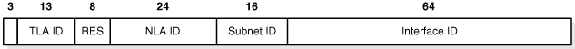

## 10 Configuring Oracle Connection Manager

Oracle Connection Manager is a proxy server that forwards connection requests to databases or other proxy servers. It operates at the session level, and usually resides on a computer separate from the database server and client computers.

Oracle Connection Manager is available for installation with Oracle Database 19c Enterprise Edition. It is a custom installation option on the Client disk.

The primary functions of Oracle Connection Manager are:

- Access control: To use rule-based configuration to filter user-specified client requests and accept others.

- Session multiplexing: To funnel multiple client sessions through a network connection to a [shared server](glossary.md) destination.

Learn how to configure Oracle Connection Manager features.

- About the cman.ora File
- Setting Up Oracle Connection Manager
  In order to set up Oracle Connection Manager, you must configure the proxy server, database, and clients.
- Configuring Oracle Connection Manager in Traffic Director Mode
  A current Oracle Database Client Interface (OCI) client or a supported older version OCI client (Oracle Database 11g Release 2 (11.2) and later) can connect to Oracle Connection Manager in Traffic Director Mode.
- Using Oracle Connection Manager as a Bridge for IPv4 and IPv6
  In some database connection environments, a client and database may use different versions of the IP protocol so that complete connectivity does not exist. In this case, at least two hops in the connection use different versions of the IP protocol.
- Starting and Stopping Oracle Connection Manager
  After configuring Oracle Connection Manager, you can start and administer it using the Oracle Connection Manager Control (CMCTL) utility.
- Oracle Connection Manager Enhancements
  Oracle Connection Manager proxies and screens request for Oracle Database Server.

**Related Topics**

- [Introducing Oracle Net Services](introducing-oracle-net-services.md)
- [Understanding the Communication Layers](understanding-communication-layers.md)

**Parent topic:** [Configuration and Administration of Oracle Net Services](part-II-config-and-admin-of-oracle-net-services.md)

### 10.1 About the cman.ora File

You configure the computer that hosts Oracle Connection Manager by setting parameters in the `cman.ora` file. The `cman.ora` file resides on the computer that hosts Oracle Connection Manager, and is located in the `ORACLE_HOME/network/admin` directory. Oracle Connection Manager will not start if the `cman.ora` file does not exist. This file includes the following components:

- Listening endpoint

- Access control rule list

- Parameter list

Each Oracle Connection Manager configuration is encapsulated within a single name-value (NV) string, which consists of the preceding components.

One computer can host any number of Oracle Connection Managers, each with its own entry in the `cman.ora` file. When defining more than one Oracle Connection Manager in the file, you can assign a default by giving only one a fully qualified host name.

You can specify multiple rules for both client and Oracle Connection Manager Control utility (CMCTL) connections. The following guidelines apply when making changes:

- You must enter at least one rule for client connections and one rule for CMCTL connections. Omitting a rule results in the rejection of all connections for the rule type omitted.

- Oracle Connection Manager does not support wildcards for partial IP addresses. If you use a wildcard, then use it in place of a full IP address. The IP address of the client may be, for example, (`SRV=*`).

- Oracle Connection Manager supports only the `/nn` notation for subnet addresses. In Example 10-1, in the first rule, `/24` represents a subnet mask that comprises 24 left-most bits. Only the first 24 bits in the client's IP address are compared with the IP address in the rule.

**Note:**

Oracle Connection Manager supports IPv6 addressing. See "Using Oracle Connection Manager as a Bridge for IPv4 and IPv6".

Example 10-1 shows a `cman.ora` file that contains a configuration entry for an Oracle Connection Manager called `CMAN1`.

Example 10-1 Sample cman.ora File

    CMAN1=
      (CONFIGURATION=
        (ADDRESS=(PROTOCOL=tcp)(HOST=proxysvr)(PORT=1521))
        (RULE_LIST=
          (RULE=(SRC=192.0.2.32/24)(DST=sales-server)(SRV=*)(ACT=accept)
            (ACTION_LIST=(AUT=on)(MCT=120)(MIT=30)))
          (RULE=(SRC=192.0.2.32)(DST=proxysvr)(SRV=cmon)(ACT=accept)))
        (PARAMETER_LIST=
          (MAX_GATEWAY_PROCESSES=8)
          (MIN_GATEWAY_PROCESSSES=3)))

Example 10-1 shows the following rules:

- In the first rule in the example, the following parameters are set:

  - `SRC=192.0.2.32/24` is for client connections. It designates the IP address of the client, or source.

  - `DST=sales-server` designates the destination host name. The ACT parameter specifies the action, that is, accept, reject, or drop. The ACTION_LIST parameter sets attributes for a connection if it is accepted, enabling you to override default parameter settings on a connection-by-connection basis.

- In the second rule, the following parameters are set:

  - `SRC=192.0.2.32` and `DST=proxysvr` represent the same server, indicating that Oracle Connection Manager and CMCTL must reside on the same computer.

  **See Also:**

  "Enabling Access Control"

Table 10-1 describes the rule-level parameters in the `cman.ora` file.

Table 10-1 Rule-Level Parameters in cman.ora File

| Parameter | Description                                                                                                                                                                                                                                                                                                                      |
|:----------|:---------------------------------------------------------------------------------------------------------------------------------------------------------------------------------------------------------------------------------------------------------------------------------------------------------------------------------|
| SRC       | The source host name or IP address of the client. The IP address can be a subnet, such as `192.0.2.62/24`.                                                                                                                                                                                                                       |
| DST       | The destination host name or IP address of the database server. The IP address can be a subnet, such as `192.0.2.62/24`.                                                                                                                                                                                                         |
| SRV       | The service name of the Oracle database obtained from the SERVICE_NAMES parameter in the initialization parameter file (`init.ora`). The service name is given by the client as part of the connect descriptor when connecting to the listener. This service name is compared to the service name specified in the rule list. |
| ACT       | To accept, reject, or drop incoming requests based on the preceding three parameters.                                                                                                                                                                                                                                            |

You can define multiple rules in the RULE_LIST. The action (`ACT`) in the first matched `RULE` is applied to the connection request. If no rules are defined, then all connections are rejected.

In the following example, client computer `client1-pc` is denied access to the service `sales.us.example.com`, but client `192.0.2.45` is granted access to the service `db1`.

    (RULE_LIST=
      (RULE=(SRC=client1-pc)(DST=sales-server)(SRV=sales.us.example.com)(ACT=reject))
      (RULE=(SRC=192.0.2.45)(DST=192.0.2.200)(SRV=db1)(ACT=accept)))

**See Also:**

[Oracle Database Net Services Reference](../netrf/oracle-connection-manager-parameters.md) for additional information about Oracle Connection Manager parameters

**Parent topic:** Configuring Oracle Connection Manager

### 10.2 Setting Up Oracle Connection Manager

In order to set up Oracle Connection Manager, you must configure the proxy server, database, and clients.

- Configuring the cman.ora file for the Oracle Connection Manager Host
- Configuring Clients for Oracle Connection Manager
- Configuring the Oracle Database Server for Oracle Connection Manager
  Configuring the database server involves registering database information remotely with Oracle Connection Manager and, optionally, configuring the server for multiplexing.

**Parent topic:** Configuring Oracle Connection Manager

#### 10.2.1 Configuring the cman.ora file for the Oracle Connection Manager Host

You make changes to the `cman.ora` file manually. The following procedure describes how to set parameters in the `cman.ora` file:

1.  Navigate to the `cman.ora` file in the `ORACLE_HOME/network/admin` directory.

2.  Open the `cman.ora` file with a text editor.

3.  Configure the listening endpoint (ADDRESS).

    The listening endpoint specifies the protocol address for the Oracle Connection Manager listener. CMON, the Oracle Connection Manager monitoring process, uses this address to register information about gateway processes with the listener. The database uses the address to register service information at the Oracle Connection Manager node.

    The Oracle Connection Manager listener always listens on the TCP/IP protocol.

        (ADDRESS=(PROTOCOL=tcp)(HOST=proxysvr)(PORT=1521))

    **Note:**

    Oracle Connection Manager can connect to the database using protocols such as TCP/IP (version 4 and version 6). Starting with Oracle Database 12c release 2 (12.2), the TCPS protocol is also supported

4.  Configure the access control rule list (RULE_LIST).

    The access control rule list specifies which connections are accepted, rejected, or dropped by the listener.

5.  Configure the parameter list (PARAMETER_LIST).

    The parameter list sets attributes for an Oracle Connection Manager. Parameters take the following forms:

    - If global, then the parameter applies to all Oracle Connection Manager connections unless a rule-level parameter overrides it. To change a global parameter default setting, enter it into the PARAMETER_LIST with an allowable value.

    - If a rule-level parameter is enabled in the ACTION_LIST section of the RULE_LIST, then it applies only to connections specified by the rule. It overrides its global counterpart.

- Configuring Transport Layer Security on Oracle Connection Manager (CMAN)
  The configuration steps involve confirming that a CMAN wallet has been created with a certificate, creating a Listening Endpoint that uses TCP/IP with TLS, and specifying the wallet location.
- Enabling Access Control

**Parent topic:** Setting Up Oracle Connection Manager

##### 10.2.1.1 Configuring Transport Layer Security on Oracle Connection Manager (CMAN)

The configuration steps involve confirming that a CMAN wallet has been created with a certificate, creating a Listening Endpoint that uses TCP/IP with TLS, and specifying the wallet location.

Step 1: Confirm that a CMAN wallet has been created and that it has a certificate.

Before proceeding to the next step, confirm that a wallet has been created and that it has a certificate. Perform the following steps:

1.  Start Oracle Wallet Manager.

    - On UNIX: Enter the following command from `$ORACLE_HOME/bin`:

      `owm`

    - On Windows: Select Start, go to Programs, click Oracle-HOME_NAME, select Integrated Management Tools, and then click Wallet Manager.

2.  From the Wallet menu, select Open.

    The wallet should contain a certificate with a Ready status and auto-login turned on. If auto-login is not on, then select it from the Wallet menu and save the wallet again. This turns auto-login on.

Step 2: Create a Listening Endpoint that uses TCP/IP with TLS (TCPS) and specify the CMAN wallet location on the CMAN side in cman.ora.

The following example shows` cman.ora` with `TCPS` protocol:

    CMAN_1=
        (CONFIGURATION=
                (ADDRESS_LIST=
                  (ADDRESS=(PROTOCOL=tcps)(HOST=proxysvr)(PORT=1522))
                  (ADDRESS=(PROTOCOL=tcp)(HOST=proxysvr)(PORT=1523))
            )
            (RULE_LIST=
                  (RULE=(SRC=*)(DST=*)(SRV=*)(ACT=accept))
            )
                (PARAMETER_LIST=
                  (MAX_GATEWAY_PROCESSES=8)
                  (MIN_GATEWAY_PROCESSSES=3)
                )
         )
    wallet_location =
        (SOURCE=
            (METHOD=File)
            (METHOD_DATA=
                (DIRECTORY=wallet_location)
            )
        )

**Parent topic:** Configuring the cman.ora file for the Oracle Connection Manager Host

##### 10.2.1.2 Enabling Access Control

Use the RULE_LIST parameter to control client access to designated database servers in a TCP/IP environment. By entering filtering rules under this parameter, you can allow or restrict specific clients access to a database server.

The following procedure describes how to configure access control:

1.  Open the `cman.ora` file with a text editor.

2.  Update the RULE_LIST parameter using the following format:

               (RULE_LIST=
                (RULE=(SRC=source_host)
                      (DST=destination_host)
                      (SRV=service)
                      (ACT=accept | reject | drop)))

    **See Also:**

    Table 10-1

**Parent topic:** Configuring the cman.ora file for the Oracle Connection Manager Host

#### 10.2.2 Configuring Clients for Oracle Connection Manager

To route clients to the database server through Oracle Connection Manager, configure the `tnsnames.ora` file with a [connect descriptor](glossary.md) that specifies the protocol address of Oracle Connection Manager. This address enables clients to connect to the Oracle Connection Manager computer. The connect descriptor looks similar to the following:

    sales=
      (DESCRIPTION=
        (ADDRESS=
          (PROTOCOL=tcp)
          (HOST=cman-pc)
          (PORT=1521))
        (CONNECT_DATA=
          (SERVICE_NAME=example.com)))

**Note:**

The Oracle Notification Service (ONS) auto-configuration does not work for connections through Oracle Connection Manager (CMAN). You need to manually configure the ONS and also ensure there is connectivity from client to ONS server on ONS port (6200 is the default port, a different port may have been chosen). Please refer the client-specific developer's guide for information on manual ONS configuration.

- [Oracle Universal Connection Pool Developer’s Guide](../jjucp/fast-connection-failover.md) for JDBC clients
- [Oracle Call Interface Programmer's Guide](../lnoci/build-and-configure-oci-applications.md) for OCI clients
- [Oracle Data Provider for .NET Developer's Guide for Microsoft Windows](../odpnt/ConfigurationHighAvailabilityProperties.md) for ODP.NET clients

The following procedure describes how to configure a protocol address for Oracle Connection Manager:

1.  Start Oracle Net Manager.

    **See Also:**

    "[Using Oracle Net Manager to Configure Oracle Net Services](managing-oracle-net-services.md)"

2.  In the navigator pane, select Service Naming from Directory or Local menus.

3.  Click the plus sign (+) on the toolbar, or select Create from the Edit menu.

    The Welcome page of the Net Service Name wizard appears.

4.  Enter a name in the Net Service Name field.

5.  Click Next.

    The Protocol page appears.

6.  Select the TCP/IP protocol for Oracle Connection Manager.

7.  Click Next.

    The Protocol Settings page appears.

8.  Specify the Oracle Connection Manager port and protocol. The default port number for Oracle Connection Manager is 1521, and the protocol is TCP/IP.

    **See Also:**

    [Oracle Database Net Services Reference](../netrf/protocol-address-configuration.md) for protocol parameter settings

9.  Click Next.

    The Service page appears.

10. Enter a service name in the Service Name field, and then select the connection type.

    **See Also:**

    "[About Connect Descriptors](identifying-and-accessing-database.md)" for additional information about setting the service name string

11. Click Next.

    **Note:**

    Do not click Test, because a connection cannot be tested at this point.

12. Click Finish to save your configuration and close the Net Service Name wizard.

    The new network service name and the Oracle Connection Manager protocol address is added to the Service Naming folder.

**Parent topic:** Setting Up Oracle Connection Manager

#### 10.2.3 Configuring the Oracle Database Server for Oracle Connection Manager

Configuring the database server involves registering database information remotely with Oracle Connection Manager and, optionally, configuring the server for multiplexing.

**Note:**

If the database that you want to register with Oracle Connection Manager is located on a remote node, then you must configure the `cman.ora` parameter `VALID_NODE_CHECKING_REGISTRATION` to allow remote registration.

- Configuring Service Registration for Use with Oracle Connection Manager
  To enable the database server to communicate with Oracle Connection Manager, the `tnsnames.ora` file must include the service name entry, and the initialization parameter file `(init.ora)` must contain a descriptor that specifies the listening address of Oracle Connection Manager.
- Enabling Session Multiplexing for Oracle Connection Manager
  To enable Oracle Connection Manager to take advantage of session multiplexing, set the `DISPATCHERS` parameter in the initialization parameter file (`init.ora`) with the `PROTOCOL` and `MULTIPLEX` attributes.

**Related Topics**

- [VALID_NODE_CHECKING_REGISTRATION](../netrf/oracle-connection-manager-parameters.md)

**Parent topic:** Setting Up Oracle Connection Manager

##### 10.2.3.1 Configuring Service Registration for Use with Oracle Connection Manager

To enable the database server to communicate with Oracle Connection Manager, the `tnsnames.ora` file must include the service name entry, and the initialization parameter file `(init.ora)` must contain a descriptor that specifies the listening address of Oracle Connection Manager.

The following procedure describes how to configure service registration:

1.  Resolve the Oracle Connection Manager alias to a service name entry in the `tnsnames.ora` file as follows:

        cman_listener_address =
          (DESCRIPTION=
            (ADDRESS_LIST=
              (ADDRESS=(PROTOCL=tcp) (HOST=proxy_server_name)( PORT=1521))))

    For example, the alias `listener_cman` would be resolved to the following entry in the `tnsnames.ora` file:

        listener_cman=
         (DESCRIPTION=
          (ADDRESS_LIST=
           (ADDRESS=(PROTOCOL=tcp)(HOST=proxyserver1)(PORT=1521))))

2.  Specify an alias for Oracle Connection Manager in the `init.ora` file as follows. This alias is the one specified in the `tnsnames.ora` file in step 1.

        REMOTE_LISTENER=cman_listener_address

    The alias must be specified because this address is TCP, port 1521 but it is not the default local listening address of TCP, port 1521 of the database server.

    For example, the alias for the Oracle Connection Manager listener running on host, `proxyserver1`, specified in step 1, might look like the following in the `init.ora` file:

        REMOTE_LISTENER=listener_cman

3.  Configure `REGISTRATION_INVITED_NODES` in `cman.ora` if the database resides on a remote node. For example:

    `(registration_invited_nodes=sales.us.example.com,10.245.129.60)`

4.  After the initialization parameter file is configured with the alias of Oracle Connection Manager, the Listener Registration (LREG) process can register database information with the Oracle Connection Manager listener. Use the following command to register the change:

        SQL> ALTER SYSTEM REGISTER

**Related Topics**

- [Registering Information with a Remote Listener](configuring-and-administering-oracle-net-listener.md)

**Parent topic:** Configuring the Oracle Database Server for Oracle Connection Manager

##### 10.2.3.2 Enabling Session Multiplexing for Oracle Connection Manager

To enable Oracle Connection Manager to take advantage of session multiplexing, set the `DISPATCHERS` parameter in the initialization parameter file (`init.ora`) with the `PROTOCOL` and `MULTIPLEX` attributes.

For example:

    DISPATCHERS="(PROTOCOL=tcp)(MULTIPLEX=on)"

The following table lists the parameters to set different levels of multiplexing:

Table 10-2 Session Multiplexing Parameters

| Attribute   | Description                                                                                                                                                                                                                                                                                                                                                                                                                                                                                                                                 |
|:------------|:--------------------------------------------------------------------------------------------------------------------------------------------------------------------------------------------------------------------------------------------------------------------------------------------------------------------------------------------------------------------------------------------------------------------------------------------------------------------------------------------------------------------------------------------|
| `PROTOCOL`  | The network protocol for which the dispatcher generates a listening endpoint.                                                                                                                                                                                                                                                                                                                                                                                                                                                               |
| `MULTIPLEX` | This parameter is used to enable session multiplexing, as follows: • If `1`, `on`, `yes`,` true`, or `both` is specified, then multiplexing is enabled for both incoming and outgoing network sessions. • If `in` is specified, then multiplexing is enabled for incoming network sessions from the client. • If `out` is specified, then multiplexing is enabled for outgoing network sessions. • If `0`, `off`, `no`, or `false` is specified, then multiplexing is disabled for both incoming and outgoing network sessions. |

**Related Topics**

- [Configuring a Shared Server Architecture](configuring-shared-server-architecture.md)
- [Oracle Database Administrator’s Guide](../admin/managing-processes.md)

**Parent topic:** Configuring the Oracle Database Server for Oracle Connection Manager

### 10.3 Configuring Oracle Connection Manager in Traffic Director Mode

A current Oracle Database Client Interface (OCI) client or a supported older version OCI client (Oracle Database 11g Release 2 (11.2) and later) can connect to Oracle Connection Manager in Traffic Director Mode.

- About Oracle Connection Manager in Traffic Director Mode
  Oracle Connection Manager in Traffic Director Mode is a proxy that is placed between supported database clients and database instances.
- Configuring cman.ora File for Oracle Connection Manager in Traffic Director Mode
  You can set up Oracle Connection Manager in Traffic Director Mode using the `TDM=YES` setting in the `cman.ora` file.
- Configuring a Wallet for Oracle Connection Manager in Traffic Director Mode Proxy Authentication
- Configuring Databases for Oracle Connection Manager in Traffic Director Mode Proxy Authentication
  Every database to which an application connects through Oracle Connection Manager in Traffic Director Mode must have a user, for example, `tdm`.
- Configuring Service Registration with Oracle Connection Manager in Traffic Director Mode
  To configure service registration, include the service name entry in the `tnsnames.ora` file. Also, include a descriptor that specifies the listening address of Oracle Connection Manager in the `init.ora` file.
- Configuring Proxy Resident Connection Pool in Oracle Connection Manager in Traffic Director Mode
- Configuring Oracle Connection Manager in Traffic Director Mode for Unplanned Events
  Oracle Connection Manager in Traffic Director Mode implicitly subscribes to Fast Application Notification (FAN) events. For this `events` must be enabled in `oraaccess.xml`.
- Configuring Oracle Connection Manager in Traffic Director Mode for Planned Down Events
  Oracle Connection Manager in Traffic Director Mode implicitly subscribes to Fast Application Notification (FAN) events. For this `events` must be enabled in `oraaccess.xml`.
- Configuring Oracle Connection Manager in Traffic Director Mode for Service Affinity
  Configure Oracle Connection Manager in Traffic Director Mode to modify the default load distribution mechanism for routing incoming connection requests.
- Configuring Transport Layer Security on Oracle Connection Manager in Traffic Director Mode
  The configuration steps involve confirming that an Oracle Connection Manager in Traffic Director Mode wallet has been created with a certificate, creating a Listening Endpoint that uses TCP/IP with TLS, and specifying the wallet location.
- Oracle Connection Manager in Traffic Director Mode Restrictions
  These features are not supported with Oracle Connection Manager in Traffic Director Mode for all drivers.

**Parent topic:** Configuring Oracle Connection Manager

#### 10.3.1 About Oracle Connection Manager in Traffic Director Mode

Oracle Connection Manager in Traffic Director Mode is a proxy that is placed between supported database clients and database instances.

Oracle Connection Manager in Traffic Director Mode provides improved high availability (HA) (planned and unplanned), connection multiplexing support, and load balancing. This feature also provides an inband client notification mechanism to deliver planned shutdown for Oracle Connection Manager (CMAN) down and service down events to the OCI client. Additional CMAN parameters must be specified in the `cman.ora` configuration file to configure Oracle Connection Manager in Traffic Director Mode.

To configure CMAN to act as an Oracle Connection Manager in Traffic Director Mode, new parameters such as `tdm` and `tdm_threading_model` must be added in the `cman.ora` configuration file. Oracle Connection Manager (CMAN) is the standard Oracle Net proxy for both Oracle RAC and non-RAC databases.

The databases that Oracle Connection Manager in Traffic Director Mode connects to must have a user, for example,tdm with the `CONNECT THROUGH` privilege granted to connect as application users. Oracle Connection Manager in Traffic Director Mode uses proxy authentication and connects as this user.

**See Also:**

[Oracle Database Net Services Reference](../netrf/index.md) for the existing parameters in the `cman.ora` file that support Oracle Connection Manager in Traffic Director Mode.

In this release, Oracle Connection Manager in Traffic Director Mode furnishes support for:

- Transparent performance enhancements and connection multiplexing

- Zero Application Downtime 

  - Planned database maintenance or PDB relocation 

  - Unplanned database outages for read-mostly workloads  

- High Availability of Oracle Connection Manager in Traffic Director Mode, this means no single point of failure

- Security and Isolation

Modes of Operation

- Pooled Connection mode

  This includes any application using the following database client releases:
  - OCI and Open Source Drivers (11.2.0.4 and later)

  - JDBC (12.1 and later)

  - ODP.NET (12.2 and later) 

  In addition, applications must be Database Resident Connection Pool (DRCP) aware. This means specifying (`SERVER=POOLED`) in the application's connect string.

- Non-pooled Connection (or Dedicated) mode

  This includes any application using database client releases 11.2.0.4 and later. In this mode, some capabilities such as connection multiplexing are not available. 

  **Note:**

  For a connection from a client to the database using Oracle Connection Manager in Traffic Director Mode, the client and database versions should be a supported combination.

Transparent Performance Enhancements and Session Multiplexing

- Statement caching, rows prefetching and Result set caching are auto-enabled for all mode of operations.

- Database session multiplexing (pooled mode only) using the proxy resident connection pool (PRCP, a proxy mode of DRCP). Applications get transparent connect-time load balancing and run-time load balancing between TDM and Database.

- Multiple Oracle Connection Manager in Traffic Director Mode instances: applications get increased scalability through client-side connect time load balancing or load balancer (BigIP, NGINX, others)

Zero Application Downtime - Planned Database Maintenance or PDB Relocation

- Pooled mode

  Oracle Connection Manager in Traffic Director Mode responds to ONS events for planned outages and re-directs work. The connections are drained from the pool on Oracle Connection Manager in Traffic Director Mode when the request completes.

  Service relocation support is available for database release 11.2.0.4 and later.

  PDB Relocation: Oracle Connection Manager in Traffic Director Mode responds to in-band notifications when a PDB is relocated, even when ONS is not configured (18.1 and later for server only) 

- Non-pooled or Dedicated mode

  No request boundary information is received from the client. Oracle Connection Manager in Traffic Director Mode supports planned outage for many applications (as long as only simple session state and cursor state need to be preserved across the request or transaction boundaries). This involves the following:
  - Stop Service or PDB at Transaction Boundary or Leverage Oracle Database 18c  “Continuous Application Availability” to stop service at request boundary.

  - Oracle Connection Manager in Traffic Director Mode leverages “TAF Failover Restore” to reconnect and restore simple states.

Unplanned Database Outages

For both pooled and non-pooled (dedicated) modes, Oracle Connection Manager in Traffic Director Mode supports unplanned outage for read–mostly applications by leveraging “TAF Failover Restore” to restore simple session state or cursor state and replay SELECT statements and first DML statement.

Security and Isolation

Oracle Connection Manager in Traffic Director Mode provides:

- Database Proxy supporting TCP/TCPS and protocol conversion

- Firewall based on IP address, Service name and TLS wallets

- Tenant isolation in a multitenant environment

- Protection against denial-of-service and fuzzing attacks 

- Secure tunneling of database traffic across on-premises database and Oracle Cloud

High Availability of Oracle Connection Manager in Traffic Director Mode

This involves:

- Multiple instances of Oracle Connection Manager in Traffic Director Mode using Load Balancer or client– side load balancing or failover in connect string

- Rolling upgrade of Oracle Connection Manager in Traffic Director Mode instances

- Closure of existing connections from client to Oracle Connection Manager in Traffic Director Mode for planned outages

- In-band notifications to Oracle Database release 18c and later clients. For earlier release clients, notifications are sent with the response of the current request.

**Related Topics**

- [Oracle Database Security Guide](../dbseg/configuring-authentication.md)

**Parent topic:** Configuring Oracle Connection Manager in Traffic Director Mode

#### 10.3.2 Configuring cman.ora File for Oracle Connection Manager in Traffic Director Mode

You can set up Oracle Connection Manager in Traffic Director Mode using the `TDM=YES` setting in the `cman.ora` file.

Sample `cman.ora` configuration for Oracle Connection Manager in Traffic Director Mode

    CMAN_1=
        (CONFIGURATION=
            (ADDRESS_LIST=
                  (ADDRESS=(PROTOCOL=tcp)(HOST=TDMHOST)(PORT=1522))
            )
            (RULE_LIST=
                  (RULE=(SRC=*)(DST=*)(SRV=*)(ACT=accept))
            )
            (PARAMETER_LIST=
                  (TDM=YES)
                  (TDM_THREADING_MODE=DEDICATED)
                  (MAX_GATEWAY_PROCESSES=8)
                  (MIN_GATEWAY_PROCESSSES=3)
            )
         )
    wallet_location =
           (SOURCE=
                (METHOD=File)
                (METHOD_DATA=(DIRECTORY=wallet_location)
                )
        )
    SQLNET.WALLET_OVERRIDE = TRUE

**Parent topic:** Configuring Oracle Connection Manager in Traffic Director Mode

#### 10.3.3 Configuring a Wallet for Oracle Connection Manager in Traffic Director Mode Proxy Authentication

Oracle Connection Manager in Traffic Director Mode connects to the databases using the wallet that must be configured with `cman.ora` file. This wallet has the user name and the password information for the tdm user used by Oracle Connection Manager in Traffic Director Mode for proxy authentication. This tdm user must exist on all the databases that the Oracle Connection Manager in Traffic Director Mode connects to.

**See Also:**

[Oracle Database Enterprise User Security Administrator's Guide](../dbimi/using-oracle-wallet-manager.md)

The following setting causes all outbound connections from Oracle Connection Manager in Traffic Director Mode to use the credentials in the wallet at the specified location for proxy authentication:

    WALLET_LOCATION =
                    (SOURCE =
                            (METHOD = FILE)
                            (METHOD_DATA =
                            (DIRECTORY = wallet_location)
                            )
                        )
            SQLNET.WALLET_OVERRIDE = TRUE

The wallet must be configured for each service. If a new service is added, then you must supply the credentials for the new service using the same wallet.

**Note:**

Whenever a new service is added and the credentials for the new service are added to the wallet, the Oracle Cloud Traffic Manager should be restarted for the changes to take effect.

- Enabling Oracle Connection Manager in Traffic Director Mode to Use External Password Store
  Steps involve creating an Oracle wallet and creating database connection credentials in that wallet for each database service.

**Related Topics**

- Configuring Databases for Oracle Connection Manager in Traffic Director Mode Proxy Authentication

**Parent topic:** Configuring Oracle Connection Manager in Traffic Director Mode

##### 10.3.3.1 Enabling Oracle Connection Manager in Traffic Director Mode to Use External Password Store

Steps involve creating an Oracle wallet and creating database connection credentials in that wallet for each database service.

Step 1: Create a wallet on Oracle Connection Manager in Traffic Director Mode by using the following syntax at the command line:

    mkstore -wrl wallet_location -create

`wallet_location` is the path to the directory where you want to create and store the wallet. This command creates an Oracle wallet with the auto-login feature enabled at the specified location. The auto-login feature enables Oracle Connection Manager in Traffic Director Mode to access the wallet contents without supplying a password.

Step 2: Create database connection credentials in the wallet by using the following syntax at the command line:

    mkstore -wrl wallet_location -createCredential db_service_name username password

`wallet_location` is the path to the directory where you created the wallet in Step 1. The `db_service_name` is the service name used by the application in its connect string while connecting to Oracle Connection Manager. The username and password are the tdm user name and password.

Repeat this step for each database service that must be accessed by using Oracle Connection Manager in Traffic Director Mode.

**Note:**

- The same tdm user can be used across all services for a given database. However, if required, a different tdm user can also be associated for each service.

- For pluggable database (PDB) services, there are two choices for setting up the tdm user:

  Common tdm user: tdm user can be a common user, in which case Oracle Connection Manager in Traffic Director Mode uses a single set of credentials for proxy authenticating users from different PDBs in a multitenant container database (CDB).

  Per PDB tdm user: tdm user can be a PDB–specific user, in which case Oracle Connection Manager in Traffic Director Mode uses PDB–specific proxy user for proxy authenticating users in a specific PDB.

- For `TCP/IP` with `TLS (TCPS)` configuration, Oracle Connection Manager in Traffic Director Mode wallet is already created. So, skip Step 1 and specify `wallet_location` in `mkstore` as the same location used for `TCPS` configuration.

**Parent topic:** Configuring a Wallet for Oracle Connection Manager in Traffic Director Mode Proxy Authentication

#### 10.3.4 Configuring Databases for Oracle Connection Manager in Traffic Director Mode Proxy Authentication

Every database to which an application connects through Oracle Connection Manager in Traffic Director Mode must have a user, for example, `tdm`.

Oracle Connection Manager in Traffic Director Mode uses proxy authentication and connects to the database as the` tdm` user. All the users that must connect through Oracle Connection Manager in Traffic Director Mode must be granted `CONNECT THROUGH` tdm privilege as follows:

    ALTER user SCOTT GRANT CONNECT THROUGH tdm

**Parent topic:** Configuring Oracle Connection Manager in Traffic Director Mode

#### 10.3.5 Configuring Service Registration with Oracle Connection Manager in Traffic Director Mode

To configure service registration, include the service name entry in the `tnsnames.ora` file. Also, include a descriptor that specifies the listening address of Oracle Connection Manager in the `init.ora` file.

The procedure to configure service registration with Oracle Connection Manager in Traffic Director Mode is similar to how you configure service registration for use with Oracle Connection Manager.

**Related Topics**

- Configuring Service Registration for Use with Oracle Connection Manager

**Parent topic:** Configuring Oracle Connection Manager in Traffic Director Mode

#### 10.3.6 Configuring Proxy Resident Connection Pool in Oracle Connection Manager in Traffic Director Mode

Oracle Connection Manager in Traffic Director Mode 18.1 supports Proxy Resident Connection Pooling (PRCP). PRCP provides connection services for a larger number of client connections that are routed by using a connection pool comprising of a fewer number of server connections to target databases. PRCP can reduce connection load (connection memory usage) on the database tier and also perform runtime load balancing (RLB) to provide better performance. This can help reduce connection load on the database.

The proxy resident connection pool is configured by specifying the following set of parameters in the `oraaccess.xml` configuration file.

- `<session_pool>` – Sets up session pool parameters.

- `<enable>` –`true` or `false` to make the session pool configuration effective. It is a must have parameter that means if the `<session_pool>` is configured, then `<enable>` must be configured.

- `<min_size>` — Minimum number of connections in the pool. The default value is `0`. Since Oracle Connection Manager in Traffic Director Mode is a heterogeneous pool scenario, so all other values are ignored.

- `<max_size>` — Maximum number of connections in the pool. There is no default parameter as it is a must have parameter. It means that if the `<session_pool>` is configured, then `<max_size>` must be configured.

- `<increment>` — Amount of increase in the number of connections in the pool as the pool expands. The default value is `1`.

- `<inactivity_timeout>` — Maximum time in seconds for which a connection stays idle in the pool, after which it is terminated. The default value is`0`. It means that there is no limit.

- `<max_use_session>` — Maximum number of times a connection can be taken and released to the pool. The default value is `0`. It means that there is no limit.

- `<max_life_time_session>` — Time, in seconds, to live for a connection in the pool. The default value is `0`. It means that there is no limit.

Using the `oraaccess.xml` file allows you to configure a proxy resident connection pool for each needed connection service. The following example shows two groups of connection parameters associated with its respective config alias, the `sales_config` and the `hr_config`, where each connection string that the application uses is mapped with its respective config alias, thus providing two proxy resident connection pools.

    <oraaccess xmlns="http://xmlns.oracle.com/oci/oraaccess"
                xmlns:oci="http://xmlns.oracle.com/oci/oraaccess"
                schemaLocation="http://xmlns.oracle.com/oci/oraaccess
                http://xmlns.oracle.com/oci/oraaccess.xsd">
      <default_parameters>
      </default_parameters>
        <!--
             Create configuration descriptions, which are
             groups of connection parameters associated with
             a config_alias.
        -->
      <config_descriptions>
        <config_description>
          <config_alias> sales_config </config_alias>
          <parameters>
             <session_pool>
                <enable>true</enable>
                <min_size> 10 </min_size>
                <max_size> 100 </max_size>
                <increment> 5 </increment>
             </session_pool>
          </parameters>
        </config_description>
        <config_description>
          <config_alias> hr_config </config_alias>
          <parameters>
             <session_pool>
               <enable>true</enable>
              <max_size> 10 </max_size>
             </session_pool>
          </parameters>
        </config_description>
      </config_descriptions>
      <!--
             Now map the connection string used by the application
             with a config_alias.
      -->
      <connection_configs>
        <connection_config>
          <connection_string>sales.us.example.com</connection_string>
          <config_alias>sales_config</config_alias>
        </connection_config>
        <connection_config>
          <connection_string>hr.us.example.com</connection_string>
          <config_alias>hr_config</config_alias>
        </connection_config>
      </connection_configs>
    </oraaccess>

**See Also:**

Overview of Oracle CMAN configuration file in [Oracle Database Net Services Reference](../netrf/oracle-connection-manager-parameters.md)

**Parent topic:** Configuring Oracle Connection Manager in Traffic Director Mode

#### 10.3.7 Configuring Oracle Connection Manager in Traffic Director Mode for Unplanned Events

Oracle Connection Manager in Traffic Director Mode implicitly subscribes to Fast Application Notification (FAN) events. For this `events` must be enabled in `oraaccess.xml`.

Use `DBMS_SERVICE` or `SRVCTL` (for an Oracle RAC database) to specify `COMMIT_OUTCOME` for this specific service.

**Related Topics**

- [Oracle Database PL/SQL Packages and Types Reference](../arpls/DBMS_SERVICE.md)
- [Oracle Clusterware Administration and Deployment Guide](../cwadd/server-control-command-reference.md)

**Parent topic:** Configuring Oracle Connection Manager in Traffic Director Mode

#### 10.3.8 Configuring Oracle Connection Manager in Traffic Director Mode for Planned Down Events

Oracle Connection Manager in Traffic Director Mode implicitly subscribes to Fast Application Notification (FAN) events. For this `events` must be enabled in `oraaccess.xml`.

For planned down events, use `DBMS_SERVICE` or `SRVCTL` to configure the service and set `failover_mode` to `select`, `commit_outcome` to `TRUE`, and `failover_restore` to `LEVEL1`.

**Related Topics**

- [Oracle Database PL/SQL Packages and Types Reference](../arpls/DBMS_SERVICE.md)
- [Oracle Clusterware Administration and Deployment Guide](../cwadd/server-control-command-reference.md)

**Parent topic:** Configuring Oracle Connection Manager in Traffic Director Mode

#### 10.3.9 Configuring Oracle Connection Manager in Traffic Director Mode for Service Affinity

Configure Oracle Connection Manager in Traffic Director Mode to modify the default load distribution mechanism for routing incoming connection requests.

By default, Oracle Connection Manager in Traffic Director Mode uses service affinity to select a gateway for routing incoming connection requests. All new connection requests are routed to the gateways associated with database services.

Use the `cman.ora` parameter `SERVICE_AFFINITY` to modify the default behavior and set the parameter to `ON` or `OFF`.

When using Proxy Resident Connection Pooling (PRCP), Oracle recommends that you set the `SERVICE_AFFINITY` parameter to `OFF` for better performance and resource utilization of gateway processes.

**Related Topics**

- [Oracle Database Net Services Reference](../netrf/oracle-connection-manager-parameters.md)
- [Oracle Multitenant Administrator's Guide](../admin/creating-and-configuring-an-oracle-database.md)

**Parent topic:** Configuring Oracle Connection Manager in Traffic Director Mode

#### 10.3.10 Configuring Transport Layer Security on Oracle Connection Manager in Traffic Director Mode

The configuration steps involve confirming that an Oracle Connection Manager in Traffic Director Mode wallet has been created with a certificate, creating a Listening Endpoint that uses TCP/IP with TLS, and specifying the wallet location.

Step 1: Confirm that an Oracle Connection Manager in Traffic Director Mode wallet has been created and that it has a certificate.

Before proceeding to the next step, confirm that a wallet has been created and that it has a certificate. Perform the following steps:

1.  Start Oracle Wallet Manager.

    - On UNIX: Enter the following command from `$ORACLE_HOME/bin`:

      `owm`

    - On Windows: Select Start, go to Programs, click Oracle-HOME_NAME, select Integrated Management Tools, and then click Wallet Manager.

2.  From the Wallet menu, select Open.

    The wallet should contain a certificate with a Ready status and auto-login turned on. If auto-login is not on, then select it from the Wallet menu and save the wallet again. This turns auto-login on.

Step 2: Create a Listening Endpoint that uses TCP/IP with TLS (TCPS) and specify the Oracle Connection Manager in Traffic Director Mode wallet location on the CMAN side in cman.ora.

The following example shows`cman.ora` with `TCPS` protocol:

    CMAN_1=
        (CONFIGURATION=
                (ADDRESS_LIST=
                  (ADDRESS=(PROTOCOL=tcps)(HOST=proxysvr)(PORT=1522))
                  (ADDRESS=(PROTOCOL=tcp)(HOST=proxysvr)(PORT=1523))
            )
            (RULE_LIST=
                  (RULE=(SRC=*)(DST=*)(SRV=*)(ACT=accept))
            )
                (PARAMETER_LIST=
                  (MAX_GATEWAY_PROCESSES=8)
                  (MIN_GATEWAY_PROCESSSES=3)
                )
         )
    wallet_location =
        (SOURCE=
            (METHOD=File)
            (METHOD_DATA=
                (DIRECTORY=wallet_location)
            )
        )
    SQLNET.WALLET_OVERRIDE = TRUE

**Parent topic:** Configuring Oracle Connection Manager in Traffic Director Mode

#### 10.3.11 Oracle Connection Manager in Traffic Director Mode Restrictions

These features are not supported with Oracle Connection Manager in Traffic Director Mode for all drivers.

- Distributed Transactions

- Advanced Queuing (AQ)

- Database Startup or Database Shutdown calls

- Sharding

- XML

- SQL Translation

- Proxy Authentication and TLS External Authentication (such as DN)

- Object REF

- Session switching

- OCIObject\* calls for navigational access

- OCIPickerImage\* calls

- OCIAnyData\* calls

- OCIDirPath\* calls

- OCISubscription\* calls

- OCILCR\*, OCIXStream\* calls

- OCIStmtExecute:

  - Scrollable Cursor

  - Implicit Results

- Change Notification (CQN)

- Client Result Cache

- OCI_MIGRATE mode

- DRCP: Multi-property Tag and PLSQL callback

- Application Continuity

- OCIConnectionPool

- Authentication as SYSDBA, SYSOPER etc

- Real Application Security (only in Java)

- Bulk Copy (ODP.Net only)

- Self-Tuning (ODP.Net only)

- ASO encryption and supported algorithms (ASO only)

**Parent topic:** Configuring Oracle Connection Manager in Traffic Director Mode

### 10.4 Using Oracle Connection Manager as a Bridge for IPv4 and IPv6

In some database connection environments, a client and database may use different versions of the IP protocol so that complete connectivity does not exist. In this case, at least two hops in the connection use different versions of the IP protocol.

For example, a request passes from an IPv4 source to an IPv6 destination, from an IPv6 source to an IPv4 destination, or from IPv6 to IPv6 through an IPv4 network.

You can use Oracle Connection Manager as a network bridge between IPv4 and IPv6. To serve as a bridge, Oracle Connection Manager must run on a dual-stack host configured with at least one IPv4 interface and at least one IPv6 interface.

Use the Oracle Connection Manager filtering feature to filter based on an IPv6 address. You can base rules on complete or partial IP addresses. The following figure shows the format of an IPv6 address:

Figure 10-1 IPv6 Address Format

[Description of "Figure 10-1 IPv6 Address Format"](img_text/netag138.md)

The numbers at the top of the diagram indicate the number of bits in the address. Each hexadecimal character in an IPv6 address represents 4 bits. Bits 4-16 are the Top-Level Aggregation Identifier (TLA ID) portion of the address. Bits 25-49 are the Next-Level Aggregation Identifiers (NLA ID).

For example, in the address `2001:0db8::203:BAFF:FE0F:C74B`, the binary representation of the first four hexademical characters (`2001`) is as follows:

    0010000000000001

Thus, the first 3 bits in the address are `001`. The TLA ID portion of the address is `0000000000001`.

The following procedure describes how to create a rules filter for IPv6 address:

1.  Navigate to the `cman.ora` file located in the `ORACLE_HOME/network/admin` directory.

2.  Open the `cman.ora` file with a text editor.

3.  Create a `RULE` in the `RULE_LIST` based on IPv6 address format.

    For example, assume that the source host is an IPv6-only host with address `2001:0db8::203:BAFF:FE0F:C74B`, whereas the destination is an IPv4-only host named `SALESL1593`. You configure Oracle Connection Manager as an IPv6-to-IPv4 bridge by creating one of the following rules:

    | Type of Rule                   | Description                                                         | Example                                                                                                                                                                                         |
    |:-------------------------------|:--------------------------------------------------------------------|:------------------------------------------------------------------------------------------------------------------------------------------------------------------------------------------------|
    | Filter based on subnet ID      | Filtering is based on the 64 bits up to and including the subnet ID | `(RULE = (SRC = 2001:0db8::203:BAFF:FE0F:C74B/64)` `  (DST = SALESL1593)` `  (SRV = SALES)` `  (ACT = ACCEPT)` `  (ACTION_LIST = (AUT=ON)(MOCT=10)(MIT=30)(CONN_STATE=YES))` `)` |
    | Filter based on NLA ID         | Filtering is based on the 48 bits up to and including the NLA ID    | `(RULE = (SRC = 2001:0db8::203:BAFF:FE0F:C74B/48)` `  (DST = SALESL1593)` `  (SRV = SALES)` `  (ACT = ACCEPT)` `  (ACTION_LIST = (AUT=ON)(MOCT=10)(MIT=30)(CONN_STATE=YES))` `)` |
    | Filter based on TLA ID         | Filtering is based on the 16 bits up to and including the TLA ID    | `(RULE = (SRC = 2001:0db8::203:BAFF:FE0F:C74B/16)` `  (DST = SALESL1593)` `  (SRV = SALES)` `  (ACT = ACCEPT)` `  (ACTION_LIST = (AUT=ON)(MOCT=10)(MIT=30)(CONN_STATE=YES))` `)` |
    | Filter based on number of bits | Filtering is based on the first 60 bits of the address              | `(RULE = (SRC = 2001:0db8::203:BAFF:FE0F:C74B/60)` `  (DST = SALESL1593)` `  (SRV = SALES)` `  (ACT = ACCEPT)` `  (ACTION_LIST = (AUT=ON)(MOCT=10)(MIT=30)(CONN_STATE=YES))` `)` |

**Related Topics**

- [About TCP/IP Protocol](understanding-communication-layers.md)
- [About IPv6 Addresses in Connect Descriptors](identifying-and-accessing-database.md)
- [Configuring Listening Protocol Addresses](configuring-and-administering-oracle-net-listener.md)

**Parent topic:** Configuring Oracle Connection Manager

### 10.5 Starting and Stopping Oracle Connection Manager

After configuring Oracle Connection Manager, you can start and administer it using the Oracle Connection Manager Control (CMCTL) utility.

At the operating system command line, the basic syntax for this utility is:

    cmctl [command] [argument1 . . . argumentN] [-c instance_name]

The `-c` parameter specifies the Oracle Connection Manager instance that you want to administer. Instances are defined in the `cman.ora` file.

**Note:**

You are prompted for the password, if specified during installation or a previous Oracle Connection Manager session. However, this exposes the password on the screen and is a potential security risk. Oracle recommends that you do not use the password option (`-p`) at the command line.

To start and stop Oracle Connection Manager using the Oracle Connection Manager Control utility:

1.  Create the `cman.ora` file.
    A sample file is located in the `ORACLE_HOME/network/admin/samples` directory after installation of Oracle Connection Manager.
2.  Start Oracle Connection Manager using one of the following methods:
    - At the command line:

      Run the `STARTUP` command. For example:

          cmctl STARTUP -c [cman_example_instance]

      The command starts the listener, Connection Manager Administration (CMADMIN), and gateway processes for an instance named `cman_example_instance`.

    - At the `CMCTL` prompt:

      At the command line, enter `cmctl` with no arguments to obtain the `CMCTL` prompt, and then run the `ADMINISTER` and `STARTUP` commands. For example:

          cmctl
          CMCTL> ADMINISTER [cman_example_instance]
          CMCTL> STARTUP
3.  Stop a running instance of Oracle Connection Manager using one of the following methods:
    - At the command line:

      Run the `SHUTDOWN` command. For example:

          cmctl SHUTDOWN -c [cman_example_instance]

    - At the `CMCTL` prompt:

      At the command line, enter `cmctl` with no arguments to obtain the `CMCTL` prompt, and then run the `ADMINISTER` and `SHUTDOWN` commands. For example:

          cmctl
          CMCTL> ADMINISTER [cman_example_instance]
          CMCTL> SHUTDOWN

**Related Topics**

- [Understanding Oracle Connection Manager Architecture](understanding-oracle-net-architecture.md)
- [Oracle Database Net Services Reference](../netrf/oracle-connection-manager-control-utility.md)

**Parent topic:** Configuring Oracle Connection Manager

### 10.6 Oracle Connection Manager Enhancements

Oracle Connection Manager proxies and screens request for Oracle Database Server.

- Oracle Connection Manager provides a more secure access to the server by supporting the Transport Layer Security (TLS) protocol. With this support, the database client can communicate to the server through Oracle Connection Manager over TCPS protocol. You can also configure the Oracle Connection Manager to have TLS connection on one side and non-TLS connection on the other side. This also acts as a secure way to hide the internal database servers for the outside clients connecting from the internet.

  Multiplexing: If the gateway already has the TCPS connection to the endpoint requested by the database client, then it multiplexes the new connect request on the same connection.

- It can listen on multiple protocol addresses. With multiple listening endpoints, Oracle Connection Manager is now able to support both TCP and TCPS at the same time. The existing single protocol address configuration is still supported. For example:
      CMAN_ALIAS=
       (configuration=
       (address_list=
       (address=(protocol=TCP)(host=a.b.c.d)(port=12522))
       (address=(protocol=TCPS)(host=a.b.c.d)(port=12523))
      )
      ..
      )

- It has the addition of network data compression facility to improve network throughput and make data transfer faster between the Oracle Database Client and the Oracle Database Server. This is done in different ways according to the database client, database server, and the next hop compression ability. Compression is enabled between any two nodes if it is negotiated by them

  If more than two consecutive nodes support and negotiate compression, such case is handled in a way that the intermediate node just relays the compressed data to the next node without performing decompression.

  Compression is supported between the Oracle Connection Manager and the server, even if the Oracle Database Client is earlier than the Oracle Database 12c release and cannot support compression.

- It supports up to 2 MB SDU enabling the Oracle Database Client and the Oracle Database Server to negotiate higher SDU when establishing connection through Oracle Connection Manager.

- Starting with this release, valid node checking for registration is enabled by default in Oracle Connection Manager. By default, only the databases on local node are allowed to register with Oracle Connection Manager. The databases on remote node can be permitted or denied to register with Oracle Connection Manager through the use of parameters `REGISTRATION_INVITED_NODES` and `REGISTRATION_EXCLUDED_NODES`.

**Related Topics**

- [Oracle Database Net Services Reference](../netrf/index.md)

**Parent topic:** Configuring Oracle Connection Manager
