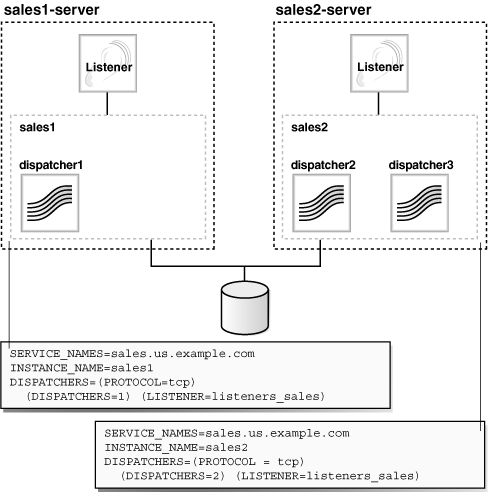
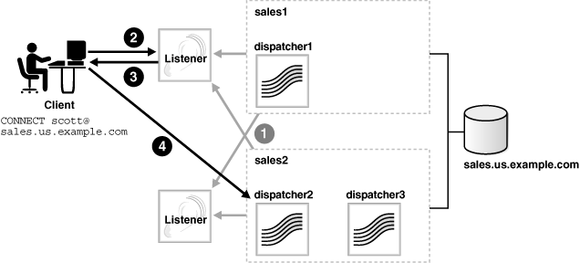
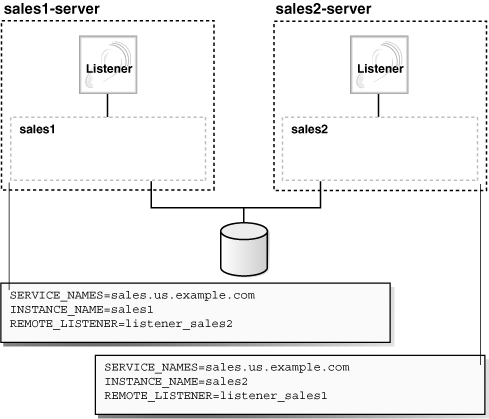
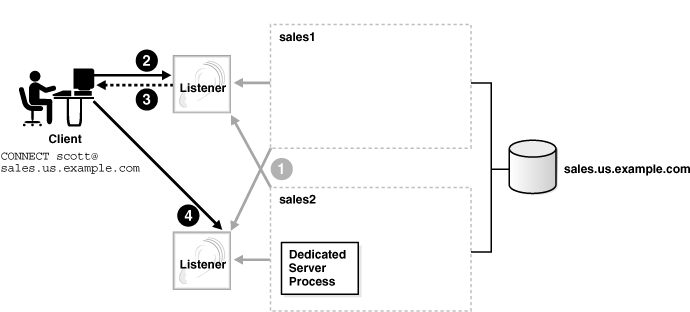

## 13 Enabling Advanced Features of Oracle Net Services

Understand how to configure the advanced features of Oracle Net Services, including advanced connect data parameters, load balancing, failover, and connections to non-database services.

- Configuring Advanced Network Address and Connect Data Information
  A database service can be accessed by several routes and protocol addresses. You configure which routes to use by setting a list of protocol addresses. You configure order addresses by specifying address parameters.
- Understanding Connection Load Balancing
  The connection load balancing feature improves connection performance by balancing the number of active connections among multiple dispatchers.
- Configuring Transparent Application Failover
  Transparent Application Failover (TAF) instructs Oracle Net to transparently reconnect a failed connection to a different listener in the event of the failure of a database instance. This enables you to continue your work using the new connection as if the original connection never failed.
- Specifying the Instance Role for Primary and Secondary Instance Configurations
  The `INSTANCE_ROLE` parameter is an optional parameter for the `CONNECT_DATA` section of a connect descriptor. It enables you to specify a connection to the primary or secondary instance of Oracle RAC configurations.
- Configuring Static Service Registration
  The listener uses the dynamic service information about the database and instance before using statically configured information in the `listener.ora` file.
- Configuring Connections to Third-Party Database Services
  Learn about external procedures settings in the `listener.ora` file, changing the default configuration for external procedures, configuring the Oracle database server for connecting to Heterogeneous Services agents, and configuring clients for connecting to the Oracle Rdb database.

**Parent topic:** [Configuration and Administration of Oracle Net Services](part-II-config-and-admin-of-oracle-net-services.md)

### 13.1 Configuring Advanced Network Address and Connect Data Information

A database service can be accessed by several routes and protocol addresses. You configure which routes to use by setting a list of protocol addresses. You configure order addresses by specifying address parameters.

- Creating a List of Listener Protocol Addresses
- About the Address List Parameters
- About the Advanced Connect Data Parameters

**Parent topic:** Enabling Advanced Features of Oracle Net Services

#### 13.1.1 Creating a List of Listener Protocol Addresses

A database service may be accessed by more than one network route, or protocol address. In the following example, `sales.us.example.com` can connect to the `sales.us.example.com` service using listeners on either `sales1-server` or `sales2-server`.

    sales.us.example.com=
     (DESCRIPTION=
      (ADDRESS_LIST=
        (ADDRESS=(PROTOCOL=tcp)(HOST=sales1-server)(PORT=1521))
        (ADDRESS=(PROTOCOL=tcp)(HOST=sales2-server)(PORT=1521)))
      (CONNECT_DATA=
        (SERVICE_NAME=sales.us.example.com)))

To add a network protocol address to an existing network service name or database service, use one of the following procedures:

- Adding a Network Protocol Using Oracle Enterprise Manager Cloud Control

- Adding a Network Protocol Using Oracle Net Manager

##### Adding a Network Protocol Using Oracle Enterprise Manager Cloud Control

The following procedure describes how to add a network protocol to an existing network service name or database service using Oracle Enterprise Manager Cloud Control:

1.  Access the Directory Naming or Local Naming page in Oracle Enterprise Manager Cloud Control:

    1.  Access the Net Services Administration page in Oracle Enterprise Manager Cloud Control.

        **See Also:**

        "[Using Oracle Enterprise Manager Cloud Control to Configure Oracle Net Services](managing-oracle-net-services.md)"

    2.  Select Local Naming or Directory Naming from the Administer list, and then select the Oracle home for the directory server or the location of the local configuration files.

    3.  Click Go.

        The Local Naming or Directory Naming page appears.

2.  Select the directory service or network service name.

    - For Local Naming, select a network service from the list, and then click Edit.

    - For Directory Naming, perform a search of the network service name in the Simple Search section, then select the network service or database service from the Results list, and then click Edit.

3.  In the Addresses section, click Add.

    The Add Address page appears.

4.  From the Protocol list, select the protocol which the listener is configured to listen. This protocol must also be installed on the client.

5.  Enter the appropriate parameter information for the selected protocol in the fields provided.

    **See Also:**

    [Oracle Database Net Services Reference](../netrf/protocol-address-configuration.md) for protocol parameter settings

6.  (Optional) In the Advanced Parameters section, specify the I/O buffer space limit for send and receive operations of sessions in the Total Send Buffer Size and Total Receive Buffer Size fields.

    **See Also:**

    "[Configuring I/O Buffer Space](optimizing-performance.md)" for additional information about buffer space

7.  Click OK.

    The protocol address is added to the Addresses section.

8.  Click OK to update the address information.

##### Adding a Network Protocol Using Oracle Net Manager

The following procedure describes how to add a network protocol to an existing network service name or database service using Oracle Net Manager:

1.  Start Oracle Net Manager.

    **See Also:**

    "[Using Oracle Net Manager to Configure Oracle Net Services](managing-oracle-net-services.md)"

2.  In the navigator pane, select Service Naming from the Directory or Local menus.

3.  Select either the network service name or a database service.

    The right pane displays the current destination service and address list.

4.  In the Address Configuration box, click the plus sign (+) to add a new address.

    A new Address tab appears:

    1.  Select the protocol and enter appropriate address information.

        **See Also:**

        [Oracle Database Net Services Reference](../netrf/protocol-address-configuration.md) for details about protocol address parameters

    2.  (Optional) On the Address tab, click Advanced to specify the I/O buffer space limit for send and receive operations of sessions in the Total Send Buffer Size and Total Receive Buffer Size fields.

        **See Also:**

        "[Configuring I/O Buffer Space](optimizing-performance.md) " for additional information about buffer space

    3.  Order the protocol addresses using the left-arrow and right-arrow buttons. This will order the addresses in the protocol address list. Unless multiple address options are configured, the first address in the list is contacted.

5.  Select Save Network Configuration from the File menu.

**Parent topic:** Configuring Advanced Network Address and Connect Data Information

#### 13.1.2 About the Address List Parameters

When a database service is accessible by multiple listener protocol addresses, specify the order in which the addresses are to be used, such as chosen randomly or tried sequentially. Table 13-1 lists the parameters used with multiple protocol addresses.

Table 13-1 Address List Parameters in the tnsnames.ora File

| Parameter    | Description                                                                                                                                                                                                                                                                                                                                                                                                                                                            |
|:-------------|:-----------------------------------------------------------------------------------------------------------------------------------------------------------------------------------------------------------------------------------------------------------------------------------------------------------------------------------------------------------------------------------------------------------------------------------------------------------------------|
| FAILOVER     | At connect time, this parameter instructs Oracle Net to fail over to a different listener if the first listener fails when set to `on`. The number of addresses in the list determines how many addresses are tried. When set to `off`, instructs Oracle Net to try one address. Connect-time failover is turned `on` by default for multiple address lists (ADDRESS_LIST), connect descriptors (DESCRIPTION), and multiple connect descriptors (DESCRIPTION_LIST). |
| LOAD_BALANCE | When set to `on`, this parameter instructs Oracle Net to progress through the list of protocol addresses in a random sequence, balancing the load on the various listeners. When set to `off`, instructs Oracle Net to try the addresses sequentially until one succeeds. Client load balancing is turned `on` by default for multiple connect descriptors (DESCRIPTION_LIST).                                                                                      |
| SOURCE_ROUTE | When set to `on`, this parameter instructs Oracle Net to use each address in the order presented until the destination is reached. This parameter is required for reaching the destination using a specific route, that is, by specific computers. This parameter is used to enable connections to [Oracle Connection Manager](glossary.md).                                                                                                                           |

**Note:**

You cannot set source routing (SOURCE_ROUTE) at the same level as connect-time failover (FAILOVER) or client load balancing (LOAD_BALANCE). Source routing connects to each address in the list sequentially whereas connect-time failover and client load balancing select a single address from a list.

When a connect descriptor in a` tnsnames.ora` file contains at least two protocol addresses for an Oracle Connection Manager hop, then parameters for connect-time failover and load balancing within the hop can be included in the file.

Table 13-2 describes the address list options.

Table 13-2 Address List Options Dialog Box

| Option                                               | Parameter Setting                                    |
|:-----------------------------------------------------|:-----------------------------------------------------|
| Try each address, in order, until one succeeds.      | FAILOVER=on                                          |
| Try each address, randomly, until one succeeds.      | LOAD_BALANCE=on FAILOVER=on                       |
| Try one address, selected at random.                 | LOAD_BALANCE=on                                      |
| Use each address in order until destination reached. | SOURCE_ROUTE=on                                      |
| Use only the first address.                          | LOAD_BALANCE=off FAILOVER=off SOURCE_ROUTE=off |

The following example shows a `tnsnames.ora` file configured for client load balancing:

    sales.us.example.com=
     (DESCRIPTION=
      (ADDRESS_LIST=
      (LOAD_BALANCE=on)
       (ADDRESS=(PROTOCOL=tcp)(HOST=sales1-server)(PORT=1521))
       (ADDRESS=(PROTOCOL=tcp)(HOST=sales2-server)(PORT=1521)))
      (CONNECT_DATA=
        (SERVICE_NAME=sales.us.example.com)))

The following example shows a `tnsnames.ora` file configured for connect-time failover:

    sales.us.example.com=
     (DESCRIPTION=
      (ADDRESS_LIST=
       (LOAD_BALANCE=off)
       (FAILOVER=on)
       (ADDRESS=(PROTOCOL=tcp)(HOST=sales1-server)(PORT=1521))
       (ADDRESS=(PROTOCOL=tcp)(HOST=sales2-server)(PORT=1521)))
      (CONNECT_DATA=
       (SERVICE_NAME=sales.us.example.com)))

The following example shows a tnsnames.ora file configured for Oracle Connection Manager and load balancing:

    sales.us.example.com=
    (DESCRIPTION=
       (SOURCE_ROUTE=ON)
       (ADDRESS=(PROTOCOL=tcp)(HOST=cman-pc1)(PORT=1630))
       (ADDRESS=
         (LOAD_BALANCE=ON)
         (ADDRESS=(PROTOCOL=tcp)(HOST=cman-pc2)(PORT=1521))
         (ADDRESS=(PROTOCOL=tcp)(HOST=cman-pc3)(PORT=1521)))
       (CONNECT_DATA=
         (SERVICE_NAME=sales.us.example.com)))

- Configuring Address List Parameters

**See Also:**

"[Configuring Clients for Oracle Connection Manager](configuring-oracle-connection-manager.md)" for additional information about configuring clients for source routing

**Parent topic:** Configuring Advanced Network Address and Connect Data Information

##### 13.1.2.1 Configuring Address List Parameters

The following procedure describes how to configure address list parameters:

1.  Perform the procedure in "Creating a List of Listener Protocol Addresses".

2.  Use Oracle Enterprise Manager Cloud Control or Oracle Net Manager to configure address list options.

    - For Oracle Enterprise Manager Cloud Control, select the appropriate option in the Connect-time Failover and Client Load Balancing section.

    - For Oracle Net Manager, click Advanced in the Address Configuration box. The Address List Options dialog box appears. Select the appropriate option.

**Parent topic:** About the Address List Parameters

#### 13.1.3 About the Advanced Connect Data Parameters

Starting with Oracle Database 12c release 2 (12.2), data compression can be set in the `sqlnet.ora` file. The parameters that set compression are SQLNET.COMPRESSION and SQLNET.COMPRESSION_LEVELS. Setting these parameters in the `sqlnet.ora` file affects all the connections using the `sqlnet.ora` file, except for Oracle Data Guard streaming redo and SecureFiles LOBs (Large Objects). The following example shows how to set compression:

    SQLNET.COMPRESSION = on
    SQLNET.COMPRESSION_LEVELS =(low,high)

The CONNECT_DATA section of a connect descriptor in the `tnsnames.ora` file defines the destination database service. In the following example, SERVICE_NAME defines a service called `sales.us.example.com`:

    sales.us.example.com=
     (DESCRIPTION=
       (ADDRESS=(PROTOCOL=tcp)(HOST=sales-server)(PORT=1521))
       (CONNECT_DATA=
        (SERVICE_NAME=sales.us.example.com)))

In addition to the service name, you can optionally configure the connect data information with the parameters described in Table 13-3.

Table 13-3 Advanced Connect Data Settings in the tnsnames.ora File

| Oracle Enterprise Manager Cloud Control/Oracle Net Manager Option | tnsnames.ora File Parameter | Description                                                                                                                                                                                                                                                   |
|:------------------------------------------------------------------|:----------------------------|:--------------------------------------------------------------------------------------------------------------------------------------------------------------------------------------------------------------------------------------------------------------|
| Instance Name                                                     | INSTANCE_NAME               | The database instance to access. The instance name can be obtained from the INSTANCE_NAME parameter in the initialization parameter file.                                                                                                                     |
| Session Data Unit Size                                            | SDU                         | The transfer rate of data packets being sent across the network. You can specify the [session data unit (SDU)](glossary.md) size to change the performance characteristics having to do with the packets sent across the network. The SDU size limit is 2 MB. |
| Use for Heterogeneous Services                                    | HS                          | If you want an Oracle database server to access a third-party system through [Heterogeneous Services](glossary.md), then set this option to `on`.                                                                                                             |
| Oracle RDB Database                                               | RDB_DATABASE                | The file name of the Oracle Rdb database.                                                                                                                                                                                                                     |
| Type of Service                                                   | TYPE_OF_SERVICE             | The type of service to use for the Oracle Rdb database.                                                                                                                                                                                                       |
| Global Database Name                                              | GLOBAL_NAME                 | Oracle Rdb database identifier.                                                                                                                                                                                                                               |

In the following example, the transfer rate for data packets is set:

    sales.us.example.com=
     (DESCRIPTION=
       (ADDRESS=(PROTOCOL=tcp)(HOST=sales-server)(PORT=1521))
       (CONNECT_DATA=
        (SERVICE_NAME=sales.us.example.com)
        (SDU=8192)))

Use Oracle Enterprise Manager Cloud Control or Oracle Net Manager to configure advanced CONNECT_DATA parameters for either a network service name or a database service.

##### Configuring Advanced Connect Descriptor Parameters Using Oracle Enterprise Manager Cloud Control

The following procedure describes how to configure advanced connect descriptor parameters using Oracle Enterprise Manager Cloud Control:

1.  Access the Directory Naming or Local Naming page in Oracle Enterprise Manager Cloud Control, as follows:

    1.  Access the Net Services Administration page in Oracle Enterprise Manager Cloud Control.

        **See Also:**

        "[Using Oracle Enterprise Manager Cloud Control to Configure Oracle Net Services](managing-oracle-net-services.md)"

    2.  Select Local Naming or Directory Naming from the Administer list, and then select the Oracle home for the directory server or the location of the local configuration files.

    3.  Click Go.

        The Directory Naming or Local Naming pages appear.

2.  Select the directory service or network service name.

    - For Local Naming, select a network service from the list, and then click Edit.

    - For Directory Naming, search the network service name in the Simple Search section by selecting the network service or database service from the Results list, and then clicking Edit.

3.  Click the Advanced tab.

4.  Enter fields or select options as appropriate, and then click OK.

5.  Click OK to update the connect data information.

##### Configuring Advanced Connect Descriptor Parameters Using Oracle Net Manager

The following procedure describes how to configure advanced connect descriptor parameters using Oracle Net Manager:

1.  Start Oracle Net Manager.

    **See Also:**

    "[Using Oracle Net Manager to Configure Oracle Net Services](managing-oracle-net-services.md)"

2.  In the navigator pane, select Service Naming from Directory or Local menus.

3.  Select either the network service name or a database service.

    The right pane displays the current destination service and address list.

4.  In the Service Identification box, click Advanced.

    The Advanced Service Options dialog box appears.

5.  Enter fields or select options as appropriate, and then click OK.

6.  If you are making these changes to the Local folder, then select Save Network Configuration from the File menu. Changes to the Directory folder are saved automatically.

**Parent topic:** Configuring Advanced Network Address and Connect Data Information

### 13.2 Understanding Connection Load Balancing

The connection load balancing feature improves connection performance by balancing the number of active connections among multiple dispatchers.

In an Oracle Real Application Clusters (Oracle RAC) environment, connection load balancing can also balance the number of active connections among multiple instances.

Because the Listener Registration (LREG) process can register with remote listeners, a listener can always be aware of all instances and dispatchers, regardless of their location. Depending on the load information, a listener decides which instance and, if shared server is configured, which dispatcher to send the incoming client request.

In a shared server configuration, a listener selects a dispatcher in the following order:

1.  Least loaded node.

2.  Least loaded instance.

3.  Least loaded dispatcher for that instance.

In a dedicated server configuration, a listener selects an instance in the following order:

1.  Least loaded node.

2.  Least loaded instance.

Load Balancing across nodes for HTTP presentation is introduced in this release. The remote listener can load balance across instances that are on different nodes for HTTP presentation using HTTP redirect.

An Oracle RAC environment requires that the dispatchers on each instance be cross-registered with the other listeners on the other nodes. This is achieved by the use of the `LISTENER` attribute of the DISPATCHERS parameter.

**Note:**

For optimum connection load balancing results, the instances that belong to the same database service should be on equivalent hardware and software configurations.

- Example of Connection Load Balancing for Shared Server Configuration
- Example of Connection Load Balancing for Dedicated Server Configuration
- COLOCATION_TAG of Client Connections
  The `COLOCATION_TAG` parameter is an alphanumeric string that you can use with the `CONNECT_DATA` parameter of the TNS connect string.

**See Also:**

- "[Registering Information with a Remote Listener](configuring-and-administering-oracle-net-listener.md)" for additional information about cross-registration

- [Oracle Database Reference](../refrn/initialization-parameters.md) for complete information about the SERVICE_NAMES and INSTANCE_NAME parameters

- [Configuring a Shared Server Architecture](configuring-shared-server-architecture.md) for additional information about the `LISTENER` attribute

- [Oracle Database Global Data Services Concepts and Administration Guide](../gsmug/global-data-services-admin.md) for information about management of global services

**Parent topic:** Enabling Advanced Features of Oracle Net Services

#### 13.2.1 Example of Connection Load Balancing for Shared Server Configuration

Figure 13-1 shows an Oracle RAC shared server database with two instances, `sales1` and `sales2`, of the same service, `sales.us.example.com`. The instances `sales1` and `sales2` reside on computers `sales1-server` and `sales2-server`, respectively. Instance `sales1` has one dispatcher and instance `sales2` has two dispatchers. Listeners named `listener` run on nodes 1 and 2. The `listener` attribute in the DISPATCHERS parameter has been configured to allow for service registration of information to both listeners.

Figure 13-1 Load Balancing Environment for a Shared Server Configuration

[Description of "Figure 13-1 Load Balancing Environment for a Shared Server Configuration"](img_text/netag034.md)

In this example, `sales2-server` is the least loaded node, `sales2` is the least loaded instance, and `dispatcher2` is the least loaded dispatcher. The following load information is registered.

- The one minute load average for each instance is 600 for `sales1` and 400 for `sales2`. This can happen if more processing is required on `sales1-server`.

- The number of connections to each instance is 200 for `sales1` and 300 for `sales2`.

- The number of dispatcher connections to each instance is 200 for `dispatcher1`, 100 for `dispatcher2`, and 200 for `dispatcher3`.

- The number of connections to `sales1` (200) is the same as that of its only dispatcher, `dispatcher1`.

- The number of connections on `sales2` (300) is the sum of the connections on its two dispatchers, `dispatcher2` (100) and `dispatcher3` (200).

The `listeners_sales` value in `(LISTENER=listeners_sales)` is resolved through a local `tnsnames.ora` file on both servers as follows:

    listeners_sales=
     (DESCRIPTION=
       (ADDRESS_LIST=
         (ADDRESS=(PROTOCOL=tcp)(HOST=sales1-server)(PORT=1521))
         (ADDRESS=(PROTOCOL=tcp)(HOST=sales2-server)(PORT=1521))))

Based on the environment, the following actions occur. The numbered actions correspond to the arrows shown in Figure 13-2:

1.  LREG processes for instances `sales1` and `sales2` register with both listeners. The listeners are updated dynamically on the load of the instances and dispatchers.

2.  The client sends a connect request. A connect descriptor is configured to try each protocol address randomly until one succeeds:

        sales.us.example.com=
         (DESCRIPTION=
          (LOAD_BALANCE=on)
          (FAILOVER=on)
          (ADDRESS=(PROTOCOL=tcp)(HOST=sales1-server)(PORT=1521))
          (ADDRESS=(PROTOCOL=tcp)(HOST=sales2-server)(PORT=1521))
          (CONNECT_DATA=(SERVICE_NAME=sales.us.example.com)))

    The listener on `sales1-server` was randomly chosen to receive the client connect request.

    The listener on `sales1-server` compares the load of the instances `sales1` and `sales2`. The comparison takes into account the load on nodes `sales1-server` and `sales2-server`, respectively. Because `sales2-server` is less loaded than `sales1-server`, the listener selects `sales2-server` over `sales1-server`.

3.  The listener compares the load on dispatchers `dispatcher2` and `dispatcher3`. Because `dispatcher2` is less loaded than `dispatcher3`, the listener redirects the client connect request to `dispatcher2`.

4.  The client connects directly to `dispatcher2`.

Figure 13-2 Load Balancing Example for a Shared Server Configuration

[Description of "Figure 13-2 Load Balancing Example for a Shared Server Configuration"](img_text/netag033.md)

**Parent topic:** Understanding Connection Load Balancing

#### 13.2.2 Example of Connection Load Balancing for Dedicated Server Configuration

Figure 13-3 shows an Oracle RAC dedicated server database with two instances, `sales1` and `sales2`, of the same service, `sales.us.example.com`. The instances `sales1` and `sales2` reside on computers `sales1-server` and `sales2-server`, respectively. Listeners named `listener` run on nodes 1 and 2. The REMOTE_LISTENER initialization parameter has been configured to allow for service registration of information to both listeners.

Figure 13-3 Load Balancing Environment for a Dedicated Server Configuration

[Description of "Figure 13-3 Load Balancing Environment for a Dedicated Server Configuration"](img_text/netag125.md)

In this example, the following load information is registered:

- `sales1-server` has a node load average of 450 per minute.

- `sales2-server` has a node load average of 200 per minute.

- `sales1` has 200 connections.

- `sales2` has 150 connections.

The `listener_sales1` value in `(REMOTE_LISTENER=listener_sales1)` is resolved through a local `tnsnames.ora` file on the `sales2-server` as follows:

    listener_sales1=
     (DESCRIPTION=
       (ADDRESS=(PROTOCOL=tcp)(HOST=sales1-server)(PORT=1521)))

The `listener_sales2` value in `(REMOTE_LISTENER=listener_sales2)` is resolved through a local `tnsnames.ora` file on the `sales1-server` as follows:

    listener_sales2=
     (DESCRIPTION=
       (ADDRESS=(PROTOCOL=tcp)(HOST=sales2-server)(PORT=1521)))

Based on the environment, the following actions occur. The numbered actions correspond to the arrows shown in Figure 13-4:

1.  LREG processes for instances `sales1` and `sales2` register with both listeners. The listeners are dynamically updated on the load of the instances.

    Based on the preceding information, `sales2-server` is the least loaded node and `sales2` is the least loaded instance.

2.  The client sends a connect request.

    A connect descriptor is configured to try each protocol address randomly until one succeeds:

        sales.us.example.com=
         (DESCRIPTION=
          (ADDRESS_LIST=
            (LOAD_BALANCE=on)
            (FAILOVER=on)
            (ADDRESS=(PROTOCOL=tcp)(HOST=sales1-server)(PORT=1521))
            (ADDRESS=(PROTOCOL=tcp)(HOST=sales2-server)(PORT=1521)))
            (CONNECT_DATA=(SERVICE_NAME=sales.us.example.com)))

    The listener on `sales1-server` was randomly chosen to receive the client connect request.

    The listener on `sales1-server` compares the load of the instances `sales1` and `sales2`. The comparison takes into account the load on nodes `sales1-server` and `sales2-server`, respectively. Because `sales2-server` is less loaded than `sales1-server`, the listener selects `sales2-server` over `sales1-server`.

3.  The listener on `sales1-server` redirects the client connect request to the listener on `sales2-server`.

4.  The client connects to the listener on `sale2-server`. The listener starts a dedicated server process, and the dedicated server process inherits the connection request from the listener.

Figure 13-4 Load Balancing Example for a Dedicated Server Configuration

[Description of "Figure 13-4 Load Balancing Example for a Dedicated Server Configuration"](img_text/netag126.md)

**Parent topic:** Understanding Connection Load Balancing

#### 13.2.3 COLOCATION_TAG of Client Connections

The `COLOCATION_TAG` parameter is an alphanumeric string that you can use with the `CONNECT_DATA` parameter of the TNS connect string.

When you set the `colocation_tag` within the `CONNECT_DATA` parameter, load balancing is ignored. The listener makes an effort to send all connections that have the same `colocation_tag` to the same database instance. The instance selection algorithm is based on the `colocation_tag`, and the list of available instances for the specified service.

For example, the listener will try to route all clients to the same database instance that have the `COLOCATION_TAG` set to `interactive` in the connection descriptor.

    sales.us.example.com=
      (DESCRIPTION=
         (ADDRESS=(PROTOCOL=tcp)(HOST=sales-scan)(PORT=1521))
         (CONNECT_DATA=(SERVICE_NAME=sales.us.example.com)(COLOCATION_TAG=interactive)))

**Note:**

Under certain conditions, such as, when maximum load of an instance is reached or when new instances are added or deleted for a service, the colocation of client connections that have the same `colocation_tag` to the same database instance may not be consistent.

**Related Topics**

- [COLOCATION_TAG](../netrf/local-naming-parameters-in-tns-ora-file.md)

**Parent topic:** Understanding Connection Load Balancing

### 13.3 Configuring Transparent Application Failover

Transparent Application Failover (TAF) instructs Oracle Net to transparently reconnect a failed connection to a different listener in the event of the failure of a database instance. This enables you to continue your work using the new connection as if the original connection never failed.

TAF involves manual configuration of a network service name that includes the `FAILOVER_MODE` parameter included in the `CONNECT_DATA` section of the connect descriptor.

**Note:**

For TAF and Application Continuity, Oracle recommends that you configure failover on the connected service. It overrides the client-side settings.

Learn about the TAF functionality and how to configure it in the connect string.

- About Transparent Application Failover
  Transparent Application Failover enables a client to automatically reconnect to a database instance if the current instance to which the connection is made fails. Notifications are used by the server to trigger TAF callbacks on the client-side.
- What Transparent Application Failover Restores
  TAF automatically restores some or all of these elements associated with active database connections. Other elements may need to be embedded in the application code to enable TAF and recover a connection.
- About the FAILOVER_MODE Parameters
  The `FAILOVER_MODE` parameter supports these additional parameters. You can specify these in the `CONNECT_DATA` section of a connect descriptor.
- Implementing Transparent Application Failover
  Depending on the `FAILOVER_MODE` parameters, you can implement TAF in several ways. Oracle recommends these methods.
- Verifying Transparent Application Failover
  You can query the `FAILOVER_TYPE`, `FAILOVER_METHOD`, and `FAILED_OVER` columns in the `V$SESSION` view to verify that TAF is correctly configured.

**Related Topics**

- [Connection Load Balancing](../racad/workload-management-with-dynamic-database-services.md)
- [Ensuring Application Continuity](../racad/ensuring-application-continuity.md)

**Parent topic:** Enabling Advanced Features of Oracle Net Services

#### 13.3.1 About Transparent Application Failover

Transparent Application Failover enables a client to automatically reconnect to a database instance if the current instance to which the connection is made fails. Notifications are used by the server to trigger TAF callbacks on the client-side.

You can configure TAF using server-side service attributes. This is the preferred method. Alternatively, you can configure TAF in the application connect string. The server-side service attributes take precedence over the values specified in the connect string.

TAF operates in one of the following modes:

- Session Failover: Re-creates lost connections and sessions.

- Select Failover: Replays in-progress queries.

When there is a failure, callback functions are initiated on the client-side using Oracle Call Interface (OCI) callbacks. This works with standard OCI connections as well as connection pool and session pool connections.

TAF operates with Oracle Data Guard to provide automatic failover. TAF works with the following database configurations to effectively mask a database failure:

- Oracle Real Application Clusters

- Replicated systems

- Standby databases

- Single instance Oracle database

**Related Topics**

- [Oracle Real Application Clusters Administration and Deployment Guide](../racad/ensuring-application-continuity.md)
- [Oracle Call Interface Programmer's Guide](../lnoci/high-availability-in-oci.md)

**Parent topic:** Configuring Transparent Application Failover

#### 13.3.2 What Transparent Application Failover Restores

TAF automatically restores some or all of these elements associated with active database connections. Other elements may need to be embedded in the application code to enable TAF and recover a connection.

- Client-server database connections: TAF automatically reestablishes the connection using the same connect string or an alternate connect string that you specify when configuring failover.

- Users' database sessions: TAF automatically logs a user in with the same user ID as was used before the failure. If multiple users were using the connection, then TAF automatically logs them in as they attempt to process database commands. Unfortunately, TAF cannot automatically restore other session properties. These properties can be restored by invoking a callback function.

- Completed commands: If a command was completed at the time of connection failure, and it changed the state of the database, then TAF does not resend the command. If TAF reconnects in response to a command that may have changed the database, then TAF issues an error message to the application.

- Open cursors used for fetching: TAF allows applications that began fetching rows from a cursor before failover to continue fetching rows after failover. This is called select failover. It is accomplished by re-running a `SELECT` statement using the same snapshot, discarding those rows already fetched and retrieving those rows that were not fetched initially. TAF verifies that the discarded rows are those that were returned initially, or it returns an error message.

- Active transactions: Any active transactions are rolled back at the time of failure because TAF cannot preserve active transactions after failover. The application instead receives an error message until a `ROLLBACK` command is submitted.

- Server-side program variables: Server-side program variables, such as PL/SQL package states, are lost during failures, and TAF cannot recover them. They can be initialized by making a call from the failover callback.

**Related Topics**

- [Oracle Call Interface Programmer's Guide](../lnoci/session-and-connection-pooling.md)

**Parent topic:** Configuring Transparent Application Failover

#### 13.3.3 About the FAILOVER_MODE Parameters

The `FAILOVER_MODE` parameter supports these additional parameters. You can specify these in the `CONNECT_DATA` section of a connect descriptor.

Table 13-4 Additional Parameters of the FAILOVER_MODE Parameter

| Parameter | Description                                                                                                                                                                                                                                                                                                                                                                                                                                                                                                                                                                                                                                                                                                    |
|:----------|:---------------------------------------------------------------------------------------------------------------------------------------------------------------------------------------------------------------------------------------------------------------------------------------------------------------------------------------------------------------------------------------------------------------------------------------------------------------------------------------------------------------------------------------------------------------------------------------------------------------------------------------------------------------------------------------------------------------|
| `BACKUP`  | A different network service name for backup connections. A backup should be specified when using `preconnect` to pre-establish connections.                                                                                                                                                                                                                                                                                                                                                                                                                                                                                                                                                                    |
| `DELAY`   | The amount of time in seconds to wait between connect attempts. If `RETRIES` is specified, then `DELAY` defaults to one second. If a callback function is registered, then this parameter is ignored.                                                                                                                                                                                                                                                                                                                                                                                                                                                                                                       |
| `METHOD`  | The setting for fast failover from the primary node to the backup node: • `basic`: Set to establish connections at failover time. This option requires almost no work on the backup server until failover time. • `preconnect`: Set to pre-established connections. This provides faster failover but requires that the backup instance be able to support all connections from every supported instance.                                                                                                                                                                                                                                                                                                |
| `RETRIES` | The number of times to attempt to connect after a failover. If `DELAY` is specified, then `RETRIES` defaults to five retry attempts. If a callback function is registered, then this parameter is ignored.                                                                                                                                                                                                                                                                                                                                                                                                                                                                                                  |
| `TYPE`    | The type of failover. Three types of Oracle Net failover functionality are available by default to Oracle Call Interface (OCI) applications: • `session`: Set to fail over the session. If the user's connection is lost, then a new session is automatically created for the user on the backup. This type of failover does not attempt to recover select operations. • `select`: Set to enable users with open cursors to continue fetching on them after failure. However, this mode involves overhead on the client side in normal select operations. • `none`: This is the default. No failover functionality is used. This can also be explicitly specified to prevent failover from happening. |

**Note:**

Oracle Net Manager does not provide support for TAF parameters. These parameters must be set manually.

**Parent topic:** Configuring Transparent Application Failover

#### 13.3.4 Implementing Transparent Application Failover

Depending on the `FAILOVER_MODE` parameters, you can implement TAF in several ways. Oracle recommends these methods.

**Important:**

Do not set the `GLOBAL_DBNAME` parameter in the `SID_LIST_``listener_name` section of the `listener.ora` file. A statically configured global database name disables TAF.

- TAF with Connect-Time Failover and Client Load Balancing
  Implement TAF with connect-time failover and client load balancing for multiple addresses.
- TAF Retrying a Connection
  TAF enables you to automatically retry connecting if the first connection attempt fails with the `RETRIES` and `DELAY` parameters.
- TAF Pre-establishing a Connection
  TAF enables you to pre-establish a backup connection. You must explicitly specify the initial and backup connections.

**Parent topic:** Configuring Transparent Application Failover

##### 13.3.4.1 TAF with Connect-Time Failover and Client Load Balancing

Implement TAF with connect-time failover and client load balancing for multiple addresses.

In the following example, Oracle Net connects randomly to one of the protocol addresses on `sales1-server` or `sales2-server`. If the instance fails after the connection, then the TAF application fails over to the other node's listener, reserving any `SELECT` statements in progress.

    sales.us.example.com=
     (DESCRIPTION=
      (LOAD_BALANCE=on)
      (FAILOVER=on)
      (ADDRESS=
           (PROTOCOL=tcp)
           (HOST=sales1-server)
           (PORT=1521))
      (ADDRESS=
           (PROTOCOL=tcp)
           (HOST=sales2-server)
           (PORT=1521))
      (CONNECT_DATA=
         (SERVICE_NAME=sales.us.example.com)
         (FAILOVER_MODE=
           (TYPE=select)
           (METHOD=basic))))

Although the preceding example has multiple addresses, the optional `ADDRESS_LIST` parameter is not used.

**Parent topic:** Implementing Transparent Application Failover

##### 13.3.4.2 TAF Retrying a Connection

TAF enables you to automatically retry connecting if the first connection attempt fails with the `RETRIES` and `DELAY` parameters.

In the following example, Oracle Net tries to reconnect to the listener on `sales1-server`. If the failover connection fails, then Oracle Net waits 15 seconds before trying to reconnect again. Oracle Net attempts to reconnect up to 20 times.

    sales.us.example.com=
     (DESCRIPTION=
      (ADDRESS=
           (PROTOCOL=tcp)
           (HOST=sales1-server)
           (PORT=1521))
      (CONNECT_DATA=
         (SERVICE_NAME=sales.us.example.com)
         (FAILOVER_MODE=
           (TYPE=select)
           (METHOD=basic)
           (RETRIES=20)
           (DELAY=15))))

**Parent topic:** Implementing Transparent Application Failover

##### 13.3.4.3 TAF Pre-establishing a Connection

TAF enables you to pre-establish a backup connection. You must explicitly specify the initial and backup connections.

In the following example, clients that use network service name `sales1.us.example.com` to connect to the listener on `sales1-server` are also preconnected to `sales2-server`. If `sales1-server` fails after the connection, then Oracle Net fails over to `sales2-server`, preserving any `SELECT` statements in progress. Similarly, Oracle Net preconnects to `sales1-server` for those clients that use `sales2.us.example.com` to connect to the listener on `sales2-server`.

    sales1.us.example.com=
     (DESCRIPTION=
      (ADDRESS=
           (PROTOCOL=tcp)
           (HOST=sales1-server)
           (PORT=1521))
      (CONNECT_DATA=
         (SERVICE_NAME=sales.us.example.com)
         (INSTANCE_NAME=sales1)
         (FAILOVER_MODE=
           (BACKUP=sales2.us.example.com)
           (TYPE=select)
           (METHOD=preconnect))))
    sales2.us.example.com=
     (DESCRIPTION=
      (ADDRESS=
           (PROTOCOL=tcp)
           (HOST=sales2-server)
           (PORT=1521))
      (CONNECT_DATA=
         (SERVICE_NAME=sales.us.example.com)
         (INSTANCE_NAME=sales2)
         (FAILOVER_MODE=
           (BACKUP=sales1.us.example.com)
           (TYPE=select)
           (METHOD=preconnect))))

**Parent topic:** Implementing Transparent Application Failover

#### 13.3.5 Verifying Transparent Application Failover

You can query the `FAILOVER_TYPE`, `FAILOVER_METHOD`, and `FAILED_OVER` columns in the `V$SESSION` view to verify that TAF is correctly configured.

To view the columns, use a query similar to the following:

    SELECT MACHINE, FAILOVER_TYPE, FAILOVER_METHOD, FAILED_OVER, COUNT(*)
    FROM V$SESSION
    GROUP BY MACHINE, FAILOVER_TYPE, FAILOVER_METHOD, FAILED_OVER;

The output before failover looks similar to the following:

    MACHINE              FAILOVER_TYPE FAILOVER_METHOD FAILED_OVER   COUNT(*)
    -------------------- ------------- ----------      ---           ----------
    sales1               NONE          NONE            NO            11
    sales2               SELECT        PRECONNECT      NO             1

The output after failover looks similar to the following:

    MACHINE              FAILOVER_TYPE FAILOVER_METHOD FAILED_OVER   COUNT(*)
    -------------------- ------------- ----------      ---           ----------
    sales2               NONE          NONE            NO            10
    sales2               SELECT        PRECONNECT      YES            1

**Note:**

You can monitor each step of TAF using an appropriately configured `OCI TAF CALLBACK` function.

**Related Topics**

- [Oracle Call Interface Programmer's Guide](../lnoci/high-availability-in-oci.md)
- [Oracle Database Reference](../refrn/V-SESSION.md)

**Parent topic:** Configuring Transparent Application Failover

### 13.4 Specifying the Instance Role for Primary and Secondary Instance Configurations

The `INSTANCE_ROLE` parameter is an optional parameter for the `CONNECT_DATA` section of a connect descriptor. It enables you to specify a connection to the primary or secondary instance of Oracle RAC configurations.

This parameter is useful when:

- You want to explicitly connect to a primary or secondary instance. The default is the primary instance.

- You want to use TAF to preconnect to a secondary instance.

Table 13-5 describes the INSTANCE_ROLE parameters.

Table 13-5 INSTANCE_ROLE Parameters

| INSTANCE_ROLE Parameter | Description                                                                                                         |
|:------------------------|:--------------------------------------------------------------------------------------------------------------------|
| PRIMARY                 | Specifies a connection to the primary instance.                                                                     |
| SECONDARY               | Specifies a connection to the secondary instance.                                                                   |
| ANY                     | Specifies a connection to whichever instance has the lowest load, regardless of primary or secondary instance role. |

#### Connection to Instance Role Type

In the following example of the `tnsnames.ora` file, network service name `sales_primary` enables connections to the primary instance, and network service name `sales_secondary` enables connections to the secondary instance.

    sales_primary=
     (DESCRIPTION=
      (ADDRESS_LIST=
        (ADDRESS=
           (PROTOCOL=tcp)
           (HOST=sales1-server)
           (PORT=1521))
        (ADDRESS=
           (PROTOCOL=tcp)
           (HOST=sales2-server)
           (PORT=1521)))
      (CONNECT_DATA=
         (SERVICE_NAME=sales.us.example.com)
         (INSTANCE_ROLE=primary)))
    sales_secondary=
     (DESCRIPTION=
      (ADDRESS_LIST=
        (ADDRESS=
           (PROTOCOL=tcp)
           (HOST=sales1-server)
           (PORT=1521))
        (ADDRESS=
           (PROTOCOL=tcp)
           (HOST=sales2-server)
           (PORT=1521)))
      (CONNECT_DATA=
         (SERVICE_NAME=sales.us.example.com)
         (INSTANCE_ROLE=secondary)))

#### Connection to a Specific Instance

There are times when Oracle Enterprise Manager Cloud Control and other system management products need to connect to a specific instance regardless of its role to perform administrative tasks. For these types of connections, configure (`INSTANCE_NAME=``instance_name``)` and (`INSTANCE_ROLE=any)` to connect to the instance regardless of its role.

In the following example, network service name `sales1` enables connections to the instance on `sales1-server` and `sales2` enables connections to the instance on `sales2-server`. `(SERVER=dedicated)` is specified to force a dedicated server connection.

    sales1=
     (DESCRIPTION=
      (ADDRESS=
           (PROTOCOL=tcp)
           (HOST=sales1-server)
           (PORT=1521))
      (CONNECT_DATA=
         (SERVICE_NAME=sales.us.example.com)
         (INSTANCE_ROLE=any)
         (INSTANCE_NAME=sales1)
         (SERVER=dedicated)))
    sales2=
     (DESCRIPTION=
      (ADDRESS=
           (PROTOCOL=tcp)
           (HOST=sales2-server)
           (PORT=1521))
      (CONNECT_DATA=
         (SERVICE_NAME=sales.us.example.com)
         (INSTANCE_ROLE=any)
         (INSTANCE_NAME=sales2)
         (SERVER=dedicated)))

**Note:**

Failover is incompatible with the preceding settings.

#### TAF Pre-establishing a Connection

If TAF is configured, then a backup connection can be pre-established to the secondary instance. The initial and backup connections must be explicitly specified. In the following example, Oracle Net connects to the listener on `sales1-server` and preconnects to `sales2-server`, the secondary instance. If `sales1-server` fails after the connection, then the TAF application fails over to `sales2-server`, the secondary instance, preserving any `SELECT` statements in progress.

    sales1.example.com=
     (DESCRIPTION=
      (ADDRESS=
           (PROTOCOL=tcp)
           (HOST=sales1-server)
           (PORT=1521))
      (CONNECT_DATA=
         (SERVICE_NAME=sales.us.example.com)
         (INSTANCE_ROLE=primary)
         (FAILOVER_MODE=
           (BACKUP=sales2.example.com)
           (TYPE=select)
           (METHOD=preconnect))))
    sales2.example.com=
     (DESCRIPTION=
      (ADDRESS=
           (PROTOCOL=tcp)
           (HOST=sales2-server)
           (PORT=1521))
      (CONNECT_DATA=
         (SERVICE_NAME=sales.us.example.com)
         (INSTANCE_ROLE=secondary)))

**Parent topic:** Enabling Advanced Features of Oracle Net Services

### 13.5 Configuring Static Service Registration

The listener uses the dynamic service information about the database and instance before using statically configured information in the `listener.ora` file.

Configuration of static service information is necessary in the following cases:

- Use of external procedure calls

- Use of Oracle Heterogeneous Services

- Use of Oracle Data Guard

- Remote database startup from a tool other than Oracle Enterprise Manager Cloud Control

- Connections to Oracle databases earlier than Oracle8i release 2 (8.1)

<!-- -->

- Configuring Static Service Information for the Listener
  Learn how to statically configure database service information for the listener using Oracle Enterprise Manager Cloud Control.

**Parent topic:** Enabling Advanced Features of Oracle Net Services

#### 13.5.1 Configuring Static Service Information for the Listener

Learn how to statically configure database service information for the listener using Oracle Enterprise Manager Cloud Control.

**Note:**

If you are using connect-time failover or TAF, such as in an Oracle Real Application Clusters environment, then do not set the GLOBAL_DBNAME parameter.

1.  Access the Net Services Administration page in Oracle Enterprise Manager Cloud Control.

2.  Select Listeners from the Administer list, and then select the Oracle home that contains the configuration files.

3.  Click Go. You may be prompted to log in to the database server.

    The Listeners page appears.

4.  Select a listener, and then click Edit.

    The Edit Listener page appears.

5.  Click the Static Database Registration tab, and then click Add.

    The Add Database Service page appears. Enter the required information in the fields.

6.  Click OK.

    **Note:**

    You can also configure static service information with Oracle Net Manager. See Statically Configure Database Service Information in the online help for additional information.

**Related Topics**

- [Using Oracle Enterprise Manager Cloud Control to Configure Oracle Net Services](managing-oracle-net-services.md)
- [Configuring Dynamic Service Registration](configuring-and-administering-oracle-net-listener.md)

**Parent topic:** Configuring Static Service Registration

### 13.6 Configuring Connections to Third-Party Database Services

Learn about external procedures settings in the `listener.ora` file, changing the default configuration for external procedures, configuring the Oracle database server for connecting to Heterogeneous Services agents, and configuring clients for connecting to the Oracle Rdb database.

- Default Configuration for External Procedures
- About Oracle Net Services for Oracle Heterogeneous Services
- Configuring Oracle Net Services for an Oracle Rdb Database

**Parent topic:** Enabling Advanced Features of Oracle Net Services

#### 13.6.1 Default Configuration for External Procedures

An [external procedure](glossary.md) is a procedure called from another program, written in a different language. An example would be a PL/SQL program calling one or more C routines that are required to perform special-purpose processing.

When an application calls an external procedure, Oracle Database starts an external procedure agent named extproc. Using the network connection established by Oracle Database, the application passes the following information to the agent:

- DLL or shared library name

- External procedure name

- Any parameters

The agent then loads the DLL or the shared library, and runs the external procedure and passes back to the application any values returned by the external procedure. The agent must reside on the same computer as the application making the external procedure call.

When you use the default configuration for external procedures, the `extproc` agent is spawned directly by Oracle Database. There are no configuration changes required for either the `listener.ora` or `tnsnames.ora` file. However, you must define the environment variables to be used by external procedures in the `extproc.ora` file located in the `ORACLE_HOME/hs/admin` directory. If the default configuration for external procedures is not used, then the parameters listed in Table 13-6 must be set.

Table 13-6 External Procedures Settings in listener.ora

| Oracle Enterprise Manager Cloud Control Field | listener.ora Parameter | Description                                                                                                                                                                                                                                                                                                                                                                                                                                                                                                                                                                                                                                                                                                                                                                                                                                                                                                                                                                                                                                                                                                                                                                                                                                                                                                                                                                                                                                                                                                                                                                                                                                                                                                                                                                                                                                                                                                                                                                                                                                                                                                                                                                           |
|:----------------------------------------------|:-----------------------|:--------------------------------------------------------------------------------------------------------------------------------------------------------------------------------------------------------------------------------------------------------------------------------------------------------------------------------------------------------------------------------------------------------------------------------------------------------------------------------------------------------------------------------------------------------------------------------------------------------------------------------------------------------------------------------------------------------------------------------------------------------------------------------------------------------------------------------------------------------------------------------------------------------------------------------------------------------------------------------------------------------------------------------------------------------------------------------------------------------------------------------------------------------------------------------------------------------------------------------------------------------------------------------------------------------------------------------------------------------------------------------------------------------------------------------------------------------------------------------------------------------------------------------------------------------------------------------------------------------------------------------------------------------------------------------------------------------------------------------------------------------------------------------------------------------------------------------------------------------------------------------------------------------------------------------------------------------------------------------------------------------------------------------------------------------------------------------------------------------------------------------------------------------------------------------------|
| Program Name                                  | PROGRAM                | The name of the external procedure agent executable. Note: On Microsoft Windows, the executable must reside in the `ORACLE_HOME\bin` directory.                                                                                                                                                                                                                                                                                                                                                                                                                                                                                                                                                                                                                                                                                                                                                                                                                                                                                                                                                                                                                                                                                                                                                                                                                                                                                                                                                                                                                                                                                                                                                                                                                                                                                                                                                                                                                                                                                                                                                                                                                                    |
| Environment Variables                         | ENVS                   | The environment variables to be used by external procedures in the `extproc.ora` file located in the `ORACLE_HOME/hs/admin` directory. Note: When `extproc.ora` is in use, it precedes the same environment variables of `ENVS` in `listener.ora`. Syntax: `SET ``name=``value` Example: `SET EXTPROC_DLLS=ANY` Specify the EXTPROC_DLLS environment variable to restrict the DLLs that the extproc agent is allowed to load. Without the EXTPROC_DLLS environment variable, the extproc agent loads DLLs from the `ORACLE_HOME/lib` directory on UNIX operating systems and the `ORACLE_HOME\bin` directory on Microsoft Windows. Set EXTPROC_DLLS to one of the following values: • Colon-separated list of DLLsFoot 1 • Syntax: `"``DLL``:``DLL``"` • This value allows the extproc agent to load the specified DLLs and the DLLs from the `ORACLE_HOME/lib` directory on UNIX operating systems and the `ORACLE_HOME\bin` directory on Microsoft Windows. You must enter the complete directory path and file name of the DLLs. • `ONLY `(Recommended for maximum security)Foot 1 • Syntax: `"ONLY:``DLL``:``DLL``"` • This value allows the extproc agent to load only the specified DLLs. You must enter the complete directory path and file name of the DLLs. • `ANY` • Syntax: `"ANY"` • Description: This value allows the extproc agent to load any DLL. `ANY` disables DLL checking. Examples:  `"EXTPROC_DLLS=/home/xyz/mylib.so:/home/abc/urlib.so,` `LD_LIBRARY_PATH=/private/xpm/lib:/private/mylibs, ` `MYPATH=/usr/ucb:/usr/local/packages,APL_ENV_FILE=/apl/conf/env.txt"` `"EXTPROC_DLLS=ONLY:/home/xyz/mylib.so:/home/abc/urlib.so,` `LD_LIBRARY_PATH=/private/xpm/lib:/private/mylibs, ` `MYPATH=/usr/ucb:/usr/local/packages,APL_ENV_FILE=/apl/conf/env.txt"` `"EXTPROC_DLLS=ANY,LD_LIBRARY_PATH=/private/xpm/lib:/private/mylibs, ` `MYPATH=/usr/ucb:/usr/local/packages,APL_ENV_FILE=/apl/conf/env.txt"` **Note:** If effective user and real user, or effective group and real group are different, then` LD_LIBRARY_PATH `environment setting is ignored. |
| Oracle Home Directory                         | ORACLE_HOME            | The Oracle home location of the agent.                                                                                                                                                                                                                                                                                                                                                                                                                                                                                                                                                                                                                                                                                                                                                                                                                                                                                                                                                                                                                                                                                                                                                                                                                                                                                                                                                                                                                                                                                                                                                                                                                                                                                                                                                                                                                                                                                                                                                                                                                                                                                                                                                |
| Oracle System Identifier (SID)                | SID_NAME               | A system identifier for the external procedure agent by any name. See the examples in Configuring Oracle Net Services for External Procedures for more information about how to work with the external procedure agent spawned by Oracle listener.                                                                                                                                                                                                                                                                                                                                                                                                                                                                                                                                                                                                                                                                                                                                                                                                                                                                                                                                                                                                                                                                                                                                                                                                                                                                                                                                                                                                                                                                                                                                                                                                                                                                                                                                                                                                                                                                                                                                 |

Footnote 1

The DLLs are separated by semi-colons (;) on Microsoft Windows.

**Note:**

The default configuration for external procedures does not require a network listener to work with Oracle Database and the `extproc` agent. The `extproc` agent is spawned directly by Oracle Database and eliminates the risks that the `extproc` agent might be spawned by Oracle Listener unexpectedly. This default configuration is recommended for maximum security.

You can change the default configuration for external procedures and have the `extproc` agent spawned by Oracle Listener. To do this, you must perform additional network configuration steps.

Having the `extproc` agent spawned by Oracle Listener is necessary if you use:

- Multi-threaded agent

- Oracle Database in MTS mode on Microsoft Windows

- The AGENT clause of the LIBRARY specification or the AGENT IN clause of the PROCEDURE specification such that you can redirect external procedures to a different `extproc` agent.

<!-- -->

- Configuring Oracle Net Services for External Procedures

**See Also:**

[Oracle Database Security Guide](../dbseg/managing-security-for-application-developers.md) for additional information about securing external procedures

**Parent topic:** Configuring Connections to Third-Party Database Services

##### 13.6.1.1 Configuring Oracle Net Services for External Procedures

You can change the default configuration for external procedures and have the extproc agent spawned by the listener similar to earlier releases of Oracle Database. Here is the process:

1\. Configure an existing listener or create a new listener to serve external procedures.

Example 13-1 shows a sample configuration in the `listener.ora` file.

Example 13-1 listener.ora File with an External Procedure

    LISTENER=
      (DESCRIPTION=
        (ADDRESS_LIST=
          (ADDRESS=(PROTOCOL=tcp)(HOST=sale-server)(PORT=1521))
          (ADDRESS=(PROTOCOL=ipc)(KEY=extproc))))
    SID_LIST_LISTENER=
      (SID_LIST=
        (SID_DESC=
          (GLOBAL_DBNAME=sales.us.example.com)
          (ORACLE_HOME=/oracle)
          (SID_NAME=sales))
        (SID_DESC=
          (SID_NAME=plsextproc)
          (ORACLE_HOME=/oracle)
          (PROGRAM=extproc)))

2\. Add a new entry in `tnsnames.ora`.

Example 13-2 shows a sample configuration in the `tnsnames.ora` file.

Example 13-2 tnsnames.ora File with an External Procedure

    EXTPROC_CONNECTION_DATA_1=
     (DESCRIPTION=
       (ADDRESS=(PROTOCOL=ipc)(KEY=extproc))
       (CONNECT_DATA=
        (SID=plsextproc)))

3\. Use `AGENT` clause of the `LIBRARY` specification or `AGENT IN` clause of the `PROCEDURE` specification such that you can redirect external procedures to a different `extproc` agent (for example, `extproc` spawned by Oracle listener).

    $ cat test.c

    #include <stdlib.h>
    int negative(char* db, int n)
    {
            return -1*n;
    }

    char* mygetenv(const char* env)
    {
            return getenv(env);
    }

    $ gcc -shared -fPIC -o test.so test.c

    $ cp test.so $ORACLE_HOME/lib

In `SQL*PLUS`, run:

    DROP DATABASE LINK extproclink;
    CREATE DATABASE LINK extproclink USING 'extproc_connection_data_1';

    CREATE OR REPLACE LIBRARY test1 AS '$ORACLE_HOME/lib/test.so';
    /

    --
    -- Use 'AGENT' clause in LIBRARY SPEC
    --
    CREATE OR REPLACE LIBRARY test2 AS '$ORACLE_HOME/lib/test.so' AGENT 'extproclink';
    /

    --
    -- Use 'AGENT IN' clause in FUNCTION
    --
    CREATE OR REPLACE FUNCTION ftest1(x VARCHAR2, y BINARY_INTEGER)
    RETURN BINARY_INTEGER
    AS LANGUAGE C
    LIBRARY test1
    NAME "negative"
    PARAMETERS(x STRING, y INT)
    AGENT IN ( x );
    /

    CREATE OR REPLACE FUNCTION ftest2(x VARCHAR2)
    RETURN VARCHAR2
    AS LANGUAGE C
    LIBRARY test2
    NAME "mygetenv";
    /

    $ select ftest1('extproclink', 123) from dual;

    $ select ftest2('LD_LIBRARY_PATH') from dual;

The listener for external procedures should have a user account that does not have general access to the files owned by the `oracle` user. Specifically, this user should not have permission to read or write to database files or to the Oracle server address space. In addition, this user should have read access to the `listener.ora` file, but must not have write access to it.

Running the listener with lower privileges also prevents using the Listener Control `SET` commands to alter the configuration of the listener in the `listener.ora` file. For this reason, Oracle recommends that you complete `listener.ora` file configuration before running the listener.

- Modifying the Default Configuration for External Procedures
- Creating a New Listener to Run External Procedures

**Parent topic:** Default Configuration for External Procedures

###### 13.6.1.1.1 Modifying the Default Configuration for External Procedures

To modify the default configuration for external procedures, configure and run a separate or existing listener to serve external procedures. The following procedure describes how to modify the default configuration:

1.  Configure an existing listener to serve external procedures using Oracle Net Configuration Assistant as follows. For most installation types, this listener is named `LISTENER`.

    1.  Access the Net Services Administration page in Oracle Enterprise Manager Cloud Control.

    2.  Select Listeners from the Administer list, and then select the Oracle home that contains the location of the configuration files.

    3.  Click Go.

        The Listeners page appears.

    4.  Select the existing listener created by Oracle Net Configuration Assistant, and then click Edit.

        The Edit Listeners page appears.

    5.  In the Addresses section, select the protocol address for external procedures, and then click Add.

    6.  Click the Other Services tab.

    7.  Select the row representing the service information for external procedures, and then click Add.

2.  Add service information about the extproc agent in the `listener.ora` file, including the parameters described in Table 13-6.

**Parent topic:** Configuring Oracle Net Services for External Procedures

###### 13.6.1.1.2 Creating a New Listener to Run External Procedures

To configure and run a separate listener to serve external procedures, create the external procedure entries for a different listener using Oracle Net Configuration Assistant. The following procedure describes how to create a new listener:

1.  Create a listener to exclusively handle external procedures, as follows:

    1.  Navigate to the Listeners page.

    2.  Click Create.

        The Create Listener page appears.

    3.  In the Listener Name field, enter a unique listener name, such as `LISTENEREXTPROC`, in the Listener Name field.

2.  In the Addresses section, configure an IPC protocol address, as follows:

    1.  Click Add.

        The Add Address page appears.

    2.  From the Protocol list, select IPC.

    3.  In the Key field, enter a key value of the extproc agent.

    4.  Click OK.

        **See Also:**

        "[Configuring Listening Protocol Addresses](configuring-and-administering-oracle-net-listener.md)" for additional information about configuring listener protocol addresses

3.  Add service information about the extproc agent in the `listener.ora` file, including the parameters described in Table 13-6, as follows:

    1.  Click the Other Services tab.

    2.  Click Add.

        The Create Other Service page appears.

    3.  Enter the following values in the fields:

        - `extproc` in the Program Name field.

        - The Oracle home where the `extproc` executable resides in the Oracle Home Directory field.

        - System identifier, such as `extproc`, in the SID field.

    4.  In the Environment Variables section, click Add Another Row.

    5.  Enter the EXTPROC_DLLS environment variable in the Name field, and the directory path and file name of the DLLs in the Value field.

    6.  Click OK.

        The Create Listener page appears.

    7.  Click OK to add the listener.

        The listener is added to the Listeners page.

        The `listener.ora` file updates with information for external procedures, as shown in the following output:

            LISTENEREXTPROC=
             (DESCRIPTION=
              (ADDRESS=
                 (PROTOCOL=ipc)(KEY=extproc)))

4.  Start the listener for external procedures from a user account with lower privileges than the `oracle` user.

**See Also:**

- "[Starting Oracle Net Listener and the Oracle Database Server](quick-start-oracle-net-services.md)" for instructions on using the Listener Control utility `START` command to start the listener

- [Oracle Database Development Guide](../adfns/design_basics.md) for instruction on enabling external procedure calls

**Parent topic:** Configuring Oracle Net Services for External Procedures

#### 13.6.2 About Oracle Net Services for Oracle Heterogeneous Services

Heterogeneous Services is an integrated component within the Oracle database server, and provides the generic technology for accessing third-party systems from the Oracle database server. Heterogeneous Services enables you to:

- Use Oracle SQL to transparently access data stored in third-party systems as if the data resides within an Oracle database server.

- Use Oracle procedure calls to transparently access third-party systems, services, or application programming interfaces (APIs) from your Oracle distributed environment.

While Heterogeneous Services provides the generic technology in the Oracle database server, a Heterogeneous Services agent is required to access a particular third-party system.

- Configuring Oracle Database to Connect to Agents

**Parent topic:** Configuring Connections to Third-Party Database Services

##### 13.6.2.1 Configuring Oracle Database to Connect to Agents

To initiate a connection to the third-party system, the Oracle database server starts an agent process through the listener on the gateway. The following procedure describes how to configure the Oracle database server to be able to connect to the agents:

1.  Configure the listener on the gateway to listen for incoming requests from the Oracle database server and spawn Heterogeneous Services agents by configuring the following parameters in the `listener.ora` file:

    - PROGRAM: The name of the agent executable

    - ORACLE_HOME: The Oracle home location of the agent executable

    - SID_NAME: The Oracle system identifier (SID)

2.  Configure the PROGRAM, ORACLE_HOME, and SID parameters in Oracle Enterprise Manager Cloud Control.

    1.  Access the Net Services Administration page in Oracle Enterprise Manager Cloud Control.

        **See Also:**

        "[Using Oracle Enterprise Manager Cloud Control to Configure Oracle Net Services](managing-oracle-net-services.md)"

    2.  Select Listeners from the Administer list, and then select the Oracle home that contains the location of the configuration files.

    3.  Click Go.

        The Listeners page appears.

    4.  Select the listener created by Oracle Net Configuration Assistant, and then click Edit.

        The Edit Listeners page appears.

    5.  Click the Other Services tab.

    6.  Click Add.

        The Create Other Service page appears.

    7.  Enter the program name in the Program Name field that will be run to create a gateway, the Oracle home where the agent executable resides in the Oracle Home Directory field, and the Oracle System Identifier (SID) or service name of the third-party system in the SID field.

    8.  Click OK.

        The Edit Listener page appears.

    9.  Click OK to modify the listener.

        The Listeners page appears.

        The `listener.ora` file updates information about the Heterogeneous Services, as shown in the following:

            SID_LIST_LISTENER=
             (SID_LIST=
              (SID_DESC=
               (SID_NAME=sybasegw)
               (ORACLE_HOME=/oracle12c)
               (PROGRAM=tg4sybs)))

3.  On the computer where the Oracle database resides, set up a network service name to connect to the listener on the gateway. The connect descriptor must include the `HS=ok` clause to ensure the connection uses Heterogeneous Services, as follows:

    1.  Create a network service name that can be used for connections from the Oracle database server to a third-party system.

        **See Also:**

        [Task 1, "Configure Net Services Names"](configuring-naming-methods.md) for local naming instructions and [configuring-naming-methods.html#GUID-F780E4E8-91A5-4D57-A769-6EDC143903DC\_\_BABGIEFF](configuring-naming-methods.md) for directory naming instructions

    2.  Use either Oracle Enterprise Manager Cloud Control or Oracle Net Manager to configure `HS=ok`.

        - For Oracle Enterprise Manager Cloud Control, access the Net Services Administration page, select Local Naming for the listener, and then click the Advanced tab in the Create Net Service Name page. Next, click Use for Heterogeneous Services.

        - For Oracle Net Manager, click Advanced in the Service Identification box. The Advanced Service Options dialog box appears. Click Use for Heterogeneous Services.

    3.  Click OK to confirm the change.

        The `tnsnames.ora` file updates with the new network service name configured for Heterogeneous Services, as shown in the following:

            sybase_gtw=
             (DESCRIPTION=
              (ADDRESS=(PROTOCOL=tcp)(HOST=gate-server)(PORT=1521))
              (CONNECT_DATA=
                (SERVICE_NAME=sybasegw)
              )
                (HS=ok)))
             )

**See Also:**

[Oracle Database Heterogeneous Connectivity Administrator's Guide](../heter/using-heterogeneous-services-agents.md)

**Parent topic:** About Oracle Net Services for Oracle Heterogeneous Services

#### 13.6.3 Configuring Oracle Net Services for an Oracle Rdb Database

Oracle Rdb is a database for Digital 64-bit operating systems. Because Oracle Rdb has its own listener, the client interacts with Rdb in the same manner as it does with an Oracle database.

To initiate a connection to an Oracle Rdb, set up a network service name to connect to the Oracle Rdb database using the parameters described in Table 13-7.

Table 13-7 Oracle RDB Database Settings in a Connect Descriptor

| Oracle Enterprise Manager Cloud Control Field | tnsnames.ora Parameter | Description                                                                                                                                                                                                                                                        |
|:----------------------------------------------|:-----------------------|:-------------------------------------------------------------------------------------------------------------------------------------------------------------------------------------------------------------------------------------------------------------------|
| Rdb Database                                  | RDB_DATABASE           | The file name of an Oracle Rdb database.                                                                                                                                                                                                                           |
| Type of Service                               | TYPE_OF_SERVICE        | The type of service to use for an Oracle Rdb database. It is used by Rdb interface tools. This feature should only be used if the application supports both Oracle Rdb and Oracle database services, and you want the application to load balance between the two. |
| Global Database Name                          | GLOBAL_NAME            | The Oracle Rdb database. Optional.                                                                                                                                                                                                                                 |

The following procedure describes how to configure a client for an Oracle Rdb database:

1.  Create a network service name that can be used for connections from the Oracle server to a third-party system.

    **See Also:**

    [Task 1, "Configure Net Services Names"](configuring-naming-methods.md) for local naming instructions and [configuring-naming-methods.html#GUID-F780E4E8-91A5-4D57-A769-6EDC143903DC\_\_BABGIEFF](configuring-naming-methods.md) for directory naming instructions

2.  Use either Oracle Enterprise Manager Cloud Control or Oracle Net Manager to set the Oracle Rdb parameters.

    - For Oracle Enterprise Manager Cloud Control, access the Net Services Administration page, select Local Naming for the listener, and then click the Advanced tab in the Create Net Service Name page.

    - For Oracle Net Manager, click Advanced in the Service Identification section. The Advanced Service Options dialog box appears.

3.  Enter the file name of an Oracle Rdb database in the Rdb Database field.

4.  (Optional) Specify the type of service in the Type of Service field, if needed, and enter the global database name in the Global Database Name field, and then click OK.

    The `tnsnames.ora` file updates with the new network service name configured for the Oracle Rdb database, similar to the following:

        alpha5=
          (DESCRIPTION=
            (ADDRESS=...)
            (CONNECT_DATA=
              (SERVICE_NAME=generic)
              (RDB_DATABASE=[.mf]mf_personnel.rdb)
             (GLOBAL_NAME=alpha5)))

    In the following example, the TYPE_OF_SERVICE parameter is used to load balance between an Oracle Rdb database service and an Oracle database service:

        alpha5=
         (DESCRIPTION_LIST=
          (DESCRIPTION=
            (ADDRESS=...)
            (CONNECT_DATA=
             (SERVICE_NAME=generic)
             (RDB_DATABASE=[.mf]mf_personnel.rdb)
             (GLOBAL_NAME=alpha5)))
          (DESCRIPTION=
           (ADDRESS=...)
            (CONNECT_DATA=
             (SERVICE_NAME=sales.us.example.com))
           (TYPE_OF_SERVICE=oracle_database))

**Parent topic:** Configuring Connections to Third-Party Database Services
