## 1 Introducing Oracle Net Services

Understand the basic elements of Oracle Net Services architecture and the Oracle Net foundation layer.

- About Oracle Net Services
  Oracle Net Services eases the complexities of network configuration and management, maximizes performance, and improves network diagnostic capabilities.
- Understanding Database Instances
  A database has at least one instance. An instance is comprised of a memory area called the System Global Area (SGA) and Oracle background processes.
- Components of Oracle Net Services
  Learn about the connectivity, manageability, scalability, and security features.

**Parent topic:** [Understanding Oracle Net Services](part-I-understanding-oracle-net-services.md)

### 1.1 About Oracle Net Services

[Oracle Net Services](glossary.md) provides enterprise-wide connectivity solutions in distributed, heterogeneous computing environments. Oracle Net Services eases the complexities of network configuration and management, maximizes performance, and improves network diagnostic capabilities.

**Note:**

The terms "SQL\*Net" and "Net Services" are used interchangeably throughout Oracle documentation and both these terms refer to the same functionality.

This section introduces the basic networking concepts involved in a typical network configuration.

- Understanding Connectivity
  Oracle Net, a component of Oracle Net Services, enables a network session from a client application to an Oracle Database server.
- Understanding Manageability
- Understanding Shared Server Architecture
- Understanding Performance
- Understanding Network Security

**Parent topic:** Introducing Oracle Net Services

#### 1.1.1 Understanding Connectivity

Oracle Net, a component of Oracle Net Services, enables a network session from a client application to an Oracle Database server.

When a network session is established, [Oracle Net](glossary.md) acts as the data carrier for both the client application and the database. It is responsible for establishing and maintaining the connection between the client application and database, as well as exchanging messages between them. Oracle Net is able to perform these jobs because it is located on each computer in the network.

- About Client/Server Application Connections
- About Web Client Application Connections

**Parent topic:** About Oracle Net Services

##### 1.1.1.1 About Client/Server Application Connections

Oracle Net enables connections from traditional client/server applications to Oracle Database servers. Figure 1-1 shows how Oracle Net enables a network connection between a client and a database server. Oracle Net is a software component that resides on both the client and the database server. Oracle Net is layered on top of network [Oracle protocol support](glossary.md), rules that determine how applications access the network and how data is subdivided into packets for transmission across the network. In Figure 1-1, Oracle Net communicates with [TCP/IP](glossary.md) to enable computer-level connectivity and data transfer between the client and the database.

Figure 1-1 Client/Server Application Connection

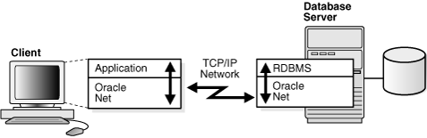
[Description of "Figure 1-1 Client/Server Application Connection"](img_text/netag107.md)

Specifically, Oracle Net is comprised of the [Oracle Net foundation layer](glossary.md), which establishes and maintains connections, and [Oracle protocol support](glossary.md), which maps the foundation layer technology to industry-standard protocols.

- Java Client Application Connections

**Parent topic:** Understanding Connectivity

###### 1.1.1.1.1 Java Client Application Connections

Java client applications access an Oracle database through a [Java Database Connectivity (JDBC) Driver](glossary.md), a standard Java interface for connecting from Java to a relational database. Oracle offers the following drivers:

- [JDBC OCI Driver](glossary.md) for client-side use with an Oracle client installation.

- [JDBC Thin Driver](glossary.md), a pure Java driver for client-side use without an Oracle installation, particularly with applets.

These drivers use Oracle Net to enable connectivity between a client application and an Oracle database.

Figure 1-2 shows a Java client application using a JDBC OCI driver and an Oracle Database server. The Java client application makes calls to the JDBC OCI driver, which translates the JDBC calls directly into the Oracle Net layer. The client then uses Oracle Net to communicate with Oracle Database that is also configured with Oracle Net.

Figure 1-2 Java Application Connection

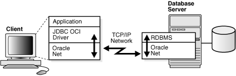
[Description of "Figure 1-2 Java Application Connection"](img_text/netag106.md)

**See Also:**

- [Oracle Database JDBC Developer's Guide](../jjdbc/JDBC-OCI-features.md)

- [Oracle Database JDBC Java API Reference](../jajdb/index.md)

**Parent topic:** About Client/Server Application Connections

##### 1.1.1.2 About Web Client Application Connections

Internet connections from client web browsers to an Oracle Database server are similar to client/server applications, except that the connection request goes to an application web server.

Figure 1-3 shows the basic architecture for web client connections, including a client web browser, an application web server, and an Oracle Database server. The browser on the client communicates with [HTTP](glossary.md) to the web server to make a connection request. The web server sends the request to an application where it is processed. The application then uses Oracle Net to communicate with the Oracle Database server that also is configured with Oracle Net.

Figure 1-3 Web Client Connections through Application Web Server

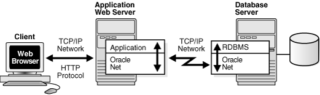
[Description of "Figure 1-3 Web Client Connections through Application Web Server"](img_text/netag105.md)

The basic components have the following characteristics:

- HyperText Transport Protocol (HTTP)

  HTTP provides the language that enables web browsers and application web servers to communicate.

- Application Web Server

  An application web server manages data for a website, controls access to that data, and responds to requests from web browsers. The application on the web server communicates with the database and performs the job requested by the web server.

<!-- -->

- Web Client Connections Through Java Application Web Server
- Web Client Connections Without an Application Web Server

**Parent topic:** Understanding Connectivity

###### 1.1.1.2.1 Web Client Connections Through Java Application Web Server

An application web server can host Java applications and servlets, as shown in Figure 1-4. Web browsers make a connection request by communicating through HTTP to an application web server. The application web server sends the request to an application or a servlet, which uses a JDBC OCI or a JDBC Thin driver to process the request. The driver then uses Oracle Net to communicate with the Oracle Database server that also is configured with Oracle Net.

Figure 1-4 Web Client Connections Through Java Application Web Server

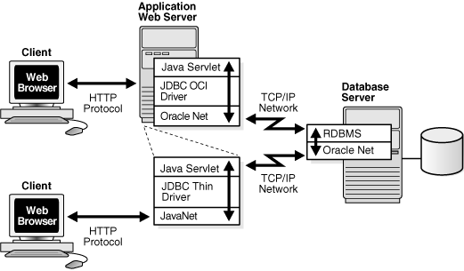
[Description of "Figure 1-4 Web Client Connections Through Java Application Web Server"](img_text/netag074.md)

**Parent topic:** About Web Client Application Connections

###### 1.1.1.2.2 Web Client Connections Without an Application Web Server

Web clients that do not require an application web server to access applications can access Oracle Database directly, for example, by using a Java applet. In addition to regular connections, the database can be configured to accept HTTP protocol, [FTP](glossary.md), or [WebDAV protocol](glossary.md) connections. These protocols are used for connections to [Oracle XML DB](glossary.md) in the Oracle Database instance.

Figure 1-5 shows two different web clients. The first web client makes an HTTP connection to the database. The second web client uses a web browser with a JDBC Thin driver, which in turn uses a Java version of Oracle Net called JavaNet to communicate with the Oracle Database server that is configured with Oracle Net.

**See Also:**

[Oracle XML DB Developer's Guide](../adxdb/accessing-XML-DB-repository-data.md)

Figure 1-5 Web Client Connection Scenarios

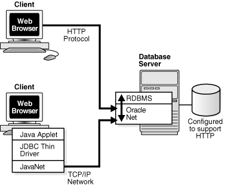
[Description of "Figure 1-5 Web Client Connection Scenarios"](img_text/netag075.md)

**Parent topic:** About Web Client Application Connections

#### 1.1.2 Understanding Manageability

Oracle Net Services offers several manageability features to configure and manage networking components.

- About Service Name and Location Transparency
  Each database is represented by one or more services. A service is a program that responds to requests from various clients or performs some operation.
- About Centralized Configuration and Management
  To manage large networking environments, administrators can access a centralized repository to specify and modify the network configuration. For this reason, you can store the Oracle Net Services configuration in an LDAP-compliant directory server.
- About Quick Installation and Configuration
  Networking elements for the Oracle Database server and clients are preconfigured for most environments.

**Parent topic:** About Oracle Net Services

##### 1.1.2.1 About Service Name and Location Transparency

Each database is represented by one or more services. A service is a program that responds to requests from various clients or performs some operation.

A service is identified by a service name, for example, `sales.us.example.com`. A client uses a service name to identify the database it must access. The information about the database service and its location in the network is transparent to the client because the information needed for a connection is stored in a repository.

The repository is represented by one or more naming methods. A naming method is a resolution method used by a client application to resolve a connect identifier to a connect descriptor when attempting to connect to a database service. Oracle Net Services offers several naming methods that support localized configuration on each client, or centralized configuration that can be accessed by all clients in the network.

For example, in the following figure, a company has three databases that clients can access. Each database has a distinct service name, such as `sales.us.example.com`, `hr.us.example.com`, and `mktg.us.example.com`.

1.  The client uses the repository to find the information it needs for `sales.us.example.com`.

2.  After the client has the information it needs, it connects to the database.

Figure 1-6 Service Information Repository

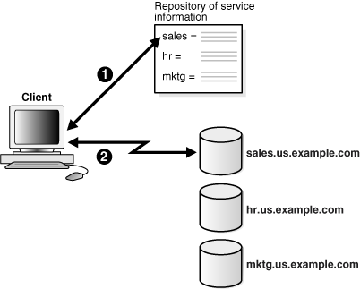
[Description of "Figure 1-6 Service Information Repository"](img_text/netag076.md)

**Parent topic:** Understanding Manageability

##### 1.1.2.2 About Centralized Configuration and Management

To manage large networking environments, administrators can access a centralized repository to specify and modify the network configuration. For this reason, you can store the Oracle Net Services configuration in an LDAP-compliant directory server.

Support of LDAP-compliant directory servers provides a centralized vehicle for managing and configuring a distributed Oracle network. The directory can act as a central repository for all information about database network components, user and corporate policies, and user authentication and security, thus replacing client-side and server-side localized configuration files.

All computers on the network can refer to the directory for information. Figure 1-7 shows clients, Oracle Database servers, and other servers (such as application web servers) connecting to a centralized directory server.

Figure 1-7 Centralized Storage of Network Configuration with a Directory Server

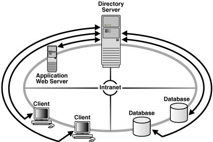
[Description of "Figure 1-7 Centralized Storage of Network Configuration with a Directory Server"](img_text/netag120.md)

**Related Topics**

- [Using a Directory Server for Centralized Management](managing-network-address-information.md)

**Parent topic:** Understanding Manageability

##### 1.1.2.3 About Quick Installation and Configuration

Networking elements for the Oracle Database server and clients are preconfigured for most environments.

The Easy Connect naming method is enabled by default, and does not require a repository. Clients connect using the hostname of the database. As a result, clients and servers are ready to connect out-of-the-box using Easy Connect, giving users the benefits of distributed computing.

**Parent topic:** Understanding Manageability

#### 1.1.3 Understanding Shared Server Architecture

The Oracle Database [shared server](glossary.md) architecture increases the scalability of applications and the number of clients that can simultaneously be connected to the database. The shared server architecture also enables existing applications to scale up without making any changes to the application itself.

When using a shared server, clients do not communicate directly with a database [server process](glossary.md), a database process that handles a client's requests on behalf of a database. Instead, client requests are routed to one or more [dispatcher](glossary.md)s. The dispatchers place the client requests in a common queue. An idle [shared server](glossary.md) from the shared pool of server processes picks up and processes a request from the queue. This means a small pool of server processes can serve a large number of clients.

Figure 1-8 and Figure 1-9 show the basic difference between the shared server connection model and the traditional [dedicated server](glossary.md) connection model. In the shared server model, a dispatcher can support multiple client connections concurrently. In the dedicated server model, there is one server process for each client. Each time a connection request is received, a server process is started and dedicated to that connection until completed. This causes a processing delay.

Figure 1-8 Shared Server Architecture

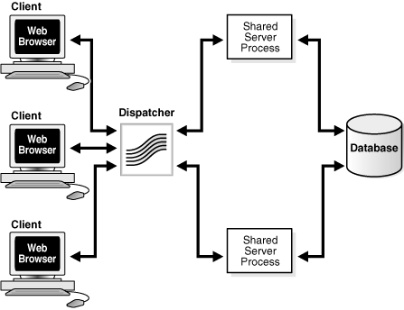
[Description of "Figure 1-8 Shared Server Architecture"](img_text/netag114.md)

Figure 1-9 Dedicated Server Architecture

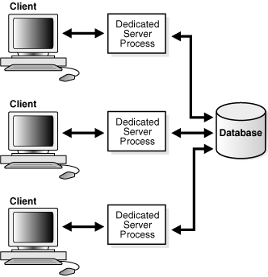
[Description of "Figure 1-9 Dedicated Server Architecture"](img_text/netag078.md)

A shared server is ideal for configurations with a large number of connections because it reduces the server memory requirements. A shared server is well suited for both Internet and intranet environments.

Utilization of server resources can be further enhanced with Oracle Connection Manager. [Oracle Connection Manager](glossary.md), an Oracle Net Services component, enables multiple client network sessions to be multiplexed, or funneled, through a single network connection to a database.

The [session multiplexing](glossary.md) feature reduces the demand on resources needed to maintain multiple network sessions between two processes by enabling the server to use fewer network connection endpoints for incoming requests. In this way, the total number of network sessions that a server can handle is increased. One Oracle Connection Manager with multiple gateways enables thousands of concurrent users to connect to a server.

Figure 1-10 shows how session multiplexing can be used in a web architecture. When Oracle Connection Manager is run on the same computer as an application web server, the application web server can route multiple client sessions through Oracle Connection Manager to ensure that those sessions have continuous access to an Oracle Database server. This functionality is especially useful for web applications where session availability and response time are major concerns.

Figure 1-10 Session Multiplexing

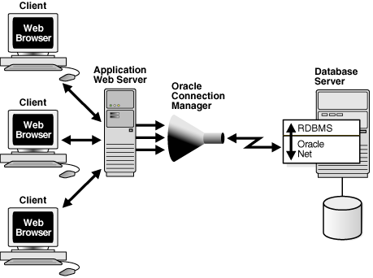
[Description of "Figure 1-10 Session Multiplexing"](img_text/netag080.md)

The following are the advantages and disadvantages of session multiplexing. Session multiplexing is recommended for networks where continuous connectivity is required.

Advantages of Session Multiplexing

- Limits the number of network resources used for each process

- Supports large client populations

- Maximizes the number of client/server sessions over a limited number of process connections

- Optimizes resource utilization

- Enables identification and monitoring of real users

- Enables mid-tier applications to support additional services

- Requires only a single transport for clients with multiple applications

- Requires only a single network connection for database links

Disadvantage of Session Multiplexing

Clients must connect to Oracle Connection Manager.

**Parent topic:** About Oracle Net Services

#### 1.1.4 Understanding Performance

System performance is important to users. Users usually start to notice performance when a system takes longer than one second to respond. Oracle Net configuration can be modified to enhance system performance.

This section discusses performance considerations.

- Listener Queue Size
- Session Data Unit Size for Data Transfer Optimization
- Persistent Buffer Flushing for TCP/IP
- Sockets Direct Protocol
- Database Availability

**Parent topic:** About Oracle Net Services

##### 1.1.4.1 Listener Queue Size

If you anticipate receiving a large number of connection requests for a listening process (such as a listener or Oracle Connection Manager) over TCP/IP, then Oracle Net enables you to configure the listening queue to be higher than the system default.

**Parent topic:** Understanding Performance

##### 1.1.4.2 Session Data Unit Size for Data Transfer Optimization

Before sending data across the network, Oracle Net buffers and encapsulates data into the [session data unit (SDU)](glossary.md). Oracle Net sends the data stored in this buffer when the buffer is full, flushed, or when database server tries to read data. When large amounts of data are being transmitted or when the message size is consistent, adjusting the size of the SDU buffers can improve performance, network utilization, or memory consumption. You can deploy SDU at the client, application web server, and database.

Tuning your application to reduce the number of round trips across the network is the best way to improve your network performance. If this is done, then it is also possible to optimize data transfer by adjusting the size of the SDU.

Considerations for Modifying the Size of the SDU

Modify the SDU size under the following situations:

- The data coming back from the server is fragmented into separate packets.

- You are on a wide area network (WAN) that has long delays.

- The packet size is consistently the same.

- Large amounts of data are returned.

Do not modify the SDU size under the following situations:

- The application can be tuned to avoid the delays listed in the adjacent column.

- You have a high speed network where the effect of the data transmission is negligible.

- Your requests return small amounts of data from the server.

**Note:**

Starting with Oracle Database 11g, Oracle Net Services optimizes bulk data transfer for certain components, such as Oracle SecureFiles LOBs and Oracle Data Guard redo transport services. The SDU size limit, as specified in the network parameter files, does not apply to these bulk data transfers. Bulk data transfer optimization does not apply when ASO options are enabled or TLS transport is used.

**See Also:**

"[Configuring Session Data Unit](optimizing-performance.md) "

**Parent topic:** Understanding Performance

##### 1.1.4.3 Persistent Buffer Flushing for TCP/IP

Under certain conditions for some applications using TCP/IP, Oracle Net packets may not get flushed immediately to the network. Most often, this behavior occurs when large amounts of data are streamed. The implementation of TCP/IP itself is the reason for the lack of flushing, causing unacceptable delays. To remedy this problem, specify no delays in the buffer flushing process.

**See Also:**

[Oracle Database Net Services Reference](../netrf/parameters-for-the-sqlnet.ora.md) for additional information about the TCP.NODELAY parameter

**Parent topic:** Understanding Performance

##### 1.1.4.4 Sockets Direct Protocol

Oracle Net Services provides support for InfiniBand high-speed networks. InfiniBand is a high-bandwidth I/O architecture designed to increase communication speed between CPUs, server-side devices, and network subsystems. Oracle Net Services provides support for Sockets Direct Protocol ([SDP](glossary.md)). SDP is an industry-standard wire protocol intended for use between InfiniBand network peers.

SDP reduces the overhead of TCP/IP by eliminating intermediate replication of data and transferring most of the messaging burden away from the CPU and onto the network hardware. The result is a low-[latency](glossary.md), increased bandwidth, high-throughput connection that reduces the amount of CPU cycles dedicated to network processing.

The communication between clients, including Oracle WebLogic Server or any other third-party middle-tier client, and Oracle Database 12c can take advantage of high-speed interconnect benefits. Oracle WebLogic Server includes Oracle TCP/IP support as part of its installation.

A driver installed on the Oracle WebLogic Server servers transparently converts TCP/IP support to SDP support. The SDP requests are then sent to an InfiniBand switch that processes and forwards the requests from the Oracle WebLogic Server servers to the database server.

**See Also:**

"[Configuring SDP Support for InfiniBand Connections](optimizing-performance.md)"

**Parent topic:** Understanding Performance

##### 1.1.4.5 Database Availability

Availability to the database is crucial for any network. You can configure multiple listeners to handle client connection requests for the same database service. This is beneficial in Oracle Real Application Clusters configurations, where each instance has a listener associated with it. Multiple listener configurations enable you to use the following features.

- Connect-time failover enables clients to request a different listener, usually on a different node, if the first listener fails.

- Client load balancing enables clients to randomize requests to the multiple listeners, usually on different nodes. These features can be used together or separately. Together, they ensure access to the database and distribute the load to not overburden a single listener.

**Parent topic:** Understanding Performance

#### 1.1.5 Understanding Network Security

Data access and the secure transfer of data are important considerations when deploying Oracle Database. Granting and denying access to a database is crucial for a secure network environment. Oracle Net Services enables database access control using firewall access control and valid node registration.

- Firewall Access Control

**See Also:**

"[Managing Oracle Net Listener Security](configuring-and-administering-oracle-net-listener.md)" for information about valid node registration

**Parent topic:** About Oracle Net Services

##### 1.1.5.1 Firewall Access Control

Oracle Connection Manager can be configured to grant or deny client access to a particular database service or a computer. By specifying filtering rules, you can allow or restrict specific client access to a server, based on the following criteria:

- Source host names or IP addresses for clients

- Destination host names or IP addresses for servers

- Destination database service names

- Client use of Oracle Net Services security features

Figure 1-11 shows an Oracle Connection Manager positioned between three clients and an Oracle Database server. Oracle Connection Manager is configured to allow access to the first two clients and to deny access to the third.

Figure 1-11 Intranet Network Access Control with Oracle Connection Manager

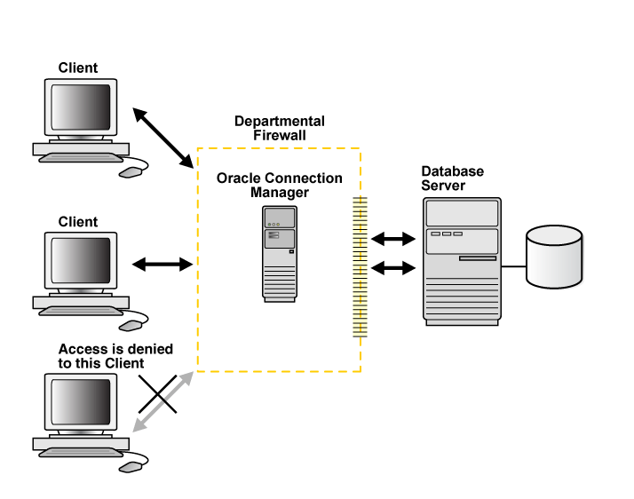
[Description of "Figure 1-11 Intranet Network Access Control with Oracle Connection Manager"](img_text/netag082.md)

Although Oracle Connection Manager cannot be integrated with third-party firewall products, vendors can package it with their own products in a way that enables this product to serve as an application gateway.

In general, firewalls should be set to receive incoming requests, and allow outbound calls from Oracle Database. By defining filtering rules, you can limit access to the network.

**Caution:**

Incorrectly setting your firewall options can cause security problems. Before changing your firewall settings, discuss the options and your network site policies with your system administrator.

Figure 1-12 shows an application gateway controlling traffic between internal and external networks and providing a single checkpoint for access control and auditing. As a result, unauthorized Internet hosts cannot directly access the database inside a corporation, but authorized users can still use Internet services outside the corporate network. This capability is critical in Internet environments to restrict remote access to sensitive data.

Figure 1-12 Internet Network Access Control with an Application Gateway

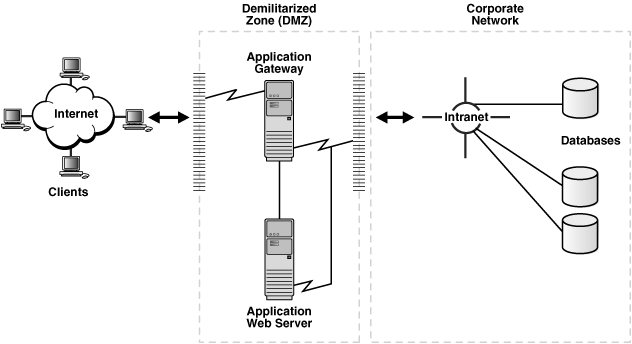
[Description of "Figure 1-12 Internet Network Access Control with an Application Gateway"](img_text/netag083.md)

It is important to deploy at least two Oracle Connection Manager firewalls or Oracle Net Firewall proxies in an Internet network environment in the event that one firewall goes down.

**Parent topic:** Understanding Network Security

### 1.2 Understanding Database Instances

A database has at least one instance. An instance is comprised of a memory area called the System Global Area (SGA) and Oracle background processes.

The memory and processes of an instance efficiently manage the associated database's data and serve the database users.

**Note:**

An instance also manages other services, such as Oracle XML DB.

The following figure shows two database instances, `sales` and `finance`, associated with their respective databases and service names.

Figure 1-13 One Instance for Each Database

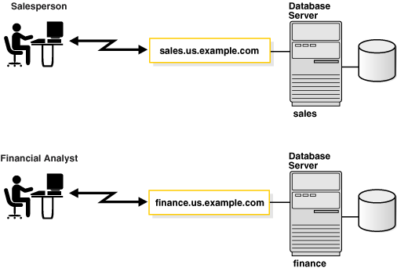
[Description of "Figure 1-13 One Instance for Each Database"](img_text/netag092.md)

Instances are identified by an instance name, such as `sales` and `finance` in this example. The instance name is specified by the `INSTANCE_NAME` initialization parameter. The instance name defaults to the Oracle system identifier (SID) of the database instance.

Some hardware architectures allow multiple computers to share access to data, software, or peripheral devices. Oracle Real Application Clusters (Oracle RAC) can take advantage of such architecture by running multiple instances on different computers that share a single physical database.

The following figure shows an Oracle RAC configuration. In this example, two instances, `sales1` and `sales2`, are associated with one database service, `sales.us.example.com`.

Figure 1-14 Multiple Instances Associated with an Oracle RAC Database

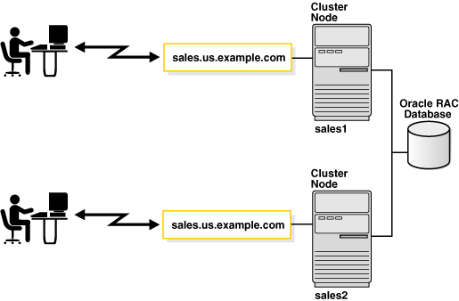
[Description of "Figure 1-14 Multiple Instances Associated with an Oracle RAC Database"](img_text/netag093.md)

**Parent topic:** Introducing Oracle Net Services

### 1.3 Components of Oracle Net Services

Learn about the connectivity, manageability, scalability, and security features.

- About Oracle Net
- About Oracle Net Listener
- About Oracle Connection Manager
- About Networking Tools
- About Oracle Advanced Security

**Parent topic:** Introducing Oracle Net Services

#### 1.3.1 About Oracle Net

Oracle Net is a software layer that resides on the client and on the Oracle Database server. It is responsible for establishing and maintaining the connection between the client application and server, as well as exchanging messages between them, using industry-standard protocols. Oracle Net has two software components:

- Oracle Net Foundation Layer
- Oracle Protocol Support
  The Oracle Net foundation layer uses Oracle protocol support to communicate with these industry-standard network protocols.

**Parent topic:** Components of Oracle Net Services

##### 1.3.1.1 Oracle Net Foundation Layer

On the client side, applications communicate with Oracle Net foundation layer to establish and maintain connections. The Oracle Net foundation layer uses Oracle protocol support that communicates with an industry-standard network protocol, such as TCP/IP, to communicate with the Oracle Database server.

Figure 1-15 illustrates the communication stack on the client.

Figure 1-15 Oracle Net on the Client

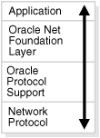
[Description of "Figure 1-15 Oracle Net on the Client"](img_text/netag087.md)

The Oracle Database server side is similar to the client side as illustrated in Figure 1-16. A network protocol sends client request information to an Oracle protocol support layer, which then sends information to the Oracle Net foundation layer. The Oracle Net foundation layer then communicates with the Oracle Database server to process the client request.

Figure 1-16 Oracle Net on the Server

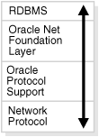
[Description of "Figure 1-16 Oracle Net on the Server"](img_text/netag088.md)

**Parent topic:** About Oracle Net

##### 1.3.1.2 Oracle Protocol Support

The Oracle Net foundation layer uses Oracle protocol support to communicate with these industry-standard network protocols.

- TCP/IP (version 4 and version 6)

- TCP/IP with Transport Layer Security (TLS)

- Named Pipes

- SDP

Oracle protocol support maps Oracle Net foundation layer functionality to industry-standard protocols used in client/server connections.

**Related Topics**

- [Understanding Oracle Protocol Support Layer](understanding-communication-layers.md)

**Parent topic:** About Oracle Net

#### 1.3.2 About Oracle Net Listener

Oracle Database server receives the initial connection through [Oracle Net Listener](glossary.md). Oracle Net Listener, referred to in this document as the [listener](glossary.md), brokers a client request, handing off the request to the server. The listener is configured with a protocol address, and clients configured with the same protocol address can send connection requests to the listener. When a connection is established, the client and Oracle server communicate directly with one another.

Oracle Net listener supports ACLs (Access Control Lists) for service and this is supported for all IP protocols.

**See Also:**

[DBSFWUSER.DBMS_SFW_ACL_ADMIN](../arpls/DBMS_SFW_ACL_ADMIN.md) in Oracle Database PL/SQL Packages and Types Reference for more information about listener ACLs

Figure 1-17 shows the listener accepting a connection request from a client and forwarding that request to an Oracle server.

Figure 1-17 Listener in a Connection Request

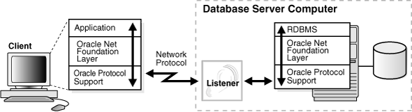
[Description of "Figure 1-17 Listener in a Connection Request"](img_text/netag089.md)

**See Also:**

[Configuring and Administering Oracle Net Listener](configuring-and-administering-oracle-net-listener.md) for additional information about the listener

**Parent topic:** Components of Oracle Net Services

#### 1.3.3 About Oracle Connection Manager

Oracle Connection Manager is the software component that resides on its own computer, separate from a client or an Oracle Database server. It proxies and screens requests for the database server. In addition, it multiplexes database sessions.

In its session multiplexing role, Oracle Connection Manager funnels multiple sessions through a single transport protocol connection to a particular destination. In this way, Oracle Connection Manager reduces the demand on resources needed to maintain multiple sessions between two processes by enabling the Oracle Database server to use fewer connection endpoints for incoming requests.

As an access control filter, Oracle Connection Manager controls access to Oracle databases.

**Note:**

Oracle Connection Manager can act as a Connection Manager in Traffic Director Mode by setting `tdm=yes` in `cman.ora`.

Oracle Connection Manager in Traffic Director mode provides improved high availability (HA) (planned and unplanned), connection multiplexing support, and load balancing. This feature also provides an inband client notification mechanism to deliver planned shutdown for Oracle Connection Manager down and service down events to the OCI client.

**See Also:**

- "Understanding Shared Server Architecture"

- "Firewall Access Control" for a description of filtering

**Parent topic:** Components of Oracle Net Services

#### 1.3.4 About Networking Tools

Oracle Net Services provides user interface tools and command-line utilities to configure, manage, and monitor the network.

- [Oracle Net Configuration Assistant](glossary.md) is a standalone tool that enables you to configure listeners and naming methods.

- [Oracle Enterprise Manager Cloud Control](glossary.md) combines configuration functionality across multiple file systems, along with listener administrative control to provide an integrated environment for configuring and managing Oracle Net Services.

- [Oracle Net Manager](glossary.md) provides configuration functionality for an Oracle home on a local client or server host.

- Command-line control utilities to configure, administer, and monitor network components, including listeners and Oracle Connection Managers.

With Oracle Enterprise Manager Cloud Control or Oracle Net Manager, you can fine-tune the listener and naming method configuration created with Oracle Net Configuration Assistant. In addition, Oracle Enterprise Manager Cloud Control and Oracle Net Manager offer built-in wizards and utilities to test connectivity, migrate data from one naming method to another, and create additional network components.

**See Also:**

[Managing Oracle Net Services](managing-oracle-net-services.md)

**Parent topic:** Components of Oracle Net Services

#### 1.3.5 About Oracle Advanced Security

Oracle Advanced Security is a separately licensable product that provides Oracle Database Transparent Data Encryption (TDE) and Oracle Data Redaction. TDE encrypts data so that only an authorized recipient can read it. Oracle Data Redaction enables an administrator to redact (mask) column data, using the following types of redaction:

- Full redaction redacts all the contents of the column data. The redacted value returned to the querying user depends on the data type of the column. For example, columns of the NUMBER data type are redacted with a zero (0) and character data types are redacted with a blank space.

- Partial redaction redacts a portion of the column data. For example, masking most of a credit card number with asterisks (\*), except for the last four digits.

- Regular expressions enable using patterns of data to redact. For example, use regular expressions to redact email addresses, which can have varying character lengths. It is designed for use with character data only.

- Random redaction present the redacted data to the querying user as randomly-generated values each time it is displayed.

- No redaction enables an administrator to test the internal operation of the redaction policies, with no effect on the results of queries against tables with policies defined on them.

**See Also:**

[Oracle Database Advanced Security Guide](../asoag/introduction-to-oracle-advanced-security.md)

**Parent topic:** Components of Oracle Net Services
