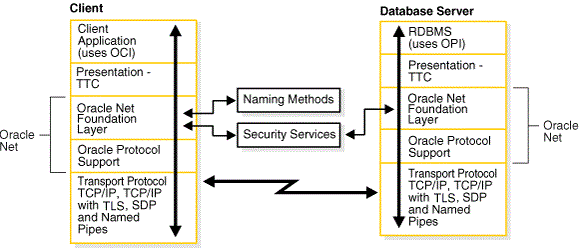
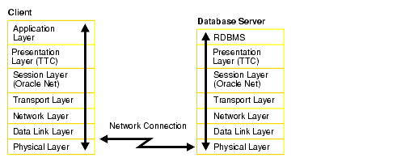
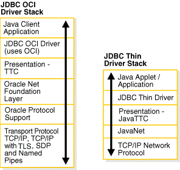
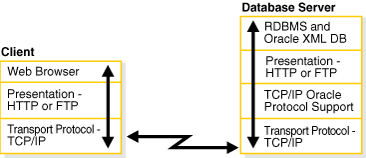
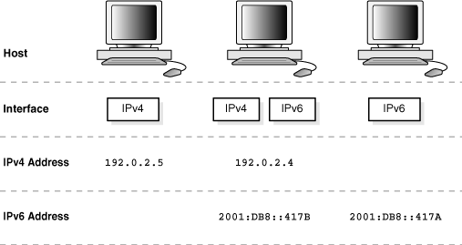
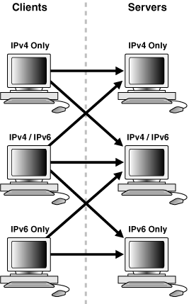

## 4 Understanding the Communication Layers

The primary function of Oracle Net is to establish and maintain connections between a client application and an Oracle database server.

Oracle Net is comprised of several communication layers that enable clients and database servers to share, modify, and manipulate data.

- Understanding Oracle Net Stack Communication for Client/Server Applications
  A database server is the Oracle software managing a database, and a client is an application that requests information from the server. The way the client and server communicate is known as the client/server stack.
- Using Oracle Net Stack Communication for Java Applications
  The Oracle Java Database Connectivity (JDBC) Drivers provide Java applications access to an Oracle database. Oracle offers two JDBC drivers.
- Using Oracle Net Stack Communication for Web Clients
- Understanding Oracle Protocol Support Layer
  A network protocol is responsible for transporting data from the client computer to the database server computer. This section describes the protocols used by the Oracle Protocol Support layer of the Oracle Net communication stack.

**Related Topics**

- [Introducing Oracle Net Services](introducing-oracle-net-services.md)

**Parent topic:** [Understanding Oracle Net Services](part-I-understanding-oracle-net-services.md)

### 4.1 Understanding Oracle Net Stack Communication for Client/Server Applications

A database server is the Oracle software managing a database, and a client is an application that requests information from the server. The way the client and server communicate is known as the client/server stack.

Information passed from a client application sent by the client communication stack across a network protocol is received by a similar communication stack on the database server side. The process flow on the database server side is the reverse of the process flow on the client side, with information ascending through the communication layers.

The following diagram illustrates the various layers on the client and on the database server after a connection has been established.

Figure 4-1 Layers Used in a Client/Server Application Connection

[Description of "Figure 4-1 Layers Used in a Client/Server Application Connection"](img_text/netag099.md)

This communication architecture is based on the [Open Systems Interconnection (OSI)](glossary.md) model. In the OSI model, communication between separate computers occurs in a stack-like fashion with information passing from one node to the other through several layers of code, including:

1.  Physical layer

2.  Data link layer

3.  Network layer

4.  Transport layer

5.  Session layer

6.  Presentation layer

7.  Application layer

The following diagram shows how Oracle Net software consisting of the Oracle Net foundation layer and Oracle Protocol Support fits into the session layer of the OSI model.

Figure 4-2 OSI Communication Layers

[Description of "Figure 4-2 OSI Communication Layers"](img_text/net81100.md)

This section contains the following topics:

- About the Client Communication Stack
- About the Server Communication Stack

**Parent topic:** Understanding the Communication Layers

#### 4.1.1 About the Client Communication Stack

The client communication stack includes the following:

- Client Application Layer
- Presentation Layer
- Oracle Net Foundation Layer
- Oracle Protocol Support Layer

**Parent topic:** Understanding Oracle Net Stack Communication for Client/Server Applications

##### 4.1.1.1 Client Application Layer

During a session with the database, the client uses [Oracle Call Interface (OCI)](glossary.md) to interact with the database server. OCI is a software component that provides an interface between the application and SQL.

**See Also:**

[Oracle Call Interface Programmer's Guide](../lnoci/introduction.md)

**Parent topic:** About the Client Communication Stack

##### 4.1.1.2 Presentation Layer

Character set differences can occur if the client and database server run on different operating systems. The presentation layer resolves any differences. It is optimized for each connection to perform conversion when required.

The presentation layer used by client/server applications is [Two-Task Common (TTC)](glossary.md). TTC provides character set and data type conversion between different character sets or formats on the client and database server. At the time of initial connection, TTC is responsible for evaluating differences in internal data and character set representations and determining whether conversions are required for the two computers to communicate.

**Parent topic:** About the Client Communication Stack

##### 4.1.1.3 Oracle Net Foundation Layer

The Oracle Net foundation layer is responsible for establishing and maintaining the connection between the client application and database server, as well as exchanging messages between them. The Oracle Net foundation layer can perform these tasks because of [Transparent Network Substrate (TNS)](glossary.md) technology. TNS provides a single, common interface for all industry-standard OSI transport and network layer protocols. TNS enables peer-to-peer application connectivity, where two or more computers can communicate with each other directly, without the need for any intermediary devices.

On the client side, the Oracle Net foundation layer receives client application requests and resolves all generic computer-level connectivity issues, such as:

- The location of the database server or destination

- How many protocols are involved in the connection

- How to handle interrupts between client and database server based on the capabilities of each

On the server side, the Oracle Net foundation layer performs the same tasks as it does on the client side. It also works with the listener to receive incoming connection requests.

In addition to establishing and maintaining connections, the Oracle Net foundation layer communicates with naming methods to resolve names and uses security services to ensure secure connections.

**Parent topic:** About the Client Communication Stack

##### 4.1.1.4 Oracle Protocol Support Layer

Oracle protocol support layer is positioned at the lowest layer of the Oracle Net foundation layer. It is responsible for mapping TNS functionality to industry-standard protocols used in the client/server connection. This layer supports the following network protocols:

- TCP/IP ([IPv4](glossary.md) and [IPv6](glossary.md))

- TCP/IP with Transport Layer Security (TLS)

- Named Pipes

- Sockets Direct Protocol (SDP)

- Exadirect

All Oracle software in the client/server connection process requires an existing network protocol stack to establish the computer-level connection between the two computers for the transport layer. The network protocol is responsible for transporting data from the client computer to the database server computer, at which point the data is passed to the server-side Oracle protocol support layer.

**Related Topics**

- Understanding Oracle Protocol Support Layer

**Parent topic:** About the Client Communication Stack

#### 4.1.2 About the Server Communication Stack

The server communication stack uses the same layers as the client stack with the exception that the database uses [Oracle Program Interface (OPI)](glossary.md). For each statement sent from OCI, OPI provides a response. For example, an OCI request to fetch 25 rows would elicit an OPI response to return the 25 rows after they have been fetched.

**Parent topic:** Understanding Oracle Net Stack Communication for Client/Server Applications

### 4.2 Using Oracle Net Stack Communication for Java Applications

The Oracle Java Database Connectivity (JDBC) Drivers provide Java applications access to an Oracle database. Oracle offers two JDBC drivers.

- [JDBC OCI Driver](glossary.md) is a type 2 JDBC driver which is used by client/server Java applications. The JDBC OCI driver uses a communication stack similar to a standard client/server communication stack. The JDBC OCI driver converts JDBC invocations to calls to OCI which are then sent over Oracle Net to the Oracle database server.

- [JDBC Thin Driver](glossary.md) is a type 4 driver which is used by Java applets. The JDBC Thin Driver establishes a direct connection to the Oracle database server over Java sockets. The JDBC Thin driver uses a Java implementation of the Oracle Net foundation layer called JavaNet and a Java implementation of TTC called JavaTTC to access the database.

The following figure shows the stack communication layers used by JDBC drivers.

Figure 4-3 Layers Used for Java-Client Applications

[Description of "Figure 4-3 Layers Used for Java-Client Applications"](img_text/netag101.md)

**Related Topics**

- [Oracle Database JDBC Developer’s Guide](../jjdbc/introducing-JDBC.md)

**Parent topic:** Understanding the Communication Layers

### 4.3 Using Oracle Net Stack Communication for Web Clients

The Oracle database server supports many other implementations for the presentation layer that can be used for web clients accessing features inside the database in addition to TTC. The listener facilitates this by supporting any presentation implementation requested by the database.

Figure 4-4 shows the stack communication layers used in an HTTP or FTP connection to [Oracle XML DB](glossary.md) in the Oracle database instance. WebDAV connections use the same stack communication layers as HTTP and FTP.

Figure 4-4 Layers Used in Web Client Connections

[Description of "Figure 4-4 Layers Used in Web Client Connections"](img_text/netag102.md)

**See Also:**

[Oracle XML DB Developer's Guide](../adxdb/intro-to-XML-DB.md)

**Parent topic:** Understanding the Communication Layers

### 4.4 Understanding Oracle Protocol Support Layer

A network protocol is responsible for transporting data from the client computer to the database server computer. This section describes the protocols used by the Oracle Protocol Support layer of the Oracle Net communication stack.

- About TCP/IP Protocol
  TCP/IP (Transmission Control Protocol/Internet Protocol) is the standard communication protocol suite used for client/server communication over a network.
- About TCP/IP with TLS Protocol
  The TCP/IP with Transport Layer Security (TLS) protocol enables an Oracle application on a client to communicate with remote databases through TCP/IP and TLS.
- About Named Pipes Protocol
  The Named Pipes protocol is a high-level interface providing interprocess communications between clients and database servers using distributed applications.
- About Sockets Direct Protocol (SDP)
  The Sockets Direct Protocol (SDP) is an industry-standard wire protocol between InfiniBand network peers. When used over an InfiniBand network, SDP reduces TCP/IP overhead by eliminating intermediate replication of data and transferring most of the messaging burden away from the CPU and onto the network hardware.
- About Exadirect Protocol
  The Exadirect protocol is an innovative protocol for low overhead database access. Use the new transport to improve latency and throughput by leveraging Remote Direct Memory Access (RDMA) in an InfiniBand environment.
- About Websocket Protocol
  The Database client connection supports secure websocket protocol. The secure web socket connection establishment is designed to work over `HTTPS`, to support `HTTPS` proxies and intermediary proxies.

**Parent topic:** Understanding the Communication Layers

#### 4.4.1 About TCP/IP Protocol

TCP/IP (Transmission Control Protocol/Internet Protocol) is the standard communication protocol suite used for client/server communication over a network.

TCP is the transport protocol that manages the exchange of data between hosts. IP is a network layer protocol for packet-switched networks.

Oracle Net supports IP in two versions: IP version 4 (IPv4) and IP version 6 (IPv6). IPv6 addresses the shortcomings of the currently used IPv4. The primary benefit of IPv6 is a large address space derived from the use of 128-bit addresses.

- IPv6 Address Notation
- IPv6 Interface and Address Configurations
- IPv6 Network Connectivity
- IPv6 Support in Oracle Database 12c

**See Also:**

[`http://tools.ietf.org/html/rfc2460`](https://docs.oracle.com/pls/topic/lookup?ctx=en/database/oracle/oracle-database/19/netag&id=tools_ietf_rfc2460) for the IPv6 specification

**Parent topic:** Understanding Oracle Protocol Support Layer

##### 4.4.1.1 IPv6 Address Notation

Oracle Database supports the standard IPv6 address notations specified by RFC 2732. A 128-bit IP address is generally represented as 8 groups of 4 hexadecimal digits, with the colon (`:`) symbol as the group separator. For example, the following address is in a valid IPv6 format:

    2001:0db8:0000:0000:0000:0000:200C:417A

Each hexadecimal digit in the address represents 4 bits, so each group in the address represents 16 bits. The following addresses represent the first and last hosts in the `2001:0db8:0000:0000` subnet:

    2001:0db8:0000:0000:0000:0000:0000:0000
    2001:0db8:0000:0000:FFFF:FFFF:FFFF:FFFF

In shorthand notation, consecutive zero fields can be compressed with a double colon (`::`) separator, as shown in the following equivalent notations:

    2001:0db8:0:0::200C:417A
    2001:0db8::200C:417A
    2001:DB8::200C:417A

- CIDR Notation
- IPv6 Addresses in URLs
- IPv4-Mapped Addresses

**See Also:**

- [`http://www.ietf.org/rfc/rfc2732.txt`](https://docs.oracle.com/pls/topic/lookup?ctx=en/database/oracle/oracle-database/19/netag&id=ietf_rfc_2732) for RFC 2732, and information about notational representation

- [`http://www.ietf.org/rfc/rfc3513.txt`](https://docs.oracle.com/pls/topic/lookup?ctx=en/database/oracle/oracle-database/19/netag&id=ietf_rfc_3513) for RFC 3513, and information about proper IPv6 addressing

**Parent topic:** About TCP/IP Protocol

###### 4.4.1.1.1 CIDR Notation

Classless Inter-Domain Routing (CIDR) is a method of grouping IP addresses into subnets that are independent of the value of the addresses. Classless routing was designed to overcome the exhaustion of address space in the IP class system and the unmanageable growth in the size of routing tables.

CIDR denotes a network by the first address in the network and the size in bits of the network prefix in decimal, separated with a slash (`/`). For example, `2001:0db8::/32` indicates that the first 32 bits of the address identify the network, whereas the remaining bits identify the hosts in the network.

CIDR uses an analogous notation for IPv4 address. For example, in the notation `192.0.2.0/24` the first 24 bits of the address represent the network prefix. The `DBMS_NETWORK_ACL_ADMIN` package, which provides an API to manage access control lists, supports CIDR notation for both IPv6 and IPv4 addresses and subnets.

**See Also:**

- [Oracle Database PL/SQL Packages and Types Reference](../arpls/DBMS_NETWORK_ACL_ADMIN.md) to learn about `DBMS_NETWORK_ACL_ADMIN`

- [`http://tools.ietf.org/html/rfc4632`](https://docs.oracle.com/pls/topic/lookup?ctx=en/database/oracle/oracle-database/19/netag&id=tools_ietf_rfc4632) for RFC 4632

**Parent topic:** IPv6 Address Notation

###### 4.4.1.1.2 IPv6 Addresses in URLs

In URLs, IPv6 addresses are enclosed by the left bracket (`[`) and right bracket (`]`) characters. For example, the IPv6 address `[2001:0db8:0:0:8:800:200C:417A]` forms part of the following URLs:

    http://[2001:0db8:0:0:8:800:200C:417A]
    http://[2001:0db8:0:0:8:800:200C:417A]:80/index.html

**Parent topic:** IPv6 Address Notation

###### 4.4.1.1.3 IPv4-Mapped Addresses

IPv4-mapped addresses are a subclass of IPv6 addresses in which the following conditions are true:

- The first 80 bits are set to 0 in the standard IPv6 notation

- The second 16 bits are set to 1 in the standard IPv6 notation

- The last 32 bits are in IPv4 notation

An IPv4-mapped address can represent the addresses of IPv4-only nodes as IPv6 addresses.

Example 4-1 shows the same IP address in different notations. The first address uses standard IPv6 notation. The second address is an IPv4-mapped address in which the last 32 bits use dotted-decimal IPv4 notation. The last address uses a shorthand notation to compress the consecutive zero fields.

Example 4-1 IPv4-Mapped Address

    0000:0000:0000:0000:0000:FFFF:C0A8:0226
    0000:0000:0000:0000:0000:FFFF:192.0.2.38
    ::FFFF:192.0.2.38

**See Also:**

[`http://tools.ietf.org/html/rfc4942`](https://docs.oracle.com/pls/topic/lookup?ctx=en/database/oracle/oracle-database/19/netag&id=tools_ietf_rfc4942) for security consideration relating to the use of IPv4-mapped addresses

**Parent topic:** IPv6 Address Notation

##### 4.4.1.2 IPv6 Interface and Address Configurations

A host may have different IPv4 and IPv6 interface configurations. The following configurations are possible for a host:

- Only an IPv4 interface, in which case the host is an IPv4-only host.

- Only an IPv6 interface, in which case the host is an IPv6-only host.

- Both an IPv4 and IPv6 interface, in which case the host is a dual-stack host.

A single host may also use different types of IP address. For example, a domain name server may associate a dual-stack host both by an IPv4 and an IPv6 address or only an IPv6 address. The IP address configurations that are not supported are the following:

- An IPv4-only host cannot use an IPv6 address.

- An IPv6-only host cannot use an IPv4 address.

Figure 4-5 shows possible host and interface configurations. The dual-stack host in the center of the diagram can communicate with IPv4 hosts over IPv4 and with IPv6 hosts over IPv6.

Figure 4-5 Supported Host and Interface Configurations

[Description of "Figure 4-5 Supported Host and Interface Configurations"](img_text/netag140.md)

**Parent topic:** About TCP/IP Protocol

##### 4.4.1.3 IPv6 Network Connectivity

The network connectivity of a host refers to its ability to communicate with another host over a network. For example, if a dual-stack client must communicate with an IPv6-only server, then the network and router must make end-to-end communication between these hosts possible.

A client or server host is IPv6-capable if it meets the following criteria:

- It has a configured IPv6 interface.

- It can connect to other hosts using the IPv6 protocol.

The IPv6 capability of a host is partially dependent on the network and partially dependent on its interface and address configuration. Figure 4-6 shows the possibilities for connectivity in a client/server network. For example, an IPv4-only host can connect to either an IPv4-only or dual-stack server, but not an IPv6-only server. Both dedicated and shared server modes are supported.

Figure 4-6 Client/Server Connectivity

[Description of "Figure 4-6 Client/Server Connectivity"](img_text/netag139.md)

Table 4-1 summarizes the IP protocols used for client/server connectivity with different host and network configurations.

Table 4-1 Supported Host and Network Configurations

| Client            | IPv4-Only Server | Dual-Stack Server  | IPv6-Only Server |
|:------------------|:-----------------|:-------------------|:-----------------|
| IPv4-Only Client  | Supported (v4)   | Supported (v4)     | Not Supported    |
| Dual-Stack Client | Supported (v4)   | Supported (v4, v6) | Supported (v6)   |
| IPv6-Only Client  | Not Supported    | Supported (v6)     | Supported        |

**See Also:**

- "[About IPv6 Addresses in Connect Descriptors](identifying-and-accessing-database.md)"

- "[Configuring Listening Protocol Addresses](configuring-and-administering-oracle-net-listener.md)"

- "[Using Oracle Connection Manager as a Bridge for IPv4 and IPv6](configuring-oracle-connection-manager.md)"

**Parent topic:** About TCP/IP Protocol

##### 4.4.1.4 IPv6 Support in Oracle Database 12c

Components in this release of Oracle Database 12c support IPv6 in the configurations described in "IPv6 Network Connectivity", with the following exception:

- Oracle Clusterware for private and ASM networks

**See Also:**

[Oracle Clusterware Administration and Deployment Guide](../cwadd/oracle-clusterware-administration.md)

**Parent topic:** About TCP/IP Protocol

#### 4.4.2 About TCP/IP with TLS Protocol

The TCP/IP with Transport Layer Security (TLS) protocol enables an Oracle application on a client to communicate with remote databases through TCP/IP and TLS.

Oracle Database supports mutual TLS (mTLS) and TLS authentication.

##### Mutual TLS or Two-Way Authentication

Mutual TLS (mTLS) authentication uses encryption data, such as certificates and private keys in Oracle wallets on both nodes to configure an encrypted secure link between the database server and database client. When the database client initiates a connection to the database server, mTLS performs a handshake between both the server and client using certificates stored in the wallet.

During the handshake, the following processes occur:

- The client and server negotiate a cipher suite (made up of a set of authentication, encryption, and data integrity types) to apply to the messages they exchange.

- With mTLS, the client and server exchange certificates to authenticate both the parties to each other. The certificate authenticity is checked against a root of trust by both the parties.

- The client and server agree upon a symmetric encryption key used to encrypt the communication channel.

The database checks the user certificate to verify that it bears the certificate authority's (CA) signature.

##### TLS or One-Way Authentication

If you do not require client authentication, similar to `HTTPS` connections that require only the web server to have a certificate, then you can configure TLS authentication. In this case, only the server authenticates to the client by presenting its server certificate and the client verifies whether the database server certificate is valid. This allows the client and server to establish the encrypted connection before exchanging any messages.

The database client recognizes and authenticates the identity of the database server in one of the following ways:

- TLS Authentication with a Client Wallet:

  TLS stores authentication data, such as trusted CA certificates and private keys, in an Oracle wallet. When the database server sends its certificate to the client, the database client verifies it using the trusted root certificate stored in the wallet.

- TLS Authentication without a Client Wallet:

  An Oracle client wallet with the server certificate is not required if the database server certificate is signed by a trusted root certificate that is already installed in the client system's default certificate store. The default certificate store is located in `/etc/pki/tls/cert.pem` on Linux or in the Microsoft Certificate Store on Windows. When the server sends its certificate to the client, the database client verifies the server certificate using common root certificates from the default certificate store.

  Walletless TLS authentication simplifies the client configuration and database client-server communication process because clients can use the system default certificate store to validate the server certificates, instead of configuring their own local wallets with trusted root certificates.

**Related Topics**

- [Oracle Database Security Guide](../dbseg/configuring-secure-sockets-layer-authentication.md)

**Parent topic:** Understanding Oracle Protocol Support Layer

#### 4.4.3 About Named Pipes Protocol

The Named Pipes protocol is a high-level interface providing interprocess communications between clients and database servers using distributed applications.

Named Pipes is specifically designed for Microsoft Windows LAN environments. One server-side process creates a named pipe, and the client-side process opens it by name. What one side writes, the other can read.

If a remote Oracle database is running on a host system that supports network communication using Named Pipes, then Oracle Net enables applications on a client to communicate with the Oracle database using Named Pipes.

**Parent topic:** Understanding Oracle Protocol Support Layer

#### 4.4.4 About Sockets Direct Protocol (SDP)

The Sockets Direct Protocol (SDP) is an industry-standard wire protocol between InfiniBand network peers. When used over an InfiniBand network, SDP reduces TCP/IP overhead by eliminating intermediate replication of data and transferring most of the messaging burden away from the CPU and onto the network hardware.

**Parent topic:** Understanding Oracle Protocol Support Layer

#### 4.4.5 About Exadirect Protocol

The Exadirect protocol is an innovative protocol for low overhead database access. Use the new transport to improve latency and throughput by leveraging Remote Direct Memory Access (RDMA) in an InfiniBand environment.

Exadirect protocol uses TCP for control communication and IB RC transport for data.

The Exadirect protocol adapter is supported only on Oracle Linux in this release.

**Parent topic:** Understanding Oracle Protocol Support Layer

#### 4.4.6 About Websocket Protocol

The Database client connection supports secure websocket protocol. The secure web socket connection establishment is designed to work over `HTTPS`, to support `HTTPS` proxies and intermediary proxies.

This protocol offers a native connection to the database with minimum protocol overhead. Secure websocket protocol is used to negotiate `SQL*Net` protocol during connection establishment between the database server and the client. The secure websocket protocol uses `TLS` and requires wallet for operation.

The Web server should support web socket tunneling. Web server proxy module (in case of Apache or Oracle HTTP Server (OHS), `mod_proxy_wstunnel`)) proxies the secure web socket database connection data between the client and the backend database server. The Database client connects using secure websocket protocol to Web server and the Web server connects to the database using websocket protocol.

**Parent topic:** Understanding Oracle Protocol Support Layer
