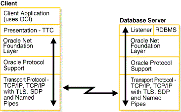
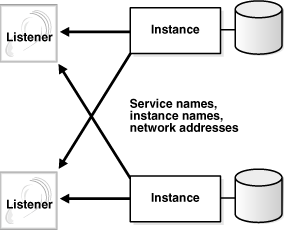
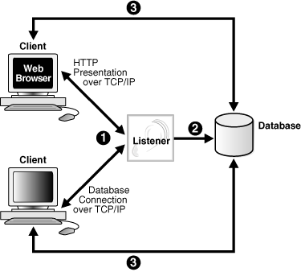
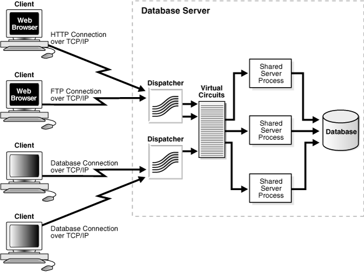
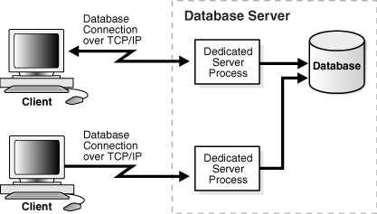
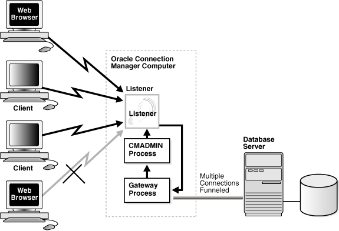
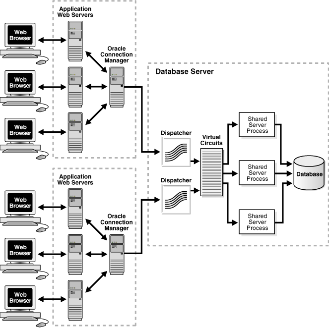

## 5 Understanding Oracle Net Architecture

The Oracle Net listener is an application positioned on top of the Oracle Net foundation layer. The database receives an initial connection from a client application through the listener.

The listener brokers client requests, handing off the requests to the Oracle database server. Every time a client requests a network session with a database, the listener receives the initial request.

The following diagram illustrates the various layers on the client and database during an initial connection. As shown in the diagram, the listener is at the top layer of the server-side network stack.

Figure 5-1 Layers Used in an Initial Connection

[Description of "Figure 5-1 Layers Used in an Initial Connection"](img_text/netag103.md)

- About Service Registration
- About the Listener and Connection Requests
- About Oracle Restart
- About Blocked Connection Requests
- Understanding Database Server Process Architecture
- Understanding Oracle Connection Manager Architecture
- Complete Architecture

**Parent topic:** [Understanding Oracle Net Services](part-I-understanding-oracle-net-services.md)

### 5.1 About Service Registration

The listener determines whether a database service and its service handlers are available through [service registration](glossary.md). During registration, the [Listener Registration (LREG)](glossary.md) process provides the listener with information about the following:

- Names of the database services provided by the database

- Name of the database [instance](glossary.md) associated with the services and its current and maximum load

- Service handlers ([dispatchers](glossary.md) and [dedicated servers](glossary.md)) available for the instance, including their type, protocol addresses, and current and maximum load

The preceding information enables the listener to direct a client request appropriately.

Figure 5-2 shows two database instances registering information with two listeners. The figure does not represent all the information that can be registered. For example, listening endpoints, such as the port numbers, can be dynamically registered with the listener.

Figure 5-2 Service Registration

[Description of "Figure 5-2 Service Registration"](img_text/netag035.md)

If the listener is not running when an instance starts, then the LREG process cannot register the service information. LREG attempts to connect to the listener periodically, but it may take up to 60 seconds before LREG registers with the listener after it has been started. To initiate service registration immediately after the listener is started, use the SQL statement `ALTER SYSTEM REGISTER`. This statement is especially useful in high availability configurations.

**Parent topic:** Understanding Oracle Net Architecture

### 5.2 About the Listener and Connection Requests

Each listener is configured with one or more [protocol addresses](glossary.md)that specify its listening endpoints. The protocol address defines the protocol the listener listens on and any other protocol-specific information. For example, the listener could be configured to listen at the following protocol address:

    (DESCRIPTION=
       (ADDRESS=(PROTOCOL=tcp)(HOST=sales-server)(PORT=1521)))

The preceding example shows a TCP/IP address that specifies the host of the listener (`sales-server`) and a port number (1521).

Clients configured with a protocol address can send connection requests to the listener. When a client request reaches the listener, it selects an appropriate [service handler](glossary.md) to service the request and forwards the request to the handler. A service handler is a dispatcher or a dedicated server process that acts as a connection point to a database.

Figure 5-3 illustrates the role of the listener during the establishment of a connection. The figure shows a browser making an HTTP connection and a client making a database connection.

1.  The browser or client send a connection request to the listener.

2.  The listener parses the request and forwards it to the service handler for the database service requested.

3.  The browser or client connect to the database.

Figure 5-3 Listener Architecture

[Description of "Figure 5-3 Listener Architecture"](img_text/netag108.md)

**Parent topic:** Understanding Oracle Net Architecture

### 5.3 About Oracle Restart

Oracle Restart enhances the availability of Oracle databases in a single-instance environment. Using the Server Control (SRVCTL) utility, you can add components such as the listener to an Oracle Restart configuration. The configuration enables the listener to start automatically when the listener fails or is not running.

When using Oracle Restart, note the following:

- Use the SRVCTL utility to start and stop the listener. Do not use the listener control utility LSNRCTL.

- Each listener must have a unique name.

**See Also:**

- "[Managing a Listener in an Oracle Restart Configuration](configuring-and-administering-oracle-net-listener.md)"

- [Oracle Database Administrator's Guide](../admin/configuring-automatic-restart-of-an-oracle-database.md) to learn how to configure Oracle Restart

**Parent topic:** Understanding Oracle Net Architecture

### 5.4 About Blocked Connection Requests

Blocked connection requests can occur when an incoming request occurs before the respective instance has been registered, or when a database is in restricted mode, such as when a shutdown of the database is in progress. If a database instance is in restricted mode, then LREG instructs the listener to block all connections to the instance. Clients attempting to connect receive one of the following errors:

- ORA-12526: TNS:listener: all appropriate instances are in restricted mode

- ORA-12527: TNS:listener: all appropriate instances are in restricted mode or blocking new connections

- ORA-12528: TNS:listener: all appropriate instances are blocking new connections

The ORA-12528 error occurs when a database instance is not yet registered with the listener.

**See Also:**

- [Oracle Database Error Messages](../errmg/index.md) for information about these error messages

- [Oracle Database SQL Reference](../sqlrf/SQL-Statements-ALTER-LIBRARY-to-ALTER-SESSION.md) for information about the `ALTER SYSTEM REGISTER` statement

- [Oracle XML DB Developer's Guide ](../adxdb/repository-access-using-protocols.md)for information about dynamically registering HTTP, FTP, and WebDAV listening endpoints

**Parent topic:** Understanding Oracle Net Architecture

### 5.5 Understanding Database Server Process Architecture

Based on the service handler type registered with the listener, the listener forwards requests to either a shared server or dedicated server process. The shared server architecture enables a database server to allow many client processes to share server processes. In a dedicated server configuration, the listener starts a separate dedicated server process for each incoming client connection request dedicated to servicing the client.

- About Shared Server Processes
- About Dedicated Server Processes

**Parent topic:** Understanding Oracle Net Architecture

#### 5.5.1 About Shared Server Processes

Shared server processes are used in the shared server architecture, as shown in Figure 5-4. With shared server architectures, client processes ultimately connect to a dispatcher. The LREG process registers the location and load of the dispatchers with the listener, enabling the listener to forward requests to the least loaded dispatcher. This registration process is not shown in the figure.

A dispatcher can support multiple client connections concurrently. Each client connection is bound to a [virtual circuit](glossary.md). A virtual circuit is a piece of shared memory used by the dispatcher for client database connection requests and replies. The dispatcher places a virtual circuit on a common request queue when a request arrives. An idle shared server picks up the virtual circuit from the request queue, services the request, and relinquishes the virtual circuit before attempting to retrieve another virtual circuit from the request queue. Shared servers place all completed requests into a dispatcher's response queue. Each dispatcher has its own response queue in the SGA (System Global Area). This approach enables a small pool of server processes to serve a large number of clients.

Figure 5-4 Shared Server Architecture

[Description of "Figure 5-4 Shared Server Architecture"](img_text/netag116.md)

**Parent topic:** Understanding Database Server Process Architecture

#### 5.5.2 About Dedicated Server Processes

In a dedicated server architecture, each client process connects to a dedicated server process. The server process is not shared by any other client. Figure 5-5 illustrates a dedicated server architecture.

LREG registers information about dedicated server processes with the listener. This enables the listener to start a dedicated server process when a client request arrives and forward the request to it.

**Note:**

Dedicated server architectures do not support HTTP, FTP, or WebDAV clients. Only database clients are supported.

Figure 5-5 Dedicated Server Architecture

[Description of "Figure 5-5 Dedicated Server Architecture"](img_text/netag115.md)

**Parent topic:** Understanding Database Server Process Architecture

### 5.6 Understanding Oracle Connection Manager Architecture

Oracle Connection Manager is a gateway through which client connection requests are sent either to the next hop or directly to the database server. Clients who relay connection requests through an Oracle Connection Manager can take advantage of the session multiplexing and access control features configured on Oracle Connection Manager. It carries no service information until a LREG process registers its services.

Oracle Connection Manager consists of three components:

- [listener](glossary.md)

- [CMGW (Oracle Connection Manager Gateway)](glossary.md)

- [CMADMIN (Oracle Connection Manager Administration)](glossary.md)

The listener receives client connections and evaluates against a set of rules whether to deny or allow access. If it allows access, then the listener forwards a request to a gateway process, selecting the one with the fewest connections. The CMGW process, in turn, forwards the request to another Oracle Connection Manager or directly to the database server, relaying data until the connection terminates. If a connection to the server already exists, then the gateway multiplexes, or funnels, its connections through the existing connection. CMADMIN monitors the state of the gateway processes and the listener, shutting down or starting up processes as needed. In addition, it registers the location and load of the gateway processes with the listener, and it answers requests from the Oracle Connection Manager Control utility.

In Figure 5-6, the listener screens connection requests. A gateway process registers with the CMADMIN process., and the CMADMIN process registers with the listener. Finally, the listener forwards the connection requests to the gateway process. After receiving the three valid client connections, the gateway process multiplexes them through a single network protocol connection to the database. The fourth connection is denied when it is evaluated against the set of rules.

Figure 5-6 Oracle Connection Manager Architecture

[Description of "Figure 5-6 Oracle Connection Manager Architecture"](img_text/netag135.md)

**Parent topic:** Understanding Oracle Net Architecture

### 5.7 Complete Architecture

Oracle Net provides an architectural solution that allows for greater scalability in Internet and intranet environments.

Figure 5-7 shows how multiple connections to an Oracle database server are made more scalable with Oracle Connection Manager and a shared server architecture. Oracle Connection Manager is used to offload some of the network I/O of the application web servers, and a shared server is used to serve more concurrent users.

Figure 5-7 Scalable Architectural Solutions

[Description of "Figure 5-7 Scalable Architectural Solutions"](img_text/netag142.md)

**Parent topic:** Understanding Oracle Net Architecture
