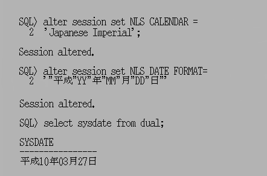

## A  Locale Data

This appendix lists the languages, territories, character sets, and other locale data supported by Oracle Database. This appendix contains the following topics:

- Languages

- Translated Messages

- Territories

- Character Sets

- Language and Character Set Detection Support

- Linguistic Collations

- Calendar Systems

- Time Zone Region Names

- Obsolete Locale Data

You can obtain information about character sets, languages, territories, and linguistic sorts by querying the `V$NLS_VALID_VALUES` dynamic performance view.

**See Also:**

[Oracle Database Reference ](../refrn/V-NLS_VALID_VALUES.md)for more information about the `V$NLS_VALID_VALUES` view

### A.1 Languages

Languages in Table A-1 provide support for locale-sensitive information such as:

- Day and month names and their abbreviations

- Symbols for equivalent expressions for A.M., P.M., A.D., and B.C.

- Default sorting sequence for character data when the `ORDER BY` SQL clause is specified

- Writing direction (left to right or right to left)

- Affirmative and negative response strings (for example, `YES` and `NO`)

By using Unicode databases and data types, you can store, process, and retrieve data for almost all contemporary languages, including many that do not appear in Table A-1.

Table A-1 Oracle Database Supported Languages

| Language Name          | Language Abbreviation | Default Sort    |
|:-----------------------|:----------------------|:----------------|
| ALBANIAN               | sq                    | GENERIC_M       |
| AMERICAN               | us                    | binary          |
| AMHARIC                | am                    | GENERIC_M       |
| ARABIC                 | ar                    | ARABIC          |
| ARMENIAN               | hy                    | GENERIC_M       |
| ASSAMESE               | as                    | binary          |
| AZERBAIJANI            | az                    | AZERBAIJANI     |
| BANGLA                 | bn                    | binary          |
| BASQUE                 | eu                    | GENERIC_M       |
| BELARUSIAN             | be                    | RUSSIAN         |
| BRAZILIAN PORTUGUESE   | ptb                   | WEST_EUROPEAN   |
| BULGARIAN              | bg                    | BULGARIAN       |
| CANADIAN FRENCH        | frc                   | CANADIAN FRENCH |
| CATALAN                | ca                    | CATALAN         |
| CROATIAN               | hr                    | CROATIAN        |
| CYRILLIC KAZAKH        | ckk                   | GENERIC_M       |
| CYRILLIC SERBIAN       | csr                   | GENERIC_M       |
| CYRILLIC UZBEK         | cuz                   | GENERIC_M       |
| CZECH                  | cs                    | CZECH           |
| DANISH                 | dk                    | DANISH          |
| DARI                   | prs                   | GENERIC_M       |
| DIVEHI                 | dv                    | GENERIC_M       |
| DUTCH                  | nl                    | DUTCH           |
| EGYPTIAN               | eg                    | ARABIC          |
| ENGLISH                | gb                    | binary          |
| ESTONIAN               | et                    | ESTONIAN        |
| FINNISH                | sf                    | FINNISH         |
| FRENCH                 | f                     | FRENCH          |
| GERMAN DIN             | din                   | GERMAN          |
| GERMAN                 | d                     | GERMAN          |
| GREEK                  | el                    | GREEK           |
| GUJARATI               | gu                    | binary          |
| HEBREW                 | iw                    | HEBREW          |
| HINDI                  | hi                    | binary          |
| HUNGARIAN              | hu                    | HUNGARIAN       |
| ICELANDIC              | is                    | ICELANDIC       |
| INDONESIAN             | in                    | INDONESIAN      |
| IRISH                  | ga                    | binary          |
| ITALIAN                | i                     | WEST_EUROPEAN   |
| JAPANESE               | ja                    | binary          |
| KANNADA                | kn                    | binary          |
| KHMER                  | km                    | GENERIC_M       |
| KOREAN                 | ko                    | binary          |
| LAO                    | lo                    | GENERIC_M       |
| LATIN AMERICAN SPANISH | esa                   | SPANISH         |
| LATIN BOSNIAN          | lbs                   | GENERIC_M       |
| LATIN SERBIAN          | lsr                   | binary          |
| LATIN UZBEK            | luz                   | GENERIC_M       |
| LATVIAN                | lv                    | LATVIAN         |
| LITHUANIAN             | lt                    | LITHUANIAN      |
| MACEDONIAN             | mk                    | binary          |
| MALAY                  | ms                    | MALAY           |
| MALAYALAM              | ml                    | binary          |
| MALTESE                | mt                    | GENERIC_M       |
| MARATHI                | mr                    | binary          |
| MEXICAN SPANISH        | esm                   | WEST_EUROPEAN   |
| NEPALI                 | ne                    | GENERIC_M       |
| NORWEGIAN              | n                     | NORWEGIAN       |
| ORIYA                  | or                    | binary          |
| PERSIAN                | fa                    | GENERIC_M       |
| POLISH                 | pl                    | POLISH          |
| PORTUGUESE             | pt                    | WEST_EUROPEAN   |
| PUNJABI                | pa                    | binary          |
| ROMANIAN               | ro                    | ROMANIAN        |
| RUSSIAN                | ru                    | RUSSIAN         |
| SIMPLIFIED CHINESE     | zhs                   | binary          |
| SINHALA                | si                    | GENERIC_M       |
| SLOVAK                 | sk                    | SLOVAK          |
| SLOVENIAN              | sl                    | SLOVENIAN       |
| SPANISH                | e                     | SPANISH         |
| SWAHILI                | sw                    | GENERIC_M       |
| SWEDISH                | s                     | SWEDISH         |
| TAMIL                  | ta                    | binary          |
| TELUGU                 | te                    | binary          |
| THAI                   | th                    | THAI_DICTIONARY |
| TRADITIONAL CHINESE    | zht                   | binary          |
| TURKISH                | tr                    | TURKISH         |
| TURKMEN                | tk                    | GENERIC_M       |
| UKRAINIAN              | uk                    | UKRAINIAN       |
| URDU                   | ur                    | GENERIC_M       |
| VIETNAMESE             | vn                    | VIETNAMESE      |

### A.2 Translated Messages

Oracle Database error messages have been translated into the languages which are listed in Table A-2.

Table A-2 Oracle Database Supported Messages

| Name                 | Abbreviation |
|:---------------------|:-------------|
| ARABIC               | ar           |
| BRAZILIAN PORTUGUESE | ptb          |
| CATALAN              | ca           |
| CZECH                | cs           |
| DANISH               | dk           |
| DUTCH                | nl           |
| FINNISH              | sf           |
| FRENCH               | f            |
| GERMAN               | d            |
| GREEK                | el           |
| HEBREW               | iw           |
| HUNGARIAN            | hu           |
| ITALIAN              | i            |
| JAPANESE             | ja           |
| KOREAN               | ko           |
| NORWEGIAN            | n            |
| POLISH               | pl           |
| PORTUGUESE           | pt           |
| ROMANIAN             | ro           |
| RUSSIAN              | ru           |
| SIMPLIFIED CHINESE   | zhs          |
| SLOVAK               | sk           |
| SPANISH              | e            |
| SWEDISH              | s            |
| THAI                 | th           |
| TRADITIONAL CHINESE  | zht          |
| TURKISH              | tr           |

### A.3 Territories

Table A-3 lists the territories that Oracle Database supports.

Table A-3 Oracle Database Supported Territories

| Territory                                                                                                                                                                                                                                                                                                                                                                                                                                                                                                                                                                                                                                                                             | Territory                                                                                                                                                                                                                                                                                                                                                                                                                                                                                                                                                                                  | Territory                                                                                                                                                                                                                                                                                                                                                                                                                                                                                                                                                                                                                                                              |
|:--------------------------------------------------------------------------------------------------------------------------------------------------------------------------------------------------------------------------------------------------------------------------------------------------------------------------------------------------------------------------------------------------------------------------------------------------------------------------------------------------------------------------------------------------------------------------------------------------------------------------------------------------------------------------------------|:-------------------------------------------------------------------------------------------------------------------------------------------------------------------------------------------------------------------------------------------------------------------------------------------------------------------------------------------------------------------------------------------------------------------------------------------------------------------------------------------------------------------------------------------------------------------------------------------|:-----------------------------------------------------------------------------------------------------------------------------------------------------------------------------------------------------------------------------------------------------------------------------------------------------------------------------------------------------------------------------------------------------------------------------------------------------------------------------------------------------------------------------------------------------------------------------------------------------------------------------------------------------------------------|
| AFGHANISTAN ALBANIA ALGERIA AMERICA ANGOLA ANTIGUA AND BARBUDA ARGENTINA ARMENIA ARUBA AUSTRALIA AUSTRIA AZERBAIJAN BAHAMAS BAHRAIN BANGLADESH BARBADOS BELARUS BELGIUM BELIZE BERMUDA BOLIVIA BOSNIA AND HERZEGOVINA BOTSWANA BRAZIL BULGARIA CAMBODIA CAMEROON CANADA CATALONIA CAYMAN ISLANDS CHILE CHINA COLOMBIA CONGO BRAZZAVILLE CONGO KINSHASA COSTA RICA CROATIA CURACAO CYPRUS CZECH REPUBLIC DENMARK DJIBOUTI DOMINICA DOMINICAN REPUBLIC ECUADOR EGYPT EL SALVADOR ESTONIA ETHIOPIA FINLAND FRANCE FYR MACEDONIA | GABON GERMANY GHANA GREECE GRENADA GUATEMALA GUYANA HAITI HONDURAS HONG KONG HUNGARY ICELAND INDIA INDONESIA IRAN IRAQ IRELAND ISRAEL ITALY IVORY COAST JAMAICA JAPAN JORDAN KAZAKHSTAN KENYA KOREA KUWAIT LAOS LATVIA LEBANON LIBYA LIECHTENSTEIN LITHUANIA LUXEMBOURG MACAO MALAWI MALAYSIA MALDIVES MALTA MAURITANIA MAURITIUS MEXICO MOLDOVA MONTENEGRO MOROCCO MOZAMBIQUE NAMIBIA NEPAL NEW ZEALAND NICARAGUA NIGERIA NORWAY | OMAN PAKISTAN PANAMA PARAGUAY PERU PHILIPPINES POLAND PORTUGAL PUERTO RICO QATAR ROMANIA RUSSIA SAINT KITTS AND NEVIS SAINT LUCIA SAUDI ARABIA SENEGAL SERBIA SIERRA LEONE SINGAPORE SLOVAKIA SLOVENIA SOMALIA SOUTH AFRICA SOUTH SUDAN SPAIN SRI LANKA SUDAN SURINAME SWAZILAND SWEDEN SWITZERLAND SYRIA TAIWAN TANZANIA THAILAND THE NETHERLANDS TRINIDAD AND TOBAGO TUNISIA TURKEY TURKMENISTAN UGANDA UKRAINE UNITED ARAB EMIRATES UNITED KINGDOM URUGUAY UZBEKISTAN VENEZUELA VIETNAM YEMEN ZAMBIA ZIMBABWE |

### A.4 Character Sets

The character sets that Oracle Database supports are listed in the following sections according to three broad categories.

- Recommended Database Character Sets

- Other Character Sets

- Client-Only Character Sets

In addition, common character set subset/superset combinations are listed. Some character sets can only be used with certain data types. For example, the AL16UTF16 character set can only be used as an `NCHAR` character set, and not as a database character set.

Also documented in the comment section are other unique features of the character set that may be important to users or your database administrator. For example, the information includes whether the character set supports the euro currency symbol, whether user-defined characters are supported, and whether the character set is a strict superset of ASCII. (You can use the Database Migration Assistant for Unicode to migrate an existing database to a new character set, only if all of the schema data is a strict subset of the new character set.)

The key for the comment column of the character set tables is:

- SB: single-byte encoding
- MB: multibyte encoding
- FIXED: fixed-width multibyte encoding
- ASCII: strict superset of ASCII
- EURO: euro symbol supported
- UDC: user-defined characters supported

Oracle Database does not document individual code page layouts. For specific details about a particular character set, its character repertoire, and code point values, you can use Oracle Locale Builder. Otherwise, you should refer to the actual national, international, or vendor-specific standards.

**See Also:**

- [Oracle Database Migration Assistant for Unicode Guide](https://docs.oracle.com/pls/topic/lookup?ctx=en/database/oracle/oracle-database/19/nlspg&id=DUMAG113)

- "[Customizing Locale Data](customizing-locale-data.md)"

#### A.4.1 Recommended Database Character Sets

Table A-4 lists the recommended and most commonly used ASCII-based Oracle Database character sets. The list is ordered alphabetically within their respective language group.

Table A-4 Recommended ASCII Database Character Sets

| Language Group | Character Set  | Description                                                                                                                                           | Comments        |
|:---------------|:---------------|:------------------------------------------------------------------------------------------------------------------------------------------------------|:----------------|
| Asian          | JA16EUC        | EUC 24-bit Japanese                                                                                                                                   | MB, ASCII       |
| Asian          | JA16EUCTILDE   | The same as JA16EUC except for the way that the wave dash and the tilde are mapped to and from Unicode.                                               | MB, ASCII       |
| Asian          | JA16SJIS       | Shift-JIS 16-bit Japanese                                                                                                                             | MB, ASCII, UDC  |
| Asian          | JA16SJISTILDE  | The same as JA16SJIS except for the way that the wave dash and the tilde are mapped to and from Unicode.                                              | MB, ASCII, UDC  |
| Asian          | KO16MSWIN949   | MS Windows Code Page 949 Korean                                                                                                                       | MB, ASCII, UDC  |
| Asian          | TH8TISASCII    | Thai Industrial Standard 620-2533 - ASCII 8-bit                                                                                                       | SB, ASCII, EURO |
| Asian          | VN8MSWIN1258   | MS Windows Code Page 1258 8-bit Vietnamese                                                                                                            | SB, ASCII, EURO |
| Asian          | ZHS16GBK       | GBK 16-bit Simplified Chinese                                                                                                                         | MB, ASCII, UDC  |
| Asian          | ZHT16HKSCS     | MS Windows Code Page 950 with Hong Kong Supplementary Character Set HKSCS-2001 (character set conversion to and from Unicode is based on Unicode 3.0) | MB, ASCII, EURO |
| Asian          | ZHT16MSWIN950  | MS Windows Code Page 950 Traditional Chinese                                                                                                          | MB, ASCII, UDC  |
| Asian          | ZHT32EUC       | EUC 32-bit Traditional Chinese                                                                                                                        | MB, ASCII       |
| European       | BLT8ISO8859P13 | ISO 8859-13 Baltic                                                                                                                                    | SB, ASCII       |
| European       | BLT8MSWIN1257  | MS Windows Code Page 1257 8-bit Baltic                                                                                                                | SB, ASCII, EURO |
| European       | CL8ISO8859P5   | ISO 8859-5 Latin/Cyrillic                                                                                                                             | SB, ASCII       |
| European       | CL8MSWIN1251   | MS Windows Code Page 1251 8-bit Latin/Cyrillic                                                                                                        | SB, ASCII, EURO |
| European       | EE8ISO8859P2   | ISO 8859-2 East European                                                                                                                              | SB, ASCII       |
| European       | EL8ISO8859P7   | ISO 8859-7 Latin/Greek                                                                                                                                | SB, ASCII, EURO |
| European       | EL8MSWIN1253   | MS Windows Code Page 1253 8-bit Latin/Greek                                                                                                           | SB, ASCII, EURO |
| European       | EE8MSWIN1250   | MS Windows Code Page 1250 8-bit East European                                                                                                         | SB, ASCII, EURO |
| European       | NE8ISO8859P10  | ISO 8859-10 North European                                                                                                                            | SB, ASCII       |
| European       | NEE8ISO8859P4  | ISO 8859-4 North and North-East European                                                                                                              | SB, ASCII       |
| European       | WE8ISO8859P15  | ISO 8859-15 West European                                                                                                                             | SB, ASCII, EURO |
| European       | WE8MSWIN1252   | MS Windows Code Page 1252 8-bit West European                                                                                                         | SB, ASCII, EURO |
| Middle Eastern | AR8ISO8859P6   | ISO 8859-6 Latin/Arabic                                                                                                                               | SB, ASCII       |
| Middle Eastern | AR8MSWIN1256   | MS Windows Code Page 1256 8-Bit Latin/Arabic                                                                                                          | SB, ASCII, EURO |
| Middle Eastern | IW8ISO8859P8   | ISO 8859-8 Latin/Hebrew                                                                                                                               | SB, ASCII       |
| Middle Eastern | IW8MSWIN1255   | MS Windows Code Page 1255 8-bit Latin/Hebrew                                                                                                          | SB, ASCII, EURO |
| Middle Eastern | TR8MSWIN1254   | MS Windows Code Page 1254 8-bit Turkish                                                                                                               | SB, ASCII, EURO |
| Middle Eastern | WE8ISO8859P9   | ISO 8859-9 West European & Turkish                                                                                                                    | SB, ASCII       |
| Universal      | AL32UTF8       | Unicode 9.0 Universal Character Set (UCS), UTF-8 encoding scheme                                                                                      | MB, ASCII, EURO |

Table A-5 lists the recommended and most commonly used EBCDIC-based Oracle Database character sets. The list is ordered alphabetically within their respective language group.

Table A-5 Recommended EBCDIC Database Character Sets

| Language Group | Character Set   | Description                                            | Comments         |
|:---------------|:----------------|:-------------------------------------------------------|:-----------------|
| Asian          | JA16DBCS        | IBM EBCDIC 16-bit Japanese                             | MB, UDC          |
| Asian          | JA16EBCDIC930   | IBM DBCS Code Page 290 16-bit Japanese                 | MB, UDC          |
| Asian          | KO16DBCS        | IBM EBCDIC 16-bit Korean                               | MB, UDC          |
| Asian          | TH8TISEBCDICS   | Thai Industrial Standard 620-2533-EBCDIC Server 8-bit  | SB               |
| European       | BLT8EBCDIC1112S | EBCDIC Code Page 1112 8-bit Server Baltic Multilingual | SB               |
| European       | CE8BS2000       | Siemens EBCDIC.DF.04 8-bit Central European            | SB               |
| European       | CL8BS2000       | Siemens EBCDIC.EHC.LC 8-bit Cyrillic                   | SB               |
| European       | CL8EBCDIC1025R  | EBCDIC Code Page 1025 Server 8-bit Cyrillic            | SB               |
| European       | CL8EBCDIC1158R  | EBCDIC Code Page 1158 Server 8-bit Cyrillic            | SB               |
| European       | D8EBCDIC1141    | EBCDIC Code Page 1141 8-bit Austrian German            | SB, EURO         |
| European       | DK8EBCDIC1142   | EBCDIC Code Page 1142 8-bit Danish                     | SB, EURO         |
| European       | EE8BS2000       | Siemens EBCDIC.DF.04 8-bit East European               | SB               |
| European       | EE8EBCDIC870S   | EBCDIC Code Page 870 Server 8-bit East European        | SB               |
| European       | EL8EBCDIC423R   | IBM EBCDIC Code Page 423 for RDBMS server-side         | SB               |
| European       | EL8EBCDIC875R   | EBCDIC Code Page 875 Server 8-bit Greek                | SB               |
| European       | F8EBCDIC1147    | EBCDIC Code Page 1147 8-bit French                     | SB, EURO         |
| European       | I8EBCDIC1144    | EBCDIC Code Page 1144 8-bit Italian                    | SB, EURO         |
| European       | S8EBCDIC1143    | EBCDIC Code Page 1143 8-bit Swedish                    | SB, EURO         |
| European       | WE8BS2000       | Siemens EBCDIC.DF.04 8-bit West European               | SB               |
| European       | WE8BS2000E      | Siemens EBCDIC.DF.04 8-bit West European               | SB, EURO         |
| European       | WE8BS2000L5     | Siemens EBCDIC.DF.L5 8-bit West European/Turkish       | SB               |
| European       | WE8EBCDIC1047E  | Latin 1/Open Systems 1047                              | SB, EBCDIC, EURO |
| European       | WE8EBCDIC1140   | EBCDIC Code Page 1140 8-bit West European              | SB, EURO         |
| European       | WE8EBCDIC1145   | EBCDIC Code Page 1145 8-bit West European              | SB, EURO         |
| European       | WE8EBCDIC1146   | EBCDIC Code Page 1146 8-bit West European              | SB, EURO         |
| European       | WE8EBCDIC1148   | EBCDIC Code Page 1148 8-bit West European              | SB, EURO         |
| Middle Eastern | AR8EBCDIC420S   | EBCDIC Code Page 420 Server 8-bit Latin/Arabic         | SB               |
| Middle Eastern | IW8EBCDIC424S   | EBCDIC Code Page 424 Server 8-bit Latin/Hebrew         | SB               |
| Middle Eastern | TR8EBCDIC1026S  | EBCDIC Code Page 1026 Server 8-bit Turkish             | SB               |

#### A.4.2 Other Character Sets

Table A-6 lists the other ASCII-based Oracle Database character sets. The list is ordered alphabetically within their language groups.

Table A-6 Other ASCII-based Database Character Sets

| Language Group | Character Set   | Description                                                                                                                                           | Comments        |
|:---------------|:----------------|:------------------------------------------------------------------------------------------------------------------------------------------------------|:----------------|
| Asian          | BN8BSCII        | Bangladesh National Code 8-bit BSCII                                                                                                                  | SB, ASCII       |
| Asian          | IN8ISCII        | Multiple-Script Indian Standard 8-bit Latin/Indian Languages                                                                                          | SB, ASCII       |
| Asian          | JA16VMS         | JVMS 16-bit Japanese                                                                                                                                  | MB, ASCII       |
| Asian          | KO16KSC5601     | KSC5601 16-bit Korean                                                                                                                                 | MB, ASCII       |
| Asian          | KO16KSCCS       | KSCCS 16-bit (Johab) Korean                                                                                                                           | MB, ASCII       |
| Asian          | TH8MACTHAIS     | Mac Server 8-bit Latin/Thai                                                                                                                           | SB, ASCII       |
| Asian          | VN8VN3          | VN3 8-bit Vietnamese                                                                                                                                  | SB, ASCII       |
| Asian          | ZHS16CGB231280  | CGB2312-80 16-bit Simplified Chinese                                                                                                                  | MB, ASCII       |
| Asian          | ZHT16BIG5       | BIG5 16-bit Traditional Chinese                                                                                                                       | MB, ASCII       |
| Asian          | ZHT16CCDC       | HP CCDC 16-bit Traditional Chinese                                                                                                                    | MB, ASCII       |
| Asian          | ZHT16DBT        | Taiwan Taxation 16-bit Traditional Chinese                                                                                                            | MB, ASCII       |
| Asian          | ZHT16HKSCS31    | MS Windows Code Page 950 with Hong Kong Supplementary Character Set HKSCS-2001 (character set conversion to and from Unicode is based on Unicode 3.1) | MB, ASCII, EURO |
| Asian          | ZHT32SOPS       | SOPS 32-bit Traditional Chinese                                                                                                                       | MB, ASCII       |
| Asian          | ZHT32TRIS       | TRIS 32-bit Traditional Chinese                                                                                                                       | MB, ASCII       |
| Middle Eastern | AR8ADOS710      | Arabic MS-DOS 710 Server 8-bit Latin/Arabic                                                                                                           | SB, ASCII       |
| Middle Eastern | AR8ADOS720      | Arabic MS-DOS 720 Server 8-bit Latin/Arabic                                                                                                           | SB, ASCII       |
| Middle Eastern | AR8APTEC715     | APTEC 715 Server 8-bit Latin/Arabic                                                                                                                   | SB, ASCII       |
| Middle Eastern | AR8ARABICMACS   | Mac Server 8-bit Latin/Arabic                                                                                                                         | SB, ASCII       |
| Middle Eastern | AR8ASMO8X       | ASMO Extended 708 8-bit Latin/Arabic                                                                                                                  | SB, ASCII       |
| Middle Eastern | AR8MUSSAD768    | Mussa'd Alarabi/2 768 Server 8-bit Latin/Arabic                                                                                                       | SB, ASCII       |
| Middle Eastern | AR8NAFITHA711   | Nafitha Enhanced 711 Server 8-bit Latin/Arabic                                                                                                        | SB, ASCII       |
| Middle Eastern | AR8NAFITHA721   | Nafitha International 721 Server 8-bit Latin/Arabic                                                                                                   | SB, ASCII       |
| Middle Eastern | AR8SAKHR706     | SAKHR 706 Server 8-bit Latin/Arabic                                                                                                                   | SB, ASCII       |
| Middle Eastern | AR8SAKHR707     | SAKHR 707 Server 8-bit Latin/Arabic                                                                                                                   | SB, ASCII       |
| Middle Eastern | AZ8ISO8859P9E   | ISO 8859-9 Latin Azerbaijani                                                                                                                          | SB, ASCII       |
| Middle Eastern | IN8ISCII        | Multiple-Script Indian Standard 8-bit Latin/Indian Languages                                                                                          | SB, ASCII       |
| Middle Eastern | IW8MACHEBREWS   | Mac Server 8-bit Hebrew                                                                                                                               | SB, ASCII       |
| Middle Eastern | IW8PC1507       | IBM-PC Code Page 1507/862 8-bit Latin/Hebrew                                                                                                          | SB, ASCII       |
| Middle Eastern | LA8ISO6937      | ISO 6937 8-bit Coded Character Set for Text Communication                                                                                             | SB, ASCII       |
| Middle Eastern | TR8DEC          | DEC 8-bit Turkish                                                                                                                                     | SB, ASCII       |
| Middle Eastern | TR8MACTURKISHS  | Mac Server 8-bit Turkish                                                                                                                              | SB, ASCII       |
| Middle Eastern | TR8PC857        | IBM-PC Code Page 857 8-bit Turkish                                                                                                                    | SB, ASCII       |
| European       | BG8MSWIN        | MS Windows 8-bit Bulgarian Cyrillic                                                                                                                   | SB, ASCII       |
| European       | BG8PC437S       | IBM-PC Code Page 437 8-bit (Bulgarian Modification)                                                                                                   | SB, ASCII       |
| European       | BLT8CP921       | Latvian Standard LVS8-92(1) Windows/Unix 8-bit Baltic                                                                                                 | SB, ASCII       |
| European       | BLT8PC775       | IBM-PC Code Page 775 8-bit Baltic                                                                                                                     | SB, ASCII       |
| European       | CDN8PC863       | IBM-PC Code Page 863 8-bit Canadian French                                                                                                            | SB, ASCII       |
| European       | CEL8ISO8859P14  | ISO 8859-14 Celtic                                                                                                                                    | SB, ASCII       |
| European       | CL8ISOIR111     | ISOIR111 Cyrillic                                                                                                                                     | SB, ASCII       |
| European       | CL8KOI8R        | RELCOM Internet Standard 8-bit Latin/Cyrillic                                                                                                         | SB, ASCII       |
| European       | CL8KOI8U        | KOI8 Ukrainian Cyrillic                                                                                                                               | SB, ASCII       |
| European       | CL8MACCYRILLICS | Mac Server 8-bit Latin/Cyrillic                                                                                                                       | SB, ASCII       |
| European       | EE8MACCES       | Mac Server 8-bit Central European                                                                                                                     | SB, ASCII       |
| European       | EE8MACCROATIANS | Mac Server 8-bit Croatian                                                                                                                             | SB, ASCII       |
| European       | EE8PC852        | IBM-PC Code Page 852 8-bit East European                                                                                                              | SB, ASCII       |
| European       | EL8DEC          | DEC 8-bit Latin/Greek                                                                                                                                 | SB, ASCII       |
| European       | EL8MACGREEKS    | Mac Server 8-bit Greek                                                                                                                                | SB, ASCII       |
| European       | EL8PC437S       | IBM-PC Code Page 437 8-bit (Greek modification)                                                                                                       | SB, ASCII       |
| European       | EL8PC851        | IBM-PC Code Page 851 8-bit Greek/Latin                                                                                                                | SB, ASCII       |
| European       | EL8PC869        | IBM-PC Code Page 869 8-bit Greek/Latin                                                                                                                | SB, ASCII       |
| European       | ET8MSWIN923     | MS Windows Code Page 923 8-bit Estonian                                                                                                               | SB, ASCII       |
| European       | HU8ABMOD        | Hungarian 8-bit Special AB Mod                                                                                                                        | SB, ASCII       |
| European       | HU8CWI2         | Hungarian 8-bit CWI-2                                                                                                                                 | SB, ASCII       |
| European       | IS8PC861        | IBM-PC Code Page 861 8-bit Icelandic                                                                                                                  | SB, ASCII       |
| European       | LA8ISO6937      | ISO 6937 8-bit Coded Character Set for Text Communication                                                                                             | SB, ASCII       |
| European       | LA8PASSPORT     | German Government Printer 8-bit All-European Latin                                                                                                    | SB, ASCII       |
| European       | LT8MSWIN921     | MS Windows Code Page 921 8-bit Lithuanian                                                                                                             | SB, ASCII       |
| European       | LT8PC772        | IBM-PC Code Page 772 8-bit Lithuanian (Latin/Cyrillic)                                                                                                | SB, ASCII       |
| European       | LT8PC774        | IBM-PC Code Page 774 8-bit Lithuanian (Latin)                                                                                                         | SB, ASCII       |
| European       | LV8PC8LR        | Latvian Version IBM-PC Code Page 866 8-bit Latin/Cyrillic                                                                                             | SB, ASCII       |
| European       | LV8PC1117       | IBM-PC Code Page 1117 8-bit Latvian                                                                                                                   | SB, ASCII       |
| European       | LV8RST104090    | IBM-PC Alternative Code Page 8-bit Latvian (Latin/Cyrillic)                                                                                           | SB, ASCII       |
| European       | N8PC865         | IBM-PC Code Page 865 8-bit Norwegian                                                                                                                  | SB, ASCII       |
| European       | RU8BESTA        | BESTA 8-bit Latin/Cyrillic                                                                                                                            | SB, ASCII       |
| European       | RU8PC855        | IBM-PC Code Page 855 8-bit Latin/Cyrillic                                                                                                             | SB, ASCII       |
| European       | RU8PC866        | IBM-PC Code Page 866 8-bit Latin/Cyrillic                                                                                                             | SB, ASCII       |
| European       | SE8ISO8859P3    | ISO 8859-3 South European                                                                                                                             | SB, ASCII       |
| European       | US7ASCII        | ASCII 7-bit American                                                                                                                                  | SB, ASCII       |
| European       | US8PC437        | IBM-PC Code Page 437 8-bit American                                                                                                                   | SB, ASCII       |
| European       | WE8DEC          | DEC 8-bit West European                                                                                                                               | SB, ASCII       |
| European       | WE8DG           | DG 8-bit West European                                                                                                                                | SB, ASCII       |
| European       | WE8ISO8859P1    | ISO 8859-1 West European                                                                                                                              | SB, ASCII       |
| European       | WE8MACROMAN8S   | Mac Server 8-bit Extended Roman8 West European                                                                                                        | SB, ASCII       |
| European       | WE8NCR4970      | NCR 4970 8-bit West European                                                                                                                          | SB, ASCII       |
| European       | WE8NEXTSTEP     | NeXTSTEP PostScript 8-bit West European                                                                                                               | SB, ASCII       |
| European       | WE8PC850        | IBM-PC Code Page 850 8-bit West European                                                                                                              | SB, ASCII       |
| European       | WE8PC858        | IBM-PC Code Page 858 8-bit West European                                                                                                              | SB, ASCII, EURO |
| European       | WE8PC860        | IBM-PC Code Page 860 8-bit West European                                                                                                              | SB, ASCII       |
| European       | WE8ROMAN8       | HP Roman8 8-bit West European                                                                                                                         | SB, ASCII       |
| Universal      | UTF8            | Unicode 3.0 Universal character set, CESU-8 encoding scheme                                                                                           | MB, ASCII, EURO |

Table A-7 lists the other EBCDIC-based Oracle Database character sets. The list is ordered alphabetically within their language groups.

Table A-7 Other EBCDIC-based Database Character Sets

| Language Group | Character Set  | Description                                                     | Comments   |
|:---------------|:---------------|:----------------------------------------------------------------|:-----------|
| Asian          | TH8TISEBCDIC   | Thai Industrial Standard 620-2533 - EBCDIC 8-bit                | SB         |
| Asian          | ZHS16DBCS      | IBM EBCDIC 16-bit Simplified Chinese                            | MB, UDC    |
| Asian          | ZHT16DBCS      | IBM EBCDIC 16-bit Traditional Chinese                           | MB, UDC    |
| Middle Eastern | AR8EBCDICX     | EBCDIC XBASIC Server 8-bit Latin/Arabic                         | SB         |
| Middle Eastern | IW8EBCDIC424   | EBCDIC Code Page 424 8-bit Latin/Hebrew                         | SB         |
| Middle Eastern | IW8EBCDIC1086  | EBCDIC Code Page 1086 8-bit Hebrew                              | SB         |
| Middle Eastern | TR8EBCDIC1026  | EBCDIC Code Page 1026 8-bit Turkish                             | SB         |
| Middle Eastern | WE8EBCDIC37C   | EBCDIC Code Page 37 8-bit Oracle/c                              | SB         |
| European       | BLT8EBCDIC1112 | EBCDIC Code Page 1112 8-bit Server Baltic Multilingual          | SB         |
| European       | CL8EBCDIC1025  | EBCDIC Code Page 1025 8-bit Cyrillic                            | SB         |
| European       | CL8EBCDIC1025C | EBCDIC Code Page 1025 Client 8-bit Cyrillic                     | SB         |
| European       | CL8EBCDIC1025S | EBCDIC Code Page 1025 Server 8-bit Cyrillic                     | SB         |
| European       | CL8EBCDIC1025X | EBCDIC Code Page 1025 (Modified) 8-bit Cyrillic                 | SB         |
| European       | CL8EBCDIC1158  | EBCDIC Code Page 1158 8-bit Cyrillic                            | SB         |
| European       | D8BS2000       | Siemens 9750-62 EBCDIC 8-bit German                             | SB         |
| European       | D8EBCDIC273    | EBCDIC Code Page 273/1 8-bit Austrian German                    | SB         |
| European       | DK8BS2000      | Siemens 9750-62 EBCDIC 8-bit Danish                             | SB         |
| European       | DK8EBCDIC277   | EBCDIC Code Page 277/1 8-bit Danish                             | SB         |
| European       | E8BS2000       | Siemens 9750-62 EBCDIC 8-bit Spanish                            | SB         |
| European       | EE8EBCDIC870   | EBCDIC Code Page 870 8-bit East European                        | SB         |
| European       | EE8EBCDIC870C  | EBCDIC Code Page 870 Client 8-bit East European                 | SB         |
| European       | EL8EBCDIC875   | EBCDIC Code Page 875 8-bit Greek                                | SB         |
| European       | EL8GCOS7       | Bull EBCDIC GCOS7 8-bit Greek                                   | SB         |
| European       | F8BS2000       | Siemens 9750-62 EBCDIC 8-bit French                             | SB         |
| European       | F8EBCDIC297    | EBCDIC Code Page 297 8-bit French                               | SB         |
| European       | I8EBCDIC280    | EBCDIC Code Page 280/1 8-bit Italian                            | SB         |
| European       | S8BS2000       | Siemens 9750-62 EBCDIC 8-bit Swedish                            | SB         |
| European       | S8EBCDIC278    | EBCDIC Code Page 278/1 8-bit Swedish                            | SB         |
| European       | US8ICL         | ICL EBCDIC 8-bit American                                       | SB         |
| European       | US8BS2000      | Siemens 9750-62 EBCDIC 8-bit American                           | SB         |
| European       | WE8EBCDIC924   | Latin 9 EBCDIC 924                                              | SB, EBCDIC |
| European       | WE8EBCDIC37    | EBCDIC Code Page 37 8-bit West European                         | SB         |
| European       | WE8EBCDIC284   | EBCDIC Code Page 284 8-bit Latin American/Spanish               | SB         |
| European       | WE8EBCDIC285   | EBCDIC Code Page 285 8-bit West European                        | SB         |
| European       | WE8EBCDIC1047  | EBCDIC Code Page 1047 8-bit West European                       | SB         |
| European       | WE8EBCDIC1140C | EBCDIC Code Page 1140 8-bit West European                       | SB, EURO   |
| European       | WE8EBCDIC1148C | EBCDIC Code Page 1148 Client 8-bit West European                | SB, EURO   |
| European       | WE8EBCDIC500C  | EBCDIC Code Page 500 8-bit Oracle/c                             | SB         |
| European       | WE8EBCDIC500   | EBCDIC Code Page 500 8-bit West European                        | SB         |
| European       | WE8EBCDIC871   | EBCDIC Code Page 871 8-bit Icelandic                            | SB         |
| European       | WE8ICL         | ICL EBCDIC 8-bit West European                                  | SB         |
| European       | WE8GCOS7       | Bull EBCDIC GCOS7 8-bit West European                           | SB         |
| Universal      | UTFE           | Unicode 3.0 Universal character set, UTF-EBCDIC encoding scheme | MB, EURO   |

#### A.4.3 Character Sets that Support the Euro Symbol

Table A-8 lists the character sets that support the Euro symbol.

Table A-8 Character Sets that Support the Euro Symbol

| Character Set Name | Hexadecimal Code Value of the Euro Symbol |
|:-------------------|:------------------------------------------|
| AL16UTF16          | 20AC                                      |
| AL32UTF8           | E282AC                                    |
| AR8MSWIN1256       | 80                                        |
| BLT8MSWIN1257      | 80                                        |
| CL8EBCDIC1158      | E1                                        |
| CL8EBCDIC1158R     | 9F                                        |
| CL8MSWIN1251       | 88                                        |
| D8EBCDIC1141       | 9F                                        |
| DK8EBCDIC1142      | 5A                                        |
| EE8MSWIN1250       | 80                                        |
| EL8EBCDIC423R      | FD                                        |
| EL8EBCDIC875R      | DF                                        |
| EL8ISO8859P7       | A4                                        |
| EL8MSWIN1253       | 80                                        |
| F8EBCDIC1147       | 9F                                        |
| I8EBCDIC1144       | 9F                                        |
| IW8MSWIN1255       | 80                                        |
| KO16KSC5601        | A2E6                                      |
| KO16KSCCS          | D9E6                                      |
| KO16MSWIN949       | A2E6                                      |
| S8EBCDIC1143       | 5A                                        |
| TH8TISASCII        | 80                                        |
| TR8MSWIN1254       | 80                                        |
| UTF8               | E282AC                                    |
| UTFE               | CA4653                                    |
| VN8MSWIN1258       | 80                                        |
| WE8BS2000E         | 9F                                        |
| WE8EBCDIC1047E     | 9F                                        |
| WE8EBCDIC1140      | 9F                                        |
| WE8EBCDIC1140C     | 9F                                        |
| WE8EBCDIC1145      | 9F                                        |
| WE8EBCDIC1146      | 9F                                        |
| WE8EBCDIC1148      | 9F                                        |
| WE8EBCDIC1148C     | 9F                                        |
| WE8EBCDIC924       | 9F                                        |
| WE8ISO8859P15      | A4                                        |
| WE8MACROMAN8       | DB                                        |
| WE8MACROMAN8S      | DB                                        |
| WE8MSWIN1252       | 80                                        |
| WE8PC858           | DF                                        |
| ZHS32GB18030       | A2E3                                      |
| ZHT16HKSCS         | A3E1                                      |
| ZHT16HKSCS31       | A3E1                                      |
| ZHT16MSWIN950      | A3E1                                      |

#### A.4.4 Client-Only Character Sets

Table A-9 lists the Oracle Database character sets that are supported as client-only character sets. The list is ordered alphabetically within their respective language groups.

Table A-9 Client-Only Character Sets

| Language Group | Character Set     | Description                                                             | Comments |
|:---------------|:------------------|:------------------------------------------------------------------------|:---------|
| Asian          | JA16EUCYEN        | EUC 24-bit Japanese with '\\ mapped to the Japanese yen character       | MB       |
| Asian          | JA16MACSJIS       | Mac client Shift-JIS 16-bit Japanese                                    | MB       |
| Asian          | JA16SJISYEN       | Shift-JIS 16-bit Japanese with '\\ mapped to the Japanese yen character | MB, UDC  |
| Asian          | TH8MACTHAI        | Mac Client 8-bit Latin/Thai                                             | SB       |
| Asian          | ZHS16MACCGB231280 | Mac client CGB2312-80 16-bit Simplified Chinese                         | MB       |
| Asian          | ZHS32GB18030      | GB18030 32-bit Simplified Chinese                                       | MB       |
| European       | CH7DEC            | DEC VT100 7-bit Swiss (German/French)                                   | SB       |
| European       | CL8MACCYRILLIC    | Mac Client 8-bit Latin/Cyrillic                                         | SB       |
| European       | D7SIEMENS9780X    | Siemens 97801/97808 7-bit German                                        | SB       |
| European       | D7DEC             | DEC VT100 7-bit German                                                  | SB       |
| European       | DK7SIEMENS9780X   | Siemens 97801/97808 7-bit Danish                                        | SB       |
| European       | EEC8EUROASCI      | EEC Targon 35 ASCI West European/Greek                                  | SB       |
| European       | EEC8EUROPA3       | EEC EUROPA3 8-bit West European/Greek                                   | SB       |
| European       | EE8MACCROATIAN    | Mac Client 8-bit Croatian                                               | SB       |
| European       | EE8MACCE          | Mac Client 8-bit Central European                                       | SB       |
| European       | EL8PC737          | IBM-PC Code Page 737 8-bit Greek/Latin                                  | SB       |
| European       | EL8MACGREEK       | Mac Client 8-bit Greek                                                  | SB       |
| European       | E7DEC             | DEC VT100 7-bit Spanish                                                 | SB       |
| European       | E7SIEMENS9780X    | Siemens 97801/97808 7-bit Spanish                                       | SB       |
| European       | F7DEC             | DEC VT100 7-bit French                                                  | SB       |
| European       | F7SIEMENS9780X    | Siemens 97801/97808 7-bit French                                        | SB       |
| European       | I7DEC             | DEC VT100 7-bit Italian                                                 | SB       |
| European       | I7SIEMENS9780X    | Siemens 97801/97808 7-bit Italian                                       | SB       |
| European       | IS8MACICELANDICS  | Mac Server 8-bit Icelandic                                              | SB       |
| European       | IS8MACICELANDIC   | Mac Client 8-bit Icelandic                                              | SB       |
| European       | NL7DEC            | DEC VT100 7-bit Dutch                                                   | SB       |
| European       | NDK7DEC           | DEC VT100 7-bit Norwegian/Danish                                        | SB       |
| European       | N7SIEMENS9780X    | Siemens 97801/97808 7-bit Norwegian                                     | SB       |
| European       | SF7DEC            | DEC VT100 7-bit Finnish                                                 | SB       |
| European       | S7SIEMENS9780X    | Siemens 97801/97808 7-bit Swedish                                       | SB       |
| European       | S7DEC             | DEC VT100 7-bit Swedish                                                 | SB       |
| European       | SF7ASCII          | ASCII 7-bit Finnish                                                     | SB       |
| European       | WE8ISOICLUK       | ICL special version ISO8859-1                                           | SB       |
| European       | WE8MACROMAN8      | Mac Client 8-bit Extended Roman8 West European                          | SB       |
| European       | WE8HP             | HP LaserJet 8-bit West European                                         | SB       |
| European       | YUG7ASCII         | ASCII 7-bit Yugoslavian                                                 | SB       |
| Middle Eastern | AR8ARABICMAC      | Mac Client 8-bit Latin/Arabic                                           | SB       |
| Middle Eastern | IW7IS960          | Israeli Standard 960 7-bit Latin/Hebrew                                 | SB       |
| Middle Eastern | IW8MACHEBREW      | Mac Client 8-bit Hebrew                                                 | SB       |
| Middle Eastern | TR7DEC            | DEC VT100 7-bit Turkish                                                 | SB       |
| Middle Eastern | TR8MACTURKISH     | Mac Client 8-bit Turkish                                                | SB       |

#### A.4.5 Universal Character Sets

Table A-10 lists the Oracle Database character sets that provide universal language support. They attempt to support all languages of the world, including, but not limited to, Asian, European, and Middle Eastern languages.

Table A-10 Universal Character Sets

| Name      | Description                                                     | Comments        |
|:----------|:----------------------------------------------------------------|:----------------|
| AL16UTF16 | Unicode 9.0 Universal character set, UTF-16BE encoding scheme   | MB, EURO, FIXED |
| AL32UTF8  | Unicode 9.0 Universal character set, UTF-8 encoding scheme      | MB, ASCII, EURO |
| UTF8      | Unicode 3.0 Universal character set, CESU-8 encoding scheme     | MB, ASCII, EURO |
| UTFE      | Unicode 3.0 Universal character set, UTF-EBCDIC encoding scheme | MB, EURO        |

**Note:**

CESU-8 defines an encoding scheme for Unicode that is identical to UTF-8 except for its representation of supplementary characters. In CESU-8, supplementary characters are represented as six-byte sequences that result from the transformation of each UTF-16 surrogate code unit into an eight-bit form that is similar to the UTF-8 transformation, but without first converting the input surrogate pairs to a scalar value.

**See Also:**

- "[Supporting Multilingual Databases with Unicode](supporting-multilingual-databases-with-unicode.md)"

- Unicode Technical Report \#26 “Compatibility Encoding Scheme for UTF-16: 8-Bit (CESU-8)” published on [The Unicode Consortium](https://docs.oracle.com/pls/topic/lookup?ctx=en/database/oracle/oracle-database/19/nlspg&id=unicode_org_reports) website

#### A.4.6 Character Set Conversion Support

The following character set encodings are supported for conversion only. They cannot be used as database character set or national character set.

Table A-11 Character Set Encodings Supported for Conversion Only

| Character Set Encoding    | Description                                                                                                                                                                                                                                                                                                                                                                                   |
|:--------------------------|:----------------------------------------------------------------------------------------------------------------------------------------------------------------------------------------------------------------------------------------------------------------------------------------------------------------------------------------------------------------------------------------------|
| UTF-16 (little-endian) | This is a 16-bit little-endian encoding form of Unicode. The corresponding Oracle Database character set is AL16UTF16LE.                                                                                                                                                                                                                                                                      |
| ISO2022-CN                | This encoding covers a variety of Chinese character encodings. They supports both simplified and traditional characters using both GB and CNS/BIG5. Being distinguished by escape sequences and shift characters, these character sets include ASCII, GB 2312-80, CNS 11643-1992 Planes 1 and 2. The corresponding Oracle Database character sets are ZHS16CGB231280, ZHS16GBK and ZHT32TRIS. |
| ISO2022-JP                | This encoding is a mixture of ASCII, JIS-Romann, JIS C 6226-1978 and JIS X 0208:1997. It is a subset of Oracle Database character set JA16EUC and can be converted to JA16EUC character set after some calculation.                                                                                                                                                                           |
| ISO2022-KR                | This encoding covers ASCII and KSC 5601 character sets. The corresponding Oracle Database character sets are KO16MSWIN949 and KO16KSC5601.                                                                                                                                                                                                                                                    |
| HZ-GB-2312                | This encoding covers GB 2312-80, ASCII and GB-Roman. The corresponding Oracle Database character set is ZHS16CGB231280.                                                                                                                                                                                                                                                                       |

You can use the Oracle Database character sets related to these encodings as the values for the `CONVERT` function parameters `source_char_set` and `dest_char_set`.

**See Also:**

- "[The CONVERT Function](sql-and-plsql-programming-in-global-environment.md)"

- [Oracle Database SQL Language Reference](../sqlrf/CONVERT.md) for more information about the `CONVERT` function

#### A.4.7 Binary Subset-Superset Pairs

Oracle Database does not maintain a list of all subset-superset pairs of its character sets but it does maintain a list of binary subset-superset pairs that it recognizes when checking compatibility of two character sets.

Table A-12 lists all binary subset-superset relationships recognized by Oracle Database.

Table A-12 Binary Subset-Superset Pairs

| Subset          | Superset                           |
|:----------------|:-----------------------------------|
| AR8ARABICMACT   | AR8ARABICMAC                       |
| AR8ISO8859P6    | AR8ASMO8X                          |
| BLT8CP921       | BLT8ISO8859P13                     |
| BLT8CP921       | LT8MSWIN921                        |
| D7DEC           | D7SIEMENS9780X                     |
| D7SIEMENS9780X  | D7DEC                              |
| DK7SIEMENS9780X | N7SIEMENS9780X                     |
| I7DEC           | I7SIEMENS9780X                     |
| I7SIEMENS9780X  | IW8EBCDIC424                       |
| IW8EBCDIC424    | IW8EBCDIC1086                      |
| KO16KSC5601     | KO16MSWIN949                       |
| LT8MSWIN921     | BLT8ISO8859P13                     |
| LT8MSWIN921     | BLT8CP921                          |
| N7SIEMENS9780X  | DK7SIEMENS9780X                    |
| US7ASCII        | See "Binary Supersets of US7ASCII" |
| UTF8            | AL32UTF8                           |
| WE8DEC          | TR8DEC                             |
| WE8DEC          | WE8NCR4970                         |
| WE8ISO8859P1    | WE8MSWIN1252                       |
| WE8ISO8859P9    | TR8MSWIN1254                       |
| WE8NCR4970      | TR8DEC                             |
| WE8NCR4970      | WE8DEC                             |
| WE8PC850        | WE8PC858                           |

US7ASCII is a special case because so many other character sets are supersets of it.

##### Binary Supersets of US7ASCII

The following is a list of all the character sets that are binary supersets of US7ASCII that are recognized by Oracle Database. These character sets are listed in the alphabetical order.

Table A-13 Character Sets That Are Binary Supersets of US7ASCII

| Character Set                                                                                                                                                                                                                                                                                                                                                                                             | Character Set                                                                                                                                                                                                                                                                                                                                                                                  | Character Set                                                                                                                                                                                                                                                                                                                                                               | Character Set                                                                                                                                                                                                                                                                                                                                                      |
|:----------------------------------------------------------------------------------------------------------------------------------------------------------------------------------------------------------------------------------------------------------------------------------------------------------------------------------------------------------------------------------------------------------|:-----------------------------------------------------------------------------------------------------------------------------------------------------------------------------------------------------------------------------------------------------------------------------------------------------------------------------------------------------------------------------------------------|:----------------------------------------------------------------------------------------------------------------------------------------------------------------------------------------------------------------------------------------------------------------------------------------------------------------------------------------------------------------------------|:-------------------------------------------------------------------------------------------------------------------------------------------------------------------------------------------------------------------------------------------------------------------------------------------------------------------------------------------------------------------|
| AL32UTF8 AR8ADOS710 AR8ADOS720 AR8APTEC715 AR8ARABICMACS AR8ASMO8X AR8ISO8859P6 AR8MSWIN1256 AR8MUSSAD768 AR8NAFITHA711 AR8NAFITHA721 AR8SAKHR706 AR8SAKHR707 AZ8ISO8859PE BG8MSWIN BG8PC437S BLT8CP921 BLT8ISO8859P13 BLT8MSWIN1257 BLT8PC775 BN8BSCII CDN8PC863 CEL8ISO8859P14 CL8ISO8859P5 CL8ISOIR111 CL8KOI8R CL8KOI8U | CL8MACCYRILLICS CL8MSWIN1251 EE8ISO8859P2 EE8MACCES EE8MACCROATIANS EE8MSWIN1250 EE8PC852 EL8DEC EL8ISO8859P7 EL8MACGREEKS EL8MSWIN1253 EL8PC437S EL8PC851 EL8PC869 ET8MSWIN923 HU8ABMOD HU8CWI2 IN8ISCII IS8PC861 IW8ISO8859P8 IW8MACHEBREWS IW8MSWIN1255 IW8PC1507 JA16EUC JA16EUCTILDE JA16SJIS JA16SJISTILDE | JA16VMS KO16KSC5601 KO16KSCCS KO16MSWIN949 LA8ISO6937 LA8PASSPORT LT8MSWIN921 LT8PC772 LT8PC774 LV8PC1117 LV8PC8LR LV8RST104090 N8PC865 NE8ISO8859P10 NEE8ISO8859P4 RU8BESTA RU8PC855 RU8PC866 SE8ISO8859P3 TH8MACTHAIS TH8TISASCII TR8DEC TR8MACTURKISHS TR8MSWIN1254 TR8PC857 US8PC437 UTF8 | VN8MSWIN1258 VN8VN3 WE8DEC WE8DG WE8ISO8859P1 WE8ISO8859P15 WE8ISO8859P9 WE8MACROMAN8S WE8MSWIN1252 WE8NCR4970 WE8NEXTSTEP WE8PC850 WE8PC858 WE8PC860 WE8ROMAN8 ZHS16CGB231280 ZHS16GBK ZHS32GB18030 ZHT16BIG5 ZHT16CCDC ZHT16DBT ZHT16HKSCS ZHT16MSWIN950 ZHT32EUC ZHT32SOPS ZHT32TRIS |

**See Also:**

"[Subsets and Supersets](choosing-character-set.md)" for discussion of what subsets and supersets of a character set are

### A.5 Language and Character Set Detection Support

Table A-14 displays the languages and character sets that are supported by the Language and Character Set Detection utility (`LCSSCAN`) and the Globalization Development Kit (GDK).

Each language has several character sets that can be detected.

When the binary values for a language match two or more encodings that have a subset/superset relationship, the subset character set is returned. For example, if the language is German and all characters are 7-bit, then US7ASCII is returned instead of WE8MSWIN1252, WE8ISO8859P15, or WE8ISO8859P1.

When the character set is determined to be UTF-8, the Oracle Database character set UTF8 is returned by default unless 4-byte characters (supplementary characters) are detected within the text. If 4-byte characters are detected, then the character set is reported as AL32UTF8.

Table A-14 Languages and Character Sets Supported by LCSSCAN and GDK

| Language            | Character Sets                                                                 |
|:--------------------|:-------------------------------------------------------------------------------|
| Arabic              | AL16UTF16, AL32UTF8, AR8ISO8859P6, AR8MSWIN1256, UTF8                          |
| Bulgarian           | AL16UTF16, AL32UTF8, CL8ISO8859P5, CL8MSWIN1251, UTF8                          |
| Catalan             | AL16UTF16, AL32UTF8, US7ASCII, UTF8, WE8ISO8859P1, WE8ISO8859P15, WE8MSWIN1252 |
| Croatian            | AL16UTF16, AL32UTF8, EE8ISO8859P2, EE8MSWIN1250, UTF8                          |
| Czech               | AL16UTF16, AL32UTF8, EE8ISO8859P2, EE8MSWIN1250, UTF8                          |
| Danish              | AL16UTF16, AL32UTF8, US7ASCII, UTF8, WE8ISO8859P1, WE8ISO8859P15, WE8MSWIN1252 |
| Dutch               | AL16UTF16, AL32UTF8, US7ASCII, UTF8, WE8ISO8859P1, WE8ISO8859P15, WE8MSWIN1252 |
| English             | AL16UTF16, AL32UTF8, US7ASCII, UTF8, WE8ISO8859P1, WE8ISO8859P15, WE8MSWIN1252 |
| Estonian            | AL16UTF16, AL32UTF8, NEE8IOS8859P4, UTF8                                       |
| Finnish             | AL16UTF16, AL32UTF8, US7ASCII, UTF8, WE8ISO8859P1, WE8ISO8859P15, WE8MSWIN1252 |
| French              | AL16UTF16, AL32UTF8, US7ASCII, UTF8, WE8ISO8859P1, WE8ISO8859P15, WE8MSWIN1252 |
| German              | AL16UTF16, AL32UTF8, US7ASCII, UTF8, WE8ISO8859P1, WE8ISO8859P15, WE8MSWIN1252 |
| Greek               | AL16UTF16, AL32UTF8, EL8ISO8859P7, EL8MSWIN1253, UTF8                          |
| Hebrew              | AL16UTF16, AL32UTF8, IW8ISO8859P8, IW8MSWIN1255, UTF8                          |
| Hindi               | AL16UTF16, AL32UTF8, IN8ISCII, UTF8                                            |
| Hungarian           | AL16UTF16, AL32UTF8, EE8ISO8859P2, EE8MSWIN1250, UTF8                          |
| Indonesian          | AL16UTF16, AL32UTF8, US7ASCII, UTF8, WE8ISO8859P1, WE8ISO8859P15, WE8MSWIN1252 |
| Italian             | AL16UTF16, AL32UTF8, US7ASCII, UTF8, WE8ISO8859P1, WE8ISO8859P15, WE8MSWIN1252 |
| Japanese            | AL16UTF16, AL32UTF8, ISO2022-JP, JA16EUC, JA16SJIS, UTF8                       |
| Korean              | AL16UTF16, AL32UTF8, ISO2022-KR, KO16KSC5601, KO16MSWIN949, UTF8               |
| Latvian             | AL16UTF16, AL32UTF8, NEE8ISO8859P4, UTF8                                       |
| Lithuanian          | AL16UTF16, AL32UTF8, NEE8ISO8859P4, UTF8                                       |
| Malay               | AL16UTF16, AL32UTF8, US7ASCII, UTF8, WE8ISO8859P1, WE8ISO8859P15, WE8MSWIN1252 |
| Norwegian           | AL16UTF16, AL32UTF8, US7ASCII, UTF8, WE8ISO8859P1, WE8ISO8859P15, WE8MSWIN1252 |
| Persian             | AL16UTF16, AL32UTF8, AR8MSWIN1256, UTF8                                        |
| Polish              | AL16UTF16, AL32UTF8, EE8ISO8859P2, EE8MSWIN1250, UTF8                          |
| Portuguese          | AL16UTF16, AL32UTF8, US7ASCII, UTF8, WE8ISO8859P1, WE8ISO8859P15, WE8MSWIN1252 |
| Romanian            | AL16UTF16, AL32UTF8, EE8ISO8859P2, EE8MSWIN1250, UTF8                          |
| Russian             | AL16UTF16, AL32UTF8, CL8ISO8859P5, CL8KOI8R, CL8MSWIN1251, RU8PC866, UTF8      |
| Serbian             | AL16UTF16, AL32UTF8, CL8ISO8859P5, CL8MSWIN1251, UTF8                          |
| Simplified Chinese  | AL16UTF16, AL32UTF8, HZ-GB-2312, UTF8, ZHS16GBK, ZHS16CGB231280                |
| Slovak              | AL16UTF16, AL32UTF8, EE8ISO8859P2, EE8MSWIN1250, UTF8                          |
| Slovenian           | AL16UTF16, AL32UTF8, EE8ISO8859P2, EE8MSWIN1250, UTF8                          |
| Spanish             | AL16UTF16, AL32UTF8, US7ASCII, UTF8, WE8ISO8859P1, WE8ISO8859P15, WE8MSWIN1252 |
| Swedish             | AL16UTF16, AL32UTF8, US7ASCII, UTF8, WE8ISO8859P1, WE8ISO8859P15, WE8MSWIN1252 |
| Thai                | AL16UTF16, AL32UTF8, TH8TISASCII, UTF8                                         |
| Traditional Chinese | AL16UTF16, AL32UTF8, UTF8, ZHT16MSWIN950                                       |
| Turkish             | AL16UTF16, AL32UTF8, TR8MSWIN1254, UTF8, WE8ISO8859P9                          |
| Ukranian            | AL16UTF16, AL32UTF8, CL8ISO8859P5, CL8MSWIN1251, UTF8                          |
| Vietnamese          | AL16UTF16, AL32UTF8, VN8VN3, UTF8                                              |

### A.6 Linguistic Collations

Oracle Database provides three kinds of linguistic collations, monolingual, multilingual, and UCA.

A monolingual collation is usually created to sort character data in a single language and is named after the corresponding language. Some languages have multiple collations implementing multiple sorting standards for each language. Some monolingual collations have an extended version that handles special linguistic cases. The name of the extended version is prefixed with the letter `X`. These special cases typically mean that one character is sorted like a sequence of two characters or a sequence of two characters is sorted as one character. For example, `ch` and `ll` are treated as a single character in `XSPANISH`. Extended monolingual collations may also define special language-specific uppercase and lowercase rules that override standard rules of a character set.

All the linguistic collations can additionally be specified as case-insensitive or accent-insensitive by appending `_CI` or `_AI` to the linguistic collation name respectively.

Table A-15 lists the monolingual linguistic collations supported by Oracle Database.

**See Also:**

Table A-1, "Oracle Database Supported Languages" for a list of the default collation for each language

Table A-15 Monolingual Linguistic Collations

| Basic Name               | Extended Name        | Special Cases                                                             |
|:-------------------------|:---------------------|:--------------------------------------------------------------------------|
| `ARABIC`                 | \-                   | \-                                                                        |
| `ARABIC_MATCH`           | \-                   | \-                                                                        |
| `ARABIC_ABJ_SORT`        | \-                   | \-                                                                        |
| `ARABIC_ABJ_MATCH`       | \-                   | \-                                                                        |
| `ASCII7`                 | \-                   | \-                                                                        |
| `AZERBAIJANI`            | `XAZERBAIJANI`       | i, I, lowercase i without dot, uppercase I with dot                       |
| `BENGALI`                | \-                   | \-                                                                        |
| `BIG5`Foot 1  | \-                   | \-                                                                        |
| `BINARY`                 | \-                   | \-                                                                        |
| `BULGARIAN`              | \-                   | \-                                                                        |
| `CATALAN`                | `XCATALAN`           | æ, AE, ß                                                                  |
| `CROATIAN`               | `XCROATIAN`          | D, L, N, d, l, n, ß                                                       |
| `CZECH`                  | `XCZECH`             | ch, CH, Ch, ß                                                             |
| `CZECH_PUNCTUATION`      | `XCZECH_PUNCTUATION` | ch, CH, Ch, ß                                                             |
| `DANISH`                 | `XDANISH`            | A, ß, Å, å                                                                |
| `DUTCH`                  | `XDUTCH`             | ij, IJ                                                                    |
| `EBCDIC`                 | \-                   | \-                                                                        |
| `EEC_EURO`               | \-                   | \-                                                                        |
| `EEC_EUROPA3`            | \-                   | \-                                                                        |
| `ESTONIAN`               | \-                   | \-                                                                        |
| `FINNISH`                | \-                   | \-                                                                        |
| `FRENCH`                 | `XFRENCH`            | \-                                                                        |
| `GBK`Foot 1   | \-                   | \-                                                                        |
| `GERMAN`                 | `XGERMAN`            | ß                                                                         |
| `GERMAN_DIN`             | `XGERMAN_DIN`        | ß, ä, ö, ü, Ä, Ö, Ü                                                       |
| `GREEK`                  | \-                   | \-                                                                        |
| `HEBREW`                 | \-                   | \-                                                                        |
| `HKSCS`Foot 1 | \-                   | \-                                                                        |
| `HUNGARIAN`              | `XHUNGARIAN`         | cs, gy, ny, sz, ty, zs, ß, CS, Cs, GY, Gy, NY, Ny, SZ, Sz, TY, Ty, ZS, Zs |
| `ICELANDIC`              | \-                   | \-                                                                        |
| `INDONESIAN`             | \-                   | \-                                                                        |
| `ITALIAN`                | \-                   | \-                                                                        |
| `LATIN`                  | \-                   | \-                                                                        |
| `LATVIAN`                | \-                   | \-                                                                        |
| `LITHUANIAN`             | \-                   | \-                                                                        |
| `MALAY`                  | \-                   | \-                                                                        |
| `NORWEGIAN`              | \-                   | \-                                                                        |
| `POLISH`                 | \-                   | \-                                                                        |
| `PUNCTUATION`            | `XPUNCTUATION`       | \-                                                                        |
| `ROMANIAN`               | \-                   | \-                                                                        |
| `RUSSIAN`                | \-                   | \-                                                                        |
| `SLOVAK`                 | `XSLOVAK`            | dz, DZ, Dz, ß (caron)                                                     |
| `SLOVENIAN`              | `XSLOVENIAN`         | ß                                                                         |
| `SPANISH`                | `XSPANISH`           | ch, ll, CH, Ch, LL, Ll                                                    |
| `SWEDISH`                | \-                   | \-                                                                        |
| `SWISS`                  | `XSWISS`             | ß                                                                         |
| `TURKISH`                | `XTURKISH`           | æ, AE, ß                                                                  |
| `UKRAINIAN`              | \-                   | \-                                                                        |
| `UNICODE_BINARY`         | \-                   | \-                                                                        |
| `VIETNAMESE`             | \-                   | \-                                                                        |
| `WEST_EUROPEAN`          | `XWEST_EUROPEAN`     | ß                                                                         |

Footnote 1 The collations `BIG5`, `GBK`, and `HKSCS` are implemented using the multilingual collation format and emulate the binary orders of the `ZHT16BIG5`, `ZHS16GBK`, and `ZHT16HKSCS` character sets, respectively.

Table A-16 lists the multilingual linguistic collations available in Oracle Database. All of them include `GENERIC_M` (an ISO standard for sorting Latin-based characters) as a base. Multilingual linguistic collations are used for a specific primary language together with Latin-based characters. For example, `KOREAN_M` sorts Korean and Latin-based characters, but it does not sort Chinese, Thai, or Japanese characters.

Table A-16 Multilingual Linguistic Collations

| Collation Name       | Description                                                                                                                                                             |
|:---------------------|:------------------------------------------------------------------------------------------------------------------------------------------------------------------------|
| `CANADIAN_M`         | Canadian French collation supports reverse secondary, special expanding characters                                                                                      |
| `DANISH_M`           | Danish collation supports sorting uppercase characters before lowercase characters                                                                                      |
| `FRENCH_M`           | French collation supports reverse sort for secondary                                                                                                                    |
| `GENERIC_M`          | Generic sorting order which is based on ISO14651 and Unicode canonical equivalence rules but excluding compatible equivalence rules                                     |
| `JAPANESE_M`         | Japanese collation supports SJIS character set order and EUC characters which are not included in SJIS                                                                  |
| `KOREAN_M`           | Korean collation: Hangul characters are based on Unicode binary order. Hanja characters based on pronunciation order. All Hangul characters are before Hanja characters |
| `SPANISH_M`          | Traditional Spanish collation supports special contracting characters                                                                                                   |
| `THAI_M`             | Thai collation supports swap characters for some vowels and consonants                                                                                                  |
| `SCHINESE_RADICAL_M` | Simplified Chinese collation based on radical as primary order and number of strokes order as secondary order                                                           |
| `SCHINESE_STROKE_M`  | Simplified Chinese collation uses number of strokes as primary order and radical as secondary order                                                                     |
| `SCHINESE_PINYIN_M`  | Simplified Chinese PinYin sorting order                                                                                                                                 |
| `TCHINESE_RADICAL_M` | Traditional Chinese collation based on radical as primary order and number of strokes order as secondary order                                                          |
| `TCHINESE_STROKE_M`  | Traditional Chinese collation uses number of strokes as primary order and radical as secondary order. It supports supplementary characters.                             |

**See Also:**

"[Linguistic Sorting and Matching](linguistic-sorting-and-matching.md)"

Table A-17 illustrates UCA collations.

Table A-17 UCA Collations

| Collation Name      | UCA Version | Language            | Collation Type | Default Setting for Collation Parameters         |
|:--------------------|:------------|:--------------------|:---------------|:-------------------------------------------------|
| `UCA0700_DUCET`     | 7.0         | All                 | DUCET          | \_S4_VS_BN_NY_EN_FN_HN_DN_MN                     |
| `UCA0700_ROOT`      | 7.0         | All                 | CLDR root      | \_S4_VS_BN_NY_EN_FN_HN_DN_MN                     |
| `UCA0700_ORADUCET`  | 7.0         | All                 | DUCET          | \_S4_VS_BN_NY_EN_FN_HN_DN_MN                     |
| `UCA0700_ORAROOT`   | 7.0         | All                 | CLDR root      | \_S4_VS_BN_NY_EN_FN_HN_DN_MN                     |
| `UCA0700_CFRENCH`   | 7.0         | Canadian French     | standard       | \_S4_VS\_BYFoot 2\_NY_EN_FN_HN_DN_MN  |
| `UCA0700_DANISH`    | 7.0         | Danish              | standard       | \_S4_VS_BN_NY_EN\_FUFoot 3\_HN_DN_MN  |
| `UCA0700_JAPANESE`  | 7.0         | Japanese            | standard       | \_S4_VS_BN_NY_EN_FN\_HYFoot 4\_DN_MN  |
| `UCA0700_KOREAN`    | 7.0         | Korean              | standard       | \_S4_VS_BN_NY_EN_FN_HN_DN_MN                     |
| `UCA0700_SPANISH`   | 7.0         | Spanish             | standard       | \_S4_VS_BN_NY_EN_FN_HN_DN_MN                     |
| `UCA0700_TSPANISH`  | 7.0         | Spanish             | traditional    | \_S4_VS_BN_NY_EN_FN_HN_DN_MN                     |
| `UCA0700_THAI`      | 7.0         | Thai                | standard       | \_S4_VS_BN_NY_EN_FN_HN_DN_MN                     |
| `UCA0700_SCHINESE`  | 7.0         | Simplified Chinese  | pinyin         | \_S4_VS_BN_NY_EN_FN_HN_DN_MN                     |
| `UCA0700_SCHINESE1` | 7.0         | Simplified Chinese  | radical        | \_S4_VS_BN_NY_EN_FN_HN_DN_MN                     |
| `UCA0700_SCHINESE2` | 7.0         | Simplified Chinese  | stroke         | \_S4_VS_BN_NY_EN_FN_HN_DN_MN                     |
| `UCA0700_TCHINESE`  | 7.0         | Traditional Chinese | stroke         | \_S4_VS_BN_NY_EN_FN_HN_DN_MN                     |
| `UCA0700_TCHINESE1` | 7.0         | Traditional Chinese | radical        | \_S4_VS_BN_NY_EN_FN_HN_DN_MN                     |
| `UCA0620_DUCET`     | 6.2         | All                 | DUCET          | \_S4_VS_BN_NY_EN_FN_HN_DN_MN                     |
| `UCA0620_ROOT`      | 6.2         | All                 | CLDR root      | \_S4_VS_BN_NY_EN_FN_HN_DN_MN                     |
| `UCA0620_CFRENCH`   | 6.2         | Canadian French     | standard       | \_S4_VS\_BYFoot 5\_NY_EN_FN_HN_DN_MN  |
| `UCA0620_DANISH`    | 6.2         | Danish              | standard       | \_S4_VS_BN_NY_EN\_FUFoot 6\_HN_DN_MN  |
| `UCA0620_JAPANESE`  | 6.2         | Japanese            | standard       | \_S4_VS_BN_NY_EN_FN\_HYFoot 7\_DN_MN  |
| `UCA0620_KOREAN`    | 6.2         | Korean              | standard       | \_S4_VS_BN_NY_EN_FN_HN_DN_MN                     |
| `UCA0620_SPANISH`   | 6.2         | Spanish             | standard       | \_S4_VS_BN_NY_EN_FN_HN_DN_MN                     |
| `UCA0620_TSPANISH`  | 6.2         | Spanish             | traditional    | \_S4_VS_BN_NY_EN_FN_HN_DN_MN                     |
| `UCA0620_THAI`      | 6.2         | Thai                | standard       | \_S4_VS_BN_NY_EN_FN_HN_DN_MN                     |
| `UCA0620_SCHINESE`  | 6.2         | Simplified Chinese  | pinyin         | \_S4_VS_BN_NY_EN_FN_HN_DN_MN                     |
| `UCA0620_SCHINESE1` | 6.2         | Simplified Chinese  | radical        | \_S4_VS_BN_NY_EN_FN_HN_DN_MN                     |
| `UCA0620_SCHINESE2` | 6.2         | Simplified Chinese  | stroke         | \_S4_VS_BN_NY_EN_FN_HN_DN_MN                     |
| `UCA0620_TCHINESE`  | 6.2         | Traditional Chinese | stroke         | \_S4_VS_BN_NY_EN_FN_HN_DN_MN                     |
| `UCA0620_TCHINESE1` | 6.2         | Traditional Chinese | radical        | \_S4_VS_BN_NY_EN_FN_HN_DN_MN                     |
| `UCA0610_DUCET`     | 6.1         | All                 | DUCET          | \_S4_VS_BN_NY_EN_FN_HN_DN_MN                     |
| `UCA0610_ROOT`      | 6.1         | All                 | CLDR root      | \_S4_VS_BN_NY_EN_FN_HN_DN_MN                     |
| `UCA0610_CFRENCH`   | 6.1         | Canadian French     | standard       | \_S4_VS\_BYFoot 8\_NY_EN_FN_HN_DN_MN  |
| `UCA0610_DANISH`    | 6.1         | Danish              | standard       | \_S4_VS_BN_NY_EN\_FUFoot 9\_HN_DN_MN  |
| `UCA0610_JAPANESE`  | 6.1         | Japanese            | standard       | \_S4_VS_BN_NY_EN_FN\_HYFoot 10\_DN_MN |
| `UCA0610_KOREAN`    | 6.1         | Korean              | standard       | \_S4_VS_BN_NY_EN_FN_HN_DN_MN                     |
| `UCA0610_SPANISH`   | 6.1         | Spanish             | standard       | \_S4_VS_BN_NY_EN_FN_HN_DN_MN                     |
| `UCA0610_TSPANISH`  | 6.1         | Spanish             | traditional    | \_S4_VS_BN_NY_EN_FN_HN_DN_MN                     |
| `UCA0610_THAI`      | 6.1         | Thai                | standard       | \_S4_VS_BN_NY_EN_FN_HN_DN_MN                     |
| `UCA0610_SCHINESE`  | 6.1         | Simplified Chinese  | pinyin         | \_S4_VS_BN_NY_EN_FN_HN_DN_MN                     |
| `UCA0610_SCHINESE1` | 6.1         | Simplified Chinese  | radical        | \_S4_VS_BN_NY_EN_FN_HN_DN_MN                     |
| `UCA0610_SCHINESE2` | 6.1         | Simplified Chinese  | stroke         | \_S4_VS_BN_NY_EN_FN_HN_DN_MN                     |
| `UCA0610_TCHINESE`  | 6.1         | Traditional Chinese | stroke         | \_S4_VS_BN_NY_EN_FN_HN_DN_MN                     |
| `UCA0610_TCHINESE1` | 6.1         | Traditional Chinese | radical        | \_S4_VS_BN_NY_EN_FN_HN_DN_MN                     |

Footnote 2 Default setting of `_BY` is unique for `UCA0700_CFRENCH` collation. For all other UCA 7.0 collations, the default setting is `_BN`.

Footnote 3 Default setting of `_FU` is unique for `UCA0700_DANISH` collation. For all other UCA 7.0 collations, the default setting is `_FN`.

Footnote 4 Default setting of `_HY` is unique for `UCA0700_JAPANESE` collation. For all other UCA 7.0 collations, the default setting is `_HN`.

Footnote 5 Default setting of `_BY` is unique for `UCA0620_CFRENCH` collation. For all other UCA 6.2 collations, the default setting is `_BN`.

Footnote 6 Default setting of `_FU` is unique for `UCA0620_DANISH` collation. For all other UCA 6.2 collations, the default setting is `_FN`.

Footnote 7 Default setting of `_HY` is unique for `UCA0620_JAPANESE` collation. For all other UCA 6.2 collations, the default setting is `_HN`.

Footnote 8 Default setting of `_BY` is unique for `UCA0610_CFRENCH` collation. For all other UCA 6.1 collations, the default setting is `_BN`.

Footnote 9 Default setting of `_FU` is unique for `UCA0610_DANISH` collation. For all other UCA 6.1 collations, the default setting is `_FN`.

Footnote 10 Default setting of `_HY` is unique for `UCA0610_JAPANESE` collation. For all other UCA 6.1 collations, the default setting is `_HN`.

**Note:**

Oracle recommends that you do not use UCA 6.1 and 6.2 collations, nor the `UCA0700_DUCET` and `UCA0700_ROOT` collations. See "[Avoiding ORA-12742 Error](linguistic-sorting-and-matching.md)" for information about the issues affecting these collations.

### A.7 Calendar Systems

By default, most territory definitions use the Gregorian calendar system. Table A-18 lists the other calendar systems supported by Oracle Database.

Table A-18 Supported Calendar Systems

| Name              | Default Date Format | Character Set Used For Default Date Format |
|:------------------|:--------------------|:-------------------------------------------|
| Japanese Imperial | EEYYMMDD            | JA16EUC                                    |
| ROC Official      | EEyymmdd            | ZHT32EUC                                   |
| Thai Buddha       | dd month EE yyyy    | TH8TISASCII                                |
| Persian           | DD Month YYYY       | AR8ASMO8X                                  |
| Arabic Hijrah     | DD Month YYYY       | AR8ISO8859P6                               |
| English Hijrah    | DD Month YYYY       | US7ASCII                                   |
| Ethiopian         | Month DD YYYY       | AL32UTF8                                   |

The Arabic Hijrah and English Hijrah calendars implemented in the Oracle Database are a variant of the tabular Islamic calendar in which the leap years are the 2nd, 5th, 7th, 10th, 13th, 16th, 18th, 21st, 24th, 26th, and 29th in the 30-years cycle and in which the 1st of Muharram 1 AH corresponds to the 16th of July 622 AD. Users can apply deviation days to modify the calendar to suit their requirements, for example, by following an alternative set of leap years. See "[Customizing Calendars with the NLS Calendar Utility](customizing-locale-data.md)" for more details about defining deviation days. The only difference between Arabic Hijrah and English Hijrah calendars are month names, which are written, correspondingly, in Arabic and in English transliteration.

The following example shows how March 27, 1998 appears in Japanese Imperial.

Figure A-1 Japanese Imperial Example

[Description of "Figure A-1 Japanese Imperial Example"](img_text/nlspg005.md)

### A.8 Time Zone Region Names

Table A-19 shows the time zone region names in the time zone files for version 11 that are supplied with the Oracle Database. See "[Datetime Data Types and Time Zone Support](datetime-data-types-and-time-zone-support.md)" for more information regarding time zone files.

You can see the time zone region names by issuing the following statement:

    SELECT DISTINCT(TZNAME) FROM V$TIMEZONE_NAMES;

Table A-19 Time Zone Region Names

| Time Zone Name                   | In the Smaller Time Zone File? | Time Zone Name           | In the Smaller Time Zone File? |
|:---------------------------------|:-------------------------------|:-------------------------|:-------------------------------|
| Africa/Abidjan                   | No                             | Asia/Qatar               | No                             |
| Africa/Accra                     | No                             | Asia/Qyzylorda           | No                             |
| Africa/Addis_Ababa               | No                             | Asia/Rangoon             | No                             |
| Africa/Algiers                   | No                             | Asia/Riyadh              | Yes                            |
| Africa/Asmara                    | No                             | Asia/Saigon              | No                             |
| Africa/Asmera                    | No                             | Asia/Sakhalin            | No                             |
| Africa/Bamako                    | No                             | Asia/Samarkand           | No                             |
| Africa/Bangui                    | No                             | Asia/Seoul               | Yes                            |
| Africa/Banjul                    | No                             | Asia/Shanghai            | Yes                            |
| Africa/Bissau                    | No                             | Asia/Singapore           | Yes                            |
| Africa/Blantyre                  | No                             | Asia/Taipei              | Yes                            |
| Africa/Brazzaville               | No                             | Asia/Tashkent            | No                             |
| Africa/Bujumbura                 | No                             | Asia/Tbilisi             | No                             |
| Africa/Cairo                     | Yes                            | Asia/Tehran              | Yes                            |
| Africa/Casablanca                | No                             | Asia/Tel_Aviv            | Yes                            |
| Africa/Ceuta                     | No                             | Asia/Thimbu              | No                             |
| Africa/Conakry                   | No                             | Asia/Thimphu             | No                             |
| Africa/Dakar                     | No                             | Asia/Tokyo               | Yes                            |
| Africa/Dar_es_Salaam             | No                             | Asia/Ujung_Pandang       | No                             |
| Africa/Djibouti                  | No                             | Asia/Ulaanbaator         | No                             |
| Africa/Doula                     | No                             | Asia/Ulan_Bator          | No                             |
| Africa/El_Aaiun                  | No                             | Asia/Urumqi              | No                             |
| Africa/Freetown                  | No                             | Asia/Vientiane           | No                             |
| Africa/Gaborone                  | No                             | Asia/Vladivostok         | No                             |
| Africa/Harare                    | No                             | Asia/Yakutsk             | No                             |
| Africa/Johannesburg              | No                             | Asia/Yetaterinburg       | No                             |
| Africa/Kampala                   | No                             | Asia/Yerevan             | No                             |
| Africa/Khartoum                  | No                             | Atlantic/Azores          | No                             |
| Africa/Kigali                    | No                             | Atlantic/Bermuda         | No                             |
| Africa/Kinshasa                  | No                             | Atlantic/Canary          | No                             |
| Africa/Lagos                     | No                             | Atlantic/Cape_Verde      | No                             |
| Africa/Libreville                | No                             | Atlantic/Faeroe          | No                             |
| Africa/Lome                      | No                             | Atlantic/Faroe           | No                             |
| Africa/Luanda                    | No                             | Atlantic/Jan_Mayen       | No                             |
| Africa/Lubumbashi                | No                             | Atlantic/Madeira         | No                             |
| Africa/Lusaka                    | No                             | Atlantic/Reykjavik       | Yes                            |
| Africa/Malabo                    | No                             | Atlantic/South_Georgia   | No                             |
| Africa/Maputo                    | No                             | Atlantic/St_Helena       | No                             |
| Africa/Maseru                    | No                             | Atlantic/Stanley         | No                             |
| Africa/Mbabane                   | No                             | Australia/ACT            | Yes                            |
| Africa/Mogadishu                 | No                             | Australia/Adelaide       | Yes                            |
| Africa/Monrovia                  | No                             | Australia/Brisbane       | Yes                            |
| Africa/Nairobi                   | No                             | Australia/Broken_Hill    | Yes                            |
| Africa/Ndjamena                  | No                             | Australia/Canberra       | Yes                            |
| Africa/Niamey                    | No                             | Australia/Currie         | No                             |
| Africa/Nouakchott                | No                             | Australia/Darwin         | Yes                            |
| Africa/Ouagadougou               | No                             | Australia/Eucla          | No                             |
| Africa/Porto-Novo                | No                             | Australia/Hobart         | Yes                            |
| Africa/Sao_Tome                  | No                             | Australia/LHI            | Yes                            |
| Africa/Timbuktu                  | No                             | Australia/Lindeman       | Yes                            |
| Africa/Tripoli                   | Yes                            | Australia/Lord_Howe      | Yes                            |
| Africa/Tunis                     | No                             | Australia/Melbourne      | Yes                            |
| Africa/Windhoek                  | No                             | Australia/NSW            | Yes                            |
| America/Adak                     | Yes                            | Australia/North          | Yes                            |
| America/Anchorage                | Yes                            | Australia/Perth          | Yes                            |
| America/Anguilla                 | No                             | Australia/Queensland     | Yes                            |
| America/Antigua                  | No                             | Australia/South          | Yes                            |
| America/Araguaina                | No                             | Australia/Sydney         | Yes                            |
| America/Argentina/Buenos_Aires   | No                             | Australia/Tasmania       | Yes                            |
| America/Argentina/Catamarca      | No                             | Australia/Victoria       | Yes                            |
| America/Argentina/ComodRivadavia | No                             | Australia/West           | Yes                            |
| America/Argentina/Cordoba        | No                             | Australia/Yancowinna     | Yes                            |
| America/Argentina/Jujuy          | No                             | Brazil/Acre              | Yes                            |
| America/Argentina/La_Rioja       | Yes                            | Brazil/DeNoronha         | Yes                            |
| America/Argentina/Mendoza        | No                             | Brazil/East              | Yes                            |
| America/Argentina/Rio_Gallegos   | Yes                            | Brazil/West              | Yes                            |
| America/Argentina/Salta          | No                             | CET                      | Yes                            |
| America/Argentina/San_Juan       | Yes                            | CST                      | Yes                            |
| America/Argentina/San_Luis       | No                             | CST6CDT                  | Yes                            |
| America/Argentina/Tucuman        | Yes                            | Canada/Atlantic          | Yes                            |
| America/Argentina/Ushuaia        | Yes                            | Canada/Central           | Yes                            |
| America/Aruba                    | No                             | Canada/East-Saskatchewan | Yes                            |
| America/Asuncion                 | No                             | Canada/Eastern           | Yes                            |
| America/Atikokan                 | No                             | Canada/Mountain          | Yes                            |
| America/Atka                     | Yes                            | Canada/Newfoundland      | Yes                            |
| America/Bahia                    | No                             | Canada/Pacific           | Yes                            |
| America/Barbados                 | No                             | Canada/Saskatchewan      | Yes                            |
| America/Belem                    | No                             | Canada/Yukon             | Yes                            |
| America/Belize                   | No                             | Chile/Continental        | Yes                            |
| America/Blanc-Sablon             | No                             | Chile/EasterIsland       | Yes                            |
| America/Boa_Vista                | No                             | Cuba                     | Yes                            |
| America/Bogota                   | No                             | EET                      | Yes                            |
| America/Boise                    | No                             | EST                      | Yes                            |
| America/Buenos_Aires             | No                             | EST5EDT                  | Yes                            |
| America/Cambridge_Bay            | No                             | Egypt                    | Yes                            |
| America/Campo_Grande             | No                             | Eire                     | Yes                            |
| America/Cancun                   | No                             | Etc/GMT                  | Yes                            |
| America/Caracas                  | No                             | Etc/GMT+0                | Yes                            |
| America/Catamarca                | No                             | Etc/GMT+1                | Yes                            |
| America/Cayenne                  | No                             | Etc/GMT+10               | Yes                            |
| America/Cayman                   | No                             | Etc/GMT+11               | Yes                            |
| America/Chicago                  | Yes                            | Etc/GMT+12               | Yes                            |
| America/Chihuahua                | No                             | Etc/GMT+2                | Yes                            |
| America/Coral_Harbour            | No                             | Etc/GMT+3                | Yes                            |
| America/Cordoba                  | No                             | Etc/GMT+4                | Yes                            |
| America/Costa_Rica               | No                             | Etc/GMT+5                | Yes                            |
| America/Cuiaba                   | No                             | Etc/GMT+6                | Yes                            |
| America/Curacao                  | No                             | Etc/GMT+7                | Yes                            |
| America/Danmarkshavn             | No                             | Etc/GMT+8                | Yes                            |
| America/Dawson                   | No                             | Etc/GMT+9                | Yes                            |
| America/Dawson_Creek             | No                             | Etc/GMT-0                | Yes                            |
| America/Denver                   | Yes                            | Etc/GMT-1                | Yes                            |
| America/Detroit                  | Yes                            | Etc/GMT-10               | Yes                            |
| America/Dominica                 | No                             | Etc/GMT-11               | Yes                            |
| America/Edmonton                 | Yes                            | Etc/GMT-12               | Yes                            |
| America/Eirunepe                 | Yes                            | Etc/GMT-13               | Yes                            |
| America/El_Salvador              | No                             | Etc/GMT-14               | Yes                            |
| America/Ensenada                 | Yes                            | Etc/GMT-2                | Yes                            |
| America/Fort_Wayne               | Yes                            | Etc/GMT-3                | Yes                            |
| America/Fortaleza                | No                             | Etc/GMT-4                | Yes                            |
| America/Glace_Bay                | No                             | Etc/GMT-5                | Yes                            |
| America/Godthab                  | No                             | Etc/GMT-6                | yes                            |
| America/Goose_Bay                | No                             | Etc/GMT-7                | Yes                            |
| America/Grand_Turk               | No                             | Etc/GMT-8                | Yes                            |
| America/Grenada                  | No                             | Etc/GMT-9                | Yes                            |
| America/Guadeloupe               | No                             | Etc/GMT0                 | Yes                            |
| America/Guatemala                | No                             | Etc/Greenwich            | Yes                            |
| America/Guayaquil                | No                             | Europe/Amsterdam         | No                             |
| America/Guyana                   | No                             | \-                       | \-                             |
| America/Halifax                  | Yes                            | Europe/Andorra           | No                             |
| America/Havana                   | Yes                            | Europe/Athens            | No                             |
| America/Hermosillo               | No                             | Europe/Belfast           | Yes                            |
| America/Indiana/Indianapolis     | Yes                            | Europe/Belgrade          | No                             |
| America/Indiana/Knox             | No                             | Europe/Berlin            | No                             |
| America/Indiana/Marengo          | No                             | Europe/Bratislava        | No                             |
| America/Indiana/Petersburg       | No                             | Europe/Brussels          | No                             |
| America/Indiana/Tell_City        | No                             | Europe/Bucharest         | No                             |
| America/Indiana/Vevay            | No                             | Europe/Budapest          | No                             |
| America/Indiana/Vincennes        | No                             | Europe/Chisinau          | No                             |
| America/Indiana/Winamac          | No                             | Europe/Copenhagen        | No                             |
| America/Indianapolis             | Yes                            | Europe/Dublin            | Yes                            |
| America/Inuvik                   | No                             | Europe/Gibraltar         | No                             |
| America/Iqaluit                  | No                             | Europe/Guernsey          | Yes                            |
| America/Jamaica                  | Yes                            | Europe/Helsinki          | No                             |
| America/Jujuy                    | No                             | Europe/Isle_of_Man       | Yes                            |
| America/Juneau                   | No                             | Europe/Istanbul          | Yes                            |
| America/Kentucky/Louisville      | No                             | Europe/Jersey            | Yes                            |
| America/Kentucky/Monticello      | No                             | Europe/Kaliningrad       | No                             |
| America/Knox_IN                  | No                             | Europe/Kiev              | No                             |
| America/La_Paz                   | No                             | Europe/Lisbon            | Yes                            |
| America/Lima                     | No                             | Europe/Ljubljana         | No                             |
| America/Los_Angeles              | Yes                            | Europe/London            | Yes                            |
| America/Louisville               | No                             | Europe/Luxembourg        | No                             |
| America/Maceio                   | No                             | Europe/Madrid            | No                             |
| America/Managua                  | No                             | Europe/Malta             | No                             |
| America/Manaus                   | Yes                            | Europe/Mariehamn         | No                             |
| America/Marigot                  | No                             | Europe/Minsk             | No                             |
| America/Martinique               | No                             | Europe/Monaco            | No                             |
| America/Mazatlan                 | Yes                            | Europe/Moscow            | Yes                            |
| America/Mendoza                  | No                             | Europe/Nicosia           | No                             |
| America/Menominee                | No                             | Europe/Oslo              | No                             |
| America/Merida                   | No                             | Europe/Paris             | No                             |
| America/Mexico_City              | Yes                            | Europe/Podgorica         | No                             |
| America/Miquelon                 | No                             | Europe/Prague            | No                             |
| America/Moncton                  | No                             | Europe/Riga              | No                             |
| America/Monterrey                | Yes                            | Europe/Rome              | No                             |
| America/Montevideo               | No                             | Europe/Samara            | No                             |
| America/Montreal                 | Yes                            | Europe/San_Marino        | No                             |
| America/Montserrat               | No                             | Europe/Sarajevo          | No                             |
| America/Nassau                   | No                             | Europe/Simferopol        | No                             |
| America/New_York                 | Yes                            | Europe/Skopje            | No                             |
| America/Nipigon                  | No                             | Europe/Sofia             | No                             |
| America/Nome                     | No                             | Europe/Stockholm         | No                             |
| America/Noronha                  | Yes                            | Europe/Tallinn           | No                             |
| America/North_Dakota/Center      | No                             | Europe/Tirane            | No                             |
| America/North_Dakota/New_Salem   | No                             | Europe/Tiraspol          | No                             |
| America/Panama                   | No                             | Europe/Uzhgorod          | No                             |
| America/Pangnirtung              | No                             | Europe/Vaduz             | No                             |
| America/Paramaribo               | No                             | Europe/Vatican           | No                             |
| America/Phoenix                  | Yes                            | Europe/Vienna            | No                             |
| America/Port-au-Prince           | No                             | Europe/Vilnius           | No                             |
| America/Port_of_Spain            | No                             | Europe/Volgograd         | No                             |
| America/Porto_Acre               | No                             | Europe/Warsaw            | Yes                            |
| America/Porto_Velho              | No                             | Europe/Zagreb            | No                             |
| America/Port_of_Spain            | No                             | Europe/Zaporozhye        | No                             |
| America/Porto_Acre               | No                             | Europe/Zurich            | No                             |
| America/Porto_Velho              | No                             | GB                       | Yes                            |
| America/Puerto_Rico              | No                             | GB-Eire                  | Yes                            |
| America/Rainy_River              | No                             | GMT                      | Yes                            |
| America/Rankin_Inlet             | No                             | GMT+0                    | Yes                            |
| America/Recife                   | No                             | GMT-0                    | Yes                            |
| America/Regina                   | Yes                            | GMT0                     | Yes                            |
| America/Resolute                 | No                             | Greenwich                | Yes                            |
| America/Rio_Branco               | Yes                            | HST                      | Yes                            |
| America/Rosario                  | No                             | Hongkong                 | Yes                            |
| America/Santiago                 | Yes                            | Iceland                  | Yes                            |
| America/Santo_Domingo            | No                             | Indian/Antananarivo      | No                             |
| America/Sao_Paulo                | Yes                            | Indian/Chagos            | No                             |
| America/Scoresbysund             | No                             | Indian/Christmas         | No                             |
| America/Shiprock                 | Yes                            | Indian/Cocos             | No                             |
| America/St_Barthelemy            | No                             | Indian/Comoro            | No                             |
| America/St_Johns                 | Yes                            | Indian/Kerguelen         | No                             |
| America/St_Kitts                 | No                             | Indian/Mahe              | No                             |
| America/St_Lucia                 | No                             | Indian/Maldives          | No                             |
| America/St_Thomas                | No                             | Indian/Mauritius         | No                             |
| America/St_Vincent               | No                             | Indian/Mayotte           | No                             |
| America/Swift_Current            | No                             | Indian/Reunion           | No                             |
| America/Tegucigalpa              | No                             | Iran                     | Yes                            |
| America/Thule                    | No                             | Israel                   | Yes                            |
| America/Thunder_Bay              | No                             | Jamaica                  | Yes                            |
| America/Tijuana                  | Yes                            | Japan                    | Yes                            |
| America/Tortola                  | No                             | Kwajalein                | Yes                            |
| America/Vancouver                | Yes                            | Libya                    | Yes                            |
| America/Virgin                   | No                             | MET                      | Yes                            |
| America/Whitehorse               | Yes                            | MST                      | Yes                            |
| America/Winnipeg                 | Yes                            | MST7MDT                  | Yes                            |
| America/Yakutat                  | No                             | Mexico/BajaNorte         | Yes                            |
| America/Yellowknife              | No                             | Mexico/BajaSur           | Yes                            |
| Antarctica/Casey                 | No                             | Mexico/General           | Yes                            |
| Antarctica/Davis                 | No                             | NZ                       | Yes                            |
| Antarctica/DumontDUrville        | No                             | NZ-CHAT                  | Yes                            |
| Antarctica/Mawson                | No                             | Navajo                   | Yes                            |
| Antarctica/McMurdo               | No                             | PRC                      | Yes                            |
| Antarctica/Palmer                | No                             | PST                      | Yes                            |
| Antarctica/South_Pole            | No                             | PST8PDT                  | Yes                            |
| Antarctica/Syowa                 | No                             | Pacific/Apia             | No                             |
| Arctic/Longyearbyen              | No                             | Pacific/Auckland         | Yes                            |
| Asia/Aden                        | No                             | Pacific/Chatham          | Yes                            |
| Asia/Almaty                      | No                             | Pacific/Easter           | Yes                            |
| Asia/Amman                       | No                             | Pacific/Efate            | No                             |
| Asia/Anadyr                      | No                             | Pacific/Enderbury        | No                             |
| Asia/Aqtau                       | No                             | Pacific/Fakaofo          | No                             |
| Asia/Aqtobe                      | No                             | Pacific/Fiji             | No                             |
| Asia/Ashgabat                    | No                             | Pacific/Funafuji         | No                             |
| Asia/Ashkhabad                   | No                             | Pacific/Galapagos        | No                             |
| Asia/Baghdad                     | No                             | Pacific/Gambier          | No                             |
| Asia/Bahrain                     | No                             | Pacific/Guadalcanal      | No                             |
| Asia/Baku                        | No                             | Pacific/Guam             | No                             |
| Asia/Bangkok                     | No                             | Pacific/Honolulu         | Yes                            |
| Asia/Beirut                      | No                             | Pacific/Johnston         | No                             |
| Asia/Bishkek                     | No                             | Pacific/Kiritimati       | No                             |
| Asia/Brunei                      | No                             | Pacific/Kosrae           | No                             |
| Asia/Calcutta                    | Yes                            | Pacific/Kwajalein        | Yes                            |
| Asia/Choibalsan                  | No                             | Pacific/Majuro           | No                             |
| Asia/Chongqing                   | No                             | Pacific/Marquesas        | No                             |
| Asia/Chungking                   | No                             | Pacific/Midway           | No                             |
| Asia/Colombo                     | No                             | Pacific/Nauru            | No                             |
| Asia/Dacca                       | No                             | Pacific/Niue             | No                             |
| Asia/Damascus                    | No                             | Pacific/Norfolk          | No                             |
| Asia/Dhaka                       | No                             | Pacific/Noumea           | No                             |
| Asia/Dili                        | No                             | Pacific/Pago_Pago        | Yes                            |
| Asia/Dubai                       | No                             | Pacific/Palau            | No                             |
| Asia/Dushanbe                    | No                             | Pacific/Pitcairn         | No                             |
| Asia/Gaza                        | No                             | Pacific/Ponape           | No                             |
| Asia/Harbin                      | No                             | Pacific/Rarotonga        | No                             |
| Asia/Ho_Chi_Minh                 | No                             | Pacific/Rarotonga        | No                             |
| Asia/Hong_Kong                   | Yes                            | Pacific/Saipan           | No                             |
| Asia/Hovd                        | No                             | Pacific/Samoa            | Yes                            |
| Asia/Irkutsk                     | No                             | Pacific/Tahiti           | No                             |
| Asia/Istanbul                    | Yes                            | Pacific/Tarawa           | No                             |
| Asia/Jakarta                     | No                             | Pacific/Tongatapu        | No                             |
| Asia/Jayapura                    | No                             | Pacific/Truk             | No                             |
| Asia/Jerusalem                   | Yes                            | Pacific/Wake             | No                             |
| Asia/Kabul                       | No                             | Pacific/Wallis           | No                             |
| Asia/Kamchatka                   | No                             | Pacific/Yap              | No                             |
| Asia/Karachi                     | No                             | Poland                   | Yes                            |
| Asia/Kashgar                     | No                             | Portugal                 | Yes                            |
| Asia/Kathmandu                   | No                             | ROC                      | Yes                            |
| Asia/Katmandu                    | No                             | ROK                      | Yes                            |
| Asia/Kolkata                     | No                             | Singapore                | Yes                            |
| Asia/Krasnoyarsk                 | No                             | Turkey                   | Yes                            |
| Asia/Kuala_Lumpur                | No                             | US/Alaska                | Yes                            |
| Asia/Kuching                     | No                             | US/Aleutian              | Yes                            |
| Asia/Kuwait                      | No                             | US/Arizona               | Yes                            |
| Asia/Macao                       | No                             | US/Central               | Yes                            |
| Asia/Macau                       | No                             | US/East-Indiana          | Yes                            |
| Asia/Magadan                     | No                             | US/Eastern               | Yes                            |
| Asia/Makassar                    | No                             | US/Hawaii                | Yes                            |
| Asia/Manila                      | No                             | US/Indiana-Starke        | No                             |
| Asia/Muscat                      | No                             | US/Michigan              | Yes                            |
| Asia/Nicosia                     | No                             | US/Mountain              | Yes                            |
| Asia/Novosibirsk                 | No                             | US/Pacific               | Yes                            |
| Asia/Omsk                        | No                             | US/Pacific-New           | Yes                            |
| Asia/Oral                        | No                             | US/Samoa                 | Yes                            |
| Asia/Phnom_Penh                  | No                             | UTC                      | No                             |
| Asia/Pontianak                   | No                             | W-SU                     | Yes                            |
| Asia/Pyongyang                   | No                             | WET                      | Yes                            |

**See Also:**

"[Choosing a Time Zone File](datetime-data-types-and-time-zone-support.md)"

### A.9 Obsolete Locale Data

This section contains information about obsolete linguistic sorts, character sets, languages, and territories. The obsolete linguistic sort, language, and territory definitions are still available. However, they are supported for backward compatibility only; they may be desupported in a future release. You can obtain a listing of the obsolete character sets, languages, territories, and linguistic sorts for the current database release by querying the `V$NLS_VALID_VALUES` view.

#### A.9.1 Obsolete Linguistic Sorts

Table A-20 contains linguistic sorts that have been obsoleted starting with Oracle Database 10g.

Table A-20 Obsolete Linguistic Sorts

| Obsolete Sort Name | Replacement Sort |
|:-------------------|:-----------------|
| THAI_TELEPHONE     | THAI_M           |
| THAI_DICTIONARY    | THAI_M           |
| CANADIAN FRENCH    | CANADIAN_M       |
| JAPANESE           | JAPANESE_M       |

#### A.9.2 Obsolete Territories

Table A-21 contains territories that have been obsoleted starting with Oracle Database 10g.

Table A-21 Obsolete Territories

| Obsolete Territory Name | Replacement Territory                         |
|:------------------------|:----------------------------------------------|
| CIS                     | RUSSIA                                        |
| MACEDONIA               | FYR MACEDONIA                                 |
| YUGOSLAVIA              | BOSNIA AND HERZEGOVINA, SERBIA, or MONTENEGRO |
| SERBIA AND MONTENEGRO   | SERBIA or MONTENEGRO                          |
| CZECHOSLOVAKIA          | CZECH REPUBLIC or SLOVAKIA                    |

#### A.9.3 Obsolete Languages

Table A-22 contains languages that have been obsoleted starting with Oracle Database 10g.

Table A-22 Obsolete Languages

| Obsolete Language Name | Replacement Language |
|:-----------------------|:---------------------|
| BENGALI                | BANGLA               |

#### A.9.4 Obsolete Character Sets and Replacement Character Sets

Table A-23 lists the obsolete character sets. If you reference any of these character sets in your code, then replace them with the new character set.

Table A-23 Obsolete Character Sets and Their Replacements

| Obsolete Character Set | Replacement Character Set                               |
|:-----------------------|:--------------------------------------------------------|
| AR8ADOS710T            | AR8ISO8859P6, AR8MSWIN1256, and AL32UTF8                |
| AR8ADOS720T            | AR8ISO8859P6, AR8MSWIN1256, and AL32UTF8                |
| AR8APTEC715T           | AR8ISO8859P6, AR8MSWIN1256, and AL32UTF8                |
| AR8ASMO708PLUS         | AR8ISO8859P6, AR8MSWIN1256, and AL32UTF8                |
| AR8HPARABIC8T          | AR8ISO8859P6, AR8MSWIN1256, and AL32UTF8                |
| AR8MUSSAD768T          | AR8ISO8859P6, AR8MSWIN1256, and AL32UTF8                |
| AR8NAFITHA711T         | AR8ISO8859P6, AR8MSWIN1256, and AL32UTF8                |
| AR8NAFITHA721T         | AR8ISO8859P6, AR8MSWIN1256, and AL32UTF8                |
| AR8SAKHR707T           | AR8ISO8859P6, AR8MSWIN1256, and AL32UTF8                |
| AR8MSAWIN              | AR8MSWIN1256                                            |
| AR8XBASIC              | AR8EBCDIC420S                                           |
| CL8EBCDIC875S          | CL8EBCDIC875R                                           |
| CL8MSWINDOW31          | CL8MSWIN1251                                            |
| EL8EBCDIC875S          | EL8EBCDIC875R                                           |
| JVMS                   | JA16VMS                                                 |
| JEUC                   | JA16EUC                                                 |
| SJIS                   | JA16SJIS                                                |
| JDBCS                  | JA16DBCS                                                |
| KSC5601                | KO16KSC5601                                             |
| KDBCS                  | KO16DBCS                                                |
| CGB2312-80             | ZHS16CGB231280                                          |
| CNS 11643-86           | ZHT32EUC                                                |
| JA16EUCFIXED           | UTF8 and AL16UTF16 See the note following this table |
| ZHS32EUCFIXED          | UTF8 and AL16UTF16                                      |
| ZHS16GBKFIXED          | UTF8 and AL16UTF16                                      |
| JA16DBCSFIXED          | UTF8 and AL16UTF16                                      |
| KO16DBCSFIXED          | UTF8 and AL16UTF16                                      |
| ZHS16DBCSFIXED         | UTF8 and AL16UTF16                                      |
| ZHS16CGB231280FIXED    | UTF8 and AL16UTF16                                      |
| ZHT16DBCSFIXED         | UTF8 and AL16UTF16                                      |
| KO16KSC5601FIXED       | UTF8 and AL16UTF16                                      |
| JA16SJISFIXED          | UTF8 and AL16UTF16 See the note following this table |
| ZHT16BIG5FIXED         | UTF8 and AL16UTF16                                      |
| ZHT32TRISFIXED         | UTF8 and AL16UTF16                                      |

**Note:**

The character sets `JA16EUCFIXED` (1830) and `JA16SJISFIXED` (1832) are supported on the database client side using:

- `NLS_NCHAR` client environment variable

- ncharset parameter of the `OCIEnvNlsCreate()` call

- `OCI_ATTR_CHARSET_ID` attribute of a bind or a define handle

#### A.9.5 AL24UTFFSS Character Set Desupported

The Unicode character set AL24UTFFSS was introduced in Oracle Database version 7 to support the UTF-8 encoding scheme and was based on the Unicode standard 1.1. AL24UTFFSS was desupported in Oracle9i. Oracle Database began offering the Unicode database character set UTF8 in Oracle8 and AL32UTF8 in Oracle9i. The AL32UTF8 character set has been updated to conform to Unicode 7.0 in Oracle Database 12c Release 2 (12.2), and Unicode 9.0 in Oracle Database 18c and Oracle Database 19c.

The migration path for an existing AL24UTFFSS database is to upgrade to UTF8 prior to upgrading to Oracle Database 9i or later. You can use the Character Set Scanner for data analysis in Oracle8 before attempting to migrate your existing database character set to UTF8.

#### A.9.6 Updates to the Oracle Database Language and Territory Definition Files

Changes have been made to the content in some of the language and territory definition files since Oracle Database 10g. These updates are necessary to correct the legacy definitions that no longer meet the local conventions in some of the languages and territories that Oracle Database supports. These changes include modifications to the currency symbols, month names, and group separators. One example is the local currency symbol for Brazil. This was updated from `Cr$` to `R$` in Oracle Database 10g.

Please refer to the "Oracle Database Language and Territory Definition Changes" table documented in the `$ORACLE_HOME/nls/data/old/data_changes.html` file for a detailed list of the changes.

You should review your existing application code to make sure that the latest locale definition files that are included in this Oracle Database release are being used. If you are not able to make locale-specific code changes to support your applications, then you may use the Oracle9i locale definition files that are included in this Oracle Database release.

To revert back to the Oracle9i language and territory behavior:

1.  Shut down the database.

2.  Run the script `cr9idata.pl` from the `$ORACLE_HOME/nls/data/old` directory.

3.  Set the `ORA_NLS10` environment variable to the newly created `$ORACLE_HOME/nls/data/9idata` directory.

4.  Restart the database.

Steps 2 and 3 will need to be repeated for all the Oracle Database clients that need to revert back to the Oracle9i definition files.

**Note:**

Oracle strongly recommends that you use the latest locale definition files included in this Oracle Database release. Oracle9i locale definition files will be desupported in a future release.
