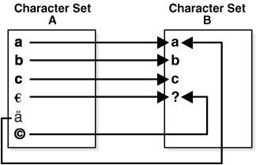
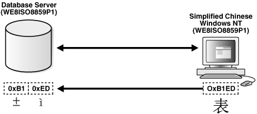
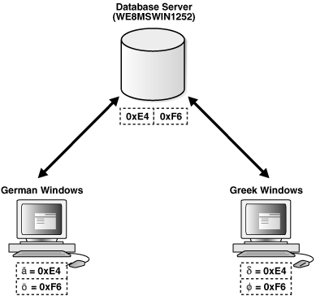

## 11  Character Set Migration

This chapter discusses character set conversion and character set migration. This chapter includes the following topics:

- Overview of Character Set Migration

- Changing the Database Character Set of an Existing Database

- Repairing Database Character Set Metadata

- The Language and Character Set File Scanner

### 11.1 Overview of Character Set Migration

Choosing the appropriate character set for your database is an important decision. When you choose the database character set, consider the following factors:

- The type of data you need to store

- The languages that the database needs to accommodate now and in the future

- The different size requirements of each character set and the corresponding performance implications

Oracle recommends choosing Unicode for its universality and compatibility with contemporary and future technologies and language requirements. The character set defined in the Unicode Standard supports all contemporary written languages with significant use and a few historical scripts. It also supports various symbols, for example, those used in technical, scientific, and musical notations. It is the native or recommended character set of many technologies, such as Java, Windows, HTML, or XML. There is no other character set that is so universal. In addition, Unicode adoption is increasing rapidly with great support from within the industry.

Oracle's implementation of Unicode, AL32UTF8, offers encoding of ASCII characters in 1 byte, characters from European, and Middle East languages in 2 bytes, characters from South and East Asian languages in 3 bytes. Therefore, storage requirements of Unicode are usually higher than storage requirements of a legacy character set for the same language.

A related topic is choosing a new character set for an existing database. Changing the database character set for an existing database is called character set migration. In this case, too, Oracle recommends migrating to Unicode for its universality and compatibility. When you migrate from one database character set to another, you should also plan to minimize data loss from the following sources:

- Data Truncation

- Character Set Conversion Issues

**See Also:**

"[Choosing a Character Set](choosing-character-set.md)"

#### 11.1.1 Data Truncation

When the database is created using byte semantics, the sizes of the `CHAR` and `VARCHAR2` data types are specified in bytes, not characters. For example, the specification `CHAR(20)` in a table definition allows 20 bytes for storing character data. When the database character set uses a single-byte character encoding scheme, no data loss occurs when characters are stored because the number of characters is equivalent to the number of bytes. If the database character set uses a multibyte character set, then the number of bytes no longer equals the number of characters because a character can consist of one or more bytes.

During migration to a new character set, it is important to verify the column widths of existing `CHAR` and `VARCHAR2` columns because they may need to be extended to support an encoding that requires multibyte storage. Truncation of data can occur if conversion causes expansion of data.

The following table shows an example of data expansion when single-byte characters become multibyte characters through conversion.

Table 11-1 Single-Byte and Multibyte Encoding

| Character | WE8MSWIN 1252 Encoding | AL32UTF8 Encoding |
|:----------|:-----------------------|:------------------|
| ä         | E4                     | C3 A4             |
| ö         | F6                     | C3 B6             |
| ©         | A9                     | C2 A9             |
| €         | 80                     | E2 82 AC          |

The first column of the preceding table shows selected characters. The second column shows the hexadecimal representation of the characters in the WE8MSWIN1252 character set. The third column shows the hexadecimal representation of each character in the AL32UTF8 character set. Each pair of letters and numbers represents one byte. For example, `ä` (`a` with an umlaut) is a single-byte character (`E4`) in WE8MSWIN1252, but it becomes a two-byte character (`C3 A4`) in AL32UTF8. Also, the encoding for the euro symbol expands from one byte (`80`) to three bytes (`E2 82 AC`).

If the data in the new character set requires storage that is greater than the supported byte size of the data types, then you must change your schema. You may need to use `CLOB` columns.

**See Also:**

"[Length Semantics](choosing-character-set.md)"

##### 11.1.1.1 Additional Problems Caused by Data Truncation

Data truncation can cause the following problems:

- In the database data dictionary, schema object names cannot exceed 30 bytes in length. You must rename schema objects if their names exceed 30 bytes in the new database character set. For example, one Thai character in the Thai national character set requires 1 byte. In AL32UTF8, it requires 3 bytes. If you have defined a table whose name is 11 Thai characters, then the table name must be shortened to 10 or fewer Thai characters when you change the database character set to AL32UTF8.

- If existing Oracle usernames or passwords are created based on characters that change in size in the new character set, then users will have trouble logging in because of authentication failures after the migration to a new character set. This occurs because the encrypted usernames and passwords stored in the data dictionary may not be updated during migration to a new character set. For example, if the current database character set is WE8MSWIN1252 and the new database character set is AL32UTF8, then the length of the username `scött` (`o` with an umlaut) changes from 5 bytes to 6 bytes. In AL32UTF8, `scött` can no longer log in because of the difference in the username. Oracle recommends that usernames and passwords be based on ASCII characters. If they are not, then you must reset the affected usernames and passwords after migrating to a new character set.

- When `CHAR` data contains characters that expand after migration to a new character set, space padding is not removed during database export by default. This means that these rows will be rejected upon import into the database with the new character set. The workaround is to set the `BLANK_TRIMMING` initialization parameter to `TRUE` before importing the `CHAR` data.

  **See Also:**

  [Oracle Database Reference](../refrn/BLANK_TRIMMING.md) for more information about the `BLANK_TRIMMING` initialization parameter

#### 11.1.2 Character Set Conversion Issues

This section includes the following topics:

- Replacement Characters that Result from Using the Export and Import Utilities

- Invalid Data That Results from Setting the Client's NLS_LANG Parameter Incorrectly

- Conversion from Single-byte to Multibyte Character Set and Oracle Data Pump

##### 11.1.2.1 Replacement Characters that Result from Using the Export and Import Utilities

The Export and Import utilities can convert character sets from the original database character set to the new database character set. However, character set conversions can sometimes cause data loss or data corruption. For example, if you are migrating from character set A to character set B, then the destination character set B should be a superset of character set A. The destination character set, B, is a superset if it contains all the characters defined in character set A. Characters that are not available in character set B are converted to replacement characters, which are often specified as `?` or `¿` or as a character that is related to the unavailable character. For example, `ä` (`a` with an umlaut) can be replaced by `a`. Replacement characters are defined by the target character set.

**Note:**

There is an exception to the requirement that the destination character set B should be a superset of character set A. If your data contains no characters that are in character set A but are not in character set B, then the destination character set does not need to be a superset of character set A to avoid data loss or data corruption.

The following figure shows an example of a character set conversion in which the copyright and euro symbols are converted to `?` and `ä` is converted to `a`.

Figure 11-1 Replacement Characters in Character Set Conversion

[Description of "Figure 11-1 Replacement Characters in Character Set Conversion"](img_text/nlspg020.md)

To reduce the risk of losing data, choose a destination character set with a similar character repertoire. Migrating to Unicode may be the best option, because AL32UTF8 contains characters from most legacy character sets.

##### 11.1.2.2 Invalid Data That Results from Setting the Client's NLS_LANG Parameter Incorrectly

Another character set migration scenario that can cause the loss of data is migrating a database that contains invalid data. Invalid data usually occurs in a database because the `NLS_LANG` parameter is not set properly on the client. The `NLS_LANG` value should reflect the client operating system code page. For example, in an English Windows environment, the code page is WE8MSWIN1252. When the `NLS_LANG` parameter is set properly, the database can automatically convert incoming data from the client operating system. When the `NLS_LANG` parameter is not set properly, then the data coming into the database is not converted properly. For example, suppose that the database character set is AL32UTF8, the client is an English Windows operating system, and the `NLS_LANG` setting on the client is AL32UTF8. Data coming into the database is encoded in WE8MSWIN1252 and is not converted to AL32UTF8 data because the `NLS_LANG` setting on the client matches the database character set. Thus Oracle assumes that no conversion is necessary, and invalid data is entered into the database.

This can lead to two possible data inconsistency problems. One problem occurs when a database contains data from a character set that is different from the database character set but the same code points exist in both character sets. For example, if the database character set is WE8ISO8859P1 and the `NLS_LANG` setting of the Chinese Windows NT client is SIMPLIFIED CHINESE_CHINA.WE8ISO8859P1, then all multibyte Chinese data (from the ZHS16GBK character set) is stored as multiples of single-byte WE8ISO8859P1 data. This means that Oracle treats these characters as single-byte WE8ISO8859P1 characters. Hence all SQL string manipulation functions such as SUBSTR or LENGTH are based on bytes rather than characters. All bytes constituting ZHS16GBK data are legal WE8ISO8859P1 codes. If such a database is migrated to another character set such as AL32UTF8, then character codes are converted as if they were in WE8ISO8859P1. This way, each of the two bytes of a ZHS16GBK character are converted separately, yielding meaningless values in AL32UTF8. The following figure shows an example of this incorrect character set replacement.

Figure 11-2 Incorrect Character Set Replacement

[Description of "Figure 11-2 Incorrect Character Set Replacement"](img_text/nlspg021.md)

The second possible problem is having data from mixed character sets inside the database. For example, if the data character set is WE8MSWIN1252, and two separate Windows clients using German and Greek are both using WE8MSWIN1252 as the `NLS_LANG` character set, then the database contains a mixture of German and Greek characters. The following figure shows how different clients can use different character sets in the same database.

Figure 11-3 Mixed Character Sets

[Description of "Figure 11-3 Mixed Character Sets"](img_text/nlspg022.md)

For database character set migration to be successful, both of these cases require manual intervention because Oracle Database cannot determine the character sets of the data being stored. Incorrect data conversion can lead to data corruption, so perform a full backup of the database before attempting to migrate the data to a new character set. Refer to the topic "Changing the Database Character Set of an Existing Database" for more information about using the Database Migration Assistant for Unicode (DMU) software for handling invalid character data during character set migration to Unicode.

##### 11.1.2.3 Conversion from Single-byte to Multibyte Character Set and Oracle Data Pump

If Oracle Data Pump is being used, and if a character set migration from single-byte to multibyte is performed, then the Data Pump PL/SQL packages must be reloaded.

### 11.2 Changing the Database Character Set of an Existing Database

Database character set migration is an intricate process that typically involves three stages: data scanning, data cleansing, and data conversion.

Before you change the database character set, you must identify possible database character set conversion problems and truncation of data. This step is called data scanning. Data scanning identifies the amount of effort required to migrate data into the new character encoding scheme before changing the database character set. Some examples of what may be found during a data scan are the number of schema objects where the column widths need to be expanded and the extent of the data that does not exist in the target character repertoire. This information helps to determine the best approach for converting the database character set.

After the potential data issues are identified, they need to be cleansed properly to ensure the data integrity can be preserved during the data conversion. The data cleansing step could require significant time and effort depending on the scale and complexity of the data issues found. It may take multiple iterations of data scanning and cleansing in order to correctly address all of the data exceptions.

The data conversion is the process by which the character data is converted from the source character set into the target character set representation. Incorrect data conversion can lead to data corruption, so perform a full backup of the database before attempting to migrate the data to a new character set.

There are two approaches for migrating the database character set:

- Migrating Character Data Using the Database Migration Assistant for Unicode

- Migrating Character Data Using a Full Export and Import

#### 11.2.1 Migrating Character Data Using the Database Migration Assistant for Unicode

The Database Migration Assistant for Unicode (DMU) offers an intuitive and user-friendly GUI that helps you streamline the migration process to Unicode through an interface that minimizes the manual workload and ensures that the migration tasks are carried out correctly and efficiently.

Some advantages of the DMU are that it does the following:

- Guides you through the workflow

  An important advantage of the DMU is that it offers a logical workflow to guide you through the entire process of migrating character sets.

- Offers suggestions for handling certain problems

  The DMU can help you when you run into certain problems, such as errors or failures during the scanning or cleansing of the data.

- Supports selective conversion of data

  The DMU enables you to convert only the data that must be converted, at the table, column, and row level.

- Offers progress monitoring

  The DMU provides a GUI to visualize how the steps are progressing.

- Offers interactive visualization features

  The DMU enables you to analyze data and see the results in the GUI in an interactive way. It also enables you to see the data itself in the GUI and cleanse it interactively from identified migration issues.

- Provides the only supported tool for inline conversion

  With the DMU, Oracle Database supports inline conversion of database contents. This offers performance and security advantage over other existing conversion methods.

- Allows cleansing actions to be scheduled for later execution during the conversion step

  Postponing of cleansing actions, such as data type migration, ensures that the production database and applications are not affected until the actual migration downtime window.

This release of the Database Migration Assistant for Unicode has a few restrictions with respect to what databases it can convert. In particular, it does not convert databases with certain types of convertible data in the data dictionary. The export/import migration methods could be used to overcome these limitations.

In the current database release, the DMU is installed under the `$ORACLE_HOME/dmu` directory.

**See Also:**

[Oracle Database Migration Assistant for Unicode Guide](https://docs.oracle.com/pls/topic/lookup?ctx=en/database/oracle/oracle-database/19/nlspg&id=DUMAG113)

#### 11.2.2 Migrating Character Data Using a Full Export and Import

A full export and import can also be used to convert the database to a new character set. It may be more time-consuming and resource-intensive as a separate target instance must be set up. If you plan to migrate your data to a non-Unicode character set, which Oracle strongly discourages, you can use the DMU to look for invalid character representation issues in the database and use export and import for the data conversion. Note that the DMU will not correctly identify data expansion issues (column and data type limit violations) if the migration is not to Unicode. It will also not identify characters that exist in the source database character set but do not exist in the non-Unicode target character set.

**See Also:**

[Oracle Database Utilities ](../sutil/oracle-data-pump-overview.md)for more information about the Export and Import utilities

### 11.3 Repairing Database Character Set Metadata

If your database has been in what is commonly called a pass-through configuration, where the client character set is defined (usually through the `NLS_LANG` client setting) to be equal to the database character set, the character data in your database could be stored in a different character set from the declared database character set. In this scenario, the recommended solution is to migrate your database to Unicode by using the DMU assumed database character set feature to indicate the actual character set for the data. In case migrating to Unicode is not immediately feasible due to business or technical constraints, it would be desirable to at least correct the database character set declaration to match with the database contents.

With Database Migration Assistant for Unicode Release 1.2, you can repair the database character set metadata in such cases using the `CSREPAIR` script. The `CSREPAIR` script works in conjunction with the DMU client and accesses the DMU repository. It can be used to change the database character set declaration to the real character set of the data only after the DMU has performed a full database scan by setting the Assumed Database Character Set property to the target character set and no invalid representation issues have been reported, which verifies that all existing data in the database is defined according to the assumed database character set. Note that `CSREPAIR` only changes the database character set declaration in the data dictionary metadata and does not convert any database data.

You can find the `CSREPAIR` script under the `admin` subdirectory of the DMU installation. The requirements when using the `CSREPAIR` script are:

1.  You must first perform a successful full database scan in the DMU with the Assumed Database Character Set property set to the real character set of the data. In this case, the assumed database character set must be different from the current database character set or else nothing will be done. The `CSREPAIR` script will not proceed if the DMU reports the existence of invalid data. It will, however, proceed if changeless or convertible data is present from the scan.
2.  The target character set in the assumed database character set must be a binary superset of US7ASCII.
3.  Only repairing from single-byte to single-byte character sets or multi-byte to multi-byte character sets is allowed as no conversion of `CLOB` data will be attempted.
4.  If you set the assumed character set at the column level, then the value must be the same as the assumed database character set. Otherwise, `CSREPAIR` will not run.
5.  You must have the `SYSDBA` privilege to run `CSREPAIR`.

#### 11.3.1 Example: Using CSREPAIR

A typical example is storing WE8MSWIN1252 data in a WE8ISO8859P1 database via the pass-through configuration. To correct the database character set from WE8ISO8859P1 to WE8MSWIN1252, perform the following steps:

1.  Set up the DMU and connect to the target WE8ISO8859P1 database.
2.  Open the Database Properties tab in the DMU.
3.  Set the Assumed Database Character Set property to WE8MSWIN1252.
4.  Use the DMU to perform a full database scan.
5.  Open the Database Scan Report and verify there is no data reported under the Invalid Representation category.
6.  Exit from the DMU client.
7.  Start the SQL\*Plus utility and connect as a user with the `SYSDBA` privilege.
8.  Run the `CSREPAIR` script:
    `SQL> @@CSREPAIR.PLB`

    Upon completion, you should get the message:

    The database character set has been successfully changed to WE8MSWIN1252. You must restart the database now.
9.  Shut down and restart the database.

### 11.4 The Language and Character Set File Scanner

The Language and Character Set File Scanner (`LCSSCAN`) is a high-performance, statistically based utility for determining the language and character set for unknown file text. It can automatically identify a wide variety of language and character set pairs. With each text, the language and character set detection engine sets up a series of probabilities, each probability corresponding to a language and character set pair. The most statistically probable pair identifies the dominant language and character set.

The purity of the text affects the accuracy of the language and character set detection. The ideal case is literary text of one single language with no spelling or grammatical errors. These types of text may require 100 characters of data or more and can return results with a very high factor of confidence. On the other hand, some technical documents can require longer segments before they are recognized. Documents that contain a mix of languages or character sets or text such as addresses, phone numbers, or programming language code may yield poor results. For example, if a document has both French and German embedded, then the accuracy of guessing either language successfully is statistically reduced. Both plain text and HTML files are accepted. If the format is known, you should set the `FORMAT` parameter to improve accuracy.

This section includes the following topics:

- Syntax of the LCSSCAN Command

- Examples: Using the LCSSCAN Command

- Getting Command-Line Help for the Language and Character Set File Scanner

- Supported Languages and Character Sets

- LCSSCAN Error Messages

#### 11.4.1 Syntax of the LCSSCAN Command

Start the Language and Character Set File Scanner with the `LCSSCAN` command. Its syntax is as follows:

    LCSSCAN  [RESULTS=number] [FORMAT=file_type] [BEGIN=number] [END=number] FILE=file_name

The parameters are described in the rest of this section.

##### RESULTS

The `RESULTS` parameter is optional.

| Property      | Description                                                                                                                                                                                                                                       |
|:--------------|:--------------------------------------------------------------------------------------------------------------------------------------------------------------------------------------------------------------------------------------------------|
| Default value | `1`                                                                                                                                                                                                                                               |
| Minimum value | `1`                                                                                                                                                                                                                                               |
| Maximum value | `3`                                                                                                                                                                                                                                               |
| Purpose       | The number of language and character set pairs that are returned. They are listed in order of probability. The comparative weight of the first choice cannot be quantified. The recommended value for this parameter is the default value of `1`. |

##### FORMAT

The `FORMAT` parameter is optional.

| Property      | Description                                                                                                   |
|:--------------|:--------------------------------------------------------------------------------------------------------------|
| Default Value | `text`                                                                                                        |
| Purpose       | This parameter identifies the type of file to be scanned. The possible values are `html`, `text`, and `auto`. |

##### BEGIN

The `BEGIN` parameter is optional.

| Property      | Description                                                                                                                    |
|:--------------|:-------------------------------------------------------------------------------------------------------------------------------|
| Default value | `1`                                                                                                                            |
| Minimum value | `1`                                                                                                                            |
| Maximum value | Number of bytes in file                                                                                                        |
| Purpose       | The byte of the input file where `LCSSCAN` begins the scanning process. The default value is the first byte of the input file. |

##### END

The `END` parameter is optional.

| Property      | Description                                                                                                 |
|:--------------|:------------------------------------------------------------------------------------------------------------|
| Default value | End of file                                                                                                 |
| Minimum value | `3`                                                                                                         |
| Maximum value | Number of bytes in file                                                                                     |
| Purpose       | The last byte of the input file that `LCSSCAN` scans. The default value is the last byte of the input file. |

##### FILE

The `FILE` parameter is required.

| Property      | Description                                     |
|:--------------|:------------------------------------------------|
| Default value | None                                            |
| Purpose       | Specifies the name of a text file to be scanned |

#### 11.4.2 Examples: Using the LCSSCAN Command

Example 11-1 Specifying Only the File Name in the LCSSCAN Command

    LCSSCAN FILE=example.txt

In this example, the entire `example.txt` file is scanned because the `BEGIN` and `END` parameters have not been specified. One language and character set pair will be returned because the `RESULTS` parameter has not been specified.

Example 11-2 Specifying the Format as HTML

    LCSSCAN FILE=example.html FORMAT=html

In this example, the entire `example.html` file is scanned because the `BEGIN` and `END` parameters have not been specified. The scan will strip HTML tags before the scan, thus results are more accurate. One language and character set pair will be returned because the `RESULTS` parameter has not been specified.

Example 11-3 Specifying the RESULTS and BEGIN Parameters for LCSSCAN

    LCSSCAN RESULTS=2 BEGIN=50 FILE=example.txt

The scanning process starts at the 50th byte of the file and continues to the end of the file. Two language and character set pairs will be returned.

Example 11-4 Specifying the RESULTS and END Parameters for LCSSCAN

    LCSSCAN RESULTS=3 END=100 FILE=example.txt

The scanning process starts at the beginning of the file and ends at the 100th byte of the file. Three language and character set pairs will be returned.

Example 11-5 Specifying the BEGIN and END Parameters for LCSSCAN

    LCSSCAN BEGIN=50 END=100 FILE=example.txt

The scanning process starts at the 50th byte and ends at the 100th byte of the file. One language and character set pair will be returned because the `RESULTS` parameter has not been specified.

#### 11.4.3 Getting Command-Line Help for the Language and Character Set File Scanner

To obtain a summary of the Language and Character Set File Scanner parameters, enter the following command:

    LCSSCAN HELP=y

The resulting output shows a summary of the Language and Character Set Scanner parameters.

#### 11.4.4 Supported Languages and Character Sets

The Language and Character Set File Scanner supports several character sets for each language.

When the binary values for a language match two or more encodings that have a subset/superset relationship, the subset character set is returned. For example, if the language is German and all characters are 7-bit, then US7ASCII is returned instead of WE8MSWIN1252, WE8ISO8859P15, or WE8ISO8859P1.

When the character set is determined to be UTF-8, the Oracle character set UTF8 is returned by default unless 4-byte characters (supplementary characters) are detected within the text. If 4-byte characters are detected, then the character set is reported as AL32UTF8.

**See Also:**

"[Language and Character Set Detection Support](appendix-A-locale-data.md)" for a list of supported languages and character sets

#### 11.4.5 LCSSCAN Error Messages

LCD-00001 An unknown error occured.
Cause: An error occurred accessing an internal structure.

Action: Report this error to Oracle Support.

LCD-00002 NLS data could not be loaded.
Cause: An error occurred accessing `$ORACLE_HOME/nls/data`.

Action: Check to make sure `$ORACLE_HOME/nls/data` exists and is accessible. If not found check `$ORA_NLS10` directory.

LCD-00003 An error occurred while reading the profile file.
Cause: An error occurred accessing `$ORACLE_HOME/nls/data`.

Action: Check to make sure `$ORACLE_HOME/nls/data` exists and is accessible. If not found check `$ORA_NLS10` directory.

LCD-00004 The beginning or ending offset has been set incorrectly.
Cause: The beginning and ending offsets must be an integer greater than 0.

Action: Change the offset to a positive number.

LCD-00005 The ending offset has been set incorrectly.
Cause: The ending offset must be greater than the beginning offset.

Action: Change the ending offset to be greater than the beginning offset.

LCD-00006 An error occurred when opening the input file.
Cause: The file was not found or could not be opened.

Action: Check the name of the file specified. Make sure the full file name is specified and that the file is not in use.

LCD-00007 The beginning offset has been set incorrectly.
Cause: The beginning offset must be less than the number of bytes in the file.

Action: Check the size of the file and specify a smaller beginning offset.

LCD-00008 No result was returned.
Cause: Not enough text was inputted to produce a result.

Action: A larger sample of text needs to be inputted to produce a reliable result.
