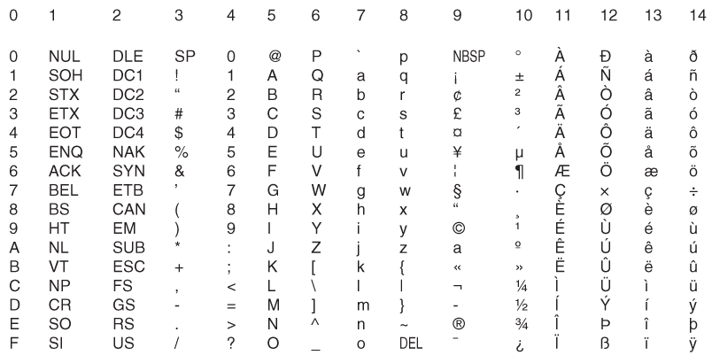
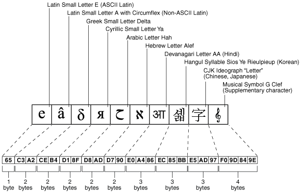
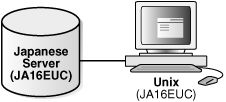
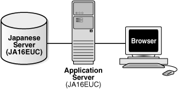
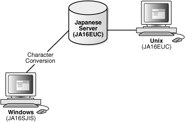
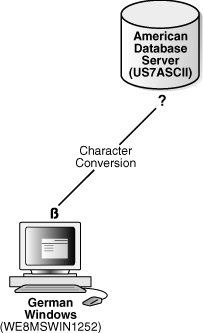
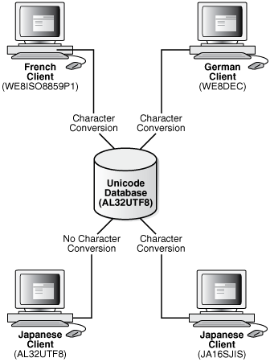
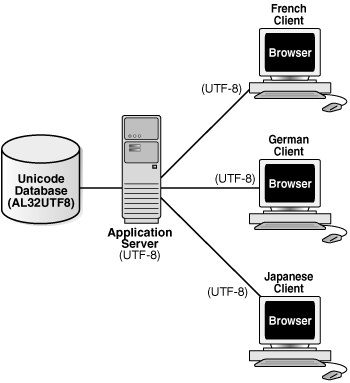

## 2  Choosing a Character Set

This chapter explains how to choose a character set. The following topics are included:

- Character Set Encoding

- Length Semantics

- Choosing an Oracle Database Character Set

- Choosing a Database Character Set for a Multitenant Container Database

- Changing the Character Set After Database Creation

- Monolingual Database Scenario

- Multilingual Database Scenario

### 2.1 Character Set Encoding

When computer systems process characters, they use numeric codes instead of the graphical representation of the character. For example, when the database stores the letter `A`, it actually stores a numeric code that the computer system interprets as the letter. These numeric codes are especially important in a global environment because of the potential need to convert data between different character sets.

This section discusses the following topics:

- What is an Encoded Character Set?

- Which Characters Are Encoded?

- What Characters Does a Character Set Support?

- How are Characters Encoded?

- Naming Convention for Oracle Database Character Sets

- Subsets and Supersets

#### 2.1.1 What is an Encoded Character Set?

You specify an encoded character set when you create a database. Choosing a character set determines what languages can be represented in the database. It also affects:

- How you create the database schema

- How you develop applications that process character data

- How the database works with the operating system

- Database performance

- Storage required for storing character data

A group of characters (for example, alphabetic characters, ideographs, symbols, punctuation marks, and control characters) can be encoded as a character set. An encoded character set assigns a unique numeric code to each character in the character set. The numeric codes are called code points or encoded values. The following table shows examples of characters that have been assigned a hexadecimal code value in the ASCII character set.

Table 2-1 Encoded Characters in the ASCII Character Set

| Character | Description      | Hexadecimal Code Value |
|:----------|:-----------------|:-----------------------|
| !         | Exclamation Mark | 21                     |
| \#        | Number Sign      | 23                     |
| \$        | Dollar Sign      | 24                     |
| 1         | Number 1         | 31                     |
| 2         | Number 2         | 32                     |
| 3         | Number 3         | 33                     |
| A         | Uppercase A      | 41                     |
| B         | Uppercase B      | 42                     |
| C         | Uppercase C      | 43                     |
| a         | Lowercase a      | 61                     |
| b         | Lowercase b      | 62                     |
| c         | Lowercase c      | 63                     |

The computer industry uses many encoded character sets. Character sets differ in the following ways:

- The number of characters available to be used in the set

- The characters that are available to be used in the set (also known as the character repertoire)

- The scripts used for writing and the languages that they represent

- The code points or values assigned to each character

- The encoding scheme used to represent a specific character

Oracle Database supports most national, international, and vendor-specific encoded character set standards.

**See Also:**

"[Character Sets](appendix-A-locale-data.md)" for a complete list of character sets that are supported by Oracle Database

#### 2.1.2 Which Characters Are Encoded?

The characters that are encoded in a character set depend on the writing systems that are represented. A writing system can be used to represent a language or a group of languages. Writing systems can be classified into two categories:

- Phonetic Writing Systems

- Ideographic Writing Systems

This section also includes the following topics:

- Punctuation, Control Characters, Numbers, and Symbols

- Writing Direction

##### 2.1.2.1 Phonetic Writing Systems

Phonetic writing systems consist of symbols that represent different sounds associated with a language. Greek, Latin, Cyrillic, and Devanagari are all examples of phonetic writing systems based on alphabets. Note that alphabets can represent multiple languages. For example, the Latin alphabet can represent many Western European languages such as French, German, and English.

Characters associated with a phonetic writing system can typically be encoded in one byte because the character repertoire is usually smaller than 256 characters.

##### 2.1.2.2 Ideographic Writing Systems

Ideographic writing systems consist of ideographs or pictographs that represent the meaning of a word, not the sounds of a language. Chinese and Japanese are examples of ideographic writing systems that are based on tens of thousands of ideographs. Languages that use ideographic writing systems may also use a syllabary. Syllabaries provide a mechanism for communicating additional phonetic information. For instance, Japanese has two syllabaries: Hiragana, normally used for grammatical elements, and Katakana, normally used for foreign and onomatopoeic words.

Characters associated with an ideographic writing system typically are encoded in more than one byte because the character repertoire has tens of thousands of characters.

##### 2.1.2.3 Punctuation, Control Characters, Numbers, and Symbols

In addition to encoding the script of a language, other special characters must be encoded:

- Punctuation marks such as commas, periods, and apostrophes

- Numbers

- Special symbols such as currency symbols and math operators

- Control characters such as carriage returns and tabs

##### 2.1.2.4 Writing Direction

Most Western languages are written left to right from the top to the bottom of the page. East Asian languages are usually written top to bottom from the right to the left of the page, although exceptions are frequently made for technical books translated from Western languages. Arabic and Hebrew are written right to left from the top to the bottom.

Numbers reverse direction in Arabic and Hebrew. Although the text is written right to left, numbers within the sentence are written left to right. For example, "I wrote 32 books" would be written as "skoob 32 etorw I". Regardless of the writing direction, Oracle Database stores the data in logical order. Logical order means the order that is used by someone typing a language, not how it looks on the screen.

Writing direction does not affect the encoding of a character.

#### 2.1.3 What Characters Does a Character Set Support?

Different character sets support different character repertoires. Because character sets are typically based on a particular writing script, they can support multiple languages. When character sets were first developed, they had a limited character repertoire. Even now there can be problems using certain characters across platforms. The following `CHAR` and `VARCHAR` characters are represented in all Oracle Database character sets and can be transported to any platform:

- Uppercase and lowercase English characters A through Z and a through z

- Arabic digits 0 through 9

- The following punctuation marks: % ' ' ( ) \* + - , . / \\ : ; \< \> = ! \_ & ~ { } \| ^ ? \$ \# @ " \[ \]

- The following control characters: space, horizontal tab, vertical tab, form feed

If you are using characters outside this set, then take care that your data is supported in the database character set that you have chosen.

At all times, a sequence of bytes comprising a character value—for example, an interactive (keyboard) input to a client program, content of a bind variable buffer, or content of a table column—must be valid in the character set declared for this value. For performance reasons, Oracle Database rarely validates provided character data automatically. If a byte sequence is not a valid representation of a string of characters in the corresponding declared character set, the behavior of Oracle software—client APIs, database server, and Oracle utilities—is explicitly undefined. Even if a value is being transferred between two environments, for example, a client and a database, and both environments have the same character set declaration, the incorrect sequence of bytes may still be altered.

The applicable character set declaration for a character value depends on the given value, as described in the relevant documentation. For example, the input for a client program, such as SQL\*Plus, should be in the character set specified in the `NLS_LANG` variable. The character set for a bind variable in an OCI program may be declared through a bind variable attribute `OCI_ATTR_CHARSET_ID`, the `charset` parameter of `OCINlsEnvCreate()`, or in the `NLS_LANG` variable, in descending priority. Other client APIs, such as JDBC, may assume all client-side character values to be in Unicode (UTF-8 or UTF-16). The character set of data stored in a database column is either the database character set or the national (`NCHAR`) character set, depending on the column's data type.

The agreement between the real and declared encodings of a character value is crucial for proper processing of the value, whether in character set conversion or in processing by character functions, such as `SUBSTR`, `UPPER`, `REGEXP`, or `ORDER` `BY`.

**See Also:**

- "[Supporting Multilingual Databases with Unicode](supporting-multilingual-databases-with-unicode.md)"

- [Oracle Database SQL Language Reference ](../sqlrf/CONVERT.md)for more information about the `CONVERT` SQL functions

- [Oracle Database SQL Language Reference ](../sqlrf/CHR.md)for more information about the `CHR` SQL functions

- "[Displaying a Code Chart with the Oracle Locale Builder](customizing-locale-data.md)"

##### 2.1.3.1 ASCII Encoding

Table 2-2 shows how the ASCII character set is encoded. Row and column headings denote hexadecimal digits. To find the encoded value of a character, read the column number followed by the row number. For example, the code value of the character A is 0x41.

Table 2-2 7-Bit ASCII Character Set

| \-  | 0   | 1   | 2   | 3   | 4   | 5   | 6   | 7   |
|:----|:----|:----|:----|:----|:----|:----|:----|:----|
| 0   | NUL | DLE | SP  | 0   | @   | P   | '   | p   |
| 1   | SOH | DC1 | !   | 1   | A   | Q   | a   | q   |
| 2   | STX | DC2 | "   | 2   | B   | R   | b   | r   |
| 3   | ETX | DC3 | \#  | 3   | C   | S   | c   | s   |
| 4   | EOT | DC4 | \$  | 4   | D   | T   | d   | t   |
| 5   | ENQ | NAK | %   | 5   | E   | U   | e   | u   |
| 6   | ACK | SYN | &   | 6   | F   | V   | f   | v   |
| 7   | BEL | ETB | '   | 7   | G   | W   | g   | w   |
| 8   | BS  | CAN | (   | 8   | H   | X   | h   | x   |
| 9   | TAB | EM  | )   | 9   | I   | Y   | i   | y   |
| A   | LF  | SUB | \*  | :   | J   | Z   | j   | z   |
| B   | VT  | ESC | \+  | ;   | K   | \[  | k   | {   |
| C   | FF  | FS  | ,   | \<  | L   | \\  | l   | \|  |
| D   | CR  | GS  | \-  | =   | M   | \]  | m   | }   |
| E   | SO  | RS  | .   | \>  | N   | ^   | n   | ~   |
| F   | SI  | US  | /   | ?   | O   | \_  | o   | DEL |

As languages evolve to meet the needs of people around the world, new character sets are created to support the languages. Typically, these new character sets support a group of related languages based on the same script. For example, the ISO 8859 character set series was created to support different European languages. Table 2-3 shows the languages that are supported by the ISO 8859 character sets.

Table 2-3 lSO 8859 Character Sets

| Standard    | Languages Supported                                                                                                                                                                                                                                                                       |
|:------------|:------------------------------------------------------------------------------------------------------------------------------------------------------------------------------------------------------------------------------------------------------------------------------------------|
| ISO 8859-1  | Western European (Albanian, Basque, Breton, Catalan, Danish, Dutch, English, Faeroese, Finnish, French, German, Greenlandic, Icelandic, Irish Gaelic, Italian, Latin, Luxemburgish, Norwegian, Portuguese, Rhaeto-Romanic, Scottish Gaelic, Spanish, Swedish)                             |
| ISO 8859-2  | Eastern European (Albanian, Croatian, Czech, English, German, Hungarian, Latin, Polish, Romanian, Slovak, Slovenian, Serbian)                                                                                                                                                             |
| ISO 8859-3  | Southeastern European (Afrikaans, Catalan, Dutch, English, Esperanto, German, Italian, Maltese, Spanish, Turkish)                                                                                                                                                                         |
| ISO 8859-4  | Northern European (Danish, English, Estonian, Finnish, German, Greenlandic, Latin, Latvian, Lithuanian, Norwegian, Sámi, Slovenian, Swedish)                                                                                                                                              |
| ISO 8859-5  | Eastern European (Cyrillic-based: Bulgarian, Byelorussian, Macedonian, Russian, Serbian, Ukrainian)                                                                                                                                                                                       |
| ISO 8859-6  | Arabic                                                                                                                                                                                                                                                                                    |
| ISO 8859-7  | Greek                                                                                                                                                                                                                                                                                     |
| ISO 8859-8  | Hebrew                                                                                                                                                                                                                                                                                    |
| ISO 8859-9  | Western European (Albanian, Basque, Breton, Catalan, Cornish, Danish, Dutch, English, Finnish, French, Frisian, Galician, German, Greenlandic, Irish Gaelic, Italian, Latin, Luxemburgish, Norwegian, Portuguese, Rhaeto-Romanic, Scottish Gaelic, Spanish, Swedish, Turkish)             |
| ISO 8859-10 | Northern European (Danish, English, Estonian, Faeroese, Finnish, German, Greenlandic, Icelandic, Irish Gaelic, Latin, Lithuanian, Norwegian, Sámi, Slovenian, Swedish)                                                                                                                    |
| ISO 8859-13 | Baltic Rim (English, Estonian, Finnish, Latin, Latvian, Norwegian)                                                                                                                                                                                                                        |
| ISO 8859-14 | Celtic (Albanian, Basque, Breton, Catalan, Cornish, Danish, English, Galician, German, Greenlandic, Irish Gaelic, Italian, Latin, Luxemburgish, Manx Gaelic, Norwegian, Portuguese, Rhaeto-Romanic, Scottish Gaelic, Spanish, Swedish, Welsh)                                             |
| ISO 8859-15 | Western European (Albanian, Basque, Breton, Catalan, Danish, Dutch, English, Estonian, Faroese, Finnish, French, Frisian, Galician, German, Greenlandic, Icelandic, Irish Gaelic, Italian, Latin, Luxemburgish, Norwegian, Portuguese, Rhaeto-Romanic, Scottish Gaelic, Spanish, Swedish) |

Historically, character sets have provided restricted multilingual support, which has been limited to groups of languages based on similar scripts. More recently, universal character sets have emerged to enable greatly improved solutions for multilingual support. Unicode is one such universal character set that encompasses most major scripts of the modern world.

**See Also:**

"[Supporting Multilingual Databases with Unicode](supporting-multilingual-databases-with-unicode.md)"

#### 2.1.4 How are Characters Encoded?

Different types of encoding schemes have been created by the computer industry. The character set you choose affects what kind of encoding scheme is used. This is important because different encoding schemes have different performance characteristics. These characteristics can influence your database schema and application development. The character set you choose uses one of the following types of encoding schemes:

- Single-Byte Encoding Schemes

- Multibyte Encoding Schemes

##### 2.1.4.1 Single-Byte Encoding Schemes

Single-byte encoding schemes are efficient. They take up the least amount of space to represent characters and are easy to process and program with because one character can be represented in one byte. Single-byte encoding schemes are classified as one of the following types:

- 7-bit encoding schemes

  Single-byte 7-bit encoding schemes can define up to 128 characters and normally support just one language. One of the most common single-byte character sets, used since the early days of computing, is ASCII (American Standard Code for Information Interchange).

- 8-bit encoding schemes

  Single-byte 8-bit encoding schemes can define up to 256 characters and often support a group of related languages. One example is ISO 8859-1, which supports many Western European languages. The following figure shows the ISO 8859-1 8-bit encoding scheme.

Figure 2-1 ISO 8859-1 8-Bit Encoding Scheme

[Description of "Figure 2-1 ISO 8859-1 8-Bit Encoding Scheme"](img_text/iso88591.md)

##### 2.1.4.2 Multibyte Encoding Schemes

Multibyte encoding schemes are needed to support ideographic scripts used in Asian languages like Chinese or Japanese because these languages use thousands of characters. These encoding schemes use either a fixed number or a variable number of bytes to represent each character.

- Fixed-width multibyte encoding schemes

  In a fixed-width multibyte encoding scheme, each character is represented by a fixed number of bytes. The number of bytes is at least two in a multibyte encoding scheme.

- Variable-width multibyte encoding schemes

  A variable-width encoding scheme uses one or more bytes to represent a single character. Some multibyte encoding schemes use certain bits to indicate the number of bytes that represents a character. For example, if two bytes is the maximum number of bytes used to represent a character, then the most significant bit can be used to indicate whether that byte is a single-byte character or the first byte of a double-byte character.

- Shift-sensitive variable-width multibyte encoding schemes

  Some variable-width encoding schemes use control codes to differentiate between single-byte and multibyte characters with the same code values. A shift-out code indicates that the following character is multibyte. A shift-in code indicates that the following character is single-byte. Shift-sensitive encoding schemes are used primarily on IBM platforms. Note that ISO-2022 character sets cannot be used as database character sets, but they can be used for applications such as a mail server.

#### 2.1.5 Naming Convention for Oracle Database Character Sets

Oracle Database uses the following naming convention for its character set names:

    <region><number of bits used to represent a character><standard character set name>[S|C]

The parts of the names that appear between angle brackets are concatenated. The optional `S` or `C` is used to differentiate character sets that can be used only on the server (`S`) or only on the client (`C`).

**Note:**

Keep in mind that:

- You should use the server character set (`S`) on the Macintosh platform. The Macintosh client character sets are obsolete. On EBCDIC platforms, use the server character set (`S`) on the server and the client character set (`C`) on the client.

- UTF8 and UTFE are exceptions to the naming convention.

The following table shows examples of Oracle Database character set names.

Table 2-4 Examples of Oracle Database Character Set Names

| Oracle Database Character Set Name | Description                                          | Region              | Number of Bits Used to Represent a Character | Standard Character Set Name |
|:-----------------------------------|:-----------------------------------------------------|:--------------------|:---------------------------------------------|:----------------------------|
| US7ASCII                           | U.S. 7-bit ASCII                                     | US                  | 7                                            | ASCII                       |
| WE8ISO8859P1                       | Western European 8-bit ISO 8859 Part 1               | WE (Western Europe) | 8                                            | ISO8859 Part 1              |
| JA16SJIS                           | Japanese 16-bit Shifted Japanese Industrial Standard | JA                  | 16                                           | SJIS                        |

#### 2.1.6 Subsets and Supersets

When discussing character set conversion or character set compatibility between databases, Oracle documentation sometimes uses the terms superset, subset, binary superset, or binary subset to describe relationship between two character sets. The terms subset and superset, without the adjective "binary", pertain to character repertoires of two Oracle character sets, that is, to the sets of characters supported (encoded) by each of the character sets. By definition, character set A is a superset of character set B if A supports all characters that B supports. Character set B is a subset of character set A if A is a superset of B.

The terms binary subset and binary superset restrict the above subset-superset relationship by adding a condition on binary representation (binary codes) of characters of the two character sets. By definition, character set A is a binary superset of character set B if A supports all characters that B supports and all these characters have the same binary representation in A and B. Character set B is a binary subset of character set A if A is a binary superset of B.

When character set A is a binary superset of character set B, any text value encoded in B is at the same time valid in A without need for character set conversion. When A is a non-binary superset of B, a text value encoded in B can be represented in A without loss of data but may require character set conversion to transform the binary representation.

Oracle Database does not maintain a list of all subset-superset pairs, but it does maintain a list of binary subset-superset pairs that it recognizes in various situations, such as checking compatibility of a transportable tablespace or a pluggable database.

**See Also:**

"[Binary Subset-Superset Pairs](appendix-A-locale-data.md)" for the list of binary subset-superset pairs recognized by Oracle Database

### 2.2 Length Semantics

In single-byte character sets, the number of bytes and the number of characters in a string are the same. In multibyte character sets, a character or code point consists of one or more bytes. Calculating the number of characters based on byte lengths can be difficult in a variable-width character set. Calculating column lengths in bytes is called byte semantics, while measuring column lengths in characters is called character semantics.

Character semantics is useful for defining the storage requirements for multibyte strings of varying widths. For example, in a Unicode database (AL32UTF8), suppose that you need to define a `VARCHAR2` column that can store up to five Chinese characters together with five English characters. Using byte semantics, this column requires 15 bytes for the Chinese characters, which are three bytes long, and 5 bytes for the English characters, which are one byte long, for a total of 20 bytes. Using character semantics, the column requires 10 characters.

The following expressions use byte semantics:

- `VARCHAR2(20 BYTE)`

- `SUBSTRB(``string``, 1, 20)`

Note the `BYTE` qualifier in the `VARCHAR2` expression and the `B` suffix in the SQL function name.

The following expressions use character semantics:

- `VARCHAR2(10 CHAR)`

- `SUBSTR(``string``, 1, 10)`

Note the `CHAR` qualifier in the `VARCHAR2` expression.

The length semantics of character data type columns, user-defined type attributes, and PL/SQL variables can be specified explicitly in their definitions with the `BYTE` or `CHAR` qualifier. This method of specifying the length semantics is recommended as it properly documents the expected semantics in creation DDL statements and makes the statements independent of any execution environment.

If a column, user-defined type attribute or PL/SQL variable definition contains neither the `BYTE` nor the `CHAR` qualifier, the length semantics associated with the column, attribute, or variable is determined by the value of the session parameter `NLS_LENGTH_SEMANTICS`. If you create database objects with legacy scripts that are too large and complex to be updated to include explicit `BYTE` and/or `CHAR` qualifiers, execute an explicit `ALTER` `SESSION` `SET` `NLS_LENGTH_SEMANTICS` statement before running each of the scripts to assure the scripts create objects in the expected semantics.

The `NLS_LENGTH_SEMANTICS` initialization parameter determines the default value of the `NLS_LENGTH_SEMANTICS` session parameter for new sessions. Its default value is `BYTE`. For the sake of compatibility with existing application installation procedures, which may have been written before character length semantics was introduced into Oracle SQL, Oracle recommends that you leave this initialization parameter undefined or you set it to `BYTE`. Otherwise, created columns may be larger than expected, causing applications to malfunction or, in some cases, cause buffer overflows.

Byte semantics is the default for the database character set. Character length semantics is the default and the only allowable kind of length semantics for `NCHAR` data types. The user cannot specify the `CHAR` or `BYTE` qualifier for `NCHAR` definitions.

Consider the following example:

    CREATE TABLE employees

    ( employee_id NUMBER(4)
    , last_name NVARCHAR2(10)
    , job_id NVARCHAR2(9)
    , manager_id NUMBER(4)
    , hire_date DATE
    , salary NUMBER(7,2)
    , department_id NUMBER(2)
    ) ;

`last_name` can hold up to 10 Unicode code points, independent of whether the `NCHAR` character set is AL16UTF16 or UTF8. When the `NCHAR` character set is AL16UTF16, these stored 10 code points may occupy up to 20 bytes. When the `NCHAR` character set is UTF8, they may occupy up to 30 bytes.

The following figure shows the number of bytes needed to store different kinds of characters in the UTF-8 character set. The ASCII character requires one byte, the non-ASCII Latin, Greek, Cyrillic, Arabic, and Hebrew characters require two bytes, the Asian characters require three bytes, and the supplementary character requires four bytes of storage.

Figure 2-2 Bytes of Storage for Different Kinds of Characters

[Description of "Figure 2-2 Bytes of Storage for Different Kinds of Characters"](img_text/figure-2-2-bytes-storage-different-kinds-characters.md)

**See Also:**

- "[SQL Functions for Different Length Semantics](sql-and-plsql-programming-in-global-environment.md)" for more information about the `SUBSTR` and `SUBSTRB` functions

- "[Length Semantics](setting-up-globalization-support-environment.md)" for more information about the `NLS_LENGTH_SEMANTICS` initialization parameter

- "[Supporting Multilingual Databases with Unicode](supporting-multilingual-databases-with-unicode.md)" for more information about Unicode and the `NCHAR` data type

- [Oracle Database SQL Language Reference ](../sqlrf/SUBSTR.md)for more information about the `SUBSTRB` and `SUBSTR` functions and the `BYTE` and `CHAR` qualifiers for character data types

### 2.3 Choosing an Oracle Database Character Set

Oracle Database uses the database character set for:

- Data stored in SQL `CHAR` data types (`CHAR`, `VARCHAR2`, `CLOB`, and `LONG)`

- Identifiers such as table names, column names, and PL/SQL variables

- Entering and storing SQL and PL/SQL source code

The character encoding scheme used by the database is defined as part of the `CREATE` `DATABASE` statement. All SQL `CHAR` data type columns (`CHAR`, `CLOB`, `VARCHAR2`, and `LONG)`, including columns in the data dictionary, have their data stored in the database character set. In addition, the choice of database character set determines which characters can name objects in the database. SQL `NCHAR` data type columns (`NCHAR`, `NCLOB`, and `NVARCHAR2)` use the national character set.

After the database is created, you cannot change the character sets, with some exceptions, without re-creating the database.

Consider the following questions when you choose an Oracle Database character set for the database:

- What languages does the database need to support now?

- What languages does the database need to support in the future?

- Is the character set available on the operating system?

- What character sets are used on clients?

- How well does the application handle the character set?

- What are the performance implications of the character set?

- What are the restrictions associated with the character set?

The Oracle Database character sets are listed in "[Character Sets](appendix-A-locale-data.md)". They are named according to the languages and regions in which they are used. Some character sets that are named for a region are also listed explicitly by language.

If you want to see the characters that are included in a character set, then:

- Check national, international, or vendor product documentation or standards documents

- Use Oracle Locale Builder

This section contains the following topics:

- Current and Future Language Requirements

- Client Operating System and Application Compatibility

- Character Set Conversion Between Clients and the Server

- Performance Implications of Choosing a Database Character Set

- Restrictions on Database Character Sets

- Choosing a National Character Set

- Summary of Supported Data Types

**See Also:**

- "[UCS-2 Encoding Form](supporting-multilingual-databases-with-unicode.md)"

- "Choosing a National Character Set"

- "Changing the Character Set After Database Creation"

- "[Locale Data](appendix-A-locale-data.md)"

- "[Customizing Locale Data](customizing-locale-data.md)"

#### 2.3.1 Current and Future Language Requirements

Several character sets may meet your current language requirements. Consider future language requirements when you choose a database character set. If you expect to support additional languages in the future, then choose a character set that supports those languages to prevent the need to migrate to a different character set later. You should generally select the Unicode character set AL32UTF8, because it supports most languages of the world.

**Note:**

Starting from Oracle Database 12c Release 2, if you use Oracle Universal Installer (OUI) or Oracle Database Configuration Assistant (DBCA) to create a database, then the default database character set used is the Unicode character set AL32UTF8.

#### 2.3.2 Client Operating System and Application Compatibility

The database character set is independent of the operating system because Oracle Database has its own globalization architecture. For example, on an English Windows operating system, you can create and run a database with a Japanese character set. However, when an application in the client operating system accesses the database, the client operating system must be able to support the database character set with appropriate fonts and input methods. For example, you cannot insert or retrieve Japanese data on the English Windows operating system without first installing a Japanese font and input method. Another way to insert and retrieve Japanese data is to use a Japanese operating system remotely to access the database server.

#### 2.3.3 Character Set Conversion Between Clients and the Server

If you choose a database character set that is different from the character set on the client operating system, then the Oracle Database can convert the operating system character set to the database character set. Character set conversion has the following disadvantages:

- Potential data loss

- Increased overhead

Character set conversions can sometimes cause data loss. For example, if you are converting from character set A to character set B, then the destination character set B must have the same character set repertoire as A. Any characters that are not available in character set B are converted to a replacement character. The replacement character is often specified as a question mark or as a linguistically related character. For example, `ä` (`a` with an umlaut) may be converted to `a`. If you have distributed environments, then consider using character sets with similar character repertoires to avoid loss of data.

Character set conversion may require copying strings between buffers several times before the data reaches the client. The database character set should always be a superset or equivalent of the native character set of the client's operating system. The character sets used by client applications that access the database usually determine which superset is the best choice.

If all client applications use the same character set, then that character set is usually the best choice for the database character set. When client applications use different character sets, the database character set should be a superset of all the client character sets. This ensures that every character is represented when converting from a client character set to the database character set.

**See Also:**

"[Character Set Migration](character-set-migration.md)"

#### 2.3.4 Performance Implications of Choosing a Database Character Set

For best performance, choose a character set that avoids character set conversion and uses the most efficient encoding for the languages desired. Single-byte character sets result in better performance than multibyte character sets, and they also are the most efficient in terms of space requirements. However, single-byte character sets limit how many languages you can support.

#### 2.3.5 Restrictions on Database Character Sets

ASCII-based character sets are supported only on ASCII-based platforms. Similarly, you can use an EBCDIC-based character set only on EBCDIC-based platforms.

The database character set is used to identify SQL and PL/SQL source code. In order to do this, it must have either EBCDIC or 7-bit ASCII as a subset, whichever is native to the platform. Therefore, it is not possible to use a fixed-width, multibyte character set as the database character set. Currently, only the AL16UTF16 character set cannot be used as a database character set.

##### 2.3.5.1 Restrictions on Character Sets Used to Express Names

The following table lists the restrictions on the character sets that can be used to express names.

Table 2-5 Restrictions on Character Sets Used to Express Names

| Name                                                                             | Single-Byte | Variable Width | Comments                                                    |
|:---------------------------------------------------------------------------------|:------------|:---------------|:------------------------------------------------------------|
| Column names                                                                     | Yes         | Yes            | \-                                                          |
| Schema objects                                                                   | Yes         | Yes            | \-                                                          |
| Comments                                                                         | Yes         | Yes            | \-                                                          |
| Database link names                                                              | Yes         | No             | \-                                                          |
| Database names                                                                   | Yes         | No             | \-                                                          |
| File names (data file, log file, control file, initialization parameter file) | Yes         | No             | \-                                                          |
| Instance names                                                                   | Yes         | No             | \-                                                          |
| Directory names                                                                  | Yes         | No             | \-                                                          |
| Keywords                                                                         | Yes         | No             | Can be expressed in English ASCII or EBCDIC characters only |
| Recovery Manager file names                                                      | Yes         | No             | \-                                                          |
| Rollback segment names                                                           | Yes         | No             | The `ROLLBACK_SEGMENTS` parameter does not support NLS      |
| Stored script names                                                              | Yes         | Yes            | \-                                                          |
| Tablespace names                                                                 | Yes         | No             | \-                                                          |

For a list of supported string formats and character sets, including LOB data (`LOB`, `BLOB`, `CLOB`, and `NCLOB`), see Table 2-7.

#### 2.3.6 Database Character Set Statement of Direction

A list of character sets has been compiled in [Table A-4](appendix-A-locale-data.md) and [Table A-5](appendix-A-locale-data.md) that Oracle strongly recommends for usage as the database character set. Other Oracle-supported character sets that do not appear on this list can continue to be used in this Oracle Database release, but may be desupported in a future release. Starting with Oracle Database 11g Release 1, the choice for the database character set is limited to this list of recommended character sets in common installation paths of Oracle Universal Installer (OUI)and Oracle Database Configuration Assistant (DBCA). Customers are still able to create new databases using custom installation paths and migrate their existing databases even if the character set is not on the recommended list. However, Oracle suggests that customers migrate to a recommended character set as soon as possible. At the top of the list of character sets that Oracle recommends for all new system deployment, is the Unicode character set AL32UTF8.

**Note:**

Starting with Oracle Database 12c Release 2, if you use Oracle Universal Installer (OUI) or Oracle Database Configuration Assistant (DBCA) to create a database, then the default database character set used is AL32UTF8.

#### 2.3.7 Choosing Unicode as a Database Character Set

Oracle recommends using Unicode for all new system deployments. Migrating legacy systems to Unicode is also recommended. Deploying your systems today in Unicode offers many advantages in usability, compatibility, and extensibility. Oracle Database enables you to deploy high-performing systems faster and more easily while utilizing the advantages of Unicode. Even if you do not need to support multilingual data today, nor have any requirement for Unicode, it is still likely to be the best choice for a new system in the long run and will ultimately save you time and money as well as give you competitive advantages in the long term.

**See Also:**

"[Supporting Multilingual Databases with Unicode](supporting-multilingual-databases-with-unicode.md)"

#### 2.3.8 Choosing a National Character Set

The term national character set refers to an alternative character set that enables you to store Unicode character data in a database that does not have a Unicode database character set. Another reason for choosing a national character set is that the properties of a different character encoding scheme may be more desirable for extensive character processing operations.

SQL `NCHAR`, `NVARCHAR2`, and `NCLOB` data types support Unicode data only. You can use either the UTF8 or the AL16UTF16 character set. The default is AL16UTF16.

Oracle recommends using SQL `CHAR`, `VARCHAR2`, and `CLOB` data types in AL32UTF8 database to store Unicode character data. Use of SQL `NCHAR`, `NVARCHAR2`, and `NCLOB` should be considered only if you must use a database whose database character set is not AL32UTF8.

**See Also:**

"[Supporting Multilingual Databases with Unicode](supporting-multilingual-databases-with-unicode.md)"

#### 2.3.9 Summary of Supported Data Types

The following table lists the data types that are supported for different encoding schemes.

Table 2-6 SQL Data Types Supported for Encoding Schemes

| Data Type   | Single Byte | Multibyte Non-Unicode | Multibyte Unicode |
|:------------|:------------|:----------------------|:------------------|
| `CHAR`      | Yes         | Yes                   | Yes               |
| `VARCHAR2`  | Yes         | Yes                   | Yes               |
| `NCHAR`     | No          | No                    | Yes               |
| `NVARCHAR2` | No          | No                    | Yes               |
| `BLOB`      | Yes         | Yes                   | Yes               |
| `CLOB`      | Yes         | Yes                   | Yes               |
| `LONG`      | Yes         | Yes                   | Yes               |
| `NCLOB`     | No          | No                    | Yes               |

**Note:**

`BLOBs` process characters as a series of byte sequences. The data is not subject to any NLS-sensitive operations.

The following table lists the SQL data types that are supported for abstract data types.

Table 2-7 Abstract Data Type Support for SQL Data Types

| Abstract Data Type | CHAR | NCHAR | BLOB | CLOB | NCLOB |
|:-------------------|:-----|:------|:-----|:-----|:------|
| Object             | Yes  | Yes   | Yes  | Yes  | Yes   |
| Collection         | Yes  | Yes   | Yes  | Yes  | Yes   |

You can create an abstract data type with the `NCHAR` attribute as follows:

    SQL> CREATE TYPE tp1 AS OBJECT (a NCHAR(10));
    Type created.
    SQL> CREATE TABLE t1 (a tp1);
    Table created.

**See Also:**

- [Oracle Database Object-Relational Developer's Guide](../adobj/about-oracle-objects.md) for more information about Oracle objects

- [Database PL/SQL Language Reference](../lnpls/plsql-collections-and-records.md) for more information about Oracle collections

### 2.4 Choosing a Database Character Set for a Multitenant Container Database

Starting with Oracle Database 12c Release 2 (12.2), pluggable databases (PDBs) in a multitenant container database (CDB) can have different database character sets and different national character sets. The databases or PDB candidates that can be plugged into a CDB can be traditional independent databases or existing PDBs unplugged from other CDBs or newly created PDBs in the CDB.

**Note:**

The character set of the CDB root is considered as the character set of the whole CDB.

The following scenarios may occur depending upon the database character set of the PDB candidate that needs to be plugged into a CDB:

- If the PDB candidate is an application PDB to be plugged into an application root:

  - If the database character set of the PDB candidate is the same as the database character set of the application root, the plug-in operation succeeds (as far as the database character set is concerned).

  - If the database character set of the PDB candidate is plug compatible with the database character set of the application root, that is, the database character set of the PDB candidate is a binary subset of the database character set of the application root and both are single-byte or both are multibyte, then the database character set of the PDB candidate is automatically changed to the database character set of the application root when the PDB candidate is opened for the first time and the plug-in operation succeeds.

  - If the database character set of the PDB candidate is not plug compatible with the database character set of the application root (when none of the above two scenarios apply), then the plug-in operation succeeds. But in this case the newly plugged-in PDB can be opened only in the restricted mode for performing administrative tasks and cannot be used for production. Unless you migrate the database character set of the new PDB to the database character set of the application root, the new PDB is unusable.

- If the PDB candidate is to be plugged directly into the CDB root:

  - If the database character set of the PDB candidate is the same as the database character set of the CDB, then the plug-in operation succeeds (as far as the database character set is concerned).

  - If the database character set of the CDB is `AL32UTF8`, then the plug-in operation succeeds regardless of the database character set of the PDB candidate.

  - If the database character set of the PDB candidate is plug compatible with the database character set of the CDB, that is, the database character set of the PDB candidate is a binary subset of the database character set of the CDB and both are single-byte or both are multibyte, then the database character set of the PDB candidate is automatically changed to the database character set of the CDB when the PDB candidate is opened for the first time and the plug-in operation succeeds.

  - If the database character set of the PDB candidate is not plug compatible with the database character set of the CDB, that is, when none of the last three scenarios mentioned above apply, then the plug-in operation succeeds. But, in this case the newly plugged-in PDB can be opened only in the restricted mode for performing administrative tasks and cannot be used for production. Unless you migrate the database character set of the new PDB to the database character set of the CDB, the new PDB is unusable.

**See Also:**

"Subsets and Supersets" for more information about binary subset and binary superset of a character set.

The following scenarios may occur depending upon the national character set of the PDB candidate that needs to be plugged into a CDB:

- If the PDB candidate is an application PDB to be plugged into an application root:

  - If the national character set of the PDB candidate is the same as the national character set of the application root, then the plug-in operation succeeds (as far as the national character set is concerned).

  - If the national character set of the PDB candidate is not the same as the national character set of the application root, then the plug-in operation succeeds. But, in this case the newly plugged-in PDB can be opened only in the restricted mode for performing administrative tasks and cannot be used for production. Unless you migrate the national character set of the new PDB to the national character set of the application root, the new PDB is unusable.

- If the PDB candidate is to be plugged directly into the CDB root, then the plug-in operation succeeds (as far as the national character set is concerned).

**Note:**

- When a PDB character set is different from the CDB character set, there may be data truncation, if the column widths of CDB views and `V$` views are not able to accommodate the PDB data that has expanded in length during the character set conversion.

- As `UTF8` and `AL32UTF8` have different maximum character widths (three versus four bytes per character), the automatic change of `UTF8` to `AL32UTF8` during plug-in operation will change implicit maximum byte lengths of columns with character length semantics. This change may fail, if there are functional indexes, virtual columns, bitmap join indexes, domain indexes, partitioning keys, sub-partitioning keys, or cluster keys defined on those columns. The plug-in operation may also fail, if a character length semantics column is part of an index key, and the index key exceeds the size limit (around 70% of the index block size) after the character set change. You must make sure that all the offending objects are removed from a database before it is plugged into a CDB. You can recreate those offending objects in the database after the database is plugged into a CDB.

Because of these restrictions, Oracle recommends the following when selecting character sets for CDBs:

- For all new multitenant deployments, use `AL32UTF8` as the database character set and `AL16UTF16` as the national character set for a CDB.

- Migrate your existing databases to `AL32UTF8` database character set before consolidation and then consolidate the databases into one or more `AL32UTF8` CDBs, depending on your needs. You can use the Oracle Database Migration Assistant for Unicode software to migrate a non-CDB to `AL32UTF8` database character set.

**See Also:**

- [Oracle Database Concepts](../multi/multitenant-architecture.md) and [Oracle Multitenant Administrator's Guide](../multi/index.md) for more information about CDBs, PDBs, and application containers.

- [Oracle Database Migration Assistant for Unicode Guide](https://docs.oracle.com/pls/topic/lookup?ctx=en/database/oracle/oracle-database/19/nlspg&id=DUMAG113) for more information about migrating a non-Unicode database character set to a Unicode database character set.

### 2.5 Changing the Character Set After Database Creation

You may want to change the database character set after the database has been created. For example, you may find that the number of languages that must be supported in your database has increased, and you therefore want to migrate to Unicode character set AL32UTF8.

As character type data in the database must be converted to Unicode, in most cases, you will encounter challenges when you change the database character set to AL32UTF8. For example, `CHAR` and `VARCHAR2` column data may exceed the declared column length. Character data may be lost when it is converted to Unicode if it contains invalid characters.

Before changing the database character set, it is important to identify all problems and carefully plan the data migration. Oracle recommends using the Database Migration Assistant for Unicode to change the database character set to AL32UTF8.

**Note:**

Starting from Oracle Database 12c Release 2, if you use Oracle Universal Installer (OUI) or Oracle Database Configuration Assistant (DBCA) to create a database, then the default database character set used is the Unicode character set AL32UTF8.

**See Also:**

[Oracle Database Migration Assistant for Unicode Guide](https://docs.oracle.com/pls/topic/lookup?ctx=en/database/oracle/oracle-database/19/nlspg&id=DUMAG113) for more information about how to change character sets

### 2.6 Monolingual Database Scenario

The simplest example of a database configuration is a client and a server that run in the same language environment and use the same character set. This monolingual scenario has the advantage of fast response because the overhead associated with character set conversion is avoided. The following figure shows a database server and a client that use the same character set. The Japanese client and the server both use the JA16EUC character set.

Figure 2-3 Monolingual Database Scenario

[Description of "Figure 2-3 Monolingual Database Scenario"](img_text/nlspg025.md)

You can also use a multitier architecture. The following figure shows an application server between the database server and the client. The application server and the database server use the same character set in a monolingual scenario. The server, the application server, and the client use the JA16EUC character set.

Figure 2-4 Multitier Monolingual Database Scenario

[Description of "Figure 2-4 Multitier Monolingual Database Scenario"](img_text/nlspg026.md)

#### 2.6.1 Character Set Conversion in a Monolingual Scenario

Character set conversion may be required in a client/server environment if a client application resides on a different platform than the server and if the platforms do not use the same character encoding schemes. Character data passed between client and server must be converted between the two encoding schemes. Character conversion occurs automatically and transparently through Oracle Net.

You can convert between any two character sets. The following figure shows a server and one client with the JA16EUC Japanese character set. The other client uses the JA16SJIS Japanese character set.

Figure 2-5 Character Set Conversion

[Description of "Figure 2-5 Character Set Conversion"](img_text/nlspg027.md)

When a target character set does not contain all of the characters in the source data, replacement characters are used. If, for example, a server uses US7ASCII and a German client uses WE8ISO8859P1, then the German character `ß` is replaced with `?` and `ä` is replaced with `a`.

Replacement characters may be defined for specific characters as part of a character set definition. When a specific replacement character is not defined, a default replacement character is used. To avoid the use of replacement characters when converting from a client character set to a database character set, the server character set should be a superset of all the client character sets.

The following figure shows that data loss occurs when the database character set does not include all of the characters in the client character set. The database character set is US7ASCII. The client's character set is WE8MSWIN1252, and the language used by the client is German. When the client inserts a string that contains `ß`, the database replaces `ß` with `?`, resulting in lost data.

Figure 2-6 Data Loss During Character Conversion

[Description of "Figure 2-6 Data Loss During Character Conversion"](img_text/nlspg033.md)

If German data is expected to be stored on the server, then a database character set that supports German characters should be used for both the server and the client to avoid data loss and conversion overhead.

When one of the character sets is a variable-width multibyte character set, conversion can introduce noticeable overhead. Carefully evaluate your situation and choose character sets to avoid conversion as much as possible.

### 2.7 Multilingual Database Scenario

If you need multilingual support, then use Unicode AL32UTF8 for the server database character set.

**Note:**

Starting from Oracle Database 12c Release 2, if you use Oracle Universal Installer (OUI) or Oracle Database Configuration Assistant (DBCA) to create a database, then the default database character set used is the Unicode character set AL32UTF8.

Unicode has two major encoding schemes:

- UTF-16: Each character is either 2 or 4 bytes long.

- UTF-8: Each character takes 1 to 4 bytes to store.

Oracle Database provides support for UTF-8 as a database character set and both UTF-8 and UTF-16 as national character sets.

Character set conversion between a UTF-8 database and any single-byte character set introduces very little overhead.

Conversion between UTF-8 and any multibyte character set has some overhead. There is no data loss from conversion, with the following exceptions:

- Some multibyte character sets do not support user-defined characters during character set conversion to and from UTF-8.

- Some Unicode characters are mapped to more than one character in another character set. For example, one Unicode character is mapped to three characters in the JA16SJIS character set. This means that a round-trip conversion may not result in the original JA16SJIS character.

The following figure shows a server that uses the AL32UTF8 Oracle Database character set that is based on the Unicode UTF-8 character set.

Figure 2-7 Multilingual Support Scenario in a Client/Server Configuration

[Description of "Figure 2-7 Multilingual Support Scenario in a Client/Server Configuration"](img_text/nlspg029.md)

There are four clients:

- A French client that uses the WE8ISO8859P1 Oracle Database character set

- A German client that uses the WE8DEC character set

- A Japanese client that uses the AL32UTF8 character set

- A Japanese client that used the JA16SJIS character set

Character conversion takes place between each client and the server except for the AL32UTF8 client, but there is no data loss because AL32UTF8 is a universal character set. If the German client tries to retrieve data from one of the Japanese clients, then all of the Japanese characters in the data are lost during the character set conversion.

The following figure shows a Unicode solution for a multitier configuration.

Figure 2-8 Multitier Multilingual Support Scenario in a Multitier Configuration

[Description of "Figure 2-8 Multitier Multilingual Support Scenario in a Multitier Configuration"](img_text/nlspg030.md)

The database, the application server, and each client use the AL32UTF8 character set. This eliminates the need for character conversion even though the clients are French, German, and Japanese.

**See Also:**

"[Supporting Multilingual Databases with Unicode](supporting-multilingual-databases-with-unicode.md)"
