## 12  Customizing Locale Data

This chapter describes how to customize locale data and includes the following topics:

- Overview of the Oracle Locale Builder Utility

- Creating a New Language Definition with Oracle Locale Builder

- Creating a New Territory Definition with the Oracle Locale Builder

- Displaying a Code Chart with the Oracle Locale Builder

- Creating a New Character Set Definition with the Oracle Locale Builder

- Creating a New Linguistic Sort with the Oracle Locale Builder

- Generating and Installing NLB Files

- Upgrading Custom NLB Files from Previous Releases of Oracle Database

- Deploying Custom NLB Files to Oracle Installations on the Same Platform

- Deploying Custom NLB Files to Oracle Installations on Another Platform

- Adding Custom Locale Definitions to Java Components with the GINSTALL Utility

- Customizing Calendars with the NLS Calendar Utility

### 12.1 Overview of the Oracle Locale Builder Utility

The Oracle Locale Builder offers an easy and efficient way to customize locale data. It provides a graphical user interface through which you can easily view, modify, and define locale-specific data. It extracts data from the text and binary definition files and presents them in a readable format so that you can process the information without worrying about the formats used in these files.

The Oracle Locale Builder manages four types of locale definitions: language, territory, character set, and linguistic sort. It also supports user-defined characters and customized linguistic rules. You can view definitions in existing text and binary definition files and make changes to them, or create your own definitions.

This section contains the following topics:

- Configuring Unicode Fonts for the Oracle Locale Builder

- The Oracle Locale Builder User Interface

- Oracle Locale Builder Pages and Dialog Boxes

#### 12.1.1 Configuring Unicode Fonts for the Oracle Locale Builder

The Oracle Locale Builder uses Unicode characters in many of its functions. For example, it shows the mapping of local character code points to Unicode code points. The Oracle Locale Builder depends on the logical fonts Serif and SansSerif that are configured in Java Runtime to display the characters. If a character cannot be rendered with the configured fonts, then it is usually displayed as a rectangular box. If you cannot see some characters properly in the Oracle Locale Builder user interface, then you may need to reconfigure the logical fonts to include additional physical fonts supporting the missing characters.

**Note:**

The Java Runtime used by the Oracle Locale Builder is located in the jdk/jre subdirectory of the Oracle Home directory.

**See Also:**

The technical note "Font Configuration Files" at <https://docs.oracle.com/javase/8/docs/technotes/guides/intl/fontconfig.html> for more information about the font configuration files used by the Java Runtime.

#### 12.1.2 The Oracle Locale Builder User Interface

Ensure that the `ORACLE_HOME` parameter is set before starting Oracle Locale Builder.

In the UNIX operating system, start the Oracle Locale Builder by changing into the `$ORACLE_HOME/nls/lbuilder` directory and issuing the following command:

    % ./lbuilder

In a Windows operating system, start the Oracle Locale Builder from the Start menu as follows: Start \> Programs \> Oracle-OraHome10 \> Configuration and Migration Tools \> Locale Builder. You can also start it from the DOS prompt by entering the `%ORACLE_HOME%\nls\lbuilder` directory and executing the `lbuilder.bat` command.

When you start the Oracle Locale Builder, the following screen appears.

Figure 12-1 Oracle Locale Builder Utility

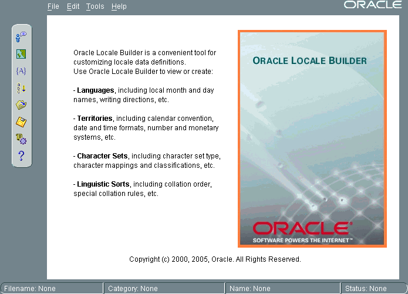
[Description of "Figure 12-1 Oracle Locale Builder Utility"](img_text/startupb.md)

#### 12.1.3 Oracle Locale Builder Pages and Dialog Boxes

Before using Oracle Locale Builder for a specific task, you should become familiar with the following tab pages and dialog boxes:

- Existing Definitions Dialog Box

- Session Log Dialog Box

- Preview NLT Tab Page

- Open File Dialog Box

**Note:**

Oracle Locale Builder includes online help.

##### 12.1.3.1 Existing Definitions Dialog Box

When you choose New Language, New Territory, New Character Set, or New Linguistic Sort, the first tab page that you see is labeled General. Click Show Existing Definitions to see the Existing Definitions dialog box.

The Existing Definitions dialog box enables you to open locale objects by name. If you know a specific language, territory, linguistic sort (collation), or character set that you want to start with, then click its displayed name. For example, you can open the `AMERICAN` language definition file as shown in the following screen.

Figure 12-2 Existing Definitions Dialog Box

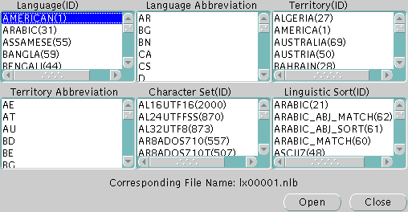
[Description of "Figure 12-2 Existing Definitions Dialog Box"](img_text/pic17.md)

Choosing `AMERICAN` opens the `lx00001.nlb` file. An NLB file is a binary file that contains the settings for a specific language, territory, character set, or linguistic sort.

Language and territory abbreviations are for reference only and cannot be opened.

##### 12.1.3.2 Session Log Dialog Box

Choose Tools `>` View Log to see the Session Log dialog box. The Session Log dialog box shows what actions have been taken in the current session. Click Save Log to keep a record of all changes. The following screen shows an example of a session log.

Figure 12-3 Session Log Dialog Box

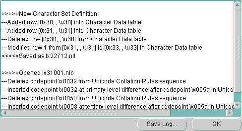
[Description of "Figure 12-3 Session Log Dialog Box"](img_text/pic22.md)

##### 12.1.3.3 Preview NLT Tab Page

The NLT (National Language Text) file is an XML file with the file extension `.nlt` that stores the settings for a specific language, territory, character set, or linguistic sort. The Preview NLT tab page presents a readable form of the file so that you can see whether the changes you have made are correct. You cannot modify the NLT file from the Preview NLT tab page. You must use the specific tools and procedures available in Oracle Locale Builder to modify the NLT file.

The following screen shows an example of the Preview NLT tab page for a user-defined language called `AMERICAN FRENCH`.

Figure 12-4 Previewing the NLT File

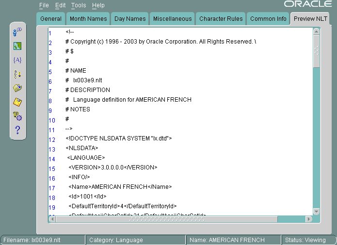
[Description of "Figure 12-4 Previewing the NLT File"](img_text/langnlt.md)

##### 12.1.3.4 Open File Dialog Box

You can see the Open File dialog box by choosing File `>` Open `>` By File Name. Then choose the NLB (National Language Binary) file that you want to modify or use as a template. An NLB file is a binary file with the file extension `.nlb` that contains the binary equivalent of the information in the NLT file. The following screen shows the Open File dialog box with the `lx00001.nlb` file selected. The Preview pane shows that this NLB file is for the `AMERICAN` language.

Figure 12-5 Open File Dialog Box

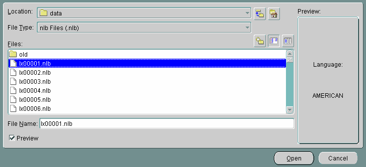
[Description of "Figure 12-5 Open File Dialog Box"](img_text/pic16.md)

### 12.2 Creating a New Language Definition with Oracle Locale Builder

This section shows how to create a new language based on French. This new language is called `AMERICAN` `FRENCH`. First, open `FRENCH` from the Existing Definitions dialog box. Then change the language name to AMERICAN FRENCH and the Language Abbreviation to AF in the General tab page. Retain the default values for the other fields. The following screen shows the resulting General tab page.

Figure 12-6 Language General Information

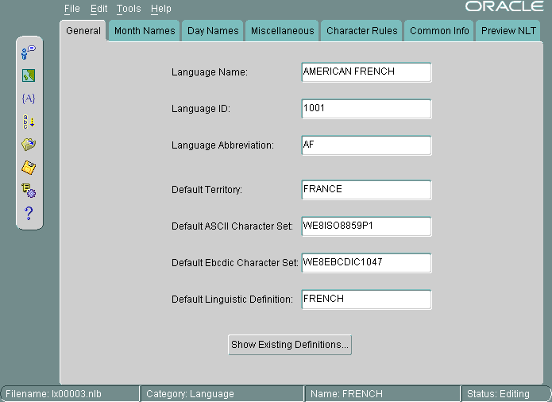
[Description of "Figure 12-6 Language General Information"](img_text/lang.md)

The following restrictions apply when choosing names for locale objects such as languages:

- Names must contain only ASCII characters

- Names must start with a letter and cannot have leading or trailing blanks

- Language, territory, and character set names cannot contain underscores or periods

The valid range for the Language ID field for a user-defined language is 1,000 to 10,000. You can accept the value provided by Oracle Locale Builder or you can specify a value within the range.

**Note:**

Only certain ID ranges are valid values for user-defined `LANGUAGE`, `TERRITORY`, `CHARACTER` `SET`, `MONOLINGUAL COLLATION`, and `MULTILINGUAL` `COLLATION` definitions. The ranges are specified in the sections of this chapter that concern each type of user-defined locale object.

The following screen shows how to set month names using the Month Names tab page.

Figure 12-7 Month Names Tab Page

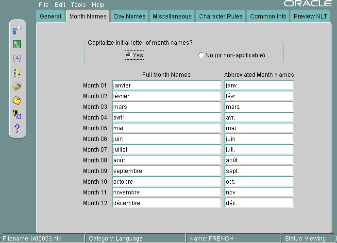
[Description of "Figure 12-7 Month Names Tab Page"](img_text/langmon.md)

All names are shown as they appear in the NLT file. If you choose Yes for capitalization, then the month names are capitalized in your application, but they do not appear capitalized in the Month Names tab page.

The following screen shows the Day Names tab page.

Figure 12-8 Day Names Tab Page

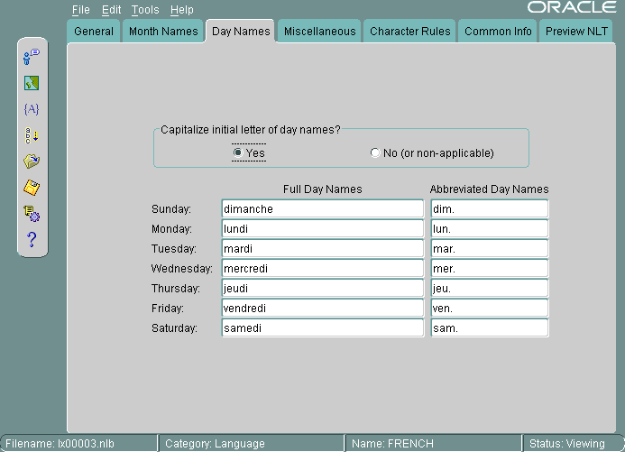
[Description of "Figure 12-8 Day Names Tab Page"](img_text/langdays.md)

You can choose day names for your user-defined language. All names are shown as they appear in the NLT file. If you choose Yes for capitalization, then the day names are capitalized in your application, but they do not appear capitalized in the Day Names tab page.

The following screen shows the Common Info tab page.

Figure 12-9 Common Info Tab Page

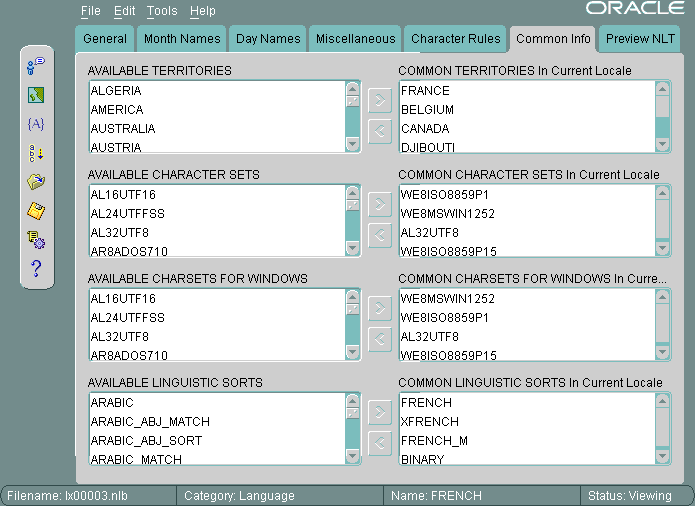
[Description of "Figure 12-9 Common Info Tab Page"](img_text/lang5.md)

You can display the territories, character sets, Windows character sets, and linguistic sorts that have associations with the current language. In general, the most appropriate or the most commonly used items are displayed first. For example, with a language of FRENCH, the common territories are FRANCE, BELGIUM, CANADA, and DJIBOUTI, while the character sets for supporting French are WE8ISO8859P1, WE8MSWIN1252, AL32UTF8, and WE8ISO8859P15. As WE8MSWIN1252 is more common than WE8ISO8859P1 in a Windows environment, it is displayed first.

### 12.3 Creating a New Territory Definition with the Oracle Locale Builder

This section shows how to create a new territory called `REDWOOD SHORES` and use `RS` as a territory abbreviation. The new territory is not based on an existing territory definition.

The basic tasks are as follows:

- Assign a territory name

- Choose formats for the calendar, numbers, date and time, and currency

The following screen shows the General tab page with REDWOOD SHORES specified as the territory name, 1001 specified as the territory ID, and RS specified as the territory abbreviation.

Figure 12-10 General Tab Page for Territories

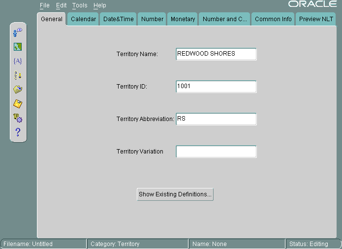
[Description of "Figure 12-10 General Tab Page for Territories"](img_text/terr.md)

The valid range for territory ID for a user-defined territory is 1000 to 10000.

The following screen shows settings for calendar formats in the Calendar tab page.

Figure 12-11 Choosing Calendar Formats

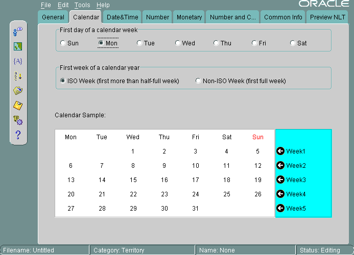
[Description of "Figure 12-11 Choosing Calendar Formats"](img_text/terrcal.md)

Monday is set as the first day of the week, and the first week of the calendar year is set as an ISO week.

**See Also:**

- "[Calendar Formats](setting-up-globalization-support-environment.md)" for more information about choosing the first day of the week and the first week of the calendar year

- "Customizing Calendars with the NLS Calendar Utility" for information about customizing calendars themselves

The following screen shows the Date & Time tab page.

Figure 12-12 Choosing Date and Time Formats

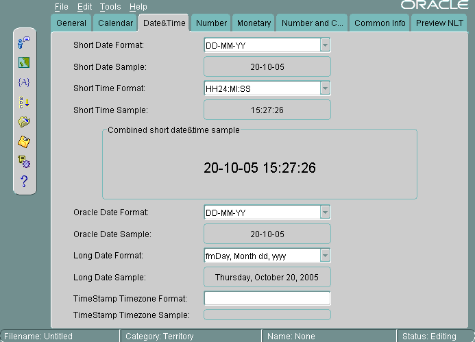
[Description of "Figure 12-12 Choosing Date and Time Formats"](img_text/terrdate.md)

When you choose a format from a list, Oracle Locale Builder displays an example of the format. In this case, the Short Date Format is set to DD-MM-YY. The Short Time Format is set to HH24:MI:SS. The Oracle Date Format is set to DD-MM-YY. The Long Date Format is set to fmDay, Month dd, yyyy. The TimeStamp Timezone Format is not set.

You can also enter your own formats instead of using the selection from the drop-down menus.

**See Also:**

- "[Date Formats](setting-up-globalization-support-environment.md)"

- "[Time Formats](setting-up-globalization-support-environment.md)"

- "[Choosing a Time Zone File](datetime-data-types-and-time-zone-support.md)"

The following screen shows the Number tab page.

Figure 12-13 Choosing Number Formats

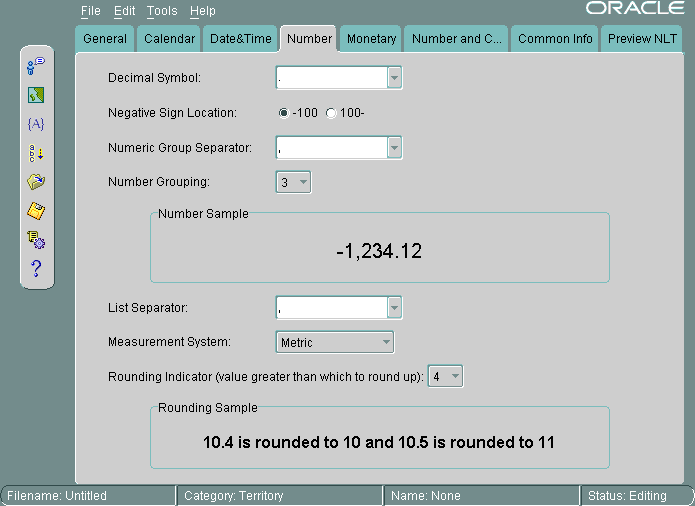
[Description of "Figure 12-13 Choosing Number Formats"](img_text/terrnum.md)

A period has been chosen for the Decimal Symbol. The Negative Sign Location is specified to be on the left of the number. The Numeric Group Separator is a comma. The Number Grouping is specified as 3 digits. The List Separator is a comma. The Measurement System is metric. The Rounding Indicator is 4.

You can enter your own values instead of using values in the lists.

When you choose a format from a list, Oracle Locale Builder displays an example of the format.

**See Also:**

"[Numeric Formats](setting-up-globalization-support-environment.md)"

The following screen shows settings for currency formats in the Monetary tab page.

Figure 12-14 Choosing Currency Formats

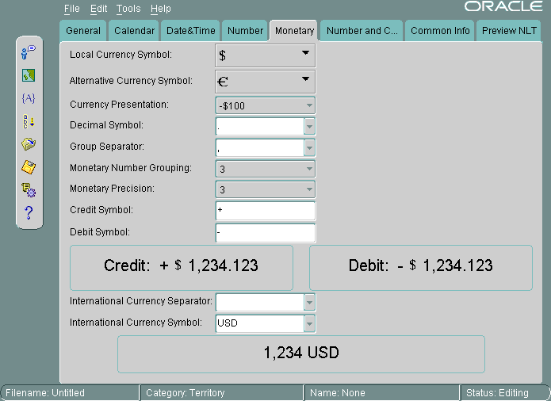
[Description of "Figure 12-14 Choosing Currency Formats"](img_text/terrmon.md)

The Local Currency symbol is set to \$. The Alternative Currency Symbol is the euro symbol. The Currency Presentation shows one of several possible sequences of the local currency symbol, the debit symbol, and the number. The Decimal Symbol is the period. The Group Separator is the comma. The Monetary Number Grouping is 3. The Monetary Precision or number of digits after the decimal symbol, is 3. The Credit Symbol is +. The Debit Symbol is -. The International Currency Separator is a blank space, so it is not visible in the field. The International Currency Symbol (ISO currency symbol) is USD. Oracle Locale Builder displays examples of the currency formats you have selected.

You can enter your own values instead of using the lists.

**See Also:**

"[Currency Formats](setting-up-globalization-support-environment.md)"

The following screen shows the Common Info tab page.

Figure 12-15 Common Info Tab Page

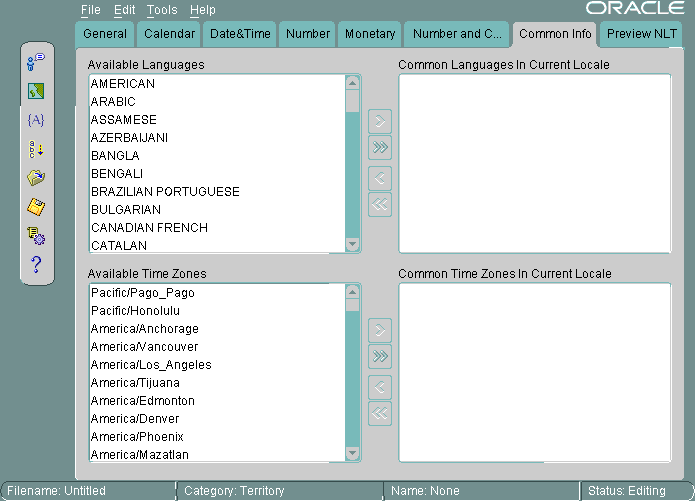
[Description of "Figure 12-15 Common Info Tab Page"](img_text/terr6.md)

You can display the common languages and time zones for the current territory. For example, with a territory of CANADA, the common languages are ENGLISH, CANADIAN FRENCH, and FRENCH. The common time zones are America/Montreal, America/St_Johns, America/Halifax, America/Winnipeg, America/Regina, America/Edmonton, and America/Vancouver.

### 12.4 Displaying a Code Chart with the Oracle Locale Builder

You can display and print the code charts of character sets with the Oracle Locale Builder. From the opening screen for Oracle Locale Builder, choose File `>` New `>` Character Set. The following screen is displayed.

Figure 12-16 General Tab Page for Character Sets

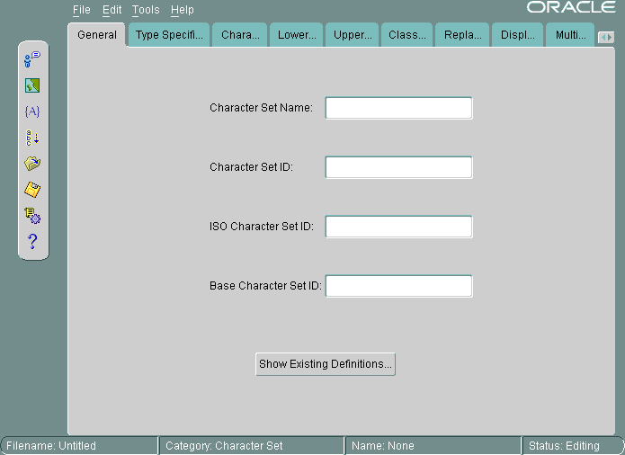
[Description of "Figure 12-16 General Tab Page for Character Sets"](img_text/cs.md)

Click Show Existing Definitions. Highlight the character set you want to display. The following screen shows the Existing Definitions combo box with US7ASCII highlighted.

Figure 12-17 Choosing US7ASCII in the Existing Definitions Dialog Box

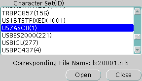
[Description of "Figure 12-17 Choosing US7ASCII in the Existing Definitions Dialog Box"](img_text/charsets.md)

Click Open to choose the character set. The following screen shows the General tab page when US7ASCII has been chosen.

Figure 12-18 General Tab Page When US7ASCII Has Been Chosen

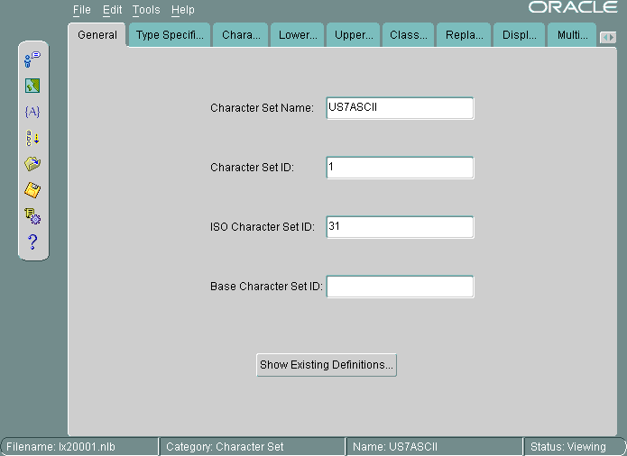
[Description of "Figure 12-18 General Tab Page When US7ASCII Has Been Chosen"](img_text/csus.md)

Select the Character Data Mapping tab. The following screen shows the Character Data Mapping tab page for US7ASCII.

Figure 12-19 Character Data Mapping Tab Page for US7ASCII

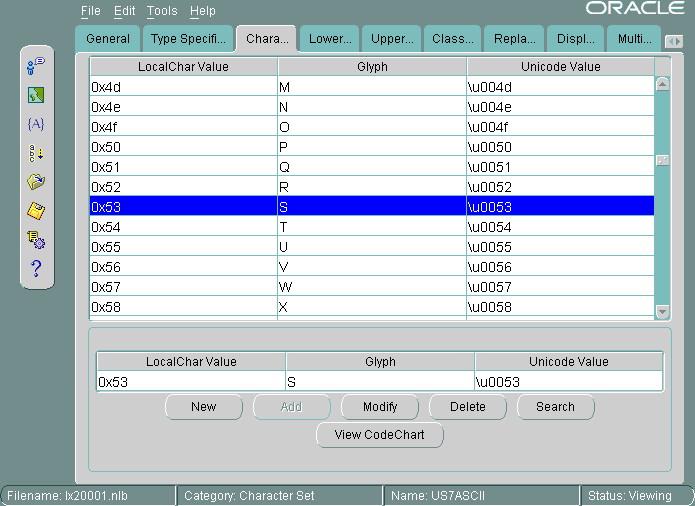
[Description of "Figure 12-19 Character Data Mapping Tab Page for US7ASCII"](img_text/cschar.md)

Click View CodeChart. The following screen shows the code chart for US7ASCII.

Figure 12-20 US7ASCII Code Chart

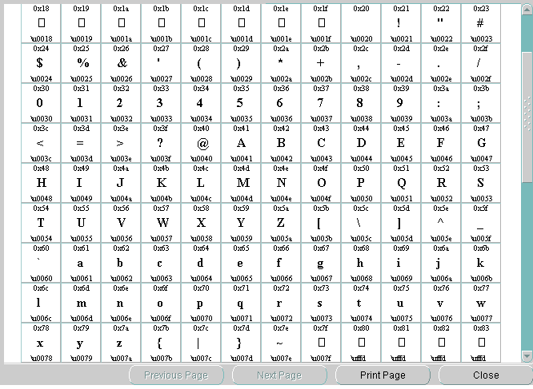
[Description of "Figure 12-20 US7ASCII Code Chart"](img_text/cschart.md)

It shows the encoded value of each character in the local character set, the glyph associated with each character, and the Unicode value of each character in the local character set.

If you want to print the code chart, then click Print Page.

### 12.5 Creating a New Character Set Definition with the Oracle Locale Builder

You can customize a character set to meet specific user needs. You can extend an existing encoded character set definition. User-defined characters are often used to encode special characters that represent the following language elements:

- Proper names

- Historical Han characters that are not defined in an existing character set standard

- Vendor-specific characters

- New symbols or characters that you define

This section describes how Oracle Database supports user-defined characters. It includes the following topics:

- Character Sets with User-Defined Characters

- Oracle Database Character Set Conversion Architecture

- Unicode Private Use Area

- User-Defined Character Cross-References Between Character Sets

- Guidelines for Creating a New Character Set from an Existing Character Set

- Example: Creating a New Character Set Definition with the Oracle Locale Builder

#### 12.5.1 Character Sets with User-Defined Characters

User-defined characters are typically supported within East Asian character sets. These East Asian character sets have at least one range of reserved code points for user-defined characters. For example, Japanese Shift-JIS preserves 1880 code points for user-defined characters. They are shown in Table 12-1.

Table 12-1 Shift JIS User-Defined Character Ranges

| Japanese Shift JIS User-Defined Character Range | Number of Code Points |
|:------------------------------------------------|:----------------------|
| F040-F07E, F080-F0FC                            | 188                   |
| F140-F17E, F180-F1FC                            | 188                   |
| F240-F27E, F280-F2FC                            | 188                   |
| F340-F37E, F380-F3FC                            | 188                   |
| F440-F47E, F480-F4FC                            | 188                   |
| F540-F57E, F580-F5FC                            | 188                   |
| FF640-F67E, F680-F6FC                           | 188                   |
| F740-F77E, F780-F7FC                            | 188                   |
| F840-F87E, F880-F8FC                            | 188                   |
| F940-F97E, F980-F9FC                            | 188                   |

The Oracle Database character sets listed in Table 12-2 contain predefined ranges that support user-defined characters.

Table 12-2 Oracle Database Character Sets with User-Defined Character Ranges

| Character Set Name | Number of Code Points Available for User-Defined Characters |
|:-------------------|:------------------------------------------------------------|
| JA16DBCS           | 4370                                                        |
| JA16EBCDIC930      | 4370                                                        |
| JA16SJIS           | 1880                                                        |
| JA16SJISYEN        | 1880                                                        |
| KO16DBCS           | 1880                                                        |
| KO16MSWIN949       | 1880                                                        |
| ZHS16DBCS          | 1880                                                        |
| ZHS16GBK           | 2149                                                        |
| ZHT16DBCS          | 6204                                                        |
| ZHT16MSWIN950      | 6217                                                        |

#### 12.5.2 Oracle Database Character Set Conversion Architecture

The code point value that represents a particular character can vary among different character sets. A Japanese kanji character is shown in the following figure.

Figure 12-21 Japanese Kanji Character

[Description of "Figure 12-21 Japanese Kanji Character"](img_text/figure-12-21-japanese-kanji-character.md)

The following table shows how the character is encoded in different character sets.

| Unicode Encoding | JA16SJIS Encoding | JA16EUC Encoding | JA16DBCS Encoding |
|:-----------------|:------------------|:-----------------|:------------------|
| 4E9C             | 889F              | B0A1             | 4867              |

Oracle Database defines all character sets with respect to Unicode code points. That is, each character is defined as a Unicode code value. Character conversion takes place transparently by using Unicode as the intermediate form. For example, when a JA16SJIS client connects to a JA16EUC database, the Japanese kanji character shown in the above figure has the code point value 889F when it is entered from the JA16SJIS client. It is internally converted to Unicode (with code point value 4E9C), and then converted to JA16EUC (code point value B0A1).

#### 12.5.3 Unicode Private Use Area

In Unicode, the range of code points E000-F8FF is reserved for the Private Use Area (PUA). The PUA is intended for end users' or vendors' private use character definition.

User-defined characters can be converted between two Oracle Database character sets by using Unicode PUA as the intermediate form, which is the same as for the standard characters.

#### 12.5.4 User-Defined Character Cross-References Between Character Sets

Cross-references between different character sets are required when registering user-defined characters across operating systems. Cross-references ensure that the user-defined characters can be converted correctly across the different character sets when they are mapped to a Unicode PUA value.

For example, when registering a user-defined character on both a Japanese Shift-JIS operating system and a Japanese IBM Host operating system, you may want to assign the F040 code point on the Shift-JIS operating system and the 6941 code point on the IBM Host operating system for this character. This is so that Oracle Database can map this character correctly between the character sets JA16SJIS and JA16DBCS.

User-defined character cross-reference information can be found by viewing the character set definitions using the Oracle Locale Builder. For example, you can determine that both the Shift-JIS UDC value F040 and the IBM Host UDC value 6941 are mapped to the same Unicode PUA value E000.

**See Also:**

"[Unicode Character Code Assignments](appendix-B-unicode-character-code-assignments.md)"

#### 12.5.5 Guidelines for Creating a New Character Set from an Existing Character Set

By default, the Oracle Locale Builder generates the next available character set ID for you. You can also choose your own character set ID. Use the following format for naming character set definition NLT files:

    lx2dddd.nlt

`dddd` is the 4-digit character set ID in hex.

When you modify a character set, observe the following guidelines:

- Do not remap existing characters.

- All character mappings must be unique.

- New characters should be mapped into the Unicode private use range of `e000-f4ff`.

  **Note:**

  The actual Unicode private use range is `e000-f8ff`. However, Oracle Database reserves `f500-f8ff` for its own private use.

- No line in the character set definition file can be longer than 80 characters.

  **Note:**

  When you create a new multibyte character set from an existing character set, use an 8-bit or multibyte character set as the original character set.

If you derive a new character set from an existing Oracle Database character set, then Oracle recommends using the following character set naming convention:

    <Oracle_character_set_name><organization_name>EXT<version>

For example, if a company such as Sun Microsystems adds user-defined characters to the JA16EUC character set, then the following character set name is appropriate:

    JA16EUCSUNWEXT1

The character set name contains the following parts:

- `JA16EUC` is the character set name defined by Oracle Database

- `SUNW` represents the organization name (company stock trading abbreviation for Sun Microsystems)

- `EXT` specifies that this character set is an extension to the JA16EUC character set

- `1` specifies the version

#### 12.5.6 Example: Creating a New Character Set Definition with the Oracle Locale Builder

This section shows how to create a new character set called `MYCHARSET` with `10001` for its character set ID. The example uses the `WE8ISO8859P1` character set and adds 10 Chinese characters.

The following screen shows the General tab page for `MYCHARSET` character set.

Figure 12-22 General Tab Page for MYCHARSET

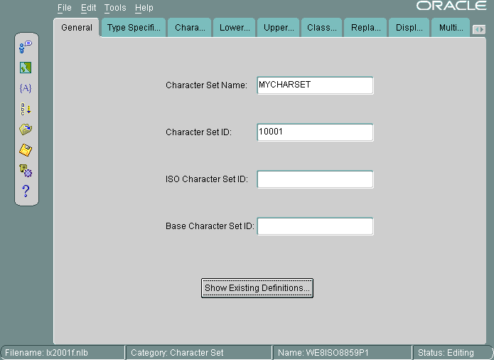
[Description of "Figure 12-22 General Tab Page for MYCHARSET"](img_text/csmychar.md)

Click Show Existing Definitions and choose the `WE8ISO8859P1` character set from the Existing Definitions dialog box.

The ISO Character Set ID and Base Character Set ID fields are optional. The Base Character Set ID is used for inheriting values so that the properties of the base character set are used as a template. The character set ID is automatically generated, but you can override it. The valid range for a user-defined character set ID is 8000 to 8999 or 10000 to 20000.

**Note:**

If you are using Pro\*COBOL, then choose a character set ID between 8000 and 8999.

The ISO Character Set ID remains blank for user-defined character sets.

In this example, the Base Character Set ID remains blank. However, you can specify a character set to use as a template. The settings in the Type Specification tab page must match the type settings of the base character set that you enter in the Base Character Set ID field. If the type settings do not match, then you will receive an error when you generate your custom character set.

The following screen shows the Type Specification tab page.

Figure 12-23 Type Specification Tab Page

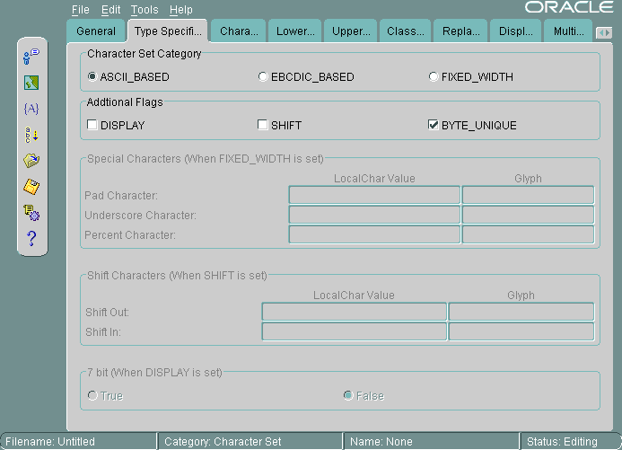
[Description of "Figure 12-23 Type Specification Tab Page"](img_text/cstype.md)

The Character Set Category is ASCII_BASED. The `BYTE_UNIQUE` option is checked.

When you have chosen an existing character set, the fields for the Type Specification tab page should already be set to appropriate values. You should keep these values unless you have a specific reason for changing them. If you need to change the settings, then use the following guidelines:

- FIXED_WIDTH is used to identify character sets whose characters have a uniform length.

- BYTE_UNIQUE means that the single-byte range of code points is distinct from the multibyte range. The code in the first byte indicates whether the character is single-byte or multibyte. An example is `JA16EUC`.

- DISPLAY identifies character sets that are used only for display on clients and not for storage. Some Arabic, Devanagari, and Hebrew character sets are display character sets.

- SHIFT is used for character sets that require extra shift characters to distinguish between single-byte characters and multibyte characters.

The following screen shows how to add user-defined characters.

Figure 12-24 Importing User-Defined Character Data

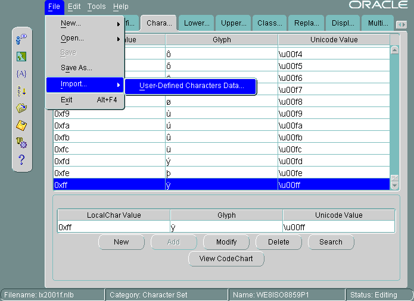
[Description of "Figure 12-24 Importing User-Defined Character Data"](img_text/csuser.md)

Open the Character Data Mapping tab page. Highlight the character that you want to add characters after in the character set. In this example, the `0xff` local character value is highlighted.

You can add one character at a time or use a text file to import a large number of characters. In this example, a text file is imported. The first column is the local character value. The second column is the Unicode value. The file contains the following character values:

88a2    963f
88a3    54c0
88a4    611b
88a5    6328
88a6    59f6
88a7    9022
88a8    8475
88a9    831c
88aa    7a50
88ab    60aa

Choose File \> Import \> User-Defined Characters Data.

The following screen shows that the imported characters are added after `0xff` in the character set.

Figure 12-25 New Characters in the Character Set

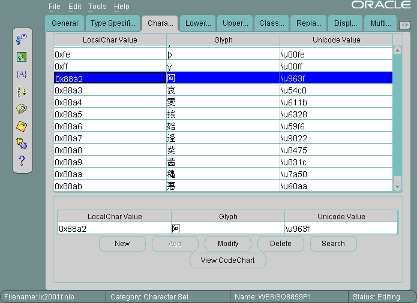
[Description of "Figure 12-25 New Characters in the Character Set"](img_text/csnewchr.md)

### 12.6 Creating a New Linguistic Sort with the Oracle Locale Builder

This section shows how to create a new multilingual linguistic sort called `MY_GENERIC_M` with a collation ID of `10001`. The `GENERIC_M` linguistic sort is used as the basis for the new linguistic sort. The following screen shows how to begin.

Figure 12-26 General Tab Page for Collation

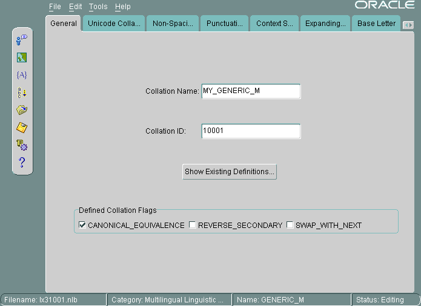
[Description of "Figure 12-26 General Tab Page for Collation"](img_text/co.md)

Settings for the flags are automatically derived. SWAP_WITH_NEXT is relevant for Thai and Lao sorts. REVERSE_SECONDARY is for French sorts. CANONICAL_EQUIVALENCE determines whether canonical rules are used. In this example, CANONICAL_EQUIVALENCE is checked.

The valid range for Collation ID (sort ID) for a user-defined sort is 1000 to 2000 for monolingual collation and 10000 to 11000 for multilingual collation.

**See Also:**

- Figure 12-30 for more information about canonical rules

- "[Linguistic Sorting and Matching](linguistic-sorting-and-matching.md)"

The following screen shows the Unicode Collation Sequence tab page.

Figure 12-27 Unicode Collation Sequence Tab Page

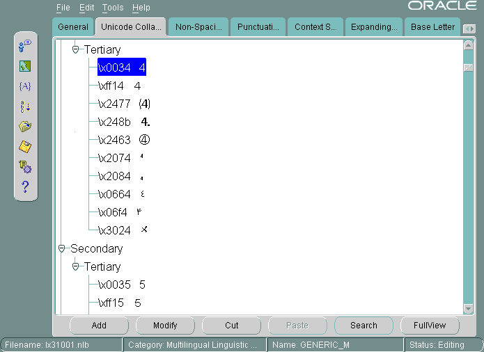
[Description of "Figure 12-27 Unicode Collation Sequence Tab Page"](img_text/couni.md)

This example customizes the linguistic sort by moving digits so that they sort after letters. Complete the following steps:

1.  Highlight the Unicode value that you want to move. In the preceding screen, the `\x0034` Unicode value is highlighted. Its location in the Unicode Collation Sequence is called a node.

2.  Click Cut. Select the location where you want to move the node.

3.  Click Paste. Clicking Paste opens the Paste Node dialog box as shown in the following screen.

    Figure 12-28 Paste Node Dialog Box

    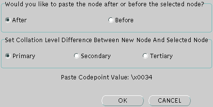
    [Description of "Figure 12-28 Paste Node Dialog Box"](img_text/pastenod.md)
    The Paste Node dialog box enables you to choose whether to paste the node after or before the location you have selected. It also enables you to choose the level (Primary, Secondary, or Tertiary) of the node in relation to the node that you want to paste it next to.

4.  Select the position and the level at which you want to paste the node. In the preceding screen, After and Primary options are selected.

5.  Click OK to paste the node.

    Use similar steps to move other digits to a position after the letters `a` through `z`.

The following screen shows the resulting Unicode Collation Sequence tab page after the digits `0` through `4` have been moved to a position after the letters `a` through `z`.

Figure 12-29 Unicode Collation Sequence After Modification

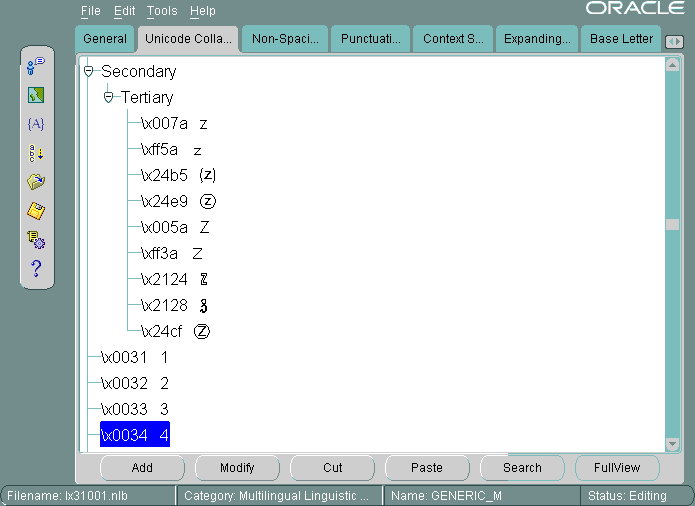
[Description of "Figure 12-29 Unicode Collation Sequence After Modification"](img_text/couni2.md)

The rest of this section contains the following topics:

- Changing the Sort Order for All Characters with the Same Diacritic

- Changing the Sort Order for One Character with a Diacritic

#### 12.6.1 Changing the Sort Order for All Characters with the Same Diacritic

This example shows how to change the sort order for characters with diacritics. You can do this by changing the sort for all characters containing a particular diacritic or by changing one character at a time. This example changes the sort of each character with a circumflex (for example, `û`) to be after the same character containing a tilde.

Verify the current sort order by choosing Tools `>` Canonical Rules. This opens the Canonical Rules dialog box as shown in the following screen.

Figure 12-30 Canonical Rules Dialog Box

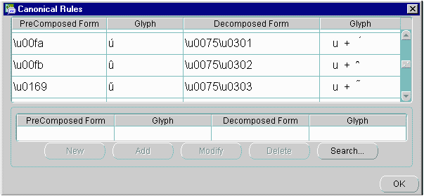
[Description of "Figure 12-30 Canonical Rules Dialog Box"](img_text/ex1.md)

This dialog box shows how characters are decomposed into their canonical equivalents and their current sorting orders. For example, `û` is represented as `u` plus ` ^`.

**See Also:**

"[Linguistic Sorting and Matching](linguistic-sorting-and-matching.md)" for more information about canonical rules

In the Oracle Locale Builder collation window (shown in Figure 12-26), select the Non-Spacing Characters tab. If you use the Non-Spacing Characters tab page, then changes for diacritics apply to all characters. The following screen shows the Non-Spacing Characters tab page.

Figure 12-31 Changing the Sort Order for All Characters with the Same Diacritic

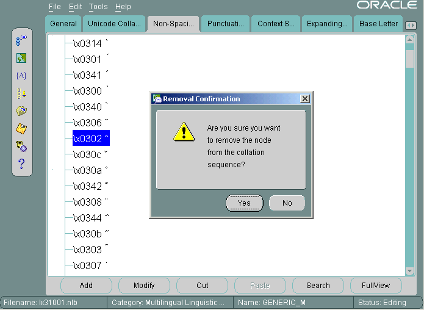
[Description of "Figure 12-31 Changing the Sort Order for All Characters with the Same Diacritic"](img_text/coremove.md)

Select the circumflex and click Cut. Click Yes in the Removal Confirmation dialog box. Select the tilde and click Paste. Choose After and Secondary in the Paste Node dialog box and click OK.

The following screen shows the new sort order.

Figure 12-32 The New Sort Order for Characters with the Same Diacritic

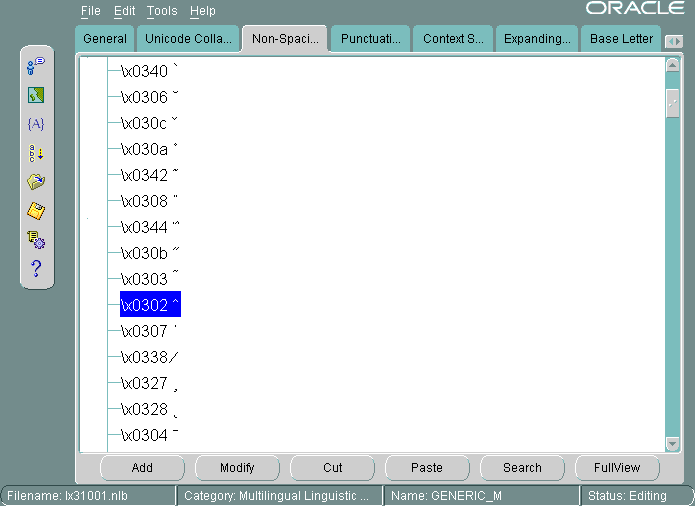
[Description of "Figure 12-32 The New Sort Order for Characters with the Same Diacritic"](img_text/conospac.md)

#### 12.6.2 Changing the Sort Order for One Character with a Diacritic

To change the order of a specific character with a diacritic, insert the character directly into the appropriate position. Characters with diacritics do not appear in the Unicode Collation Sequence tab page, so you cannot cut and paste them into the new location.

This example changes the sort order for `ä` so that it sorts after `Z`.

Select the Unicode Collation tab. Highlight the character, `Z,` that you want to put `ä` next to. Click Add. The Insert New Node dialog box appears, as shown in the following screen.

Figure 12-33 Changing the Sort Order of One Character with a Diacritic

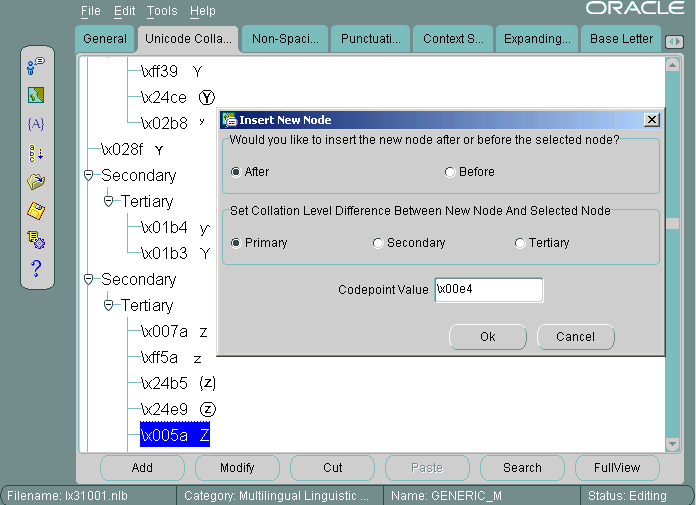
[Description of "Figure 12-33 Changing the Sort Order of One Character with a Diacritic"](img_text/coinsert.md)

Choose After and Primary in the Insert New Node dialog box. Enter the Unicode code point value of `ä`. The code point value is `\x00e4`. Click OK.

The following screen shows the resulting sort order.

Figure 12-34 New Sort Order After Changing a Single Character

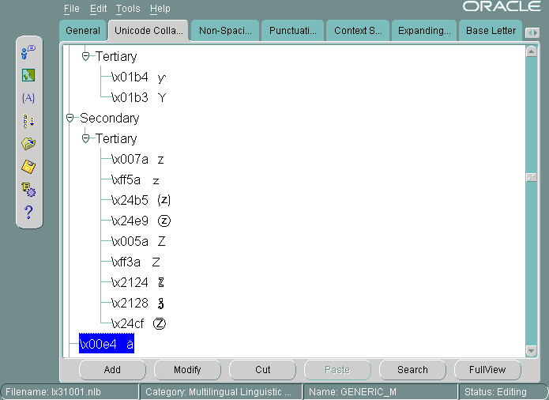
[Description of "Figure 12-34 New Sort Order After Changing a Single Character"](img_text/coinser2.md)

### 12.7 Generating and Installing NLB Files

After you have defined a new language, territory, character set, or linguistic sort, generate new NLB files from the NLT files as follows.

1.  As the user who owns the files (typically user `oracle`), back up the NLS installation boot file (`lx0boot.nlb`) and the NLS system boot file (`lx1boot.nlb`) in the `ORA_NLS10` directory. On a UNIX platform, enter commands similar to the following example:
        % setenv ORA_NLS10 $ORACLE_HOME/nls/data
        % cd $ORA_NLS10
        % cp -p lx0boot.nlb lx0boot.nlb.orig
        % cp -p lx1boot.nlb lx1boot.nlb.orig

    Note that the `-p` option preserves the timestamp of the original file.
2.  In Oracle Locale Builder, choose Tools `>` Generate NLB or click the Generate NLB icon in the left side bar.
3.  Click Browse to find the directory where the NLT file is located. The location dialog box is shown below.
    Figure 12-35 Location Dialog Box

    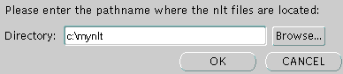
    [Description of "Figure 12-35 Location Dialog Box"](img_text/ex6.md)
    Do not try to specify an NLT file. Oracle Locale Builder generates an NLB file for each NLT file.
4.  Click OK to generate the NLB files.
    The following screen shows the final notification about successfully generated NLB files for all the NLT files in the directory.

    Figure 12-36 NLB Generation Success Dialog Box

    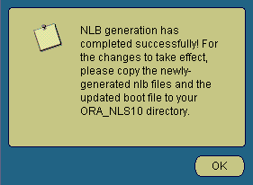
    [Description of "Figure 12-36 NLB Generation Success Dialog Box"](img_text/ex7.md)
5.  Copy the `lx1boot.nlb` file into the path that is specified by the `ORA_NLS10` environment variable. For example, on a UNIX platform, enter a command similar to the following example:
        % cp /directory_name/lx1boot.nlb $ORA_NLS10/lx1boot.nlb
6.  Copy the new NLB files into the `ORA_NLS10` directory. For example, on a UNIX platform, enter commands similar to the following example:
        % cp /directory_name/lx22710.nlb $ORA_NLS10
        % cp /directory_name/lx52710.nlb $ORA_NLS10

    **Note:**

    Oracle Locale Builder generates NLB files in the directory where the NLT files reside
7.  Restart the database to use the newly created locale data.
8.  To use the new locale data on the client side, exit the client and re-invoke the client after installing the NLB files.
    **See Also:**

    "[Locale Data on Demand](overview-of-globalization-support.md)" for more information about the `ORA_NLS10` environment variable

### 12.8 Upgrading Custom NLB Files from Previous Releases of Oracle Database

Locale definition files are database release-dependent. For example, NLB files from Oracle Database 9i and Oracle Database 10g are not directly supported in an Oracle Database 11 installation, and so forth. Even a patch set may introduce a small change to the NLB file format, if it is necessary to fix a bug. Installation of a patch set or a patch set update (PSU) may overwrite your customizations, if any Oracle-supplied NLB files have been modified in the patch set.

In order to migrate your locale customization files from your current release of the database to a new release or patch set, perform the following steps:

1.  Create a directory and copy your customized NLB or NLT files there.
2.  Install the new database release, patch set or patch set update into the existing Oracle Home or into a new Oracle Home, as appropriate.
3.  Use the Oracle Locale Builder from the new or updated Oracle Home to open each of the files copied in step (1) and save them in the NLT format to the source directory.
4.  Repeat the NLB generation and installation steps as described in the section "Generating and Installing NLB Files", still using the new version of the Oracle Locale Builder and the same source directory.

Note that Oracle Locale Builder can read and process previous versions of the NLT and NLB files, as well as read and process these files from different platforms. However, Oracle Locale Builder always saves NLT files and generates NLB files in the latest format for the release of Oracle Database that you have installed.

### 12.9 Deploying Custom NLB Files to Oracle Installations on the Same Platform

To add your customizations to another Oracle Home with exactly the same database release and patch configuration and on the same platform as the Oracle Home used to generate the original set of customizations, perform the following steps:

1.  In the target Oracle Home, perform step 1 from "Generating and Installing NLB Files".
2.  If the target Oracle Home is on another machine, copy your customized NLB files and the generated `lx1boot.nlb` file to the target machine, using any method preserving the binary integrity of the files, such as FTP in binary mode, copy to a remotely mounted file system, `rcp` utility, and so on.
3.  On the target machine, perform steps 5-8 from "Generating and Installing NLB Files" using the directory containing your customized NLB files and the `lx1boot.nlb` file as `directory_name`.

### 12.10 Deploying Custom NLB Files to Oracle Installations on Another Platform

While being release-dependent, NLB files are platform-independent. Platform-dependent differences in the binary format (such as 32-bit versus 64-bit, big-endian versus little-endian, ASCII versus EBCDIC) are processed transparently during NLB loading. Therefore, when deploying your locale customization files into other Oracle Database installations running with the same Oracle Database release and patch configuration, but under a different operating system platform, you can choose one of the following two options:

1.  Copy over the custom `.NLT` files to your new platform and repeat the NLB generation and installation steps as described in "Generating and Installing NLB Files".

2.  Copy over the entire set of `.NLB` files (both Oracle-supplied NLB files and custom NLB files) to your new platform.

Note that option (2) may introduce some overhead at NLB loading time due to the transparent platform processing required. However, this overhead should be negligible, because each NLB file is usually loaded only once after an Oracle Database instance or an Oracle Client application is started and it is cached until the instance or application is shut down. Moreover, NLB files are loaded on demand. So, in most installations, only a small subset of all available NLB files is ever loaded into memory.

Option (2) is especially useful to customize files for platforms on which Oracle Locale Builder is not supported.

To copy over the entire set of NLB files to your new platform, perform the following steps:

1.  Shut down all Oracle Database instances and Oracle Client applications using the target Oracle Home.

2.  As the user who owns the files (typically user `oracle`), move all NLB files from the `ORA_NLS10` directory of the target Oracle Home to a backup directory. On a UNIX platform, enter commands similar to the following example:

        % setenv ORA_NLS10 $ORACLE_HOME/nls/data
        % cd $ORA_NLS10
        % mkdir orig
        % mv *.nlb orig

3.  Copy all NLB files from the source Oracle Home NLB directory to the target Oracle Home NLB (`$ORA_NLS10`) directory. Use any remote copy method preserving the binary integrity of the files, such as FTP in binary mode, copy to a remotely mounted file system, `rcp` utility, and so on.

4.  Restart the database instances and/or applications, as desired.

### 12.11 Adding Custom Locale Definitions to Java Components with the GINSTALL Utility

The `Ginstall` utility adds custom character sets, language, territory, and linguistic sorts to Java components in your applications. You use Locale Builder to define your custom character sets, language, territory, and linguistic sort. Locale Builder generates NLT files, which contain the custom definitions. Then to add the custom definitions to the Java components, you run `Ginstall` to generate `gdk_custom.jar`.

To add custom definitions for character set, language, territory, and linguistic sort:

1.  Generate the NLT file using Oracle Locale Builder.
    If you are upgrading custom NLB files from a previous release, follow the procedure described in "Upgrading Custom NLB Files from Previous Releases of Oracle Database".
2.  Run `Ginstall` with `-add` or `-a` option to generate `gdk_custom.jar`.
        java -classpath $ORACLE_HOME/jlib/orai18n.jar:$ORACLE_HOME/lib/xmlparserv2.jar Ginstall -[add | a] <Name of NLT file>

    To generate multiple NLT files:

        java -classpath $ORACLE_HOME/jlib/orai18n.jar:$ORACLE_HOME/lib/xmlparserv2.jar Ginstall -[add | a] <NLT file1>
         <NLT file2>
         <NLT file3>
3.  Copy `gdk_custom.jar` to the same directory as `orai18n.jar` or `orai18n-mapping.jar`.

To remove a custom definition:

- Run `Ginstall` as follows.

      java -classpath $ORACLE_HOME/jlib/orai18n.jar:$ORACLE_HOME/lib/xmlparserv2.jar Ginstall -[remove | r] <Name of NLT file>

To update a custom definition:

- Run `Ginstall` as follows.

      java -classpath $ORACLE_HOME/jlib/orai18n.jar:$ORACLE_HOME/lib/xmlparserv2.jar Ginstall -[update | u] <Name of NLT file>

### 12.12 Customizing Calendars with the NLS Calendar Utility

Oracle Database supports several calendars. Some of them may require the addition of ruler eras in the future and some may require tailoring to local needs through addition or subtraction of deviation days. To add the required information to your Oracle implementation, you can use external files that are automatically loaded when the calendar functions are executed.

Calendar data is first defined in a text file. The text definition file must be converted into binary format. You can use the NLS Calendar Utility (`lxegen`) to convert the text definition file into binary format.

The name of the text definition file and its location for the `lxegen` utility are hard-coded and depend on the platform. On UNIX platforms, the file name is `lxecal.nlt`. It is located in the `$ORACLE_HOME/nls` directory. A sample text definition file is included in the `$ORACLE_HOME/nls/demo` directory.

Depending on the number of different calendars referenced in the text definition file, the `lxegen` utility produces one or more binary files. The names of the binary files are also hard-coded and depend on the platform. On UNIX platforms, the names of the binary files are `lxecalah.nlb` (deviation days for the Arabic Hijrah calendar), `lxecaleh.nlb` (deviation days for the English Hijrah calendar), and `lxecalji.nlb` (ruler eras for the Japanese Imperial calendar). The binary files are generated in the same directory as the text file and overwrite existing binary files.

After the binary files have been generated, they are automatically loaded during system initialization. Do not move or rename the files. Unlike files generated by Oracle Locale Builder, calendar customization binary files are not platform-independent. You should generate them for each combination of Oracle software release and platform separately.

Invoke the calendar utility from the command line as follows:

    % lxegen

**See Also:**

- "[Calendar Systems](appendix-A-locale-data.md)"

- [Oracle Database Examples Installation Guide ](../exmpl/index.md)for more information regarding how to install demo files

- Operating system documentation for the location of the files on your system
