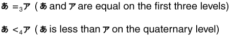

## 5  Linguistic Sorting and Matching

This chapter explains the mechanism of linguistic sorting and searching of character data or strings in Oracle Database. The process of determining the mutual ordering of strings (character values) is called a [collation](glossary.md). For any two strings, the collation defines whether the strings are equal or whether one precedes the other in the sorting order. In the Oracle documentation, the term [sort](glossary.md) is often used in place of collation.

Determining equality is especially important when a set of strings, such as a table column, is searched for values that equal a specified search term or that match a search pattern. SQL operators and functions used in searching are `=`, `LIKE`, `REGEXP_LIKE`, `INSTR`, and `REGEXP_INSTR`. This chapter uses the term matching to mean determining the equality of entire strings using the equality operator `=` or determining the equality of substrings of a string when the string is matched against a pattern using `LIKE`, `REGEXP_LIKE` or `REGEXP_INSTR`. Note that Oracle Text provides advanced full-text searching capabilities for the Oracle Database.

The ordering of strings in a set is called sorting. For example, the `ORDER` `BY` clause uses collation to determine the ordering of strings to sort the query results, while PL/SQL uses collations to sort strings in associative arrays indexed by `VARCHAR2` values, and the functions `MIN`, `MAX`, `GREATEST`, and `LEAST` use collations to find the smallest or largest character value.

There are many possible collations that can be applied to strings to determine their ordering. Collations that take into consideration the standards and customs of spoken languages are called [linguistic collation](glossary.md)s. They order strings in the same way as dictionaries, phone directories, and other text lists written in a given language. In contrast, [binary collation](glossary.md) orders strings based on their binary representation (character encoding), treating each string as a simple sequences of bytes.

**See Also:**

[Oracle Text Application Developer's Guide](../ccapp/understanding-oracle-text-application-development.md)

The following topics explain linguistic sorting and matching:

- Overview of Oracle Database Collation Capabilities

- Using Binary Collation

- Using Linguistic Collation

- Linguistic Collation Features

- Case-Insensitive and Accent-Insensitive Linguistic Collation

- Performing Linguistic Comparisons

- Using Linguistic Indexes

- Searching Linguistic Strings

- SQL Regular Expressions in a Multilingual Environment

- Column-Level Collation and Case Sensitivity

### 5.1 Overview of Oracle Database Collation Capabilities

Different languages have different collations. In addition, different cultures or countries that use the same alphabets may sort words differently. For example, in Danish, Æ is after `Z`, while `Y` and `Ü` are considered to be variants of the same letter.

Collation can be case-sensitive or case-insensitive. Case refers to the condition of being uppercase or lowercase. For example, in a Latin alphabet, `A` is the uppercase glyph for `a`, the lowercase glyph.

Collation can ignore or consider diacritics. A diacritic is a mark near or through a character or combination of characters that indicates a different sound than the sound of the character without the diacritic. For example, the cedilla (`,`) in `façade` is a diacritic. It changes the sound of `c`.

Collation order can be phonetic or it can be based on the appearance of the character. For example, collation can be based on the number of strokes in East Asian ideographs. Another common collation issue is combining letters into a single character. For example, in traditional Spanish, `ch` is a distinct character that comes after `c`, which means that the correct order is: cerveza, colorado, cheremoya. This means that the letter `c` cannot be sorted until Oracle Database has checked whether the next letter is an `h`.

Oracle Database provides the following types of collation:

- Binary

- Monolingual

- Multilingual

- Unicode Collation Algorithm (UCA)

While monolingual collation achieves a linguistically correct order for a single language, multilingual collation and UCA collation are designed to handle many languages at the same time. Furthermore, UCA collation conforms to the Unicode Collation Algorithm (UCA) that is a Unicode standard and is fully compatible with the international collation standard ISO 14651. The UCA standard provides a complete linguistic ordering for all characters in Unicode, hence all the languages around the world. With wide deployment of Unicode application, UCA collation is best suited for sorting multilingual data.

### 5.2 Using Binary Collation

One way to sort character data is based on the numeric values of the characters defined by the character encoding scheme. This is called a binary collation. Binary collation is the fastest type of sort. It produces reasonable results for the English alphabet because the ASCII and EBCDIC standards define the letters A to Z in ascending numeric value.

**Note:**

In the ASCII standard, all uppercase letters appear before any lowercase letters. In the EBCDIC standard, the opposite is true: all lowercase letters appear before any uppercase letters.

When characters used in other languages are present, a binary collation usually does not produce reasonable results. For example, an ascending `ORDER` `BY` query returns the character strings `ABC`, `ABZ`, `BCD`, `ÄBC`, when `Ä` has a higher numeric value than `B` in the character encoding scheme. A binary collation is not usually linguistically meaningful for Asian languages that use ideographic characters.

### 5.3 Using Linguistic Collation

To produce a collation sequence that matches the alphabetic sequence of characters, another sorting technique must be used that sorts characters independently of their numeric values in the character encoding scheme. This technique is called a linguistic collation. A linguistic collation operates by replacing characters with numeric values that reflect each character's proper linguistic order.

This section includes the following topics:

- Monolingual Collation

- Multilingual Collation

- UCA Collation

#### 5.3.1 Monolingual Collation

Oracle Database compares character strings in two steps for monolingual collation. The first step compares the major value of the entire string from a table of major values. Usually, letters with the same appearance have the same major value. The second step compares the minor value from a table of minor values. The major and minor values are defined by Oracle Database. Oracle Database defines letters with diacritic and case differences as having the same major value but different minor values.

Each major table entry contains the Unicode code point and major value for a character. The Unicode code point is a 16-bit binary value that represents a character.

The following table illustrates sample values for sorting `a`, `A`, `ä`, `Ä`, and `b`.

Table 5-1 Sample Glyphs and Their Major and Minor Sort Values

| Glyph | Major Value | Minor Value |
|:------|:------------|:------------|
| a     | 15          | 5           |
| A     | 15          | 10          |
| ä     | 15          | 15          |
| Ä     | 15          | 20          |
| b     | 20          | 5           |

**Note:**

Monolingual collation is not available for non-Unicode multibyte database character sets. If a monolingual collation is specified when the database character set is non-Unicode multibyte, then the default sort order is the binary sort order of the database character set. One exception is `UNICODE_BINARY`. This collation is available for all character sets.

**See Also:**

"[What is the Unicode Standard?](supporting-multilingual-databases-with-unicode.md)"

#### 5.3.2 Multilingual Collation

Oracle Database provides multilingual collation so that you can sort data in more than one language in one sort. This is useful for regions or languages that have complex sorting rules and for multilingual databases. Note that Oracle Database supports all of the collations defined in the previous releases.

For Asian language data or multilingual data, Oracle Database provides a sorting mechanism based on the ISO 14651 standard. For example, Chinese characters can be ordered by the number of strokes, PinYin, or radicals.

In addition, multilingual collation can handle canonical equivalence and supplementary characters. Canonical equivalence is a basic equivalence between characters or sequences of characters. For example, `ç` is equivalent to the combination of `c` and `,`. Supplementary characters are user-defined characters or predefined characters in Unicode that require two code points within a specific code range. You can define up to 1.1 million code points in one multilingual sort.

For example, Oracle Database supports a monolingual French sort (`FRENCH`), but you can specify a multilingual French collation (`FRENCH_M`). `_M` represents the ISO 14651 standard for multilingual sorting. The sorting order is based on the `GENERIC_M` sorting order and can sort diacritical marks from right to left. Multilingual linguistic sort is usually used if the tables contain multilingual data. If the tables contain only French, then a monolingual French sort might have better performance because it uses less memory. It uses less memory because fewer characters are defined in a monolingual French sort than in a multilingual French sort. There is a trade-off between the scope and the performance of a sort.

**See Also:**

- "Canonical Equivalence"

- "[Code Points and Supplementary Characters](supporting-multilingual-databases-with-unicode.md)"

##### 5.3.2.1 Multilingual Collation Levels

Oracle Database evaluates multilingual collation at three levels of precision:

- Primary Level Collation

- Secondary Level Collation

- Tertiary Level Collation

###### 5.3.2.1.1 Primary Level Collation

A primary level collation distinguishes between base letters, such as the difference between characters `a` and `b`. It is up to individual locales to define whether `a` is before `b`, `b` is before `a`, or if they are equal. The binary representation of the characters is completely irrelevant. If a character is an ignorable character, then it is assigned a primary level order (or weight)of zero, which means it is ignored at the primary level. Characters that are ignorable on other levels are given an order of zero at those levels.

For example, at the primary level, all variations of `bat` come before all variations of `bet`. The variations of `bat` can appear in any order, and the variations of `bet` can appear in any order:

    Bat
    bat
    BAT
    BET
    Bet
    bet

**See Also:**

"Ignorable Characters"

###### 5.3.2.1.2 Secondary Level Collation

A secondary level collation distinguishes between base letters (the primary level collation) before distinguishing between diacritics on a given base letter. For example, the character `Ä` differs from the character `A` only because it has a diacritic. Thus, `Ä` and `A` are the same on the primary level because they have the same base letter (`A`) but differ on the secondary level.

The following list has been sorted on the primary level (`resume` comes before `resumes`) and on the secondary level (strings without diacritics come before strings with diacritics):

    resume
    résumé
    Résumé
    Resumes
    resumes
    résumés

###### 5.3.2.1.3 Tertiary Level Collation

A tertiary level collation distinguishes between base letters (primary level collation), diacritics (secondary level collation), and case (upper case and lower case). It can also include special characters such as `+`, `-`, and `*`.

The following are examples of tertiary level collations:

- Characters `a` and `A` are equal on the primary and secondary levels but different on the tertiary level because they have different cases.

- Characters `ä` and `A` are equal on the primary level and different on the secondary and tertiary levels.

- The primary and secondary level orders for the dash character `-` is 0. That is, it is ignored on the primary and secondary levels. If a dash is compared with another character whose primary level weight is nonzero, for example, `u`, then no result for the primary level is available because `u` is not compared with anything. In this case, Oracle Database finds a difference between `-` and `u` only at the tertiary level.

The following list has been sorted on the primary level (`resume` comes before `resumes`) and on the secondary level (strings without diacritics come before strings with diacritics) and on the tertiary level (lower case comes before upper case):

    resume
    Resume
    résumé
    Résumé
    resumes
    Resumes
    résumés
    Résumés

#### 5.3.3 UCA Collation

Unicode Collation Algorithm (UCA) is a Unicode standard that is fully compatible with the international collation standard ISO 14651. UCA defines a Default Unicode Collation Element Table (DUCET) that provides a reasonable default ordering for all languages that are not tailored. To achieve the correct ordering for a particular language, DUCET can be tailored to meet the linguistic requirements for that language. There are tailorings of DUCET for various languages provided in the Unicode Common Locale Data Repository.

This Oracle Database release provides UCA collation that fully conforms to UCA 7.0. In addition to the collation based on DUCET, it provides tailored collations for a number of commonly used languages. For example, you can specify UCA collation `UCA0700_SCHINESE` to sort multilingual data containing Simplified Chinese. The collation will make Simplified Chinese data appear in the PinYin order.

For sorting multilingual data, Oracle recommends the latest supported version of UCA collations.

This section describes the following topics:

- UCA Comparison Levels

- UCA Collation Parameters

**See Also:**

[The Unicode Consortium](https://docs.oracle.com/pls/topic/lookup?ctx=en/database/oracle/oracle-database/19/nlspg&id=unicode_org) website for more information about Unicode Collation Algorithm and related terminologies

##### 5.3.3.1 UCA Comparison Levels

Similar to multilingual collation, UCA collations employ a multilevel comparison algorithm to evaluate characters. This can go up to four levels of comparison:

- Primary Level

- Secondary Level

- Tertiary Level

- Quaternary Level

###### 5.3.3.1.1 Primary Level

The primary level is used to distinguish between base letters, which is similar to the comparison used in the primary level collation of the multilingual collation.

**See Also:**

"Primary Level Collation" for examples of base letter differences

###### 5.3.3.1.2 Secondary Level

The secondary level is used to distinguish between diacritics if base letters are the same, which is similar to what is used in the secondary level collation of the multilingual collation to distinguish between diacritics.

**See Also:**

"Secondary Level Collation" for examples of diacritic differences

###### 5.3.3.1.3 Tertiary Level

The tertiary level is used to distinguish between cases on a given base letter with the same diacritic, which is similar to what is used in the tertiary level collation of the multilingual collation to distinguish between cases. Moreover, UCA DUCET collation treats punctuations with primary or quaternary significance based on how variable characters are weighted, which is different from the tertiary level collation of the multilingual collation that treat punctuations with tertiary level of significance.

**See Also:**

"Tertiary Level Collation" for examples of characters with case differences

###### 5.3.3.1.4 Quaternary Level

The quaternary level is used to distinguish variable characters from other characters, if variable characters are weighted as shifted. It is also used to distinguish Hiragana from Katakana with the same base and case. An example is illustrated in the following figure.

Figure 5-1 Hiragana and Katakana Collation

[Description of "Figure 5-1 Hiragana and Katakana Collation"](img_text/nlspg042_200.md)

**See Also:**

"UCA Collation Parameters"

##### 5.3.3.2 UCA Collation Parameters

The following table illustrates the collation parameters and options that are supported in UCA collations in this release.

Table 5-2 UCA Collation Parameters

| Attribute                                       | Options                                        | Collation Modifier                                                                                                      |
|:------------------------------------------------|:-----------------------------------------------|:------------------------------------------------------------------------------------------------------------------------|
| `strength`                                      | primary secondary tertiary quaternary | `_AI` or `_S1` `_CI` or `_S2` `_S3` `_S4` (Only applicable when the `alternate` attribute is set to `shifted`) |
| `alternate`                                     | non-ignorable shifted blanked            | `_VN` `_VS` `_VB`                                                                                                 |
| `backwards`                                     | on off                                      | `_BY` `_BN`                                                                                                          |
| `normalization`                                 | on                                             | `_NY`                                                                                                                   |
| `caseLevel`                                     | off                                            | `_EN`                                                                                                                   |
| `caseFirst`                                     | upper off                                   | `_FU` (Only valid for Danish) `_FN` (Only valid for other languages)                                                 |
| `hiraganaQuaternary` (Deprecated in UCA 7.0) | on off                                      | `_HY` `_HN`                                                                                                          |
| `numeric`                                       | off                                            | `_DN`                                                                                                                   |
| `match-style`                                   | minimal                                        | `_MN`                                                                                                                   |

The parameter `strength` represents UCA comparison level.

The parameter `alternate` controls how variable characters are weighted.

The parameter `backwards` controls if diacritics are to be sorted backward.

The parameter `hiraganaQuaternary` is applicable to the UCA collations for the Japanese language only. It has no effect on other collations. If it is set to “on” (`_HY`), then the corresponding Hiragana and Katakana characters have different quaternary weights. Otherwise, they have the same weights. The `hiraganaQuaternary` parameter is deprecated in UCA 7.0.

You can configure the preceding four UCA parameters using the options listed in Table 5-2. The options for the other parameters listed in Table 5-2 are currently fixed based on tailored languages and are not configurable.

**See Also:**

- "UCA Comparison Levels"

- [The Unicode Consortium](https://docs.oracle.com/pls/topic/lookup?ctx=en/database/oracle/oracle-database/19/nlspg&id=unicode_org) website for a complete description of UCA collation parameters and options

### 5.4 Linguistic Collation Features

This section contains information about different features that a linguistic collation can have:

- Base Letters

- Ignorable Characters

- Contracting Characters

- Expanding Characters

- Context-Sensitive Characters

- Canonical Equivalence

- Reverse Secondary Sorting

- Character Rearrangement for Thai and Laotian Characters

- Special Letters

- Special Combination Letters

- Special Uppercase Letters

- Special Lowercase Letters

You can customize linguistic collations to include the desired characteristics.

**See Also:**

"[Customizing Locale Data](customizing-locale-data.md)"

#### 5.4.1 Base Letters

Base letters are defined in a base letter table, which maps each letter to its base letter. For example, `a`, `A`, `ä`, and `Ä` all map to `a`, which is the base letter. This concept is particularly relevant for working with Oracle Text.

**See Also:**

[ Oracle Text Reference](../ccref/oracle-text-alternative-spelling.md)

#### 5.4.2 Ignorable Characters

In multilingual collation and UCA collation, certain characters may be treated as ignorable. Ignorable characters are skipped, that is, treated as non-existent, when two character values (strings) containing such characters are compared in a sorting or matching operation. There are three kinds of ignorable characters: primary, secondary, and tertiary.

- Primary Ignorable Characters

- Secondary Ignorable Characters

- Tertiary Ignorable Characters

##### 5.4.2.1 Primary Ignorable Characters

Primary ignorable characters are ignored when the multilingual collation or UCA collation definition applied to the given comparison has the accent-insensitivity modifier `_AI,` for example, `GENERIC_M_AI` or `UCA0700_DUCET_AI`.

Primary ignorable characters are comprised of diacritics (accents) from various alphabets (Latin, Cyrillic, Greek, Devanagari, Katakana, and so on) and also of decorating modifiers, such as an enclosing circle or enclosing square. These characters are non-spacing combining characters, which means they combine with the preceding character to form a complete accented or decorated character ("non-spacing" means that the character occupies the same character position on screen or paper as the preceding character). For example, the character "Latin Small Letter e" followed by the character "Combining Grave Accent" forms a single letter "è", while the character "Latin Capital Letter A" followed by the "Combining Enclosing Circle" forms a single character "(A)". Because non-spacing characters are defined as ignorable for accent-insensitive sorts, these sorts can treat, for example, `rôle` as equal to `role`, `naïve` as equal to `naive`, and `(A)(B)(C)` as equal to `ABC`.

Primary ignorable characters are called non-spacing characters when viewed in a multilingual collation definition in the Oracle Locale Builder utility.

##### 5.4.2.2 Secondary Ignorable Characters

Secondary ignorable characters are ignored when the applied definition has either the accent-insensitivity modifier `_AI` or the case-insensitivity modifier `_CI`.

In multilingual collation, secondary ignorable characters are comprised of punctuation characters, such as the space character, new line control codes, dashes, various quote forms, mathematical operators, dot, comma, exclamation mark, various bracket forms, and so on. In accent-insensitive (`_AI`) and case-insensitive (`_CI`) sorts, these punctuation characters are ignored so that `multi-lingual` can be treated as equal to `multilingual` and `e-mail` can be treated as equal to `email`.

Secondary ignorable characters are called punctuation characters when viewed in a multilingual collation definition in the Oracle Locale Builder utility.

There are no secondary ignorable characters defined in the UCA DUCET, however. Punctuations are treated as variable characters in the UCA.

##### 5.4.2.3 Tertiary Ignorable Characters

Tertiary ignorable characters are generally ignored in linguistic comparison. They are mainly comprised of control codes, format characters, variation selectors, and so on.

Primary and secondary ignorable characters are not ignored when a standard, case- and accent-sensitive sort is used. However, they have lower priority when determining the order of strings. For example, `multi-lingual` is sorted after `multilingual` in the `GENERIC_M` sort, but it is still sorted between `multidimensional` and `multinational`. The comparison `d < l < n` of the base letters has higher priority in determining the order than the presence of the secondary ignorable character HYPHEN (U+002D).

You can see the full list of non-spacing characters and punctuation characters in a multilingual collation definition when viewing the definition in the Oracle Locale Builder. Generally, neither punctuation characters nor non-spacing characters are included in monolingual collation definitions. In some monolingual collation definitions, the space character and the tabulator character may be included. The comparison algorithm automatically assigns a minor value to each undefined character. This makes punctuation characters non-ignorable but, as in the case of multilingual collations, considered with lower priority when determining the order of compared strings. The ordering among punctuation characters in monolingual collations is based on their Unicode code points and may not correspond to user expectations.

**See Also:**

"Case-Insensitive and Accent-Insensitive Linguistic Collation"

#### 5.4.3 Variable Characters and Variable Weighting

There are characters defined with variable collation elements in the UCA. These characters are called variable characters and are comprised of white space characters, punctuations, and certain symbols.

Variable characters can be weighted differently in UCA collations to adjust the effect of these characters in a sorting or comparison, which is called variable weighting. The collation parameter, `alternate`, controls how it works. The following options on variable weighting are supported in UCA collations in this release:

- `blanked`

  Variable characters are treated as ignorable characters. For example, SPACE (U+0020) is ignored in comparison.

- `non-ignorable`

  Variable characters are treated as if they were not ignorable characters. For example, SPACE (U+0020) is not ignored in comparison at primary level.

- `shifted`

  Variable characters are treated as ignorable characters on the primary, secondary and tertiary levels. In addition, a new quaternary level is used for all characters. The quaternary weight of a character depends on if the character is a variable, ignorable, or other. For example, SPACE (U+0020) is assigned a quaternary weight differently from A (U+0041) because SPACE is a variable character while A is neither a variable nor an ignorable character.

**See Also:**

"UCA Collation Parameters"

##### Examples of Variable Weighting

This section includes different examples of variable weighting.

Example 5-1 UCA DUCET Order When Variable is Weighed as Blanked

The following list has been sorted using `UCA0700_DUCET_VB`:

    blackbird
    Blackbird
    Black-bird
    Black bird
    BlackBird

`Blackbird`, `Black-bird`, and `Black` `bird` have the same collation weight because SPACE(U+0020) and HYPHEN(U+002D) are treated as ignorable characters. Selecting only the distinct entries illustrates this behavior (note that only `Blackbird` is shown in the result):

    blackbird
    Blackbird
    BlackBird

`Blackbird`, `Black-bird`, and `Black` `bird` are sorted after `blackbird` due to case difference on the first letter B (U+0042), but before `BlackBird` due to case difference at the second `b` (U+0062).

Example 5-2 UCA DUCET Order When Variable is Weighed as Non-Ignorable

The following list has been sorted using `UCA0700_DUCET_VN`:

    Black bird
    Black-bird
    blackbird
    Blackbird
    BlackBird

`Black` `bird` and `Black-bird` are sorted before `blackbird` because both SPACE (U+0020) and HYPHEN (U+002D) are not treated as ignorable characters but they are smaller than `b` (U+0062) at the primary level. `Black` `bird` is sorted before `Black-bird` because SPACE (U+0020) is small than HYPHEN (U+002D) at the primary level.

Example 5-3 UCA DUCET Order When Variable is Weighed as Shifted

The following list has been sorted using `UCA0700_DUCET`:

    blackbird
    Black bird
    Black-bird
    Blackbird
    BlackBird

`blackbird` is sorted before `Black` `bird` and `Black-bird` because both SPACE (U+0020) and HYPHEN (U+002D) are ignored at the first three levels, and there is a case difference on the first letter `b` (U+0062). `Black-bird` is sorted before `Blackbird` is because HYPHEN (U+002D) has a small quaternary weight than the letter `b` (U+0062) in `Blackbird`.

#### 5.4.4 Contracting Characters

Collation elements usually consist of a single character, but in some locales, two or more characters in a character string must be considered as a single collation element during sorting. For example, in traditional Spanish, the string `ch` is composed of two characters. These characters are called contracting characters in multilingual collation and special combination letters in monolingual collation.

Do not confuse a composed character with a contracting character. A composed character like `á` can be decomposed into `a` and `'`, each with their own encoding. The difference between a composed character and a contracting character is that a composed character can be displayed as a single character on a terminal, while a contracting character is used only for sorting, and its component characters must be rendered separately.

#### 5.4.5 Expanding Characters

In some locales, certain characters must be sorted as if they were character strings. An example is the German character `ß` (sharp s). It is sorted exactly the same as the string `ss`. Another example is that `ö` sorts as if it were `oe`, after `od` and before `of`. These characters are known as expanding characters in multilingual collation and special letters in monolingual collation. Just as with contracting characters, the replacement string for an expanding character is meaningful only for sorting.

#### 5.4.6 Context-Sensitive Characters

In Japanese, a prolonged sound mark that resembles an em dash `—` represents a length mark that lengthens the vowel of the preceding character. The sort order depends on the vowel that precedes the length mark. This is called context-sensitive collation. For example, after the character `ka`, the `—` length mark indicates a long `a` and is treated the same as `a`, while after the character `ki`, the `—` length mark indicates a long `i` and is treated the same as `i`. Transliterating this to Latin characters, a sort might look like this:

    kaa
    ka—   -- kaa and ka— are the same
    kai   -- kai follows ka- because i is after a
    kia   -- kia follows kai because i is after a
    kii   -- kii follows kia because i is after a
    ki—   -- kii and ki— are the same

#### 5.4.7 Canonical Equivalence

Canonical equivalence is an attribute of a multilingual collation and describes how equivalent code point sequences are sorted. If canonical equivalence is applied in a particular multilingual collation, then canonically equivalent strings are treated as equal.

One Unicode code point can be equivalent to a sequence of base letter code points plus diacritic code points. This is called the Unicode canonical equivalence. For example, `ä` equals its base letter `a` and an umlaut. A linguistic flag, `CANONICAL_EQUIVALENCE = TRUE`, indicates that all canonical equivalence rules defined in Unicode need to be applied in a specific multilingual collation. Oracle Database-defined multilingual collations include the appropriate setting for the canonical equivalence flag. You can set the flag to `FALSE` to speed up the comparison and ordering functions if all the data is in its composed form.

For example, consider the following strings:

- `äa` (`a` umlaut followed by `a`)

- `a¨b` (`a` followed by umlaut followed by `b`)

- `äc` (`a` umlaut followed by `c`)

If `CANONICAL_EQUIVALENCE=FALSE`, then the sort order of the strings is:

    a¨b
    äa
    äc

This occurs because `a` comes before `ä` if canonical equivalence is not applied.

If `CANONICAL_EQUIVALENCE=TRUE`, then the sort order of the strings is:

    äa
    a¨b
    äc

This occurs because `ä` and `a¨` are treated as canonically equivalent.

You can use Oracle Locale Builder to view the setting of the canonical equivalence flag in existing multilingual collations. When you create a customized multilingual collation with Oracle Locale Builder, you can set the canonical equivalence flag as desired.

**See Also:**

"[Creating a New Linguistic Sort with the Oracle Locale Builder](customizing-locale-data.md)" for more information about setting the canonical equivalence flag

#### 5.4.8 Reverse Secondary Sorting

In French, sorting strings of characters with diacritics first compares base letters from left to right, but compares characters with diacritics from right to left. For example, by default, a character with a diacritic is placed after its unmarked variant. Thus `Èdit` comes before `Edít` in a French sort. They are equal on the primary level, and the secondary order is determined by examining characters with diacritics from right to left. Individual locales can request that the characters with diacritics be sorted with the right-to-left rule. Set the `REVERSE_SECONDARY` linguistic flag to `TRUE` to enable reverse secondary sorting.

**See Also:**

"[Creating a New Linguistic Sort with the Oracle Locale Builder](customizing-locale-data.md)" for more information about setting the reverse secondary flag

#### 5.4.9 Character Rearrangement for Thai and Laotian Characters

In Thai and Lao, some characters must first change places with the following character before sorting. Normally, these types of characters are symbols representing vowel sounds, and the next character is a consonant. Consonants and vowels must change places before sorting. Set the `SWAP_WITH_NEXT` linguistic flag for all characters that must change places before sorting.

**See Also:**

"[Creating a New Linguistic Sort with the Oracle Locale Builder](customizing-locale-data.md)" for more information about setting the `SWAP_WITH_NEXT` flag

#### 5.4.10 Special Letters

Special letters is a term used in monolingual collation. They are called expanding characters in multilingual collation.

**See Also:**

"Expanding Characters"

#### 5.4.11 Special Combination Letters

Special combination letters is the term used in monolingual collations. They are called contracting letters in multilingual collation.

**See Also:**

"Contracting Characters"

#### 5.4.12 Special Uppercase Letters

One lowercase letter may map to multiple uppercase letters. For example, in traditional German, the uppercase letters for `ß` are `SS`.

These case conversions are handled by the `NLS_UPPER`, `NLS_LOWER`, and `NLS_INITCAP` SQL functions, according to the conventions established by the linguistic collations. The `UPPER`, `LOWER`, and `INITCAP` SQL functions cannot handle these special characters, because their casing operation is based on binary mapping defined for the underlying character set, which is not linguistic sensitive.

The `NLS_UPPER SQL` function returns its first argument string in which all lowercase letters have been mapped to their uppercase equivalents. The following example shows the result of the `NLS_UPPER` function when `NLS_SORT` is set to `XGERMAN`:

    SELECT NLS_UPPER ('große') "Uppercase" FROM DUAL;

    Upper
    -----
    GROSSE

**See Also:**

[Oracle Database SQL Language Reference](../sqlrf/NLS_UPPER.md)

#### 5.4.13 Special Lowercase Letters

Oracle Database supports special lowercase letters. One uppercase letter may map to multiple lowercase letters. An example is the Turkish uppercase `I` becoming a small, dotless i.

### 5.5 Case-Insensitive and Accent-Insensitive Linguistic Collation

An SQL operation in an Oracle Database is generally sensitive to the case and the accents (diacritics) of characters. However, sometimes you may need to perform case-insensitive or accent-insensitive comparison or matching.

In previous versions of the database, case-insensitive queries could be achieved by using the `NLS_UPPER` and `NLS_LOWER` SQL functions. The functions change the case of strings based on a specific linguistic collation definition. This enables you to perform case-insensitive searches regardless of the language being used. For example, create a table called `test1` as follows:

    SQL> CREATE TABLE test1(word VARCHAR2(12));
    SQL> INSERT INTO test1 VALUES('GROSSE');
    SQL> INSERT INTO test1 VALUES('Große');
    SQL> INSERT INTO test1 VALUES('große');
    SQL> SELECT * FROM test1;

    WORD
    ------------
    GROSSE
    Große
    große

Perform a case-sensitive search for `GROSSE` as follows:

    SQL> SELECT word FROM test1 WHERE word='GROSSE';

    WORD
    ------------
    GROSSE

Perform a case-insensitive search for `GROSSE` using the `NLS_UPPER` function:

    SELECT word FROM test1
    WHERE NLS_UPPER(word, 'NLS_SORT = XGERMAN') = 'GROSSE';

    WORD
    ------------
    GROSSE
    Große
    große

Oracle Database provides case-insensitive and accent-insensitive options for collation. It provides the following types of linguistic collations:

- Linguistic collations that use information about base letters, diacritics, punctuation, and case. These are the standard linguistic collations that are described in "Using Linguistic Collation".

- Monolingual collations that use information about base letters, diacritics, and punctuation, but not case, and multilingual and UCA collations that use information about base letters and diacritics, but not case or punctuation. This type of sort is called case-insensitive.

- Monolingual collations that use information about base letters and punctuation only, and multilingual and UCA collations that use information about base letters only. This type of sort is called accent-insensitive. (Accent is another word for diacritic.) Like case-insensitive sorts, an accent-insensitive sort does not use information about case.

Accent- and case-insensitive multilingual collations ignore punctuation characters as described in "Ignorable Characters".

The rest of this section contains the following topics:

- Examples: Case-Insensitive and Accent-Insensitive Collation

- Specifying a Case-Insensitive or Accent-Insensitive Collation

- Examples: Linguistic Collation

**See Also:**

- "[NLS_SORT](setting-up-globalization-support-environment.md)"

- "[NLS_COMP](setting-up-globalization-support-environment.md)"

#### 5.5.1 Examples: Case-Insensitive and Accent-Insensitive Collation

The following examples show:

- A collation that uses information about base letters, diacritics, punctuation, and case

- A case-insensitive collation

- An accent-insensitive collation

Example 5-4 Linguistic Collation Using Base Letters, Diacritics, Punctuation, and Case Information

The following list has been sorted using information about base letters, diacritics, punctuation, and case:

    blackbird
    black bird
    black-bird
    Blackbird
    Black-bird
    blackbîrd
    bläckbird

Example 5-5 Case-Insensitive Linguistic Collation

The following list has been sorted using information about base letters, diacritics, and punctuation, ignoring case:

    black bird
    black-bird
    Black-bird
    blackbird
    Blackbird
    blackbîrd
    bläckbird

`black-bird` and `Black-bird` have the same value in the collation, because the only different between them is case. They could appear interchanged in the list. `Blackbird` and `blackbird` also have the same value in the collation and could appear interchanged in the list.

Example 5-6 Accent-Insensitive Linguistic Collation

The following list has been sorted using information about base letters only. No information about diacritics, punctuation, or case has been used.

    blackbird
    bläckbird
    blackbîrd
    Blackbird
    BlackBird
    Black-bird
    Black bird

#### 5.5.2 Specifying a Case-Insensitive or Accent-Insensitive Collation

Use the `NLS_SORT` session parameter to specify a case-insensitive or accent-insensitive collation:

- Append `_CI` to an Oracle Database collation name for a case-insensitive collation.

- Append `_AI` to an Oracle Database collation name for an accent-insensitive and case-insensitive collation.

For example, you can set `NLS_SORT` to the following types of values:

    UCA0700_SPANISH_AI
    FRENCH_M_AI
    XGERMAN_CI

Binary collation can also be case-insensitive or accent-insensitive. When you specify `BINARY_CI` as a value for `NLS_SORT`, it designates a collation that is accent-sensitive and case-insensitive. `BINARY_AI` designates an accent-insensitive and case-insensitive binary collation. You may want to use a binary collation if the binary collation order of the character set is appropriate for the character set you are using.

For example, with the `NLS_LANG` environment variable set to `AMERICAN_AMERICA.WE8ISO8859P1`, create a table called `test2` and populate it as follows:

    SQL> CREATE TABLE test2 (letter VARCHAR2(10));
    SQL> INSERT INTO test2 VALUES('ä');
    SQL> INSERT INTO test2 VALUES('a');
    SQL> INSERT INTO test2 VALUES('A');
    SQL> INSERT INTO test2 VALUES('Z');
    SQL> SELECT * FROM test2;

    LETTER
    -----------
    ä
    a
    A
    Z

The default value of `NLS_SORT` is `BINARY`. Use the following statement to do a binary collation of the characters in table `test2`:

    SELECT * FROM test2 ORDER BY letter;

To change the value of `NLS_SORT`, enter a statement similar to the following:

    ALTER SESSION SET NLS_SORT=BINARY_CI;

The following table shows the collation orders that result from setting `NLS_SORT` to `BINARY`, `BINARY_CI`, and `BINARY_AI`.

| BINARY | BINARY_CI | BINARY_AI |
|:-------|:----------|:----------|
| `A`    | `a`       | `ä`       |
| `Z`    | `A`       | `a`       |
| `a`    | `Z`       | `A`       |
| `ä`    | `ä`       | `Z`       |

When `NLS_SORT=BINARY`, uppercase letters come before lowercase letters. Letters with diacritics appear last.

When the collation considers diacritics but ignores case (`BINARY_CI`), the letters with diacritics appear last.

When both case and diacritics are ignored (`BINARY_AI`), `ä` is sorted with the other characters whose base letter is `a`. All the characters whose base letter is `a` occur before `z`.

You can use binary collation for better performance when the character set is US7ASCII or another character set that has the same collation order as the binary collation.

The following table shows the collation orders that result from German collation for the table.

| GERMAN | GERMAN_CI | GERMAN_AI |
|:-------|:----------|:----------|
| `a`    | `a`       | `ä`       |
| `A`    | `A`       | `a`       |
| `ä`    | `ä`       | `A`       |
| `Z`    | `Z`       | `Z`       |

A German collation places lowercase letters before uppercase letters, and `ä` occurs before `Z`. When the collation ignores both case and diacritics (`GERMAN_AI`), `ä` appears with the other characters whose base letter is `a`.

#### 5.5.3 Examples: Linguistic Collation

The examples in this section demonstrate a binary collation, a monolingual collation, and a UCA collation. To prepare for the examples, create and populate a table called `test3`. Enter the following statements:

    SQL> CREATE TABLE test3 (name VARCHAR2(20));
    SQL> INSERT INTO test3 VALUES('Diet');
    SQL> INSERT INTO test3 VALUES('À voir');
    SQL> INSERT INTO test3 VALUES('Freizeit');

Example 5-7 Binary Collation

The `ORDER BY` clause uses a binary collation.

    SQL> SELECT * FROM test3 ORDER BY name;

You should see the following output:

    Diet
    Freizeit
    À voir

Note that a binary collation results in `À voir` being at the end of the list.

Example 5-8 Monolingual German Collation

Use the `NLSSORT` function with the `NLS_SORT` parameter set to `german` to obtain a German collation.

    SQL> SELECT * FROM test3 ORDER BY NLSSORT(name, 'NLS_SORT=german');

You should see the following output:

    À voir
    Diet
    Freizeit

Note that `À voir` is at the beginning of the list in a German collation.

Example 5-9 Comparing a Monolingual German Collation to a UCA Collation

Insert the character string shown in the following figure into `test`. It is a `D` with a crossbar followed by `ñ`.

Figure 5-2 Example Character String

[Description of "Figure 5-2 Example Character String"](img_text/dn14.md)

Perform a monolingual German collation by using the `NLSSORT` function with the `NLS_SORT` parameter set to `german`.

    SELECT * FROM test2 ORDER BY NLSSORT(name, 'NLS_SORT=german');

The output from the German collation shows the new character string last in the list of entries because the characters are not recognized in a German collation.

Perform a UCA collation by entering the following statement:

    SELECT * FROM test2
    ORDER BY NLSSORT(name, 'NLS_SORT=UCA0700_DUCET');

The output shows the new character string after `Diet`, following the UCA order.

**See Also:**

- "[The NLSSORT Function](sql-and-plsql-programming-in-global-environment.md)"

- "[NLS_SORT](setting-up-globalization-support-environment.md)" for more information about setting and changing the `NLS_SORT` parameter

### 5.6 Performing Linguistic Comparisons

Starting with Oracle Database 12c Release 2 (12.2), a collation-sensitive operation determines the collation to use from the collations associated with its arguments.

A collation can be declared for a table column or a view column when the column is created. This associated collation is then passed along the column values to the operations processing the column. An operation applies a set of precedence rules to determine the collation to use based on the collations of its arguments. Similarly, an operation returning a character value derives collation for the return value from the collations of its arguments.

**See Also:**

"Column-Level Collation and Case Sensitivity" for more information about the collation architecture in Oracle Database.

If a collation-sensitive operation determines that the collation it should apply is the pseudo-collation `USING_NLS_COMP`, then the `NLS_COMP` and `NLS_SORT` parameters are referenced to determine the actual named collation to use. In this case, the collation is determined in the same way as it is determined in Oracle Database 12c Release 1 (12.1) and earlier releases.

The `NLS_COMP` setting determines how `NLS_SORT` is handled by the SQL operations. There are three valid values for `NLS_COMP`:

- `BINARY`

  Most SQL operations compare character values using binary collation, regardless of the value set in `NLS_SORT`. This is the default setting.

<!-- -->

- `LINGUISTIC`

  All SQL operations compare character values using collation specified in `NLS_SORT`. For example, `NLS_COMP=LINGUISTIC` and `NLS_SORT=BINARY_CI` means the collation-sensitive SQL operations will use binary comparison, but will ignore character case.

<!-- -->

- `ANSI`

  A limited set of SQL operations honors the `NLS_SORT` setting. `ANSI` is available for backward compatibility.

The following table shows how different SQL or PL/SQL operations behave with these different settings.

Table 5-3 Linguistic Comparison Behavior with NLS_COMP Settings

| SQL or PL/SQL Operation:   | BINARY            | LINGUISTIC        | ANSI              |
|:---------------------------|:------------------|:------------------|:------------------|
| Set Operators:             | \-                | \-                | \-                |
| `UNION, INTERSECT, MINUS`  | Binary            | Honors `NLS_SORT` | Binary            |
| Scalar Functions:          | \-                | \-                | \-                |
| `DECODE`                   | Binary            | Honors `NLS_SORT` | Binary            |
| `INSTRx`                   | Binary            | Honors `NLS_SORT` | Binary            |
| `LEAST, GREATEST`          | Binary            | Honors `NLS_SORT` | Binary            |
| `MAX, MIN`                 | Binary            | Honors `NLS_SORT` | Binary            |
| `NULLIF`                   | Binary            | Honors `NLS_SORT` | Binary            |
| `REPLACE`                  | Binary            | Honors `NLS_SORT` | Binary            |
| `TRIM, LTRIM, RTRIM`       | Binary            | Honors `NLS_SORT` | Binary            |
| `TRANSLATE`                | Binary            | Honors `NLS_SORT` | Binary            |
| `NLS_INITCAP`              | Honors `NLS_SORT` | Honors `NLS_SORT` | Honors `NLS_SORT` |
| `NLS_LOWER, NLS_UPPER`     | Honors `NLS_SORT` | Honors `NLS_SORT` | Honors `NLS_SORT` |
| `NLSSORT`                  | Honors `NLS_SORT` | Honors `NLS_SORT` | Honors `NLS_SORT` |
| `REGEXP_COUNT`             | Honors `NLS_SORT` | Honors `NLS_SORT` | Honors `NLS_SORT` |
| `REGEXP_INSTR`             | Honors `NLS_SORT` | Honors `NLS_SORT` | Honors `NLS_SORT` |
| `REGEXP_REPLACE`           | Honors `NLS_SORT` | Honors `NLS_SORT` | Honors `NLS_SORT` |
| `REGEXP_SUBSTR`            | Honors `NLS_SORT` | Honors `NLS_SORT` | Honors `NLS_SORT` |
| Conditions:                | \-                | \-                | \-                |
| `=, !=, >, <, >=, <=`      | Binary            | Honors `NLS_SORT` | Honors `NLS_SORT` |
| `BETWEEN, NOT BETWEEN`     | Binary            | Honors `NLS_SORT` | Honors `NLS_SORT` |
| `IN, NOT IN`               | Binary            | Honors `NLS_SORT` | Honors `NLS_SORT` |
| `REGEXP_LIKE`              | Binary            | Honors `NLS_SORT` | Honors `NLS_SORT` |
| `LIKE`                     | Binary            | Honors `NLS_SORT` | Binary            |
| CASE Expression:           | \-                | \-                | \-                |
| `CASE`                     | Binary            | Honors `NLS_SORT` | Binary            |
| Analytic Function Clauses: | \-                | \-                | \-                |
| `DISTINCT`                 | Honors `NLS_SORT` | Honors `NLS_SORT` | Honors `NLS_SORT` |
| `OVER(ORDER BY)`           | Honors `NLS_SORT` | Honors `NLS_SORT` | Honors `NLS_SORT` |
| `OVER(PARTITION BY)`       | Honors `NLS_SORT` | Honors `NLS_SORT` | Honors `NLS_SORT` |
| Subquery Clauses:          | \-                | \-                | \-                |
| `DISTINCT, UNIQUE `        | Binary            | Honors `NLS_SORT` | Binary            |
| `GROUP BY`                 | Binary            | Honors `NLS_SORT` | Binary            |
| `ORDER BY`                 | Honors `NLS_SORT` | Honors `NLS_SORT` | Honors `NLS_SORT` |

**See Also:**

"[NLS_COMP](setting-up-globalization-support-environment.md)" and "[NLS_SORT](setting-up-globalization-support-environment.md)" for more information about these parameters.

#### 5.6.1 Collation Keys

When the comparison conditions =, !=, \>, \<, \>=, \<=, `BETWEEN`, `NOT` `BETWEEN`, `IN`, `NOT` `IN`, the query clauses `ORDER` `BY` or `GROUP` `BY`, or the aggregate function `COUNT(DISTINCT)` are evaluated according to linguistic rules, the compared argument values are first transformed to binary values called collation keys and then compared byte by byte, like `RAW` values.

If a monolingual collation is applied, collation keys contain concatenated major values for characters of the source value followed by concatenated minor values for those characters. If a multilingual collation is applied, collation keys contain concatenated primary, then secondary, and then tertiary values. If a UCA collation is applied, collation keys contain concatenated primary, secondary, tertiary, and possibly quaternary values. The case-insensitive and accent-insensitive multilingual and UCA collations may omit quaternary, tertiary, and secondary values.

The collation keys are the same values that are returned by the `NLSSORT` function. That is, activating the linguistic behavior of these SQL operations is equivalent to including their arguments into calls to the `NLSSORT` function.

**See Also:**

"[The NLSSORT Function](sql-and-plsql-programming-in-global-environment.md)"

#### 5.6.2 Restricted Precision of Linguistic Comparison

As collation keys are values of the data type `RAW` and the maximum length of a `RAW` value depends on the value of the initialization parameter, `MAX_STRING_SIZE`, the maximum length of a collation key is controlled by the parameter as well.

When `MAX_STRING_SIZE` is set to `STANDARD`, the maximum length of a collation key is restricted to 2000 bytes. If a full source string yields a collation key longer than the maximum length, the collation key generated for this string is calculated for a maximum prefix (initial substring) of the value for which the calculated result does not exceed 2000 bytes.

For monolingual collation, the prefix is typically 1000 characters. For multilingual collation, the prefix is typically 500 characters. For UCA collations, the prefix is typically 300 characters. The exact length of the prefix may be higher or lower and depends on the particular collation and the particular characters contained in the source string. The implication of this method of collation key generation is that SQL operations using the collation keys to implement the linguistic behavior will return results that may ignore trailing parts of long arguments. For example, two strings starting with the same 1000 characters but differing somewhere after the 1000th character will be grouped together by the `GROUP` `BY` clause.

When `MAX_STRING_SIZE` is set to `EXTENDED`, the maximum length of a collation key is restricted to 32767 bytes. With this setting, collation key generation is switched to precise mode. If a full source string yields a collation key longer than the maximum length, the database raises the `ORA-12742` error message instead of generating a truncated key.

#### 5.6.3 Avoiding ORA-12742 Error

In the precise mode, that is, when the initialization parameter `MAX_STRING_SIZE` is set to `EXTENDED`, generation of a collation key may fail with `ORA-12742` error, if the buffer reserved for the collation key is too small. This can happen in any of the following two cases:

- The length of the generated key is longer than 32767 bytes

- The expansion ratio used to calculate the collation key length from the source string length is too low for a given combination of collation and source string

The first case may happen for long source strings in any linguistic collation because collation keys are mostly longer than the source strings for which they are created. To avoid `ORA-12742` error in this case, make sure that lengths of the collated values are never longer than the following limits:

- 21844 bytes for the collation `BINARY_CI`

- 4094 bytes for a monolingual or multilingual collation

- 1560 bytes for a UCA collation

The second case may happen for strings of any length in all `UCA0610` and `UCA0620` collations and in the collations `UCA0700_DUCET` and `UCA0700_ROOT`. This case happens because the pessimistic expansion ratio for the listed UCA collations is very high. Using the pessimistic expansion ratio for calculation of the pessimistic collation key length would strongly reduce the maximum length of a linguistically indexable column. Therefore, a lower ratio is used for these collations, which works for all source strings except those containing one or more of the four specific rare compatibility characters - one Japanese, one Korean, and two Arabic. The presence of these specific characters in a string may cause the collation key generation for the string to fail with `ORA-12742` error.

The `UCA0700` collations other than `UCA0700_DUCET` and `UCA0700_ROOT` have been customized to never generate collation keys longer than the chosen expansion ratio. In particular, `UCA0700_ORADUCET` and `UCA0700_ORAROOT` collations are almost identical versions of the corresponding `UCA0700_DUCET` and `UCA0700_ROOT` collations, in which the collation weights for the four problematic characters have been shortened.

**Note:**

Oracle recommends that if you want to use UCA collations, then use only the `UCA0700` collations, except `UCA0700_DUCET` and `UCA0700_ROOT`.

When a character value for which a collation key cannot be generated for a certain collation is inserted into a column, any query comparing or sorting this character value using this collation fails with `ORA-12742` error. In certain application configurations, this may cause a denial of service (DoS) attack vulnerability. It is therefore important to follow these guidelines:

- Collate only column values limited in length, not using the problematic UCA collations as described above or

- Dynamically verify that only safe values are inserted into a table or

- Assure that applications are designed in such a way that values entered by one user cannot break queries issued by another user

You can dynamically verify safety of values inserted into a column by creating a `CHECK` constraint on the column. For example, if you create a table as follows:

    CREATE TABLE translation_string
    (
       id NUMBER,
       string VARCHAR2(32767),
       CONSTRAINT check_string CHECK (VSIZE(NLSSORT(string COLLATE UCA0700_DUCET)) != -1)
    );

then any insert or update of a character value in the string column will trigger the collation key generation in the check constraint condition. Problematic values will cause the DML to fail with `ORA-12742` error. However, once successfully inserted or updated, the value will never cause `ORA-12742` error in a later query.

The `check_string` constraint in the above example performs a pessimistic check over all the collations. It may be over-pessimistic for many collations. If you know that one or two specific collations will be used with a column, you can modify the check constraint to force generation of collation keys only for those collations. However, in that case, you have to restrict the collations that can be used in your application.

#### 5.6.4 Examples: Linguistic Comparison

The following examples illustrate behavior with different `NLS_COMP` settings.

Example 5-10 Binary Comparison Binary Collation

The following illustrates behavior with a binary setting:

    SQL> ALTER SESSION SET NLS_COMP=BINARY;
    SQL> ALTER SESSION SET NLS_SORT=BINARY;
    SQL> SELECT ename FROM emp1;

    ENAME
    ----------------------
    Mc Calla
    MCAfee
    McCoye
    Mccathye
    McCafeé

    5 rows selected

    SQL> SELECT ename FROM emp1 WHERE ename LIKE 'McC%e';

    ENAME
    ----------------------
    McCoye

    1 row selected

Example 5-11 Linguistic Comparison Binary Case-Insensitive Collation

The following illustrates behavior with a case-insensitive setting:

    SQL> ALTER SESSION SET NLS_COMP=LINGUISTIC;
    SQL> ALTER SESSION SET NLS_SORT=BINARY_CI;
    SQL> SELECT ename FROM emp1 WHERE ename LIKE 'McC%e';

    ENAME
    ----------------------
    McCoye
    Mccathye

    2 rows selected

Example 5-12 Linguistic Comparison Binary Accent-Insensitive Collation

The following illustrates behavior with an accent-insensitive setting:

    SQL> ALTER SESSION SET NLS_COMP=LINGUISTIC;
    SQL> ALTER SESSION SET NLS_SORT=BINARY_AI;
    SQL> SELECT ename FROM emp1 WHERE ename LIKE 'McC%e';

    ENAME
    ----------------------
    McCoye
    Mccathye
    McCafeé

    3 rows selected

Example 5-13 Linguistic Comparisons Returning Fewer Rows

Some operations may return fewer rows after applying linguistic rules. For example, with a binary setting, `McAfee` and `Mcafee` are different:

    SQL> ALTER SESSION SET NLS_COMP=BINARY;
    SQL> ALTER SESSION SET NLS_SORT=BINARY;
    SQL> SELECT DISTINCT ename FROM emp2;

    ENAME
    ----------------------
    McAfee
    Mcafee
    McCoy

    3 rows selected

However, with a case-insensitive setting, `McAfee` and `Mcafee` are the same:

    SQL> ALTER SESSION SET NLS_COMP=LINGUISTIC;
    SQL> ALTER SESSION SET NLS_SORT=BINARY_CI;
    SQL> SELECT DISTINCT ename FROM emp2;

    ENAME
    ----------------------
    McAfee
    McCoy

    2 rows selected

In this example, either `McAfee` or `Mcafee` could be returned from the `DISTINCT` operation. There is no guarantee exactly which one will be picked.

Example 5-14 Linguistic Comparisons Using XSPANISH

There are cases where characters are the same using binary comparison but different using linguistic comparison. For example, with a binary setting, the character `C` in `Cindy`, `Chad`, and `Clara` represents the same letter `C`:

    SQL> ALTER SESSION SET NLS_COMP=BINARY;
    SQL> ALTER SESSION SET NLS_SORT=BINARY;
    SQL> SELECT ename FROM emp3 WHERE ename LIKE 'C%';

    ENAME
    ----------------------
    Cindy
    Chad
    Clara

    3 rows selected

In a database session with the linguistic rule set to traditional Spanish, `XSPANISH`, `ch` is treated as one character. So the letter `c` in `Chad` is different than the letter `C` in `Cindy` and `Clara`:

    SQL> ALTER SESSION SET NLS_COMP=LINGUISTIC;
    SQL> ALTER SESSION SET NLS_SORT=XSPANISH;
    SQL> SELECT ename FROM emp3 WHERE ename LIKE 'C%';

    ENAME
    ----------------------
    Cindy
    Clara

    2 rows selected

And the letter `c` in combination `ch` is different than the `c` standing by itself:

    SQL> SELECT REPLACE ('character', 'c', 't') "Changes" FROM DUAL;

    Changes
    ---------------------
    charatter

Example 5-15 Linguistic Comparisons Using UCA0700_TSPANISH

The character `ch` behaves the same in the traditional Spanish ordering of the UCA collations as that in `XSPANISH`:

    SQL> ALTER SESSION SET NLS_COMP = LINGUISTIC;
    SQL> ALTER SESSION SET NLS_SORT = UCA0700_TSPANISH;
    SQL> SELECT ename FROM emp3 WHERE ename LIKE 'C%';

    ENAME
    --------------
    Cindy
    Clara

    SQL> SELECT REPLACE ('character', 'c', 't') "Changes" FROM DUAL;

    Changes
    -----------
    charatter

### 5.7 Using Linguistic Indexes

Linguistic collation is language-specific and requires more data processing than binary collation. Using a binary collation for ASCII is accurate and fast because the binary codes for ASCII characters reflect their linguistic order.

When data in multiple languages is stored in the database, you may want applications to collate the data returned from a `SELECT...ORDER BY` statement according to different collation sequences depending on the language. You can accomplish this without sacrificing performance by using linguistic indexes. Although a linguistic index for a column slows down inserts and updates, it greatly improves the performance of linguistic collation with the `ORDER` `BY` clause and the `WHERE` clause.

You can create a function-based index that uses languages other than English. The index does not change the linguistic collation order determined by `NLS_SORT`. The linguistic index simply improves the performance.

The following statement creates an index based on a German collation:

    CREATE TABLE my_table(name VARCHAR(20) NOT NULL);
    CREATE INDEX nls_index ON my_table (NLSSORT(name, 'NLS_SORT = German'));

The `NOT` `NULL` in the `CREATE` `TABLE` statement ensures that the index is used.

After the index has been created, enter a `SELECT` statement similar to the following example:

    SELECT * FROM my_table WHERE name LIKE 'Hein%' ORDER BY name;

It returns the result much faster than the same `SELECT` statement without a linguistic index.

When a standard index is created on a column `column` with a named collation `collation` other than `BINARY`, the created index is implicitly a functional, linguistic index created on the expression:

    NLSSORT(column,'NLS_SORT=collation')

**See Also:**

- "Standard Indexes" in the section “Effect of Data-Bound Collation on Other Database Objects” for more information about the effect of column-level collation on indexes

- [Oracle Database Administrator's Guide ](../admin/managing-indexes.md)for more information about function-based indexes

The rest of this section contains the following topics:

- Supported SQL Operations and Functions for Linguistic Indexes

- Linguistic Indexes for Multiple Languages

- Requirements for Using Linguistic Indexes

#### 5.7.1 Supported SQL Operations and Functions for Linguistic Indexes

Linguistic index support is available for the following collation-sensitive SQL operations and SQL functions:

- Comparison conditions `=`, `!=`, `>`, `<`, `>=`, `<=`

- Range conditions `BETWEEN` \| `NOT` `BETWEEN`

- `IN` \| `NOT` `IN`

- `ORDER` `BY`

- `GROUP` `BY`

- `LIKE` (`LIKE`, `LIKE2`, `LIKE4`, `LIKEC`)

- `DISTINCT`

- `UNIQUE`

- `UNION`

- `INTERSECT`

- `MINUS`

The SQL functions in the following list cannot utilize linguistic index:

- `INSTR` (`INSTR`, `INSTRB`, `INSTR2`, `INSTR4`, `INSTRC`)

- `MAX`

- `MIN`

- `REPLACE`

- `TRIM`

- `LTRIM`

- `RTRIM`

- `TRANSLATE`

#### 5.7.2 Linguistic Indexes for Multiple Languages

There are four ways to build linguistic indexes for data in multiple languages:

- Build a linguistic index for each language that the application supports. This approach offers simplicity but requires more disk space. For each index, the rows in the language other than the one on which the index is built are collated together at the end of the sequence. The following example builds linguistic indexes for French and German.

      CREATE INDEX french_index ON employees (NLSSORT(employee_id, 'NLS_SORT=FRENCH'));
      CREATE INDEX german_index ON employees (NLSSORT(employee_id, 'NLS_SORT=GERMAN'));

  Oracle Database chooses the index based on the `NLS_SORT` session parameter or the arguments of the `NLSSORT` function specified in the `ORDER` `BY` clause. For example, if the `NLS_SORT` session parameter is set to `FRENCH`, then Oracle Database uses `french_index`. When it is set to `GERMAN`, Oracle Database uses `german_index`.

- Build a single linguistic index for all languages. This requires a language column (`LANG_COL` in "Example: Setting Up a French Linguistic Index") to be used as a parameter of the `NLSSORT` function. The language column contains `NLS_LANGUAGE` values for the data in the column on which the index is built. The following example builds a single linguistic index for multiple languages. With this index, the rows with the same values for `NLS_LANGUAGE` are sorted together.

      CREATE INDEX i ON t (LANG_COL, NLSSORT(col, 'NLS_SORT=' || LANG_COL));

  Queries choose an index based on the argument of the `NLSSORT` function specified in the `ORDER BY` clause.

- Build a single linguistic index for all languages using one of the multilingual collations such as `GENERIC_M` or `FRENCH_M`. These indexes sort characters according to the rules defined in ISO 14651. For example:

      CREATE INDEX i ON t (NLSSORT(col, 'NLS_SORT=GENERIC_M'));

  **See Also:**

  "Multilingual Collation" for more information

- Build a single linguistic index for all languages using one of the UCA collations such as `UCA0700_ORADUCET` or `UCA0700_CFRENCH`. These indexes sort characters in the order conforming to ISO 14651 and UCA 7.0. For example:

      CREATE INDEX i
        ON t (NLSSORT(col, 'NLS_SORT=UCA0700_ORADUCET'));

**See Also:**

"UCA Collation" for more information

#### 5.7.3 Requirements for Using Linguistic Indexes

The following are requirements for using linguistic indexes:

- Set NLS_SORT Appropriately

- Specify NOT NULL in a WHERE Clause If the Column Was Not Declared NOT NULL

- Use a Tablespace with an Adequate Block Size

This section also includes:

- Example: Setting Up a French Linguistic Index

##### 5.7.3.1 Set NLS_SORT Appropriately

The `NLS_SORT` parameter should indicate the linguistic definition you want to use for the linguistic collation. If you want a French linguistic collation order, then `NLS_SORT` should be set to `FRENCH`. If you want a German linguistic collation order, then `NLS_SORT` should be set to `GERMAN`.

There are several ways to set `NLS_SORT`. You should set `NLS_SORT` as a client environment variable so that you can use the same SQL statements for all languages. Different linguistic indexes can be used when `NLS_SORT` is set in the client environment.

**See Also:**

"[NLS_SORT](setting-up-globalization-support-environment.md)"

##### 5.7.3.2 Specify NOT NULL in a WHERE Clause If the Column Was Not Declared NOT NULL

When you want to use the `ORDER BY ``column_name` clause with a column that has a linguistic index, include a `WHERE` clause like the following example:

    WHERE NLSSORT(column_name) IS NOT NULL

This `WHERE` clause is not necessary if the column has already been defined as a `NOT NULL` column in the schema.

##### 5.7.3.3 Use a Tablespace with an Adequate Block Size

A collation key created from a character value is usually a few times longer than this value. The actual length expansion depends on the particular collation in use and the content of the source value, with the UCA-based collations expanding the most.

When creating a linguistic index, Oracle Database first calculates the estimated maximum size of the index key by summing up the estimated maximum sizes of the collation keys (`NLSSORT` results) for each of the character columns forming the index key. In this calculation, the maximum size of a collation key for a character column with the maximum byte length `n` is estimated to be `n*21+5` for UCA-based collations and `n*8+10` for other collations.

The large expansion ratios can yield large maximum index key sizes, especially for composite (multicolumn) keys. At the same time, the maximum key size of an index cannot exceed around 70% of the block size of the tablespace containing the index. If it does, an ORA-1450 error is reported. To avoid this error, you should store the linguistic index in a tablespace with an adequate block size, which may be larger than the default block size of your database. A suitable tablespace can be created with the `CREATE` `TABLESPACE` statement, provided the initialization parameter `DB_``n``K_CACHE_SIZE` corresponding to the required block size n has been set appropriately.

**See Also:**

[Oracle Database Administrator's Guide](../admin/managing-tablespaces.md)

##### 5.7.3.4 Example: Setting Up a French Linguistic Index

The following example shows how to set up a French linguistic index. You may want to set `NLS_SORT` as a client environment variable instead of using the `ALTER` `SESSION` statement.

    ALTER SESSION SET NLS_SORT='FRENCH';
    CREATE INDEX test_idx ON test4(NLSSORT(name, 'NLS_SORT=FRENCH'));
    SELECT * FROM test4 ORDER BY col;
    ALTER SESSION SET NLS_COMP=LINGUISTIC;
    SELECT * FROM test4 WHERE name > 'Henri';

**Note:**

The SQL functions `MAX()` and `MIN()` cannot use linguistic indexes when `NLS_COMP` is set to `LINGUISTIC`.

### 5.8 Searching Linguistic Strings

Searching and collation are related tasks. Organizing data and processing it in a linguistically meaningful order is necessary for proper business processing. Searching and matching data in a linguistically meaningful way depends on what collation order is applied.

For example, searching for all strings greater than `c` and less than `f` produces different results depending on the value of `NLS_SORT`. In an ASCII binary collation, the search finds any strings that start with `d` or `e` but excludes entries that begin with upper case `D` or `E` or accented `e` with a diacritic, such as `ê`. Applying an accent-insensitive binary collation returns all strings that start with `d`, `D,` and accented `e,` such as `Ê` or `ê`. Applying the same search with `NLS_SORT` set to `XSPANISH` also returns strings that start with `ch`, because `ch` is treated as a composite character that collates between `c` and `d` in traditional Spanish. This chapter discusses the kinds of collation that Oracle Database offers and how they affect string searches by SQL and SQL regular expressions.

**See Also:**

- "Linguistic Collation Features"

- "SQL Regular Expressions in a Multilingual Environment"

### 5.9 SQL Regular Expressions in a Multilingual Environment

Regular expressions provide a powerful method of identifying patterns of strings within a body of text. Usage ranges from a simple search for a string such as `San Francisco` to the more complex task of extracting all URLs to finding all words whose every second character is a vowel. SQL and PL/SQL support regular expressions in Oracle Database.

Traditional regular expression engines were designed to address only English text. However, regular expression implementations can encompass a wide variety of languages with characteristics that are very different from western European text. The implementation of regular expressions in Oracle Database is based on the Unicode Regular Expression Guidelines. The `REGEXP` SQL functions work with all character sets that are supported as database character sets and national character sets. Moreover, Oracle Database enhances the matching capabilities of the POSIX regular expression constructs to handle the unique linguistic requirements of matching multilingual data.

Oracle Database enhancements of the linguistic-sensitive operators are described in the following sections:

- Character Range '\[x-y\]' in Regular Expressions

- Collation Element Delimiter '\[. .\]' in Regular Expressions

- Character Class '\[: :\]' in Regular Expressions

- Equivalence Class '\[= =\]' in Regular Expressions

- Examples: Regular Expressions

**See Also:**

- [Oracle Database Development Guide ](../adfns/regexp.md)for more information about regular expression syntax

- [Oracle Database SQL Language Reference ](../sqlrf/REGEXP_COUNT.md)for more information about `REGEX` SQL functions

#### 5.9.1 Character Range '\[x-y\]' in Regular Expressions

According to the POSIX standard, a range in a regular expression includes all collation elements between the start point and the end point of the range in the linguistic definition of the current locale. Therefore, ranges in regular expressions are meant to be linguistic ranges, not byte value ranges, because byte value ranges depend on the platform, and the end user should not be expected to know the ordering of the byte values of the characters. The semantics of the range expression must be independent of the character set. This implies that a range such as `[a-d]` may include all the letters between `a` and `d` plus all of those letters with diacritics, plus any special case collation element such as `ch` in Traditional Spanish that is sorted as one character.

Oracle Database interprets range expressions as specified by the `NLS_SORT` parameter to determine the collation elements covered by a given range. For example:

    Expression:     [a-d]e
    NLS_SORT:       BINARY
    Does not match: cheremoya
    NLS_SORT:       XSPANISH
    Matches:        >>che<<remoya

#### 5.9.2 Collation Element Delimiter '\[. .\]' in Regular Expressions

This construct is introduced by the POSIX standard to separate collating elements. A collating element is a unit of collation and is equal to one character in most cases. However, the collation sequence in some languages may define two or more characters as a collating element. The historical regular expression syntax does not allow the user to define ranges involving multicharacter collation elements. For example, there was no way to define a range from `a` to `ch` because `ch` was interpreted as two separate characters.

By using the collating element delimiter `[. .]`, you can separate a multicharacter collation element from other elements. For example, the range from `a` to `ch` can be written as `[a-[.ch.]]`. It can also be used to separate single-character collating elements. If you use `[. .]` to enclose a multicharacter sequence that is not a defined collating element, then it is considered as a semantic error in the regular expression. For example, `[.ab.]` is considered invalid if `ab` is not a defined multicharacter collating element.

#### 5.9.3 Character Class '\[: :\]' in Regular Expressions

In English regular expressions, the range expression can be used to indicate a character class. For example, `[a-z]` can be used to indicate any lowercase letter. However, in non-English regular expressions, this approach is not accurate unless `a` is the first lowercase letter and `z` is the last lowercase letter in the collation sequence of the language.

The POSIX standard introduces a new syntactical element to enable specifying explicit character classes in a portable way. The `[: :]` syntax denotes the set of characters belonging to a certain character class. The character class definition is based on the character set classification data.

#### 5.9.4 Equivalence Class '\[= =\]' in Regular Expressions

Oracle Database also supports equivalence classes through the `[= =]` syntax as recommended by the POSIX standard. A base letter and all of the accented versions of the base constitute an equivalence class. For example, the equivalence class `[=a=]` matches `ä` as well as `â`. The current implementation does not support matching of Unicode composed and decomposed forms for performance reasons. For example, ä (`a` umlaut) does not match '`a` followed by umlaut'.

#### 5.9.5 Examples: Regular Expressions

The following examples show regular expression matches.

Example 5-16 Case-Insensitive Match Using the NLS_SORT Value

Case sensitivity in an Oracle Database regular expression match is determined at two levels: the `NLS_SORT` initialization parameter and the run-time match option. The `REGEXP` functions inherit the case-sensitive behavior from the value of `NLS_SORT` by default. The value can also be explicitly overridden by the run-time match option `'c'` (case-sensitive) or `'i'` (case-insensitive).

    Expression: catalog(ue)?
    NLS_SORT: GENERIC_M_CI
    Matches:

    >>Catalog<<
    >>catalogue<<
    >>CATALOG<<

Oracle Database SQL syntax:

    SQL> ALTER SESSION SET NLS_SORT='GENERIC_M_CI';
    SQL> SELECT col FROM test WHERE REGEXP_LIKE(col,'catalog(ue)?');

Example 5-17 Case Insensitivity Overridden by the Run-time Match Option

    Expression: catalog(ue)?
    NLS_SORT: GENERIC_M_CI
    Match option: 'c'
    Matches:

    >>catalogue<<

    Does not match:

    Catalog
    CATALOG

Oracle Database SQL syntax:

    SQL> ALTER SESSION SET NLS_SORT='GENERIC_M_CI';
    SQL> SELECT col FROM test WHERE REGEXP_LIKE(col,'catalog(ue)?','c');

Example 5-18 Matching with the Collation Element Operator \[..\]

    Expression: [^-a-[.ch.]]+  /*with NLS_SORT set to xspanish*/
    Matches:

    >>driver<<

    Does not match:

    cab

Oracle Database SQL syntax:

    SQL> SELECT col FROM test WHERE REGEXP_LIKE(col,'[^-a-[.ch.]]+');

Example 5-19 Matching with the Character Class Operator \[::\]

This expression looks for 6-character strings with lowercase characters. Note that accented characters are matched as lowercase characters.

    Expression: [[:lower:]]{6}
    Database character set: WE8ISO8859P1
    Matches:

    >>maître<<
    >>mòbile<<
    >>pájaro<<
    >>zurück<<

Oracle Database SQL syntax:

    SQL> SELECT col FROM test WHERE REGEXP_LIKE(col,'[[:lower:]]{6}');

Example 5-20 Matching with the Base Letter Operator \[==\]

    Expression: r[[=e=]]sum[[=e=]]
    Matches:

    >>resume<<
    >>résumé<<
    >>résume<<
    >>resumé<<

Oracle Database SQL syntax:

    SQL> SELECT col FROM test WHERE REGEXP_LIKE(col,'r[[=e=]]sum[[=e=]]');

**See Also:**

- [Oracle Database Development Guide ](../adfns/regexp.md)for more information about regular expression syntax

- [Oracle Database SQL Language Reference ](../sqlrf/REGEXP_COUNT.md)for more information about `REGEX` SQL functions

### 5.10 Column-Level Collation and Case Sensitivity

The column-level collation feature specifies a collation for a character column in its definition. This feature applies linguistic processing only where needed and achieves consistent handling of particular column data in all SQL statements. Oracle supports case-insensitive and accent-insensitive collations. By assigning such collation to a column, you can easily force all comparisons of column values to be case-insensitive or accent-insensitive or both.

The collations declared at a column-level are part of the more general data-bound collation architecture, where collation becomes an attribute of data, analogous to the data type. The declared collation is passed along the column to SQL operations and is used together with collations of other operation arguments to determine the collation to use by the operation.

The column-level collation feature is based on the ISO SQL standard and it simplifies application migration to Oracle Database from other database systems that support this feature. This feature is backward-compatible with the mechanism of controlling linguistic behavior for SQL and PL/SQL operations using the session parameters `NLS_COMP` and `NLS_SORT`.

This section contains the following topics:

- About Data-Bound Collation

- Default Collations

- Enabling Data-Bound Collation

- Specifying a Data-Bound Collation

- Viewing the Data-Bound Collation of a Database Object

- Case-Insensitive Database

- Effect of Data-Bound Collation on Other Database Objects

- Effect of Data-Bound Collation on Distributed Queries and DML Operations

- Effect of Data-Bound Collation on PL/SQL Types and User-Defined Types

- Effect of Data-Bound Collation on Oracle XML DB

#### 5.10.1 About Data-Bound Collation

In Oracle Database 12c Release 1 (12.1) and earlier releases, the two session parameters `NLS_SORT` and `NLS_COMP` determine the rules by which character type data is compared and matched. The collation specified using these two session parameters is called the session collation. The value of `NLS_COMP` decides which operations are controlled by the collation specified in the value of `NLS_SORT` and which operations use the `BINARY` collation. All collation-sensitive operations selected by the value of `NLS_COMP` in all SQL and PL/SQL statements executed in the session use the same collation.

Starting with Oracle Database 12c Release 2 (12.2), a new mechanism has been added to apply collations for SQL operations in a much more granular way. A collation is an attribute of data, similar to the data type. A collation can be declared for a character data container, such as table column, and is passed to all SQL operations that operate on that column. Each collation-sensitive operation combines declared collations of its arguments to determine the collation to use for the operation processing. Furthermore, an operation that returns a character value combines collations of its arguments to derive a collation for the result. The operator `COLLATE` allows overriding a collation in any place in an expression.

This type of collation, which is associated with a particular data, is called the data-bound collation . A data-bound collation can be applied only to the values of character data types — `VARCHAR2`, `CHAR`, `LONG`, `NVARCHAR2`, `NCHAR`, `CLOB`, and `NCLOB`.

**Note:**

The data-bound collation of a table column is also used for the following operations that always used binary collation earlier to the Oracle Database 12c Release 2 (12.2):

- Index key ordering for standard (that is, non-functional) indexes on the column, including indexes of primary keys, unique constraints, and bitmap indexes.

- Range, list, and reference partitioning on a column.

- Enforcement of a foreign key constraint on a column that points to a primary key or unique key column in another table.

There are two types of data-bound collations:

- Named Collation: This collation is a particular set of collating rules specified by a collation name. Named collations are the same collations that are specified as values for the `NLS_SORT` parameter. A named collation can be either a binary collation or a linguistic collation.

  - Examples of binary named collation are: `BINARY`, `BINARY_CI` (case-insensitive binary collation), and `BINARY_AI` (accent-insensitive and case-insensitive binary collation).

  - Examples of linguistic named collation are: `GENERIC_M`, `GENERIC_M_AI`, `FRENCH`, `POLISH`, `UCA0700_CFRENCH`, and so on.

- Pseudo-collation: This collation does not directly specify the collating rules for a character data type. Instead, it instructs collation-sensitive operations to check the values of the `NLS_SORT` and `NLS_COMP` session parameters for the actual named collation to use. Pseudo-collations are the bridge between the new declarative method of specifying collations and the old method that uses session parameters.

  The following are the supported pseudo-collations:

  - `USING_NLS_COMP`: Operations that use the `USING_NLS_COMP` pseudo-collation behave the same as in Oracle Database 12c (12.1) and earlier releases, that is, they use the session collation. The particular named collation applied by the SQL or PL/SQL operation is either `BINARY` or determined by the value of `NLS_SORT`, `NLS_COMP`, and the operation itself.

  - `USING_NLS_SORT`, `USING_NLS_SORT_CI`, `USING_NLS_SORT_AI`, and `USING_NLS_SORT_CS`: If one of these collations is determined as the collation to use for an operation, the operation applies the collation named by the value of `NLS_SORT` parameter without considering the value of `NLS_COMP` parameter. Additionally:

    - If the pseudo-collation is `USING_NLS_SORT_CI` and the value of `NLS_SORT` does not end in `_CI` or `_AI`, then the name of collation to apply is constructed by appending `_CI` to the value of `NLS_SORT`.

    - If the pseudo-collation is `USING_NLS_SORT_AI` and the value of `NLS_SORT` does not end in `_CI` or `_AI`, then the name of collation to apply is constructed by appending `_AI` to the value of `NLS_SORT`. If the value of `NLS_SORT` ends in `_CI`, then the suffix `_CI` is changed to `_AI`.

    - If the pseudo-collation is `USING_NLS_SORT_CS` and the value of `NLS_SORT` ends in `_CI` or `_AI`, then the name of collation to apply is constructed by stripping this suffix from the `NLS_SORT` value.

    - Otherwise, the name of collation to apply is the value of `NLS_SORT`.

**Note:**

- Suffix `_CI` stands for case insensitivity. Suffix \_AI stands for case and accent insensitivity. Suffix `_CS` stands for case and accent sensitivity.

- The pseudo-collation `USING_NLS_SORT_CI` forces the use of the case-insensitive version of the collation specified in the `NLS_SORT` parameter value.

- The pseudo-collation `USING_NLS_SORT_AI` forces the use of the case-insensitive and accent-insensitive version of the collation specified in the `NLS_SORT` parameter value.

- The pseudo-collation `USING_NLS_SORT_CS` forces the use of the case-sensitive and accent-sensitive version of the collation specified in the `NLS_SORT` parameter value.

- The only collation supported by `CLOB` and `NCLOB` columns is the pseudo-collation `USING_NLS_COMP`.

#### 5.10.2 Default Collations

Starting with Oracle Database 12c Release 2 (12.2), each table column with a character data type has a declared data-bound collation. If collation for a column is not specified explicitly in the DDL statement that creates the column (in the `CREATE TABLE` or `ALTER TABLE ADD` statement), then the containing table’s default collation is used for the column. If the DDL statement creating a table does not specify a default collation, then the default collation of the schema owning the table is used as the default collation for the table. Specify default collation for a schema in the `CREATE USER` statement that creates the owner of the schema. If the CREATE USER statement does not specify the default collation for a schema, then the collation `USING_NLS_COMP` is used.

Collations are inherited only when database objects are created. For example, changing the table default collation does not change the collations of existing character columns of a table. Only new columns added to the table after the change inherit the new default collation. Similarly, changing the schema default collation does not change the default collations of tables in a schema. Only new tables created in the schema after the change inherit the new default collation.

The session parameter `DEFAULT_COLLATION` overrides the schema default collation as described in the section "Effective Schema Default Collation".

**Note:**

After upgrading to Oracle Database 12c Release 2 (12.2) or later, all the columns, tables, and schemas in the upgraded database have the `USING_NLS_COMP` collation. This ensures that all the collation-sensitive operations in the database behave the same as before the upgrade, that is, all the operations use session collation.

#### 5.10.3 Enabling Data-Bound Collation

To enable the data-bound collation feature, set the following database initialization parameter values:

- `MAX_STRING_SIZE=EXTENDED`

- `COMPATIBLE>=12.2`

**Note:**

- If the data-bound collation feature is not enabled, collations cannot be specified for database objects and value for the `DEFAULT_COLLATION` session parameter cannot be set.

- Until the data-bound collation feature is enabled, all user-defined database objects have the data-bound collation `USING_NLS_COMP`. However, Oracle-supplied database objects are not guaranteed to use only this collation.

- Even if the data-bound collation feature is not enabled, the `COLLATE` operator and the `COLLATION()`, `NLS_COLLATION_ID()`, and `NLS_COLLATION_NAME()` functions can be used in SQL statements.

- Once the data-bound collation feature is enabled, it cannot be disabled, that is, you cannot set the value for the `MAX_STRING_SIZE` parameter back to `STANDARD` and the value for the `COMPATIBLE` parameter back to the earlier Oracle Database release.

- The data-bound collation feature cannot be used in a multitenant container database root (CDB root), because, for a CDB root, the actual value of the `MAX_STRING_SIZE` initialization parameter is ignored and its value is always assumed to be `STANDARD`. However, if the `MAX_STRING_SIZE` parameter value is not specified for a PDB, then the PDB uses the `MAX_STRING_SIZE` parameter value specified for the CDB root.

#### 5.10.4 Specifying a Data-Bound Collation

A data-bound collation can be specified for:

- Table columns

- Cluster columns

- Tables

- Schemas through the owning user

- Views and materialized views

- PL/SQL units, such as procedures, functions, packages, types, and triggers

- SQL expressions

**Note:**

- A collation cannot be specified for a cluster, but it can be specified for key columns in a cluster.

- A collation cannot be specified for a whole database.

##### 5.10.4.1 Effective Schema Default Collation

The effective schema default collation is a default collation assigned to a database object created in a particular schema using a DDL statement in a particular user session, when a default collation for the object is not explicitly declared in the DDL statement. The effective schema default collation is a combination of the corresponding schema default collation and the value of the `DEFAULT_COLLATION` parameter for the session.

If a value is specified for the `DEFAULT_COLLATION` parameter in a session, then the effective schema default collation for that session for a schema is the value of the `DEFAULT_COLLATION` parameter. If a value is not specified for the `DEFAULT_COLLATION` parameter in a session, then the effective schema default collation for that session is the value of the corresponding schema default collation.

You can specify a value for the parameter `DEFAULT_COLLATION` with the `ALTER SESSION` statement:

    SQL> ALTER SESSION SET DEFAULT_COLLATION=collation_name;

Both named collations and pseudo-collations can be specified as the value for `collation_name`.

You can remove the collation assigned to the `DEFAULT_COLLATION` parameter by assigning it the value `NONE`:

    SQL> ALTER SESSION SET DEFAULT_COLLATION=NONE;

The current value of the `DEFAULT_COLLATION` parameter can be checked in a session by using the statement:

    SQL> SELECT SYS_CONTEXT('USERENV', 'SESSION_DEFAULT_COLLATION') FROM DUAL;

**Note:**

- Oracle recommends that you specify a default collation for a database object during its creation using a DDL statement, when you want the object’s default collation to be independent of the default collation of the enclosing schema. You should use the parameter `DEFAULT_COLLATION` only when dealing with legacy scripts that do not specify the collation explicitly.

- A session default collation specified by the `DEFAULT_COLLATION` parameter does not get propagated to any remote sessions connected to the current session using DB links.

##### 5.10.4.2 Specifying Data-Bound Collation for a Schema

You can specify a default data-bound collation for a schema using the `DEFAULT COLLATION` clause in the `CREATE USER` and `ALTER USER` statements. The schema default collation determines the effective schema default collation that is assigned as the default collation for all the tables, views, materialized views, PL/SQL units, and user-defined types (UDTs) created in that schema, if these database objects do not have explicitly declared default collations.

If a schema default collation is not specified explicitly in the `CREATE USER` statement, then it is set to `USING_NLS_COMP` collation. You can change the schema default collation with the `ALTER USER` statement. The change does not affect the existing database objects and affects only the database objects that are subsequently created, replaced, or compiled in the schema.

**Note:**

- If the `DEFAULT_COLLATION` parameter is specified for a session, then it overrides the default collation of a schema referenced in that session.

- If a schema has a default collation declaration other than `USING_NLS_COMP`, then PL/SQL units, including user-defined types, can be created in that schema, only if the session parameter `DEFAULT_COLLATION` is set to `USING_NLS_COMP` or the PL/SQL unit creation DDL contains the `DEFAULT COLLATION USING_NLS_COMP` clause.

- A schema default collation cannot be changed for an Oracle-supplied database user.

Example: Applying a default collation to a schema

    CREATE USER hrsys
      IDENTIFIED BY password
      DEFAULT TABLESPACE hr_ts_1
      DEFAULT COLLATION BINARY
      ACCOUNT LOCK
    -- the clauses after password can be in any order
    /

This statement creates a new database user `hrsys` with its schema. The default collation of the schema is set to `BINARY`. All database objects created in the schema that do not contain the `DEFAULT COLLATION` clause have their default collation set to `BINARY`, unless the session parameter `DEFAULT_COLLATION` overrides it.

Example: Changing the default collation of a schema

    ALTER USER hrsys DEFAULT COLLATION USING_NLS_COMP
    /

This statement changes the default collation of the `hrsys` schema to the pseudo-collation `USING_NLS_COMP`. After this statement is executed, all the database objects created in the schema that do not contain the `DEFAULT COLLATION` clause have their default collation set to `USING_NLS_COMP`, unless the session parameter `DEFAULT_COLLATION` overrides it. The default collations of the existing database objects are not affected.

You can change the default collation for a schema at any time.

**See Also:**

- "Effective Schema Default Collation"

- [Oracle Database SQL Language Reference](../sqlrf/CREATE-USER.md) for the syntax of declaring schema default collation in `CREATE` `USER` and `ALTER` `USER` statements

##### 5.10.4.3 Specifying Data-Bound Collation for a Table

You can specify a default data-bound collation for a table using the `DEFAULT COLLATION` clause in the `CREATE TABLE` and `ALTER TABLE` statements. The table default collation is assigned to a character column of the table, when an explicit collation is not declared for that column. If a default collation is not explicitly declared for a table in the `CREATE TABLE` statement, then the table collation is set to effective schema default collation.

You can change the default collation of a table using the `ALTER TABLE` statement. The change does not affect the existing table columns and affects only those columns that are subsequently added to the table or are updated using the `ALTER TABLE` statement.

Example: Applying a default collation to a table while creating a table

    CREATE TABLE employees
    (
      emp_code   VARCHAR2(10) PRIMARY KEY,
      first_name VARCHAR2(100),
      last_name  VARCHAR2(200),
      job_code   VARCHAR2(5) COLLATE BINARY,
      dep_code   NUMBER
    )
    DEFAULT COLLATION BINARY_CI
    -- other CREATE TABLE clauses
    /

The columns `emp_code, first_name,` and `last_name` inherit the table default collation `BINARY_CI`. The column `job_code` is declared explicitly with the collation `BINARY`. The primary key constraint declared on the column `emp_code` will not allow rows having the `emp_code` values of abcde123 and ABCDE123 in the table simultaneously.

Example: Changing the default collation of a table

    ALTER TABLE employees DEFAULT COLLATION USING_NLS_COMP
    /

This statement changes the default collation of the table `employees` to the pseudo-collation `USING_NLS_COMP`. Any new `VARCHAR2, CHAR, NVARCHAR2, NCHAR,` and `LONG` columns added to the table after the `ALTER TABLE` statement is executed, inherits the new collation, unless these columns are declared with an explicit collation or belong to a foreign key. The collations of the existing columns are not affected.

The default collation of a table can be changed at any time.

**See Also:**

- "Effective Schema Default Collation"

- [Oracle Database SQL Language Reference](../sqlrf/CREATE-USER.md) for the syntax of declaring table default collation in the `CREATE TABLE` and `ALTER TABLE` statements

##### 5.10.4.4 Specifying Data-Bound Collation for a View and a Materialized View

You can specify a default data-bound collation for a view and a materialized view by using the `DEFAULT COLLATION` clause in the `CREATE VIEW` and `CREATE MATERIALIZED VIEW` statements respectively.

The default collation of a view or a materialized view is used as the derived collation of all the character literals included in the defining query of that view or materialized view. The default collation of a view or a materialized view can only be changed by recreating that view or materialized view.

**Note:**

- If a default collation is not specified for a view or a materialized view, then it is set to effective schema default collation.

- A default collation for a view or a materialized view is not used by the view columns. The collations of the view columns are derived from the view’s defining subquery. The `CREATE VIEW` or `CREATE MATERIALIZED VIEW` statement fails with an error or is created invalid, if any of the character columns of that view or materialized view is based on an expression in the defining subquery that has no derived collation.

- The `CREATE VIEW` or `CREATE MATERIALIZED VIEW` statement fails with an error, if its default collation is other than `USING_NLS_COMP`, and the defining query uses a `WITH` plsql_declarations clause.

Example: Applying a collation to a view

    CREATE VIEW employees_j_polish_sort
     ( emp_code, first_name, last_name, job_code, dep_code )
     DEFAULT COLLATION BINARY
    AS
     SELECT * FROM employees
     WHERE last_name LIKE 'j%'
     ORDER BY last_name COLLATE POLISH
    /

Assuming the definition of the table `employees` is as in the `CREATE TABLE` example above, the view `employees_j_polish_sort` selects all employees with the last name starting with lowercase or uppercase `‘j’` and sorts them using the named collation `POLISH`. This collation properly orders accented letters for the Polish language. For example, it orders `‘ó’` between `‘o’` and `‘p’`. The `BINARY` and `BINARY_CI` collations order it after `‘z’`. Without the operator `COLLATE`, the `ORDER BY` clause would order the query result based on the collation of the column `last_name`, which is `BINARY_CI`.

The default collation of the view, which is `BINARY` collation, is used only to derive the collation of the character literal `'j%'`. However, collation of a literal has lower priority than collation of a column. The collation of the column `last_name`, which is `BINARY_CI`, takes precedence and is used by the operator `LIKE`.

**See Also:**

"Effective Schema Default Collation"

##### 5.10.4.5 Specifying Data-Bound Collation for a Column

A data-bound collation can be explicitly specified for columns of character data types `VARCHAR2`, `CHAR`, `LONG`, `CLOB`, `NVARCHAR2`, `NCHAR`, and `NCLOB` using:

- The `COLLATE` clause of a standard or a virtual column definition in a `CREATE TABLE` or `ALTER TABLE` statement.

  - If the column collation is not specified explicitly with the `COLLATE` clause for a column, then the default collation of the table is used for that column, except for the cases documented below.

  - If a column has the data type of `CLOB` or `NCLOB`, then its specified collation must be `USING_NLS_COMP`. The default collation of `CLOB` and `NCLOB` columns is always `USING_NLS_COMP` and it does not depend on the table default collation.

  - There are no operators allowed on `LONG` data type values in SQL, other than conversion to `CLOB` data type. Therefore, collation of `LONG` columns is not used in SQL statements. However, the `LONG` data type is identical to `VARCHAR2(32767)` in PL/SQL, and hence needs collation specification in PL/SQL. Therefore, collation specification for `LONG` columns is supported by Oracle, so that it can be passed to PL/SQL units through `%TYPE` and `%ROWTYPE` attributes.

    **Note:**

    Only the `USING_NLS_COMP` collation is supported for columns referenced using the `%TYPE` and `%ROWTYPE` attributes in PL/SQL units.

  - If neither the collation nor the data type is specified explicitly for a virtual column, or a column is created by a `CREATE TABLE AS SELECT` statement, then the collation is derived from the defining expression of the column, except when the column belongs to a foreign key. If the defining expression of a column has no derived collation, an error is reported.

  - If a column belongs to a foreign key, its explicit collation specification must specify the same collation that is declared for the corresponding column of the referenced primary key or unique constraint. If a column belongs to a foreign key and has no explicit collation specification, its collation is assigned from the corresponding column of the referenced primary key or unique constraint. If a column belongs to two or more foreign key constraints referencing primary key or unique constraints with different collation specifications, an error is reported.

  Example: Adding a column with collation declaration

      ALTER TABLE employees ADD gender VARCHAR2(1) COLLATE BINARY_CI
      /

  This statement adds a new column named gender to the table employees and requests it to be collated using the collation `BINARY_CI`. Without the `COLLATE` clause, the column `employees.gender` would inherit the default collation of the table.

  Example: Changing the collation of a column

      ALTER TABLE employees MODIFY job_code COLLATE BINARY_CI
      /

  This statement changes the collation of the column `employees.job_code` to `BINARY_CI`. The statement would fail, if the column were included in an index key, partitioning key, foreign key, or a virtual column expression.

  **Note:**

  The `COLLATE` clause can be applied to a column during its modification only when:

  - the column to be modified is of a character data type and is not going to be changed to a non-character data type

  - the column to be modified is not of a character data type and is going to be changed to a character data type, and the column is one of the following:

    - a primary key column

    - a unique key column

    - a partition key column

    - a column having a standard index applied to it

- The `COLLATE` clause of a key column definition in a `CREATE CLUSTER` statement.

  - If the column collation is not specified explicitly with the `COLLATE` clause for a cluster column, then the effective schema default collation for the `CREATE CLUSTER` statement is used for that column.

  - The collations of cluster key columns must match the collations of the corresponding columns in the tables created in the cluster.

  Example: Applying a collation to a column in a cluster

      CREATE CLUSTER clu1
      (
        id        VARCHAR2(10) COLLATE BINARY_CI,
        category  VARCHAR2(20)
      )
      SIZE 8192 HASHKEYS 1000000
      -- other CREATE CLUSTER clauses
      /

  The collation for the column `category` is inherited from the effective schema default collation at the time of `CREATE CLUSTER` execution. Unless the schema containing the cluster `clu1` is defined with a different explicit collation or a different collation is set in the `DEFAULT_COLLATION` session parameter, this effective schema default collation is the pseudo-collation `USING_NLS_COMP`.

  A `CREATE TABLE` statement defining a table to be added to the hash cluster `clu1` must specify two of the table’s columns in the `CLUSTER` clause. The first column must be of data type `VARCHAR2(10)` and must be declared with the collation `BINARY_CI`, and the second column must be of data type `VARCHAR2(20)` and must be declared with the collation inherited by the cluster column `clu1.category` from the effective schema default collation. The two collations are not used by the hash cluster itself.

**Note:**

- Declared collations of columns involved in creation of various database objects, such as indexes, constraints, clusters, partitions, materialized views, and zone maps undergo certain restrictions that are further described in the section "Effect of Data-Bound Collation on Other Database Objects".

- The declared collation of a column can be modified with the `ALTER TABLE MODIFY` statement, except for the cases described in the section "Effect of Data-Bound Collation on Other Database Objects".

##### 5.10.4.6 Specifying Data-Bound Collation for PL/SQL Units

A data-bound collation can be specified for the following PL/SQL units using the `DEFAULT COLLATION` clause in their `CREATE [OR REPLACE]` statement:

- Procedures

- Functions

- Packages

- Types

- Triggers

Varray and nested table types do not have explicitly declared default collations, as they do not have PL/SQL methods or multiple attributes to apply the default collation. Package and type bodies do not have their own collations, and they use the default collations of their specifications.

Starting with Oracle Database 12c Release 2 (12.2), the `CREATE [OR REPLACE] PROCEDURE | FUNCTION | PACKAGE | TYPE | TRIGGER` statement succeeds, only if the effective schema default collation is the pseudo-collation `USING_NLS_COMP` or the `DEFAULT COLLATION USING_NLS_COMP` clause in the `CREATE` statement overrides the effective schema default collation. This restriction includes varrays and nested tables with scalar elements of character data types.

If an `ALTER COMPILE` statement is issued with the `REUSE SETTINGS` clause, the stored default collation of the database object being compiled is not changed. The compilation of a database object fails, if the object does not satisfy the requirements described in the section “Effect of Data-Bound Collation on PL/SQL Types and User-Defined Types”. For example, the compilation of a database object fails when the stored default collation is not `USING_NLS_COMP` or the `%TYPE` attribute is applied to a column with a named collation in the PL/SQL code.

If an `ALTER COMPILE` statement is issued without the `REUSE SETTINGS` clause, the stored default collation of the database object being compiled is compared with the effective schema default collation for the object owner at the time of the execution of the statement. If they are not equal and the PL/SQL unit does not contain the `DEFAULT COLLATION` clause, then an error is reported and the statement fails without compiling the object. If they are equal, then the compilation proceeds. The compilation fails, if the object does not satisfy the requirements described in the section “Effect of Data-Bound Collation on PL/SQL Types and User-Defined Types”.

Starting with Oracle Database 12c Release 2 (12.2), all character data containers in procedures, functions, and methods, such as variables, parameters, and return values, behave as if their data-bound collation is the pseudo-collation `USING_NLS_COMP`. Also, all character attributes behave as if their data-bound collation is the pseudo-collation `USING_NLS_COMP` and all the relational table columns storing object attributes are assigned the pseudo-collation `USING_NLS_COMP`.

**Note:**

If a default collation is not specified for a PL/SQL unit, then it is set to the effective schema default collation.

**See Also:**

- "Effective Schema Default Collation"

- "Effect of Data-Bound Collation on PL/SQL Types and User-Defined Types"

##### 5.10.4.7 Specifying Data-Bound Collation for SQL Expressions

During an SQL expression evaluation, each character argument to an operator and each character result of an operator has an associated data-bound collation. The collations of an operator’s arguments determine the collation used by the operator, if the operator is collation-sensitive. The derived collation of an SQL expression result is relevant for a consumer of the result, which may be another SQL operator in the expression tree or a top-level consumer, such as an SQL statement clause in a `SELECT` statement. You can override the derived collation of an expression node, such as a simple expression or an operator result, by using the `COLLATE` operator. The collation derivation and collation determination rules are used while evaluating an SQL expression.

This section contains the following topics:

- Collation Derivation

- Collation Determination

- Expression Evaluation and the COLLATE Operator

- COLLATION Function

- NLS_COLLATION_ID and NLS_COLLATION_NAME Functions

###### 5.10.4.7.1 Collation Derivation

The process of determining the collation of a character result of an SQL operation is called collation derivation. Such operation may be an operator, column reference, character literal, bind variable reference, function call, CASE expression, or a query clause.

**See Also:**

"[Collation Derivation and Determination Rules for SQL Operations](appendix-C-collation-derivation-and-determination-rules-for-SQL-operations.md)" for more information about collation derivation.

###### 5.10.4.7.2 Collation Determination

Collation determination is the process of selecting the right collation to apply during the execution of a collation-sensitive operation. A collation-sensitive operation can be an SQL operator, condition, built-in function call, CASE expression or a query clause.

**See Also:**

"[Collation Derivation and Determination Rules for SQL Operations](appendix-C-collation-derivation-and-determination-rules-for-SQL-operations.md)" for more information about collation determination.

###### 5.10.4.7.3 Expression Evaluation and the COLLATE Operator

You can override the derived collation of any expression node, that is, a simple expression or an operator result, with the `COLLATE` operator. The `COLLATE` operator does for collations what the `CAST` operator does for data types. The `COLLATE` operator must specify a collation or a pseudo-collation by name. Dynamic collation specification in the form of an expression is not allowed. This is different from how collations are specified for the SQL functions `NLSSORT`, `NLS_UPPER`, `NLS_LOWER`, and `NLS_INITCAP`.

Starting with Oracle Database 12c Release 2 (12.2), the syntax of SQL expressions used in `SELECT` and DML statements allows changing the collation of a character value expression. The syntax of compound expression clause is as follows:

    { (expr)
    | { + | - | PRIOR } expr
    | expr { * | / | + | - | || } expr
    | expr COLLATE collation_name
    }

`collation_name` is the name the collation to be assigned to the value of the expression `expr`. The name must be enclosed in double-quotes, if it contains the space character. The COLLATE operator overrides the collation that the database derives using the standard collation derivation rules for `expr`. The COLLATE operator can be applied only to the expressions of the data types VARCHAR2, CHAR, LONG, NVARCHAR2, and NCHAR. There is no implicit conversion of the argument of COLLATE to a character data type. The COLLATE operator has the same precedence as other unary operators, but it is a postfix operator and it is evaluated only after all the prefix operators are evaluated.

**See Also:**

- "Enabling Data-Bound Collation"

- "[Collation Derivation and Determination Rules for SQL Operations](appendix-C-collation-derivation-and-determination-rules-for-SQL-operations.md)"

###### 5.10.4.7.4 COLLATION Function

Starting with Oracle Database 12c Release 2 (12.2), the function `COLLATION` returns the derived data-bound collation of a character expression.

    COLLATION( expr );

`expr` is an expression of a character data type. The `COLLATION` function returns the name of the derived collation of `expr` as a `VARCHAR2` value. This function returns pseudo-collations as well. The UCA collation names are returned in the long, canonical format with all collation parameters included in the collation name. This function returns `NULL` value, if the collation of the expression is undefined due to any collation conflict in the expression tree.

**Note:**

- The `COLLATION` function returns only the data-bound collations, and not the dynamic collations set by the `NLS_SORT` parameter. Thus, for a column declared as `COLLATE USING_NLS_SORT`, the function returns the character value "`USING_NLS_SORT`", and not the actual value of the session parameter `NLS_SORT`. You can use the built-in function `SYS_CONTEXT('USERENV','NLS_SORT')` to get the actual value of the session parameter `NLS_SORT`.

- The `COLLATION` function used in SQL is evaluated during the compilation of the SQL statement.

###### 5.10.4.7.5 NLS_COLLATION_ID and NLS_COLLATION_NAME Functions

Starting with Oracle Database 12c Release 2 (12.2), the two functions `NLS_COLLATION_ID` and `NLS_COLLATION_NAME` allow numeric collation IDs, as stored in data dictionary, to be translated to collation names and collation names translated to collation IDs.

The syntax for the `NLS_COLLATION_ID` function is:

    NLS_COLLATION_ID( expr );

`expr` is an expression that must evaluate to a `VARCHAR2` value. The value of `expr` is taken as a collation name or pseudo-collation name, and the corresponding collation ID is returned by the function. The NULL value is returned, if the collation name is invalid.

The syntax for the `NLS_COLLATION_NAME` function is:

    NLS_COLLATION_NAME( expr [,flag] );

`expr` is an expression that must evaluate to a `NUMBER` value. The value of `expr` is taken as a collation ID, and the corresponding collation name or pseudo-collation name is returned by the function. The `NULL` value is returned, if the collation ID is invalid.

The optional parameter `flag` must evaluate to a `VARCHAR2` value. The value of the `flag` parameter must be `'S'`, `'s'`, `'L'`, or `'l'`. The default value of the `flag` parameter is `'L'`. This parameter determines the behavior of the function for UCA collations. The `flag` parameter values `'S'` and `'s'` mean that the UCA collation names are returned in the short format, that is, the format in which all the UCA collation parameters with default values are omitted. The `flag` parameter values `'L'` and `'l'` mean that the UCA collation names are returned in the long, canonical format, that is, the format in which all the UCA collation parameters are included, even if they have default values. For example, `UCA0700_DUCET` and `UCA0700_DUCET_S4_VS_BN_NY_EN_FN_HN_DN_MN` are short and long names of the same collation respectively.

**See Also:**

"UCA Collation"

#### 5.10.5 Viewing the Data-Bound Collation of a Database Object

You can view the data-bound collation information for a database object or a column using the following data dictionary views:

Data dictionary views for viewing the default collation of an object

` DBA|USER_USERS.DEFAULT_COLLATION`

` DBA|ALL|USER_TABLES.DEFAULT_COLLATION`

` DBA|ALL|USER_VIEWS.DEFAULT_COLLATION`

` DBA|ALL|USER_MVIEWS.DEFAULT_COLLATION`

` DBA|ALL|USER_OBJECTS.DEFAULT_COLLATION`

Data dictionary views for viewing the collation of a table, a view, or a cluster column

` {DBA|ALL|USER}_TAB_COLS.COLLATION`

` {DBA|ALL|USER}_TAB_COLUMNS.COLLATION`

Data dictionary views to view the collation association between a virtual column and an original column

The data dictionary views contain the following columns that show the collation association between a virtual column and an original columns whose linguistic behavior the virtual column implements:

` {DBA|ALL|USER}_TAB_COLS.COLLATED_COLUMN_ID`

` {DBA|ALL|USER}_PART_KEY_COLUMNS.COLLATED_COLUMN_ID`

` {DBA|ALL|USER}_SUBPART_KEY_COLUMNS.COLLATED_COLUMN_ID`

**Note:**

The name of a UCA collation is stored in the data dictionary views in the form of a long canonical format with all its parameters, including the parameters with the default values. For example, the UCA collation `UCA0700_DUCET` is stored in these views as `UCA0700_DUCET_S4_VS_BN_NY_EN_FN_HN_DN_MN`.

#### 5.10.6 Case-Insensitive Database

Oracle Database supports case-insensitive collations, such as `BINARY_CI`, `BINARY_AI`, `GENERIC_M_CI`, `GENERIC_M_AI`, `UCA0700_DUCET_CI`, and `UCA0700_DUCET_AI`. By applying such collations to SQL operations, an application can perform string comparisons and matching in a case-insensitive way.

Starting with Oracle Database 12c Release 2 (12.2), you can declare a column to be always compared as case-insensitive by specifying a case-insensitive data-bound collation (collation having suffix `_CI` or `_AI`) in the column definition. The column collation, if not specified explicitly, is inherited from the table default collation, which in turn is inherited from the schema default collation. This way, you can easily declare all the character columns in a database as case-insensitive by default, and use explicit collation declarations only for columns that require a case-sensitive collation.

**See Also:**

"About Data-Bound Collation"

#### 5.10.7 Effect of Data-Bound Collation on Other Database Objects

This section describes the affect on the following database objects, when they reference a column implementing a data-bound collation:

- Persistent Objects

- Standard Indexes

- Bitmap Join Indexes

- Primary and Unique Constraints

- Foreign Key Constraints

- Partitioning and Sharding

- Index-organized Tables (IOTs)

- Clusters

- Table Clustering and Zone Maps

- Oracle Text Indexes and Other Domain Indexes

- Other Specific Table Types

##### Persistent Objects

A database object with content stored persistently in the database, such as index, partition, primary key, unique key, referential constraint, cluster, or zone map, cannot have its content collated persistently based on transient, possibly changing values of session parameters `NLS_COMP` and `NLS_SORT`. Therefore, when a pseudo-collation is declared for a key column of such an object, the values of the column are collated and grouped as described below.

| Collation Group | Key Column Collation                                        | Collation Used |
|:----------------|:------------------------------------------------------------|:---------------|
| Group 1         | `USING_NLS_COMP` `USING_NLS_SORT` `USING_NLS_SORT_CS` | `BINARY`       |
| Group 2         | `USING_NLS_SORT_CI`                                         | `BINARY_CI`    |
| Group 3         | `USING_NLS_SORT_AI`                                         | `BINARY_AI`    |

##### Standard Indexes

Standard indexes, that is, B-tree indexes defined on a column declared with a collation not from Group 1, automatically become functional indexes on the function `NLSSORT`. This functionality is applicable to bitmap indexes as well. The `NLSSORT` function uses the collation of the index key column, if it is a named collation, or the collation `BINARY_CI` or `BINARY_AI`, as described in the section "Persistent Objects".

**Note:**

An index defined on a column declared with a collation from Group 1 is created as a standard binary index.

For example, the SQL statements:

    CREATE TABLE my_table
    (
      my_column VARCHAR2(100) COLLATE POLISH,
      ...
    );

    CREATE [UNIQUE|BITMAP] INDEX my_index ON my_table(my_column);

are equivalent to:

    CREATE TABLE my_table
    (
      my_column VARCHAR2(100) COLLATE POLISH,
      ...
    );

    CREATE [UNIQUE|BITMAP] INDEX my_index ON my_table(NLSSORT(my_column,'NLS_SORT=POLISH'));

A compound index key comprising columns that have collations from Group 1 as well as not from Group 1 contains both NLSSORT-based expressions and plain columns.

For example, the SQL statements:

    CREATE TABLE my_table
    (
      id          VARCHAR2(20)  COLLATE USING_NLS_COMP,
      my_column   VARCHAR2(100) COLLATE POLISH,
      ...
    );

    CREATE [UNIQUE|BITMAP] INDEX my_index ON my_table(id, my_column);

are equivalent to:

    CREATE TABLE my_table
    (
      id         VARCHAR2(20)   COLLATE USING_NLS_COMP,
      my_column  VARCHAR2(100)  COLLATE POLISH,
      ...
    );

    CREATE [UNIQUE|BITMAP] INDEX my_index ON my_table(id, NLSSORT(my_column,'NLS_SORT=POLISH'));

You can change the collation of an index key column with the `ALTER TABLE MODIFY` statement only among collations of the same group as defined in the section "Persistent Objects". For example, you can change the collation`BINARY` to `USING_NLS_SORT`, but not to `USING_NLS_SORT_CI` or to any other named collation. To change the collation to another value, the index must be dropped first.

##### Bitmap Join Indexes

A bitmap join index definition can only reference columns with collations `BINARY`, `USING_NLS_COMP`, `USING_NLS_SORT`, and `USING_NLS_SORT_CS`. For any of these collations, index keys are collated and the join condition is evaluated using the `BINARY` collation.

The collation of a bitmap join index key column or a column referenced in the bitmap index join condition can be changed with the `ALTER TABLE MODIFY` statement only among collations permitted in the index definition.

##### Primary and Unique Constraints

Primary and unique constraints defined on a column declared with a named collation use that collation to determine the uniqueness of the value to be inserted in that column. In this case, a primary constraint or a unique constraint is implemented by using a unique functional index instead of a binary unique index. Primary and unique constraints on columns declared with any of the pseudo-collations use a variant of the binary collation as described in the section "Persistent Objects".

The collation of a primary or a unique key column can be changed with the `ALTER TABLE MODIFY` statement only among collations of the same group as defined in the section and only if no foreign key constraint references the primary or unique key. To change the collation to another value, the constraint must be dropped first.

##### Foreign Key Constraints

Foreign key constraints use the collation of the referenced primary or unique key columns when comparing key values. The comparison between a foreign key value and a referenced primary key value is not necessarily binary. Foreign constraints on columns declared with any of the pseudo-collations use a variant of the binary collation as described in the section "Persistent Objects". The collation of a foreign key column cannot be changed with the `ALTER TABLE MODIFY` statement. To change the collation, the constraint must be dropped first.

**Note:**

The collation of a foreign key column must be the same as the collation of the referenced column. This requirement is checked when the foreign key constraint is defined.

##### Partitioning and Sharding

Range, list, hash, and referential partitioning use the collations of the columns building the partitioning key to determine the ordering of values for the purpose of assigning them to proper partitions and sub-partitions, and for partition pruning.

In Oracle Database 18c and later, partitioning and partition set key columns with character data types used as sharding keys must have the collation `BINARY`, `USING_NLS_COMP`, `USING_NLS_SORT`, or `USING_NLS_SORT_CS`. The same collations are required for partitioning key columns in tables that:

- are of XMLType or

- contain columns of XMLType or

- are defined with the `FOR EXCHANGE WITH TABLE` clause

The collation of a partitioning key column can be changed with the `ALTER TABLE MODIFY` statement only among the collations of the same group described in the section "Persistent Objects".

**Note:**

Data-bound collation does not affect system partitioning.

##### Index-organized Tables (IOTs)

An index-organized table stores columns of its primary key plus zero or more columns in its primary key index, and the rest of the columns in a heap-organized overflow segment.

Starting with Oracle Database 12c Release 2 (12.2), primary key columns of an IOT must have the collation `BINARY`, `USING_NLS_COMP`, `USING_NLS_SORT`, or `USING_NLS_SORT_CS`. For all these collations, the index key values are collated with `BINARY` collation.

The collation of a primary key column of an IOT can be changed with the `ALTER TABLE MODIFY` statement to any of the above mentioned collations only.

##### Clusters

Oracle Database supports hash clusters and index clusters. Index clusters have an index, and the key value ordering for character key columns in this index is sensitive to collation. Hash clusters are not collation-sensitive in general because table rows are grouped based on a numerical hash function. However, the value of a user-defined hash function may depend on the collations of key columns referenced by the function.

Additionally, the SORT clause on hash cluster columns instructs Oracle Database to sort the rows of a cluster on those columns after applying the hash function when performing a DML operation. To ensure that hash and index processing is consistent for all the tables of a cluster, key columns of both hash and index clusters having declared collations must match the collations of corresponding columns of tables stored in that cluster.

**Note:**

- Starting with Oracle Database 12c Release 2 (12.2), creation of an index clusters with key columns declared with a collation other than `BINARY`, `USING_NLS_COMP`, `USING_NLS_SORT`, or `USING_NLS_SORT_CS` is not supported. The same restriction applies to columns of hash clusters that have the `SORT` clause. Key columns of hash clusters without the `SORT` clause can have any collation.

- Hash clusters and index clusters have no default collation. Cluster keys usually have very few columns and new columns cannot be added to a cluster using the `ALTER CLUSTER` command. Therefore, default collations are not useful for clusters. The default collation for a column in a cluster is always derived from the effective schema default collation.

- Collation of a table column corresponding to a cluster key cannot be modified with `ALTER TABLE MODIFY` statement.

**See Also:**

"Effective Schema Default Collation"

##### Table Clustering and Zone Maps

The data-bound collation feature is not supported for table clustering and zone maps. Clustering and zone maps can only be applied to table columns declared with `BINARY` or `USING_NLS_COMP` collation. For all these collations, column values are clustered based on the `BINARY` collation.

##### Oracle Text Indexes and Other Domain Indexes

The data-bound collation feature is not supported for Oracle Text indexes and other domain indexes. Domain indexes can be created only on table columns declared with collation `BINARY`, `USING_NLS_COMP`, `USING_NLS_SORT`, or `USING_NLS_SORT_CS`. Oracle Text does not use data-bound collation in its processing. Oracle Text has its own mechanisms to specify matching behavior.

##### Other Specific Table Types

The default table collation and column collations can be specified for temporary and external tables as well.

**Note:**

User-defined types (UDTs) support only the pseudo-collation `USING_NLS_COMP`. Therefore, nested tables, which are always based on a user-defined collection type, also support `USING_NLS_COMP` collation only.

**See Also:**

- "Specifying Data-Bound Collation for a Table"

- "Specifying Data-Bound Collation for a Column"

#### 5.10.8 Effect of Data-Bound Collation on Distributed Queries and DML Operations

Distributed queries and DML operations may involve one or more database nodes of different Oracle Database releases, such as, 12.2, 12.1, and earlier. Evaluation of different parts of a query may happen in different nodes and determination of particular nodes evaluating particular operators is subject to optimizer decisions. Moreover, a local node is generally aware only of nodes that it directly accesses through database links. Indirect or multi-hop nodes, which are remote nodes accessed through synonyms referenced in the query and defined in directly connected nodes, are not visible to a local node.

Considering the above scenario and the requirement that query results must be deterministic and cannot depend on optimizer decisions, Oracle defines the following behavior for queries and subqueries:

- If an Oracle Database 12.2 node with the data-bound collation feature enabled connects to another Oracle Database 12.2 node with the data-bound collation feature enabled, all data-bound collation related behavior is supported.

- If an Oracle Database 12.1 node or an earlier Oracle Database release node connects to an Oracle Database 12.2 node, the Oracle Database 12.2 node recognizes that the query is coming from an earlier Oracle Database release. If such a query references columns with a declared collation other than `USING_NLS_COMP`, an error is reported. However, if the remote Oracle Database 12.2 node receives a DML statement, the statement is evaluated, even if it references columns with a declared collation other than `USING_NLS_COMP`.

- If a local Oracle Database 12.2 node connects to a remote database node of earlier Oracle Database release, the local database node assumes that any character data coming from the remote database node has the declared collation of `USING_NLS_COMP`. The local database node makes sure that the new SQL operators, such as `COLLATE` and `NLS_COLLATION_NAME`, are not sent to the remote database node. If an SQL statement has to be executed on the remote node (for example, a DML operation on a remote table), and if it contains the new SQL operators or a reference to a local column with collation other than `USING_NLS_COMP`, then an error is reported.

**Note:**

The above rules are applied recursively when additional databases are accessed through database links defined in remote nodes and referenced through synonyms.

#### 5.10.9 Effect of Data-Bound Collation on PL/SQL Types and User-Defined Types

Oracle Database provides limited data-bound collation support for PL/SQL types and user-defined types (UDTs). Only those features are provided in Oracle Database that are needed to maintain forward compatibility of PL/SQL code, with the possible future extension of data-bound collation architecture to PL/SQL without limiting the use of PL/SQL with database objects that use the data-bound collation feature.

The following features related to PL/SQL units and UDTs are provided in Oracle Database for data-bound collation support:

- A PL/SQL procedure, function, package, trigger, or UDT can be created as a valid object, only if the effective schema default collation at the time of its creation is `USING_NLS_COMP`, or its definition contains an explicit `DEFAULT COLLATION USING_NLS_COMP` clause. If the resulting default object collation is different from `USING_NLS_COMP`, the database object is created as invalid with a compilation error.

  **See Also:**

  "Effective Schema Default Collation"

- The new SQL operators `COLLATE`, `COLLATION`, `NLS_COLLATION_ID`, and `NLS_COLLATION_NAME` used in embedded SQL are accepted and passed to the SQL engine, but their functionality is not available in PL/SQL code.

- The database columns with declared collations other than `USING_NLS_COMP` can be referenced in embedded SQL, but not in PL/SQL expressions.

- The DML row-level triggers cannot reference fields of `OLD`, `NEW`, or `PARENT` pseudo-records, or correlation names that correspond to columns with declared collation other than `USING_NLS_COMP`.

- The PL/SQL variables referenced in embedded SQL statements have the pseudo-collation `USING_NLS_COMP` and the coercibility level 2.

- The `%TYPE` attribute is not allowed on character columns with a declared collation other than the pseudo-collation `USING_NLS_COMP`. Similarly, the `%ROWTYPE` attribute is not allowed on tables, views, cursors, or cursor variables with at least one character column with a declared collation other than `USING_NLS_COMP`. The columns with collations other than `USING_NLS_COMP` can be selected into `INTO` clause variables declared without those attributes. PL/SQL variables always have the default collation `USING_NLS_COMP`. Thus, whatever is the collation of the selected columns, it is always overridden with the pseudo-collation `USING_NLS_COMP` for PL/SQL processing.

- The cursor `FOR LOOP` statements are not allowed on cursors that return result set columns with collation other than the pseudo-collation `USING_NLS_COMP`.

- A relational column created to store an UDT attribute, whether of an object column or of an object table, inherits the attribute’s collation property. However, as all UDTs are created using the pseudo-collation `USING_NLS_COMP`, any relevant columns for UDT attributes are also created with the pseudo-collation `USING_NLS_COMP`.

- A `WHEN` condition in a trigger is evaluated by the SQL engine, and hence, it supports the data-bound collation feature. A `WHEN` condition can reference a column with declared collation other than `USING_NLS_COMP`, and can use the new operators and functions.

#### 5.10.10 Effect of Data-Bound Collation on Oracle XML DB

The XML Query standard `XQuery` defines features to specify collation for collation-sensitive operators in XML Query expressions. An XQuery collation can be specified for a particular operator, similar to how collation is specified in the second parameter of the Oracle SQL function `NLS_UPPER`, or as a default collation in the static context of an XQuery expression. XQuery does not provide any mechanism to declare collation for a data container or data source. Therefore, the declared collations of any relational database columns passed as arguments in the `PASSING` clause of the `XMLQuery` , `XMLExists`, or `XMLTable` operator are ignored by Oracle XML DB.
