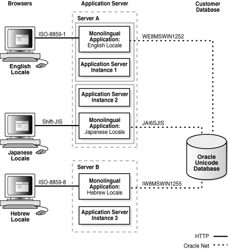
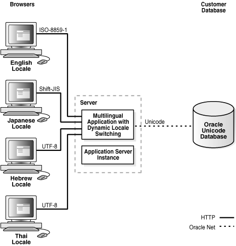
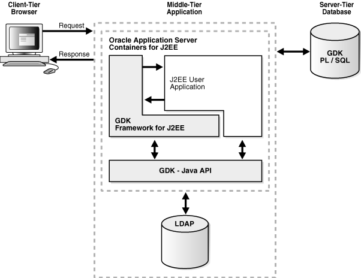
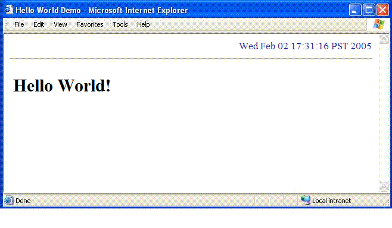
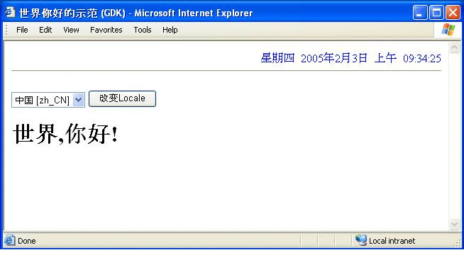
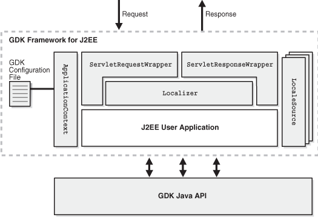
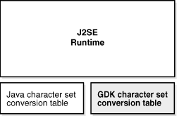

## 8  Oracle Globalization Development Kit

This chapter includes the following sections:

- Overview of the Oracle Globalization Development Kit

- Designing a Global Internet Application

- Developing a Global Internet Application

- Getting Started with the Globalization Development Kit

- GDK Quick Start

- GDK Application Framework for J2EE

- GDK Java API

- The GDK Application Configuration File

- GDK for Java Supplied Packages and Classes

- GDK for PL/SQL Supplied Packages

- GDK Error Messages

### 8.1 Overview of the Oracle Globalization Development Kit

Designing and developing a globalized application can be a daunting task even for the most experienced developers. This is usually caused by lack of knowledge and the complexity of globalization concepts and APIs. Application developers who write applications using Oracle Database need to understand the Globalization Support architecture of the database, including the properties of the different character sets, territories, languages and linguistic sort definitions. They also need to understand the globalization functionality of their middle-tier programming environment, and find out how it can interact and synchronize with the locale model of the database. Finally, to develop a globalized Internet application, they need to design and write code that is capable of simultaneously supporting multiple clients running on different operating systems, with different character sets and locale requirements.

Oracle Globalization Development Kit (GDK) simplifies the development process and reduces the cost of developing Internet applications that will be used to support a global environment. The GDK includes comprehensive programming APIs for both Java and PL/SQL, code samples, and documentation that address many of the design, development, and deployment issues encountered while creating global applications.

The GDK mainly consists of two parts: GDK for Java and GDK for PL/SQL. GDK for Java provides globalization support to Java applications. GDK for PL/SQL provides globalization support to the PL/SQL programming environment. The features offered in GDK for Java and GDK for PL/SQL are not identical.

### 8.2 Designing a Global Internet Application

There are two architectural models for deploying a global Web site or a global Internet application, depending on your globalization and business requirements. Which model to deploy affects how the Internet application is developed and how the application server is configured in the middle-tier. The two models are:

- Multiple instances of monolingual Internet applications

  Internet applications that support only one locale in a single binary are classified as monolingual applications. A locale refers to a national language and the region in which the language is spoken. For example, the primary language of the United States and Great Britain is English. However, the two territories have different currencies and different conventions for date formats. Therefore, the United States and Great Britain are considered to be two different locales.

  This level of globalization support is suitable for customers who want to support one locale for each instance of the application. Users need to have different entry points to access the applications for different locales. This model is manageable only if the number of supported locales is small.

- Single instance of a multilingual application

  Internet applications that support multiple locales simultaneously in a single binary are classified as multilingual applications. This level of globalization support is suitable for customers who want to support several locales in an Internet application simultaneously. Users of different locale preferences use the same entry point to access the application.

  Developing an application using the monolingual model is very different from developing an application using the multilingual model. The Globalization Development Kit consists of libraries, which can assist in the development of global applications using either architectural model.

The rest of this section includes the following topics:

- Deploying a Monolingual Internet Application

- Deploying a Multilingual Internet Application

#### 8.2.1 Deploying a Monolingual Internet Application

Deploying a global Internet application with multiple instances of monolingual Internet applications is shown in the following figure.

Figure 8-1 Monolingual Internet Application Architecture

[Description of "Figure 8-1 Monolingual Internet Application Architecture"](img_text/nlspg035.md)

Each application server is configured for the locale that it serves. This deployment model assumes that one instance of an Internet application runs in the same locale as the application in the middle tier.

The Internet applications access a back-end database in the native encoding used for the locale. The following are advantages of deploying monolingual Internet applications:

- The support of the individual locales is separated into different servers so that multiple locales can be supported independently in different locations and that the workload can be distributed accordingly. For example, customers may want to support Western European locales first and then support Asian locales such as Japanese (Japan) later.

- The complexity required to support multiple locales simultaneously is avoided. The amount of code to write is significantly less for a monolingual Internet application than for a multilingual Internet application.

The following are disadvantages of deploying monolingual Internet applications:

- Extra effort is required to maintain and manage multiple servers for different locales. Different configurations are required for different application servers.

- The minimum number of application servers required depends on the number of locales the application supports, regardless of whether the site traffic will reach the capacity provided by the application servers.

- Load balancing for application servers is limited to the group of application servers for the same locale.

- More QA resources, both human and machine, are required for multiple configurations of application servers. Internet applications running on different locales must be certified on the corresponding application server configuration.

- It is not designed to support multilingual content. For example, a web page containing Japanese and Arabic data cannot be easily supported in this model.

As more and more locales are supported, the disadvantages quickly outweigh the advantages. With the limitation and the maintenance overhead of the monolingual deployment model, this deployment architecture is suitable for applications that support only one or two locales.

#### 8.2.2 Deploying a Multilingual Internet Application

Multilingual Internet applications are deployed to the application servers with a single application server configuration that works for all locales. The following figure shows the architecture of a multilingual Internet application.

Figure 8-2 Multilingual Internet Application Architecture

[Description of "Figure 8-2 Multilingual Internet Application Architecture"](img_text/nlspg034.md)

To support multiple locales in a single application instance, the application may need to do the following:

- Dynamically detect the locale of the users and adapt to the locale by constructing HTML pages in the language and cultural conventions of the locale

- Process character data in Unicode so that data in any language can be supported. Character data can be entered by users or retrieved from back-end databases.

- Dynamically determine the HTML page encoding (or character set) to be used for HTML pages and convert content from Unicode to the page encoding and the reverse.

The following are major advantages of deploying multilingual Internet application:

- Using a single application server configuration for all application servers simplifies the deployment configuration and hence reduces the cost of maintenance.

- Performance tuning and capacity planning do not depend on the number of locales supported by the Web site.

- Introducing additional locales is relatively easy. No extra machines are necessary for the new locales.

- Testing the application across different locales can be done in a single testing environment.

- This model can support multilingual content within the same instance of the application. For example, a web page containing Japanese, Chinese, English and Arabic data can be easily supported in this model.

The disadvantage of deploying multilingual Internet applications is that it requires extra coding during application development to handle dynamic locale detection and Unicode, which is costly when only one or two languages need to be supported.

Deploying multilingual Internet applications is more appropriate than deploying monolingual applications when Web sites support multiple locales.

### 8.3 Developing a Global Internet Application

Building an Internet application that supports different locales requires good development practices.

For multilingual Internet applications, the application itself must be aware of the user's locale and be able to present locale-appropriate content to the user. Clients must be able to communicate with the application server regardless of the client's locale. The application server then communicates with the database server, exchanging data while maintaining the preferences of the different locales and character set settings. One of the main considerations when developing a multilingual Internet application is to be able to dynamically detect, cache, and provide the appropriate contents according to the user's preferred locale.

For monolingual Internet applications, the locale of the user is always fixed and usually follows the default locale of the run-time environment. Hence, the locale configuration is much simpler.

The following sections describe some of the most common issues that developers encounter when building a global Internet application:

- Locale Determination

- Locale Awareness

- Localizing the Content

#### 8.3.1 Locale Determination

To be locale-aware or locale-sensitive, Internet applications must be able to determine the preferred locale of the user.

Monolingual applications always serve users with the same locale, and that locale should be equivalent to the default run-time locale of the corresponding programming environment.

Multilingual applications can determine a user locale dynamically in three ways. Each method has advantages and disadvantages, but they can be used together in the applications to complement each other. The user locale can be determined in the following ways:

- Based on the user profile information from a LDAP directory server such as the Oracle Internet Directory or other user profile tables stored inside the database

  The schema for the user profile should include preferred locale attribute to indicate the locale of a user. This way of determining a locale user does not work if a user has not been logged on before.

- Based on the default locale of the browser

  Get the default ISO locale setting from a browser. The default ISO locale of the browser is sent through the Accept-Language HTTP header in every HTTP request. If the Accept-Language header is `NULL`, then the desired locale should default to English. The drawback of this approach is that the Accept-Language header may not be a reliable source of information for the locale of a user.

- Based on user selection

  Allow users to select a locale from a list box or from a menu, and switch the application locale to the one selected.

The Globalization Development Kit provides an application framework that enables you to use these locale determination methods declaratively.

**See Also:**

"Getting Started with the Globalization Development Kit"

#### 8.3.2 Locale Awareness

To be locale-aware or locale-sensitive, Internet applications need to determine the locale of a user. After the locale of a user is determined, applications should:

- Construct HTML content in the language of the locale

- Use the cultural conventions implied by the locale

Locale-sensitive functions, such as date, time, and monetary formatting, are built into various programming environments such as Java and PL/SQL. Applications may use them to format the HTML pages according to the cultural conventions of the locale of a user. A locale is represented differently in different programming environments. For example, the French (Canada) locale is represented in different environments as follows:

- In the ISO standard, it is represented by `fr-CA` where `fr` is the language code defined in the ISO 639 standard and `CA` is the country code defined in the ISO 3166 standard.

- In Java, it is represented as a Java locale object constructed with `fr`, the ISO language code for French, as the language and `CA`, the ISO country code for Canada, as the country. The Java locale name is `fr_CA`.

- In PL/SQL and SQL, it is represented mainly by the `NLS_LANGUAGE` and `NLS_TERRITORY` session parameters where the value of the `NLS_LANGUAGE` parameter is equal to `CANADIAN FRENCH` and the value of the `NLS_TERRITORY` parameter is equal to `CANADA`.

If you write applications for more than one programming environment, then locales must be synchronized between environments. For example, Java applications that call PL/SQL procedures should map the Java locales to the corresponding `NLS_LANGUAGE` and `NLS_TERRITORY` values and change the parameter values to match the user's locale before calling the PL/SQL procedures.

The Globalization Development Kit for Java provides a set of Java classes to ensure consistency on locale-sensitive behaviors with Oracle databases.

#### 8.3.3 Localizing the Content

For the application to support a multilingual environment, it must be able to present the content in the preferred language and in the locale convention of the user. Hard-coded user interface text must first be externalized from the application, together with any image files, so that they can be translated into the different languages supported by the application. The translation files then must be staged in separate directories, and the application must be able to locate the relevant content according to the user locale setting. Special application handling may also be required to support a fallback mechanism, so that if the user-preferred locale is not available, then the next most suitable content is presented. For example, if Canadian French content is not available, then it may be suitable for the application to switch to the French files instead.

### 8.4 Getting Started with the Globalization Development Kit

The Globalization Development Kit (GDK) for Java provides a J2EE application framework and Java APIs to develop globalized Internet applications using the best globalization practices and features designed by Oracle. It reduces the complexities and simplifies the code that Oracle developers require to develop globalized Java applications.

GDK for Java complements the existing globalization features in J2EE. Although the J2EE platform already provides a strong foundation for building globalized applications, its globalization functionalities and behaviors can be quite different from Oracle's functionalities. GDK for Java provides synchronization of locale-sensitive behaviors between the middle-tier Java application and the database server.

GDK for PL/SQL contains a suite of PL/SQL packages that provide additional globalization functionalities for applications written in PL/SQL.

The following figure shows major components of the GDK and how they are related to each other. User applications run on the J2EE container of Oracle Application Server in the middle tier. GDK provides the application framework that the J2EE application uses to simplify coding to support globalization. Both the framework and the application call the GDK Java API to perform locale-sensitive tasks. GDK for PL/SQL offers PL/SQL packages that help to resolve globalization issues specific to the PL/SQL environment.

Figure 8-3 GDK Components

[Description of "Figure 8-3 GDK Components"](img_text/nlspg036.md)

The functionalities offered by GDK for Java can be divided into two categories:

- The GDK application framework for J2EE provides the globalization framework for building J2EE-based Internet application. The framework encapsulates the complexity of globalization programming, such as determining user locale, maintaining locale persistency, and processing locale information. It consists of a set of Java classes through which applications can gain access to the framework. These associated Java classes enable applications to code against the framework so that globalization behaviors can be extended declaratively.

- The GDK Java API offers development support in Java applications and provides consistent globalization operations as provided in Oracle database servers. The API is accessible and is independent of the GDK framework so that standalone Java applications and J2EE applications that are not based on the GDK framework are able to access the individual features offered by the Java API. The features provided in the Java API include data and number formatting, sorting, and handling character sets in the same way as the Oracle Database.

  **Note:**

  The GDK Java API is supported with JDK versions 1.6 and later.

GDK for Java is contained in nine `.jar` files, all in the form of `orai18n*jar`. These files are shipped with the Oracle Database, in the `$ORACLE_HOME/jlib` directory. If the application using the GDK is not hosted on the same machine as the database, then the GDK files must be copied to the application server and included into the `CLASSPATH` to run your application. You do not need to install the Oracle Database into your application server to be able to run the GDK inside your Java application. GDK is a pure Java library that runs on every platform. The Oracle client parameters `NLS_LANG` and `ORACLE_HOME` are not required.

### 8.5 GDK Quick Start

This section explains how to modify a monolingual application to be a global, multilingual application using GDK. The subsequent sections in this chapter provide detailed information on using GDK.

The following figure shows a screenshot from a monolingual Web application.

Figure 8-4 Original HelloWorld Web Page

[Description of "Figure 8-4 Original HelloWorld Web Page"](img_text/hw1.md)

The initial, non-GDK HelloWorld Web application simply prints a "Hello World!" message, along with the current date and time in the top right hand corner of the page. Example 8-1 shows the original HelloWorld JSP source code for the preceding image.

Example 8-2 shows the corresponding Web application descriptor file for the HelloWorld message.

Example 8-1 HelloWorld JSP Page Code

    <%@ page contentType="text/html;charset=windows-1252"%>
    <html>
      <head>
        <meta http-equiv="Content-Type" content="text/html; charset=windows-1252">
        <title>Hello World Demo</title>
      </head>
      <body>

        <%= new java.util.Date(System.currentTimeMillis()) %>

      

      <h1>Hello World!</h1>
      </body>
    </html>

Example 8-2 HelloWorld web.xml Code

    <?xml version = '1.0' encoding = 'windows-1252'?>
    <!DOCTYPE web-app PUBLIC "-//Sun Microsystems, Inc.//DTD Web Application 2.3//EN"
     "http://java.sun.com/dtd/web-app_2_3.dtd">
    <web-app>
      <description>web.xml file for the monolingual Hello World</description>
      <session-config>
        <session-timeout>35</session-timeout>
      </session-config>
      <mime-mapping>
        <extension>html</extension>
        <mime-type>text/html</mime-type>
      </mime-mapping>
      <mime-mapping>
        <extension>txt</extension>
        <mime-type>text/plain</mime-type>
      </mime-mapping>
    </web-app>

The HelloWorld JSP code in Example 8-1 is only for English-speaking users. Some of the problems with this code are as follows:

- There is no locale determination based on user preference or browser setting.

- The title and the heading are included in the code.

- The date and time value is not localized based on any locale preference.

- The character encoding included in the code is for Latin-1.

The GDK framework can be integrated into the HelloWorld code to make it a global, multilingual application. The preceding code can be modified to include the following features:

- Automatic locale negotiation to detect the user's browser locale and serve the client with localized HTML pages. The supported application locales are configured in the GDK configuration file.

- Locale selection list to map the supported application locales. The list can have application locale display names which are the name of the country representing the locale. The list will be included on the Web page so users can select a different locale.

- GDK framework and API for globalization support for the HelloWorld JSP. This involves selecting display strings in a locale-sensitive manner and formatting the date and time value.

#### 8.5.1 Modifying the HelloWorld Application

This section explains how to modify the HelloWorld application to support globalization. The application will be modified to support three locales, Simplified Chinese (zh-CN), Swiss German (de-CH), and American English (en-US). The following rules will be used for the languages:

- If the client locale supports one of these languages, then that language will be used for the application.

- If the client locale does not support one of these languages, then American English will be used for the application.

In addition, the user will be able to change the language by selecting a supported locales from the locale selection list. The following tasks describe how to modify the application:

- Task 1: Enable the Hello World Application to use the GDK Framework

- Task 2: Configure the GDK Framework for Hello World

- Task 3: Enable the JSP or Java Servlet

- Task 4: Create the Locale Selection List

- Task 5: Build the Application

##### Task 1: Enable the Hello World Application to use the GDK Framework

In this task, the GDK filter and a listener are configured in the Web application deployment descriptor file, `web.xml`. This allows the GDK framework to be used with the HelloWorld application. The following example shows the GDK-enabled `web.xml` file.

    <?xml version = '1.0' encoding = 'windows-1252'?>
    <!DOCTYPE web-app PUBLIC "-//Sun Microsystems, Inc.//DTD Web Application 2.3//EN" "http://java.sun.com/dtd/web-app_2_3.dtd">
    <web-app>
      <description>web.xml file for Hello World</description>
       <!-- Enable the application to use the GDK Application Framework.-->
      <filter>
        <filter-name>GDKFilter</filter-name>
        <filter-class>oracle.i18n.servlet.filter.ServletFilter</filter-class>
      </filter>
      <filter-mapping>
        <filter-name>GDKFilter</filter-name>
        <url-pattern>*.jsp</url-pattern>
      </filter-mapping>

      <listener>
        <listener-class>oracle.i18n.servlet.listener.ContextListener</listener-class>
      </listener>

      <session-config>
        <session-timeout>35</session-timeout>
      </session-config>
      <mime-mapping>
        <extension>html</extension>
        <mime-type>text/html</mime-type>
      </mime-mapping>
      <mime-mapping>
        <extension>txt</extension>
        <mime-type>text/plain</mime-type>
      </mime-mapping>
    </web-app>

The following tags were added to the file:

- `<filter>`

  The filter name is GDKFilter, and the filter class is `oracle.i18n.servlet.filter.ServletFilter`.

- `<filter-mapping>`

  The GDKFilter is specified in the tag, as well as the URL pattern.

- `<listener>`

  The listener class is `oracle.i18n.servlet.listener.ContextListener`. The default GDK listener is configured to instantiate GDK ApplicationContext, which controls application scope operations for the framework.

##### Task 2: Configure the GDK Framework for Hello World

The GDK application framework is configured with the application configuration file `gdkapp.xml`. The configuration file is located in the same directory as the `web.xml` file. The following example shows the `gdkapp.xml` file.

    <?xml version="1.0" encoding="UTF-8"?>
    <gdkapp xmlns:xsi="http://www.w3.org/2001/XMLSchema-instance"
        xsi:noNamespaceSchemaLocation="gdkapp.xsd">

      <!-- The Hello World GDK Configuration -->
      <page-charset default="yes">UTF-8</page-charset>

      <!-- The supported application locales for the Hello World Application -->

      <application-locales>
        <locale>de-CH</locale>
        <locale default="yes">en-US</locale>
        <locale>zh-CN</locale>
      </application-locales>

      <locale-determine-rule>
        <locale-source>oracle.i18n.servlet.localesource.UserInput</locale-source>
        <locale-source>oracle.i18n.servlet.localesource.HttpAcceptLanguage
        </locale-source>
      </locale-determine-rule>

      <message-bundles>
        <resource-bundle name="default">com.oracle.demo.Messages</resource-bundle>
      </message-bundles>
    </gdkapp>

The file must be configured for J2EE applications. The following tags are used in the file:

- `<page-charset>`

  The page encoding tag specifies the character set used for HTTP requests and responses. The UTF-8 encoding is used as the default because many languages can be represented by this encoding.

- `<application-locales>`

  Configuring the application locales in the `gdkapp.xml` file makes a central place to define locales. This makes it easier to add and remove locales without changing source code. The locale list can be retrieved using the GDK API call `ApplicationContext.getSupportedLocales`.

- `<locale-determine-rule>`

  The language of the initial page is determined by the language setting of the browser. The user can override this language by choosing from the list. The `locale-determine-rule` is used by GDK to first try the Accept-Language HTTP header as the source of the locale. If the user selects a locale from the list, then the JSP posts a locale parameter value containing the selected locale. The GDK then sends a response with the contents in the selected language.

- `<message-bundles>`

  The message resource bundles allow an application access to localized static content that may be displayed on a Web page. The GDK framework configuration file allows an application to define a default resource bundle for translated text for various languages. In the HelloWorld example, the localized string messages are stored in the Java ListResourceBundle bundle named `Messages`. The `Messages` bundle consists of base resources for the application which are in the default locale. Two more resource bundles provide the Chinese and German translations. These resource bundles are named `Messages_zh_CN.java` and `Messages_de.java` respectively. The HelloWorld application will select the right translation for "Hello World!" from the resource bundle based on the locale determined by the GDK framework. The `<message-bundles>` tag is used to configure the resource bundles that the application will use.

##### Task 3: Enable the JSP or Java Servlet

JSPs and Java servlets must be enabled to use the GDK API. The following example shows a JSP that has been modified to enable to use the GDK API and services. This JSP can accommodate any language and locale.

    . . .
    <html>
      <head>
        <meta http-equiv="Content-Type" content="text/html; charset=UTF-8">
        <title><%= localizer.getMessage("helloWorldTitle") %></title>
      </head>
      <body>

        <% Date currDate= new Date(System.currentTimeMillis()); %>
        <%=localizer.formatDateTime(currDate, OraDateFormat.LONG)%>

      

      <form>
        <select name="locale" size="1">
          <%= getCountryDropDown(request)%>
        </select>
        <input  type="submit" value="<%= localizer.getMessage("changeLocale") %>">
        </input>
      </form>

      <h1><%= localizer.getMessage("helloWorld") %></h1>
      </body>
    </html>

The following figure shows the HelloWorld application that has been configured with the zh-CN locale as the primary locale for the browser preference. The HelloWorld string and page title are displayed in Simplified Chinese. In addition, the date is formatted in the zh-CN locale convention. This example allows the user to override the locale from the locale selection list.

Figure 8-5 HelloWorld Localized for the zh-CN Locale

[Description of "Figure 8-5 HelloWorld Localized for the zh-CN Locale"](img_text/hw2.md)

When the locale changes or is initialized using the HTTP Request Accept-Language header or the locale selection list, the GUI behaves appropriately for that locale. This means the date and time value in the upper right corner is localized properly. In addition, the strings are localized and displayed on the HelloWorld page.

The GDK Java Localizer class provides capabilities to localize the contents of a Web page based on the automatic detection of the locale by the GDK framework.

The following code retrieves an instance of the localizer based on the current HTTPServletRequest object. In addition, several imports are declared for use of the GDK API within the JSP page. The localizer retrieves localized strings in a locale-sensitive manner with fallback behavior, and formats the date and time.

    <%@page contentType="text/html;charset=UTF-8"%>
    <%@page import="java.util.*, oracle.i18n.servlet.*" %>
    <%@page import="oracle.i18n.util.*, oracle.i18n.text.*" %>

    <%
        Localizer localizer = ServletHelper.getLocalizerInstance(request);
    %>

The following code retrieves the current date and time value stored in the currDate variable. The value is formatted by the localizer `formatDateTime` method. The `OraDateFormat.LONG` parameter in the `formatDateTime` method instructs the localizer to format the date using the locale's long formatting style. If the locale of the incoming request is changed to a different locale with the locale selection list, then the date and time value will be formatted according to the conventions of the new locale. No code changes need to be made to support newly-introduced locales.

         <% Date currDate= new Date(System.currentTimeMillis()); %>
         <%=localizer.formatDateTime(currDate, OraDateFormat.LONG)%>

The HelloWorld JSP can be reused for any locale because the HelloWorld string and title are selected in a locale-sensitive manner. The translated strings are selected from a resource bundle.

The GDK uses the OraResourceBundle class for implementing the resource bundle fallback behavior. The following code shows how the Localizer picks the HelloWorld message from the resource bundle.

The default application resource bundle Messages is declared in the `gdkapp.xml` file. The localizer uses the message resource bundle to pick the message and apply the locale-specific logic. For example, if the current locale for the incoming request is "de-CH", then the message will first be looked for in the messages_de_CH bundle. If it does not exist, then it will look up in the Messages_de resource bundle.

    <h1><%= localizer.getMessage("helloWorld") %></h1>

##### Task 4: Create the Locale Selection List

The locale selection list is used to override the selected locale based on the HTTP Request Accept-Language header. The GDK framework checks the locale parameter passed in as part of the HTTP POST request as a value for the new locale. A locale selected with the locale selection list is posted as the locale parameter value. GDK uses this value for the request locale. All this happens implicitly within the GDK code.

The following code sample displays the locale selection list as an HTML select tag with the name locale. The submit tag causes the new value to be posted to the server. The GDK framework retrieves the correct selection.

    <form>
        <select name="locale" size="1">
          <%= getCountryDropDown(request)%>
        </select>
        <input type="submit" value="<%= localizer.getMessage("changeLocale") %>">
        </input>
    </form>

The locale selection list is constructed from the HTML code generated by the `getCountryDropDown` method. The method converts the configured application locales into localized country names.

A call is made to the ServletHelper class to get the ApplicationContext object associated with the current request. This object provides the globalization context for an application, which includes information such as supported locales and configuration information. The `getSupportedLocales` call retrieves the list of locales in the `gdkapp.xml` file. The configured application locale list is displayed as options of the HTML select. The `OraDisplayLocaleInfo` class is responsible for providing localization methods of locale-specific elements such as country and language names.

An instance of this class is created by passing in the current locale automatically determined by the GDK framework. GDK creates requests and response wrappers for HTTP request and responses. The `request.getLocale()` method returns the GDK determined locale based on the locale determination rules.

The `OraDsiplayLocaleInfo.getDisplayCountry` method retrieves the localized country names of the application locales. An HTML option list is created in the ddOptBuffer string buffer. The `getCountryDropDown` call returns a string containing the following HTML values:

       <option value="en_US" selected>United States [en_US]</option>
       <option value="zh_CN">China [zh_CN]</option>
       <option value="de_CH">Switzerland [de_CH]</option>

In the preceding values, the en-US locale is selected for the locale. Country names are generated are based on the current locale.

The following example shows the code for constructing the locale selection list.

    <%!
        public String getCountryDropDown(HttpServletRequest request)
        {
            StringBuffer ddOptBuffer = new StringBuffer();
            ApplicationContext ctx =
                ServletHelper.getApplicationContextInstance(request);
            Locale[] appLocales = ctx.getSupportedLocales();
            Locale currentLocale = request.getLocale();

            if (currentLocale.getCountry().equals(""))
            {
                 // Since the Country was not specified get the Default Locale
                 // (with Country) from the GDK
                 OraLocaleInfo oli = OraLocaleInfo.getInstance(currentLocale);
                 currentLocale = oli.getLocale();
            }

            OraDisplayLocaleInfo odli =
                     OraDisplayLocaleInfo.getInstance(currentLocale);
            for (int i=0;i<appLocales.length; i++)
            {
                ddOptBuffer.append("<option value=\"" + appLocales[i] + "\"" +
                (appLocales[i].getLanguage().equals(currentLocale.getLanguage()) ?
                 " selected" : "") +
                 ">" + odli.getDisplayCountry(appLocales[i]) +
                 " [" +  appLocales[i] + "]</option>\n");
            }

            return ddOptBuffer.toString();
        }
    %>

##### Task 5: Build the Application

In order to build the application, the following files must be specified in the classpath:

    orai18n.jar
    regexp.jar

The `orai18n.jar` file contains the GDK framework and the API. The `regexp.jar` file contains the regular expression library. The GDK API also has locale determination capabilities. The classes are supplied by the `ora18n-lcsd.jar` file.

### 8.6 GDK Application Framework for J2EE

GDK for Java provides the globalization framework for middle-tier J2EE applications. The framework encapsulates the complexity of globalization programming, such as determining user locale, maintaining locale persistency, and processing locale information. This framework minimizes the effort required to make Internet applications global-ready. The following figure shows the GDK application framework.

Figure 8-6 GDK Application Framework for J2EE

[Description of "Figure 8-6 GDK Application Framework for J2EE"](img_text/nlspg038.md)

The main Java classes composing the framework are as follows:

- `ApplicationContext` provides the globalization context of an application. The context information includes the list of supported locales and the rule for determining user-preferred locale. The context information is obtained from the GDK application configuration file for the application.

- The set of `LocaleSource` classes can be plugged into the framework. Each `LocaleSource` class implements the `LocaleSource` interface to get the locale from the corresponding source. Oracle bundles several `LocaleSource` classes in GDK. For example, the `DBLocaleSource` class obtains the locale information of the current user from a database schema. You can also write a customized `LocaleSource` class by implementing the same `LocaleSource` interface and plugging it into the framework.

- `ServletRequestWrapper` and `ServletResponseWrapper` are the main classes of the GDK Servlet filter that transforms HTTP requests and HTTP responses. `ServletRequestWrapper` instantiates a `Localizer` object for each HTTP request based on the information gathered from the `ApplicationContext` and `LocaleSource` objects and ensures that forms parameters are handled properly. `ServletResponseWrapper` controls how HTTP response should be constructed.

- `Localizer` is the all-in-one object that exposes the important functions that are sensitive to the current user locale and application context. It provides a centralized set of methods for you to call and make your applications behave appropriately to the current user locale and application context.

- The GDK Java API is always available for applications to enable finer control of globalization behavior.

The GDK application framework simplifies the coding required for your applications to support different locales. When you write a J2EE application according to the application framework, the application code is independent of what locales the application supports, and you control the globalization support in the application by defining it in the GDK application configuration file. There is no code change required when you add or remove a locale from the list of supported application locales.

The following list gives you some idea of the extent to which you can define the globalization support in the GDK application configuration file:

- You can add and remove a locale from the list of supported locales.

- You can change the way the user locale is determined.

- You can change the HTML page encoding of your application.

- You can specify how the translated resources can be located.

- You can plug a new `LocaleSource` object into the framework and use it to detect a user locale.

This section includes the following topics:

- Making the GDK Framework Available to J2EE Applications

- Integrating Locale Sources into the GDK Framework

- Getting the User Locale From the GDK Framework

- Implementing Locale Awareness Using the GDK Localizer

- Defining the Supported Application Locales in the GDK

- Handling Non-ASCII Input and Output in the GDK Framework

- Managing Localized Content in the GDK

#### 8.6.1 Making the GDK Framework Available to J2EE Applications

The behavior of the GDK application framework for J2EE is controlled by the GDK application configuration file, `gdkapp.xml`. The application configuration file allows developers to specify the behaviors of globalized applications in one centralized place. One application configuration file is required for each J2EE application using the GDK. The `gdkapp.xml` file should be placed in the `./WEB-INF` directory of the J2EE environment of the application. The file dictates the behavior and the properties of the GDK framework and the application that is using it. It contains locale mapping tables, character sets of content files, and globalization parameters for the configuration of the application. The application administrator can modify the application configuration file to change the globalization behavior in the application, without needing to change the programs and to recompile them.

**See Also:**

"The GDK Application Configuration File"

For a J2EE application to use the GDK application framework defined by the corresponding GDK application configuration file, the GDK Servlet filter and the GDK context listener must be defined in the `web.xml` file of the application. The `web.xml` file should be modified to include the following at the beginning of the file:

    <web-app>
    <!-- Add GDK filter that is called after the authentication -->

    <filter>
        <filter-name>gdkfilter</filter-name>
        <filter-class>oracle.i18n.servlet.filter.ServletFilter</filter-class>
    </filter>
    <filter-mapping>
        <filter-name>gdkfilter</filter-name>
        <url-pattern>*.jsp</url-pattern>
    </filter-mapping>

    <!-- Include the GDK context listener -->

     <listener>
    <listener-class>oracle.i18n.servlet.listener.ContextListener</listener-class>
     </listener>
    </web-app>

Examples of the `gdkapp.xml` and `web.xml` files can be found in the `$ORACLE_HOME/nls/gdk/demo` directory.

The GDK application framework supports Servlet container version 2.3 and later. It uses the Servlet filter facility for transparent globalization operations such as determining the user locale and specifying the character set for content files. The `ContextListener` instantiates GDK application parameters described in the GDK application configuration file. The `ServletFilter` overrides the request and response objects with a GDK request (`ServletRequestWrapper`) and response (`ServletResponseWrapper`) objects, respectively.

If other application filters are used in the application to also override the same methods, then the filter in the GDK framework may return incorrect results. For example, if `getLocale` returns `en_US`, but the result is overridden by other filters, then the result of the GDK locale detection mechanism is affected. All of the methods that are being overridden in the filter of the GDK framework are documented in [Oracle Globalization Development Kit Java API Reference](../jvgdk/index.md). Be aware of potential conflicts when using other filters together with the GDK framework.

#### 8.6.2 Integrating Locale Sources into the GDK Framework

Determining the user's preferred locale is the first step in making an application global-ready. The locale detection offered by the J2EE application framework is primitive. It lacks the method that transparently retrieves the most appropriate user locale among locale sources. It provides locale detection by the HTTP language preference only, and it cannot support a multilevel locale fallback mechanism. The GDK application framework provides support for predefined locale sources to complement J2EE. In a web application, several locale sources are available. Table 8-1 summarizes locale sources that are provided by the GDK.

Table 8-1 Locale Resources Provided by the GDK

| Locale                                       | Description                                                                                                                                                                                                                 |
|:---------------------------------------------|:----------------------------------------------------------------------------------------------------------------------------------------------------------------------------------------------------------------------------|
| HTTP language preference                     | Locales included in the HTTP protocol as a value of `Accept-Language`. This is set at the web browser level. A locale fallback operation is required if the browser locale is not supported by the application.             |
| User input locale                            | Locale specified by the user from a menu or a parameter in the HTTP protocol                                                                                                                                                |
| User profile locale preference from database | Locale preference stored in the database as part of the user profiles                                                                                                                                                       |
| Application default locale                   | A locale defined in the GDK application configuration file. This locale is defined as the default locale for the application. Typically, this is used as a fallback locale when the other locale sources are not available. |

**See Also:**

"The GDK Application Configuration File" for information about the GDK multilevel locale fallback mechanism

The GDK application framework provides seamless support for predefined locale sources, such as user input locale, HTTP language preference, user profile locale preference in the database, and the application default locale. You can incorporate the locale sources to the framework by defining them under the `<locale-determine-rule>` tag in the GDK application configuration file as follows:

    <locale-determine-rule>
        <locale-source>
            oracle.i18n.servlet.localesource.UserInput
        </locale-source>
        <locale-source>
            oracle.i18n.servlet.localesource.HTTPAcceptLanguage
        </locale-source>
    </locale-determine-rule>

The GDK framework uses the locale source declaration order and determines whether a particular locale source is available. If it is available, then it is used as the source, otherwise, it tries to find the next available locale source for the list. In the preceding example, if the `UserInput` locale source is available, it is used first, otherwise, the `HTTPAcceptLanguage` locale source will be used.

Custom locale sources, such as locale preference from an LDAP server, can be easily implemented and integrated into the GDK framework. You must implement the `LocaleSource` interface and specify the corresponding implementation class under the `<locale-determine-rule>` tag in the same way as the predefined locale sources were specified.

The `LocaleSource` implementation not only retrieves the locale information from the corresponding source to the framework but also updates the locale information to the corresponding source when the framework tells it to do so. Locale sources can be read-only or read/write, and they can be cacheable or noncacheable. The GDK framework initiates updates only to read/write locale sources and caches the locale information from cacheable locale sources. Examples of custom locale sources can be found in the `$ORACLE_HOME/nls/gdk/demo` directory.

**See Also:**

[Oracle Globalization Development Kit Java API Reference ](../jvgdk/index.md)for more information about implementing a `LocaleSource`

#### 8.6.3 Getting the User Locale From the GDK Framework

The GDK offers automatic locale detection to determine the current locale of the user. For example, the following code retrieves the current user locale in Java. It uses a `Locale` object explicitly.

    Locale loc = request.getLocale();

The `getLocale()` method returns the `Locale` that represents the current locale. This is similar to invoking the `HttpServletRequest.getLocale()` method in JSP or Java Servlet code. However, the logic in determining the user locale is different, because multiple locale sources are being considered in the GDK framework.

Alternatively, you can get a `Localizer` object that encapsulates the `Locale` object determined by the GDK framework. For the benefits of using the `Localizer` object, see "Implementing Locale Awareness Using the GDK Localizer".

    Localizer localizer = ServletHelper.getLocalizerInstance(request);
    Locale loc = localizer.getLocale();

The locale detection logic of the GDK framework depends on the locale sources defined in the GDK application configuration file. The names of the locale sources are registered in the application configuration file. The following example shows the locale determination rule section of the application configuration file. It indicates that the user-preferred locale can be determined from either the LDAP server or from the HTTP `Accept-Language` header. The `LDAPUserSchema` locale source class should be provided by the application. Note that all of the locale source classes have to be extended from the `LocaleSource` abstract class.

    <locale-determine-rule>
        <locale-source>LDAPUserSchema</locale-source>
        <locale-source>oracle.i18n.localesource.HTTPAcceptLanguage</locale-source>
    </locale-determine-rule>

For example, when the user is authenticated in the application and the user locale preference is stored in an LDAP server, then the `LDAPUserSchema` class connects to the LDAP server to retrieve the user locale preference. When the user is anonymous, then the `HttpAcceptLanguage` class returns the language preference of the web browser.

The cache is maintained for the duration of a HTTP session. If the locale source is obtained from the HTTP language preference, then the locale information is passed to the application in the HTTP `Accept-Language` header and not cached. This enables flexibility so that the locale preference can change between requests. The cache is available in the HTTP session.

The GDK framework exposes a method for the application to overwrite the locale preference information persistently stored in locale sources such as the LDAP server or the user profile table in the database. This method also resets the current locale information stored inside the cache for the current HTTP session. The following is an example of overwriting the preferred locale using the `store` command.

    <input type="hidden"
    name="<%=appctx.getParameterName(LocaleSource.Parameter.COMMAND)%>"
    value="store">

To discard the current locale information stored inside the cache, the `clean` command can be specified as the input parameter. The following table shows the list of commands supported by the GDK:

| Command | Functionality                                                                                                                                                   |
|:--------|:----------------------------------------------------------------------------------------------------------------------------------------------------------------|
| `store` | Updates user locale preferences in the available locale sources with the specified locale information. This command is ignored by the read-only locale sources. |
| `clean` | Discards the current locale information in the cache.                                                                                                           |

Note that the GDK parameter names can be customized in the application configuration file to avoid name conflicts with other parameters used in the application.

#### 8.6.4 Implementing Locale Awareness Using the GDK Localizer

The `Localizer` object obtained from the GDK application framework is an all-in-one globalization object that provides access to functions that are commonly used in building locale awareness in your applications. In addition, it provides functions to get information about the application context, such as the list of supported locales. The `Localizer` object simplifies and centralizes the code required to build consistent locale awareness behavior in your applications.

The `oracle.i18n.servlet` package contains the `Localizer` class. You can get the Localizer instance as follows:

    Localizer lc = ServletHelper.getLocalizerInstance(request);

The `Localizer` object encapsulates the most commonly used locale-sensitive information determined by the GDK framework and exposes it as locale-sensitive methods. This object includes the following functionalities pertaining to the user locale:

- Format date in long and short formats

- Format numbers and currencies

- Get collation key value of a string

- Get locale data such as language, country and currency names

- Get locale data to be used for constructing user interface

- Get a translated message from resource bundles

- Get text formatting information such as writing direction

- Encode and decode URLs

- Get the common list of time zones and linguistic sorts

For example, when you want to display a date in your application, you may want to call the `Localizer.formatDate()` or `Localizer.formateDateTime()` methods. When you want to determine the writing direction of the current locale, you can call the `Localizer.getWritingDirection()` and `Localizer.getAlignment()` to determine the value used in the `<DIR>` tag and `<ALIGN>` tag respectively.

The `Localizer` object also exposes methods to enumerate the list of supported locales and their corresponding languages and countries in your applications.

The `Localizer` object actually makes use of the classes in the GDK Java API to accomplish its tasks. These classes include, but are not limited to, the following: `OraDateFormat`, `OraNumberFormat`, `OraCollator`, `OraLocaleInfo`, `oracle.i18n.util.LocaleMapper`, o`racle.i18n.net.URLEncoder`, and `oracle.i18n.net.URLDecoder`.

The `Localizer` object simplifies the code you need to write for locale awareness. It maintains caches of the corresponding objects created from the GDK Java API so that the calling application does not need to maintain these objects for subsequent calls to the same objects. If you require more than the functionality the `Localizer` object can provide, then you can always call the corresponding methods in the GDK Java API directly.

**Note:**

Strings returned by many `Localizer` methods, such as formatted dates and locale-specific currency symbols, depend on locale data that may be provided by users through URLs or form input. For example, the locale source class `oracle.i18n.servlet.localesource.UserInput` provides various datetime format patterns and the ISO currency abbreviation retrieved from a page URL. A datetime format pattern may include double-quoted literal strings with arbitrary contents. To prevent cross-site script injection attacks, strings returned by `Localizer` methods must be properly escaped before being displayed as part of an HTML page, for example, by applying the method `encode` of the class `oracle.i18n.net.CharEntityReference`.

**See Also:**

[Oracle Globalization Development Kit Java API Reference ](../jvgdk/index.md)for detailed information about the `Localizer` object

#### 8.6.5 Defining the Supported Application Locales in the GDK

The number of locales and the names of the locales that an application needs to support are based on the business requirements of the application. The names of the locales that are supported by the application are registered in the application configuration file. The following example shows the application locales section of the application configuration file. It indicates that the application supports German (`de`), Japanese (`ja`), and English for the US (`en-US`), with English defined as the default fallback application locale. Note that the locale names are based on the IANA convention.

    <application-locales>
        <locale>de</locale>
        <locale>ja</locale>
        <locale default="yes">en-US</locale>
    </application-locales>

When the GDK framework detects the user locale, it verifies whether the locale that is returned is one of the supported locales in the application configuration file. The verification algorithm is as follows:

1.  Retrieve the list of supported application locales from the application configuration file.
2.  Check whether the locale that was detected is included in the list. If it is included in the list, then use this locale as the current client's locale.
3.  If there is a variant in the locale that was detected, then remove the variant and check whether the resulting locale is in the list. For example, the Java locale `de_DE_EURO` has a `EURO` variant. Remove the variant so that the resulting locale is `de_DE`.
4.  If the locale includes a country code, then remove the country code and check whether the resulting locale is in the list. For example, the Java locale `de_DE` has a country code of `DE`. Remove the country code so that the resulting locale is `de`.
5.  If the detected locale does not match any of the locales in the list, then use the default locale that is defined in the application configuration file as the client locale.

By performing steps 3 and 4, the application can support users with the same language requirements but with different locale settings than those defined in the application configuration file. For example, the GDK can support `de-AT` (the Austrian variant of German), `de-CH` (the Swiss variant of German), and `de-LU` (the Luxembourgian variant of German) locales.

The locale fallback detection in the GDK framework is similar to that of the Java Resource Bundle, except that it is not affected by the default locale of the Java VM. This exception occurs because the Application Default Locale can be used during the GDK locale fallback operations.

If the application-locales section is omitted from the application configuration file, then the GDK assumes that the common locales, which can be returned from the `OraLocaleInfo.getCommonLocales` method, are supported by the application.

#### 8.6.6 Handling Non-ASCII Input and Output in the GDK Framework

The character set (or character encoding) of an HTML page is a very important piece of information to a browser and an Internet application. The browser needs to interpret this information so that it can use correct fonts and character set mapping tables for displaying pages. The Internet applications need to know so they can safely process input data from a HTML form based on the specified encoding.

The page encoding can be translated as the character set used for the locale to which an Internet application is serving.

In order to correctly specify the page encoding for HTML pages without using the GDK framework, Internet applications must:

1.  Determine the desired page input data character set encoding for a given locale.

2.  Specify the corresponding encoding name for each HTTP request and HTTP response.

Applications using the GDK framework can ignore these steps. No application code change is required. The character set information is specified in the GDK application configuration file. At run time, the GDK automatically sets the character sets for the request and response objects. The GDK framework does not support the scenario where the incoming character set is different from that of the outgoing character set.

The GDK application framework supports the following scenarios for setting the character sets of the HTML pages:

- A single local character set is dedicated to the whole application. This is appropriate for a monolingual Internet application. Depending on the properties of the character set, it may be able to support more than one language. For example, most Western European languages can be served by ISO-8859-1.

- Unicode UTF-8 is used for all contents regardless of the language. This is appropriate for a multilingual application that uses Unicode for deployment.

- The native character set for each language is used. For example, English contents are represented in ISO-8859-1, and Japanese contents are represented in Shift_JIS. This is appropriate for a multilingual Internet application that uses a default character set mapping for each locale. This is useful for applications that need to support different character sets based on the user locales. For example, for mobile applications that lack Unicode fonts or Internet browsers that cannot fully support Unicode, the character sets must to be determined for each request.

The character set information is specified in the GDK application configuration file. The following is an example of setting UTF-8 as the character set for all the application pages.

    <page-charset>UTF-8</page-charset>

The page character set information is used by the `ServletRequestWrapper` class, which sets the proper character set for the request object. It is also used by the `ContentType` HTTP header specified in the `ServletResponseWrapper` class for output when instantiated. If `page-charset` is set to `AUTO-CHARSET`, then the character set is assumed to be the default character set for the current user locale. Set `page-charset` to `AUTO-CHARSET` as follows:

    <page-charset>AUTO-CHARSET</page-charset>

The default mappings are derived from the `LocaleMapper` class, which provides the default IANA character set for the locale name in the GDK Java API.

Table 8-2 lists the mappings between the common ISO locales and their IANA character sets.

Table 8-2 Mapping Between Common ISO Locales and IANA Character Sets

| ISO Locale | NLS_LANGUAGE Value   | NLS_TERRITORY Value | IANA Character Set |
|:-----------|:---------------------|:--------------------|:-------------------|
| ar-SA      | ARABIC               | SAUDI ARABIA        | WINDOWS-1256       |
| de-DE      | GERMAN               | GERMANY             | WINDOWS-1252       |
| en-US      | AMERICAN             | AMERICA             | WINDOWS-1252       |
| en-GB      | ENGLISH              | UNITED KINGDOM      | WINDOWS-1252       |
| el         | GREEK                | GREECE              | WINDOWS-1253       |
| es-ES      | SPANISH              | SPAIN               | WINDOWS-1252       |
| fr         | FRENCH               | FRANCE              | WINDOWS-1252       |
| fr-CA      | CANADIAN FRENCH      | CANADA              | WINDOWS-1252       |
| iw         | HEBREW               | ISRAEL              | WINDOWS-1255       |
| ko         | KOREAN               | KOREA               | EUC-KR             |
| ja         | JAPANESE             | JAPAN               | SHIFT_JIS          |
| it         | ITALIAN              | ITALY               | WINDOWS-1252       |
| pt         | PORTUGUESE           | PORTUGAL            | WINDOWS-1252       |
| pt-BR      | BRAZILIAN PORTUGUESE | BRAZIL              | WINDOWS-1252       |
| tr         | TURKISH              | TURKEY              | WINDOWS-1254       |
| nl         | DUTCH                | THE NETHERLANDS     | WINDOWS-1252       |
| zh         | SIMPLIFIED CHINESE   | CHINA               | GBK                |
| zh-TW      | TRADITIONAL CHINESE  | TAIWAN              | BIG5               |

The locale to character set mapping in the GDK can also be customized. To override the default mapping defined in the GDK Java API, a locale-to-character-set mapping table can be specified in the application configuration file.

    <locale-charset-maps>
       <locale-charset>
          <locale>ja</locale><charset>EUC-JP</charset>
       </locale-charset>
    </locale-charset-maps>

The previous example shows that for locale Japanese (`ja`), the GDK changes the default character set from SHIFT_JIS to EUC-JP.

**See Also:**

"Oracle Locale Information in the GDK"

#### 8.6.7 Managing Localized Content in the GDK

This section includes the following topics:

- Managing Localized Content in JSPs and Java Servlets

- Managing Localized Content in Static Files

##### 8.6.7.1 Managing Localized Content in JSPs and Java Servlets

Resource bundles enable access to localized contents at run time in J2SE. Translatable strings within Java servlets and Java Server Pages (JSPs) are externalized into Java resource bundles so that these resource bundles can be translated independently into different languages. The translated resource bundles carry the same base class names as the English bundles, using the Java locale name as the suffix.

To retrieve translated data from the resource bundle, the `getBundle()` method must be invoked for every request.

    <% Locale user_locale=request.getLocale();
       ResourceBundle rb=ResourceBundle.getBundle("resource",user_locale); %>
    <%= rb.getString("Welcome") %>

The GDK framework simplifies the retrieval of text strings from the resource bundles. `Localizer.getMessage()` is a wrapper to the resource bundle.

    <% Localizer.getMessage ("Welcome") %>

Instead of specifying the base class name as `getBundle()` in the application, you can specify the resource bundle in the application configuration file, so that the GDK automatically instantiates a `ResourceBundle` object when a translated text string is requested.

    <message-bundles>
      <resource-bundle name="default">resource</resource-bundle>
    </message-bundles>

This configuration file snippet declares a default resource bundle whose translated contents reside in the "resource" Java bundle class. Multiple resource bundles can be specified in the configuration file. To access a nondefault bundle, specify the `name` parameter in the `getMessage` method. The message bundle mechanism uses the `OraResourceBundle` GDK class for its implementation. This class provides the special locale fallback behaviors on top of the Java behaviors. The rules are as follows:

- If the given locale exactly matches the locale in the available resource bundles, it will be used.

- If the resource bundle for Chinese in Singapore (`zh_SG`) is not found, it will fall back to the resource bundle for Chinese in China (`zh_CN`) for Simplified Chinese translations.

- If the resource bundle for Chinese in Hong Kong (`zh_HK`) is not found, it will fall back to the resource bundle for Chinese in Taiwan (`zh_TW`) for Traditional Chinese translations.

- If the resource bundle for Chinese in Macau (`zh_MO`) is not found, it will fall back to the resource bundle for Chinese in Taiwan (`zh_TW`) for Traditional Chinese translations.

- If the resource bundle for any other Chinese (`zh_` and `zh`) is not found, it will fall back to the resource bundle for Chinese in China (`zh_CN`) for Simplified Chinese translations.

- The default locale, which can be obtained by the `Locale.getDefault()` method, will not be considered in the fallback operations.

For example, assume the default locale is `ja_JP` and the resource handle for it is available. When the resource bundle for `es_MX` is requested, and neither resource bundle for `es` or `es_MX` is provided, the base resource bundle object that does not have a local suffix is returned.

The usage of the `OraResourceBundle` class is similar to the `java.util.ResourceBundle` class, but the `OraResearchBundle` class does not instantiate itself. Instead, the return value of the `getBundle` method is an instance of the subclass of the `java.util.ResourceBundle` class.

##### 8.6.7.2 Managing Localized Content in Static Files

For a application, which supports only one locale, the URL that has a suffix of `/index.html` typically takes the user to the starting page of the application.

In a globalized application, contents in different languages are usually stored separately, and it is common for them to be staged in different directories or with different file names based on the language or the country name. This information is then used to construct the URLs for localized content retrieval in the application.

The following examples illustrate how to retrieve the French and Japanese versions of the index page. Their suffixes are as follows:

    /fr/index.html
    /ja/index.html

By using the `rewriteURL()` method of the `ServletHelper` class, the GDK framework handles the logic to locate the translated files from the corresponding language directories. The `ServletHelper.rewriteURL()` method rewrites a URL based on the rules specified in the application configuration file. This method is used to determine the correct location where the localized content is staged.

The following is an example of the JSP code:

    ">
    ">

The URL rewrite definitions are defined in the GDK application configuration file:

      <url-rewrite-rule fallback="yes">
        <pattern>(.*)/(a-zA-Z0-9_\]+.)$</pattern>
        <result>$1/$A/$2</result>
      </url-rewrite-rule>

The pattern section defined in the rewrite rule follows the regular expression conventions. The result section supports the following special variables for replacing:

- `$L` is used to represent the ISO 639 language code part of the current user locale

- `$C` represents the ISO 3166 country code

- `$A` represents the entire locale string, where the ISO 639 language code and ISO 3166 country code are connected with an underscore character (`_`)

- \$1 to \$9 represent the matched substrings

For example, if the current user locale is `ja`, then the URL for the `welcome.jpg` image file is rewritten as `image/ja/welcome.jpg`, and `welcome.html` is changed to `html/ja/welcome.html`.

Both `ServletHelper.rewriteURL()`and `Localizer.getMessage()` methods perform consistent locale fallback operations in the case where the translation files for the user locale are not available. For example, if the online help files are not available for the `es_MX` locale (Spanish for Mexico), but the `es` (Spanish for Spain) files are available, then the methods will select the Spanish translated files as the substitute.

### 8.7 GDK Java API

The globalization features and behaviors in Java are not the same as those offered in Oracle Database. For example, J2SE supports a set of locales and character sets that are different from locales and character sets in Oracle Database. This inconsistency can be confusing for users when their application contains data that is formatted based on two different conventions. For example, dates that are retrieved from the database are formatted using Oracle conventions, such as number and date formatting and linguistic sort ordering. However, the static application data is typically formatted using Java locale conventions. The globalization functionalities in Java can also be different depending on the version of the JDK on which the application runs.

Before Oracle Database 10g, when an application was required to incorporate Oracle globalization features, it had to make connections to the database and issue SQL statements. Such operations make the application complicated and generate more network connections to the database.

In Oracle Database 10g and later, the GDK Java API extends the globalization features to the middle tier. By enabling applications to perform globalization logic such as Oracle date and number formatting and linguistic sorting in the middle tier, the GDK Java API enables developers to eliminate expensive programming logic in the database. The GDK Java API also provides standard compliance for XQuery. This improves the overall application performance by reducing the database processing load, and by decreasing unnecessary network traffic between the application tier and the back end.

The GDK Java API also offers advanced globalization features, such as language and character set detection, and the enumeration of common locale data for a territory or a language (for example, all time zones supported in Canada). These features are not available in most programming platforms. Without the GDK Java API, developers must write business logic to handle these processes inside the application.

The key functionalities of the GDK Java API are as follows:

- Oracle Locale Information in the GDK

- Oracle Locale Mapping in the GDK

- Oracle Character Set Conversion in the GDK

- Oracle Date, Number, and Monetary Formats in the GDK

- Oracle Binary and Linguistic Sorts in the GDK

- Oracle Language and Character Set Detection in the GDK

- Oracle Translated Locale and Time Zone Names in the GDK

- Using the GDK with E-Mail Programs

#### 8.7.1 Oracle Locale Information in the GDK

Oracle locale definitions, which include languages, territories, linguistic sorts, and character sets, are exposed in the GDK Java API. The naming convention that Oracle uses may be different from other vendors. Although many of these names and definitions follow industry standards, some are Oracle-specific, tailored to meet special customer requirements.

`OraLocaleInfo` is an Oracle locale class that includes language, territory, and collator objects. It provides a method for applications to retrieve a collection of locale-related objects for a given locale. Examples include: a full list of the Oracle linguistic sorts available in the GDK, the local time zones defined for a given territory, or the common languages used in a particular territory.

Following are examples of using the `OraLocaleInfo` class:

    // All Territories supported by GDK
    String[] avterr = OraLocaleInfo.getAvailableTerritories();

    // Local TimeZones for a given Territory

    OraLocaleInfo oloc = OraLocaleInfo.getInstance("English", "Canada");
    TimeZone[] loctz = oloc.getLocalTimeZones();

#### 8.7.2 Oracle Locale Mapping in the GDK

The GDK Java API provides the `LocaleMapper` class. It maps equivalent locales and character sets between Java, IANA, ISO, and Oracle. A Java application may receive locale information from the client that is specified in an Oracle Database locale name or an IANA character set name. The Java application must be able to map to an equivalent Java locale or Java encoding before it can process the information correctly.

The follow example shows using the `LocaleMapper` class.

    // Mapping from Java locale to Oracle language and Oracle territory

    Locale locale = new Locale("it", "IT");
    String oraLang = LocaleMapper.getOraLanguage(locale);
    String oraTerr = LocaleMapper.getOraTerritory(locale);

    // From Oracle language and Oracle territory to Java Locale

    locale = LocaleMapper.getJavaLocale("AMERICAN","AMERICA");
    locale = LocaleMapper.getJavaLocale("TRADITONAL CHINESE", "");

    // From IANA & Java to Oracle Character set

    String ocs1 = LocaleMapper.getOraCharacterSet(
                                   LocaleMapper.IANA, "ISO-8859-1");
    String ocs2 = LocaleMapper.getOraCharacterSet(
                                   LocaleMapper.JAVA, "ISO8859_1");

The `LocaleMapper` class can also return the most commonly used e-mail character set for a specific locale on both Windows and UNIX platforms. This is useful when developing Java applications that need to process e-mail messages.

**See Also:**

"Using the GDK with E-Mail Programs"

#### 8.7.3 Oracle Character Set Conversion in the GDK

The GDK Java API contains a set of character set conversion classes APIs that enable users to perform Oracle character set conversions. Although Java JDK is already equipped with classes that can perform conversions for many of the standard character sets, they do not support Oracle-specific character sets and Oracle's user-defined character sets.

JDK provides an interface for developers to extend Java's character sets. The GDK Java API provides implicit support for Oracle's character sets by using this plug-in feature provided by the JDK package java.nio.charset. You can access the J2SE API to obtain Oracle-specific behaviors.

**Note:**

The GDK Java API is supported with JDK versions 1.6 and later.

The following figure shows that the GDK character set conversion tables are plugged into J2SE in the same way as the Java character set tables. With this pluggable framework of J2SE, the Oracle character set conversions can be used in the same way as other Java character set conversions.

Figure 8-7 Oracle Character Set Plug-In

[Description of "Figure 8-7 Oracle Character Set Plug-In"](img_text/nlspg037.md)

The GDK character conversion classes support all Oracle character sets including user-defined characters sets. It can be used by Java applications to properly convert to and from Java's internal character set, UTF-16.

Oracle's character set names are proprietary. To avoid potential conflicts with Java's own character sets, all Oracle character set names have an `X-ORACLE-` prefix for all implicit usage through Java's API.

The following is an example of Oracle character set conversion:

    // Converts the Chinese character "three" from UCS2 to JA16SJIS

    String str = "\u4e09";
    byte[] barr = str.getBytes("x-oracle-JA16SJIS");

Just as with other Java character sets, the character set facility in `java.nio.charset.Charset` is applicable to all of the Oracle character sets. For example, if you want to check whether the specified character set is a superset of another character set, then you can use the `Charset.contains` method as follows:

    Charset cs1 = Charset.forName("x-oracle-US7ASCII");
    Charset cs2 = Charset.forName("x-oracle-WE8WINDOWS1252");
    // true if WE8WINDOWS1252 is the superset of US7ASCII, otherwise false.
    boolean osc = cs2.contains(cs1);

For a Java application that is using the JDBC driver to communicate with the database, the JDBC driver provides the necessary character set conversion between the application and the database. Calling the GDK character set conversion methods explicitly within the application is not required. A Java application that interprets and generates text files based on Oracle's character set encoding format is an example of using Oracle character set conversion classes.

#### 8.7.4 Oracle Date, Number, and Monetary Formats in the GDK

The GDK Java API provides formatting classes that support date, number, and monetary formats using Oracle conventions for Java applications in the `oracle.i18n.text` package.

New locale formats introduced in Oracle Database 10g, such as the short and long date, number, and monetary formats, are also exposed in these format classes.

The following are examples of Oracle date, Oracle number, and Oracle monetary formatting:

    // Obtain the current date and time in the default Oracle LONG format for
    // the locale de_DE (German_Germany)

    Locale locale = new Locale("de", "DE");
    OraDateFormat odf =
      OraDateFormat.getDateTimeInstance(OraDateFormat.LONG, locale);

    // Obtain the numeric value 1234567.89 using the default number format
    // for the Locale en_IN (English_India)

    locale = new Locale("en", "IN");
    OraNumberFormat onf = OraNumberFormat.getNumberInstance(locale);
    String nm = onf.format(new Double(1234567.89));

    // Obtain the monetary value 1234567.89 using the default currency
    // format for the Locale en_US (American_America)

    locale = new Locale("en", "US");

    onf = OraNumberFormat.getCurrencyInstance(locale);
    nm = onf.format(new Double(1234567.89));

#### 8.7.5 Oracle Binary and Linguistic Sorts in the GDK

Oracle provides support for binary, monolingual, and multilingual linguistic sorts in the database. In Oracle Database, these sorts provide case-insensitive and accent-insensitive sorting and searching capabilities inside the database. By using the `OraCollator` class, the GDK Java API enables Java applications to sort and search for information based on the latest Oracle binary and linguistic sorting features, including case-insensitive and accent-insensitive options.

Normalization can be an important part of sorting. The composition and decomposition of characters are based on the Unicode standard; therefore, sorting also depends on the Unicode standard. The GDK contains methods to perform composition.

**Note:**

Because each version of the JDK may support a different version of the Unicode standard, the GDK provides an `OraNormalizer` class that is based on the latest version of the Unicode standard, which for this release is Unicode 9.0.

The sorting order of a binary sort is based on the Oracle character set that is being used. Except for the UTFE character set, the binary sorts of all Oracle character sets are supported in the GDK Java API. The only linguistic sort that is not supported in the GDK Java API is `JAPANESE`, but a similar and more accurate sorting result can be achieved by using `JAPANESE_M`.

The following example shows string comparisons and string sorting.

Example 8-3 String Comparisons and String Sorting

    // compares strings using XGERMAN

    private static String s1 = "abcSS";
    private static String s2 = "abc\u00DF";

    String cname = "XGERMAN";
    OraCollator ocol = OraCollator.getInstance(cname);
    int c = ocol.compare(s1, s2);

    // sorts strings using GENERIC_M

    private static String[] source =
      new String[]
      {
        "Hochgeschwindigkeitsdrucker",
        "Bildschirmfu\u00DF",
        "Skjermhengsel",
        "DIMM de Mem\u00F3ria",
        "M\u00F3dulo SDRAM com ECC",
      };

      cname = "GENERIC_M";
      ocol = OraCollator.getInstance(cname);
      List result = getCollationKeys(source, ocol);

    private static List getCollationKeys(String[] source, OraCollator ocol)
    {
      List karr = new ArrayList(source.length);
      for (int i = 0; i < source.length; ++i)
      {
        karr.add(ocol.getCollationKey(source[i]));
      }
      Collections.sort(karr); // sorting operation
      return karr;
    }

#### 8.7.6 Oracle Language and Character Set Detection in the GDK

The Oracle Language and Character Set Detection Java classes in the GDK Java API provide a high performance, statistically based engine for determining the character set and language for unspecified text. It can automatically identify language and character set pairs from throughout the world. With each text, the language and character set detection engine sets up a series of probabilities, each probability corresponding to a language and character set pair. The most probable pair statistically identifies the dominant language and character set.

The purity of the text submitted affects the accuracy of the language and character set detection. Only plain text strings are accepted, so any tagging must be stripped before hand. The ideal case is literary text with almost no foreign words or grammatical errors. Text strings that contain a mix of languages or character sets, or nonnatural language text like addresses, phone numbers, and programming language code may yield poor results.

The `LCSDetector` class can detect the language and character set of a byte array, a character array, a string, and an `InputStream` class. It supports both plain text and HTML file detection. It can take the entire input for sampling or only portions of the input for sampling, when the length or both the offset and the length are supplied. For each input, up to three potential language and character set pairs can be returned by the `LCSDetector` class. They are always ranked in sequence, with the pair with the highest probability returned first.

**See Also:**

"[Language and Character Set Detection Support](appendix-A-locale-data.md)" for a list of supported language and character set pairs

The following are examples of using the `LCSDetector` class to enable language and character set detection:

    // This example detects the character set of a plain text file "foo.txt" and
    // then appends the detected ISO character set name to the name of the text file

    LCSDetector lcsd = new LCSDetector();
    File oldfile = new File("foo.txt");
    FileInputStream in = new FileInputStream(oldfile);
    lcsd.detect(in);
    String charset = lcsd.getResult().getIANACharacterSet();
    File newfile = new File("foo."+charset+".txt");
    oldfile.renameTo(newfile);

    // This example shows how to use the LCSDector class to detect the language and
    // character set of a byte array

    int offset = 0;
    LCSDetector led = new LCSDetector();
    /* loop through the entire byte array */
    while ( true )
    {
        bytes_read = led.detect(byte_input, offset, 1024);
        if ( bytes_read == -1 )
            break;
        offset += bytes_read;
    }
    LCSDResultSet res = led.getResult();

    /* print the detection results with close ratios */
    System.out.println("the best guess "  );
    System.out.println("Langauge " + res.getOraLanguage() );
    System.out.println("CharacterSet " + res.getOraCharacterSet() );
    int high_hit = res.getHiHitPairs();
    if ( high_hit >= 2 )
    {
            System.out.println("the second best guess  " );
            System.out.println("Langauge " + res.getOraLanguage(2) );
            System.out.println("CharacterSet " +res.getOraCharacterSet(2) );
    }
    if ( high_hit >= 3 )
    {
             System.out.println("the third best guess  ");
             System.out.println("Langauge " + res.getOraLanguage(3) );
             System.out.println("CharacterSet " +res.getOraCharacterSet(3) );
    }

#### 8.7.7 Oracle Translated Locale and Time Zone Names in the GDK

All of the Oracle language names, territory names, character set names, linguistic sort names, and time zone names have been translated into 27 languages including English. They are readily available for inclusion into the user applications, and they provide consistency for the display names across user applications in different languages. `OraDisplayLocaleInfo` is a utility class that provides the translations of locale and attributes. The translated names are useful for presentation in user interface text and for drop-down selection boxes. For example, a native French speaker prefers to select from a list of time zones displayed in French than in English.

The following example shows using `OraDisplayLocaleInfo` to return a list of time zones supported in Canada, using the French translation names.

Example 8-4 Using OraDisplayLocaleInfo to Return a Specific List of Time Zones

    OraLocaleInfo oloc = OraLocaleInfo.getInstance("CANADIAN FRENCH", "CANADA");
    OraDisplayLocaleInfo odloc = OraDisplayLocaleInfo.getInstance(oloc);
    TimeZone[] loctzs = oloc.getLocaleTimeZones();
    String []  disptz = new string [loctzs.length];
    for (int i=0; i<loctzs.length; ++i)
    {
      disptz [i]= odloc.getDisplayTimeZone(loctzs[i]);
      ...
    }

#### 8.7.8 Using the GDK with E-Mail Programs

You can use the GDK `LocaleMapper` class to retrieve the most commonly used e-mail character set. Call `LocaleMapper.getIANACharSetFromLocale`, passing in the locale object. The return value is an array of character set names. The first character set returned is the most commonly used e-mail character set.

The following example illustrates sending an e-mail message containing Simplified Chinese data in the GBK character set encoding.

Example 8-5 Sending E-mail Containing Simplified Chinese Data in GBK Character Set Encoding

    import oracle.i18n.util.LocaleMapper;
    import java.util.Date;
    import java.util.Locale;
    import java.util.Properties;
    import javax.mail.Message;
    import javax.mail.Session;
    import javax.mail.Transport;
    import javax.mail.internet.InternetAddress;
    import javax.mail.internet.MimeMessage;
    import javax.mail.internet.MimeUtility;
    /**
     * Email send operation sample
     *
     * javac -classpath orai18n.jar:j2ee.jar EmailSampleText.java
     * java  -classpath .:orai18n.jar:j2ee.jar EmailSampleText
     */
    public class EmailSampleText
    {
      public static void main(String[] args)
      {
        send("localhost",                        // smtp host name
          "your.address@yourcompany.com",        // from email address
          "You",                                 // from display email
          "somebody@somecompany.com",            // to email address
          "Subject test zh CN",                  // subject
          "Content ˘4E02 from Text email",       // body
          new Locale("zh", "CN")                 // user locale
        );
      }
      public static void send(String smtp, String fromEmail, String fromDispName,
        String toEmail, String subject, String content, Locale locale
      )
      {
        // get the list of common email character sets
        final String[] charset = LocaleMapper.getIANACharSetFromLocale(LocaleMapper.
    EMAIL_WINDOWS,
    locale
          );
        // pick the first one for the email encoding
        final String contentType = "text/plain; charset=" + charset[0];
        try
        {
          Properties props = System.getProperties();
          props.put("mail.smtp.host", smtp);
          //  here, set username / password if necessary
          Session session = Session.getDefaultInstance(props, null);
          MimeMessage mimeMessage = new MimeMessage(session);
          mimeMessage.setFrom(new InternetAddress(fromEmail, fromDispName,
              charset[0]
            )
          );
          mimeMessage.setRecipients(Message.RecipientType.TO, toEmail);
          mimeMessage.setSubject(MimeUtility.encodeText(subject, charset[0], "Q"));
          // body
          mimeMessage.setContent(content, contentType);
          mimeMessage.setHeader("Content-Type", contentType);
          mimeMessage.setHeader("Content-Transfer-Encoding", "8bit");
          mimeMessage.setSentDate(new Date());
          Transport.send(mimeMessage);
        }
        catch (Exception e)
        {
          e.printStackTrace();
        }
      }
    }

### 8.8 The GDK Application Configuration File

The GDK application configuration file dictates the behavior and the properties of the GDK application framework and the application that is using it. It contains locale mapping tables and parameters for the configuration of the application. One configuration file is required for each application.

The `gdkapp.xml` application configuration file is an XML document. This file resides in the `./WEB-INF` directory of the J2EE environment of the application.

The following sections describe the contents and the properties of the application configuration file in detail:

- locale-charset-maps

- page-charset

- application-locales

- locale-determine-rule

- locale-parameter-name

- message-bundles

- url-rewrite-rule

- Example: GDK Application Configuration File

#### 8.8.1 locale-charset-maps

This section enables applications to override the mapping from the language to the default character set provided by the GDK. This mapping is used when the `page-charset` is set to `AUTO-CHARSET`.

For example, for the `en` locale, the default GDK character set is `windows-1252`. However, if the application requires `ISO-8859-1`, this can be specified as follows:

      <locale-charset-maps>
        <locale-charset>
          <locale>en</locale>
          <charset>ISO_8859-1</charset>
        </locale-charset>
      </locale-charset-maps>

The locale name is comprised of the language code and the country code, and they should follow the ISO naming convention as defined in ISO 639 and ISO 3166, respectively. The character set name follows the IANA convention.

Optionally, the user-agent parameter can be specified in the mapping table to distinguish different clients as follows:

    <locale-charset>
      <locale>en,de</locale>
      <user-agent>^Mozilla⁄4.0</user-agent>
      <charset>ISO-8859-1</charset>
    </locale-charset>

The previous example shows that if the `user-agent` value in the HTTP header starts with `Mozilla/4.0` (which indicates an older version of Web clients) for English (`en`) and German (`de`) locales, then the GDK sets the character set to ISO-8859-1.

Multiple locales can be specified in a comma-delimited list.

**See Also:**

"page-charset"

#### 8.8.2 page-charset

This tag section defines the character set of the application pages. If this is explicitly set to a given character set, then all pages use this character set. The character set name must follow the IANA character set convention, for example:

    <page-charset>UTF-8</page-charset>

However, if the `page-charset` is set to `AUTO-CHARSET`, then the character set is based on the default character set of the current user locale. The default character set is derived from the locale to character set mapping table specified in the application configuration file.

If the character set mapping table in the application configuration file is not available, then the character set is based on the default locale name to IANA character set mapping table in the GDK. Default mappings are derived from `OraLocaleInfo` class.

**See Also:**

- "locale-charset-maps"

- "Handling Non-ASCII Input and Output in the GDK Framework"

#### 8.8.3 application-locales

This tag section defines a list of the locales supported by the application. For example:

    <application-locales>
      <locale default="yes">en-US</locale>
      <locale>de</locale>
      <locale>zh-CN</locale>
    </application-locales>

If the language component is specified with the `*` country code, then all locale names with this language code qualify. For example, if `de-*` (the language code for German) is defined as one of the application locales, then this supports `de-AT` `(German`- Austria), `de` (German-Germany), `de-LU` (German-Luxembourg), `de-CH` (German-Switzerland), and even irregular locale combination such as `de-CN` (German-China). However, the application can be restricted to support a predefined set of locales.

It is recommended to set one of the application locales as the default application locale (by specifying `default="yes"`) so that it can be used as a fall back locale for customers who are connecting to the application with an unsupported locale.

#### 8.8.4 locale-determine-rule

This section defines the order in which the preferred user locale is determined. The locale sources should be specified based on the scenario in the application. This section includes the following scenarios:

- Scenario 1: The GDK framework uses the accept language at all times.

<!-- -->

        <locale-source>
            oracle.i18n.servlet.localesource.HTTPAcceptLanguage
        </locale-source>

- Scenario 2: By default, the GDK framework uses the accept language. After the user specifies the locale, the locale is used for further operations.

<!-- -->

        <locale-source>
            oracle.i18n.servlet.localesource.UserInput
        </locale-source>

        <locale-source>
            oracle.i18n.servlet.localesource.HTTPAcceptLanguage
        </locale-source>

- Scenario 3: By default, the GDK framework uses the accept language. After the user is authenticated, the GDK framework uses the database locale source. The database locale source is cached until the user logs out. After the user logs out, the accept language is used again.

<!-- -->

         <db-locale-source
            data-source-name="jdbc/OracleCoreDS"
            locale-source-table="customer"
            user-column="customer_email"
            user-key="userid"
            language-column="nls_language"
            territory-column="nls_territory"
            timezone-column="timezone">

              oracle.i18n.servlet.localesource.DBLocaleSource

         </db-locale-source>

         <locale-source>
              oracle.i18n.servlet.localesource.HttpAcceptLanguage
         </locale-source>

Note that Scenario 3 includes the predefined database locale source, `DBLocaleSource`. It enables the user profile information to be specified in the configuration file without writing a custom database locale source. In the example, the user profile table is called `"customer"`. The columns are `"customer_email"`, `"nls_language"`, `"nls_territory"`, and `"timezone"`. They store the unique e-mail address, the Oracle name of the preferred language, the Oracle name of the preferred territory, and the time zone ID of a customer. The `user-key` is a mandatory attribute that specifies the attribute name used to pass the user ID from the application to the GDK framework.

- Scenario 4: The GDK framework uses the accept language in the first page. When the user inputs a locale, it is cached and used until the user logs into the application. After the user is authenticated, the GDK framework uses the database locale source. The database locale source is cached until the user logs out. After the user logs out, the accept language is used again or the user input is used if the user inputs a locale.

<!-- -->

        <locale-source>
            demo.DatabaseLocaleSource
        </locale-source>
        <locale-source>
            oracle.i18n.servlet.localesource.UserInput
        </locale-source>
        <locale-source>
            oracle.i18n.servlet.localesource.HttpAcceptLanguage
        </locale-source>

Note that Scenario 4 uses the custom database locale source. If the user profile schema is complex, such as user profile information separated into multiple tables, then the custom locale source should be provided by the application. Examples of custom locale sources can be found in the `$ORACLE_HOME/nls/gdk/demo` directory.

#### 8.8.5 locale-parameter-name

This tag defines the name of the locale parameters that are used in the user input so that the current user locale can be passed between requests.

Table 8-3 shows the parameters used in the GDK framework.

Table 8-3 Locale Parameters Used in the GDK Framework

| Default Parameter Name  | Value                                                                                                                                                                                 |
|:------------------------|:--------------------------------------------------------------------------------------------------------------------------------------------------------------------------------------|
| `locale`                | ISO locale where ISO 639 language code and ISO 3166 country code are connected with an underscore (`_`) or a hyphen (`-`). For example, `zh_CN` for Simplified Chinese used in China. |
| `language`              | Oracle language name. For example, `AMERICAN` for American English.                                                                                                                   |
| `territory`             | Oracle territory name. For example, `SPAIN`.                                                                                                                                          |
| `timezone`              | Time zone name. For example, `American/Los_Angeles`.                                                                                                                                  |
| `iso-currency`          | ISO 4217 currency code. For example, `EUR` for the euro.                                                                                                                              |
| `date-format`           | Date format pattern mask. For example, `DD_MON_RRRR`.                                                                                                                                 |
| `long-date-format`      | Long date format pattern mask. For example, `DAY-YYY-MM-DD`.                                                                                                                          |
| `date-time-format`      | Date and time format pattern mask. For example, `DD-MON-RRRR HH24:MI:SS`.                                                                                                             |
| `long-date-time-format` | Long date and time format pattern mask. For example, `DAY YYYY-MM-DD HH12:MI:SS AM`.                                                                                                  |
| `time-format`           | Time format pattern mask. For example, `HH:MI:SS`.                                                                                                                                    |
| `number-format`         | Number format. For example, `9G99G990D00`.                                                                                                                                            |
| `currency-format`       | Currency format. For example, `L9G99G990D00`.                                                                                                                                         |
| `linguistic-sorting`    | Linguistic sort order name. For example, `JAPANESE_M` for Japanese multilingual sort.                                                                                                 |
| `charset`               | Character set. For example, `WE8ISO8859P15`.                                                                                                                                          |
| `writing-direction`     | Writing direction string. For example, `LTR` for left-to-right writing direction or `RTL` for right-to-left writing direction.                                                        |
| `command`               | GDK command. For example, `store` for the update operation.                                                                                                                           |

The parameter names are used in either the parameter in the HTML form or in the URL.

#### 8.8.6 message-bundles

This tag defines the base class names of the resource bundles used in the application. The mapping is used in the `Localizer.getMessage` method for locating translated text in the resource bundles.

    <message-bundles>
      <resource-bundle>Messages</resource-bundle>
      <resource-bundle name="newresource">NewMessages</resource-bundle>
    </message-bundles>

If the name attribute is not specified or if it is specified as `name="default"` to the `<resource-bundle>` tag, then the corresponding resource bundle is used as the default message bundle. To support more than one resource bundle in an application, resource bundle names must be assigned to the nondefault resource bundles. The nondefault bundle names must be passed as a parameter of the `getMessage` method.

For example:

     Localizer loc = ServletHelper.getLocalizerInstance(request);
     String translatedMessage = loc.getMessage("Hello");
     String translatedMessage2 = loc.getMessage("World", "newresource");

#### 8.8.7 url-rewrite-rule

This tag is used to control the behavior of the URL rewrite operations. The rewriting rule is a regular expression.

    <url-rewrite-rule fallback="no">
      <pattern>(.*)/([^/]+)$</pattern>
      <result>$1/$L/$2</result>
    </url-rewrite-rule>

**See Also:**

"Managing Localized Content in the GDK"

If the localized content for the requested locale is not available, then it is possible for the GDK framework to trigger the locale fallback mechanism by mapping it to the closest translation locale. By default, the fallback option is turned off. This can be turned on by specifying `fallback="yes"`.

For example, suppose an application supports only the following translations: `en`, `de`, and `ja`, and `en` is the default locale of the application. If the current application locale is `de-US`, then it falls back to `de`. If the user selects `zh-TW` as its application locale, then it falls back to `en`.

A fallback mechanism is often necessary if the number of supported application locales is greater than the number of the translation locales. This usually happens if multiple locales share one translation. One example is Spanish. The application may need to support multiple Spanish-speaking countries and not just Spain, with one set of translation files.

Multiple URL rewrite rules can be specified by assigning the name attribute to nondefault URL rewrite rules. To use the nondefault URL rewrite rules, the name must be passed as a parameter of the rewrite URL method. For example:

    ">
    ">

The first rule changes the `"images/welcome.gif"` URL to the localized welcome image file. The second rule named `"flag"` changes the `"US.gif"` URL to the user's country flag image file. The rule definition should be as follows:

    <url-rewrite-rule fallback="yes">
      <pattern>(.*)/([^/]+)$</pattern>
      <result>$1/$L/$2</result>
    </url-rewrite-rule>
    <url-rewrite-rule name="flag">
      <pattern>US.gif/pattern>
      <result>$C.gif</result>
    </url-rewrite-rule>

#### 8.8.8 Example: GDK Application Configuration File

This section contains an example of an application configuration file with the following application properties:

- The application supports the following locales: Arabic (ar), Greek (`el`), English (`en`), German (`de`), French (`fr`), Japanese (`ja`) and Simplified Chinese for China (`zh-CN`).

- English is the default application locale.

- The page character set for the `ja` locale is always UTF-8.

- The page character set for the `en` and `de` locales when using an Internet Explorer client is `windows-1252`.

- The page character set for the `en`, `de`, and `fr` locales on other web browser clients is `iso-8859-1`.

- The page character sets for all other locales are the default character set for the locale.

- The user locale is determined by the following order: user input locale and then `Accept-Language`.

- The localized contents are stored in their appropriate language subfolders. The folder names are derived from the ISO 639 language code. The folders are located in the root directory of the application. For example, the Japanese file for `/shop/welcome.jpg` is stored in `/ja/shop/welcome.jpg`.

<!-- -->

    <?xml version="1.0" encoding="utf-8"?>
    <gdkapp
    xmlns:xsi="http://www.w3.org/2001/XMLSchema-instance"
    xsi:noNamespaceSchemaLocation="gdkapp.xsd">
      <!-- Language to Character set mapping -->
      <locale-charset-maps>
        <locale-charset>
          <locale>ja</locale>
          <charset>UTF-8</charset>
        </locale-charset>
        <locale-charset>
          <locale>en,de</locale>
          <user-agent>^Mozilla\/[0-9\. ]+\(compatible; MSIE [^;]+; \)
          </user-agent>
          <charset>WINDOWS-1252</charset>
        </locale-charset>
        <locale-charset>
          <locale>en,de,fr</locale>
          <charset>ISO-8859-1</charset>
        </locale-charset>
      </locale-charset-maps>

      <!-- Application Configurations -->
      <page-charset>AUTO-CHARSET</page-charset>
      <application-locales>
        <locale>ar</locale>
        <locale>de</locale>
        <locale>fr</locale>
        <locale>ja</locale>
        <locale>el</locale>
        <locale default="yes">en</locale>
        <locale>zh-CN</locale>
      </application-locales>
      <locale-determine-rule>
        <locale-source>
            oracle.i18n.servlet.localesource.UserInput
        </locale-source>
        <locale-source>
            oracle.i18n.servlet.localesource.HttpAcceptLanguage
        </locale-source>
      </locale-determine-rule>
      <!-- URL rewriting rule -->
      <url-rewrite-rule fallback="no">
        <pattern>(.*)/([^/]+)$</pattern>
        <result>/$L/$1/$2</result>
      </url-rewrite-rule>
    </gdkapp>

### 8.9 GDK for Java Supplied Packages and Classes

Oracle Globalization Services for Java contains the following packages:

- oracle.i18n.lcsd

- oracle.i18n.net

- oracle.i18n.servlet

- oracle.i18n.text

- oracle.i18n.util

  **See Also:**

  [Oracle Globalization Development Kit Java API Reference](../jvgdk/index.md)

#### 8.9.1 oracle.i18n.lcsd

Package `oracle.i18n.lcsd` provides classes to automatically detect and recognize language and character set based on text input. It supports the detection of both plain text and HTML files. Language is based on ISO; encoding is based on IANA or Oracle character sets. It includes the following classes:

- `LCSDetector`: Contains methods to automatically detect and recognize language and character set based on text input.

- `LCSDResultSet`: Stores the result generated by `LCSDetector`. Methods in this class can be used to retrieve specific information from the result.

- `LCSDetectionInputStream`: Transparently detects the language and encoding for a stream object.

- `LCSDetectionReader`: Transparently detects the language and encoding, and converts the input data to Unicode.

- `LCSDetectionHTMLInputStream`: Extends the `LCSDetectionInputStream` class to support the language and encoding detection for input in HTML format.

- `LCSDetectionHTMLReader`: Extends the `LCSDetectionReader` class to support the language and encoding detection for input in HTML format.

##### 8.9.1.1 LCSScan

The Language and Character Set File Scanner (Java Version) is a statistically-based utility for determining the language and character set for unknown file text. Its functionality and usage are similar to the Language and Character Set File Scanner of the "C" Version.

**See Also:**

"[The Language and Character Set File Scanner](character-set-migration.md)"

###### 8.9.1.1.1 Syntax of the LCSScan Command

    Usage: java LCSScan <options>
    Example: java LCSScan FILE=test.txt RESULTS=3 SIZE=10000

    Keyword   Description                                                (Default)
    -------   --------------                                             --------
    RESULTS   number of language and character set pairs to return 1..3  1
    SIZE      sampling size of the file in bytes                         8192
    FORMAT    file format TEXT or HTML                                   TEXT
    RATIO     show result ratio YES or NO                                NO
    FILE      name of input file
    HELP      show help screen                                           this screen

###### 8.9.1.1.2 Examples of Using LCSScan

Make sure that the `orai18n-lcsd.jar` and `orai18n-mapping.jar` files are in the `CLASSPATH`.

Example 8-6 Specifying the File Name in the LCSScan Command

    java oracle/i18n/lcsd/LCSScan FILE=example.txt

In this example, 8192 bytes of `example.txt` file is scanned. One language and character set pair will be returned.

Example 8-7 Specifying the File Name and Sampling Size in the LCSScan Command

    java oracle/i18n/lcsd/LCSScan FILE=example.txt SIZE=4096

In this example, 4096 bytes of `example.txt` file is scanned. One language and character set pair will be returned.

Example 8-8 Specifying the File Name and Number of Language and Character Set Pairs in the LCSScan Command

    java oracle/i18n/lcsd/LCSScan FILE=example.txt RESULTS=3

In this example, 8192 bytes of `example.txt` file is scanned. Three language and character set pairs will be returned.

Example 8-9 Specifying the File Name and Show Result Ratio in the LCSScan Command

    java oracle/i18n/lcsd/LCSScan FILE=example.txt RATIO=YES

In this example, 8192 bytes of `example.txt` file is scanned. One language and character set pair will be returned with the result ratio.

Example 8-10 Specifying the File Name and Format as HTML

    java oracle/i18n/lcsd/LCSScan FILE=example.html FORMAT=html

In this example, 8192 bytes of `example.html` file is scanned. The scan will strip HTML tags before the scan, thus results are more accurate. One language and character set pair will be returned.

#### 8.9.2 oracle.i18n.net

Package `oracle.i18n.net` provides Internet-related data conversions for globalization. It includes the following classes:

- `CharEntityReference`: A utility class to escape or unescape a string into character reference or entity reference form.

- `CharEntityReference.Form`: A form parameter class that specifies the escaped form.

#### 8.9.3 oracle.i18n.servlet

Package `oracle.i18n.Servlet` enables JSP and JavaServlet to have automatic locale support and also returns the localized contents to the application. It includes the following classes:

- `ApplicationContext`: Performs application scope operations in the framework.

- `Localizer`: Provides access to the most commonly used globalization information.

- `ServletHelper`: Bridges Java servlets and globalization objects.

#### 8.9.4 oracle.i18n.text

Package `oracle.i18n.text` provides general text data globalization support. It includes the following classes:

- `OraCollationKey`: Represents a `String` under certain rules of a specific `OraCollator` object.

- `OraCollator`: Performs locale-sensitive string comparison, including linguistic collation and binary sorting.

- `OraDateFormat`: Performs formatting and parsing between datetime and string locale. It supports Oracle datetime formatting behavior.

- `OraDecimalFormat`: Performs formatting and parsing between number and string locale. It supports Oracle number formatting behavior.

- `OraDecimalFormatSymbol`: Contains Oracle format symbols used by Oracle number and currency formatting.

- `OraNumberFormat`: Performs formatting and parsing between number and string locale. It supports Oracle number formatting behavior.

- `OraSimpleDateFormat`: Performs formatting and parsing between datetime and string locale. It supports Oracle datetime formatting behavior.

#### 8.9.5 oracle.i18n.util

Package `oracle.i18n.util` provides general utilities for globalization support. It includes the following classes:

- `LocaleMapper`: Provides mappings between Oracle locale elements and equivalent locale elements in other vendors and standards.

- `OraDisplayLocaleInfo`: Provides translations of locale and attributes.

- `OraLocaleInfo`: Contains the language, territory, and collator objects.

- `OraSQLUtil`: Provides useful methods for dealing with SQL.

### 8.10 GDK for PL/SQL Supplied Packages

The GDK for PL/SQL includes the following PL/SQL packages:

- `UTL_I18N`

- `UTL_LMS`

`UTL_I18N` is a set of PL/SQL services that help developers to build globalized applications. The `UTL_I18N` PL/SQL package provides the following functions:

- String conversion functions for various data types

- Escape and unescape sequences for predefined characters and multibyte characters used by HTML and XML documents

- Functions that map between Oracle, Internet Assigned Numbers Authority (IANA), ISO, and e-mail application character sets, languages, and territories

- A function that returns the Oracle character set name from an Oracle language name

- A function that performs script transliteration

- Functions that return the ISO currency code, local time zones, and local languages supported for a given territory

- Functions that return the most commonly used linguistic sort, a listing of all applicable linguistic sorts, and the local territories supported for a given language

- Functions that map between Oracle full and short language names

- A function that returns the language translation of a given language and territory name

- A function that returns a listing of the most commonly used time zones

- A function that returns the maximum number of bytes for a character of an Oracle character set

- Functions that validate the character encoding of VARCHAR2, NVARCHAR2, CLOB, and NCLOB data

`UTL_LMS` retrieves and formats error messages in different languages.

**See Also:**

[`"UTL_I18N"`](../arpls/UTL_I18N.md) and [`"UTL_LMS"`](../arpls/UTL_LMS.md) in the Oracle Database PL/SQL Packages and Types Reference

### 8.11 GDK Error Messages

GDK-03001 Invalid or unsupported sorting rule
Cause: An invalid or unsupported sorting rule name was specified.

Action: Choose a valid sorting rule name and check the Globalization Support Guide for the list of sorting rule names.

GDK-03002 The functional-driven sort is not supported.
Cause: A functional-driven sorting rule name was specified.

Action: Choose a valid sorting rule name and check the Globalization Support Guide for the list of sorting rule names.

GDK-03003 The linguistic data file is missing.
Cause: A valid sorting rule was specified, but the associated data file was not found.

Action: Make sure the GDK jar files are correctly installed in the Java application.

GDK-03005 Binary sort is not available for the specified character set .
Cause: Binary sorting for the specified character set is not supported.

Action: Check the Globalization Support Guide for a character set that supports binary sort.

GDK-03006 The comparison strength level setting is invalid.
Cause: An invalid comparison strength level was specified.

Action: Choose a valid comparison strength level from the list -- PRIMARY, SECONDARY or TERTIARY.

GDK-03007 The composition level setting is invalid.
Cause: An invalid composition level setting was specified.

Action: Choose a valid composition level from the list -- NO_COMPOSITION or CANONICAL_COMPOSITION.

GDK-04001 Cannot map Oracle character to Unicode
Cause: The program attempted to use a character in the Oracle character set that cannot be mapped to Unicode.

Action: Write a separate exception handler for the invalid character, or call the withReplacement method so that the invalid character can be replaced with a valid replacement character.

GDK-04002 Cannot map Unicode to Oracle character
Cause: The program attempted to use an Unicode character that cannot be mapped to a character in the Oracle character set.

Action: Write a separate exception handler for the invalid character, or call the withReplacement method so that the invalid character can be replaced with a valid replacement character.

GDK-05000 A literal in the date format is too large.
Cause: The specified string literal in the date format was too long.

Action: Use a shorter string literal in the date format.

GDK-05001 The date format is too long for internal buffer.
Cause: The date format pattern was too long.

Action: Use a shorter date format pattern.

GDK-05002 The Julian date is out of range.
Cause: An illegal date range was specified.

Action: Make sure that date is in the specified range 0 - 3439760.

GDK-05003 Failure in retrieving date/time
Cause: This is an internal error.

Action: Contact Oracle Support Services.

GDK-05010 Duplicate format code found
Cause: The same format code was used more than once in the format pattern.

Action: Remove the redundant format code.

GDK-05011 The Julian date precludes the use of the day of the year.
Cause: Both the Julian date and the day of the year were specified.

Action: Remove either the Julian date or the day of the year.

GDK-05012 The year may only be specified once.
Cause: The year format code appeared more than once.

Action: Remove the redundant year format code.

GDK-05013 The hour may only be specified once.
Cause: The hour format code appeared more than once.

Action: Remove the redundant hour format code.

GDK-05014 The AM/PM conflicts with the use of A.M./P.M.
Cause: AM/PM was specified along with A.M./P.M.

Action: Use either AM/PM or A.M./P.M; do not use both.

GDK-05015 The BC/AD conflicts with the use of B.C./A.D.
Cause: BC/AD was specified along with B.C./A.D.

Action: Use either BC/AD or B.C./A.D.; do not use both.

GDK-05016 Duplicate month found
Cause: The month format code appeared more than once.

Action: Remove the redundant month format code.

GDK-05017 The day of the week may only be specified once.
Cause: The day of the week format code appeared more than once.

Action: Remove the redundant day of the week format code.

GDK-05018 The HH24 precludes the use of meridian indicator.
Cause: HH24 was specified along with the meridian indicator.

Action: Use either the HH24 or the HH12 with the meridian indicator.

GDK-05019 The signed year precludes the use of BC/AD.
Cause: The signed year was specified along with BC/AD.

Action: Use either the signed year or the unsigned year with BC/AD.

GDK-05020 A format code cannot appear in a date input format.
Cause: A format code appeared in a date input format.

Action: Remove the format code.

GDK-05021 Date format not recognized
Cause: An unsupported format code was specified.

Action: Correct the format code.

GDK-05022 The era format code is not valid with this calendar.
Cause: An invalid era format code was specified for the calendar.

Action: Remove the era format code or use anther calendar that supports the era.

GDK-05030 The date format pattern ends before converting entire input string.
Cause: An incomplete date format pattern was specified.

Action: Rewrite the format pattern to cover the entire input string.

GDK-05031 The year conflicts with the Julian date.
Cause: An incompatible year was specified for the Julian date.

Action: Make sure that the Julian date and the year are not in conflict.

GDK-05032 The day of the year conflicts with the Julian date.
Cause: An incompatible day of year was specified for the Julian date.

Action: Make sure that the Julian date and the day of the year are not in conflict.

GDK-05033 The month conflicts with the Julian date.
Cause: An incompatible month was specified for the Julian date.

Action: Make sure that the Julian date and the month are not in conflict.

GDK-05034 The day of the month conflicts with the Julian date.
Cause: An incompatible day of the month was specified for the Julian date.

Action: Make sure that the Julian date and the day of the month are not in conflict.

GDK-05035 The day of the week conflicts with the Julian date.
Cause: An incompatible day of the week was specified for the Julian date.

Action: Make sure that the Julian date and the day of week are not in conflict.

GDK-05036 The hour conflicts with the seconds in the day.
Cause: The specified hour and the seconds in the day were not compatible.

Action: Make sure the hour and the seconds in the day are not in conflict.

GDK-05037 The minutes of the hour conflicts with the seconds in the day.
Cause: The specified minutes of the hour and the seconds in the day were not compatible.

Action: Make sure the minutes of the hour and the seconds in the day are not in conflict.

GDK-05038 The seconds of the minute conflicts with the seconds in the day.
Cause: The specified seconds of the minute and the seconds in the day were not compatible.

Action: Make sure the seconds of the minute and the seconds in the day are not in conflict.

GDK-05039 Date not valid for the month specified
Cause: An illegal date for the month was specified.

Action: Check the date range for the month.

GDK-05040 Input value not long enough for the date format
Cause: Too many format codes were specified.

Action: Remove unused format codes or specify a longer value.

GDK-05041 A full year must be between -4713 and +9999, and not be 0.
Cause: An illegal year was specified.

Action: Specify the year in the specified range.

GDK-05042 A quarter must be between 1 and 4.
Cause: Cause: An illegal quarter was specified.

Action: Action: Make sure that the quarter is in the specified range.

GDK-05043 Not a valid month
Cause: An illegal month was specified.

Action: Make sure that the month is between 1 and 12 or has a valid month name.

GDK-05044 The week of the year must be between 1 and 52.
Cause: An illegal week of the year was specified.

Action: Make sure that the week of the year is in the specified range.

GDK-05045 The week of the month must be between 1 and 5.
Cause: An illegal week of the month was specified.

Action: Make sure that the week of the month is in the specified range.

GDK-05046 Not a valid day of the week
Cause: An illegal day of the week was specified.

Action: Make sure that the day of the week is between 1 and 7 or has a valid day name.

GDK-05047 A day of the month must be between 1 and the last day of the month.
Cause: An illegal day of the month was specified.

Action: Make sure that the day of the month is in the specified range.

GDK-05048 A day of year must be between 1 and 365 (366 for leap year).
Cause: An illegal day of the year was specified.

Action: Make sure that the day of the year is in the specified range.

GDK-05049 An hour must be between 1 and 12.
Cause: An illegal hour was specified.

Action: Make sure that the hour is in the specified range.

GDK-05050 An hour must be between 0 and 23.
Cause: An illegal hour was specified.

Action: Make sure that the hour is in the specified range.

GDK-05051 A minute must be between 0 and 59.
Cause: Cause: An illegal minute was specified.

Action: Action: Make sure the minute is in the specified range.

GDK-05052 A second must be between 0 and 59.
Cause: An illegal second was specified.

Action: Make sure the second is in the specified range.

GDK-05053 A second in the day must be between 0 and 86399.
Cause: An illegal second in the day was specified.

Action: Make sure second in the day is in the specified range.

GDK-05054 The Julian date must be between 1 and 5373484.
Cause: An illegal Julian date was specified.

Action: Make sure that the Julian date is in the specified range.

GDK-05055 Missing AM/A.M. or PM/P.M.
Cause: Neither AM/A.M. nor PM/P.M. was specified in the format pattern.

Action: Specify either AM/A.M. or PM/P.M.

GDK-05056 Missing BC/B.C. or AD/A.D.
Cause: Neither BC/B.C. nor AD/A.D. was specified in the format pattern.

Action: Specify either BC/B.C. or AD/A.D.

GDK-05057 Not a valid time zone
Cause: An illegal time zone was specified.

Action: Specify a valid time zone.

GDK-05058 Non-numeric character found
Cause: A non-numeric character was found where a numeric character was expected.

Action: Make sure that the character is a numeric character.

GDK-05059 Non-alphabetic character found
Cause: A non-alphabetic character was found where an alphabetic was expected.

Action: Make sure that the character is an alphabetic character.

GDK-05060 The week of the year must be between 1 and 53.
Cause: An illegal week of the year was specified.

Action: Make sure that the week of the year is in the specified range.

GDK-05061 The literal does not match the format string.
Cause: The string literals in the input were not the same length as the literals in the format pattern (with the exception of the leading whitespace).

Action: Correct the format pattern to match the literal. If the "FX" modifier has been toggled on, the literal must match exactly, with no extra whitespace.

GDK-05062 The numeric value does not match the length of the format item.
Cause: The numeric value did not match the length of the format item.

Action: Correct the input date or turn off the FX or FM format modifier. When the FX and FM format codes are specified for an input date, then the number of digits must be exactly the number specified by the format code. For example, 9 will not match the format code DD but 09 will.

GDK-05063 The year is not supported for the current calendar.
Cause: An unsupported year for the current calendar was specified.

Action: Check the Globalization Support Guide to find out what years are supported for the current calendar.

GDK-05064 The date is out of range for the calendar.
Cause: The specified date was out of range for the calendar.

Action: Specify a date that is legal for the calendar.

GDK-05065 Invalid era
Cause: An illegal era was specified.

Action: Make sure that the era is valid.

GDK-05066 The datetime class is invalid.
Cause: This is an internal error.

Action: Contact Oracle Support Services.

GDK-05067 The interval is invalid.
Cause: An invalid interval was specified.

Action: Specify a valid interval.

GDK-05068 The leading precision of the interval is too small.
Cause: The specified leading precision of the interval was too small to store the interval.

Action: Increase the leading precision of the interval or specify an interval with a smaller leading precision.

GDK-05069 Reserved for future use
Cause: Reserved.

Action: Reserved.

GDK-05070 The specified intervals and datetimes were not mutually comparable.
Cause: The specified intervals and datetimes were not mutually comparable.

Action: Specify a pair of intervals or datetimes that are mutually comparable.

GDK-05071 The number of seconds must be less than 60.
Cause: The specified number of seconds was greater than 59.

Action: Specify a value for the seconds to 59 or smaller.

GDK-05072 Reserved for future use
Cause: Reserved.

Action: Reserved.

GDK-05073 The leading precision of the interval was too small.
Cause: The specified leading precision of the interval was too small to store the interval.

Action: Increase the leading precision of the interval or specify an interval with a smaller leading precision.

GDK-05074 An invalid time zone hour was specified.
Cause: The hour in the time zone must be between -12 and 13.

Action: Specify a time zone hour between -12 and 13.

GDK-05075 An invalid time zone minute was specified.
Cause: The minute in the time zone must be between 0 and 59.

Action: Specify a time zone minute between 0 and 59.

GDK-05076 An invalid year was specified.
Cause: A year must be at least -4713.

Action: Specify a year that is greater than or equal to -4713.

GDK-05077 The string is too long for the internal buffer.
Cause: This is an internal error.

Action: Contact Oracle Support Services.

GDK-05078 The specified field was not found in the datetime or interval.
Cause: The specified field was not found in the datetime or interval.

Action: Make sure that the specified field is in the datetime or interval.

GDK-05079 An invalid hh25 field was specified.
Cause: The hh25 field must be between 0 and 24.

Action: Specify an hh25 field between 0 and 24.

GDK-05080 An invalid fractional second was specified.
Cause: The fractional second must be between 0 and 999999999.

Action: Specify a value for fractional second between 0 and 999999999.

GDK-05081 An invalid time zone region ID was specified.
Cause: The time zone region ID specified was invalid.

Action: Contact Oracle Support Services.

GDK-05082 Time zone region name not found
Cause: The specified region name cannot be found.

Action: Contact Oracle Support Services.

GDK-05083 Reserved for future use
Cause: Reserved.

Action: Reserved.

GDK-05084 Internal formatting error
Cause: This is an internal error.

Action: Contact Oracle Support Services.

GDK-05085 Invalid object type
Cause: An illegal object type was specified.

Action: Use a supported object type.

GDK-05086 Invalid date format style
Cause: An illegal format style was specified.

Action: Choose a valid format style.

GDK-05087 A null format pattern was specified.
Cause: The format pattern cannot be null.

Action: Provide a valid format pattern.

GDK-05088 Invalid number format model
Cause: An illegal number format code was specified.

Action: Correct the number format code.

GDK-05089 Invalid number
Cause: An invalid number was specified.

Action: Correct the input.

GDK-05090 Reserved for future use
Cause: Reserved.

Action: Reserved.

GDK-0509 Datetime/interval internal error
Cause: This is an internal error.

Action: Contact Oracle Support Services.

GDK-05098 Too many precision specifiers
Cause: Extra data was found in the date format pattern while the program attempted to truncate or round dates.

Action: Check the syntax of the date format pattern.

GDK-05099 Bad precision specifier
Cause: An illegal precision specifier was specified.

Action: Use a valid precision specifier.

GDK-05200 Missing WE8ISO8859P1 data file
Cause: The character set data file for WE8ISO8859P1 was not installed.

Action: Make sure the GDK jar files are installed properly in the Java application.

GDK-05201 Failed to convert to a hexadecimal value
Cause: An invalid hexadecimal string was included in the HTML/XML data.

Action: Make sure the string includes the hexadecimal character in the form of &x\[0-9A-Fa-f\]+;.

GDK-05202 Failed to convert to a decimal value
Cause: An invalid decimal string was found in the HTML/XML data.

Action: Make sure the string includes the decimal character in the form of &\[0-9\]+;.

GDK-05203 Unregistered character entity
Cause: An invalid character entity was found in the HTML/XML data.

Action: Use a valid character entity value in HTML/XML data. See HTML/XML standards for the registered character entities.

GDK-05204 Invalid Quoted-Printable value
Cause: An invalid Quoted-Printable data was found in the data.

Action: Make sure the input data has been encoded in the proper Quoted-Printable form.

GDK-05205 Invalid MIME header format
Cause: An invalid MIME header format was specified.

Action: Check RFC 2047 for the MIME header format. Make sure the input data conforms to the format.

GDK-05206 Invalid numeric string
Cause: An invalid character in the form of %FF was found when a URL was being decoded.

Action: Make sure the input URL string is valid and has been encoded correctly; %FF needs to be a valid hex number.

GDK-05207 Invalid class of the object, key, in the user-defined locale to charset mapping"
Cause: The class of key object in the user-defined locale to character set mapping table was not java.util.Locale.

Action: When you construct the Map object for the user-defined locale to character set mapping table, specify java.util.Locale for the key object.

GDK-05208 Invalid class of the object, value, in the user-defined locale to charset mapping
Cause: The class of value object in the user-defined locale to character set mapping table was not java.lang.String.

Action: When you construct the Map object for the user-defined locale to character set mapping table, specify java.lang.String for the value object.

GDK-05209 Invalid rewrite rule
Cause: An invalid regular expression was specified for the match pattern in the rewrite rule.

Action: Make sure the match pattern for the rewriting rule uses a valid regular expression.

GDK-05210 Invalid character set
Cause: An invalid character set name was specified.

Action: Specify a valid character set name.

GDK-0521 Default locale not defined as a supported locale
Cause: The default application locale was not included in the supported locale list.

Action: Include the default application locale in the supported locale list or change the default locale to the one that is in the list of the supported locales.

GDK-05212 The rewriting rule must be a String array with three elements.
Cause: The rewriting rule parameter was not a String array with three elements.

Action: Make sure the rewriting rule parameter is a String array with three elements. The first element represents the match pattern in the regular expression, the second element represents the result pattern in the form specified in the JavaDoc of ServletHelper.rewriteURL, and the third element represents the Boolean value "True" or "False" that specifies whether the locale fallback operation is performed or not.

GDK-05213 Invalid type for the class of the object, key, in the user-defined parameter name mapping
Cause: The class of key object in the user-defined parameter name mapping table was not java.lang.String.

Action: When you construct the Map object for the user-defined parameter name mapping table, specify java.lang.String for the key object.

GDK-05214 The class of the object, value, in the user-defined parameter name mapping, must be of type \\java.lang.String\\.
Cause: The class of value object in the user-defined parameter name mapping table was not java.lang.String.

Action: When you construct the Map object for the user-defined parameter name mapping table, specify java.lang.String for the value object.

GDK-05215 Parameter name must be in the form \[a-z\]\[a-z0-9\]\*.
Cause: An invalid character was included in the parameter name.

Action: Make sure the parameter name is in the form of \[a-z\]\[a-z0-9\]\*.

GDK-05216 The attribute \\var\\ must be specified if the attribute \\scope\\ is set.
Cause: Despite the attribute "scope" being set in the tag, the attribute "var" was not specified.

Action: Specify the attribute "var" for the name of variable.

GDK-05217 The \\param\\ tag must be nested inside a \\message\\ tag.
Cause: The "param" tag was not nested inside a "message" tag.

Action: Make sure the tag "param" is inside the tag "message".

GDK-05218 Invalid \\scope\\ attribute is specified.
Cause: An invalid "scope" value was specified.

Action: Specify a valid scope as either "application," "session," "request," or "page".

GDK-05219 Invalid date format style
Cause: The specified date format style was invalid.

Action: Specify a valid date format style as either "default," "short," or "long"

GDK-05220 No corresponding Oracle character set exists for the IANA character set.
Cause: An unsupported IANA character set name was specified.

Action: Specify the IANA character set that has a corresponding Oracle character set.

GDK-05221 Invalid parameter name
Cause: An invalid parameter name was specified in the user-defined parameter mapping table.

Action: Make sure the specified parameter name is supported. To get the list of supported parameter names, call LocaleSource.Parameter.toArray.

GDK-05222 Invalid type for the class of the object, key, in the user-defined message bundle mapping.
Cause: The class of key object in the user-defined message bundle mapping table was not "java.lang.String."

Action: When you construct the Map object for the user-defined message bundle mapping table, specify java.lang.String for the key object.

GDK-05223 Invalid type for the class of the object, value, in the user-defined message bundle mapping
Cause: The class of value object in the user-defined message bundle mapping table was not "java.lang.String."

Action: When you construct the Map object for the user-defined message bundle mapping table, specify java.lang.String for the value object.

GDK-05224 Invalid locale string
Cause: An invalid character was included in the specified ISO locale names in the GDK application configuration file.

Action: Make sure the ISO locale names include only valid characters. A typical name format is an ISO 639 language followed by an ISO 3166 country connected by a dash character; for example, "en-US" is used to specify the locale for American English in the United States.

GDK-06001 LCSDetector profile not available
Cause: The specified profile was not found.

Action: Make sure the GDK jar files are installed properly in the Java application.

GDK-06002 Invalid IANA character set name or no corresponding Oracle name found
Cause: The IANA character set specified was either invalid or did not have a corresponding Oracle character set.

Action: Check that the IANA character is valid and make sure that it has a corresponding Oracle character set.

GDK-06003 Invalid ISO language name or no corresponding Oracle name found
Cause: The ISO language specified was either invalid or did not have a corresponding Oracle language.

Action: Check to see that the ISO language specified is valid and has a corresponding Oracle language.

GDK-06004 A character set filter and a language filter cannot be set at the same time.
Cause: A character set filter and a language filter were set at the same time in a LCSDetector object.

Action: Set only one of the two -- character set or language.

GDK-06005 Reset is necessary before LCSDetector can work with a different data source.
Cause: The reset method was not invoked before a different type of data source was used for a LCSDetector object.

Action: Call LCSDetector.reset to reset the detector before switching to detect other types of data source.

ORA-17154 Cannot map Oracle character to Unicode
Cause: The Oracle character was either invalid or incomplete and could not be mapped to an Unicode value.

Action: Write a separate exception handler for the invalid character, or call the withReplacement method so that the invalid character can be replaced with a valid replacement character.

ORA-17155 Cannot map Unicode to Oracle character
Cause: The Unicode character did not have a counterpart in the Oracle character set.

Action: Write a separate exception handler for the invalid character, or call the withReplacement method so that the invalid character can be replaced with a valid replacement character.
