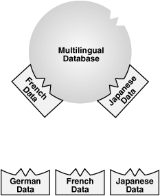

## 1 Overview of Globalization Support

This chapter provides an overview of globalization support for Oracle Database. This chapter discusses the following topics:

- Globalization Support Architecture

- Globalization Support Features

### 1.1 Globalization Support Architecture

The globalization support in Oracle Database enables you to store, process, and retrieve data in native languages. It ensures that database utilities, error messages, sort order, and date, time, monetary, numeric, and calendar conventions automatically adapt to any native language and locale.

In the past, Oracle referred to globalization support capabilities as National Language Support (NLS) features. NLS is actually a subset of globalization support. NLS is the ability to choose a national language and store data in a specific character set. Globalization support enables you to develop multilingual applications and software products that can be accessed and run from anywhere in the world simultaneously. An application can render content of the user interface and process data in the native users' languages and locale preferences.

#### 1.1.1 Locale Data on Demand

Oracle Database globalization support is implemented with the Oracle NLS Runtime Library (NLSRTL). NLSRTL provides a comprehensive suite of language-independent functions that perform proper text and character processing and language-convention manipulations. Behavior of these functions for a specific language and territory is governed by a set of locale-specific data that is identified and loaded at run time.

The locale-specific data is structured as independent sets of data for each locale that Oracle Database supports. The data for a particular locale can be loaded independently of other locale data.

The advantages of this design are as follows:

- You can manage memory consumption by choosing the set of locales that you need.

- You can add and customize locale data for a specific locale without affecting other locales.

The following figure shows how locale-specific data is loaded at run time. In this example, French data and Japanese data are loaded into the multilingual database, but German data is not.

Figure 1-1 Loading Locale-Specific Data to the Database

[Description of "Figure 1-1 Loading Locale-Specific Data to the Database"](img_text/figure-1-1-loading-locale-specific-data.md)

The locale-specific data is stored in the `$ORACLE_HOME/nls/data` directory. The `ORA_NLS10` environment variable should be defined only when you need to change the default directory location for the locale-specific data files, for example, when the system has multiple Oracle Database homes that share a single copy of the locale-specific data files.

A boot file is used to determine the availability of the NLS objects that can be loaded. Oracle Database supports both system and user boot files. The user boot file gives you the flexibility to tailor what NLS locale objects are available for the database. Also, new locale data can be added and some locale data components can be customized.

**See Also:**

"[Customizing Locale Data](customizing-locale-data.md)"

#### 1.1.2 Architecture to Support Multilingual Applications

Oracle Database enables multitier applications and client/server applications to support languages for which the database is configured.

The locale-dependent operations are controlled by several parameters and environment variables on both the client and the database server. On the database server, each session that is started on behalf of a client may run in the same or a different locale as other sessions, and can have the same or different language requirements specified.

Oracle Database has a set of session-independent NLS parameters that are specified when you create a database. Two of the parameters specify the database character set and the national character set, which is an alternative Unicode character set that can be specified for `NCHAR`, `NVARCHAR2`, and `NCLOB` data. The parameters specify the character set that is used to store text data in the database. Other parameters, such as language and territory, are used to evaluate and check constraints.

If the client session and the database server specify different character sets, then the database converts character set strings automatically.

From a globalization support perspective, all applications are considered to be clients, even if they run on the same physical machine as the Oracle Database instance. For example, when SQL\*Plus is started by the UNIX user who owns the Oracle Database software from the Oracle home in which the RDBMS software is installed, and SQL\*Plus connects to the database through an adapter by specifying the `ORACLE_SID` parameter, SQL\*Plus is considered a client. Its behavior is ruled by client-side NLS parameters.

Another example of an application being considered a client occurs when the middle tier is an application server. The different sessions spawned by the application server are considered to be separate client sessions.

When a client application is started, it initializes the client NLS environment from environment settings. All NLS operations performed locally are executed using these settings. Examples of local NLS operations are:

- Display formatting in Oracle Developer applications

- User OCI code that executes NLS OCI functions with OCI environment handles

When the application connects to a database, a session is created on the server. The new session initializes its NLS environment from NLS instance parameters specified in the initialization parameter file. These settings can be subsequently changed by an `ALTER` `SESSION` statement. The statement changes only the session NLS environment. It does not change the local client NLS environment. The session NLS settings are used to process SQL and PL/SQL statements that are executed on the server. For example, use an `ALTER SESSION` statement to set the `NLS_LANGUAGE` initialization parameter to Italian:

    ALTER SESSION SET NLS_LANGUAGE=Italian;

Enter a `SELECT` statement:

    SQL> SELECT last_name, hire_date, ROUND(salary/8,2) salary FROM employees;

You should see results similar to the following:

    LAST_NAME                 HIRE_DATE     SALARY
    ------------------------- --------- ----------
    ...
    Sciarra                   30-SET-05      962.5
    Urman                     07-MAR-06        975
    Popp                      07-DIC-07      862.5
    ...

Note that the month name abbreviations are in Italian.

Immediately after the connection has been established, if the `NLS_LANG` environment setting is defined on the client side, then an implicit `ALTER` `SESSION` statement synchronizes the client and session NLS environments.

**See Also:**

- "[OCI Programming in a Global Environment](OCI-programming-in-global-environment.md)"

- "[Setting Up a Globalization Support Environment](setting-up-globalization-support-environment.md)"

#### 1.1.3 Using Unicode in a Multilingual Database

Unicode, the universal encoded character set, enables you to store information in any language by using a single character set. Unicode provides a unique code value for every character, regardless of the platform, program, or language. Oracle recommends using `AL32UTF8` as the database character set. `AL32UTF8` is the proper implementation of the UTF-8 encoding form of the Unicode standard.

**Note:**

Starting with Oracle Database 12c Release 2, if you use Oracle Universal Installer (OUI) or Oracle Database Configuration Assistant (DBCA) to create a database, the default database character set used is the Unicode character set `AL32UTF8`.

Unicode has the following advantages:

- Simplifies character set conversion and linguistic sort functions.

- Improves performance compared with native multibyte character sets.

- Supports the Unicode data type based on the Unicode standard.

To help you migrate to a Unicode environment, Oracle provides the Database Migration Assistant for Unicode (DMU). The DMU is an intuitive and user-friendly GUI that helps streamline the migration process through an interface that minimizes the workload and ensures that all migration issues are addressed, along with guaranteeing that the data conversion is carried out correctly and efficiently. The DMU offers many advantages over past methods of migrating data, some of which are:

- It guides you through the workflow.

- It offers suggestions for handling certain problems, such as failures during the cleansing of the data.

- It supports selective conversion of data.

- It offers progress monitoring.

**See Also:**

- "[Supporting Multilingual Databases with Unicode](supporting-multilingual-databases-with-unicode.md)"

- "[Programming with Unicode](programming-with-unicode.md)"

- "[Enabling Multilingual Support with Unicode Data Types](supporting-multilingual-databases-with-unicode.md)"

- [Oracle Database Migration Assistant for Unicode Guide](https://docs.oracle.com/pls/topic/lookup?ctx=en/database/oracle/oracle-database/19/nlspg&id=DUMAG-GUID-3CA04A80-4870-469F-9FBB-0578779E7622)

### 1.2 Globalization Support Features

This section provides an overview of the standard globalization features in Oracle Database:

- Language Support

- Territory Support

- Date and Time Formats

- Monetary and Numeric Formats

- Calendar Systems

- Linguistic Sorting

- Character Set Support

- Character Semantics

- Customization of Locale and Calendar Data

- Unicode Support

#### 1.2.1 Language Support

Oracle Database enables you to store, process, and retrieve data in native languages. The languages that can be stored in a database are all languages written in scripts that are encoded by Oracle-supported character sets. Through the use of Unicode databases and data types, Oracle Database supports most contemporary languages.

Additional support is available for a subset of the languages. The database can, for example, display dates using translated month names, and can sort text data according to cultural conventions.

When this document uses the term language support, it refers to the additional language-dependent functionality, and not to the ability to store text of a specific language. For example, language support includes displaying dates or sorting text according to specific locales and cultural conventions. Additionally, for some supported languages, Oracle Database provides translated error messages and a translated user interface for the database utilities.

**See Also:**

- "[Setting Up a Globalization Support Environment](setting-up-globalization-support-environment.md)"

- "[Languages](appendix-A-locale-data.md)" for the list of Oracle Database language names and abbreviations

- "[Translated Messages](appendix-A-locale-data.md)" for the list of languages into which Oracle Database messages are translated

#### 1.2.2 Territory Support

Oracle Database supports cultural conventions that are specific to geographical locations. The default local time format, date format, and numeric and monetary conventions depend on the local territory setting. Setting different NLS parameters enables the database session to use different cultural settings. For example, you can set the euro (`EUR`) as the primary currency and the Japanese yen (`JPY`) as the secondary currency for a given database session, even when the territory is defined as `AMERICA`.

**See Also:**

- "[Setting Up a Globalization Support Environment](setting-up-globalization-support-environment.md)"

- "[Territories](appendix-A-locale-data.md)" for a list of territories that are supported by Oracle Database

#### 1.2.3 Date and Time Formats

Different conventions for displaying the hour, day, month, and year can be handled in local formats. For example, in the United Kingdom, the date is displayed using the `DD-MON-YYYY` format, while Japan commonly uses the `YYYY-MM-DD` format.

Time zones and daylight saving support are also available.

**See Also:**

- "[Setting Up a Globalization Support Environment](setting-up-globalization-support-environment.md)"

- "[Datetime Data Types and Time Zone Support](datetime-data-types-and-time-zone-support.md)"

- [Oracle Database SQL Language Reference](../sqlrf/Format-Models.md)

#### 1.2.4 Monetary and Numeric Formats

Currency, credit, and debit symbols can be represented in local formats. Radix symbols and thousands separators can be defined by locales. For example, in the US, the decimal point is a dot (.), while it is a comma (,) in France. Therefore, the amount \$1,234 has different meanings in different countries.

**See Also:**

"[Setting Up a Globalization Support Environment](setting-up-globalization-support-environment.md)"

#### 1.2.5 Calendar Systems

Many different calendar systems are in use around the world. Oracle Database supports eight different calendar systems:

- Arabic Hijrah

- English Hijrah

- Ethiopian

- Gregorian

- Japanese Imperial

- Persian

- ROC Official (Republic of China)

- Thai Buddha

**See Also:**

- "[Setting Up a Globalization Support Environment](setting-up-globalization-support-environment.md)"

- "[Calendar Systems](appendix-A-locale-data.md)" for more information about supported calendars

#### 1.2.6 Linguistic Sorting

Oracle Database provides linguistic definitions for culturally accurate sorting and case conversion. The basic definition treats strings as sequences of independent characters. The extended definition recognizes pairs of characters that should be treated as special cases.

Strings that are converted to upper case or lower case using the basic definition always retain their lengths. Strings converted using the extended definition may become longer or shorter.

**See Also:**

"[Linguistic Sorting and Matching](linguistic-sorting-and-matching.md)"

#### 1.2.7 Character Set Support

Oracle Database supports a large number of single-byte, multibyte, and fixed-width encoding schemes that are based on national, international, and vendor-specific standards.

**See Also:**

- "[Choosing a Character Set](choosing-character-set.md)"

- "[Character Sets](appendix-A-locale-data.md)" for a list of supported character sets

#### 1.2.8 Character Semantics

Oracle Database provides character semantics. It is useful for defining the storage requirements for multibyte strings of varying widths in terms of characters instead of bytes.

**See Also:**

"[Length Semantics](choosing-character-set.md)"

#### 1.2.9 Customization of Locale and Calendar Data

You can customize locale data such as language, character set, territory, or linguistic sort using the Oracle Locale Builder.

You can customize calendars with the NLS Calendar Utility.

**See Also:**

- "[Customizing Locale Data](customizing-locale-data.md)"

- "[Customizing Calendars with the NLS Calendar Utility](customizing-locale-data.md)"

#### 1.2.10 Unicode Support

Unicode is an industry standard that enables text and symbols from all languages to be consistently represented and manipulated by computers.

Oracle Database has complied with the Unicode standard since Oracle 7. Subsequently, Oracle Database 10g Release 2 (10.2) supports Unicode 4.0. Oracle Database 11g release supports Unicode 5.0. Oracle Database 12c Release 1 (12.1) supports Unicode 6.2. Oracle Database 12c Release 2 (12.2) supports Unicode 7.0. Oracle Database 18c and Oracle Database 19c support Unicode 9.0.

You can store Unicode characters in an Oracle database in two ways:

- You can create a Unicode database that enables you to store UTF-8 encoded characters as SQL `CHAR` data types `VARCHAR2`, `CHAR`, `LONG` (deprecated), and `CLOB`.

- You can support multilingual data in specific columns by using SQL `NCHAR` data types `NVARCHAR2`, `NCHAR`, and `NCLOB`. You can store Unicode characters into columns of the `NCHAR` data types regardless of how the database character set has been defined. The `NCHAR` data types are exclusively Unicode data types.

**Note:**

Starting with Oracle Database 12c Release 2 (12.2), if you use Oracle Universal Installer (OUI) or Oracle Database Configuration Assistant (DBCA) to create a database, then the default database character set used is the Unicode character set AL32UTF8.

**See Also:**

"[Supporting Multilingual Databases with Unicode](supporting-multilingual-databases-with-unicode.md)"
