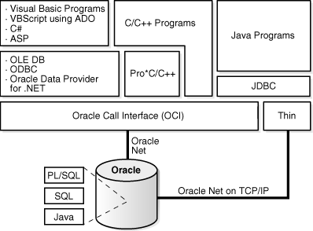
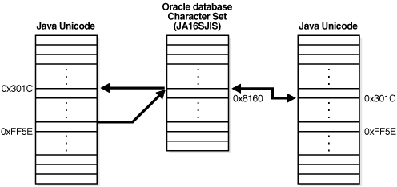

## 7  Programming with Unicode

This chapter describes how to use programming and access products for Oracle Database with Unicode. This chapter contains the following topics:

- Overview of Programming with Unicode

- SQL and PL/SQL Programming with Unicode

- OCI Programming with Unicode

- Pro\*C/C++ Programming with Unicode

- JDBC Programming with Unicode

- ODBC and OLE DB Programming with Unicode

- XML Programming with Unicode

### 7.1 Overview of Programming with Unicode

Oracle offers several database access products for inserting and retrieving Unicode data. Oracle offers database access products for commonly used programming environments such as Java and C/C++. Data is transparently converted between the database and client programs, which ensures that client programs are independent of the database character set and national character set. In addition, client programs are sometimes even independent of the character data type, such as `NCHAR` or `CHAR`, used in the database.

To avoid overloading the database server with data conversion operations, Oracle always tries to move them to the client side database access products. In a few cases, data must be converted in the database, which affects performance. This chapter discusses details of the data conversion paths.

#### 7.1.1 Database Access Product Stack and Unicode

Oracle offers a comprehensive set of database access products that enable programs from different development environments to access Unicode data stored in the database. These products are listed in the following table.

Table 7-1 Oracle Database Access Products

| Programming Environment | Oracle Database Access Products                                                                                                       |
|:------------------------|:--------------------------------------------------------------------------------------------------------------------------------------|
| C/C++                   | Oracle Call Interface (OCI) Oracle Pro\*C/C++ Oracle ODBC driver Oracle Provider for OLE DB Oracle Data Provider for .NET |
| Java                    | Oracle JDBC OCI or thin driver Oracle server-side thin driver Oracle server-side internal driver                                |
| PL/SQL                  | Oracle PL/SQL and SQL                                                                                                                 |
| Visual Basic/C#         | Oracle ODBC driver Oracle Provider for OLE DB                                                                                      |

The following figure shows how the database access products can access the database.

Figure 7-1 Oracle Database Access Products

[Description of "Figure 7-1 Oracle Database Access Products "](img_text/nlspg024.md)

The Oracle Call Interface (OCI) is the lowest level API that the rest of the client-side database access products use. It provides a flexible way for C/C++ programs to access Unicode data stored in SQL `CHAR` and `NCHAR` data types. Using OCI, you can programmatically specify the character set (UTF-8, UTF-16, and others) for the data to be inserted or retrieved. It accesses the database through Oracle Net.

Oracle Pro\*C/C++ enables you to embed SQL and PL/SQL in your programs. It uses OCI's Unicode capabilities to provide UTF-16 and UTF-8 data access for SQL `CHAR` and `NCHAR` data types.

The Oracle ODBC driver enables C/C++, Visual Basic, and VBScript programs running on Windows platforms to access Unicode data stored in SQL `CHAR` and `NCHAR` data types of the database. It provides UTF-16 data access by implementing the `SQLWCHAR` interface specified in the ODBC standard specification.

The Oracle Provider for OLE DB enables C/C++, Visual Basic, and VBScript programs running on Windows platforms to access Unicode data stored in SQL `CHAR` and `NCHAR` data types. It provides UTF-16 data access through wide string OLE DB data types.

The Oracle Data Provider for .NET enables programs running in any .NET programming environment on Windows platforms to access Unicode data stored in SQL `CHAR` and `NCHAR` data types. It provides UTF-16 data access through Unicode data types.

Oracle JDBC drivers are the primary Java programmatic interface for accessing an Oracle database. Oracle provides the following JDBC drivers:

- The JDBC OCI driver that is used by Java applications and requires the OCI library

- The JDBC thin driver, which is a pure Java driver that is primarily used by Java applets and supports the Oracle Net protocol over TCP/IP

- The JDBC server-side thin driver, a pure Java driver used inside Java stored procedures to connect to another Oracle server

- The JDBC server-side internal driver that is used inside the Oracle server to access the data in the database

All drivers support Unicode data access to SQL `CHAR` and `NCHAR` data types in the database.

The PL/SQL and SQL engines process PL/SQL programs and SQL statements on behalf of client-side programs such as OCI and server-side PL/SQL stored procedures. They allow PL/SQL programs to declare `CHAR`, `VARCHAR2`, `NCHAR`, and `NVARCHAR2` variables and to access SQL `CHAR` and `NCHAR` data types in the database.

The following sections describe how each of the database access products supports Unicode data access to an Oracle database and offer examples for using those products:

- SQL and PL/SQL Programming with Unicode

- OCI Programming with Unicode

- Pro\*C/C++ Programming with Unicode

- JDBC Programming with Unicode

- ODBC and OLE DB Programming with Unicode

### 7.2 SQL and PL/SQL Programming with Unicode

SQL is the fundamental language with which all programs and users access data in an Oracle database either directly or indirectly. PL/SQL is a procedural language that combines the data manipulating power of SQL with the data processing power of procedural languages. Both SQL and PL/SQL can be embedded in other programming languages. This section describes Unicode-related features in SQL and PL/SQL that you can deploy for multilingual applications.

This section contains the following topics:

- SQL NCHAR Data Types

- Implicit Data Type Conversion Between NCHAR and Other Data Types

- Exception Handling for Data Loss During Data Type Conversion

- Rules for Implicit Data Type Conversion

- SQL Functions for Unicode Data Types

- Other SQL Functions

- Unicode String Literals

- Using the UTL_FILE Package with NCHAR Data

#### 7.2.1 SQL NCHAR Data Types

There are three SQL `NCHAR` data types:

- The NCHAR Data Type

- The NVARCHAR2 Data Type

- The NCLOB Data Type

##### 7.2.1.1 The NCHAR Data Type

When you define a table column or a PL/SQL variable as the `NCHAR` data type, the length is always specified as the number of characters. For example, the following statement creates a column with a maximum length of 30 characters:

    CREATE TABLE table1 (column1 NCHAR(30));

The maximum number of bytes for the column is determined as follows:

    maximum number of bytes = (maximum number of characters) x (maximum number of bytes for each character)

For example, if the national character set is UTF8, then the maximum byte length is 30 characters times 3 bytes for each character, or 90 bytes.

The national character set, which is used for all `NCHAR` data types, is defined when the database is created. The national character set can be either UTF8 or AL16UTF16. The default is AL16UTF16.

The maximum column size allowed is 32000 characters when the national character set is UTF8 and 8000 when it is AL16UTF16. The actual data is subject to the maximum byte limit of 16000. The two size constraints must be satisfied at the same time. In PL/SQL, the maximum length of `NCHAR` data is 32767 bytes. You can define an `NCHAR` variable of up to 32767 characters, but the actual data cannot exceed 32767 bytes. If you insert a value that is shorter than the column length, then Oracle pads the value with blanks to whichever length is smaller: maximum character length or maximum byte length.

**Note:**

UTF8 may affect performance because it is a variable-width character set. Excessive blank padding of `NCHAR` fields decreases performance. Consider using the `NVARCHAR2` data type or changing to the AL16UTF16 character set for the `NCHAR` data type.

##### 7.2.1.2 The NVARCHAR2 Data Type

The `NVARCHAR2` data type specifies a variable length character string that uses the national character set. When you create a table with an `NVARCHAR2` column, you specify the maximum number of characters for the column. Lengths for `NVARCHAR2` are always in units of characters, just as for `NCHAR`. Oracle subsequently stores each value in the column exactly as you specify it, if the value does not exceed the column's maximum length. Oracle does not pad the string value to the maximum length.

The maximum length for the `NVARCHAR2` type is 4000 characters if `MAX_STRING_SIZE` `=` `STANDARD` or 32767 characters if `MAX_STRING_SIZE` `=` `EXTENDED`. These lengths are based on using UTF8; the values are 2000 and 16383 characters when using AL16UTF16.

In PL/SQL, the maximum length for an `NVARCHAR2` variable is 32767 bytes. You can define `NVARCHAR2` variables up to 32767 characters, but the actual data cannot exceed 32767 bytes.

The following statement creates a table with one `NVARCHAR2` column whose maximum length in characters is 2000 and maximum length in bytes is 4000.

    CREATE TABLE table2 (column2 NVARCHAR2(2000));

##### 7.2.1.3 The NCLOB Data Type

`NCLOB` is a character large object containing Unicode characters, with a maximum size of 4 gigabytes. Unlike the `BLOB` data type, the `NCLOB` data type has full transactional support so that changes made through SQL, the `DBMS_LOB` package, or OCI participate fully in transactions. Manipulations of `NCLOB` value can be committed and rolled back. Note, however, that you cannot save an `NCLOB` locator in a PL/SQL or OCI variable in one transaction and then use it in another transaction or session.

`NCLOB` values are stored in the database in a format that is compatible with UCS-2, regardless of the national character set. Oracle translates the stored Unicode value to the character set requested on the client or on the server, which can be fixed-width or variable-width. When you insert data into an `NCLOB` column using a variable-width character set, Oracle converts the data into a format that is compatible with UCS-2 before storing it in the database.

**See Also:**

[Oracle Database SecureFiles and Large Objects Developer's Guide ](../adlob/introduction-to-large-objects.md)for more information about the `NCLOB` data type

#### 7.2.2 Implicit Data Type Conversion Between NCHAR and Other Data Types

Oracle supports implicit conversions between SQL `NCHAR` data types and other Oracle data types, such as `CHAR`, `VARCHAR2`, `NUMBER`, `DATE`, `ROWID`, and `CLOB`. Any implicit conversions for `CHAR` and `VARCHAR2` data types are also supported for SQL `NCHAR` data types. You can use SQL `NCHAR` data types the same way as SQL `CHAR` data types.

Type conversions between SQL `CHAR` data types and SQL `NCHAR` data types may involve character set conversion when the database and national character sets are different. Padding with blanks may occur if the target data is either `CHAR` or `NCHAR`.

**See Also:**

[Oracle Database SQL Language Reference](../sqlrf/TO_NCHAR-character.md)

#### 7.2.3 Exception Handling for Data Loss During Data Type Conversion

Data loss can occur during data type conversion when character set conversion is necessary. If a character in the source character set is not defined in the target character set, then a replacement character is used in its place. For example, if you try to insert `NCHAR` data into a regular `CHAR` column and the character data in `NCHAR` (Unicode) form cannot be converted to the database character set, then the character is replaced by a replacement character defined by the database character set. The `NLS_NCHAR_CONV_EXCP` initialization parameter controls the behavior of data loss during character type conversion. When this parameter is set to `TRUE`, any SQL statements that result in data loss return an `ORA-12713` error and the corresponding operation is stopped. When this parameter is set to `FALSE`, data loss is not reported and the unconvertible characters are replaced with replacement characters. The default value is `FALSE`. This parameter works for both implicit and explicit conversion.

In PL/SQL, when data loss occurs during conversion of SQL `CHAR` and `NCHAR` data types, the `LOSSY_CHARSET_CONVERSION` exception is raised for both implicit and explicit conversion.

#### 7.2.4 Rules for Implicit Data Type Conversion

In some cases, conversion between data types is possible in only one direction. In other cases, conversion in both directions is possible. Oracle defines a set of rules for conversion between data types. The following table contains the rules for conversion between data types.

Table 7-2 Rules for Conversion Between Data Types

| Statement                                               | Rule                                                                                                                                                                                                                                                                                                                                                                                                                                                                                                                                                                                                                                                                                                                                                                                                                                                                                                                                                                                                                             |
|:--------------------------------------------------------|:---------------------------------------------------------------------------------------------------------------------------------------------------------------------------------------------------------------------------------------------------------------------------------------------------------------------------------------------------------------------------------------------------------------------------------------------------------------------------------------------------------------------------------------------------------------------------------------------------------------------------------------------------------------------------------------------------------------------------------------------------------------------------------------------------------------------------------------------------------------------------------------------------------------------------------------------------------------------------------------------------------------------------------|
| `INSERT`/`UPDATE` statement                             | Values are converted to the data type of the target database column.                                                                                                                                                                                                                                                                                                                                                                                                                                                                                                                                                                                                                                                                                                                                                                                                                                                                                                                                                             |
| `SELECT` `INTO` statement                               | Data from the database is converted to the data type of the target variable.                                                                                                                                                                                                                                                                                                                                                                                                                                                                                                                                                                                                                                                                                                                                                                                                                                                                                                                                                     |
| Variable assignments                                    | Values on the right of the equal sign are converted to the data type of the target variable on the left of the equal sign.                                                                                                                                                                                                                                                                                                                                                                                                                                                                                                                                                                                                                                                                                                                                                                                                                                                                                                       |
| Parameters in SQL and PL/SQL functions                  | `CHAR`, `VARCHAR2`, `NCHAR`, and `NVARCHAR2` are loaded the same way. An argument with a `CHAR`, `VARCHAR2`, `NCHAR` or `NVARCHAR2` data type is compared to a formal parameter of any of the `CHAR`, `VARCHAR2`, `NCHAR` or `NVARCHAR2` data types. If the argument and formal parameter data types do not match exactly, then implicit conversions are introduced when data is copied into the parameter on function entry and copied out to the argument on function exit.                                                                                                                                                                                                                                                                                                                                                                                                                                                                                                                                                    |
| Concatenation \|\| operation or `CONCAT` function       | If one operand is a SQL `CHAR` or `NCHAR` data type and the other operand is a `NUMBER` or other non-character data type, then the other data type is converted to `VARCHAR2` or `NVARCHAR2`. For concatenation between character data types, see "SQL NCHAR data types and SQL CHAR data types".                                                                                                                                                                                                                                                                                                                                                                                                                                                                                                                                                                                                                                                                                                                                |
| SQL `CHAR` or `NCHAR` data types and `NUMBER` data type | Character values are converted to `NUMBER` data type.                                                                                                                                                                                                                                                                                                                                                                                                                                                                                                                                                                                                                                                                                                                                                                                                                                                                                                                                                                            |
| SQL `CHAR` or `NCHAR` data types and `DATE` data type   | Character values are converted to `DATE` data type.                                                                                                                                                                                                                                                                                                                                                                                                                                                                                                                                                                                                                                                                                                                                                                                                                                                                                                                                                                              |
| SQL `CHAR` or `NCHAR` data types and `ROWID` data type  | Character values are converted to `ROWID` data type.                                                                                                                                                                                                                                                                                                                                                                                                                                                                                                                                                                                                                                                                                                                                                                                                                                                                                                                                                                             |
| SQL `NCHAR` data types and SQL `CHAR` data types        | Comparisons between SQL `NCHAR` data types and SQL `CHAR` data types are more complex because they can be encoded in different character sets. When `CHAR` and `VARCHAR2` values are compared, the `CHAR` values are converted to `VARCHAR2` values. When `NCHAR` and `NVARCHAR2` values are compared, the `NCHAR` values are converted to `NVARCHAR2` values. When there is comparison between SQL `NCHAR` data types and SQL `CHAR` data types, character set conversion occurs if they are encoded in different character sets. The character set for SQL `NCHAR` data types is always Unicode and can be either UTF8 or AL16UTF16 encoding, which have the same character repertoires but are different encodings of the Unicode standard. SQL `CHAR` data types use the database character set, which can be any character set that Oracle supports. Unicode is a superset of any character set supported by Oracle, so SQL `CHAR` data types can always be converted to SQL `NCHAR` data types without data loss. |

#### 7.2.5 SQL Functions for Unicode Data Types

SQL `NCHAR` data types can be converted to and from SQL `CHAR` data types and other data types using explicit conversion functions. The examples in this section use the table created by the following statement:

    CREATE TABLE customers
      (id NUMBER, name NVARCHAR2(50), address NVARCHAR2(200), birthdate DATE);

**See Also:**

[Oracle Database SQL Language Reference](../sqlrf/Data-Types.md) for more information about explicit conversion functions for SQL `NCHAR` data types

Example 7-1 Populating the Customers Table Using the TO_NCHAR Function

The `TO_NCHAR` function converts the data at run time, while the `N` function converts the data at compilation time.

    INSERT INTO customers VALUES (1000,
      TO_NCHAR('John Smith'),N'500 Oracle Parkway',sysdate);

Example 7-2 Selecting from the Customer Table Using the TO_CHAR Function

The following statement converts the values of `name` from characters in the national character set to characters in the database character set before selecting them according to the `LIKE` clause:

    SELECT name FROM customers WHERE TO_CHAR(name) LIKE '%Sm%';

You should see the following output:

    NAME
    --------------------------------------
    John Smith

Example 7-3 Selecting from the Customer Table Using the TO_DATE Function

Using the `N` function shows that either `NCHAR` or `CHAR` data can be passed as parameters for the `TO_DATE` function. The data types can mixed because they are converted at run time.

    DECLARE
       ndatestring NVARCHAR2(20) := N'12-SEP-1975';
       ndstr NVARCHAR2(50);
    BEGIN
       SELECT name INTO ndstr FROM customers
       WHERE (birthdate)> TO_DATE(ndatestring, 'DD-MON-YYYY', NLS_DATE_LANGUAGE =
       'AMERICAN');
    END;

As demonstrated in Example 7-3, SQL `NCHAR` data can be passed to explicit conversion functions. SQL `CHAR` and `NCHAR` data can be mixed together when using multiple string parameters.

#### 7.2.6 Other SQL Functions

Most SQL functions can take arguments of SQL `NCHAR` data types as well as mixed character data types. The return data type is based on the type of the first argument. If a non-string data type like `NUMBER` or `DATE` is passed to these functions, then it is converted to `VARCHAR2`.

**See Also:**

[Oracle Database SQL Language Reference](../sqlrf/RPAD.md)

The following examples use the `customer` table created in "SQL Functions for Unicode Data Types".

Example 7-4 INSTR Function

In this example, the string literal `'Sm'` is converted to `NVARCHAR2` and then scanned by `INSTR`, to detect the position of the first occurrence of this string in `name`.

    SELECT INSTR(name, N'Sm', 1, 1) FROM customers;

Example 7-5 CONCAT Function

    SELECT CONCAT(name,id) FROM customers;

`id` is converted to `NVARCHAR2` and then concatenated with `name`.

Example 7-6 RPAD Function

    SELECT RPAD(name,100,' ') FROM customers;

The following output results:

    RPAD(NAME,100,'')
    ------------------------------------------
    John Smith

The space character ' ' is converted to the corresponding character in the `NCHAR` character set and then padded to the right of `name` until the total display length reaches 100.

#### 7.2.7 Unicode String Literals

You can input Unicode string literals in SQL and PL/SQL as follows:

- Put a prefix `N` before a string literal that is enclosed with single quotation marks. This explicitly indicates that the following string literal is an `NCHAR` string literal. For example, `N'résumé'` is an `NCHAR` string literal. For information about limitations of this method, see "NCHAR String Literal Replacement".

- Use the `NCHR(``n``)` SQL function, which returns a unit of character code in the national character set, which is AL16UTF16 or UTF8. The result of concatenating several `NCHR(``n``)` functions is `NVARCHAR2` data. In this way, you can bypass the client and server character set conversions and create an `NVARCHAR2` string directly. For example, `NCHR(32)` represents a blank character.

  Because `NCHR(``n``)` is associated with the national character set, portability of the resulting value is limited to applications that run with the same national character set. If this is a concern, then use the `UNISTR` function to remove portability limitations.

- Use the `UNISTR`('`string'`) SQL function. `UNISTR`('`string'`) converts a string to the national character set. To ensure portability and to preserve data, include only ASCII characters and Unicode encoding in the following form: `\xxxx`, where `xxxx` is the hexadecimal value of a character code value in UTF-16 encoding format. For example, `UNISTR('G\0061ry')` represents `'Gary'`. The ASCII characters are converted to the database character set and then to the national character set. The Unicode encoding is converted directly to the national character set.

The last two methods can be used to encode any Unicode string literals.

#### 7.2.8 NCHAR String Literal Replacement

This section provides information on how to avoid data loss when performing `NCHAR` string literal replacement.

Being part of a SQL or PL/SQL statement, the text of any literal, with or without the prefix `N`, is encoded in the same character set as the rest of the statement. On the client side, the statement is in the client character set, which is determined by the client character set defined in `NLS_LANG`, or specified in the `OCIEnvNlsCreate()` call, or predefined as UTF-16 in JDBC. On the server side, the statement is in the database character set.

- When the SQL or PL/SQL statement is transferred from client to the database server, its character set is converted accordingly. It is important to note that if the database character set does not contain all characters used in the text literals, then the data is lost in this conversion. This problem affects `NCHAR` string literals more than the `CHAR` text literals. This is because the `N'` literals are designed to be independent of the database character set, and should be able to provide any data that the client character set supports.

  To avoid data loss in conversion to an incompatible database character set, you can activate the `NCHAR` literal replacement functionality. The functionality transparently replaces the `N'` literals on the client side with an internal format. The database server then decodes this to Unicode when the statement is executed.

- The sections "Handling SQL NCHAR String Literals in OCI" and "Using SQL NCHAR String Literals in JDBC" show how to switch on the replacement functionality in OCI and JDBC, respectively. Because many applications, for example, SQL\*Plus, use OCI to connect to a database, and they do not control `NCHAR` literal replacement explicitly, you can set the client environment variable `ORA_NCHAR_LITERAL_REPLACE` to `TRUE` to control the functionality for them. By default, the functionality is switched off to maintain backward compatibility.

#### 7.2.9 Using the UTL_FILE Package with NCHAR Data

The `UTL_FILE` package handles Unicode national character set data of the `NVARCHAR2` data type. `NCHAR` and `NCLOB` are supported through implicit conversion. The functions and procedures include the following:

- `FOPEN_NCHAR`

  This function opens a file in national character set mode for input or output, with the maximum line size specified. Even though the contents of an `NVARCHAR2` buffer may be AL16UTF16 or UTF8 (depending on the national character set of the database), the contents of the file are always read and written in UTF8. See "[Support for the Unicode Standard in Oracle Database](supporting-multilingual-databases-with-unicode.md)" for more information. `UTL_FILE` converts between UTF8 and AL16UTF16 as necessary.

- `GET_LINE_NCHAR`

  This procedure reads text from the open file identified by the file handle and places the text in the output buffer parameter. The file must be opened in national character set mode, and must be encoded in the UTF8 character set. The expected buffer data type is `NVARCHAR2`. If a variable of another data type, such as `NCHAR`, `NCLOB`, or `VARCHAR2` is specified, PL/SQL performs standard implicit conversion from `NVARCHAR2` after the text is read.

- `PUT_NCHAR`

  This procedure writes the text string stored in the buffer parameter to the open file identified by the file handle. The file must be opened in the national character set mode. The text string will be written in the UTF8 character set. The expected buffer data type is `NVARCHAR2`. If a variable of another data type is specified, PL/SQL performs implicit conversion to `NVARCHAR2` before writing the text.

- `PUT_LINE_NCHAR`

  This procedure is equivalent to `PUT_NCHAR`, except that the line separator is appended to the written text.

- `PUTF_NCHAR`

  This procedure is a formatted version of a `PUT_NCHAR` procedure. It accepts a format string with formatting elements \n and %s, and up to five arguments to be substituted for consecutive instances of %s in the format string. The expected data type of the format string and the arguments is `NVARCHAR2`. If variables of another data type are specified, PL/SQL performs implicit conversion to `NVARCHAR2` before formatting the text. Formatted text is written in the UTF8 character set to the file identified by the file handle. The file must be opened in the national character set mode.

The above functions and procedures process text files encoded in the UTF8 character set, that is, in the Unicode CESU-8 encoding. See "[Universal Character Sets](appendix-A-locale-data.md)" for more information about CESU-8. The functions and procedures convert between UTF8 and the national character set of the database, which can be UTF8 or AL16UTF16, as needed.

**See Also:**

[Oracle Database PL/SQL Packages and Types Reference](../arpls/UTL_FILE.md) for more information about the `UTL_FILE` package

### 7.3 OCI Programming with Unicode

OCI is the lowest-level API for accessing a database, so it offers the best possible performance. When using Unicode with OCI, consider these topics:

- OCIEnvNlsCreate() Function for Unicode Programming

- OCI Unicode Code Conversion

- Setting UTF-8 to the NLS_LANG Character Set in OCI

- Binding and Defining SQL CHAR Data Types in OCI

- Binding and Defining SQL NCHAR Data Types in OCI

- Handling SQL NCHAR String Literals in OCI

- Binding and Defining CLOB and NCLOB Unicode Data in OCI

**See Also:**

"[OCI Programming in a Global Environment](OCI-programming-in-global-environment.md)"

#### 7.3.1 OCIEnvNlsCreate() Function for Unicode Programming

The `OCIEnvNlsCreate()` function is used to specify a SQL `CHAR` character set and a SQL `NCHAR` character set when the OCI environment is created. It is an enhanced version of the `OCIEnvCreate()` function and has extended arguments for two character set IDs. The OCI_UTF16ID UTF-16 character set ID replaces the Unicode mode introduced in Oracle9i release 1 (9.0.1). For example:

    OCIEnv *envhp;
    status = OCIEnvNlsCreate((OCIEnv **)&envhp,
    (ub4)0,
    (void *)0,
    (void *(*) ()) 0,
    (void *(*) ()) 0,
    (void(*) ()) 0,
    (size_t) 0,
    (void **)0,
    (ub2)OCI_UTF16ID, /* Metadata and SQL CHAR character set */
    (ub2)OCI_UTF16ID /* SQL NCHAR character set */);

The Unicode mode, in which the OCI_UTF16 flag is used with the `OCIEnvCreate()` function, is deprecated.

When OCI_UTF16ID is specified for both SQL `CHAR` and SQL `NCHAR` character sets, all metadata and bound and defined data are encoded in UTF-16. Metadata includes SQL statements, user names, error messages, and column names. Thus, all inherited operations are independent of the `NLS_LANG` setting, and all metatext data parameters (`text*`) are assumed to be Unicode text data types (`utext*`) in UTF-16 encoding.

To prepare the SQL statement when the `OCIEnv()` function is initialized with the OCI_UTF16ID character set ID, call the `OCIStmtPrepare()` function with a `(utext*)` string. The following example runs on the Windows platform only. You may need to change `wchar_t` data types for other platforms.

    const wchar_t sqlstr[] = L"SELECT * FROM ENAME=:ename";
    ...
    OCIStmt* stmthp;
    sts = OCIHandleAlloc(envh, (void **)&stmthp, OCI_HTYPE_STMT, 0,
    NULL);
    status = OCIStmtPrepare(stmthp, errhp,(const text*)sqlstr,
    wcslen(sqlstr), OCI_NTV_SYNTAX, OCI_DEFAULT);

To bind and define data, you do not have to set the `OCI_ATTR_CHARSET_ID` attribute because the `OCIEnv()` function has already been initialized with UTF-16 character set IDs. The bind variable names also must be UTF-16 strings.

    /* Inserting Unicode data */
    OCIBindByName(stmthp1, &bnd1p, errhp, (const text*)L":ename",
    (sb4)wcslen(L":ename"),
                  (void *) ename, sizeof(ename), SQLT_STR, (void
    *)&insname_ind,
                  (ub2 *) 0, (ub2 *) 0, (ub4) 0, (ub4 *)0,
    OCI_DEFAULT);
    OCIAttrSet((void *) bnd1p, (ub4) OCI_HTYPE_BIND, (void *)
    &ename_col_len,
               (ub4) 0, (ub4)OCI_ATTR_MAXDATA_SIZE, errhp);
    ...
    /* Retrieving Unicode data */
    OCIDefineByPos (stmthp2, &dfn1p, errhp, (ub4)1, (void *)ename,
                   (sb4)sizeof(ename), SQLT_STR, (void *)0, (ub2 *)0,
    (ub2*)0, (ub4)OCI_DEFAULT);

The `OCIExecute()` function performs the operation.

**See Also:**

"[Specifying Character Sets in OCI](OCI-programming-in-global-environment.md)"

#### 7.3.2 OCI Unicode Code Conversion

Unicode character set conversions take place between an OCI client and the database server if the client and server character sets are different. The conversion occurs on either the client or the server depending on the circumstances, but usually on the client side.

##### 7.3.2.1 Data Integrity

You can lose data during conversion if you call an OCI API inappropriately. If the server and client character sets are different, then you can lose data when the destination character set is a smaller set than the source character set. You can avoid this potential problem if both character sets are Unicode character sets (for example, UTF8 and AL16UTF16).

When you bind or define SQL `NCHAR` data types, you should set the `OCI_ATTR_CHARSET_FORM` attribute to `SQLCS_NCHAR`. Otherwise, you can lose data because the data is converted to the database character set before converting to or from the national character set. This occurs only if the database character set is not Unicode.

##### 7.3.2.2 OCI Performance Implications When Using Unicode

Redundant data conversions can cause performance degradation in your OCI applications. These conversions occur in two cases:

- When you bind or define SQL `CHAR` data types and set the `OCI_ATTR_CHARSET_FORM` attribute to `SQLCS_NCHAR`, data conversions take place from client character set to the national database character set, and from the national character set to the database character set. No data loss is expected, but two conversions happen, even though it requires only one.

- When you bind or define SQL `NCHAR` data types and do not set `OCI_ATTR_CHARSET_FORM`, data conversions take place from client character set to the database character set, and from the database character set to the national database character set. In the worst case, data loss can occur if the database character set is smaller than the client's.

To avoid performance problems, you should always set `OCI_ATTR_CHARSET_FORM` correctly, based on the data type of the target columns. If you do not know the target data type, then you should set the `OCI_ATTR_CHARSET_FORM` attribute to `SQLCS_NCHAR` when binding and defining.

The following table contains information about OCI character set conversions.

Table 7-3 OCI Character Set Conversions

| Data Types for OCI Client Buffer | OCI_ATTR_CHARSET_FORM | Data Types of the Target Column in the Database | Conversion Between                                                                                                                 | Comments                                                                                                            |
|:---------------------------------|:----------------------|:------------------------------------------------|:-----------------------------------------------------------------------------------------------------------------------------------|:--------------------------------------------------------------------------------------------------------------------|
| `utext`                          | `SQLCS_IMPLICIT`      | `CHAR,VARCHAR2,` `CLOB`                      | UTF-16 and database character set in OCI                                                                                           | No unexpected data loss                                                                                             |
| `utext`                          | `SQLCS_NCHAR`         | `NCHAR,NVARCHAR2,` `NCLOB`                   | UTF-16 and national character set in OCI                                                                                           | No unexpected data loss                                                                                             |
| `utext`                          | `SQLCS_NCHAR`         | `CHAR,VARCHAR2,` `CLOB`                      | UTF-16 and national character set in OCI National character set and database character set in database server                   | No unexpected data loss, but may degrade performance because the conversion goes through the national character set |
| `utext`                          | `SQLCS_IMPLICIT`      | `NCHAR,NVARCHAR2,` `NCLOB`                   | UTF-16 and database character set in OCI Database character set and national character set in database server                   | Data loss may occur if the database character set is not Unicode                                                    |
| `text`                           | `SQLCS_IMPLICIT`      | `CHAR,VARCHAR2,` `CLOB`                      | `NLS_LANG` character set and database character set in OCI                                                                         | No unexpected data loss                                                                                             |
| `text`                           | `SQLCS_NCHAR`         | `NCHAR,NVARCHAR2,` `NCLOB`                   | `NLS_LANG` character set and national character set in OCI                                                                         | No unexpected data loss                                                                                             |
| `text`                           | `SQLCS_NCHAR`         | `CHAR,VARCHAR2,` `CLOB`                      | `NLS_LANG` character set and national character set in OCI National character set and database character set in database server | No unexpected data loss, but may degrade performance because the conversion goes through the national character set |
| `text`                           | `SQLCS_IMPLICIT`      | `NCHAR,NVARCHAR2,` `NCLOB`                   | `NLS_LANG` character set and database character set in OCI Database character set and national character set in database server | Data loss may occur because the conversion goes through the database character set                                  |

##### 7.3.2.3 OCI Unicode Data Expansion

Data conversion can result in data expansion, which can cause a buffer to overflow. For binding operations, you must set the `OCI_ATTR_MAXDATA_SIZE` attribute to a large enough size to hold the expanded data on the server. If this is difficult to do, then you must consider changing the table schema. For defining operations, client applications must allocate enough buffer space for the expanded data. The size of the buffer should be the maximum length of the expanded data. You can estimate the maximum buffer length with the following calculation:

1.  Get the column data byte size.

2.  Multiply it by the maximum number of bytes for each character in the client character set.

This method is the simplest and quickest way, but it may not be accurate and can waste memory. It is applicable to any character set combination. For example, for UTF-16 data binding and defining, the following example calculates the client buffer:

    ub2 csid = OCI_UTF16ID;
    oratext *selstmt = "SELECT ename FROM emp";
    counter = 1;
    ...
    OCIStmtPrepare(stmthp, errhp, selstmt, (ub4)strlen((char*)selstmt),
                   OCI_NTV_SYNTAX, OCI_DEFAULT);
    OCIStmtExecute ( svchp, stmthp, errhp, (ub4)0, (ub4)0,
                     (CONST OCISnapshot*)0, (OCISnapshot*)0,
                     OCI_DESCRIBE_ONLY);
    OCIParamGet(stmthp, OCI_HTYPE_STMT, errhp, &myparam, (ub4)counter);
    OCIAttrGet((void*)myparam, (ub4)OCI_DTYPE_PARAM, (void*)&col_width,
               (ub4*)0, (ub4)OCI_ATTR_DATA_SIZE, errhp);
    ...
    maxenamelen = (col_width + 1) * sizeof(utext);
    cbuf = (utext*)malloc(maxenamelen);
    ...
    OCIDefineByPos(stmthp, &dfnp, errhp, (ub4)1, (void *)cbuf,
                    (sb4)maxenamelen, SQLT_STR, (void *)0, (ub2 *)0,
                    (ub2*)0, (ub4)OCI_DEFAULT);
    OCIAttrSet((void *) dfnp, (ub4) OCI_HTYPE_DEFINE, (void *) &csid,
               (ub4) 0, (ub4)OCI_ATTR_CHARSET_ID, errhp);
    OCIStmtFetch(stmthp, errhp, 1, OCI_FETCH_NEXT, OCI_DEFAULT);
    ...

#### 7.3.3 Setting UTF-8 to the NLS_LANG Character Set in OCI

For OCI client applications that support Unicode UTF-8 encoding, use AL32UTF8 to specify the `NLS_LANG` character set, unless the database character set is UTF8. Use UTF8 if the database character set is UTF8.

Do not set `NLS_LANG` to AL16UTF16, because AL16UTF16 is the national character set for the server. If you need to use UTF-16, then you should specify the client character set to `OCI_UTF16ID`, using the `OCIAttrSet()` function when binding or defining data.

#### 7.3.4 Binding and Defining SQL CHAR Data Types in OCI

To specify a Unicode character set for binding and defining data with SQL `CHAR` data types, you may need to call the `OCIAttrSet()` function to set the appropriate character set ID after `OCIBind()` or `OCIDefine()` APIs. There are two typical cases:

- Call `OCIBind()` or `OCIDefine()` followed by `OCIAttrSet`() to specify UTF-16 Unicode character set encoding. For example:

      ...
      ub2 csid = OCI_UTF16ID;
      utext ename[100]; /* enough buffer for ENAME */
      ...
      /* Inserting Unicode data */
      OCIBindByName(stmthp1, &bnd1p, errhp, (oratext*)":ENAME",
                   (sb4)strlen((char *)":ENAME"), (void *) ename, sizeof(ename),
                   SQLT_STR, (void *)&insname_ind, (ub2 *) 0, (ub2 *) 0, (ub4) 0,
                   (ub4 *)0, OCI_DEFAULT);
      OCIAttrSet((void *) bnd1p, (ub4) OCI_HTYPE_BIND, (void *) &csid,
                 (ub4) 0, (ub4)OCI_ATTR_CHARSET_ID, errhp);
      OCIAttrSet((void *) bnd1p, (ub4) OCI_HTYPE_BIND, (void *) &ename_col_len,
                 (ub4) 0, (ub4)OCI_ATTR_MAXDATA_SIZE, errhp);
      ...
      /* Retrieving Unicode data */
      OCIDefineByPos (stmthp2, &dfn1p, errhp, (ub4)1, (void *)ename,
                      (sb4)sizeof(ename), SQLT_STR, (void *)0, (ub2 *)0,
                      (ub2*)0, (ub4)OCI_DEFAULT);
      OCIAttrSet((void *) dfn1p, (ub4) OCI_HTYPE_DEFINE, (void *) &csid,
                 (ub4) 0, (ub4)OCI_ATTR_CHARSET_ID, errhp);
      ...

  If bound buffers are of the `utext` data type, then you should add a cast (`text`\*) when `OCIBind()` or `OCIDefine()` is called. The value of the `OCI_ATTR_MAXDATA_SIZE` attribute is usually determined by the column size of the server character set because this size is only used to allocate temporary buffer space for conversion on the server when you perform binding operations.

- Call `OCIBind()` or `OCIDefine()` with the `NLS_LANG` character set specified as UTF8 or AL32UTF8.

  UTF8 or AL32UTF8 can be set in the `NLS_LANG` environment variable. You call `OCIBind()` and `OCIDefine()` in exactly the same manner as when you are not using Unicode. Set the `NLS_LANG` environment variable to UTF8 or AL32UTF8 and run the following OCI program:

      ...
      oratext ename[100]; /* enough buffer size for ENAME */
      ...
      /* Inserting Unicode data */
      OCIBindByName(stmthp1, &bnd1p, errhp, (oratext*)":ENAME",
                    (sb4)strlen((char *)":ENAME"), (void *) ename, sizeof(ename),
                    SQLT_STR, (void *)&insname_ind, (ub2 *) 0, (ub2 *) 0,
                    (ub4) 0, (ub4 *)0, OCI_DEFAULT);
      OCIAttrSet((void *) bnd1p, (ub4) OCI_HTYPE_BIND, (void *) &ename_col_len,
                 (ub4) 0, (ub4)OCI_ATTR_MAXDATA_SIZE, errhp);
      ...
      /* Retrieving Unicode data */
      OCIDefineByPos (stmthp2, &dfn1p, errhp, (ub4)1, (void *)ename,
                      (sb4)sizeof(ename), SQLT_STR, (void *)0, (ub2 *)0, (ub2*)0,
                      (ub4)OCI_DEFAULT);
      ...

#### 7.3.5 Binding and Defining SQL NCHAR Data Types in OCI

Oracle recommends that you access SQL `NCHAR` data types using UTF-16 binding or defining when using OCI. Beginning with Oracle9i, SQL `NCHAR` data types are Unicode data types with an encoding of either UTF8 or AL16UTF16. To access data in SQL `NCHAR` data types, set the `OCI_ATTR_CHARSET_FORM` attribute to `SQLCS_NCHAR` between binding or defining and execution so that it performs an appropriate data conversion without data loss. The length of data in SQL `NCHAR` data types is always in the number of Unicode code units.

The following program is a typical example of inserting and fetching data against an `NCHAR` data column:

    ...
    ub2 csid = OCI_UTF16ID;
    ub1 cform = SQLCS_NCHAR;
    utext ename[100]; /* enough buffer for ENAME */
    ...
    /* Inserting Unicode data */
    OCIBindByName(stmthp1, &bnd1p, errhp, (oratext*)":ENAME",
                  (sb4)strlen((char *)":ENAME"), (void *) ename,
                  sizeof(ename), SQLT_STR, (void *)&insname_ind, (ub2 *) 0,
                  (ub2 *) 0, (ub4) 0, (ub4 *)0, OCI_DEFAULT);
    OCIAttrSet((void *) bnd1p, (ub4) OCI_HTYPE_BIND, (void *) &cform, (ub4) 0,
               (ub4)OCI_ATTR_CHARSET_FORM, errhp);
    OCIAttrSet((void *) bnd1p, (ub4) OCI_HTYPE_BIND, (void *) &csid, (ub4) 0,
               (ub4)OCI_ATTR_CHARSET_ID, errhp);
    OCIAttrSet((void *) bnd1p, (ub4) OCI_HTYPE_BIND, (void *) &ename_col_len,
               (ub4) 0, (ub4)OCI_ATTR_MAXDATA_SIZE, errhp);
    ...
    /* Retrieving Unicode data */
    OCIDefineByPos (stmthp2, &dfn1p, errhp, (ub4)1, (void *)ename,
                    (sb4)sizeof(ename), SQLT_STR, (void *)0, (ub2 *)0, (ub2*)0,
                    (ub4)OCI_DEFAULT);
    OCIAttrSet((void *) dfn1p, (ub4) OCI_HTYPE_DEFINE, (void *) &csid, (ub4) 0,
               (ub4)OCI_ATTR_CHARSET_ID, errhp);
    OCIAttrSet((void *) dfn1p, (ub4) OCI_HTYPE_DEFINE, (void *) &cform, (ub4) 0,
               (ub4)OCI_ATTR_CHARSET_FORM, errhp);
    ...

#### 7.3.6 Handling SQL NCHAR String Literals in OCI

By default, the `NCHAR` literal replacement is not enabled in OCI. You can enable it in OCI by setting the environment variable `ORA_NCHAR_LITERAL_REPLACE` to `TRUE`.

You can also enable literal replacement programmatically in OCI by using the `OCI_NCHAR_LITERAL_REPLACE_ON` and `OCI_NCHAR_LITERAL_REPLACE_OFF` modes in `OCIEnvCreate()` and `OCIEnvNlsCreate()`. For example, `OCIEnvCreate(OCI_NCHAR_LITERAL_REPLACE_ON)` enables `NCHAR` literal replacement and `OCIEnvCreate(OCI_NCHAR_LITERAL_REPLACE_OFF)` disables it.

As an example, consider the following statement:

    int main(argc, argv)
    {
       OCIEnv *envhp;

       if (OCIEnvCreate((OCIEnv **) &envhp,
          (ub4)OCI_THREADED|OCI_NCHAR_LITERAL_REPLACE_ON,
          (dvoid *)0, (dvoid * (*)(dvoid *, size_t)) 0,
          (dvoid * (*)(dvoid *, dvoid *, size_t))0,
          (void (*)(dvoid *, dvoid *)) 0,
          (size_t) 0, (dvoid **) 0))
       {
          printf("FAILED: OCIEnvCreate()\n";
          return 1;
       }
       ...
    }

**Note:**

When `NCHAR` literal replacement is enabled, `OCIStmtPrepare` and `OCIStmtPrepare2` transform `N'` literals with `U'` literals in the SQL text and store the resulting SQL text in the statement handle. Thus, if an application uses `OCI_ATTR_STATEMENT` to retrieve the SQL text from the OCI statement handle, the SQL text returns `U'` instead of `N'` as specified in the original text.

**See Also:**

- "NCHAR String Literal Replacement"

- [Oracle Database Administrator's Guide](../admin/getting-started-with-database-administration.md) for information about how to set environment variables

#### 7.3.7 Binding and Defining CLOB and NCLOB Unicode Data in OCI

In order to write (bind) and read (define) UTF-16 data for `CLOB` or `NCLOB` columns, the UTF-16 character set ID must be specified as `OCILobWrite()` and `OCILobRead()`. When you write UTF-16 data into a `CLOB` column, call `OCILobWrite()` as follows:

    ...
    ub2 csid = OCI_UTF16ID;
    err = OCILobWrite (ctx->svchp, ctx->errhp, lobp, &amtp, offset, (void *) buf,
                       (ub4) BUFSIZE, OCI_ONE_PIECE, (void *)0,
                       (sb4 (*)()) 0, (ub2) csid, (ub1) SQLCS_IMPLICIT);

The `amtp` parameter is the data length in number of Unicode code units. The `offset` parameter indicates the offset of data from the beginning of the data column. The `csid` parameter must be set for UTF-16 data.

To read UTF-16 data from `CLOB` columns, call `OCILobRead()` as follows:

    ...
    ub2 csid = OCI_UTF16ID;
    err = OCILobRead(ctx->svchp, ctx->errhp, lobp, &amtp, offset, (void *) buf,
                     (ub4)BUFSIZE , (void *) 0, (sb4 (*)()) 0, (ub2)csid,
                     (ub1) SQLCS_IMPLICIT);

The data length is always represented in the number of Unicode code units. Note one Unicode supplementary character is counted as two code units, because the encoding is UTF-16. After binding or defining a `LOB` column, you can measure the data length stored in the `LOB` column using `OCILobGetLength()`. The returning value is the data length in the number of code units if you bind or define as UTF-16.

    err = OCILobGetLength(ctx->svchp, ctx->errhp, lobp, &lenp);

If you are using an `NCLOB`, then you must set `OCI_ATTR_CHARSET_FORM` to `SQLCS_NCHAR`.

### 7.4 Pro\*C/C++ Programming with Unicode

Pro\*C/C++ provides the following ways to insert or retrieve Unicode data into or from the database:

- Using the `VARCHAR` Pro\*C/C++ data type or the native C/C++ `text` data type, a program can access Unicode data stored in SQL `CHAR` data types of a UTF8 or AL32UTF8 database. Alternatively, a program could use the C/C++ native `text` type.

- Using the `UVARCHAR` Pro\*C/C++ data type or the native C/C++ `utext` data type, a program can access Unicode data stored in `NCHAR` data types of a database.

- Using the `NVARCHAR` Pro\*C/C++ data type, a program can access Unicode data stored in `NCHAR` data types. The difference between `UVARCHAR` and `NVARCHAR` in a Pro\*C/C++ program is that the data for the `UVARCHAR` data type is stored in a `utext` buffer while the data for the `NVARCHAR` data type is stored in a `text` data type.

Pro\*C/C++ does not use the Unicode OCI API for SQL text. As a result, embedded SQL text must be encoded in the character set specified in the `NLS_LANG` environment variable.

This section contains the following topics:

- Pro\*C/C++ Data Conversion in Unicode

- Using the VARCHAR Data Type in Pro\*C/C++

- Using the NVARCHAR Data Type in Pro\*C/C++

- Using the UVARCHAR Data Type in Pro\*C/C++

#### 7.4.1 Pro\*C/C++ Data Conversion in Unicode

Data conversion occurs in the OCI layer, but it is the Pro\*C/C++ preprocessor that instructs OCI which conversion path should be taken based on the data types used in a Pro\*C/C++ program. The following table shows the conversion paths.

Table 7-4 Pro\*C/C++ Bind and Define Data Conversion

| Pro\*C/C++ Data Type  | SQL Data Type | Conversion Path                                                                                                                                                    |
|:----------------------|:--------------|:-------------------------------------------------------------------------------------------------------------------------------------------------------------------|
| `VARCHAR` or `text`   | `CHAR`        | `NLS_LANG` character set to and from the database character set happens in OCI                                                                                     |
| `VARCHAR` or `text`   | `NCHAR`       | `NLS_LANG` character set to and from database character set happens in OCI Database character set to and from national character set happens in database server |
| `NVARCHAR`            | `NCHAR`       | `NLS_LANG` character set to and from national character set happens in OCI                                                                                         |
| `NVARCHAR`            | `CHAR`        | `NLS_LANG` character set to and from national character set happens in OCI National character set to and from database character set in database server         |
| `UVARCHAR` or `utext` | `NCHAR`       | UTF-16 to and from the national character set happens in OCI                                                                                                       |
| `UVARCHAR` or `utext` | `CHAR`        | UTF-16 to and from national character set happens in OCI National character set to database character set happens in database server                            |

#### 7.4.2 Using the VARCHAR Data Type in Pro\*C/C++

The Pro\*C/C++ `VARCHAR` data type is preprocessed to a struct with a `length` field and `text` buffer field. The following example uses the C/C++ `text` native data type and the `VARCHAR` Pro\*C/C++ data types to bind and define table columns.

    #include <sqlca.h>
    main()
    {
       ...
       /* Change to STRING datatype:    */
       EXEC ORACLE OPTION (CHAR_MAP=STRING) ;
       text ename[20] ;          /* unsigned short type */
       varchar address[50] ;     /* Pro*C/C++ varchar type */

       EXEC SQL SELECT ename, address INTO :ename, :address FROM emp;
       /* ename is NULL-terminated */
       printf(L"ENAME = %s, ADDRESS = %.*s\n", ename, address.len, address.arr);
       ...
    }

When you use the `VARCHAR` data type or native `text` data type in a Pro\*C/C++ program, the preprocessor assumes that the program intends to access columns of SQL `CHAR` data types instead of SQL `NCHAR` data types in the database. The preprocessor generates C/C++ code to reflect this fact by doing a bind or define using the `SQLCS_IMPLICIT` value for the `OCI_ATTR_CHARSET_FORM` attribute. As a result, if a bind or define variable is bound to a column of SQL `NCHAR` data types in the database, then implicit conversion occurs in the database server to convert the data from the database character set to the national database character set and vice versa. During the conversion, data loss occurs when the database character set is a smaller set than the national character set.

#### 7.4.3 Using the NVARCHAR Data Type in Pro\*C/C++

The Pro\*C/C++ `NVARCHAR` data type is similar to the Pro\*C/C++ `VARCHAR` data type. It should be used to access SQL `NCHAR` data types in the database. It tells Pro\*C/C++ preprocessor to bind or define a text buffer to the column of SQL `NCHAR` data types. The preprocessor specifies the `SQLCS_NCHAR` value for the `OCI_ATTR_CHARSET_FORM` attribute of the bind or define variable. As a result, no implicit conversion occurs in the database.

If the `NVARCHAR` buffer is bound against columns of SQL `CHAR` data types, then the data in the `NVARCHAR` buffer (encoded in the `NLS_LANG` character set) is converted to or from the national character set in OCI, and the data is then converted to the database character set in the database server. Data can be lost when the `NLS_LANG` character set is a larger set than the database character set.

#### 7.4.4 Using the UVARCHAR Data Type in Pro\*C/C++

The `UVARCHAR` data type is preprocessed to a struct with a `length` field and `utext` buffer field. The following example code contains two host variables, `ename` and `address`. The `ename` host variable is declared as a `utext` buffer containing 20 Unicode characters. The `address` host variable is declared as a `uvarchar` buffer containing 50 Unicode characters. The `len` and `arr` fields are accessible as fields of a struct.

    #include <sqlca.h>
    #include <sqlucs2.h>

    main()
    {
       ...
       /* Change to STRING datatype */
       EXEC ORACLE OPTION (CHAR_MAP=STRING);
       utext ename[20];          /* unsigned short type */
       uvarchar address[50];     /* Pro*C/C++ uvarchar type */

       EXEC SQL SELECT ename, address INTO :ename, :address FROM emp;

       /* ename is NULL-terminated */
       wprintf(L"ENAME = %s, ADDRESS = %.*s\n", ename, address.len, address.arr);
       ...
    }

When you use the `UVARCHAR` data type or native `utext` data type in Pro\*C/C++ programs, the preprocessor assumes that the program intends to access SQL `NCHAR` data types. The preprocessor generates C/C++ code by binding or defining using the `SQLCS_NCHAR` value for `OCI_ATTR_CHARSET_FORM` attribute. As a result, if a bind or define variable is bound to a column of a SQL `NCHAR` data type, then an implicit conversion of the data from the national character set occurs in the database server. However, there is no data lost in this scenario because the national character set is always a larger set than the database character set.

### 7.5 JDBC Programming with Unicode

Oracle provides the following JDBC drivers for Java programs to access character data in an Oracle database:

- The JDBC OCI driver

- The JDBC thin driver

- The JDBC server-side internal driver

- The JDBC server-side thin driver

Java programs can insert or retrieve character data to and from columns of SQL `CHAR` and `NCHAR` data types. Specifically, JDBC enables Java programs to bind or define Java strings to SQL `CHAR` and `NCHAR` data types. Because Java's `string` data type is UTF-16 encoded, data retrieved from or inserted into the database must be converted from UTF-16 to the database character set or the national character set and vice versa. JDBC also enables you to specify the PL/SQL and SQL statements in Java strings so that any non-ASCII schema object names and string literals can be used.

At database connection time, JDBC sets the server `NLS_LANGUAGE` and `NLS_TERRITORY` parameters to correspond to the locale of the Java VM that runs the JDBC driver. This operation ensures that the server and the Java client communicate in the same language. As a result, Oracle error messages returned from the server are in the same language as the client locale.

This section contains the following topics:

- Binding and Defining Java Strings to SQL CHAR Data Types

- Binding and Defining Java Strings to SQL NCHAR Data Types

- Using the SQL NCHAR Data Types Without Changing the Code

- Using SQL NCHAR String Literals in JDBC

- Data Conversion in JDBC

- Using oracle.sql.CHAR in Oracle Object Types

- Restrictions on Accessing SQL CHAR Data with JDBC

#### 7.5.1 Binding and Defining Java Strings to SQL CHAR Data Types

Oracle JDBC drivers allow you to access SQL `CHAR` data types in the database using Java string bind or define variables. The following code illustrates how to bind a Java string to a `CHAR` column.

    int employee_id = 12345;
    String last_name = "Joe";
    PreparedStatement pstmt = conn.prepareStatement("INSERT INTO" +
        "employees (last_name, employee_id) VALUES (?, ?)");
    pstmt.setString(1, last_name);
    pstmt.setInt(2, employee_id);
    pstmt.execute();                   /* execute to insert into first row */
    employee_id += 1;                  /* next employee number */
    last_name = "\uFF2A\uFF4F\uFF45";  /* Unicode characters in name */
    pstmt.setString(1, last_name);
    pstmt.setInt(2, employee_id);
    pstmt.execute();                   /* execute to insert into second row */

You can define the target SQL columns by specifying their data types and lengths. When you define a SQL `CHAR` column with the data type and the length, JDBC uses this information to optimize the performance of fetching SQL `CHAR` data from the column. The following is an example of defining a SQL `CHAR` column.

    OraclePreparedStatement pstmt = (OraclePreparedStatement)
         conn.prepareStatement("SELECT ename, empno from emp");
    pstmt.defineColumnType(1,Types.VARCHAR, 3);
    pstmt.defineColumnType(2,Types.INTEGER);
    ResultSet rest = pstmt.executeQuery();
    String name = rset.getString(1);
    int id = reset.getInt(2);

You must cast `PreparedStatement` to `OraclePreparedStatement` to call `defineColumnType()`. The second parameter of `defineColumnType()` is the data type of the target SQL column. The third parameter is the length in number of characters.

#### 7.5.2 Binding and Defining Java Strings to SQL NCHAR Data Types

For binding or defining Java string variables to SQL `NCHAR` data types, Oracle provides an extended `PreparedStatement` which has the `setFormOfUse()` method through which you can explicitly specify the target column of a bind variable to be a SQL `NCHAR` data type. The following code illustrates how to bind a Java string to an `NCHAR` column.

    int employee_id = 12345;
    String last_name = "Joe"
    oracle.jdbc.OraclePreparedStatement pstmt =
        (oracle.jdbc.OraclePreparedStatement)
        conn.prepareStatement("INSERT INTO employees (last_name, employee_id)
        VALUES (?, ?)");
    pstmt.setFormOfUse(1, oracle.jdbc.OraclePreparedStatement.FORM_NCHAR);
    pstmt.setString(1, last_name);
    pstmt.setInt(2, employee_id);
    pstmt.execute();                  /* execute to insert into first row */
    employee_id += 1;                 /* next employee number */
    last_name = "\uFF2A\uFF4F\uFF45"; /* Unicode characters in name */
    pstmt.setString(1, last_name);
    pstmt.setInt(2, employee_id);
    pstmt.execute();                  /* execute to insert into second row */

You can define the target SQL `NCHAR` columns by specifying their data types, forms of use, and lengths. JDBC uses this information to optimize the performance of fetching SQL `NCHAR` data from these columns. The following is an example of defining a SQL `NCHAR` column.

    OraclePreparedStatement pstmt = (OraclePreparedStatement)
               conn.prepareStatement("SELECT ename, empno from emp");
    pstmt.defineColumnType(1,Types.VARCHAR, 3,
                           OraclePreparedStatement.FORM_NCHAR);
    pstmt.defineColumnType(2,Types.INTEGER);
    ResultSet rest = pstmt.executeQuery();
    String name = rset.getString(1);
    int id = reset.getInt(2);

To define a SQL `NCHAR` column, you must specify the data type that is equivalent to a SQL `CHAR` column in the first argument, the length in number of characters in the second argument, and the form of use in the fourth argument of `defineColumnType()`.

You can bind or define a Java string against an `NCHAR` column without explicitly specifying the form of use argument. This implies the following:

- If you do not specify the argument in the `setString()` method, then JDBC assumes that the bind or define variable is for the SQL `CHAR` column. As a result, it tries to convert them to the database character set. When the data gets to the database, the database implicitly converts the data in the database character set to the national character set. During this conversion, data can be lost when the database character set is a subset of the national character set. Because the national character set is either UTF8 or AL16UTF16, data loss would happen if the database character set is not UTF8 or AL32UTF8.

- Because implicit conversion from SQL `CHAR` to SQL `NCHAR` data types happens in the database, database performance is degraded.

In addition, if you bind or define a Java string for a column of SQL `CHAR` data types but specify the form of use argument, then performance of the database is degraded. However, data should not be lost because the national character set is always a larger set than the database character set.

##### 7.5.2.1 New JDBC4.0 Methods for NCHAR Data Types

JDBC 11.1 adds support for the new JDBC 4.0 (JDK6) SQL data types `NCHAR`, `NVARCHAR`, `LONGNVARCHAR`, and `NCLOB`. To retrieve a national character value, an application can call one of the following methods:

- `getNString`

- `getNClob`

- `getNCharacterStream`

The `getNClob` method verifies that the retrieved value is indeed an `NCLOB`. Otherwise, these methods are equivalent to corresponding methods without the letter `N`.

To specify a value for a parameter marker of national character type, an application can call one of the following methods:

- `setNString`

- `setNCharacterStream`

- `setNClob`

These methods are equivalent to corresponding methods without the letter `N` preceded by a call to `setFormOfUse(..., OraclePreparedStatement.FORM_NCHAR)`.

**See Also:**

[Oracle Database JDBC Developer's Guide](../jjdbc/globalization-support.md) for more information

#### 7.5.3 Using the SQL NCHAR Data Types Without Changing the Code

A Java system property has been introduced in the Oracle JDBC drivers for customers to tell whether the form of use argument should be specified by default in a Java application. This property has the following purposes:

- Existing applications accessing the SQL `CHAR` data types can be migrated to support the SQL `NCHAR` data types for worldwide deployment without changing a line of code.

- Applications do not need to call the `setFormOfUse()` method when binding and defining a SQL `NCHAR` column. The application code can be made neutral and independent of the data types being used in the back-end database. With this property set, applications can be easily switched from using SQL `CHAR` or SQL `NCHAR`.

The Java system property is specified in the command line that invokes the Java application. The syntax of specifying this flag is as follows:

    java -Doracle.jdbc.defaultNChar=true <application class>

With this property specified, the Oracle JDBC drivers assume the presence of the form of use argument for all bind and define operations in the application.

If you have a database schema that consists of both the SQL `CHAR` and SQL `NCHAR` columns, then using this flag may have some performance impact when accessing the SQL `CHAR` columns because of implicit conversion done in the database server.

**See Also:**

"Data Conversion in JDBC" for more information about the performance impact of implicit conversion

#### 7.5.4 Using SQL NCHAR String Literals in JDBC

When using `NCHAR` string literals in JDBC, there is a potential for data loss because characters are converted to the database character set before processing. See "NCHAR String Literal Replacement" for more details.

The desired behavior for preserving the `NCHAR` string literals can be achieved by enabling the property set `oracle.jdbc.convertNcharLiterals`. If the value is true, then this option is enabled; otherwise, it is disabled. The default setting is false. It can be enabled in two ways: a) as a Java system property or b) as a connection property. Once enabled, conversion is performed on all SQL in the VM (system property) or in the connection (connection property). For example, the property can be set as a Java system property as follows:

    java -Doracle.jdbc.convertNcharLiterals="true" ...

Alternatively, you can set this as a connection property as follows:

    Properties props = new Properties();
    ...
    props.setProperty("oracle.jdbc.convertNcharLiterals", "true");
    Connection conn = DriverManager.getConnection(url, props);

If you set this as a connection property, it overrides a system property setting.

#### 7.5.5 Data Conversion in JDBC

Because Java strings are always encoded in UTF-16, JDBC drivers transparently convert data from the database character set to UTF-16 or the national character set. The conversion paths taken are different for the JDBC drivers:

- Data Conversion for the OCI Driver

- Data Conversion for Thin Drivers

- Data Conversion for the Server-Side Internal Driver

##### 7.5.5.1 Data Conversion for the OCI Driver

For the OCI driver, the SQL statements are always converted to the database character set by the driver before it is sent to the database for processing. When the database character set is neither US7ASCII nor WE8ISO8859P1, the driver converts the SQL statements to UTF-8 first in Java and then to the database character set in C. Otherwise, it converts the SQL statements directly to the database character set. For Java string bind variables, The following table summarizes the conversion paths taken for different scenarios. For Java string define variables, the same conversion paths, but in the opposite direction, are taken.

Table 7-5 OCI Driver Conversion Path

| Form of Use           | SQL Data Type | Conversion Path                                                                                                                                                                                                                       |
|:----------------------|:--------------|:--------------------------------------------------------------------------------------------------------------------------------------------------------------------------------------------------------------------------------------|
| `FORM_CHAR (Default)` | `CHAR`        | Conversion between the UTF-16 encoding of a Java string and the database character set happens in the JDBC driver.                                                                                                                    |
| `FORM_CHAR (Default)` | `NCHAR`       | Conversion between the UTF-16 encoding of a Java string and the database character set happens in the JDBC driver. Then, conversion between the database character set and the national character set happens in the database server. |
| `FORM_NCHAR`          | `NCHAR`       | Conversion between the UTF-16 encoding of a Java string and the national character set happens in the JDBC driver.                                                                                                                    |
| `FORM_NCHAR`          | `CHAR`        | Conversion between the UTF-16 encoding of a Java string and the national character set happens in the JDBC driver. Then, conversion between the national character set and the database character set happens in the database server. |

##### 7.5.5.2 Data Conversion for Thin Drivers

SQL statements are always converted to either the database character set or to UTF-8 by the driver before they are sent to the database for processing. The driver converts the SQL statement to the database character set when the database character set is one of the following character sets:

- US7ASCII

- WE8ISO8859P1

- WE8DEC

- WE8MSWIN1252

Otherwise, the driver converts the SQL statement to UTF-8 and notifies the database that the statement requires further conversion before being processed. The database, in turn, converts the SQL statement to the database character set. For Java string bind variables, the conversion paths shown in the following table are taken for the thin driver. For Java string define variables, the same conversion paths but in the opposite direction are taken. The four character sets listed earlier are called selected characters sets in the table.

Table 7-6 Thin Driver Conversion Path

| Form of Use           | SQL Data Type | Database Character Set                 | Conversion Path                                                                                                                                                                                                                       |
|:----------------------|:--------------|:---------------------------------------|:--------------------------------------------------------------------------------------------------------------------------------------------------------------------------------------------------------------------------------------|
| `FORM_CHAR (Default)` | `CHAR`        | One of the selected character sets     | Conversion between the UTF-16 encoding of a Java string and the database character set happens in the thin driver.                                                                                                                    |
| `FORM_CHAR (Default)` | `NCHAR`       | One of the selected character sets     | Conversion between the UTF-16 encoding of a Java string and the database character set happens in the thin driver. Then, conversion between the database character set and the national character set happens in the database server. |
| `FORM_CHAR (Default)` | `CHAR`        | Other than the selected character sets | Conversion between the UTF-16 encoding of a Java string and UTF-8 happens in the thin driver. Then, conversion between UTF-8 and the database character set happens in the database server.                                           |
| `FORM_CHAR (Default)` | `NCHAR`       | Other than the selected character sets | Conversion between the UTF-16 encoding of a Java string and UTF-8 happens in the thin driver. Then, conversion from UTF-8 to the database character set and then to the national character set happens in the database server.        |
| `FORM_NCHAR`          | `CHAR`        | Any                                    | Conversion between the UTF-16 encoding of a Java string and the national character set happens in the thin driver. Then, conversion between the national character set and the database character set happens in the database server. |
| `FORM_NCHAR`          | `NCHAR`       | Any                                    | Conversion between the UTF-16 encoding of a Java string and the national character set happens in the thin driver.                                                                                                                    |

##### 7.5.5.3 Data Conversion for the Server-Side Internal Driver

All data conversion occurs in the database server because the server-side internal driver works inside the database.

#### 7.5.6 Using oracle.sql.CHAR in Oracle Object Types

JDBC drivers support Oracle object types. Oracle objects are always sent from database to client as an object represented in the database character set or national character set. That means the data conversion path in "Data Conversion in JDBC" does not apply to Oracle object access. Instead, the `oracle.sql.CHAR` class is used for passing SQL `CHAR` and SQL `NCHAR` data of an object type from the database to the client.

This section includes the following topics:

- oracle.sql.CHAR

- Accessing SQL CHAR and NCHAR Attributes with oracle.sql.CHAR

##### 7.5.6.1 oracle.sql.CHAR

The `oracle.sql.CHAR` class has a special functionality for conversion of character data. The Oracle character set is a key attribute of the `oracle.sql.CHAR` class. The Oracle character set is always passed in when an `oracle.sql.CHAR` object is constructed. Without a known character set, the bytes of data in the `oracle.sql.CHAR` object are meaningless.

The `oracle.sql.CHAR` class provides the following methods for converting character data to strings:

- `getString()`

  Converts the sequence of characters represented by the `oracle.sql.CHAR` object to a string, returning a Java string object. If the character set is not recognized, then `getString()` returns a `SQLException`.

- `toString()`

  Identical to `getString()`, except that if the character set is not recognized, then `toString()` returns a hexadecimal representation of the `oracle.sql.CHAR` data and does not returns a `SQLException`.

- `getStringWithReplacement()`

  Identical to `getString()`, except that a default replacement character replaces characters that have no Unicode representation in the character set of this `oracle.sql.CHAR` object. This default character varies among character sets, but it is often a question mark.

You may want to construct an `oracle.sql.CHAR` object yourself (to pass into a prepared statement, for example). When you construct an `oracle.sql.CHAR` object, you must provide character set information to the `oracle.sql.CHAR` object by using an instance of the `oracle.sql.CharacterSet` class. Each instance of the `oracle.sql.CharacterSet` class represents one of the character sets that Oracle supports.

Complete the following tasks to construct an `oracle.sql.CHAR` object:

1.  Create a `CharacterSet` instance by calling the static `CharacterSet.make()` method. This method creates the character set class. It requires as input a valid Oracle character set (`OracleId)`. For example:

        int OracleId = CharacterSet.JA16SJIS_CHARSET; // this is character set 832
        ...
        CharacterSet mycharset = CharacterSet.make(OracleId);

    Each character set that Oracle supports has a unique predefined `OracleId`. The `OracleId` can always be referenced as a character set specified as `Oracle_character_set_name``_CHARSET` where `Oracle_character_set_name` is the Oracle character set.

2.  Construct an `oracle.sql.CHAR` object. Pass to the constructor a string (or the bytes that represent the string) and the `CharacterSet` object that indicates how to interpret the bytes based on the character set. For example:

        String mystring = "teststring";
        ...
        oracle.sql.CHAR mychar = new oracle.sql.CHAR(teststring, mycharset);

    The `oracle.sql.CHAR` class has multiple constructors: they can take a string, a byte array, or an object as input along with the `CharacterSet` object. In the case of a string, the string is converted to the character set indicated by the `CharacterSet` object before being placed into the `oracle.sql.CHAR` object.

The server (database) and the client (or application running on the client) can use different character sets. When you use the methods of this class to transfer data between the server and the client, the JDBC drivers must convert the data between the server character set and the client character set.

##### 7.5.6.2 Accessing SQL CHAR and NCHAR Attributes with oracle.sql.CHAR

The following is an example of an object type created using SQL:

    CREATE TYPE person_type AS OBJECT (
       name VARCHAR2(30), address NVARCHAR2(256), age NUMBER);
    CREATE TABLE employees (id NUMBER, person PERSON_TYPE);

The Java class corresponding to this object type can be constructed as follows:

    public class person implement SqlData
    {
       oracle.sql.CHAR name;
       oracle.sql.CHAR address;
       oracle.sql.NUMBER age;
       // SqlData interfaces
       getSqlType() {...}
       writeSql(SqlOutput stream) {...}
       readSql(SqlInput stream, String sqltype) {...}
    }

The `oracle.sql.CHAR` class is used here to map to the `NAME` attributes of the Oracle object type, which is of `VARCHAR2` data type. JDBC populates this class with the byte representation of the `VARCHAR2` data in the database and the `CharacterSet` object corresponding to the database character set. The following code retrieves a `person` object from the `employees` table:

    TypeMap map = ((OracleConnection)conn).getTypeMap();
    map.put("PERSON_TYPE", Class.forName("person"));
    conn.setTypeMap(map);
        .       .        .
        .       .        .
    ResultSet rs = stmt.executeQuery("SELECT PERSON FROM EMPLOYEES");
    rs.next();
    person p = (person) rs.getObject(1);
    oracle.sql.CHAR sql_name = p.name;
    oracle.sql.CHAR sql_address=p.address;
    String java_name = sql_name.getString();
    String java_address = sql_address.getString();

The `getString()` method of the `oracle.sql.CHAR` class converts the byte array from the database character set or national character set to UTF-16 by calling Oracle's Java data conversion classes and returning a Java string. For the `rs.getObject(1)` call to work, the `SqlData` interface has to be implemented in the class `person`, and the `Typemap` `map` has to be set up to indicate the mapping of the object type `PERSON_TYPE` to the Java class.

#### 7.5.7 Restrictions on Accessing SQL CHAR Data with JDBC

This section contains the following topic:

- Character Integrity Issues in a Multibyte Database Environment

##### 7.5.7.1 Character Integrity Issues in a Multibyte Database Environment

Oracle JDBC drivers perform character set conversions as appropriate when character data is inserted into or retrieved from the database. The drivers convert Unicode characters used by Java clients to Oracle database character set characters, and vice versa. Character data that makes a round trip from the Java Unicode character set to the database character set and back to Java can suffer some loss of information. This happens when multiple Unicode characters are mapped to a single character in the database character set. An example is the Unicode full-width tilde character (0xFF5E) and its mapping to Oracle's JA16SJIS character set. The round-trip conversion for this Unicode character results in the Unicode character 0x301C, which is a wave dash (a character commonly used in Japan to indicate range), not a tilde.

The following figure shows the round-trip conversion of the tilde character.

Figure 7-2 Character Integrity

[Description of "Figure 7-2 Character Integrity"](img_text/nlspg015.md)

This issue is not a bug in Oracle's JDBC. It is an unfortunate side effect of the ambiguity in character mapping specifications on different operating systems. Fortunately, this problem affects only a small number of characters in a small number of Oracle character sets such as JA16SJIS, JA16EUC, ZHT16BIG5, and KO16KS5601. The workaround is to avoid making a full round-trip with these characters.

### 7.6 ODBC and OLE DB Programming with Unicode

You should use the Oracle ODBC driver or Oracle Provider for OLE DB to access the Oracle server when using a Windows platform. This section describes how these drivers support Unicode. It includes the following topics:

- Unicode-Enabled Drivers in ODBC and OLE DB

- OCI Dependency in Unicode

- ODBC and OLE DB Code Conversion in Unicode

- ODBC Unicode Data Types

- OLE DB Unicode Data Types

- ADO Access

#### 7.6.1 Unicode-Enabled Drivers in ODBC and OLE DB

Oracle's ODBC driver and Oracle Provider for OLE DB can handle Unicode data properly without data loss. For example, you can run a Unicode ODBC application containing Japanese data on English Windows if you install Japanese fonts and an input method editor for entering Japanese characters.

Oracle provides ODBC and OLE DB products for Windows platforms only. For UNIX platforms, contact your vendor.

#### 7.6.2 OCI Dependency in Unicode

OCI Unicode binding and defining features are used by the ODBC and OLE DB drivers to handle Unicode data. OCI Unicode data binding and defining features are independent from `NLS_LANG`. This means Unicode data is handled properly, irrespective of the `NLS_LANG` setting on the platform.

**See Also:**

"OCI Programming with Unicode"

#### 7.6.3 ODBC and OLE DB Code Conversion in Unicode

In general, no redundant data conversion occurs unless you specify a different client data type from that of the server. If you bind Unicode buffer `SQL_C_WCHAR` with a Unicode data column like `NCHAR`, for example, then ODBC and OLE DB drivers bypass it between the application and OCI layer.

If you do not specify data types before fetching, but call `SQLGetData` with the client data types instead, then the conversions described in the following table occur.

Table 7-7 ODBC Implicit Binding Code Conversions

| Data Types of ODBC Client Buffer | Data Types of the Target Column in the Database | Fetch Conversions                                                                                                                                                                                                                                                          | Comments                                                                                                                 |
|:---------------------------------|:------------------------------------------------|:---------------------------------------------------------------------------------------------------------------------------------------------------------------------------------------------------------------------------------------------------------------------------|:-------------------------------------------------------------------------------------------------------------------------|
| `SQL_C_WCHAR`                    | `CHAR,VARCHAR2,` `CLOB`                      | If the database character set is a subset of the `NLS_LANG` character set, then the conversions occur in the following order: • Database character set • `NLS_LANG` • UTF-16 in OCI • UTF-16 in ODBC                                                           | No unexpected data loss May degrade performance if database character set is a subset of the `NLS_LANG` character set |
| `SQL_C_CHAR`                     | `CHAR,VARCHAR2,` `CLOB`                      | If database character set is a subset of `NLS_LANG` character set: Database character set to `NLS_LANG` in OCI If database character set is NOT a subset of `NLS_LANG` character set: Database character set, UTF-16, to `NLS_LANG` character set in OCI and ODBC | No unexpected data loss May degrade performance if database character set is not a subset of `NLS_LANG` character set |

You must specify the data type for inserting and updating operations.

The data type of the ODBC client buffer is given when you call `SQLGetData` but not immediately. Hence, `SQLFetch` does not have the information.

Because the ODBC driver guarantees data integrity, if you perform implicit bindings, then redundant conversion may result in performance degradation. Your choice is the trade-off between performance with explicit binding or usability with implicit binding.

##### 7.6.3.1 OLE DB Code Conversions

Unlike ODBC, OLE DB only enables you to perform implicit bindings for inserting, updating, and fetching data. The conversion algorithm for determining the intermediate character set is the same as the implicit binding cases of ODBC.

Table 7-8 OLE DB Implicit Bindings

| Data Types of OLE_DB Client Buffer | Data Types of the Target Column in the Database | In-Binding and Out-Binding Conversions                                                                                                                                                                                                                                                                                   | Comments                                                                                                                 |
|:-----------------------------------|:------------------------------------------------|:-------------------------------------------------------------------------------------------------------------------------------------------------------------------------------------------------------------------------------------------------------------------------------------------------------------------------|:-------------------------------------------------------------------------------------------------------------------------|
| `DBTYPE_WCHAR`                     | `CHAR,VARCHAR2,` `CLOB`                      | If database character set is a subset of the `NLS_LANG` character set: Database character set to and from `NLS_LANG` character set in OCI. `NLS_LANG` character set to UTF-16 in OLE DB If database character set is NOT a subset of `NLS_LANG` character set: Database character set to and from UTF-16 in OCI | No unexpected data loss May degrade performance if database character set is a subset of `NLS_LANG` character set     |
| `DBTYPE_CHAR`                      | `CHAR,VARCHAR2,` `CLOB`                      | If database character set is a subset of the `NLS_LANG` character set: Database character set to and from `NLS_LANG` in OCI If database character set is not a subset of `NLS_LANG` character set: Database character set to and from UTF-16 in OCI. UTF-16 to `NLS_LANG` character set in OLE DB               | No unexpected data loss May degrade performance if database character set is not a subset of `NLS_LANG` character set |

#### 7.6.4 ODBC Unicode Data Types

In ODBC Unicode applications, use `SQLWCHAR` to store Unicode data. All standard Windows Unicode functions can be used for `SQLWCHAR` data manipulations. For example, `wcslen` counts the number of characters of `SQLWCHAR` data:

    SQLWCHAR sqlStmt[] = L"select ename from emp";
    len = wcslen(sqlStmt);

Microsoft's ODBC 3.5 specification defines three Unicode data type identifiers for the `SQL_C_WCHAR`, `SQL_C_WVARCHAR`, and `SQL_WLONGVARCHAR` clients; and three Unicode data type identifiers for servers `SQL_WCHAR`, `SQL_WVARCHAR`, and `SQL_WLONGVARCHAR`.

For binding operations, specify data types for both client and server using `SQLBindParameter`. The following is an example of Unicode binding, where the client buffer `Name` indicates that Unicode data (`SQL_C_WCHAR`) is bound to the first bind variable associated with the Unicode column (`SQL_WCHAR`):

    SQLBindParameter(StatementHandle, 1, SQL_PARAM_INPUT, SQL_C_WCHAR,
    SQL_WCHAR, NameLen, 0, (SQLPOINTER)Name, 0, &Name);

The following table represents the data type mappings of the ODBC Unicode data types for the server against SQL `NCHAR` data types.

Table 7-9 Server ODBC Unicode Data Type Mapping

| ODBC Data Type     | Oracle Data Type |
|:-------------------|:-----------------|
| `SQL_WCHAR`        | `NCHAR`          |
| `SQL_WVARCHAR`     | `NVARCHAR2`      |
| `SQL_WLONGVARCHAR` | `NCLOB`          |

According to ODBC specifications, `SQL_WCHAR`, `SQL_WVARCHAR`, and `SQL_WLONGVARCHAR` are treated as Unicode data, and are therefore measured in the number of characters instead of the number of bytes.

#### 7.6.5 OLE DB Unicode Data Types

OLE DB offers the `wchar_t`, `BSTR`, and `OLESTR` data types for a Unicode C client. In practice, `wchar_t` is the most common data type and the others are for specific purposes. The following example assigns a static SQL statement:

    wchar_t *sqlStmt = OLESTR("SELECT ename FROM emp");

The `OLESTR` macro works exactly like an "L" modifier to indicate the Unicode string. If you need to allocate Unicode data buffer dynamically using `OLESTR`, then use the `IMalloc` allocator (for example, `CoTaskMemAlloc`). However, using `OLESTR` is not the normal method for variable length data; use `wchar_t`\* instead for generic string types. `BSTR` is similar. It is a string with a length prefix in the memory location preceding the string. Some functions and methods can accept only `BSTR` Unicode data types. Therefore, `BSTR` Unicode string must be manipulated with special functions like `SysAllocString` for allocation and `SysFreeString` for freeing memory.

Unlike ODBC, OLE DB does not allow you to specify the server data type explicitly. When you set the client data type, the OLE DB driver automatically performs data conversion if necessary.

The following table shows the OLE DB data type mapping.

Table 7-10 OLE DB Data Type Mapping

| OLE DB Data Type | Oracle Data Type     |
|:-----------------|:---------------------|
| `DBTYPE_WCHAR`   | `NCHAR or NVARCHAR2` |

If `DBTYPE_BSTR` is specified, then it is assumed to be `DBTYPE_WCHAR` because both are Unicode strings.

#### 7.6.6 ADO Access

ADO is a high-level API to access database with the OLE DB and ODBC drivers. Most database application developers use the ADO interface on Windows because it is easily accessible from Visual Basic, the primary scripting language for Active Server Pages (ASP) for the Internet Information Server (IIS). To OLE DB and ODBC drivers, ADO is simply an OLE DB consumer or ODBC application. ADO assumes that OLE DB and ODBC drivers are Unicode-aware components; hence, it always attempts to manipulate Unicode data.

### 7.7 XML Programming with Unicode

XML support of Unicode is essential for software development for global markets so that text information can be exchanged in any language. Unicode uniformly supports almost every character and language, which makes it much easier to support multiple languages within XML. To enable Unicode for XML within an Oracle database, the character set of the database must be UTF-8. By enabling Unicode text handling in your application, you acquire a basis for supporting any language. Every XML document is Unicode text and potentially multilingual, unless it is guaranteed that only a known subset of Unicode characters will appear on your documents. Thus Oracle recommends that you enable Unicode for XML. Unicode support comes with Java and many other modern programming environments.

This section includes the following topics:

- Writing an XML File in Unicode with Java

- Reading an XML File in Unicode with Java

- Parsing an XML Stream in Unicode with Java

#### 7.7.1 Writing an XML File in Unicode with Java

A common mistake in reading and writing XML files is using the `Reader` and `Writer` classes for character input and output. Using `Reader` and `Writer` for XML files should be avoided because it requires character set conversion based on the default character encoding of the run-time environment.

For example, using `FileWriter` class is not safe because it converts the document to the default character encoding. The output file can suffer from a parsing error or data loss if the document contains characters that are not available in the default character encoding.

UTF-8 is popular for XML documents, but UTF-8 is not usually the default file encoding for Java. Thus using a Java class that assumes the default file encoding can cause problems.

The following example shows how to avoid these problems:

    import java.io.*;
    import oracle.xml.parser.v2.*;

    public class I18nSafeXMLFileWritingSample
    {
      public static void main(String[] args) throws Exception
      {
        // create a test document
        XMLDocument doc = new XMLDocument();
        doc.setVersion( "1.0" );
        doc.appendChild(doc.createComment( "This is a test empty document." ));
        doc.appendChild(doc.createElement( "root" ));

        // create a file
        File file = new File( "myfile.xml" );

        // create a binary output stream to write to the file just created
        FileOutputStream fos = new FileOutputStream( file );

        // create a Writer that converts Java character stream to UTF-8 stream
        OutputStreamWriter osw = new OutputStreamWriter( fos, "UTF8" );

        // buffering for efficiency
        Writer w = new BufferedWriter( osw );

        // create a PrintWriter to adapt to the printing method
        PrintWriter out = new PrintWriter( w );

        // print the document to the file through the connected objects
        doc.print( out );
      }
    }

#### 7.7.2 Reading an XML File in Unicode with Java

Do not read XML files as text input. When reading an XML document stored in a file system, use the parser to automatically detect the character encoding of the document. Avoid using a `Reader` class or specifying a character encoding on the input stream. Given a binary input stream with no external encoding information, the parser automatically figures out the character encoding based on the byte order mark and encoding declaration of the XML document. Any well-formed document in any supported encoding can be successfully parsed using the following sample code:

    import java.io.*;
    import oracle.xml.parser.v2.*;

    public class I18nSafeXMLFileReadingSample
    {
      public static void main(String[] args) throws Exception
      {
        // create an instance of the xml file
        File file = new File( "myfile.xml" );

        // create a binary input stream
        FileInputStream fis = new FileInputStream( file );

        // buffering for efficiency
        BufferedInputStream in = new BufferedInputStream( fis );

        // get an instance of the parser
        DOMParser parser = new DOMParser();

        // parse the xml file
        parser.parse( in );
      }
    }

#### 7.7.3 Parsing an XML Stream in Unicode with Java

When the source of an XML document is not a file system, the encoding information is usually available before reading the document. For example, if the input document is provided in the form of a Java character stream or Reader, its encoding is evident and no detection should take place. The parser can begin parsing a Reader in Unicode without regard to the character encoding.

The following is an example of parsing a document with external encoding information:

    import java.io.*;
    import java.net.*;
    import org.xml.sax.*;
    import oracle.xml.parser.v2.*;

    public class I18nSafeXMLStreamReadingSample
    {
      public static void main(String[] args) throws Exception
      {
        // create an instance of the xml file
        URL url = new URL( "http://myhost/mydocument.xml" );

        // create a connection to the xml document
        URLConnection conn = url.openConnection();

        // get an input stream
        InputStream is = conn.getInputStream();

        // buffering for efficiency
        BufferedInputStream bis = new BufferedInputStream( is );

        /* figure out the character encoding here                              */
        /* a typical source of encoding information is the content-type header */
        /* we assume it is found to be utf-8 in this example                   */
        String charset = "utf-8";

        // create an InputSource for UTF-8 stream
        InputSource in = new InputSource( bis );
        in.setEncoding( charset );

        // get an instance of the parser
        DOMParser parser = new DOMParser();

        // parse the xml stream
        parser.parse( in );
      }
    }
