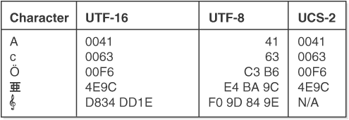

## 6  Supporting Multilingual Databases with Unicode

This chapter illustrates how to use the Unicode Standard in an Oracle Database environment. This chapter includes the following topics:

- What is the Unicode Standard?

- Features of the Unicode Standard

- Implementing a Unicode Solution in the Database

- Unicode Case Studies

- Designing Database Schemas to Support Multiple Languages

### 6.1 What is the Unicode Standard?

The Unicode Standard is a character encoding system that defines every character in most of the spoken languages in the world.

To overcome the limitations of existing character encodings, several organizations began working on the creation of a global character set in the late 1980s. The need for this became even greater with the development of the World Wide Web in the mid-1990s. The Internet has changed how companies do business, with an emphasis on the global market that has made a universal character set a major requirement.

A global character set needs to fulfill the following conditions:

- Contain all major living scripts

- Support legacy data and implementations

- Be simple enough that a single implementation of an application is sufficient for worldwide use

A global character set should also have the following capabilities:

- Support multilingual users and organizations

- Conform to international standards

- Enable worldwide interchange of data

The Unicode Standard, which is now in wide use, meets all of the requirements and capabilities of a global character set. It provides a unique code value for every character, regardless of the platform, program, or language. It also defines a number of character properties and processing rules that help implement complex multilingual text processing correctly and consistently. Bi-directional behavior, word breaking, and line breaking are examples of such complex processing.

The Unicode Standard has been adopted by many software and hardware vendors. Many operating systems and browsers now support the standard. The Unicode Standard is required by other standards such as XML, Java, JavaScript, LDAP, and WML. It is also synchronized with the ISO/IEC 10646 standard.

Oracle Database introduced the Unicode Standard character encoding as the now obsolete database character set AL24UTFFSS in Oracle Database 7. Since then, incremental improvements have been made in each release to synchronize the support with the new published version of the standard.

**Note:**

Oracle Database 19c supports Unicode version 9.0.

**See Also:**

[The Unicode Consortium](https://docs.oracle.com/pls/topic/lookup?ctx=en/database/oracle/oracle-database/19/nlspg&id=unicode_org) website for more information about the Unicode Standard

### 6.2 Features of the Unicode Standard

This section contains the following topics:

- Code Points and Supplementary Characters

- Unicode Encoding Forms

- Support for the Unicode Standard in Oracle Database

#### 6.2.1 Code Points and Supplementary Characters

The first version of the Unicode Standard was a 16-bit, fixed-width encoding that used two bytes to encode each character. This enabled 65,536 characters to be represented. However, more characters need to be supported, especially additional CJK ideographs that are important for the Chinese, Japanese, and Korean markets.

The current definition of the Unicode Standard assigns a number to each character defined in the standard. These numbers are called code points, and are in the range 0 to 10FFFF hexadecimal. The Unicode notation for representing character code points is the prefix "U+" followed by the hexadecimal code point value. The code point value is left-padded with non-significant zeros to the minimum length of four. Characters with code points U+0000 to U+FFFF are called Basic Multilingual Plane characters. Characters with code points U+10000 to U+10FFFF are called supplementary characters.

Adding supplementary characters has increased the complexity of the Unicode 16-bit, fixed-width encoding form; however, this is still far less complex than managing hundreds of legacy encodings used before Unicode.

#### 6.2.2 Unicode Encoding Forms

The Unicode Standard defines a few encoding forms, which are mappings from Unicode code points to code units. Code units are integer values processed by applications. Code units may have 8, 16, or 32 bits. The standard encoding forms are: UTF-8, UTF-16, and UTF-32. There are also two compatibility encodings mentioned in the standard and its associated technical reports: UCS-2 and CESU-8. Conversion between different Unicode encodings is a simple bit-wise operation that is defined in the standard.

This section contains the following topics:

- UTF-8 Encoding Form

- UTF-16 Encoding Form

- UCS-2 Encoding Form

- UTF-32 Encoding Form

- CESU-8 Encoding Form

- Examples: UTF-16, UTF-8, and UCS-2 Encoding

##### 6.2.2.1 UTF-8 Encoding Form

UTF-8 is the 8-bit encoding form of Unicode. It is a variable-width encoding and a strict superset of ASCII. This means that each and every character in the ASCII character set is available in UTF-8 with the same byte representation. One Unicode character can be represented by 1 byte, 2 bytes, 3 bytes, or 4 bytes in the UTF-8 encoding form. Characters from the European and Middle Eastern scripts are represented in either 1 or 2 bytes. Characters from most Asian scripts are represented in 3 bytes. Supplementary characters are represented in 4 bytes.

UTF-8 is the Unicode encoding used for HTML and most Internet browsers.

The benefits of UTF-8 are as follows:

- Compact storage requirement for European scripts because it is a strict superset of ASCII

- Ease of migration between ASCII-based character sets and UTF-8

**See Also:**

- "Code Points and Supplementary Characters"

- [Table B-2](appendix-B-unicode-character-code-assignments.md)

##### 6.2.2.2 UTF-16 Encoding Form

UTF-16 is the 16-bit encoding form of Unicode. One character can be represented by either one 16-bit integer value (two bytes) or two 16-bit integer values (four bytes) in UTF-16. All characters from the Basic Multilingual Plane, which are most characters used in everyday text, are represented in two bytes. Supplementary characters are represented in four bytes. The two code units (integer values) encoding a single supplementary character are called a surrogate pair.

UTF-16 is the main Unicode encoding used for internal processing by Java since version J2SE 5.0 and by Microsoft Windows since version 2000.

The benefits of UTF-16 over UTF-8 are as follows:

- More compact storage for Asian scripts because most of the commonly used Asian characters are represented in two bytes.

- Better compatibility with Java and Microsoft clients

**See Also:**

- "Code Points and Supplementary Characters"

- [Table B-1](appendix-B-unicode-character-code-assignments.md)

##### 6.2.2.3 UCS-2 Encoding Form

UCS-2 is not an official Unicode encoding form. The name originally comes from older versions of the ISO/IEC 10646 standard, before the introduction of the supplementary characters. Therefore, it is currently used to refer to the UTF-16 encoding form stripped from support for supplementary characters and surrogate pairs. That is, surrogate pairs are processed in UCS-2 as two separate characters. Applications supporting UCS-2 but not UTF-16 should not process text containing supplementary characters, as they may incorrectly split surrogate pairs when dividing text into fragments. They are also generally incapable of displaying such text.

UCS-2 is the Unicode encoding used for internal processing by Java before version J2SE 5.0 and by Microsoft Windows NT.

##### 6.2.2.4 UTF-32 Encoding Form

UTF-32 is the 32-bit encoding form of Unicode. Each Unicode code point is represented by a single 32-bit, fixed-width integer value. If is the simplest encoding form, but very space inefficient. For English text, it quadruples the storage requirements compared to UTF-8 and doubles when compared to UTF16. Therefore, UTF-32 is sometimes used as an intermediate form in internal text processing, but it is generally not used for information interchange.

In Java, since version J2SE 5.0, selected APIs have been enhanced to operate on characters in the 32-bit form, stored as `int` values.

##### 6.2.2.5 CESU-8 Encoding Form

CESU-8 is not part of the core Unicode Standard. It is described in the Unicode Technical Report \#26 published by The Unicode Consortium. CESU-8 is a compatibility encoding form identical to UTF-8 except for its representation of supplementary characters. In CESU-8, supplementary characters are represented as surrogate pairs, as in UTF-16. To obtain the CESU-8 encoding of a supplementary character, encode the character in UTF-16 first and then treat each of the surrogate code units as a code point with the same value. Then, apply the UTF-8 encoding rules (bit transformation) to each of the code points. This will yield two three-byte representations, six bytes in total.

CESU-8 has only two benefits:

- It has the same binary sorting order as UTF-16.

- It uses the same number of codes per character (one or two). This is important for character length semantics in string processing.

In general, the CESU-8 encoding form should be avoided as much as possible.

**See Also:**

Unicode Technical Report \#26 “Compatibility Encoding Scheme for UTF-16: 8-Bit (CESU-8)” published on [The Unicode Consortium](https://docs.oracle.com/pls/topic/lookup?ctx=en/database/oracle/oracle-database/19/nlspg&id=unicode_org_reports) website

##### 6.2.2.6 Examples: UTF-16, UTF-8, and UCS-2 Encoding

The following table shows some characters and their character codes in UTF-16, UTF-8, and UCS-2 encoding. The last character is a treble clef (a music symbol), a supplementary character.

[Description of the illustration nlspg031.eps](img_text/nlspg031.md)

#### 6.2.3 Support for the Unicode Standard in Oracle Database

Oracle Database began supporting the Unicode character set as a database character set in release 7. Table 6-1 summarizes the Unicode character sets supported by Oracle Database.

Table 6-1 Unicode Character Sets Supported by Oracle Database

| Character Set | Supported in RDBMS Release | Unicode Encoding Form | Unicode Version                                                                                                                                                                                                                                                                                                 | Database Character Set | National Character Set                             |
|:--------------|:---------------------------|:----------------------|:----------------------------------------------------------------------------------------------------------------------------------------------------------------------------------------------------------------------------------------------------------------------------------------------------------------|:-----------------------|:---------------------------------------------------|
| AL24UTFFSS    | 7.2 to 8i                  | UTF-8                 | 1.1                                                                                                                                                                                                                                                                                                             | Yes                    | No                                                 |
| UTF8          | 8.0 to 19c                 | CESU-8                | Oracle Database release 8.0 through Oracle8i Release 8.1.6: 2.1 Oracle8i Database release 8.1.7 and later: 3.0                                                                                                                                                                                               | Yes                    | Yes (Oracle9i Database and later versions only) |
| UTFE          | 8.0 to 19c                 | UTF-EBCDIC            | Oracle8i Database releases 8.0 through 8.1.6: 2.1 For Oracle8i Database release 8.1.7 and later: 3.0                                                                                                                                                                                                         | YesFoot 1   | No                                                 |
| AL32UTF8      | 9i to 19c                  | UTF-8                 | Oracle9i Database release 1: 3.0 Oracle9i Database release 2: 3.1 Oracle Database 10g, release 1: 3.2 Oracle Database 10g, release 2: 4.0 Oracle Database 11g: 5.0 Oracle Database 12c, release 1: 6.2 Oracle Database 12c, release 2: 7.0 Oracle Database 18c to Oracle Database 19c: 9.0 | Yes                    | No                                                 |
| AL16UTF16     | 9i to 19c                  | UTF-16                | Oracle9i Database release 1: 3.0 Oracle9i Database release 2: 3.1 Oracle Database 10g, release 1: 3.2 Oracle Database 10g, release 2: 4.0 Oracle Database 11g: 5.0 Oracle Database 12c, release 1: 6.2 Oracle Database 12c, release 2: 7.0 Oracle Database 18c to Oracle Database 19c: 9.0 | No                     | Yes                                                |

Footnote 1 UTF-EBCDIC is a compatibility encoding form specific to EBCDIC-based systems, such as IBM z/OS or Fujitsu BS2000. It is described in the Unicode Technical Report \#16. Oracle character set UTFE is a partial implementation of the UTF-EBCDIC encoding form, supported on ECBDIC-based platforms only. Oracle Database does not support five-byte sequences of the this encoding form, limiting the supported code point range to U+000 - U+3FFFF. The use of the UTFE character set is discouraged.

### 6.3 Implementing a Unicode Solution in the Database

Unicode characters can be stored in an Oracle database in two ways:

- You can create a database that enables you to store UTF-8 encoded characters as SQL `CHAR` data types (`CHAR`, `VARCHAR2`, `CLOB`, and `LONG)`.

- You can store Unicode data in either the UTF-16 or CESU-8 encoding form in SQL `NCHAR` data types (`NCHAR`, `NVARCHAR2`, and `NCLOB`). The SQL `NCHAR` data types are called Unicode data types because they are used only for storing Unicode data.

**Note:**

You can combine both Unicode solutions, if required by different applications running in a single database.

The following sections explain how to use the two Unicode solutions and how to choose between them:

- Enabling Multilingual Support for a Database

- Enabling Multilingual Support with Unicode Data Types

- How to Choose Between Unicode Solutions

#### 6.3.1 Enabling Multilingual Support for a Database

The database character set specifies the encoding to be used in the SQL `CHAR` data types as well as the metadata such as table names, column names, and SQL statements. A Unicode Standard-enabled database is a database with a Unicode Standard-compliant character set as the database character set. There are two database Oracle character sets that implement the Unicode Standard.

- AL32UTF8

  The AL32UTF8 character set implements the UTF-8 encoding form and supports the latest version of the Unicode standard. It encodes characters in one, two, three, or four bytes. Supplementary characters require four bytes. It is for ASCII-based platforms.

  AL32UTF8 is the recommended database character set for any new deployment of Oracle Database as it provides the optimal support for multilingual applications, such as Internet websites and applications for multinational companies.

- UTF8

  The UTF8 character set implements the CESU-8 encoding form and encodes characters in one, two, or three bytes. It is for ASCII-based platforms.

  Supplementary characters inserted into a UTF8 database are stored in the CESU-8 encoding form. Each character is represented by two three-byte codes and hence occupies six bytes of memory in total.

  The properties of characters in the UTF8 character set are not guaranteed to be updated beyond version 3.0 of the Unicode Standard.

  Oracle recommends that you switch to AL32UTF8 for full support of the supplementary characters and the most recent versions of the Unicode Standard.

**Note:**

- Specify a database character set when you create a database. Oracle recommends using AL32UTF8 as the database character set. AL32UTF8 is the proper implementation of the Unicode encoding UTF-8. Starting with Oracle Database 12c Release 2, AL32UTF8 is used as the default database character set while creating a database using Oracle Universal Installer (OUI) as well as Oracle Database Configuration Assistant (DBCA).

- Do not use UTF8 as the database character set as it is not a proper implementation of the Unicode encoding UTF-8. If the UTF8 character set is used where UTF-8 processing is expected, then data loss and security issues may occur. This is especially true for Web related data, such as XML and URL addresses.

- AL32UTF8 and UTF8 character sets are not compatible with each other as they have different maximum character widths. AL32UTF8 has a maximum character width of 4 bytes, whereas UTF8 has a maximum character width of 3 bytes.

- If the `CHARACTER SET` clause is not specified in the `CREATE DATABASE` statement explicitly, then the database character set defaults to US7ASCII (except on EBCDIC platforms).

Example 6-1 Creating a Database with a Unicode Character Set

To create a database with the AL32UTF8 character set, use the `CREATE` `DATABASE` statement and include the `CHARACTER SET AL32UTF8` clause. For example:

    CREATE DATABASE sample

    CONTROLFILE REUSE
    LOGFILE

    GROUP 1 ('diskx:log1.log', 'disky:log1.log') SIZE 50K,
    GROUP 2 ('diskx:log2.log', 'disky:log2.log') SIZE 50K

    MAXLOGFILES 5
    MAXLOGHISTORY 100
    MAXDATAFILES 10
    MAXINSTANCES 2
    ARCHIVELOG
    CHARACTER SET AL32UTF8
    NATIONAL CHARACTER SET AL16UTF16
    DATAFILE

    'disk1:df1.dbf' AUTOEXTEND ON,
    'disk2:df2.dbf' AUTOEXTEND ON NEXT 10M MAXSIZE UNLIMITED

    DEFAULT TEMPORARY TABLESPACE temp_ts
    UNDO TABLESPACE undo_ts
    SET TIME_ZONE = '+00:00';

#### 6.3.2 Enabling Multilingual Support with Unicode Data Types

An alternative to storing Unicode data in the database is to use the SQL `NCHAR` data types (`NCHAR`, `NVARCHAR2`, `NCLOB`). You can store Unicode characters in columns of these data types regardless of how the database character set has been defined. The `NCHAR` data type is exclusively a Unicode data type, which means that it stores data encoded in a Unicode encoding form.

Oracle recommends using SQL `CHAR`, `VARCHAR2`, and `CLOB` data types in AL32UTF8 database to store Unicode character data. SQL `NCHAR`, `NVARCHAR2`, and `NCLOB` data types are not supported by some database features. Most notably, Oracle Text and XML DB do not support these data types.

You can create a table using the `NVARCHAR2` and `NCHAR` data types. The column length specified for the `NCHAR` and `NVARCHAR2` columns always equals the number of characters instead of the number of bytes:

    CREATE TABLE product_information
        ( product_id          NUMBER(6)
        , product_name        NVARCHAR2(100)
        , product_description VARCHAR2(1000));

The encoding used in the SQL `NCHAR` data types is the national character set specified for the database. You can specify one of the following Oracle character sets as the national character set:

- AL16UTF16

  This is the default character set and recommended for SQL `NCHAR` data types. This character set encodes Unicode data in the UTF-16 encoding form. It supports supplementary characters, which are stored as four bytes.

- UTF8

  When UTF8 is specified for SQL `NCHAR` data types, the data stored in the SQL data types is in CESU-8 encoding form. The UTF8 character set is deprecated.

You can specify the national character set for the SQL `NCHAR` data types when you create a database using the `CREATE` `DATABASE` statement with the `NATIONAL CHARACTER SET` clause. The following statement creates a database with WE8ISO8859P1 as the database character set and AL16UTF16 as the national character set.

Example 6-2 Creating a Database with a National Character Set

    CREATE DATABASE sample

    CONTROLFILE REUSE
    LOGFILE

    GROUP 1 ('diskx:log1.log', 'disky:log1.log') SIZE 50K,
    GROUP 2 ('diskx:log2.log', 'disky:log2.log') SIZE 50K

    MAXLOGFILES 5
    MAXLOGHISTORY 100
    MAXDATAFILES 10
    MAXINSTANCES 2
    ARCHIVELOG
    CHARACTER SET WE8ISO8859P1
    NATIONAL CHARACTER SET AL16UTF16
    DATAFILE

    'disk1:df1.dbf' AUTOEXTEND ON,
    'disk2:df2.dbf' AUTOEXTEND ON NEXT 10M MAXSIZE UNLIMITED

    DEFAULT TEMPORARY TABLESPACE temp_ts
    UNDO TABLESPACE undo_ts
    SET TIME_ZONE = '+00:00';

#### 6.3.3 How to Choose Between Unicode Solutions

Oracle recommends that you deploy all new Oracle databases in the database character set AL32UTF8 and you use SQL `VARCHAR2`, `CHAR`, and `CLOB` data types to store character data. The SQL `NVARCHAR2`, `NCHAR`, and `NCLOB` data types should be considered only if:

- You have an existing database with a non-Unicode database character set and a legacy application, for which the business costs of migrating to Unicode would be inacceptable, and you need to add support for multilingual data in a small part of the application or in a small new module for which a separate database would not make much sense, or

- You need to create an application that has to support multilingual data and which must be installable in any of Oracle database deployed by your customers.

For the database character set in a Unicode Standard-enabled database, always select AL32UTF8. For the national character set, select AL16UTF16. If you consider choosing the deprecated UTF8 because of the lower storage requirements for English character data, first consider other options, such as data compression or increasing disk storage. Later migration to AL16UTF16 may be expensive, if a lot of data accumulates in the database.

**Note:**

- Oracle recommends using AL32UTF8 as the database character set. AL32UTF8 is the proper implementation of the Unicode encoding UTF-8. Starting with Oracle Database 12c Release 2, AL32UTF8 is used as the default database character set while creating a database using Oracle Universal Installer (OUI) as well as Oracle Database Configuration Assistant (DBCA).

- Do not use UTF8 as the database character set as it is not a proper implementation of the Unicode encoding UTF-8. If the UTF8 character set is used where UTF-8 processing is expected, then data loss and security issues may occur. This is especially true for Web related data, such as XML and URL addresses.

- AL32UTF8 and UTF8 character sets are not compatible with each other as they have different maximum character widths. AL32UTF8 has a maximum character width of 4 bytes, whereas UTF8 has a maximum character width of 3 bytes.

### 6.4 Unicode Case Studies

This section describes typical scenarios for storing Unicode characters in an Oracle database:

- Scenario 1: Unicode Solution with a Unicode Standard-Enabled Database

- Scenario 2: Unicode Solution with Unicode Data Types

#### Scenario 1: Unicode Solution with a Unicode Standard-Enabled Database

An American company running a Java application would like to add German and French support in the next release of the application. They would like to add Japanese support at a later time. The company currently has the following system configuration:

- The existing database has a database character set of US7ASCII.

- All character data in the existing database is composed of ASCII characters.

- PL/SQL stored procedures are used in the database.

- The database is about 300 GB, with very little data stored in `CLOB` columns.

- There is a nightly downtime of 4 hours.

In this case, a typical solution is to choose AL32UTF8 for the database character set because of the following reasons:

- The database is very large and the scheduled downtime is short. Fast migration of the database to a Unicode character set is vital. Because the database is in US7ASCII, the easiest and fastest way of enabling the database to support the Unicode Standard is to switch the database character set to AL32UTF8 by using the Database Migration Assistant for Unicode (DMU). No data conversion is required for columns other than `CLOB` because US7ASCII is a subset of AL32UTF8.

- Because most of the code is written in Java and PL/SQL, changing the database character set to AL32UTF8 is unlikely to break existing code. Unicode support is automatically enabled in the application.

#### Scenario 2: Unicode Solution with Unicode Data Types

A European company that runs its legacy applications mainly on Windows platforms wants to add a new small Windows application written in Visual C/C++. The new application will use the existing database to support Japanese and Chinese customer names. The company currently has the following system configuration:

- The existing database has a database character set of WE8MSWIN1252.

- All character data in the existing database is composed of Western European characters.

- The database is around 500 GB with a lot of `CLOB` columns.

- Support for full-text search and XML storage is not required in the new application

A typical solution is to take the following actions:

- Use `NCHAR` and `NVARCHAR2` data types to store Unicode characters

- Keep WE8MSWIN1252 as the database character set

- Use AL16UTF16 as the national character set

The reasons for this solution are:

- Migrating the existing database to a Unicode database requires data conversion because the database character set is WE8MSWIN1252 (a Windows Latin-1 character set), which is not a subset of AL32UTF8. Also, a lot of data is stored in `CLOB` columns. All `CLOB` values in a database, even if they contain only ASCII characters, must be converted when migrating from a single-byte database character set, such as US7ASCII or WE8MSWIN1252 to AL32UTF8. As a result, there will be a lot of overhead in converting the data to AL32UTF8.

- The additional languages are supported in the new application only. It does not depend on the existing applications or schemas. It is simpler to use the Unicode data type in the new schema and keep the existing schemas unchanged.

- Only customer name columns require Unicode character set support. Using a single `NCHAR` column meets the customer's requirements without migrating the entire database.

- The new application does not need database features that do not support SQL `NCHAR` data types.

- The lengths of the SQL `NCHAR` data types are defined as number of characters. This is the same as how they are treated when using `wchar_t` strings in Windows C/C++ programs. This reduces programming complexity.

- Existing applications using the existing schemas are unaffected.

### 6.5 Designing Database Schemas to Support Multiple Languages

In addition to choosing a Unicode solution, the following issues should be taken into consideration when the database schema is designed to support multiple languages:

- Specifying Column Lengths for Multilingual Data

- Storing Data in Multiple Languages

- Storing Documents in Multiple Languages in LOB Data Types

- Creating Indexes for Searching Multilingual Document Contents

#### 6.5.1 Specifying Column Lengths for Multilingual Data

When you use `NCHAR` and `NVARCHAR2` data types for storing multilingual data, the column size specified for a column is defined in number of characters. (This number of characters means the number of encoded Unicode code points, except that supplementary Unicode characters represented through surrogate pairs count as two characters.)

The following table shows the maximum size of the `NCHAR` and `NVARCHAR2` data types for the AL16UTF16 and UTF8 national character sets.

Table 6-2 Maximum Data Type Size for the AL16UTF16 and UTF8 National Character Sets

| National Character Set | Maximum Column Size of NCHAR Data Type | Maximum Column Size of NVARCHAR2 Data Type (When MAX_STRING_SIZE = STANDARD) | Maximum Column Size of NVARCHAR2 Data Type (When MAX_STRING_SIZE = EXTENDED) |
|:-----------------------|:---------------------------------------|:-----------------------------------------------------------------------------|:-----------------------------------------------------------------------------|
| AL16UTF16              | 1000 characters                        | 2000 characters                                                              | 16383 characters                                                             |
| UTF8                   | 2000 characters                        | 4000 characters                                                              | 32767 characters                                                             |

This maximum size in characters is a constraint, not guaranteed capacity of the data type. The maximum capacity is expressed in bytes.

For the `NCHAR` data type, the maximum capacity is 2000 bytes. For `NVARCHAR2`, it is 4000 bytes, if the initialization parameter `MAX_STRING_SIZE` is set to `STANDARD`, and 32767 bytes, if the initialization parameter `MAX_STRING_SIZE` is set to `EXTENDED`

When the national character set is AL16UTF16, the maximum number of characters never occupies more bytes than the maximum capacity, as each character (in an Oracle sense) occupies exactly 2 bytes. However, if the national character set is UTF8, the maximum number of characters can be stored only if all these characters are from the Unicode Basic Latin range, which corresponds to the ASCII standard.

Other Unicode characters occupy more than one byte each in UTF8 and presence of such characters in a 4000 character string makes the string longer than the maximum 4000 bytes. If you want national character set columns to be able to hold the declared number of characters in any national character set, do not declare `NCHAR` columns longer than 2000/3=666 characters and `NVARCHAR2` columns longer than 4000/3=1333 or 32767/3=10922 characters, depending on the `MAX_STRING_SIZE` initialization parameter.

When you use `CHAR` and `VARCHAR2` data types for storing multilingual data, the maximum length specified for each column is, by default, in number of bytes. If the database needs to support Thai, Arabic, or multibyte languages such as Chinese and Japanese, then the maximum lengths of the `CHAR`, `VARCHAR`, and `VARCHAR2` columns may need to be extended. This is because the number of bytes required to encode these languages in UTF8 or AL32UTF8 may be significantly larger than the number of bytes for encoding English and Western European languages. For example, one Thai character in the Thai character set requires 3 bytes in UTF8 or AL32UTF8. Application designers should consider using an extended character data type or `CLOB` data type if they need to store data larger than 4000 bytes.

**See Also:**

- [Oracle Database SQL Language Reference](../sqlrf/Data-Types.md)

- [Oracle Database Reference](../refrn/MAX_STRING_SIZE.md) for more information about extending character data types by setting `MAX_STRING_SIZE` to the value of `EXTENDED`

#### 6.5.2 Storing Data in Multiple Languages

The Unicode character set includes characters of most written languages around the world, but it does not contain information about the language to which a given character belongs. In other words, a character such as `ä` does not contain information about whether it is a Swedish or German character. In order to provide information in the language a user desires, data stored in a Unicode database should be tagged with the language information to which the data belongs.

There are many ways for a database schema to relate data to a language. The following sections discuss example steps to achieve this goal.

##### Store Language Information with the Data

For data such as product descriptions or product names, you can add a language column (`language_id`) of `CHAR` or `VARCHAR2` data type to the product table to identify the language of the corresponding product information. This enables applications to retrieve the information in the desired language. The possible values for this language column are the 3-letter abbreviations of the valid `NLS_LANGUAGE` values of the database.

**See Also:**

"[Locale Data](appendix-A-locale-data.md)" for a list of `NLS_LANGUAGE` values and their abbreviations

You can also create a view to select the data of the current language. For example:

    ALTER TABLE scott.product_information ADD (language_id VARCHAR2(50)):

    CREATE OR REPLACE VIEW product AS
       SELECT product_id, product_name
       FROM   product_information
       WHERE  language_id = SYS_CONTEXT('USERENV','LANG');

##### Select Translated Data Using Fine-Grained Access Control

Fine-grained access control enables you to limit the degree to which a user can view information in a table or view. Typically, this is done by appending a `WHERE` clause. When you add a `WHERE` clause as a fine-grained access policy to a table or view, Oracle automatically appends the `WHERE` clause to any SQL statements on the table at run time so that only those rows satisfying the `WHERE` clause can be accessed.

You can use this feature to avoid specifying the desired language of a user in the `WHERE` clause in every `SELECT` statement in your applications. The following `WHERE` clause limits the view of a table to the rows corresponding to the desired language of a user:

    WHERE language_id = SYS_CONTEXT('userenv', 'LANG')

Specify this `WHERE` clause as a fine-grained access policy for `product_information` as follows:

    CREATE FUNCTION func1 (sch VARCHAR2 , obj VARCHAR2 )
    RETURN VARCHAR2(100);
    BEGIN
    RETURN 'language_id = SYS_CONTEXT(''userenv'', ''LANG'')';
    END
    /

    DBMS_RLS.ADD_POLICY ('scott', 'product_information', 'lang_policy', 'scott', 'func1', 'select');

Then any `SELECT` statement on the `product_information` table automatically appends the `WHERE` clause.

**See Also:**

[Oracle Database Development Guide ](../adfns/security.md)for more information about fine-grained access control

#### 6.5.3 Storing Documents in Multiple Languages in LOB Data Types

You can store documents in multiple languages in `CLOB`, `NCLOB`, or `BLOB` data types and set up Oracle Text to enable content search for the documents.

Data in `CLOB` columns is stored in the AL16UTF16 character set when the database character set is multibyte, such as UTF8 or AL32UTF8. This means that the storage space required for an English document doubles when the data is converted. Storage for an Asian language document in a `CLOB` column requires less storage space than the same document in a `LONG` column using AL32UTF8, typically around 30% less, depending on the contents of the document.

Documents in `NCLOB` format are also stored in the AL16UTF16 character set regardless of the database character set or national character set. The storage space requirement is the same as for `CLOB` data. Document contents are converted to UTF-16 when they are inserted into a `NCLOB` column. If you want to store multilingual documents in a non-Unicode database, then choose `NCLOB`. However, content search on `NCLOB` with Oracle Text is not supported.

Documents in `BLOB` format are stored as they are. No data conversion occurs during insertion and retrieval. However, SQL string manipulation functions (such as `LENGTH` or `SUBSTR`) and collation functions (such as `NLS_SORT` and `ORDER BY`) cannot be applied to the `BLOB` data type.

The following table lists the advantages and disadvantages of the `CLOB`, `NCLOB`, and `BLOB` data types when storing documents:

Table 6-3 Comparison of LOB Data Types for Document Storage

| Data Types | Advantages                                                                                                                                                                                | Disadvantages                                                                                                          |
|:-----------|:------------------------------------------------------------------------------------------------------------------------------------------------------------------------------------------|:-----------------------------------------------------------------------------------------------------------------------|
| `CLOB`     | • Content search support with Oracle Text • String manipulation support                                                                                                                | • Depends on database character set • Data conversion is necessary for insertion • Cannot store binary documents |
| `NCLOB`    | • Independent of database character set • String manipulation support                                                                                                                  | • No content search support • Data conversion is necessary for insertion • Cannot store binary documents         |
| `BLOB`     | • Independent of database character set • Content search support • No data conversion, data stored as is • Can store binary documents, such as Microsoft Word or Microsoft Excel | • No string manipulation support                                                                                       |

#### 6.5.4 Creating Indexes for Searching Multilingual Document Contents

Oracle Text enables you to build indexes for content search on multilingual documents stored in `CLOB` format and `BLOB` format. It uses a language-specific lexer to parse the `CLOB` or `BLOB` data and produces a list of searchable keywords.

Create a multilexer to search multilingual documents. The multilexer chooses a language-specific lexer for each row, based on a language column. This section describes the high level steps to create indexes for documents in multiple languages. It contains the following topics:

- Creating Multilexers

- Creating Indexes for Documents Stored in the CLOB Data Type

- Creating Indexes for Documents Stored in the BLOB Data Type

**See Also:**

[Oracle Text Reference](../ccref/oracle-text-indexing-elements.md)

##### 6.5.4.1 Creating Multilexers

The first step in creating the multilexer is the creation of language-specific lexer preferences for each language supported. The following example creates English, German, and Japanese lexers with PL/SQL procedures:

    ctx_ddl.create_preference('english_lexer', 'basic_lexer');
    ctx_ddl.set_attribute('english_lexer','index_themes','yes');
    ctx_ddl.create_preference('german_lexer', 'basic_lexer');
    ctx_ddl.set_attribute('german_lexer','composite','german');
    ctx_ddl.set_attribute('german_lexer','alternate_spelling','german');
    ctx_ddl.set_attribute('german_lexer','mixed_case','yes');
    ctx_ddl.create_preference('japanese_lexer', 'JAPANESE_VGRAM_LEXER');

After the language-specific lexer preferences are created, they need to be gathered together under a single multilexer preference. First, create the multilexer preference, using the `MULTI_LEXER` object:

    ctx_ddl.create_preference('global_lexer','multi_lexer');

Now add the language-specific lexers to the multilexer preference using the `add_sub_lexer` call:

    ctx_ddl.add_sub_lexer('global_lexer', 'german', 'german_lexer');
    ctx_ddl.add_sub_lexer('global_lexer', 'japanese', 'japanese_lexer');
    ctx_ddl.add_sub_lexer('global_lexer', 'default','english_lexer');

This nominates the `german_lexer` preference to handle German documents, the `japanese_lexer` preference to handle Japanese documents, and the `english_lexer` preference to handle everything else, using `DEFAULT` as the language.

##### 6.5.4.2 Creating Indexes for Documents Stored in the CLOB Data Type

The multilexer decides which lexer to use for each row based on a language column in the table. This is a character column that stores the language of the document in a text column. Use the Oracle language name to identify the language of a document in this column. For example, if you use the `CLOB` data type to store your documents, then add the language column to the table where the documents are stored:

    CREATE TABLE globaldoc
      (doc_id    NUMBER       PRIMARY KEY,
      language  VARCHAR2(30),
      text      CLOB);

To create an index for this table, use the multilexer preference and specify the name of the language column:

    CREATE INDEX globalx ON globaldoc(text)
      indextype IS ctxsys.context
      parameters ('lexer
                   global_lexer
                   language
                   column
                   language');

##### 6.5.4.3 Creating Indexes for Documents Stored in the BLOB Data Type

In addition to the language column, the character set and format columns must be added in the table where the documents are stored. The character set column stores the character set of the documents using the Oracle character set names. The format column specifies whether a document is a text or binary document. For example, the `CREATE TABLE` statement can specify columns called `characterset` and `format`:

    CREATE TABLE globaldoc (
       doc_id       NUMBER       PRIMARY KEY,
       language     VARCHAR2(30),
       characterset VARCHAR2(30),
       format       VARCHAR2(10),
       text         BLOB
      );

You can put word-processing or spreadsheet documents into the table and specify `binary` in the `format` column. For documents in HTML, XML and text format, you can put them into the table and specify `text` in the `format` column.

Because there is a column in which to specify the character set, you can store text documents in different character sets.

When you create the index, specify the names of the format and character set columns:

    CREATE INDEX globalx ON globaldoc(text)
      indextype is ctxsys.context
      parameters ('filter inso_filter
                    lexer global_lexer
                    language column language
                    format  column format
                    charset column characterset');

You can use the `charset_filter` if all documents are in text format. The `charset_filter` converts data from the character set specified in the `charset` column to the database character set.
