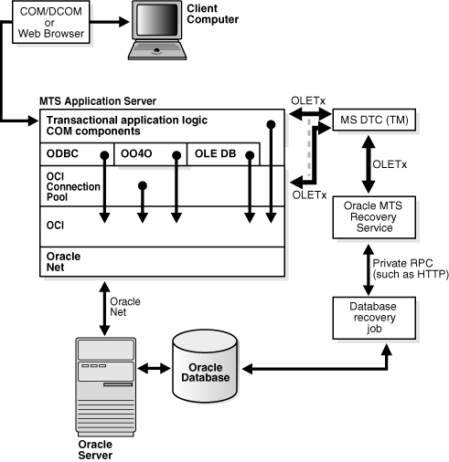

These topics describe how to program with [Microsoft Transaction Server](glossary.md) and an Oracle Database.

- COM Component Integration in a Transaction

- Microsoft Transaction Server Application Development

- OCI Integration with Microsoft Transaction Server

- ODBC Integration with Microsoft Transaction Server Overview

OraMTS also provides integration with Oracle Provider for OLE DB, and Oracle Data Provider for .NET.

**See Also:**

- [Oracle Provider for OLE DB Developer's Guide for Microsoft Windows](../oledb/features-of-oledb.md) for information on using Oracle Provider for OLE DB with MTS

- [Oracle Data Provider for .NET Developer's Guide for Microsoft Windows](../odpnt/InstallDistributedTransaction.md) for information on using Oracle Data Provider for .NET with MTS

### COM Component Integration in a Transaction

The focal point of the transaction process is a component of Microsoft Transaction Server called [Microsoft Distributed Transaction Coordinator (MS DTC)](glossary.md). When a client computer starts a business method on a transactional component, Microsoft Transaction Server begins a transaction coordinated by the MS DTC. The Oracle connection pooling layer enables the database to act as a [resource manager (RM)](glossary.md) in the MS DTC-coordinated transaction. Figure 4-1 illustrates this transactional model.

Figure 4-1 Component Integration in a Transaction

[Description of "Figure 4-1 Component Integration in a Transaction"](img_text/ntmts011.md)

#### Client Computer

The client computer activates the application components on the MTS Application Server through a Web browser or through the [component object model (COM)](glossary.md) /[distributed component object model (DCOM)](glossary.md).

#### MTS Application Server

The MTS application server consists of the services that the Windows operating service provides to host transactional application components that a client computer can activate, either indirectly through a Web browser or directly through the [component object model (COM)](glossary.md) /[distributed component object model (DCOM)](glossary.md). In response to client requests, the application server invokes the COM components. The invocations are performed within the scope of transactions where required

#### Transactional Application Logic COM Components

Three primary responsibilities:

- Embed the business logic. If a component is transactional, Microsoft Transaction Server starts a transaction for every method invocation on that component.

- Acquire pooled connections to a Oracle Database through the Oracle resource dispenser and [Oracle Call Interface (OCI)](glossary.md), [Oracle Open Database Connectivity (ODBC) Driver](glossary.md), or [Oracle Provider for OLE DB](glossary.md).

- Decide the outcome of the operation by notifying Microsoft Transaction Server of its decision to commit or terminate the changes to all RMs.

#### Oracle ODBC Driver, Oracle Provider for OLE DB, and OCI

Two primary responsibilities:

- Obtain a service context to the Oracle Database through the OCI connection pooling component.

- Provide connection pooling resources, if necessary (through Oracle Provider for OLE DB or Oracle ODBC Driver). The Oracle ODBC Driver provides pooled ODBC connections. Oracle Provider for OLE DB provides pooled data source objects.

#### OCI Connection Pool

Three primary responsibilities:

- Enlists the RM (Oracle Database) in the component's Microsoft Transaction Server transaction.

- Starts an Oracle global transaction corresponding to the Microsoft Transaction Server transaction of which the component is a part.

- Acts as a resource dispenser to perform client-side connection pooling.

#### Oracle Net

Provides connectivity in distributed, heterogeneous computing environments.

#### Oracle MTS Recovery Service

Recovers in-doubt Oracle transactions that originated from the host computer and are related to the Microsoft Transaction Server.

#### Database Recovery Job

Detects in-doubt DTC transactions. This job extracts the recovery service's endpoint address in the in-doubt transaction's XID and then requests the outcome of the Microsoft DTC transaction from the recovery service. Ultimately, the job will commit or terminate the in-doubt transaction when it receives the transaction's outcome.

#### Microsoft DTC

Microsoft Distributed Transaction Coordinator is part of Microsoft Transaction Server and has two primary responsibilities:

- Commits and terminates transactions using the two-phase commit protocol.

- Monitors transactions that require recovery. Multiple MS DTCs can be involved in a single transaction. When a transactional Microsoft Transaction Server component on computer A invokes another transactional Microsoft Transaction Server component on computer B, a connection is opened between the MS DTC on computer A and the MS DTC on computer B. When the root MS DTC commits or terminates a transaction, it sends the request through all involved MS DTCs. The transaction request is then passed to the OCI connection pooling/Microsoft Transaction Server integration, which sends it to the database.

#### Oracle Database

Acts as an RM for Microsoft Transaction Server. This is the database on which the client transaction request is performed.

### Microsoft Transaction Server Application Development

OCI connection pooling is used to coordinate a transaction in nearly all application programming interfaces. This topic describes how transactions are registered and how OCI connection pooling coordinates them.

#### Microsoft Transaction Server Component Registration

Application components that run in the Microsoft Transaction Server environment are created as dynamic link libraries (DLLs). Application components are registered with Microsoft Transaction Server using the Microsoft Transaction Server Explorer graphical user interface (GUI) tool.

##### Types of Registration Components

When you register the application component, you mark it as one of the following types:

- Requires a Transaction The component must run in a transaction. If the transaction does not currently exist, Microsoft Transaction Server automatically creates a new transaction for each method invocation on the component.

- Supports a Transaction The component can run within the client's transaction. When a new component is created, its context inherits the transaction from the context of the invoking client. If the client does not have a transaction, the new context is also created without one.

- Requires a New Transaction The component must run within its own transaction. Microsoft Transaction Server automatically creates a new transaction for each method invocation on the component.

- Does Not Support Transactions The component does not run within a transaction. Each method invocation on the component is performed without a surrounding transaction, regardless of whether the invoking client includes a transaction.

##### Registration of Components

How you register an application component determines if it runs in a Microsoft Transaction Server-coordinated transaction.

- If the application component runs in a Microsoft Transaction Server-coordinated transaction, the OCI connection pooling is always used and Microsoft Transaction Server and its MS DTC component coordinate the creation, startup, management, and commitment phases of the transaction. Microsoft Transaction Server ensures that all changes made by the component are committed if the transaction succeeds, or are terminated if the transaction fails.

- If the application component does not run in a Microsoft Transaction Server-coordinated transaction, the component runs in a Microsoft Transaction Server environment, but the databases that it accesses may or may not take part in MS DTC-coordinated transactions. If the transaction is not MS DTC-coordinated, the client application must create, start, manage, and commit the transaction. OCI connection pooling may be used, depending upon the interface accessing the database (such as Oracle Provider for OLE DB, Oracle ODBC Driver, or others).

#### Microsoft Transaction Server-Coordinated Component Transaction

This topic describes how OCI connection pooling, Microsoft Transaction Server, and MS DTC operate with application components in a Microsoft Transaction Server-coordinated transaction environment.

1.  The client API (one of Oracle ODBC Driver, OCI, ODP.NET or Oracle Provider for OLE DB) calls OCI function `OraMTSSvcGet()` to obtain a service context from the OCI connection pooling component.

2.  The OCI connection pooling component enlists the transaction that will be coordinated by the MS DTC component of Microsoft Transaction Server.

    The OCI service and environment handles are returned to client applications.

3.  The client application:

    - Performs the database operations.

    - Calls OCI function `OraMTSSvcRel()` to release the OCI pooling connection obtained at the beginning of the transaction.

    - Calls `SetComplete` (to commit database operations) or `SetAbort` (to terminate database operations) on the Microsoft Transaction Server context object associated with the component.

4.  MS DTC performs the two-phase commit protocol to prepare and commit or to terminate the transaction. This notifies the OCI connection pooling component and ends the transaction.

5.  OCI connection pooling is notified and performs the necessary steps to complete phase one, the prepare phase, and phase two, the commit or terminate phase.

#### Microsoft DTC-Coordinated Component Transaction

This topic describes how OCI connection pooling, Microsoft Transaction Server, and MS DTC operate with application components not running in a Microsoft Transaction Server-coordinated transaction, but using MS DTC.

1.  The client application starts an MS DTC transaction and connects to the Oracle Database. The connection protocol follows one of the following scenarios:

    - Nonpooled OCI connections are obtained through OCI logon calls such as `OCIServerAttach()` and `OCISessionBegin()`. For these connections, the application calls `OraMTSEnlCtxGet()` to associate the OCI service context with a Microsoft Transaction Server enlistment context.

    - A connection pool is obtained by calling `OraMTSSvcGet(..,..,ORAMTS_CFLG_NOIMPLICIT)`.

2.  The client handles the context in one of the following scenarios:

    - For nonpooled connections, the client application passes in the enlistment context to `OraMTSJoinTxn()`.

    - For pooled connections, the client application passes the OCI service context into `OraMTSSvcEnlist()`.

3.  The OCI connection pooling component enlists the connection, either pooled or nonpooled, in the transaction coordinated by the MS DTC component of Microsoft Transaction Server.

4.  The client application then:

    - Performs database operations.

    - Calls `OraMTSSvcEnlist()` with a `NULL` transaction reference to de-enlist from an MS DTC coordinated transaction.

      For nonpooled connections, `OraMTSTxnJoin()` is invoked with a `NULL` transaction reference to perform the de-enlistment.

    - Calls `OraMTSSvcRel()` to release a pooled connection back to the pool.

      For nonpooled connections, the client calls `OraMTSEnlCtxRel()` to release the enlistment context and then logs off the database.

    - Calls the commit or terminate method on the MS DTC transaction object, such as `pTransaction->Commit()` or `pTransaction->Abort()`.

5.  MS DTC performs the two-phase commit protocol to commit the transaction.

6.  OCI connection pooling is notified and performs the necessary steps to complete phase one, the prepare phase, and phase two, the commit or terminate phase.

### OCI Integration with Microsoft Transaction Server

Example 4-1 illustrates how you can integrate the MTS sever with OCI. The only change in code you must make involves obtaining and releasing the OCI service context handle. Both OCI service context handle and environment handle are acquired when you obtain a pooled OCI connection to the database by calling `OraMTSSvcGet()`. Include the `oramts.h` header and link with the `oramts.lib` library. When you are finished, call OCI function `OraMTSSvcRel()` to release the service context handle and environment handle. Using `OraMTSSvcGet()` enables you to receive connection pooling and implicit transaction support if you registered the application component to run in a Microsoft Transaction Server transaction.

Ensure that for each process, you call `OCIInitialize` at least once before executing any other OCI calls. This initializes the OCI process environment. In addition, you must pass it the `OCI_THREADED` flag. If you are using Microsoft Internet Information Server (IIS) and the components are being called as in-process libraries, then `OCIInitialize` is already called for you. The registry key `ORAMTS_OCI_OBJ_MODE` has been added. Set the value to 1 to initialize OCI in Object mode; otherwise OCI will initialize in the threaded mode.

Example 4-1 Integration of MTS and OCI

    #include <oci.h>
    #include  <oramts.h>
    #include  <xolehlp.h>
    // other MTS relevant includes ...

    // prototype for the error handler.
    BOOL Chekerr(sword swOCIStat, OCIError *OCIErrh);

    // MTS component method
    HRESULT OCITestMethod()
    {
     IObjectContext *pObjectContext = NULL;
     OCIEnv    *myenvh = NULL;
     OCISvcCtx *mysvch = NULL;
     OCIError  *myerrh = NULL;
     OCIStnt   *mystmh = NULL;
     DWORD      dwStat;
     HRESULT    hRes = S_OK;
     sword      swOCIStat;
     BOOL       bCommit = FALSE;
     char      *lpzStmt = "UPDATE EMP SET SAL = SAL + 1000";

     // Initialize the OCI environment first -- request OCI_THREADED
     OCIInitialize(OCI_THREADED, (dvoid*)NULL,NULL,NULL,NULL);
     // attempt to get a connection to the database through the resource dispenser
     OraMTSSvcGet(
    "hr","hr_password","finprod_db",&mysvch, &myenvh, ORAMTS_CFLG_ALLDEFAULT);
     // validate return status
     if(dwStat != ORAMTS_ERR_NOERROR)
     {
       printf("error: failed to obtain a connection to the database - %ld",
    dwStat);
       goto cleanup;
     }
     // successful logon and enlistment in the MTS transaction. allocate statement
     // handles and other handles using the OCI environment handle myenvh ....
     swOCIStat = OCIHandleAlloc(myenvh, (void *)&myerrh,OCI_HTYPE_ERROR, 0 , NULL);
     if (Checkerr(swOCIStat, myerrh)) goto cleanup;
     swOCIStat = OCIHandleAlloc(myenvh, (dvoid *)&mystmh,OCI_HTYPE_STMT, 0,NULL);
     if (Checkerr(swOCIStat, myerrh)) goto cleanup;
     // prepare a DML statement
     OCIStmtPrepare(mystmh, myerrh, lpzStmt, lstrlen(lpzStmt), OCI_NTV_SYNTAX,
    OCI_DEFAULT)
     Checkerr(swOCIStat, myerrh);
     // execute the statement -- ensure that AUTOCOMMIT is not requested.
     OCIStmtExecute(mysvch, mystmh, myerrh, 1, 0, NULL, NULL, OCI_DEFAULT);
     if (Checkerr(swOCIStat, myerrh)) goto cleanup;
     // all's well so far choose to go for a commit
     bCommit = TRUE;
    cleanup:
     if (mystmh) OCIHandleFree((void*)mystmh, OCI_HTYPE_STMT);
     if (myerrh  OCIHandleFree((void*)myerrh, OCI_HTYPE_ERROR);
     if (mysvch) OraMTSSvcRel(mysvch);
     if (bCommit)
         pObjectContext->SetComplete();
     else
         pObjectContext->Abort();
     return(bCommit ? S_OK : E_FAIL);
    }

#### Integrating COM Components

There are several scenarios for integrating COM components. COM applications that are not hosted by the Microsoft Transaction Server environment, also known as standalone applications, cannot use declarative transactions through the Microsoft Transaction Server Explorer Microsoft Management Console, but they can use the last three of the scenario described.

##### COM Components Running in an MTS-Coordinated Transaction

COM components that are running in an MTS-coordinated transactions use OCI connection pooling to implicitly enlist the database in a transaction. The following pseudo-code listing illustrates the use of OCI functions:

    OCIInitialize(OCI_THREADED, ...)
    OraMTSSvcGet(..., &OCISvc, ..., ORAMTS_CFLAG_ALLDEFAULT)
    ...
    OraMTSSvcRel(OCISvc)

##### Non-Transactional COM Components Running with OCI Connection Pooling

COM components that are marked as non-transactional and running in an MTS-coordinated transaction use OCI connection pooling do not enlist the database in a transaction. The following pseudo-code listing illustrates the use of OCI functions:

    OCIInitialize(OCI_THREADED, ...)
    OraMTSSvcGet(..., &OCISvc, ..., ORAMTS_CFLAG_NOIMPLICIT)
    ...
    OraMTSSvcRel(OCISvc)

##### COM Components Using MS DTC and OCI Connection Pooling

COM components that are not running in an MTS-coordinated transaction use MS DTC with OCI connection pooling to explicitly enlist the database in a transaction. The following pseudo-code listing illustrates the use of OCI functions:

    OCIInitialize(OCI_THREADED, ...)
    DTCGetTransactionManager(...)
    BeginTransaction(..., &transaction)
    OraMTSSvcGet(..., &OCISvc, ..., ORAMTS_CFLAG_NOIMPLICIT)
    OraMTSSvcEnlist(OCISvc, ..., transaction, ...)
    ...
    OraMTSvcEnlist(OCISvc, ..., NULL, ...)
    OraMTSSvcRel(OCISvc)

##### COM Components Using MS DTC and Nonpooling OCI Connection

COM components that are not running in an MTS-coordinated transaction use MS DTC with a non-pooling OCI connection to explicitly enlist the database in a transaction. The following pseudo-code listing illustrates the use of OCI functions:

    OCIInitialize(OCI_THREADED, ...)
    OCI to get connected
    OraMTSEnlCtxGET
    DTCGetTransactionManager(...)
    BeginTransaction(..., &transaction)
    OraMTSJoinTxn (OCISvc, ..., transaction, ...)
    ...
    OraMTSJoinTxn
    ...
    OraMTSEnlCtxRel()
    OCI to logoff

#### Using OCI Functions

This topic details the OCI functions discussed earlier in this topic. Table 4-1 summarizes these functions.

Table 4-1 Summary of OCI Functions for Integrating MTS and Oracle Database

| OCI Function        | Summary                                                                             |
|:--------------------|:------------------------------------------------------------------------------------|
| OraMTSSvcGet()      | Obtains a pooled connection from the OCI connection pool.                           |
| OraMTSSvcRel()      | Releases a pooled OCI connection, OCI service context, back to the connection pool. |
| OraMTSSvcEnlist()   | Enlists or de-enlists an OCI connection in a transaction coordinated by MS DTC.     |
| OraMTSSvcEnlistEx() | Enlists an OCI connection or service context in an MS DTC transaction.              |
| OraMTSEnlCtxGet()   | Creates an enlistment context for a nonpooled OCI connection.                       |
| OraMTSEnlCtxRel()   | Eliminates a previously set up enlistment context for a nonpooled OCI connection.   |
| OraMTSJoinTxn()     | Enlists a nonpooled OCI connection in an MS DTC transaction.                        |
| OraMTSTransTest()   | Tests if you are running inside a Microsoft Transaction Server-started transaction. |
| OraMTSOCIErrGet()   | Retrieves the OCI error code and message text.                                      |

#### OraMTSSvcGet()

Obtains a pooled connection, also known as an OCI service context, from the OCI connection pool. The pooled connection includes an OCI service context handle and an OCI environment handle.

##### Syntax

    DWORD  OraMTSSvcGet(

                     text*       lpUname,
                     text*       lpPsswd,
                     text*       lpDbnam,
                     OCISvcCtx** pOCISvc,
                     OCIEnv**    pOCIEnv,
                     ub4         dwConFlgs);

##### Parameters

Table 4-2 OraMTSSvcGet() Parameters

| Parameter   | IN/OUT | Description                                                                                                                                                                                                                                                                                                                                                                                                                                                                                                                                                                                                                                                                                                                                                                                                                                                                                                                                                                                                                                                                                                                                                                                                                                                                                                                |
|:------------|:-------|:---------------------------------------------------------------------------------------------------------------------------------------------------------------------------------------------------------------------------------------------------------------------------------------------------------------------------------------------------------------------------------------------------------------------------------------------------------------------------------------------------------------------------------------------------------------------------------------------------------------------------------------------------------------------------------------------------------------------------------------------------------------------------------------------------------------------------------------------------------------------------------------------------------------------------------------------------------------------------------------------------------------------------------------------------------------------------------------------------------------------------------------------------------------------------------------------------------------------------------------------------------------------------------------------------------------------------|
| `lpUname`   | `IN`   | Username for connecting to the Oracle Database                                                                                                                                                                                                                                                                                                                                                                                                                                                                                                                                                                                                                                                                                                                                                                                                                                                                                                                                                                                                                                                                                                                                                                                                                                                                             |
| `lpPsswd`   | `IN`   | Password for the username                                                                                                                                                                                                                                                                                                                                                                                                                                                                                                                                                                                                                                                                                                                                                                                                                                                                                                                                                                                                                                                                                                                                                                                                                                                                                                  |
| `lpDbnam`   | `IN`   | The [net service name](glossary.md) for connecting to the database (created with Oracle Net Manager or Oracle Net Configuration Assistant)                                                                                                                                                                                                                                                                                                                                                                                                                                                                                                                                                                                                                                                                                                                                                                                                                                                                                                                                                                                                                                                                                                                                                                                 |
| `pOCISvc`   | `OUT`  | Pointer to the OCI service context handle                                                                                                                                                                                                                                                                                                                                                                                                                                                                                                                                                                                                                                                                                                                                                                                                                                                                                                                                                                                                                                                                                                                                                                                                                                                                                  |
| `pOCIEnv`   | `OUT`  | Pointer to the OCI environment handle                                                                                                                                                                                                                                                                                                                                                                                                                                                                                                                                                                                                                                                                                                                                                                                                                                                                                                                                                                                                                                                                                                                                                                                                                                                                                      |
| `dwConFlgs` | `IN`   | Connection flags. Possible values are: • `ORAMTS_CFLG_ALLDEFAULT` • Obtains a pooled connection and enlists the connection in any Microsoft Transaction Server transaction, if one exists. If the component is nontransactional, no enlistment request is dispensed. • `ORAMTS_CFLG_NOIMPLICIT` • Obtains a pooled connection, but does not enlist the resource in any Microsoft Transaction Server transaction even if the component is transactional. Use this flag if the component enlists the connection resource later using `OraMTSSvcEnlist()`. Prior to releasing a connection obtained in this fashion, the client must de-enlist the resource if enlisted. • ORAMTS_CFLG_UNIQUESRVR • Requests a single OCI session for each OCI Server. In this release, multiplexing is not supported. Therefore, this option is always used. • `ORAMTS_CFLG_SYSDBALOGN` • Use this flag if connecting as `SYSDBA`. • `ORAMTS_CFLG_SYSOPRLOGN` • Use this flag if connecting as `SYSOPER`. • `ORAMTS_CFLG_PRELIMAUTH` • Use this flag if connecting as the user `INTERNAL` to pre-Oracle9i databases. The `INTERNAL` account is no longer valid as of Oracle9i. Instead, log on with a `SYSDBA` or `SYSOPER` account using the `ORAMTS_CFLG_SYSOPRLOGN` or `ORAMTS_CFLG_SYSDBALOGN` flag. |

##### Returns

Returns `ORAMTSERR_NOERROR` upon successful acquisition of an OCI pooling connection (OCI service context).

##### Usage Notes

- `OraMTSSvcGet()` returns a pooled OCI connection to the caller, enabling a database transaction using OCI to begin. Use `OraMTSSvcGet()` to implicitly enlist the OCI connection in a transaction coordinated by Microsoft Transaction Server. In this type of transaction, Microsoft Transaction Server controls the creation, startup, management, and commitment phases of the transaction through its MS DTC component.

- `OraMTSSvcGet()` also provides connection pooling without enlisting the Oracle Database in a Microsoft Transaction Server transaction. This is done by setting `OraMTSSvcGet()` as follows:

      OraMTSSvcGet(...,ORAMTS_CFLG_NOIMPLICIT)

- In all cases where `OraMTSSvcGet``()` is used, you must always use `OraMTSSvcRel``()` to release the connection when finished.

- Use the flags `ORAMTS_CFLG_SYSDBALOGN` and `ORAMTS_CFLG_SYSOPRLOGN` when connecting as `SYSDBA` and `SYSOPER`, respectively.

- To obtain a nonenlisted connection using the `hr`/`hr_password` account, call `OraMTSSvcGet()` as follows:

      OraMTSSvcGet("hr", "hr_password", "oracle", &OCISvc, &OCIEnv, ORAMTS_CFLG_ALLDEFAULT | ORAMTS_CFLG_NOIMPLICIT);

- `OraMTSSvcGet()` does not support placing the username (`lpUname`), password (`lpPsswd`), and net service name syntax (`lpDbname`) together in the username argument (for example, `hr/``hr_password``@prod_fin`). Instead, the caller must fill in `lpUname`, `lpPsswd`, and `lpDbname` separately (as shown in the previous syntax example). Calling `OraMTSSvcGet()` with the username and password as `NULL` strings uses external authentication (operating system authentication) for the connection.

#### OraMTSSvcRel()

Releases a pooled OCI connection, OCI service context, back to the connection pool. Use this function to release connections that were acquired with `OraMTSSvcGet()`.

##### Syntax

    DWORD OraMTSSvcRel(OCISvcCtx* OCISvc);

##### Parameters

Table 4-3 OraMTSSvcRel() Parameters

| Parameter | IN/OUT | Description                                 |
|:----------|:-------|:--------------------------------------------|
| `OCISvc`  | `IN`   | OCI service context for a pooled connection |

##### Returns

Returns `ORAMTSERR_NOERROR` upon successful release of a pooled OCI connection.

##### Usage Notes

- An OCI pooled connection obtained through a previous call to `OraMTSSvcGet()` is released back to the connection pool. Once released back to the connection pool, the OCI service context, its environment handle, and all child handles are invalid.

- A nontransactional client component must explicitly call `OCITransCommit()` or `OCITransAbort()` prior to releasing a connection obtained through `OraMTSSvcGet(..., ...,ORAMTS_CFLG_ALLDEFAULT)` back to the pool. Otherwise, all changes made in that session are rolled back. A transaction component uses the `SetComplete` or `SetAbort` methods on its Microsoft Transaction Server object context.

- Components that have called `OraMTSSvcGet(..., ...,ORAMTS_CFLG_NOIMPLICIT)` to obtain a connection resource must first de-enlist the resource if enlisted. If the connection was enlisted explicitly, `pTransaction->Commit()` or `pTransaction->Abort()` must be called. Otherwise, `OCITransCommit()` or `OCITransAbort()` must be called before releasing the connection back to the pool.

#### OraMTSSvcEnlist()

Enlists or de-enlists an OCI connection in a transaction coordinated by MS DTC. Use this call to explicitly enlist pooled connections. Nonpooled connections must enlist with `OraMTSJoinTxn()`.

##### Syntax

    DWORD OraMTSSvcEnlist(

                       OCISvcCtx*  OCISvc,
                       OCIError*   OCIErr,
                       void*       lpTrans,
                       unsigned    dwFlags);

##### Parameters

Table 4-4 OraMTSSvcEnlist() Parameters

| Parameter | IN/OUT   | Description                                                                                                                                                                                                                                                                                           |
|:----------|:---------|:------------------------------------------------------------------------------------------------------------------------------------------------------------------------------------------------------------------------------------------------------------------------------------------------------|
| `OCISvc`  | `IN`     | OCI service context for pooled connections obtained by calling `OraMTSSvcGet()`                                                                                                                                                                                                                       |
| `OCIErr`  | `IN/OUT` | OCI error handle (ignored)                                                                                                                                                                                                                                                                            |
| `lpTrans` | `IN`     | Pointer to the MS DTC-controlled transaction in which to enlist. If `NULL`, the OCI connection is de-enlisted from the MS DTC-controlled transaction.                                                                                                                                                 |
| `dwFlags` | `IN`     | Flag used for enlisting in a transaction. Use the `ORAMTS_ENFLG_DEFAULT` value. If enlisting, then start a new Oracle global transaction. If de-enlisting, then detach from any global Oracle transaction and delete the context object if the OCI service context represents a nonpooled connection. |

##### Returns

Returns `ORAMTSERR_NOERROR` on success.

##### Usage Notes

- Use this call to explicitly enlist or de-enlist a pooled connection. For enlisting and de-enlisting nonpooled connections, use `OraMTSSvcRel()`.

- `OraMTSSvcEnlist()` enlists (or de-enlists) pooled OCI connections obtained previously through `OraMTSSvcGet()` with the `ORAMTS_CFLG_NOIMPLICIT` flag and not yet released with `OraMTSSvcRel()`. The pooled OCI connections must be explicitly enlistable. When the transaction is complete, you must de-enlist `OraMTSSvcEnlist()`, passing `NULL` as the transaction pointer as follows:

      OraMTSSvcEnlist (OCISvc, OCIErr, NULL, ORAMTS_ENFLG_DEFAULT)

  You must use `OraMTSSvcRel()` to release the connection when done.

- Callers must allocate a connection, enlist the connection, perform work, de-enlist the connection, release the connection, and then attempt to commit or terminate.

#### OraMTSSvcEnlistEx()

Enlists an OCI connection or service context in an MS DTC transaction. Use this call only to explicitly enlist pooled connections. Nonpooled connections must enlist with `OraMTSJoinTxn()`.

##### Syntax

    DWORD OraMTSSvcEnlistEx(
                         OCISvcCtx* OCISvc,

                         OCIError*  OCIErr,
                         void*      lpTrans,
                         unsigned   dwFlags,
                         char*      lpDBName);

##### Parameters

Table 4-5 OraMTSSvcEnlistEx() Parameters

| Parameter  | IN/OUT   | Description                                                                                                                                                                                                                                                                                           |
|:-----------|:---------|:------------------------------------------------------------------------------------------------------------------------------------------------------------------------------------------------------------------------------------------------------------------------------------------------------|
| `OCISvc`   | `IN`     | OCI service context for pooled connections obtained by calling `OraMTSSvcGet()`                                                                                                                                                                                                                       |
| `OCIErr`   | `IN/OUT` | OCI error handle (ignored)                                                                                                                                                                                                                                                                            |
| `lpTrans`  | `IN`     | Pointer to the MS DTC-controlled transaction in which to enlist. If `NULL`, the OCI connection is de-enlisted from the MS DTC-controlled transaction.                                                                                                                                                 |
| `dwFlags`  | `IN`     | Flag used for enlisting in a transaction. Use the `ORAMTS_ENFLG_DEFAULT` value. If enlisting, then start a new Oracle global transaction. If de-enlisting, then detach from any global Oracle transaction and delete the context object if the OCI service context represents a nonpooled connection. |
| `lpDBName` | `-`      | Net service name for connecting to the database (created with Oracle Net Manager or Oracle Net Configuration Assistant)                                                                                                                                                                               |

##### Returns

Returns `ORAMTSERR_ILLEGAL_OPER`.

##### Usage Notes

Use `OraMTSSvcEnlistEx()` for pooled connections or `OraMTSJoinTxn()` for nonpooled connections.

#### OraMTSEnlCtxGet()

Creates an enlistment context for a nonpooled OCI connection.

##### Syntax

    DWORD OraMTSEnlCtxGet(

                         text*       lpUname,
                         text*       lpPsswd,
                         text*       lpDbnam,
                         OCISvcCtx*  pOCISvc,
                         OCIError*   pOCIErr,
                         ub4         dwFlags,
                         void**      pCtxt);

##### Parameters

Table 4-6 OraMTSEnlCtxGet() Parameters

| Parameter | IN/OUT | Description                                                  |
|:----------|:-------|:-------------------------------------------------------------|
| `lpUname` | `IN`   | Username for connecting to the Oracle Database               |
| `lpPsswd` | `IN`   | Password for connecting to the Oracle Database               |
| `lpDbnam` | `IN`   | Net service name for connecting to a database                |
| `pOCISvc` | `IN`   | OCI service context for a nonpooled connection               |
| `pOCIErr` | `IN`   | OCI error handle                                             |
| `dwFlags` | `IN`   | Enlistment flags. The only value currently permitted is `0`. |
| `pCtxt`   | `OUT`  | Enlistment context to be created                             |

##### Returns

Returns `ORAMTSERR_NOERROR` on success.

##### Usage Notes

- This call sets up an enlistment context for a nonpooled connection. This call must be started just after the caller establishes the OCI connection to the database. Once created, this context can be passed into `OraMTSJoinTxn()` calls. Prior to deleting the OCI connection, `OraMTSEnlCtxRel()` must be called to delete the enlistment context.

- Callers must:

  - Allocate a nonpooled connection through OCI.

  - Create an enlistment context by calling `OraMTSEnlCtxGet()`.

  - Enlist the connection by calling `OraMTSJoinTxn()`.

  - Perform database work.

  - De-enlist the connection by calling `OraMTSJoinTxn()` with a `NULL` transaction pointer.

  - Attempt to commit or terminate work.

  - Release the enlistment context by calling `OraMTSEnlCtxRel()`.

  - Release the nonpooled OCI connection and delete its associated OCI environment handle.

#### OraMTSEnlCtxRel()

Eliminates a previously set up enlistment context for a nonpooled OCI connection.

##### Syntax

    DWORD OraMTSEnlCtxRel(void* pCtxt);

##### Parameters

Table 4-7 OraMTSEnlCtxRel() Parameters

| Parameter | IN/OUT | Description                     |
|:----------|:-------|:--------------------------------|
| `pCtxt`   | `IN`   | Enlistment context to eliminate |

##### Returns

Returns `ORAMTSERR_NOERROR` on success.

##### Usage Notes

- Before dropping a nonpooled OCI connection, a client must call `OraMTSEnlCtxRel()` to eliminate any enlistment context it may have created for that connection. The enlistment context can maintain OCI handles allocated off the connection's OCI environment handle. This makes it imperative that the environment handle is not deleted for the associated enlistment context.

#### OraMTSJoinTxn()

Enlists a nonpooled OCI connection in an MS DTC transaction.

##### Syntax

    DWORD OraMTSJoinTxn(void*  pCtxt,
                        void*  pTrans);

##### Parameters

Table 4-8 OraMTSJoinTxn() Parameters

| Parameter | IN   | Description                                |
|:----------|:-----|:-------------------------------------------|
| `pCtxt`   | `IN` | Enlistment context for the OCI connection  |
| `pTrans`  | `IN` | Reference to the MS DTC transaction object |

##### Returns

Returns `ORAMTSERR_NOERROR` on success.

##### Usage Notes

- Clients use this call with nonpooled OCI connections to enlist connections in MS DTC-coordinated transactions. The client passes in the wide reference to the enlistment context representing the OCI connection, along with a reference to an MS DTC transaction object. If `pTrans` is `NULL`, the OCI connection is de-enlisted from any MS DTC transaction in which it is currently enlisted. You can enlist a previously-enlisted OCI connection in a different MS DTC transaction.

#### OraMTSTransTest()

Tests if you are running inside a Microsoft Transaction Server-started transaction.

##### Syntax

    BOOL OraMTSTransTest();

##### Returns

Returns `true` if running inside a Microsoft Transaction Server transaction.

##### Usage Notes

Microsoft Transaction Server transactional components use `OraMTSTransTest()` to check if a component is running within the context of a Microsoft Transaction Server transaction. Note that this call can only test Microsoft Transaction Server-started transactions. Transactions started by directly calling the MS DTC are not detected.

#### OraMTSOCIErrGet()

Retrieves the OCI error code and message text, if any, from the last `OraMTS` function operation, typically `OraMTSSvcGet()` or `OraMTSJoinTxn()`.

##### Syntax

    BOOL OraMTSOCIErrGet(DWORD* dwErr,
                         LPCHAR lpcEMsg,
                         DWORD* lpdLen);

##### Parameters

Table 4-9 OraMTSOCIErrGet() Parameters

| Parameter | IN/OUT | Description                               |
|:----------|:-------|:------------------------------------------|
| `dwErr`   | `-`    | Error code                                |
| `lpcEMsg` | `-`    | Buffer for the error message, if any      |
| `lpdLen`  | `-`    | Set to the actual number of message bytes |

##### Returns

Returns `true` if an OCI error is encountered. Otherwise, `false` is returned. If `true` is returned and `lpcEMsg` and `lpdLen` are valid, and there is a stashed error message, up to `lpdLen` bytes are copied into `lpcEMsg`. `lpdLen` is set to the actual number of message bytes.

##### Usage Notes

Example 4-2 illustrates how `OraMTSOCIErrGet()` retrieves the OCI error code and OCI error message text, if any, from the last `OraMTSSvc()` operation on this thread.

Example 4-2 Retrieving the OCI Error Code and Message Text

    DWORD dwStat = OraMTSSvcGet("hr",
                                "invalid_password",
                                "fin_prod",
                                "db",
                                &mysvch,
                                &myenvh,
                                ORAMTS_CFLG_ALLDEFAULT);

    if (dwStat != ORAMTS_ERR_NOERROR)
       {
          DWORD   dwOCIErr;
          char    errBuf[MAX_PATH];
          DWORD   errBufLen = sizeof(effBuf);

          if (OraMTSOCIErrGet(&dwOCIErr, &errBuf, &errBufLen))
                printf("OCIError %d: %s"\n);
       }

### ODBC Integration with Microsoft Transaction Server Overview

This topic describes how to use Oracle ODBC Driver with Microsoft Transaction Server and a Oracle Database. No changes to OCI code are necessary for ODBC to operate successfully.

#### Setting the Connection Attribute

To use Microsoft Transaction Server with either Oracle ODBC Driver 11.1 or Microsoft Oracle ODBC driver, set the connection attribute using the `SQLSetConnectAttr` function to call the parameter `SQL_ATTR_ENLIST_IN_DTC` in the ODBC code. This enables you to receive connection pooling and implicit transaction support.

#### Using Oracle ODBC Driver

The ODBC Driver Manager distributed with ODBC 3.0 is a Resource Dispenser that supports connection pooling. Oracle ODBC Driver release 11.1 integrates with the ODBC 3.0 Driver Manager by supporting the `SQLSetConnectAttr(...,..., SQL_ATTR_ENLIST_IN_DTC)` call to enlist or de-enlist the ODBC connection used in MS DTC-coordinated transactions.

Use the Oracle ODBC Driver 11.1 with:

- Applications you develop

- The sample banking application that Microsoft provides with Microsoft Transaction Server.

To configure Oracle ODBC Driver, follow these steps:

1.  Choose Start \> Settings \> Control Panel.
    The Control Panel window appears.
2.  Double-click ODBC.
    The ODBC Data Source Administrator dialog box appears.
3.  Choose the File DSN tab.
4.  To make Oracle ODBC Driver work with Microsoft sample banking application demo, follow these steps. Otherwise, skip this step.
    - Back up Microsoft `mtssamples.dsn` file. This file is located in `ROOTDRIVE`:\\`program files\common files\odbc\data sources`.

    - Select `mtssamples.dsn` and click Remove.

    - Click Yes when prompted.

      This deletes the configuration file that enables the Microsoft Transaction Server sample application demo to use the Microsoft ODBC driver.

    If you don't intend to use the demo, click Add to create a new File data source name (DSN).

    The Create New Data Source wizard appears.
5.  Select Oracle in `HOME_NAME`.
6.  Click Advanced.
7.  Add the following information in the keywords and values field:
        SERVER=database_alias
        USERNAME=hr
        PASSWORD=hr_password

    where:

    - `SERVER` is the The database alias used by the demo to access the database `mtsdemo`.

    - `USERNAME` is the database username for this application, such as `hr`.

    - `PASSWORD` is the database password for username `hr`.

    Verify that the `hr` schema contains the `account` and `receipt` tables.
8.  Click OK.
9.  Click Next to continue with the Create New Data Source wizard.
10. For the Microsoft sample application, enter `mtssamples.dsn` (Microsoft ODBC name). This name must exactly match the name you removed in Step 4.
    For applications you develop, enter the name of the DSN file that will be used.
11. Complete the remaining Create New Data Source wizard pages.
12. Click OK to exit the ODBC Data Source Administrator dialog box.
13. Exit the Control Panel window.

**See Also:**

Microsoft Transaction Server SDK for information

#### Using Microsoft Oracle ODBC Driver

As an alternative to the Oracle ODBC driver, you can use the Microsoft Oracle ODBC Driver. You should be aware that you would not be able to integrate with Oracle Provider for OLE DB and Oracle Data Provider for .NET if using the Microsoft driver. Also, you will not receive the performance benefits of the Oracle ODBC driver, API support for integration, or Oracle client support services.

After enabling the Microsoft Oracle ODBC Driver, perform these additional steps to configure the Microsoft Oracle ODBC Driver:

To configure the Microsoft Oracle ODBC Driver:

1.  Install Oracle Required Support Files (RSF) and SQL\*Net 2.3 or later on the computer where the Microsoft Oracle ODBC Driver is operating.
2.  Run the `ORACLE_BASE``\``ORACLE_HOME`\\`oramts\samples\ sql\omtssamp.sql` script.
3.  Use SQL\*Net Easy Config to set up a database alias connection. This alias is used in the `mtssamples.dsn` file.
4.  If you installed the RSFs in a home with Oracle Net installed, be sure to set the following registry parameter at `HKEY_LOCAL_MACHINE\SOFTWARE\ORACLE`:
        ORAOCI = ORA73.DLL

**See Also:**

"Setting Up MTS to Access Oracle" in the Microsoft Transaction Server online Help for instructions on enabling the Microsoft Oracle ODBC Driver
