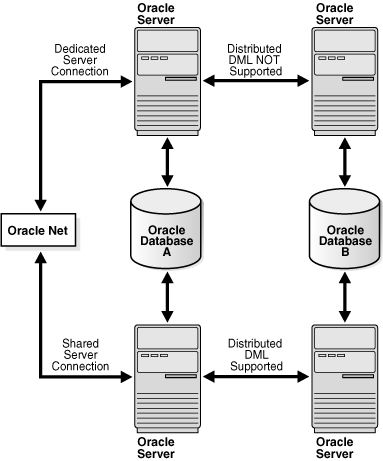

These topics provide information on troubleshooting Oracle Microsoft Transaction Server.

- Tracking Oracle Services for Microsoft Transaction Server Performance

- Correcting Oracle Net Changes that Impact Connection Pooling

- Designing an Application that Uses Multiple Databases

- Working with Different Types of Connection Pooling

- Working with In-Doubt Transactions

- Dropping the Microsoft Transaction Server Administrative User Account

### Tracking Oracle Services for Microsoft Transaction Server Performance

Trace files record information about Oracle Services for Microsoft Transaction Server performance. This information includes:

- Any errors

- Enlistment requests and outcomes

- Prepare, commit, and terminate requests and their outcomes

Registry parameters handle tracing within `oramts.dll`, which performs the following tasks:

- It implements the API for integrating the Oracle Database with Microsoft Transaction Server.

- It works as a resource dispenser to provide pooled [Oracle Call Interface (OCI)](glossary.md) connections.

- It enables clients with nonpooled OCI connections to enlist in transactions started by [Microsoft Distributed Transaction Coordinator (MS DTC)](glossary.md).

- It communicates with Oracle Services for Microsoft Transaction Server to enlist the Oracle Database in transactions started by MS DTC.

The MTS-based COM components can acquire connections to both dedicated and shared Oracle servers of a database. The components can then attempt to perform distributed updates, using data manipulation language, on another database using pre-existing database links between these databases. While the distributed updates from shared servers succeed, those from dedicated servers fail.

Registry parameters that handle tracing are automatically set in `\\``HKEY_LOCAL_MACHINE``\SOFTWARE\ORACLE\``HOMEID` during the installation of Oracle Services for Microsoft Transaction Server.

Restart all applications using Oracle Services for Microsoft Transaction Server. Further, if you have modified parameters related to the tracing of the `OracleMTSRecoveryService`, restart the Windows service.

Table 6-1 shows the range of `ORAMTS_CP_TRACE_LEVEL` trace values.

Table 6-1 ORAMTS_CP_TRACE_LEVEL Trace Registry Parameter Values

| Level | Description                                                                                                                                                                     |
|:------|:--------------------------------------------------------------------------------------------------------------------------------------------------------------------------------|
| 0     | Disables tracing. If the registry parameter is not set in the registry or as an environment variable, then tracing is disabled. This is equivalent to setting the level to `0`. |
| 1     | Traces errors only                                                                                                                                                              |
| 2     | Traces important events in addition to errors                                                                                                                                   |
| 3     | This level is not supported; if you set this parameter to `3`, level 2 tracing is enabled.                                                                                      |
| 4     | Traces function entry/exit, important events, and errors                                                                                                                        |
| 5     | Traces reference counting function and constructor/destructor entry/exit                                                                                                        |

**Note:**

The [Oracle MTS Recovery Service](glossary.md) also generates trace file output in the `ORACLE_BASE``\``ORACLE_HOME``\``oramts``\``trace` directory.

### Correcting Oracle Net Changes that Impact Connection Pooling

The connection pool provided by the OraMTS layer, `oramts.dll`, uses a connection's [net service name](glossary.md) to identify pooled connections for an application. If changes are made to the net service name, and pooled connections are available, the application using the connection pool must be stopped and restarted. These changes can include altering the host or the database system identifier (SID) for the net service name in the `tnsnames.ora` file.

These changes ensure that all currently pooled connections corresponding to the old net service name are destroyed and any new pooled connections use the changes made to the net service name. This includes any application hosting [Microsoft Transaction Server](glossary.md) components.

To empty connection pools, perform the following:

- If the application is an out-of-process Microsoft Transaction Server component (server package), run the following application:

      C:\> mtxstop

  This empties the connection pools.

- If the application is an in-process Microsoft Transaction Server component (library package), terminate the application. This also empties the connection pool.

### Designing an Application that Uses Multiple Databases

Oracle clients can establish connections to a database in two ways:

- Typical Oracle clients establish connections to a database using a dedicated server configuration. In a dedicated server configuration, one client corresponds to one Oracle server process.

- For scalability under heavy loads, Oracle clients have the option of using a shared server configuration. In a shared server configuration, a single Oracle server process can be shared by more than one client connection.

Microsoft Transaction Server communicates with the database through distributed transactions. In a dedicated server configuration, you cannot use distributed updates ([data manipulation language](glossary.md) statements across database links) from other databases. However, if the original connection to the database is established using shared server configurations, the distributed updates from other databases succeed.

To use data manipulation language statements in shared server configurations, set the following parameter in the `tnsnames.ora`` `file:

    SERVER=dedicated

This forces the Oracle Net listener to provide a dedicated connection. Figure 6-1 shows this process.

Figure 6-1 Distributed DML Statements from MTS Applications

[Description of "Figure 6-1 Distributed DML Statements from MTS Applications"](img_text/ntmts012.md)

### Working with Different Types of Connection Pooling

#### Oracle Net Connection Pooling

Oracle Net connection pooling is a server-side feature that is implemented only if the Oracle Database is configured for shared server support. Oracle Net connection pooling enables you to minimize the number of physical network connections to a shared server. This is achieved by sharing a dispatcher's set of connections among multiple client processes.

#### Microsoft Transaction Server Connection Pooling

Microsoft Transaction Server provides a resource pooling infrastructure that enables certain resources to be pooled, such as memory and database connections.

#### OCI Connection Pooling

OCI connection pooling layer works with MTS resource pooling to provide pooled Oracle client/server sessions. The OCI connection pooling layer also caches Oracle Net connections to reduce client/server session setup time.

### Working with In-Doubt Transactions

Oracle uses distributed transactions in the following configurations:

- Distributed database configurations, such as distributed updates using database links

- External transaction managers, such as Tuxedo and MS DTC, for coordinating transaction outcome

The two-phase commit protocol completes these transactions. During phase one, the transaction manager (TM) requests the various resource managers involved in the TM's transaction to prepare the underlying distributed transactions. In phase two, the TM determines whether it commits or terminates the transaction, and requests the resource managers to commit or terminate the underlying transaction. If a resource manager fails to receive the phase two notification, the underlying distributed transaction becomes in-doubt.

To integrate Oracle with Microsoft Transaction Server, distributed transactions are used in the database. Distributed transactions correspond to transactions coordinated by the MS DTC. A distributed transaction can become in-doubt when the transaction cannot commit or terminate (phase two of the two-phase commit). This occurs when the Microsoft Transaction Server application server process, database, or network fails.

**See Also:**

[Managing Recovery Scenarios](managing-recovery-scenarios.md)

### Dropping the Microsoft Transaction Server Administrative User Account

The Microsoft Transaction Server administrative user account is created by running the `oramtsadmin.sql` script. If you later change the database with which Microsoft Transaction Server is coordinating transactions, you can drop the administrative user account schema from the previous database.

To drop the Microsoft Transaction Server administrative user account:

1.  Start SQL\*Plus:
        c:\> sqlplus /NOLOG
2.  Connect to the database as `SYSDBA`:
        SQL> CONNECT / AS SYSDBA
3.  Enter the following command to drop administrative user account schema:
        SQL> DROP USER mtsadmin_username CASCADE;

    where `mtsadmin_username`` `is the Microsoft Transaction Server administrative user account (default is `mtssys`).

**See Also:**

See [Managing Recovery Scenarios](managing-recovery-scenarios.md) for information on creating the Microsoft Transaction Server administrative user account for the new database
