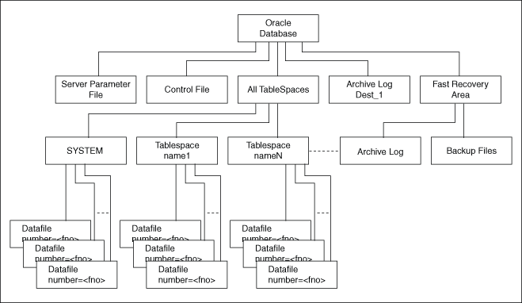

The technique for backing up a database depends on the archiving mode of the database and whether you are making a component-based or a volume-based backup.

Oracle recommends shadow copies taken in a component mode for backing up the Oracle Database using VSS writer. The Oracle VSS writer defines the components that include the set of database files. The Oracle VSS writer then saves the redo generated during hot backup mode when the snapshot was created in the backup writer metadata document.

The component hierarchy defined by the Oracle VSS writer is illustrated in Oracle VSS Writer Component Hierarchy.

Figure 9-1 Oracle VSS Writer Component Hierarchy

[Description of "Figure 9-1 Oracle VSS Writer Component Hierarchy"](img_text/comp.md)

- [About Component-Based Backups](about-component-based-backups.md)
  The components supported by the Oracle VSS writer are listed in Components Backed Up by the Oracle VSS Writer.
- [About Backing Up a Database in ARCHIVELOG Mode](about-backing-up-a-database-in-archivelog-mode.md)
  Learn about backing up a database in ARCHIVELOG mode.
- [About Backing Up a Database in NOARCHIVELOG Mode](about-backing-up-a-database-in-noarchivelog-mode.md)
  Learn about backing up a database in NOARCHIVELOG mode.

**Related Topics**

- [About Component-Based Backups](about-component-based-backups.md)

**Parent topic:** [Performing Database Backup and Recovery with VSS](performing-database-backup-and-recovery-with-vss.md)
