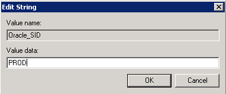

Use this procedure to add a registry parameter with regedit.

To add a parameter to the registry:

1.  Start Registry Editor in one of the two ways:
    - From the command prompt, enter:

          C:\> regedit

    - From the Start menu, select Run, enter `regedit` in the Open field, and clickOK.

    The Registry Editor window appears.
2.  Navigate to the registry key to which you want to add the new value.
3.  Choose New from the Edit menu.
4.  From the list, select the data type that you want to edit:
    - String Value

    - Binary value

    - DWORD (32-bit) Value

    - QWORD (64-bit) Value

    - Multi-String Value

    - Expandable String Value
5.  A `New Value #1` string value name is created on the right pane of the Registry Editor window of the chosen data type. Example, `REG_EXPAND_SZ` and so on.
6.  Right-click the parameter, select Rename and press Enter to rename it.
7.  Double-click the parameter to change the value data to the new `SID`.
8.  Click OK.
    The Edit String dialog appears:

    
    [Description of the illustration stringre.gif](img_text/stringre.md)
9.  Type the value for the parameter.
10. Click OK.
    Registry Editor adds the parameter.
11. Choose Exit from the Registry menu.

**Parent topic:** [Managing Registry Parameters with regedit](managing-registry-parameters-with-regedit.md)
