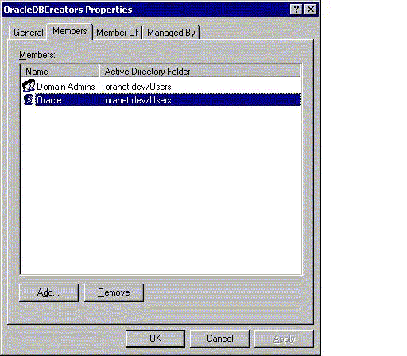

Learn how to add or remove users in the security groups with Active Directory Users and Computers.

You can add or remove users in the security groups with Active Directory Users and Computers.

**Note:**

Use Active Directory Users and Computers to perform the procedures described in this section. Windows Explorer does not provide the necessary functionality.

To add or remove users:

1.  From the Start menu, select All Programs, then select Administrative Tools, and then select Active Directory Users and Computers.
2.  Choose Advanced Features from the View main menu.
    This enables you to view and edit information that is usually hidden.
3.  Expand the domain (administrative context) in which your Oracle Context is located.
4.  Expand Users.
    The security groups appear in the right window pane.

    
    [Description of the illustration adsecgrp.gif](img_text/adsecgrp.md)
5.  Right-click the Oracle security group that you want to view or modify.
    A menu appears with several options.
6.  Choose Properties.
7.  Choose the Members tab.
    The Properties dialog for the group you selected appears (in this example, `OracleDBCreators`).

    
    [Description of the illustration admembrs.gif](img_text/admembrs.md)
8.  To add users, click Add.
    The Select Users, Computers, Service Accounts, or Groups dialog appears.
9.  Select the users or groups you want to add and click Add.
    Your selections appear in the Select Users, Computers, Service Accounts, or Groups dialog.
10. To remove a user, select the user name from the Members list and click Remove.
11. When you are finished adding and removing users, click OK.

**Parent topic:** [Overview of Access Control List Management for Oracle Directory Objects](overview-of-access-control-list-management-for-oracle-directory-objects.md)
