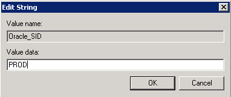

If you do not yet have the parameter `ORACLE_SID`, because this is the first database on your system, then you must create it.

To create the parameter `ORACLE_SID`:

1.  Select New from the Edit menu.
2.  Select Expandable String Value from the menu list.
3.  A New Value \#1 expandable string value name is created on the right pane of the Registry Editor window of data type `REG_EXPAND_SZ`.
4.  Right-click the parameter, select Rename to rename it to `ORACLE_SID` and press Enter.
5.  Double-click the `ORACLE_SID` entry to change the value data to the new `SID`.
    An Edit String dialog box appears:

    
    [Description of the illustration stringre.gif](img_text/stringre.md)
6.  Enter PROD in the Value data field.
7.  Click OK.
    Registry Editor adds parameter `ORACLE_SID`.
8.  Select Exit from the File menu.
    Registry Editor exits.

**Parent topic:** [Overview of Database Creation Tasks on Windows Using Command-Line Tools](overview-of-database-creation-tasks-on-windows-using-command-line-tools.md)
