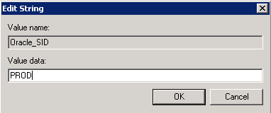

Use this procedure to modify a parameter value with regedit.

To edit Oracle-related settings:

1.  Start Registry Editor in one of the two ways:
    - From the command prompt, enter:

          C:\> regedit

    - From the Start menu, select Run, enter `regedit` in the Open field, and click OK.

    The Registry Editor window appears.
2.  Navigate to the values you want to view or modify by double-clicking appropriate keys.
    The left-hand side of the window shows the hierarchy of the registry keys, and the right-hand side of the window shows the various values associated with a key.
3.  Double-click the parameter to change the value data to the new `SID`.
    The Edit String dialog appears:

    
    [Description of the illustration stringre.gif](img_text/stringre.md)
4.  Make any necessary edits.
5.  Click OK.
6.  Choose Exit from the Registry Editor menu.

**Parent topic:** [Managing Registry Parameters with regedit](managing-registry-parameters-with-regedit.md)
