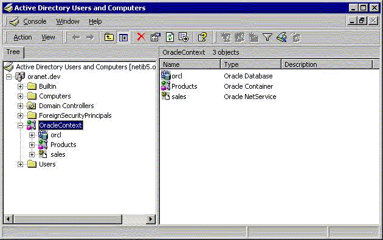

Learn about Oracle directory objects in Active Directory.

If Oracle Database and Oracle Net Services are installed and configured to access Active Directory, then Active Directory Users and Computers displays Oracle directory objects, as illustrated in Oracle Directory Objects in Active Directory Users and Computers:

Figure 14-1 Oracle Directory Objects in Active Directory Users and Computers

[Description of "Figure 14-1 Oracle Directory Objects in Active Directory Users and Computers"](img_text/adusrext.md)

Oracle Directory Objects describes the Oracle directory objects appearing in Oracle Directory Objects in Active Directory Users and Computers.

Table 14-1 Oracle Directory Objects

| Object          | Description                                                                                                                                                                                                                                                                                                    |
|:----------------|:---------------------------------------------------------------------------------------------------------------------------------------------------------------------------------------------------------------------------------------------------------------------------------------------------------------|
| `oranet.dev`    | The domain in which you created your Oracle Context. This domain (also known as the administrative context) contains various Oracle entries to support directory naming. Oracle Net Configuration Assistant automatically discovers this information during Oracle Database integration with Active Directory. |
| `OracleContext` | The top-level Oracle entry in the Active Directory tree. It contains Oracle Database service and net service name object information. All Oracle software information is placed in this folder.                                                                                                                |
| `orcl`          | The Oracle Database service name used in this example.                                                                                                                                                                                                                                                         |
| `Products`      | Folder for Oracle product information.                                                                                                                                                                                                                                                                         |
| `sales`         | The net service name object used in this example.                                                                                                                                                                                                                                                              |
| `Users`         | Folder for the Oracle security groups. Enterprise users and roles created with Oracle Enterprise Security Manager also appear in this folder.                                                                                                                                                                  |

**Related Topics**

- [Overview of Access Control List Management for Oracle Directory Objects](overview-of-access-control-list-management-for-oracle-directory-objects.md)

**Parent topic:** [Overview of Oracle Components That Integrate with Active Directory](overview-of-oracle-components-that-integrate-with-active-directory.md)
