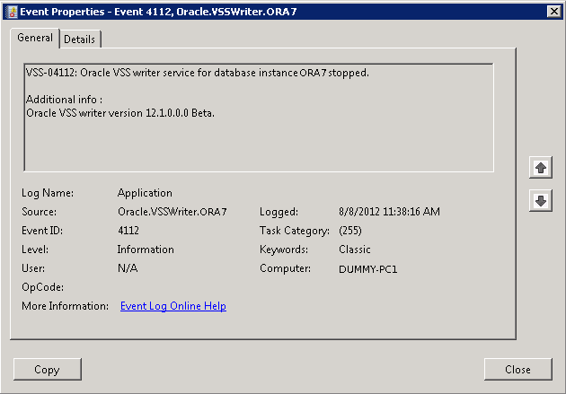
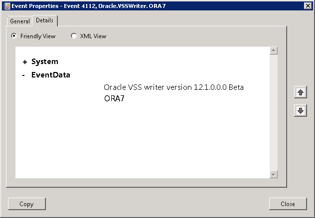

Learn how to read an Event Viewer.

Oracle Database for Windows events are displayed with a source of Oracle.`SID`.

Event number 34 specifies an audit trail event. These events are recorded if the parameter `AUDIT_TRAIL` is set to `db` (`true`) or `os` in the initialization parameter file. Option `os` enables systemwide auditing and causes audited records to be written to Event Viewer. Option `db` enables systemwide auditing and causes audited records to be written to the database audit trail (table `SYS.AUD$`). Some records, however, are written to Event Viewer.

Event numbers other than 34 specify general database activities, such as an instance being started or stopped.

When you double-click an icon in Event Viewer, the Event Properties dialog box appears with more information about the selected event. Event Properties General Tab, for example, shows details about Event ID 4112. In the General tab, you find a text description of the event. In the Details tab, you can select Friendly View to see the System and Event Data in words or XML View to see the same information in XML format, as shown in Event Properties Details Tab.

Figure 7-2 Event Properties General Tab

[Description of "Figure 7-2 Event Properties General Tab"](img_text/ev_dtl.md)

Figure 7-3 Event Properties Details Tab

[Description of "Figure 7-3 Event Properties Details Tab"](img_text/ev_dtl2.md)

**See Also:**

Microsoft operating system documentation for more information about using Event Viewer

**Parent topic:** [About Event Viewer](about-event-viewer.md)
