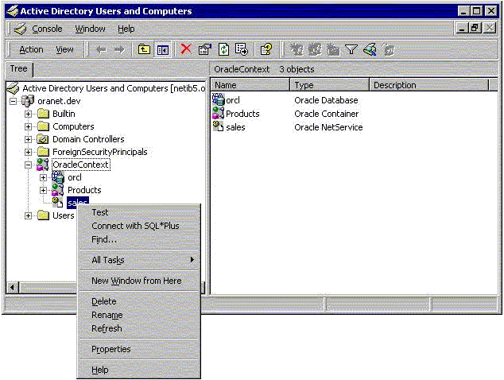
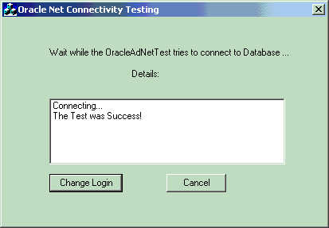
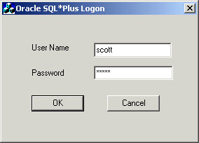

Learn how you can test connectivity to an Oracle Database server from Microsoft tools.

Oracle directory objects in Active Directory are integrated with the following Microsoft tools:

- Windows Explorer

- Active Directory Users and Computers

You can test connectivity to an Oracle Database server from within these Microsoft tools by connecting to it, or you can just test the connection with actually connecting. To test connectivity:

1.  Start Windows Explorer or Active Directory Users and Computers.

    To start Windows Explorer:

    1.  From the Start menu, select All Programs, then select Accessories, and then select Windows Explorer.

    2.  Expand Network.

    3.  Expand Directory.

    To start Active Directory Users and Computers:

    From the Start menu, select All Programs, then select Administrative Tools, and then select Active Directory Users and Computers.

    **Note:**

    All clients accessing an Oracle Database server through Active Directory require read access on all net service name objects in the Oracle Context. If Oracle Net is not configured to require authentication for name lookup, then clients must be able to authenticate anonymously with Active Directory. With Windows Server domain, this requires changing the Active Directory default setting so that anonymous access is allowed. If anonymous access is not going to be allowed to this directory the clients must be configured to authenticate and net service objects must have access control definitions that allow clients to read them as appropriate.

2.  Expand the domain in which your Oracle Context is located.

3.  Expand your Oracle Context.

4.  Right-click a database service or Oracle Net Service name object.

    A menu appears with several options. This section covers only the Test and Connect with SQL\*Plus options.

    
    [Description of the illustration adtest.gif](img_text/adtest.md)

5.  If you want to test the database connection without actually connecting to it, then choose Test. A status message appears describing the status of your connection attempt.

    
    [Description of the illustration adtstcon.gif](img_text/adtstcon.md)

6.  If you want to test the database connection by actually connecting to it, then choose Connect with SQL\*Plus. The Oracle SQL\*Plus Logon dialog appears.

    
    [Description of the illustration adsqlpls.gif](img_text/adsqlpls.md)

7.  Enter your user name and password, then click OK. A status message appears describing the status of your connection attempt.

**See also:**

[Oracle Database Net Services Administrator's Guide](../netag/managing-network-address-information.md) for more information

**Parent topic:** [About Testing Connectivity](about-testing-connectivity.md)
