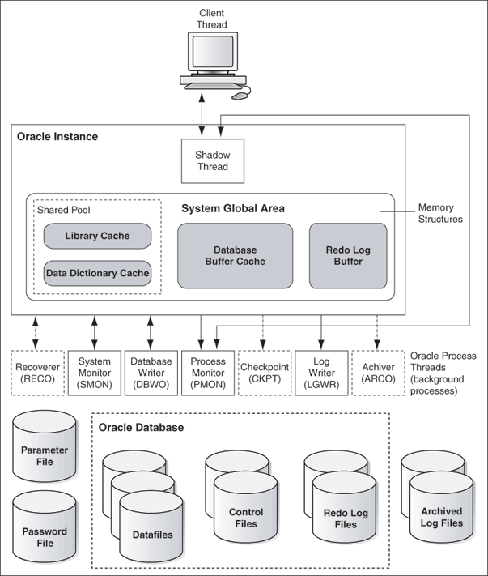

The internal process architecture of Oracle Database is thread-based. Threads are objects within a process that run program instructions.

Threads allow concurrent operations within a process so that a process can run different parts of its program simultaneously on different processors. A thread-based architecture provides the following advantages:

- Faster context switching

- Simpler System Global Area allocation routine, because it does not require use of shared memory

- Faster spawning of new connections, because threads are created more quickly than processes

- Decreased memory usage, because threads share more data structures than processes

Internally, the code to implement the thread model is compact and separate from the main body of Oracle Database code. Exception handlers and routines track and deallocate resources. They add robustness, with no downtime because of resource leaks or program that does not function as expected.

Oracle Database is not a typical Windows process. On Windows, an Oracle Database or Oracle Automatic Storage Management instance (threads and memory structures) is a Windows service: a background process registered with the operating system. The service is started by Windows and requires no user interaction to start. This enables the database to open automatically at computer startup.

When running multiple Oracle Database or Oracle Automatic Storage Management instances on Windows, each instance runs its own Windows service with multiple component threads. Each thread is required for the database to be available, or is optional and specific to certain platforms. The background processes read and write from various data files, depending on your configuration. Oracle Database architecture on Windows is illustrated in Oracle Database Architecture on Windows. Examples of Oracle Database required threads on Windows are listed in Oracle Database Threads.

Figure 1-1 Oracle Database Architecture on Windows

[Description of "Figure 1-1 Oracle Database Architecture on Windows"](img_text/ntqrf003.md)

Table 1-1 Oracle Database Threads

| Oracle Database Thread | Description                                                            | Required/Optional |
|:-----------------------|:-----------------------------------------------------------------------|:------------------|
| `DBWO`                 | database writer                                                        | Required          |
| `LGWR`                 | log writer                                                             | Required          |
| `MMAN`                 | memory manager process                                                 | Required          |
| `PMON`                 | process monitor                                                        | Required          |
| `PSPO`                 | process spawner process                                                | Required          |
| `SMON`                 | system monitor                                                         | Required          |
| `CKPT`                 | checkpoint process (thread on Windows) that runs by default on Windows | Required          |
| `ARCO`                 | archive process (or thread on Windows)                                 | Required          |
| `RECO`                 | distributed recovery background process                                | Required          |

**Note:**

You can view running background processes by entering the following query:

    SQL> select * from v$bgprocess where paddr <> '00';

Oracle Database for Windows is supplied as a set of executables and dynamic link libraries (DLLs). Executable images can be modified using `ORASTACK` to change the size of the stack used by the threads of the Oracle Database process. Oracle recommends that you use this tool only under the guidance of Oracle Support Services.

**Parent topic:** [Overview of Oracle Database on Windows Architecture](overview-of-oracle-database-on-windows-architecture.md)
