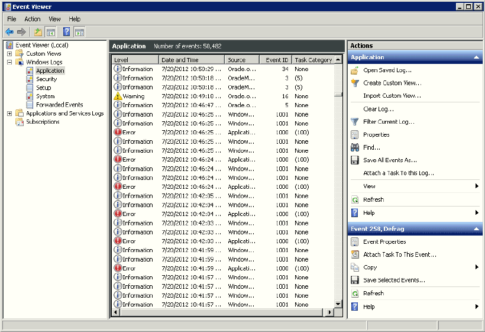

Learn how to use Event Viewer.

To access Event Viewer:

1.  From the Start menu, select All Programs, then select Administrative Tools, and then select Event Viewer.
    The Event Viewer window appears.
2.  Select Windows Logs.
3.  Double-click Application to open the Application view window.

Application View Window displays the Application view window, Application View Definitions shows what is recorded in each column, and Event Viewer Icons interprets icons that appear on the left hand side of the viewer.

Figure 7-1 Application View Window

[Description of "Figure 7-1 Application View Window"](img_text/ev_vwr.md)

Table 7-2 Application View Definitions

| Column Name   | Definition                                 |
|:--------------|:-------------------------------------------|
| Date and Time | Date and time at which an event took place |
| Source        | Application that recorded an event         |
| Event ID      | Unique number assigned to an event         |
| Task Category | Classification of events                   |

Table 7-3 Event Viewer Icons

| Icon                                 | Event Type  | Suggested Action                                                                                                              |
|:-------------------------------------|:------------|:------------------------------------------------------------------------------------------------------------------------------|
| Exclamation Point in Red Circle      | Error       | Error identification. Always check these icons.                                                                               |
| Lowercase "i" in Blue Circle         | Information | Noncritical system events. Check these icons only to track a specific event.                                                  |
| Exclamation Point in Yellow Triangle | Warning     | Special events, such as instance termination or services shutdown. Investigate these icons, but they are usually noncritical. |

**Parent topic:** [About Event Viewer](about-event-viewer.md)
