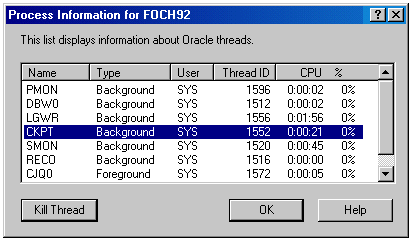

To view information about Oracle Database threads using Oracle Administration Assistant for Windows, you must either enable Windows native authentication for the database or run the utility `ocfgutil.exe` with arguments `username` and `password`.

The utility stores the user name and password in the following registry location:

    HKEY_LOCAL_MACHINE\SYSTEM\CurrentControlSet\Services\OracleOraConfig

When the Windows native authentication is not enabled, Oracle Remote Configuration Agent retrieves the user name and password from this registry key to log in to the database.

To view information about Oracle Database threads using Oracle Administration Assistant for Windows:

1.  From the Start menu, select All Programs, then select Oracle - HOMENAME, then select Configuration and Migration Tools, and then select Administration Assistant for Windows.
2.  Right-click the `SID`, where `SID` is a specific instance name, such as `orcl`.
3.  Select Process Information.
    The Process Information dialog box appears, listing name, type, user, thread ID, and CPU usage for each Oracle Database thread.
4.  To terminate a thread, select it, and click Kill Thread.

[Description of the illustration procinfo.gif](img_text/procinfo.md)

**Parent topic:** [Monitoring a Database on Windows](monitoring-a-database-on-windows.md)
