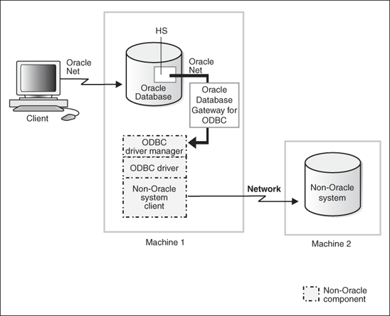
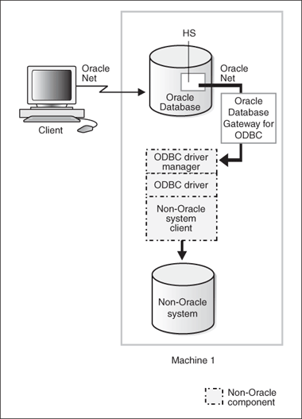

Oracle Database Gateways provide the ability to transparently access data residing in a non-Oracle system from an Oracle environment. The following sections briefly cover Heterogeneous Services, the technology that the Oracle Database Gateway for ODBC is based on.

**See Also:**

[Oracle Database Heterogeneous Connectivity User's Guide](../heter/index.md) to get a good understanding of generic gateway technology, Heterogeneous Services, and how Oracle Database Gateways fit in the picture.

### Overview of Oracle Database Gateways

Gateway technology is composed of two parts: a component that has the generic technology to connect to a non-Oracle system, which is common to all the non-Oracle systems, called Heterogeneous Services, and a component that is specific to the non-Oracle system that the gateway connects to. Heterogeneous Services, in conjunction with the Oracle Database Gateways, enable transparent access to non-Oracle systems from an Oracle environment.

Heterogeneous data access is a problem that affects a lot of companies. Many companies run several different database systems. Each of these systems stores data and has a set of applications that run against it. Consolidating this data in one database system is often hard - in large part because many of the applications that run against one database may not have an equivalent that runs against another. Until migration to one consolidated database system is feasible, it is necessary for the various heterogeneous database systems to interoperate.

Oracle Database Gateways provide the ability to transparently access data residing in a non-Oracle system from an Oracle environment. This transparency eliminates the need for application developers to customize their applications to access data from different non-Oracle systems, thus decreasing development efforts and increasing the mobility of the application. Applications can be developed using a consistent Oracle interface for both Oracle and non-Oracle systems.

### About Heterogeneous Services Technology

Heterogeneous Services provides the generic technology for connecting to non-Oracle systems. As an integrated component of the database, Heterogeneous Services can exploit features of the database, such as the powerful SQL parsing and distributed optimization capabilities.

Heterogeneous Services extend the Oracle SQL engine to recognize the SQL and procedural capabilities of the remote non-Oracle system and the mappings required to obtain necessary data dictionary information. Heterogeneous Services provides two types of translations: the ability to translate Oracle SQL into the proper dialect of the non-Oracle system as well as data dictionary translations that displays the metadata of the non-Oracle system in the local format. For situations where no translations are available, native SQL can be issued to the non-Oracle system using the pass-through feature of Heterogeneous Services.

Heterogeneous Services also maintains the transaction coordination between Oracle and the remote non-Oracle system.

**See Also:**

[Oracle Database Heterogeneous Connectivity User's Guide](../heter/index.md) for more information about Heterogeneous Services.

### About Oracle Database Gateway for ODBC

Oracle Database Gateway for ODBC is intended for low-end data integration solutions requiring the dynamic query capability to connect from an Oracle database to non-Oracle systems.

Any data source compatible with the ODBC standards described in this chapter can be accessed using Oracle Database Gateway for ODBC.

The capabilities, SQL mappings, data type conversions, and interface to the remote non-Oracle system are contained in the gateway. The gateway interacts with Heterogeneous Services to provide the transparent connectivity between Oracle and non-Oracle systems.

### Oracle Database Gateway for ODBC Architecture

The gateway works with an ODBC driver to access the non-Oracle data store using Oracle Database Gateway for ODBC. The driver that you use must be on the same machine as the gateway. The non-Oracle system can reside on the same machine as the Oracle database or on a different machine.

The gateway can be installed on the machine running the non-Oracle system, the machine running the Oracle database or on a third machine as a standalone. Each configuration has its advantages and disadvantages. The considerations when determining where to install the gateway are network traffic, operating system platform availability, hardware resources and storage.

**Note:**

The ODBC driver may require non-Oracle client libraries even if the non-Oracle database is located on the same machine. Refer to your ODBC driver documentation for information about the requirements for the ODBC driver.

#### Oracle and Non-Oracle Systems on Separate Machines

The figure is an example of a configuration in which an Oracle and non-Oracle database are on separate machines, communicating through Oracle Database Gateway for ODBC. The client connects to the non-Oracle system through a network.

Figure 1-1 shows a non-Oracle system on a computer that is separate from the Oracle system.

Figure 1-1 Oracle and Non-Oracle Systems on Separate Machines

[Description of "Figure 1-1 Oracle and Non-Oracle Systems on Separate Machines"](img_text/heter004.md)

In this configuration:

- A client connects to the Oracle database through Oracle Net.

- The Heterogeneous Services component of the Oracle database connects through Oracle Net to the gateway.

- The gateway communicates with the following non-Oracle components:

  - An ODBC driver manager

  - An ODBC driver

- Each user session receives its own dedicated agent process spawned by the first use in that user session of the database link to the non-Oracle system. The agent process ends when the user session ends.

**Note:**

The ODBC driver may require non-Oracle client libraries even if the non-Oracle database is located on the same machine. Refer to your ODBC driver documentation for information about the requirements for the ODBC driver.

#### Oracle and Non-Oracle Systems on the Same Machine

The figure is an example of a configuration in which an Oracle and non-Oracle database are on the same machine, again communicating through Oracle Database Gateway for ODBC.

Figure 1-2 shows a client accessing non-Oracle databases that reside on the same computer as the Oracle databases using Heterogeneous Services.

Figure 1-2 Oracle and Non-Oracle Systems on the Same Machine

[Description of "Figure 1-2 Oracle and Non-Oracle Systems on the Same Machine"](img_text/heter005.md)

In this configuration:

- A client connects to the Oracle database through Oracle Net.

- The Heterogeneous Services component of the Oracle database connects through Oracle Net to the gateway.

- The agent communicates with the following non-Oracle components:

  - An ODBC driver manager

  - An ODBC driver

  The driver then allows access to the non-Oracle data store.

- Each user session receives its own dedicated agent process spawned by the first use in that user session of the database link to the non-Oracle system. The agent process ends when the user session ends.

**Note:**

The ODBC driver may require non-Oracle client libraries even if the non-Oracle database is located on the same machine. Refer to your ODBC driver documentation for information about the requirements for the ODBC driver.

### ODBC Connectivity Requirements

To use Oracle Database Gateway for ODBC, you must have an ODBC driver installed on the same machine as the gateway.

The ODBC driver manager and driver must meet the following requirements:

- The following ODBC catalog functions must work inside a transaction:

  - `SQLColumns`

  - `SQLForeignKeys`

  - `SQLGetFunctions`

  - `SQLGetInfo`

  - `SQLGetTypeInfo`

  - `SQLPrimaryKeys`

  - `SQLProcedureColumns`

  - `SQLProcedures`

  - `SQLStatistics`

  - `SQLTables`

- On Windows:

  - The ODBC driver must have compliance level to ODBC standard 3.0. For multi-byte support, the driver needs to meet ODBC standard 3.5.

  - The ODBC driver and driver manager must conform to ODBC application program interface (API) conformance Level 1 or higher. If the ODBC driver or driver manager does not support multiple active ODBC cursors, the complexity of SQL statements that you can execute using Oracle Database Gateway for ODBC is restricted.

- On UNIX:

  - The ODBC driver manager must be installed on the same machine.

  - The ODBC driver must have compliance level to ODBC Standard 3.0 and have a conformance level 1 or higher. If the ODBC driver works with an ODBC driver manager, the ODBC driver manager must be compliant with ODBC Standard 3.0 or higher. The ODBC driver must have compliance level to ODBC standard 3.0. For multi-byte support, the driver needs to meet ODBC standard 3.5.

  **See Also:**

  Your ODBC driver documentation for dependencies on an ODBC driver manager, and [Oracle Database Concepts ](../cncpt/data-concurrency-and-consistency.md)for more information on transaction isolation levels.

- The ODBC driver you use must support all of the core SQL ODBC data types and must support SQL grammar level `SQL_92`. The ODBC driver should also expose the following ODBC APIs:

  - `SQLAllocHandle`

  - `SQLBindCol`

  - `SQLBindParameter`

  - `SQLCancel`

  - `SQLColAttribute`

  - `SQLColumns`

  - `SQLConnect`

  - `SQLDescribeCol`

  - `SQLDisconnect`

  - `SQLDriverConnect`

  - `SQLEndTran`

  - `SQLExecDirect`

  - `SQLExecute`

  - `SQLFetch`

  - `SQLForeignKeys`

  - `SQLFreeHandle`

  - `SQLFreeStmt`

  - `SQLGetConnectAttr`

  - `SQLGetData`

  - `SQLGetDiagField`

  - `SQLGetDiagRec`

  - `SQLGetEnvAttr`

  - `SQLGetFunctions`

  - `SQLGetInfo`

  - `SQLGetStmtAttr`

  - `SQLGetTypeInfo`

  - `SQLMoreResults`

  - `SQLNumResultCols`

  - `SQLParamData`

  - `SQLPrepare`

  - `SQLPrimaryKeys`

  - `SQLProcedureColumns`

  - `SQLProcedures`

  - `SQLPutData`

  - `SQLRowCount`

  - `SQLSetConnectAttr`

  - `SQLSetEnvAttr`

  - `SQLSetDescField`

  - `SQLSetDescRec`

  - `SQLSetStmtAttr`

  - `SQLStatistics` - If statistics are to be supported

  - `SQLTables`
