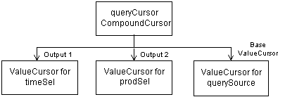
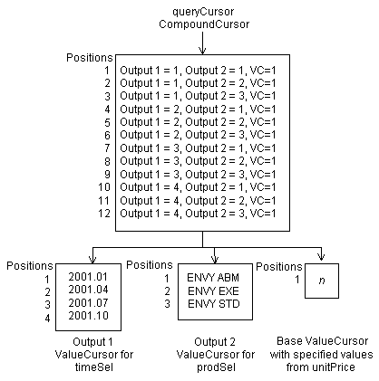
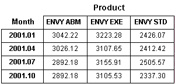
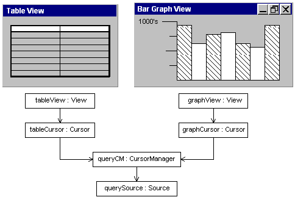

This chapter describes the Oracle OLAP Java API `Cursor` class and the related classes that you use to retrieve the results of a query. This chapter also describes the `Cursor` concepts of position, fetch size, and extent. For examples of creating and using a `Cursor` and its related objects, see [Retrieving Query Results](retrieving-query-results.md).

This chapter includes the following topics:

- Overview of the OLAP Java API Cursor Objects

- Cursor Classes

- CursorInfoSpecification Classes

- CursorManager Class

- About Cursor Positions and Extent

- About Fetch Sizes

### 8.1 Overview of the OLAP Java API Cursor Objects

A `Cursor` retrieves the result set specified by a `Source`. You create a `Cursor` by calling the `createCursor` method of a `CursorManager`. You create a `CursorManager` by calling the `createCursorManager` method of a `DataProvider`.

You can get the SQL generated for a `Source` by the Oracle OLAP SQL generator without having to create a `Cursor`. To get the SQL for the `Source`, you create an `SQLCursorManager` by using a `createSQLCursorManager` method of a `DataProvider`. You can then use classes outside of the OLAP Java API, or other methods, to retrieve data using the generated SQL.

#### 8.1.1 Creating a Cursor

You create a `Cursor` for a `Source` by doing the following:

1.  Creating a `CursorManager` by calling one of the `createCursorManager` methods of the `DataProvider` and passing it the `Source`. If you want to alter the behavior of the `Cursor`, then you can create a `CursorInfoSpecification` and use the methods of it to specify the behavior. You then create a `CursorManager` with a method that takes the `Source` and the `CursorInfoSpecification`.
2.  Creating a `Cursor` by calling the `createCursor` method of the `CursorManager`.

#### 8.1.2 Sources For Which You Cannot Create a Cursor

Some `Source` objects do not specify data that a `Cursor` can retrieve from the data store. The following are `Source` objects for which you cannot create a `Cursor` that contains values.

- A `Source` that specifies an operation that is not computationally possible. An example is a `Source` that specifies an infinite recursion.

- A `Source` that defines an infinite result set. An example is the fundamental `Source` that represents the set of all `String` objects.

- A `Source` that has no elements or includes another `Source` that has no elements. Examples are a `Source` returned by the `getEmptySource` method of `DataProvider` and another `Source` derived from the empty `Source`. Another example is a derived `Source` that results from selecting a value from a primary `Source` that you got from an `MdmDimension` and the selected value does not exist in the dimension.

If you create a `Cursor` for such a `Source` and try to get the values of the `Cursor`, then an `Exception` occurs.

#### 8.1.3 Cursor Objects and Transaction Objects

When you create a derived `Source` or change the state of a `Template`, you create the `Source` in the context of the current `Transaction`. The `Source` is active in the `Transaction` in which you create it or in a child `Transaction` of that `Transaction`. A `Source` must be active in the current `Transaction` for you to be able to create a `Cursor` for it.

Creating a derived `Source` occurs in a write `Transaction`. Creating a `Cursor` occurs in a read `Transaction`. After creating a derived `Source`, and before you can create a `Cursor` for that `Source`, you must change the write `Transaction` into a read `Transaction` by calling the `commitCurrentTransaction` methods of the `TransactionProvider` your application is using. For information on `Transaction` and `TransactionProvider` objects, see [Using a TransactionProvider](using-transaction-provider.md).

For a `Cursor` that you create for a query that includes a parameterized `Source`, you can change the value of the `Parameter` object and then get the new values of the `Cursor` without having to commit the `Transaction` again. For information on parameterized `Source` objects, see [Understanding Source Objects](understanding-source-objects.md).

### 8.2 Cursor Classes

In the `oracle.olapi.data.cursor` package, the Oracle OLAP Java API defines the interfaces described in the following table.

| Interface        | Description                                                                                                                                                                                 |
|:-----------------|:--------------------------------------------------------------------------------------------------------------------------------------------------------------------------------------------|
| `Cursor`         | An abstract superclass that encapsulates the notion of a current position.                                                                                                                  |
| `ValueCursor`    | A `Cursor` that has a value at the current position. A `ValueCursor` has no child `Cursor` objects.                                                                                         |
| `CompoundCursor` | A `Cursor` that has child `Cursor` objects, which are a child `ValueCursor` for the values of the `Source` associated with it and an output child `Cursor` for each output of the `Source`. |

#### 8.2.1 Structure of a Cursor

The structure of a `Cursor` mirrors the structure of the `Source` associated with it. If the `Source` does not have any outputs, then the `Cursor` for that `Source` is a `ValueCursor`. If the `Source` has one or more outputs, then the `Cursor` for that `Source` is a `CompoundCursor`. A `CompoundCursor` has as children a base `ValueCursor`, which has the values of the base of the `Source` of the `CompoundCursor`, and one or more output `Cursor` objects.

The output of a `Source` is another `Source`. An output `Source` can itself have outputs. The child `Cursor` for an output of a `Source` is a `ValueCursor` if the output `Source` does not have any outputs and a `CompoundCursor` if it does.

Example 8-1 creates a query that specifies the prices of selected product items for selected months. In the example, `timeHier` is a `Source` for a hierarchy of a dimension of time values, and `prodHier` is a `Source` for a hierarchy of a dimension of product values.

If you create a `Cursor` for `prodSel` or for `timeSel`, then either `Cursor` is a `ValueCursor` because both `prodSel` and `timeSel` have no outputs.

The `unitPrice` object is a `Source` for an `MdmBaseMeasure` that represents values for the price of product units. The `MdmBaseMeasure` has as inputs the `MdmPrimaryDimension` objects representing products and times, and the `unitPrice` `Source` has as inputs the `Source` objects for those dimensions.

The example selects elements of the dimension hierarchies and then joins the `Source` objects for the selections to that of the measure to produce `querySource`, which has `prodSel` and `timeSel` as outputs.

Example 8-1 Creating the querySource Query

    Source timeSel = timeHier.selectValues(new String[]
                                              {"CALENDAR_YEAR::MONTH::2001.01",
                                               "CALENDAR_YEAR::MONTH::2001.04",
                                               "CALENDAR_YEAR::MONTH::2001.07",
                                               "CALENDAR_YEAR::MONTH::2001.10"});

    Source prodSel = prodHier.selectValues(new String[]
                                              {"PRODUCT_PRIMARY::ITEM::ENVY ABM",
                                               "PRODUCT_PRIMARY::ITEM::ENVY EXE",
                                               "PRODUCT_PRIMARY::ITEM::ENVY STD"});

    Source querySource = unitPrice.join(timeSel).join(prodSel);

The result set defined by `querySource` is the unit price values for the selected products for the selected months. The results are organized by the outputs. Since `timeSel` is joined to the `Source` produced by the `unitPrice.join(prodSel)` operation, `timeSel` is the slower varying output, which means that the result set specifies the set of selected products for each selected time value. For each time value the result set has three product values so the product values vary faster than the time values. The values of the base `ValueCursor` of `querySource` are the fastest varying of all, because there is one price value for each product for each day.

[Example 9-1](retrieving-query-results.md) in [Retrieving Query Results](retrieving-query-results.md), creates a `Cursor`, `queryCursor`, for `querySource`. Since `querySource` has outputs, `queryCursor` is a `CompoundCursor`. The base `ValueCursor` of `queryCursor` has values from `unitPrice`, which is the base `Source` of the operation that created `querySource`. The values from `unitPrice` are those specified by the outputs. The outputs for `queryCursor` are a `ValueCursor` that has values from `prodSel` and a `ValueCursor` that has values from `timeSel`.

Figure 8-1 Structure of the queryCursor CompoundCursor

This figure illustrates the structure of `queryCursor`. The base `ValueCursor` and the two output `ValueCursor` objects are the children of `queryCursor`, which is the parent `CompoundCursor`.

[Description of "Figure 8-1 Structure of the queryCursor CompoundCursor"](img_text/qrycrstr.md)

The following table displays the values from `queryCursor` in a table. The left column has time values, the middle column has product values, and the right column has the unit price of the product for the month.

| Month   | Product  | Price of Unit |
|:--------|:---------|:--------------|
| 2001.01 | ENVY ABM | 3042.22       |
| 2001.01 | ENVY EXE | 3223.28       |
| 2001.01 | ENVY STD | 3042.22       |
| 2001.04 | ENVY ABM | 2412.42       |
| 2001.04 | ENVY EXE | 3107.65       |
| 2001.04 | ENVY STD | 3026.12       |
| 2001.07 | ENVY ABM | 2505.57       |
| 2001.07 | ENVY EXE | 3155.91       |
| 2001.07 | ENVY STD | 2892.18       |
| 2001.10 | ENVY ABM | 2337.30       |
| 2001.10 | ENVY EXE | 3105.53       |
| 2001.10 | ENVY STD | 2856.86       |

For examples of getting the values from a `ValueCursor`, see [Retrieving Query Results](retrieving-query-results.md).

#### 8.2.2 Specifying the Behavior of a Cursor

`CursorSpecification` objects specify some aspects of the behavior of their corresponding `Cursor` objects. You must specify the behavior on a `CursorSpecification` before creating the corresponding `Cursor`. To specify the behavior, use the following `CursorSpecification` methods:

- `setDefaultFetchSize`

- `setExtentCalculationSpecified`

- `setParentEndCalculationSpecified`

- `setParentStartCalculationSpecified`

- `specifyDefaultFetchSizeOnChildren` (for a `CompoundCursorSpecification` only)

A `CursorSpecification` also has methods that you can use to discover if the behavior is specified. Those methods are the following:

- `isExtentCalculationSpecified`

- `isParentEndCalculationSpecified`

- `isParentStartCalculationSpecified`

If you have used the `CursorSpecification` methods to set the default fetch size, or to calculate the extent or the starting or ending positions of a value in the parent of the value, then you can successfully use the following `Cursor` methods:

- `getExtent`

- `getFetchSize`

- `getParentEnd`

- `getParentStart`

- `setFetchSize`

For examples of specifying `Cursor` behavior, see [Retrieving Query Results](retrieving-query-results.md). For information on fetch sizes, see "About Fetch Sizes". For information on the extent of a `Cursor`, see "What is the Extent of a Cursor?". For information on the starting and ending positions in a parent `Cursor` of the current value of a `Cursor`, see "About the Parent Starting and Ending Positions in a Cursor".

### 8.3 CursorInfoSpecification Classes

The `CursorInfoSpecification` interface and the subinterfaces `CompoundCursorInfoSpecification` and `ValueCursorInfoSpecification`, specify methods for the abstract `CursorSpecification` class and the concrete `CompoundCursorSpecification` and `ValueCursorSpecification` classes. A `CursorSpecification` specifies certain aspects of the behavior of the `Cursor` that corresponds to it. You can create instances of classes that implement the `CursorInfoSpecification` interface either directly or indirectly.

You can create a `CursorSpecification` for a `Source` by calling the `createCursorInfoSpecification` method of a `DataProvider`. That method returns a `CompoundCursorSpecification` or a `ValueCursorSpecification`. You can use the methods of the `CursorSpecification` to specify aspects of the behavior of a `Cursor`. You can then use the `CursorSpecification` in creating a `CursorManager` by passing it as the `cursorInfoSpec` argument to the `createCursorManager` method of a `DataProvider`.

With `CursorSpecification` methods, you can do the following:

- Get the `Source` that corresponds to the `CursorSpecification`.

- Get or set the default fetch size for the corresponding `Cursor`.

- Specify that Oracle OLAP should calculate the extent of a `Cursor`.

- Determine whether calculating the extent is specified.

- Specify that Oracle OLAP should calculate the starting or ending position of the current value of the corresponding `Cursor` in the parent `Cursor`. If you know the starting and ending positions of a value in the parent, then you can determine how many faster varying elements the parent `Cursor` has for that value.

- Determine whether calculating the starting or ending position of the current value of the corresponding `Cursor` in the parent is specified.

- Accept a `CursorSpecificationVisitor`.

For more information, see "About Cursor Positions and Extent" and "About Fetch Sizes".

In the `oracle.olapi.data.source` package, the Oracle OLAP Java API defines the classes described in the following table.

| Interface                         | Description                                                                                                                                             |
|:----------------------------------|:--------------------------------------------------------------------------------------------------------------------------------------------------------|
| `CursorInfoSpecification`         | An interface that specifies methods for `CursorSpecification` objects.                                                                                  |
| `CursorSpecification`             | An abstract class that implements some methods of the `CursorInfoSpecification` interface.                                                              |
| `CompoundCursorSpecification`     | A `CursorSpecification` for a `Source` that has one or more outputs. A `CompoundCursorSpecification` has component child `CursorSpecification` objects. |
| `CompoundInfoCursorSpecification` | An interface that specifies methods for `CompoundCursorSpecification` objects.                                                                          |
| `ValueCursorSpecification`        | A `CursorSpecification` for a `Source` that has values and no outputs.                                                                                  |
| `ValueCursorInfoSpecification`    | An interface for `ValueCursorSpecification` objects.                                                                                                    |

A `Cursor` has the same structure as the `CursorSpecification`. Every `ValueCursorSpecification` or `CompoundCursorSpecification` has a corresponding `ValueCursor` or `CompoundCursor`. To be able to get certain information or behavior from a `Cursor`, your application must specify that it wants that information or behavior by calling methods of the corresponding `CursorSpecification` before it creates the `Cursor`.

### 8.4 CursorManager Class

With a `CursorManager`, you can create a `Cursor` for a `Source`. The class returned by one of the `createCursorManager` methods of a `DataProvider` manages the buffering of data for the `Cursor` objects it creates.

You can create more than one `Cursor` from the same `CursorManager`, which is useful for displaying data from a result set in different formats such as a table or a graph. All of the `Cursor` objects created by a `CursorManager` have the same specifications, such as the default fetch sizes. Because the `Cursor` objects have the same specifications, they can share the data managed by the `CursorManager`.

A `SQLCursorManager` has methods that return the SQL generated by the Oracle OLAP SQL generator for a `Source`. You create one or more `SQLCursorManager` objects by calling the `createSQLCursorManager` or `createSQLCursorManagers` methods of a `DataProvider`. You do not use a `SQLCursorManager` to create a `Cursor`. Instead, you use the SQL returned by the `SQLCursorManager` with classes outside of the OLAP Java API, or by other means, to retrieve the data specified by the query.

#### 8.4.1 Updating the CursorInfoSpecification for a CursorManager

If your application is using OLAP Java API `Template` objects and the state of a `Template` changes in a way that alters the structure of the `Source` produced by the `Template`, then any `CursorInfoSpecification` objects for the `Source` are no longer valid. You need to create new `CursorInfoSpecification` objects for the changed `Source`.

After creating a new `CursorInfoSpecification`, you can create a new `CursorManager` for the `Source`. You do not, however, need to create a new `CursorManager`. You can call the `updateSpecification` method of the existing `CursorManager` to replace the previous `CursorInfoSpecification` with the new `CursorInfoSpecification`. You can then create a new `Cursor` from the `CursorManager`.

### 8.5 About Cursor Positions and Extent

A `Cursor` has one or more positions. The current position of a `Cursor` is the position that is currently active in the `Cursor`. To move the current position of a `Cursor` call the `setPosition` or `next` methods of the `Cursor`.

Oracle OLAP does not validate the position that you set on the `Cursor` until you attempt an operation on the `Cursor`, such as calling the `getCurrentValue` method. If you set the current position to a negative value or to a value that is greater than the number of positions in the `Cursor` and then attempt a `Cursor` operation, then the `Cursor` throws a `PositionOutOfBoundsException`.

The extent of a `Cursor` is described in "What is the Extent of a Cursor?".

#### 8.5.1 Positions of a ValueCursor

The current position of a `ValueCursor` specifies a value, which you can retrieve. For example, `prodSel`, a derived `Source` described in "Structure of a Cursor", is a selection of three products from a primary `Source` that specifies a dimension of products and their hierarchical groupings. The `ValueCursor` for `prodSel` has three elements. The following example gets the position of each element of the `ValueCursor`, and displays the value at that position.

    // prodSelValCursor is the ValueCursor for prodSel
    println("ValueCursor Position  Value ");
    println("--------------------  ------------------------");
    do
    {
      println("          " + prodSelValCursor.getPosition() +
              "           " + prodSelValCursor.getCurrentValue());
    } while(prodSelValCursor.next());

The preceding example displays the following:

    ValueCursor Position               Value
    --------------------  -------------------------------
              1           PRODUCT_PRIMARY::ITEM::ENVY ABM
              2           PRODUCT_PRIMARY::ITEM::ENVY EXE
              3           PRODUCT_PRIMARY::ITEM::ENVY STD

The following example sets the current position of `prodSelValCursor` to 2 and retrieves the value at that position.

    prodSelValCursor.setPosition(2);
    println(prodSelValCursor.getCurrentString());

The preceding example displays the following:

    PRODUCT_PRIMARY::ITEM::ENVY EXE

For more examples of getting the current value of a `ValueCursor`, see [Retrieving Query Results](retrieving-query-results.md).

#### 8.5.2 Positions of a CompoundCursor

A `CompoundCursor` has one position for each set of the elements of the descendent `ValueCursor` objects. The current position of the `CompoundCursor` specifies one of those sets.

For example, `querySource`, the `Source` created in Example 8-1, has values from a measure, `unitPrice`. The values are the prices of product units at different times. The outputs of `querySource` are `Source` objects that represent selections of four month values from a time dimension and three product values from a product dimension.

The result set for `querySource` has one measure value for each tuple (each set of output values), so the total number of values is twelve (one value for each of the three products for each of the four months). Therefore, the `queryCursor` `CompoundCursor` created for `querySource` has twelve positions.

Each position of `queryCursor` specifies one set of positions of the outputs and the base `ValueCursor`. For example, position 1 of `queryCursor` defines the following set of positions for the outputs and the base `ValueCursor`:

- Position 1 of output 1 (the `ValueCursor` for `timeSel`)

- Position 1 of output 2 (the `ValueCursor` for `prodSel`)

- Position 1 of the base `ValueCursor` for `queryCursor` (This position has the value from the `unitPrice` measure that is specified by the values of the outputs.)

Figure 8-2 Cursor Positions in queryCursor

This example illustrates the positions of `queryCursor` `CompoundCursor`, the base `ValueCursor`, and the outputs.

[Description of "Figure 8-2 Cursor Positions in queryCursor"](img_text/qrycrspo.md)

The `ValueCursor` for `queryCursor` has only one position because only one value of `unitPrice` is specified by any one set of values of the outputs. For a query such as `querySource`, the `ValueCursor` of the `Cursor` has only one value, and therefore only one position, at a time for any one position of the root `CompoundCursor`.

Figure 8-3 Crosstab Display of queryCursor

This figure illustrates one possible display of the data from `queryCursor`. It is a crosstab view with four columns and five rows. In the left column are the month values. In the top row are the product values. In each of the intersecting cells of the crosstab is the price of the product for the month.

[Description of "Figure 8-3 Crosstab Display of queryCursor"](img_text/xtabvudp.md)

A `CompoundCursor` coordinates the positions of the `ValueCursor` objects relative to each other. The current position of the `CompoundCursor` specifies the current positions of the descendent `ValueCursor` objects.

Example 8-2 Setting the CompoundCursor Position and Getting the Current Values

This example sets the position of `queryCursor` and then gets the current values and the positions of the child `Cursor` objects.

    CompoundCursor rootCursor = (CompoundCursor) queryCursor;
    ValueCursor baseValueCursor = rootCursor.getValueCursor();
    List outputs = rootCursor.getOutputs();
    ValueCursor output1 = (ValueCursor) outputs.get(0);
    ValueCursor output2 = (ValueCursor) outputs.get(1);
    int pos = 5;
    rootCursor.setPosition(pos);
    println("CompoundCursor position set to " + pos + ".");
    println("The current position of the CompoundCursor is = " +
            rootCursor.getPosition() + ".");
    println("Output 1 position = " + output1.getPosition() +
            ", value = " + output1.getCurrentValue());
    println("Output 2 position = " + output2.getPosition() +
            ", value = " + output2.getCurrentValue());
    println("VC position = " + baseValueCursor.getPosition() +
            ", value = " + baseValueCursor.getCurrentValue());

This example displays the following:

    CompoundCursor position set to 5.
    The current position of the CompoundCursor is 5.
    Output 1 position = 2, value = CALENDAR_YEAR::MONTH::2001.04
    Output 2 position = 2, value = PRODUCT_PRIMARY::ITEM::ENVY EXE
    VC position = 1, value = 3107.65

The positions of `queryCursor` are symmetric in that the result set for `querySource` always has three product values for each time value. The `ValueCursor` for `prodSel`, therefore, always has three positions for each value of the `timeSel` `ValueCursor`. The `timeSel` output `ValueCursor` is slower varying than the `prodSel` `ValueCursor`.

In an asymmetric case, however, the number of positions in a `ValueCursor` is not always the same relative to the slower varying output. For example, if the price of units for product ENVY ABM for month 2001.10 were null because that product was no longer being sold by that date, and if null values were suppressed in the query, then `queryCursor` would only have eleven positions. The `ValueCursor` for `prodSel` would only have two positions when the position of the `ValueCursor` for `timeSel` was 4.

Example 8-3 demonstrates an asymmetric result set that is produced by selecting elements of one dimension based on a comparison of measure values. The example uses the same product and time selections as in Example 8-1. It uses a `Source` for a measure of product units sold, `units`, that is dimensioned by product, time, sales channels, and customer dimensions. The `chanSel` and `custSel` objects are selections of single values of the dimensions. The example produces a `Source`, `querySource2`, that specifies which of the selected products sold more than one unit for the selected time, channel, and customer values. Because `querySource2` is a derived `Source`, this example commits the current `Transaction`.

The example creates a `Cursor` for `querySource2`, loops through the positions of the `CompoundCursor`, gets the position and current value of the first output `ValueCursor` and the `ValueCursor` of the `CompoundCursor`, and displays the positions and values of the `ValueCursor` objects. The `getLocalValue` method is a method in the program that extracts the local value from a unique value.

Example 8-3 Positions in an Asymmetric Query

    // Create the query
    prodSel.join(chanSel).join(custSel).join(timeSel).select(units.gt(1));

    // Commit the current Transaction.
    try
    {  // The DataProvider is dp.
      (dp.getTransactionProvider()).commitCurrentTransaction();
    }
    catch(Exception e)
    {
      output.println("Cannot commit current Transaction " + e);
    }

    // Create the CursorManager and the Cursor.
    CursorManager cursorManager = dp.createCursorManager(querySource2);
    Cursor queryCursor2 = cursorManager.createCursor();

    CompoundCursor rootCursor = (CompoundCursor) queryCursor2;
    ValueCursor baseValueCursor = rootCursor.getValueCursor();
    List outputs = rootCursor.getOutputs();
    ValueCursor output1 = (ValueCursor) outputs.get(0);

    // Get the positions and values and display them.
    println("CompoundCursor  Output ValueCursor        ValueCursor");
    println("  position      position  |  value    position  |  value");
    do
    {
      println(sp6 + rootCursor.getPosition() +  // sp6 is 6 spaces
              sp13 + output1.getPosition() +    // sp13 is 13 spaces
              sp7 + getLocalValue(output1.getCurrentString()) + //sp7 is 7 spaces
              sp7 + baseValueCursor.getPosition() +
              sp7 + getLocalValue(baseValueCursor.getCurrentString()));
    }
    while(queryCursor2.next());

The example displays the following:

    CompoundCursor  Output ValueCursor        ValueCursor
      position      position |   value    position |   value
          1             1       2001.01       1       ENVY ABM
          2             1       2001.01       2       ENVY EXE
          3             1       2001.01       3       ENVY STD
          4             2       2001.04       1       ENVY ABM
          5             3       2001.07       1       ENVY ABM
          6             3       2001.07       2       ENVY EXE
          7             4       2001.10       1       ENVY EXE
          8             4       2001.10       2       ENVY STD

Because not every combination of product and time selections has unit sales greater than 1 for the specified channel and customer selections, the number of elements of the `ValueCursor` for the values derived from `prodSel` is not the same for each value of the output `ValueCursor`. For time value 2001.01, all three products have sales greater than one, but for time value 2001.04, only one of the products does. The other two time values, 2001.07 and 2001.10, have two products that meet the criteria. Therefore, the `ValueCursor` for the `CompoundCursor` has three positions for time 2001.01, only one position for time 2001.04, and two positions for times 2001.07 and 2001.10.

#### 8.5.3 About the Parent Starting and Ending Positions in a Cursor

To effectively manage the display of the data that you get from a `CompoundCursor`, you sometimes need to know how many faster varying values exist for the current slower varying value. For example, suppose that you are displaying in a crosstab one row of values from an edge of a cube, then you might want to know how many columns to draw in the display for the row.

To determine how many faster varying values exist for the current value of a child `Cursor`, you find the starting and ending positions of that current value in the parent `Cursor`. Subtract the starting position from the ending position and then add 1, as in the following.

    long span = (cursor.getParentEnd() - cursor.getParentStart()) + 1;

The result is the span of the current value of the child `Cursor` in the parent `Cursor`, which tells you how many values of the fastest varying child `Cursor` exist for the current value. Calculating the starting and ending positions is costly in time and computing resources, so you should only specify that you want those calculations performed when your application needs the information.

An Oracle OLAP Java API `Cursor` enables your application to have only the data that it is currently displaying actually present on the client computer. For information on specifying the amount of data for a `Cursor`, see "About Fetch Sizes".

From the data on the client computer, however, you cannot determine at what position of the parent `Cursor` the current value of a child `Cursor` begins or ends. To get that information, you use the `getParentStart` and `getParentEnd` methods of a `Cursor`.

To specify that you want Oracle OLAP to calculate the starting and ending positions of a value of a child `Cursor` in the parent `Cursor`, call the `setParentStartCalculationSpecified` and `setParentEndCalculationSpecified` methods of the `CursorSpecification` corresponding to the `Cursor`. You can determine whether calculating the starting or ending positions is specified by calling the `isParentStartCalculationSpecified` or `isParentEndCalculationSpecified` methods of the `CursorSpecification`. For an example of specifying these calculations, see [Retrieving Query Results](retrieving-query-results.md).

#### 8.5.4 What is the Extent of a Cursor?

The extent of a `Cursor` is the total number of elements it contains relative to any slower varying outputs.

The extent is information that you can use, for example, to display the correct number of columns or correctly-sized scroll bars. The extent, however, can be expensive to calculate. For example, a `Source` that represents a cube might have four outputs. Each output might have hundreds of values. If all null values and zero values of the measure for the sets of outputs are eliminated from the result set, then to calculate the extent of the `CompoundCursor` for the `Source`, Oracle OLAP must traverse the entire result space before it creates the `CompoundCursor`. If you do not specify that you wants the extent calculated, then Oracle OLAP only needs to traverse the sets of elements defined by the outputs of the cube as specified by the fetch size of the `Cursor` and as needed by your application.

To specify that you want Oracle OLAP to calculate the extent for a `Cursor`, call the `setExtentCalculationSpecified` method of the `CursorSpecification` corresponding to the `Cursor`. You can determine whether calculating the extent is specified by calling the `isExtentCalculationSpecified` method of the `CursorSpecification`. For an example of specifying the calculation of the extent of a `Cursor`, see [Retrieving Query Results](retrieving-query-results.md).

### 8.6 About Fetch Sizes

An OLAP Java API `Cursor` represents the entire result set for a `Source`. The `Cursor` is a virtual `Cursor`, however, because it retrieves only a portion of the result set at a time from Oracle OLAP. A `CursorManager` manages a virtual `Cursor` and retrieves results from Oracle OLAP as your application needs them. By managing the virtual `Cursor`, the `CursorManager` relieves your application of a substantial burden.

The amount of data that a `Cursor` retrieves in a single fetch operation is determined by the fetch size specified for the `Cursor`. You specify a fetch size to limit the amount of data your application needs to cache on the local computer and to maximize the efficiency of the fetch by customizing it to meet the needs of your method of displaying the data.

You can also regulate the number of elements that Oracle OLAP returns by using `Parameter` and parameterized `Source` objects in constructing your query. For more information on `Parameter` objects, see [Understanding Source Objects](understanding-source-objects.md). For examples of using parameterized `Source` objects, see [Making Queries Using Source Methods](making-queries-using-source-methods.md).

When you create a `CursorManager` for a `Source`, Oracle OLAP specifies a default fetch size on the root `CursorSpecification`. You can change the default fetch size with the `setDefaultFetchSize` method of the root `CursorSpecification`.

You can create two or more `Cursor` objects from the same `CursorManager` and use both `Cursor` objects simultaneously. Rather than having separate data caches, the `Cursor` objects can share the data managed by the `CursorManager`.

An example is an application that displays the results of a query to the user as both a table and a graph. The application creates a `CursorManager` for the `Source`. The application creates two separate `Cursor` objects from the same `CursorManager`, one for a table view and one for a graph view. The two views share the same query and display the same data, just in different formats.

Figure 8-4 A Source and Two Cursors for Different Views of the Values

This figure illustrates the relationship between the `Source`, the `Cursor` objects, and the views.

[Description of "Figure 8-4 A Source and Two Cursors for Different Views of the Values"](img_text/crsvlvus.md)
