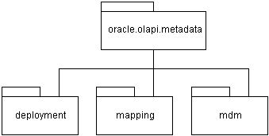
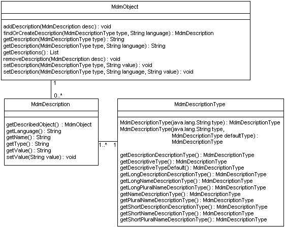
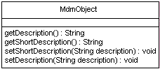
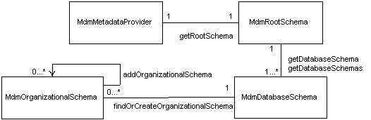
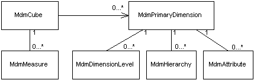
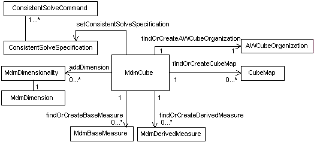
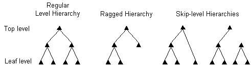

This chapter describes the classes in the Oracle OLAP Java API that represent OLAP dimensional and relational metadata objects. It also describes the classes that provide access to the metadata objects and to data sources, or that contain information about the metadata objects. This chapter includes the following topics:

- Overview of OLAP Java API Metadata Classes

- Identifying, Describing, and Classifying Metadata Objects

- Providing Metadata Objects

- Providing Access to Data Sources

For more information on getting existing metadata objects, see [Discovering Metadata](discovering-metadata.md). For more information on creating metadata objects, see [Creating Metadata and Analytic Workspaces](creating-metadata-and-analytic-workspaces.md).

### 2.1 Overview of OLAP Java API Metadata Classes

[Introduction to the OLAP Java API](introduction-olap-java-api.md) describes the OLAP dimensional data model and briefly mentions some of the OLAP Java API classes that implement that model. Those classes are in the `oracle.olapi.metadata` packages. Using those classes, you can do the following tasks.

- Gain access to the available metadata objects

- Create new metadata objects

- Deploy metadata objects in an analytic workspace or as relational objects

- Map metadata objects to data sources

- Export metadata objects to XML or import them from XML

- Create `Source` objects to query the data

Figure 2-1 shows the `oracle.olapi.metadata` packages.

Figure 2-1 The oracle.olapi.metadata Packages

[Description of "Figure 2-1 The oracle.olapi.metadata Packages"](img_text/mtdtpkgs.md)

The packages are the following:

- `oracle.olapi.metadata`, which has interfaces and abstract classes that specify the most basic characteristics of metadata objects and metadata providers.

- `oracle.olapi.metadata.mdm`, which has classes that implement the MDM (multidimensional model) metadata model. This package has classes that represent the metadata objects, classes that provide access to those objects, and classes that contain descriptive information about the objects.

- `oracle.olapi.metadata.deployment`, which has classes that specify the organization of a metadata object as an analytic workspace object or as a relational object.

- `oracle.olapi.metadata.mapping`, which has classes that map a metadata object to relational data sources.

Some of the classes in the `oracle.olapi.metadata.mdm` package directly correspond to OLAP dimensional metadata objects. Table 2-1 presents some of these correspondences.

Table 2-1 Corresponding Dimensional and MDM Objects

| Dimensional Metadata Objects | MDM Metadata Objects                          |
|:-----------------------------|:----------------------------------------------|
| Cube                         | `MdmCube`                                     |
| Measure                      | `MdmBaseMeasure`                              |
| Calculated measure           | `MdmDerivedMeasure`                           |
| Measure folder               | `MdmOrganizationalSchema`                     |
| Dimension                    | `MdmTimeDimension` and `MdmStandardDimension` |
| Hierarchy                    | `MdmLevelHierarchy` and `MdmValueHierarchy`   |
| Level                        | `MdmDimensionLevel` and `MdmHierarchyLevel`   |
| Attribute                    | `MdmBaseAttribute` and `MdmDerivedAttribute`  |

Other classes in the package correspond to relational objects. Table 2-2 shows those correspondences.

Table 2-2 Corresponding Relational and MDM Objects

| Relational Objects | MDM Metadata Objects |
|:-------------------|:---------------------|
| Schema             | `MdmDatabaseSchema`  |
| Table              | `MdmTable`           |
| Table column       | `MdmColumn`          |

### 2.2 Identifying, Describing, and Classifying Metadata Objects

Most OLAP Java API metadata objects have a unique identifier (ID), a name, and an owner or a containing object. You can also associate descriptions and classifications to most metadata objects.

Most metadata classes extend the abstract `oracle.olapi.metadata.BaseMetadataObject` class. A `BaseMetadataObject` can have a name and an ID. You can get most metadata objects by name. The ID is used internally by Oracle OLAP, but an application can also use the ID to get some metadata objects.

A `BaseMetadataObject` also has an owner, which is returned by the `getOwner` method. For most metadata objects, the owner is an `MdmDatabaseSchema`. For the `MdmRootSchema` and `MdmMeasureDimension` objects, the owner is the root schema. For an `MdmViewColumn`, which is not a subclass of `BaseMetadataObject`, the `getOwner` method returns the owning implementation of the `MdmViewColumnOwner` interface, such as an `MdmPrimaryDimension`, an `MdmBaseAttribute`, or an `MdmMeasure`. An `MdmViewColumn` represents a column in an OLAP view. For information on OLAP views, see "Using OLAP Views".

Some `BaseMetadataObject` objects are contained by the metadata object that created them. For example, an `MdmBaseMeasure` is contained by the `MdmCube` that created it. You can get the container for a metadata object by calling the `getContainedByObject` method.

The `MdmObject` class, which is an abstract subclass of `BaseMetadataObject`, adds associations with descriptive objects and classifications. Typically, a descriptive object contains a name or descriptive text that you associate with the metadata object itself. Applications often use a descriptive object for display purposes in a user interface. A classification is a string value that your application assigns to the metadata object. Your application handles the classification for whatever purpose you want.

#### 2.2.1 Identifying Objects

You can identify a `BaseMetadataObject` object by name and by ID. Namespaces identify the type and the format of legacy metadata objects.

##### 2.2.1.1 Getting and Setting Names

Most metadata objects have a name that you can get by calling the `getName` method of the object. For some objects, you can assign a name when you create the object. For example, an `oracle.olapi.metadata.deployment.AW` object represents an analytic workspace. When you create an `AW` by calling the `findOrCreateAW` method of an `MdmDatabaseSchema`, you use the `publicName` parameter of the method to specify a name for the `AW` object that the method returns.

For some objects, you can use the `setName` method to change the name of an existing object. For example, you can change the name of an `MdmStandardDimension` by calling the `setName` method of the dimension object. The new name does not take effect until you commit the root `Transaction` of the session. After you call `setName`, but before you commit the root `Transaction`, the `getNewName` method returns the new name while the `getName` method returns the existing name. For more information on getting objects by name, see "[About Creating a Metadata Object or a Query in a Transaction](using-transaction-provider.md)"

You can get some objects by name from an `MdmDatabaseSchema`. For more information on getting objects by name, see "Representing Schemas".

For use in displaying names or descriptions in a user interface, or for any purpose you want, you can associate any number of names and descriptions with an `MdmObject` by using the `MdmDescription` class. For information on using that class, see "Using Descriptions".

##### 2.2.1.2 Describing Unique Identifiers

Most metadata objects have a unique identifier (ID). The identifier has one of the following forms.

- `objectName`

- `ownerName.objectName`

- `ownerName.containerName.objectName`

For example, for the `MdmDatabaseSchema` that represents the schema for the user `GLOBAL`, the identifier returned by the `getID` method is `GLOBAL`. For an `MdmPrimaryDimension` named PRODUCT_AWJ, the `getID` method returns `GLOBAL.PRODUCT_AWJ` and for an `MdmLevelHierarchy` of that dimension named PRODUCT_PRIMARY, the method returns `GLOBAL.PRODUCT_AWJ.PRODUCT_PRIMARY`.

The ID of a metadata object is persistent. However, if the name or the owner of a metadata object changes, then the ID changes as well. For more information on getting objects by ID, see "Getting Metadata Objects by ID".

For a legacy 10g metadata object, the first part of the identifier is a namespace. The namespace is followed by the namespace delimiter, which is two periods. An example of the identifier of a 10g dimension is `AWXML_DIMENSION..GLOBAL.PRODUCT_AW`.

##### 2.2.1.3 Supporting Legacy Metadata Objects

In Oracle Database, Release 11g, Oracle Database, Release 11g Oracle OLAP supports legacy 10g OLAP Java API applications. Namespaces identify 10g metadata objects and enable them to exist in the same session as 11g objects.

###### 2.2.1.3.1 Supporting Legacy Applications

To support legacy applications that use OLAP metadata objects that were created in 10g, the `oracle.olapi.data.source.DataProvider` class has a metadata reader mode. By default, the metadata reader recognizes Oracle OLAP 10g and 11g metadata objects. You can specify a metadata reader mode with a property of a `java.util.Properties` object or with a string in the proper XML format. For information on the modes and how to specify one, see the constructor methods of the `DataProvider` class in the [Oracle OLAP Java API Reference](../olapi/index.md) documentation.

###### 2.2.1.3.2 Describing Namespaces

In Oracle Database, Release 10g, an Oracle OLAP cube, dimension, or measure folder could have the same name as a relational table or view. In Release 11g, top-level OLAP metadata objects are stored in the Oracle Database data dictionary, so they cannot have the same name as another relational object. A namespace designation allows a legacy OLAP Java API 10g metadata object to exist in the same session as 11g metadata objects. Such legacy metadata objects were created by using classes in the `oracle.olapi.AWXML` package of the Oracle OLAP Analytic Workspace Java API or by using CWM PL/SQL packages. For 10g and 11g objects to exist in the same session, the metadata reader mode of the `DataProvider` must be set to `ALL`. The `ALL` mode is the default metadata reader mode. For more information on metadata reader mode settings, see the `DataProvider` class documentation in [Oracle OLAP Java API Reference](../olapi/index.md).

The metadata objects for a 10g cube, dimension, and measure folder are represented in 11g by the `MdmCube`, `MdmPrimaryDimension`, and `MdmSchema` classes. An instance of one of those classes can have a namespace associated with it, which is returned by the `getNamespace` method. For an 11g object, the namespace is null.

The 11g XML definition of a 10g object has a `Namespace` attribute. For information on exporting and importing XML definitions of metadata objects, see "Exporting and Importing Metadata as XML Templates".

The namespace of a legacy metadata object identifies the metadata format and the type of object. It begins with either `AWXML_` or `CWM_` and then has the type of object, such as `CUBE` or `DIMENSION`. For example, a dimension created by using the Oracle OLAP Analytic Workspace Java API in Oracle Database 10g, Release 2 (10.2), would have the namespace `AWXML_DIMENSION` in 11g.

The valid namespaces are represented by static constant fields of the `MdmMetadataProvider` class. The `getValidNamespaces` method of that class returns a list of the valid namespaces, including the default namespace. You cannot create a new namespace.

You can use the constant fields to get a legacy metadata object from an `MdmDatabaseSchema`. For example, the following code gets the PRODUCT_AW dimension. In the code, `mdmDBSchema` is the `MdmDatabaseSchema` for the GLOBAL user.

    MdmStandardDimension mdmProdAWDim =
      mdmDBSchema.findOrCreateStandardDimension("PRODUCT_AW",
        MdmMetadataProvider.AWXML_DIMENSION_NAMESPACE);

In the `ALL` metadata reader mode, you get an existing 10g metadata object but you cannot create a new one. If the legacy metadata object does not exist, the method returns an 11g object that has the specified name.

#### 2.2.2 Using Descriptions

With an `MdmDescription` object, you can associate descriptive information with an `MdmObject` object.

An `MdmDescriptionType` object represents the type of description of an `MdmDescription`. You can use `MdmDescription` objects to display names, descriptions, or other information for a metadata object in a user interface. `MdmDescription` objects are created, assigned, and handled entirely by your application.

**Note:**

A descriptive name that you associate with an `MdmObject` through an `MdmDescription` is not the object name that is returned by the `MdmObject.getName` method. The object name is used by Oracle OLAP to identify the object internally. A descriptive name is used only by an application.

The OLAP Java API defines some types of descriptions. The `MdmDescriptionType` class has static methods that provide the following description types:

- Name

- Short name

- Long name

- Plural name

- Short plural name

- Long plural name

- Description

- Short description

- Long description

You get one of these defined description types by calling a method of `MdmDescriptionType`. For example, the following code gets the description type object for a long name and a long description.

    MdmDescriptionType mdmLongNameDescrType =
      MdmDescriptionType.getLongNameDescriptionType();
    MdmDescriptionType mdmLongDescrDescrType =
      MdmDescriptionType.getLongDescriptionDescriptionType();

You can create a new type of description by using a constructor method of `MdmDescriptionType`. You can get the type of an `MdmDescriptionType` object with the `getDescriptiveType` method. The first figure below shows the methods of `MdmDescriptionType`.

Some of the defined description types have an associated default description type. You change a default description type or assign a default description type for a new or existing `MdmDescriptionType` by using the `MdmDescriptionType(java.lang.String type, MdmDescriptionType defaultType)` constructor method. You can get the default type of an `MdmDescriptionType` object with the `getDescriptiveTypeDefault` method.

Example 2-1 Associating a Description with an MdmObject

To associate an `MdmDescription` object with an `MdmObject`, use the `findOrCreateDescription` or a `setDescription` method of the `MdmObject`. The `findOrCreateDescription` method returns an `MdmDescription` object. To specify a value for the description, use the `setValue` method of `MdmDescription`.

This example shows both ways of associating an `MdmDescription` with an `MdmObject`. In the example, `mdmProdDim` is an `MdmStandardDimension` object.

    MdmDescription mdmShortNameDescr =
      mdmProdDim.findOrCreateDescription(
        MdmDescriptionType.getShortNameDescriptionType(), "AMERICAN");
    mdmShortNameDescr.setValue("Product");

    mdmProdDim.setDescription(
      MdmDescriptionType.getLongNameDescriptionType(), "Product Dimension");

This figure shows the methods of `MdmObject` that use `MdmDescription` and `MdmDescriptionType` objects. It also shows the `MdmDescription` and `MdmDescriptionType` classes and their methods, and the associations between the classes. An `MdmObject` can have from zero to many `MdmDescription` objects. An `MdmDescription` is associated with one `MdmObject` and one `MdmDescriptionType`. An `MdmDescriptionType` can be associated with one or more `MdmDescription` objects.

Figure 2-2 MdmObject and MdmDescription Associations

[Description of "Figure 2-2 MdmObject and MdmDescription Associations"](img_text/mdmdsctp.md)

Versions of the OLAP Java API before 11g did not have the `MdmDescription` and `MdmDescriptionType` classes. In those versions, the `MdmObject` class had only the following methods for getting and setting descriptions.

Figure 2-3 Methods for Getting and Setting Descriptions Before 11g

[Description of "Figure 2-3 Methods for Getting and Setting Descriptions Before 11g"](img_text/mdmobjds.md)

For backward compatibility, the OLAP Java API still supports these methods, but implements them internally using `MdmDescription` and `MdmDescriptionType` objects.

#### 2.2.3 Using Classifications

A classification is a property of an `MdmObject`. You assign a classification to an object and then use the classification as you please. For example, you could add a classification with the value of "HIDDEN" to indicate that an application should not display the object in the user interface. You can assign a classification to an `MdmObject` by using the `addObjectClassification` method of the object. You can get the classifications with the `getObjectClassifications` method and remove one with the `removeObjectClassification` method.

### 2.3 Providing Metadata Objects

Access to Oracle OLAP Java API metadata objects is initially provided by an `MdmMetadataProvider` and by `MdmSchema` objects. The `MdmMetadataProvider` also has the ability to import or export an XML representation of a metadata object. The following topics describe the `MdmMetadataProvider` class and its uses.

- Describing Metadata Providers

- Representing Schemas

#### 2.3.1 Describing Metadata Providers

Before you can get or create OLAP Java API metadata objects, you must first create an `MdmMetadataProvider`. For information on creating an `MdmMetadataProvider`, see "[Creating an MdmMetadataProvider](discovering-metadata.md)".

With the `getRootSchema` method of the `MdmMetadataProvider`, you can get the root `MdmSchema` object, which is an instance of the `MdmRootSchema` class. The root schema is a container for `MdmDatabaseSchema` objects.

`MdmDatabaseSchema` objects are owners of top-level metadata objects such as `AW`, `MdmCube`, and `MdmPrimaryDimension` objects. The top-level objects are first-class data objects and are represented in the Oracle Database data dictionary. Because they are in the data dictionary, these OLAP data objects are available to SQL queries. You create top-level metadata objects by using `findOrCreate` methods of an `MdmDatabaseSchema`.

The top-level objects are the containers of objects such as `MdmMeasure`, `MdmHierarchy`, and `MdmAttribute` objects. You create the contained objects by using methods of the top-level objects.

For more information on `MdmSchema` objects, see "Representing Schemas". For information on top-level metadata objects, see "Providing Access to Data Sources".

You can also get an existing metadata object by calling the `getMetadataObject` or `getMetadataObjects` method of the `MdmMetadataProvider` and providing the ID of the metadata object.

The following topics describe getting metadata objects:

- Getting Metadata Objects by ID

- Exporting and Importing Metadata as XML Templates

##### 2.3.1.1 Getting Metadata Objects by ID

Usually, you get or create metadata objects by calling `findOrCreate` methods on the owning object. For example, you can get or create an `MdmCube` by calling the `findOrCreateCube` method of an `MdmDatabaseSchema` object. However, you can also get an existing metadata object from an `MdmMetadataProvider` by specifying the ID of the object. The `MdmMetadataProvider.getMetadataObject` method takes a `String` that is the ID of an object and returns the object. The `getMetadataObjects` method takes a `List` of IDs and returns a `List` of objects.

You can store the ID of a metadata object from one session and then get the object by that ID in another session. Of course, getting an object by a stored ID assumes that the object still exists and that the ID of the object has not changed. For some metadata objects, you can change the name or the owner. If the name or owner of the object changes, then the ID of the object changes.

##### 2.3.1.2 Exporting and Importing Metadata as XML Templates

The `MdmMetadataProvider` class has many methods for exporting and importing metadata objects to and from XML definitions of those objects. The XML definition is a template from which Oracle OLAP can create the metadata objects defined.

You can use XML templates to transport metadata objects between Oracle Database instances. You can exchange XML templates between Analytic Workspace Manager and an OLAP Java API application; that is, in Analytic Workspace Manager you can import a template that you created with an `MdmMetadataProvider` export XML method, and you can use an `importXML` method to import an XML template created by Analytic Workspace Manager.

When exporting XML, you can rename objects or specify bind variables for the values of XML attributes. You can also supply an implementation of the `XMLWriterCallback` interface to manage some aspects of the export process. When importing XML, you can specify an `MdmDatabaseSchema` to own the imported objects, bind values to replace the bind variables in the exported XML, and an implementation of the `XMLParserCallback` interface to manage some aspects of the import process.

The following topics describe exporting and importing metadata objects through XML templates.

- Exporting XML Templates

- Importing XML Templates

- Describing Bind Variables in XML Templates

###### 2.3.1.2.1 Exporting XML Templates

For exporting metadata objects to XML templates, `MdmMetadataProvider` has many signatures of the `exportFullXML` and `exportIncrementalXML` methods. The methods export a template to a `java.lang.String` or to a `java.io.Writer`.

You can use an XML template produced by these methods to import metadata objects through the `importXML` methods of `MdmMetadataProvider`. You can also use the XML template to import metadata objects in Analytic Workspace Manager.

An `exportFullXML` method exports the complete XML definitions for the specified objects or for the objects that you have created or modified since a specified `oracle.olapi.transaction.Transaction`. For an example of using the `exportFullXML` method, see [Example 4-10](creating-metadata-and-analytic-workspaces.md).

An `exportIncrementalXML` method exports only the XML attributes that have changed for a metadata object since a specified `Transaction`. If you specify a `List` of objects, then the exported templates contain the XML attributes that have changed for the objects that are in the list. The exported incremental XML includes the type and name of the objects in the ownership and containment hierarchy of the changed object.

The `exportFullXML` and `exportIncrementalXML` methods take various combinations of the following parameters.

- A `List` of the objects to export or a `Transaction`.

- A `Writer` to which Oracle OLAP exports the XML. If you do not specify a `Writer`, then the method returns a `java.lang.String` that contains the XML.

- A `java.util.Map` that has metadata object references as keys and that has, as the objects for the keys, `String` values that contain new names for the referenced objects. With this `Map`, you can rename an object that you export. You can specify `null` for the parameter if you do not want to rename any objects.

  If you specify a `Map` for this `renameMap` parameter, then the Oracle OLAP XML generator renames a referenced object during the export. You can copy the definition of an existing object this way, by renaming an object during the export of an XML template and then importing the template.

- A `boolean` that specifies whether or not to include the name of the owning object in the exported XML.

- An optional `Map` that has metadata object references as keys and that has, as the objects for the keys, `String` values that function like SQL bind variables. For more information on the bind variables in this parameter, see "Describing Bind Variables in XML Templates".

- An optional implementation of the `oracle.olapi.metadata.XMLWriterCallback` interface. With an `XMLWriterCallback`, you can specify whether or not to exclude an attribute or an owner name from the exported XML.

All metadata objects that share an ancestor are grouped together in the exported XML. For any object that is not a top-level object and whose top-level container is not in the `List` of the objects to export, the exported template contains an incremental definition to the object and a full definition below that. This supports the export of objects such as a calculated measure in a cube without having to export the entire cube template.

If an `MdmDatabaseSchema` is in the `List` of objects to export, then the exported template includes all objects within the database schema. If an `oracle.olapi.metadata.deployment.AW` object is in the `List`, then the exported template includes all of the objects that are contained by the `AW`. If the `MdmRootSchema` is in the list, it is ignored.

###### 2.3.1.2.2 Importing XML Templates

For importing metadata objects as XML templates, `MdmMetadataProvider` has several signatures of the `importXML` method.

An `importXML` method imports XML definitions of objects and either creates new objects or modifies existing objects. The `importXML` method take various combinations of the following parameters.

- A `java.io.Reader` for input of the XML or a `String` that contains the XML to import.

- An `MdmDatabaseSchema` to contain the new or modified metadata objects.

- A `boolean`, `modifyIfExists`, that indicates whether or not you want differences in the imported XML definition to modify an existing object of the same name.

- An optional `Map`, `bindValues`, that contains bind variables as keys and, as the objects for the keys, `String` values to replace the bind variables. For more information on the bind values in this parameter, see "Describing Bind Variables in XML Templates".

- An optional implementation of the `oracle.olapi.metadata.XMLParserCallback` interface.

If the value of the `modifyIfExists` parameter is `true` and if the imported XML contains a full definition for an object that already exists and the object definition is different from the XML, then the method merges the new or changed elements of the object definition with the existing definition of the object. If the value of `modifyIfExists` is `false` and if the XML contains a full definition for an object that already exists, then the `importXML` method throws an exception.

With the `bindValues` parameter, you can specify a `Map` that has key/object pairs that Oracle OLAP uses to replace bind variables when importing an XML template. A key in the `Map` is a bind variable to replace and the object paired to the key is the value with which to replace the bind variable. When you import a template, if you specify a `Map` that contains bind variables as keys, then Oracle OLAP replaces a bind variable in the imported XML with the value specified for the bind variable in the `bindValues` `Map`.

You can pass an implementation of the `XMLParserCallback` interface to an `importXML` method as the `parserCallback` parameter. With the `XMLParserCallback`, you can specify how Oracle OLAP handles an error that might occur when importing XML. The `XML11_2_ParserCallback` interface adds methods for renaming the imported object and for suppressing attributes of the imported object.

###### 2.3.1.2.3 Describing Bind Variables in XML Templates

The `exportFullXML` and `exportIncrementalXML` methods have an optional `bindVariables` parameter. This parameter is a `Map` that has metadata objects as keys and `String` values as the objects for the keys. The `String` values function like SQL bind variables. During the export of the XML, the Oracle OLAP XML generator replaces the name of the referenced object with the bind variable.

If you provide a `Map` for the `bindVariables` parameter to an `exportFullXML` or `exportIncrementalXML` method, then the XML produced by the method begins with the following declaration.

    <!DOCTYPE Metadata [
    <!ENTITY % BIND_VALUES PUBLIC "OLAP BIND VALUES" "OLAP METADATA">
    %BIND_VALUES;
     ]>

A value specified in the `bindVariables` map appears in the exported XML in the format `"&BV;"`, where `BV` is the bind variable.

The `bindValues` parameter of an `importXML` method specifies values that Oracle OLAP uses to replace the bind variables when importing an XML template. When you import a template, if you specify a `Map` that contains bind variables as keys, then Oracle OLAP replaces a bind variable in the imported XML with the `String` specified as the object for the bind variable key in the `Map`.

If you provide a `Map` for the `bindValues` parameter, then the `inXML` string that you provide to the method must include the `!DOCTYPE Metadata` declaration and the bind variables in the XML to import must be in the `"&BV;"` format.

#### 2.3.2 Representing Schemas

Schemas are represented by the `MdmSchema` class and the subclasses of it. An `MdmSchema` is owner of, or a container for, `MdmCube`, `MdmDimension`, and other `MdmObject` objects, including other `MdmSchema` objects. In the 10g and earlier versions of the OLAP Java API, the `MdmSchema` class had more than one role. The API had one root `MdmSchema`, an `MdmSchema` for each measure folder, and custom `MdmSchema` objects that an application could create.

The 11g OLAP Java API introduced subclasses of `MdmSchema` to separate and define the different roles. In 11g, `MdmSchema` remains a concrete class for compatibility with the earlier versions and for use in 10g metadata reader modes.

In 11g, an `MdmSchema` is an instance of one of the following subclasses of `MdmSchema`:

- `MdmRootSchema`, which is a container for `MdmDatabaseSchema` objects and is supplied by the system.

- `MdmDatabaseSchema`, which represents the relational schema for a database user and which creates and owns `MdmCube`, `MdmDimension`, and other `MdmObject` objects. `MdmDatabaseSchema` objects are supplied by the system.

- `MdmOrganizationalSchema`, which you can use to organize measures and other `MdmOrganizationalSchema` objects.

The following topics describe the subclasses of `MdmSchema`.

- Representing the Root Schema

- Representing Database Schemas

- Representing Organizational Schemas

##### 2.3.2.1 Representing the Root Schema

The root schema is a container for database schema objects. This top-level schema is represented by the `MdmRootSchema` class. You get the `MdmRootSchema` with the `getRootSchema` method of the `MdmMetadataProvider`. From the `MdmRootSchema` you can get all of the `MdmDatabaseSchema` objects or you can get an individual `MdmDatabaseSchema` by name.

The `MdmRootSchema` class also contains all of the `MdmCube`, `MdmMeasure`, and `MdmPrimaryDimension` objects that are provided by the `MdmMetadataProvider`, and has methods for getting those objects. However, the `List` of objects returned by those methods contains only the cubes, measures, or dimensions that the user has permission to see.

Figure 2-4 shows the associations between an `MdmMetadataProvider` and the subclasses of `MdmSchema`.

Figure 2-4 Associations Between MdmMetadataProvider and the MdmSchema Subclasses

[Description of "Figure 2-4 Associations Between MdmMetadataProvider and the MdmSchema Subclasses"](img_text/mdmschas.md)

##### 2.3.2.2 Representing Database Schemas

The relational schema owned by a database user is represented by an `MdmDatabaseSchema` object.

The `MdmRootSchema` has one `MdmDatabaseSchema` object for each database user. An `MdmDatabaseSchema` has the same name as the database user. For example, the name of the `MdmDatabaseSchema` for the user GLOBAL is `GLOBAL`.

You can get one or all of the `MdmDatabaseSchema` objects with methods of the `MdmRootSchema`. However, access to the objects that are owned by an `MdmDatabaseSchema` is determined by the security privileges granted to the user of the session.

An `MdmDatabaseSchema` is the owner of top-level OLAP metadata objects and the objects created by them. You use an `MdmDatabaseSchema` to get existing metadata objects or to create new ones. The top-level objects are the following:

- `AW`

- `MdmCube`

- `MdmNamedBuildProcess`

- `MdmOrganizationalSchema`

- `MdmPrimaryDimension`

- `MdmTable`

Except for an `MdmTable`, you can create new top-level objects, or get existing ones, with the `findOrCreate` methods such as `findOrCreateAW` and `findOrCreateStandardDimension`. Creating objects is described in [Discovering Metadata](discovering-metadata.md).

When you commit the `Transaction` in which you have created top-level OLAP metadata objects, those objects then exist in the Oracle data dictionary. They are available for use by ordinary SQL queries as well as for use by applications that use the Oracle OLAP Java API.

Because the metadata objects exist in the Oracle data dictionary, an Oracle Database DBA can restrict access to certain types of the metadata objects. In a client application, you can set such restrictions by using the JDBC API to send standard SQL `GRANT` and `REVOKE` commands through the JDBC connection for the user session.

You can get an `MdmTable`, or other top-level object, with the `getTopLevelObject` method. You can get all of the instances of a particular type of top-level object with methods such as `getAWs`, `getDimensions`, or `getOrganizationalSchemas`, or you can use the `getSchemaObjects` to get all of the objects owned by the `MdmDatabaseSchema`. You can add or remove top-level objects with methods like `addAW` and `removeSchemaObject`.

##### 2.3.2.3 Representing Organizational Schemas

An OLAP measure folder organizes measures, cubes, and dimensions. A measure folder is represented by the `MdmOrganizationalSchema` class. Measure folders provide a way to differentiate among the similarly named measures. For example, a user may have access to several schemas with measures named SALES or COSTS. You could separate measures that have the same name into different `MdmOrganizationalSchema` objects. An `MdmOrganizationalSchema` has methods for adding or removing cubes, dimensions, and measures. You can nest organizational schemas, so the class also has methods for adding and removing other `MdmOrganizationalSchema` objects.

### 2.4 Providing Access to Data Sources

Some of the classes in the `mdm` package that represent objects that contain or provide access to the data in the data store. Some of these classes represent OLAP dimensional data model objects, which include cubes, measures, dimensions, levels, hierarchies, and attributes. Other `mdm` classes represent relational objects such as tables, or columns in a view or table.

Figure 2-5 shows the associations between the classes that implement dimensional data model objects. An `MdmCube` can contain from zero to many `MdmMeasure` objects. An `MdmMeasure` is contained by one `MdmCube` object. An `MdmCube` can have from zero to many `MdmPrimaryDimension` objects, which are associated with it through `MdmDimensionality` objects. An `MdmPrimaryDimension` can contain from zero to many `MdmDimensionLevel` objects, `MdmHierarchy` objects, and `MdmAttribute` objects.

Figure 2-5 Associations of Dimensional Data Model Classes

[Description of "Figure 2-5 Associations of Dimensional Data Model Classes"](img_text/dimmodel.md)

The classes that represent these dimensional or relational data objects are subclasses of the `MdmSource` class. Subclasses of `MdmSource` have a `getSource` method, which returns a `Source` object. You use `Source` objects to define a query of the data. You then use `Cursor` objects to retrieve the data. For more information about working with `Source` and `Cursor` objects, see [Understanding Source Objects](understanding-source-objects.md) and [Understanding Cursor Classes and Concepts](understanding-cursor-classes-and-concepts.md).

You can also use SQL to query the views that Oracle OLAP automatically generates for the cubes, dimensions, and hierarchies. For information on querying these views, see "Getting Dimension and Hierarchy View and View Column Names".

The following topics describe the classes that provide access to data sources.

- Representing Cubes and Measures

- Representing Dimensions, Levels, and Hierarchies

- Representing Dimension Attributes

- Using OLAP Views

#### 2.4.1 Representing Cubes and Measures

Cubes are the physical implementation of the dimensional model. They organize measures that have the same set of dimensions. Cubes and measures are dimensioned objects; the dimensions associated with a cube identify and categorize the data of the measures. The following topics describe cubes and measures.

- Representing Cubes

- Representing Measures

##### 2.4.1.1 Representing Cubes

An OLAP cube is represented by the `MdmCube` class. An `MdmCube` is a container for `MdmMeasure` objects that are dimensioned by the same set of `MdmPrimaryDimension` objects. An application creates `MdmBaseMeasure` or `MdmDerivedMeasure` objects with the `findOrCreateBaseMeasure` and `findOrCreateDerivedMeasure` methods of an `MdmCube`. It associates each of the dimensions of the measures with the cube by using the `addDimension` method.

An `MdmCube` usually corresponds to a single fact table or view. To associate the table or view with the cube, you use `Query` and `CubeMap` objects. You get the `Query` for the table or view and then associate the `Query` with the `CubeMap` by using the `setQuery` method of the `CubeMap`.

The `CubeMap` contains `MeasureMap` and `CubeDimensionalityMap` objects that map the measures and dimensions of the cube to data sources. With the `MeasureMap`, you specify an `MdmBaseMeasure` and an `Expression` that identifies the column in the fact table or view that contains the base data for the measure.

To map the dimensions of the cube you get the `MdmDimensionality` objects of the cube. You create a `CubeDimensionalityMap` for each `MdmDimensionality`. You then specify an `Expression` for the `CubeDimensionalityMap` that identifies the foreign key column for the dimension in the fact table or view. If you want to specify a dimension column other than the column for the leaf-level dimension members, then you must specify a join `Condition` with the `setJoinCondition` method of the `CubeDimensionalityMap`.

An `MdmCube` has an associated `CubeOrganization`. The `CubeOrganization` deploys the cube in an analytic workspace or as a relational database object. To deploy a cube to an analytic workspace, you call the `findOrCreateAWCubeOrganization` method of the `MdmCube`. You use the `AWCubeOrganization` returned by that method to specify characteristics of the cube, such as how Oracle OLAP builds the cube, how the cube stores measure data, and whether the database creates materialized views for the cube. For information on the `AWCubeOrganization` class, see Oracle OLAP Java API Reference.

If the `AWCubeOrganization` has a materialized view option of `REWRITE_MV_OPTION`, then Oracle OLAP creates a materialized view for the cube that can be used by the database query rewrite system. If the materialized view option is `REWRITE_WITH_ATTRIBUTES_MV_OPTION`, then Oracle OLAP includes in the rewrite materialized view the dimension attributes for which the `isPopulateLineage` method returns `true`. You set the materialized view options with the `setMVOption` method of the `AWCubeOrganization`.

An `MdmCube` also has a `ConsistentSolveSpecification` object, which contains one or more `ConsistentSolveCommand` objects that specify how Oracle OLAP calculates (or solves) the values of the measures of the cube. For example, as the `ConsistentSolveCommand`, you could specify an `AggregationCommand` that represents the `SUM` or the `MAX` function. You specify the `ConsistentSolveSpecification` with the `setConsistentSolveSpecification` method of the cube.

A cube is consistent when the values of the measures match the specification, for example, when the values of the parents are equal to the `SUM` of the values of their children. A cube becomes consistent when the `BuildProcess` executes the `ConsistentSolveCommand`.

For examples of creating `MdmCube` and `MdmMeasure` objects and mapping them, and of the other operations described in this topic, see [Example 4-7](creating-metadata-and-analytic-workspaces.md) and [Example 4-8](creating-metadata-and-analytic-workspaces.md).

Figure 2-6 shows the associations between an `MdmCube` and the some of the classes mentioned in this topic. The figure shows an `MdmCube` as deployed in an analytic workspace.

Figure 2-6 MdmCube and Associated Objects

[Description of "Figure 2-6 MdmCube and Associated Objects"](img_text/cubeasso.md)

##### 2.4.1.2 Representing Measures

An `MdmMeasure` is an abstract class that represents a set of data that is organized by one or more `MdmPrimaryDimension` objects. The structure of the data is similar to that of a multidimensional array. Like the dimensions of an array, which provide the indexes for identifying a specific cell in the array, the `MdmPrimaryDimension` objects that organize an `MdmMeasure` provide the indexes for identifying a specific value of the `MdmMeasure`.

For example, suppose you have an `MdmMeasure` that has data that records the number of product units sold to a customer during a time period and through a sales channel. The data of the measure is organized by dimensions for products, times, customers, and channels (with a channel representing the sales avenue, such as catalog or internet.). You can think of the data as occupying a four-dimensional array with the product, time, customer, and channel dimensions providing the organizational structure. The values of these four dimensions are indexes for identifying each particular cell in the array. Each cell contains a single data value for the number of units sold. You must specify a value for each dimension in order to identify a value in the array.

The values of an `MdmMeasure` are usually numeric, but a measure can have values of other data types. The concrete subclasses of `MdmMeasure` are `MdmBaseMeasure` and `MdmDerivedMeasure`.

An `MdmBaseMeasure` in an analytic workspace has associated physical storage structures. Typically an `MdmCube` gets the base data for an `MdmBaseMeasure` from a column in a fact table. Oracle OLAP then calculates the aggregate values of the measure and stores those values in an OLAP view for the cube.

When you create an `MdmBaseMeasure`, you can specify the SQL data type of the measure with the `setSQLDataType` method. If you do not specify it, then the `MdmBaseMeasure` has the data type of the source data to which you map it.

By specifying `true` with the `setAllowAutoDataTypeChange` method, you can allow Oracle OLAP to automatically set the SQL data type of the measure. This can be useful if the data type of a measure changes. If you allow the automatic changing of the SQL data type, then Oracle OLAP determines the appropriate SQL data type whether or not you have specified one with the `setSQLDataType` method.

An `MdmDerivedMeasure` has no associated physical storage. Oracle OLAP dynamically calculates the values for an `MdmDerivedMeasure` as needed.

The values of an `MdmMeasure` are determined by the structure of the `MdmPrimaryDimension` objects of the `MdmMeasure`. That is, each value of an `MdmMeasure` is identified by a tuple, which is a unique combination of members from the `MdmPrimaryDimension` objects.

The `MdmPrimaryDimension` objects of an `MdmMeasure` are `MdmStandardDimension` or `MdmTimeDimension` objects. They usually have at least one hierarchical structure. Those `MdmPrimaryDimension` objects include all of the members of their component `MdmHierarchy` objects. Because of this structure, the values of an `MdmMeasure` are of one or more of the following:

- Values from the fact table column, view, or calculation on which the `MdmMeasure` is based. These values are identified by a combination of the members at the leaf levels of the hierarchies of a dimension.

- Aggregated values that Oracle OLAP has provided. These measure values are identified by at least one member from an aggregate level of a hierarchy.

- Values specified by an `Expression` for a `MdmDerivedMeasure` or a custom dimension member.

As an example, imagine an `MdmBaseMeasure` that is dimensioned by an `MdmTimeDimension` and an `MdmStandardDimension` of products. The metadata objects for the measure and the dimensions are `mdmUnitCost`, `mdmTimeDim`, and `mdmProdDim`. Each of the `mdmTimeDim` and the `mdmProdDim` objects has all of the leaf members and aggregate members of the dimension it represents. A leaf member is one that has no children. An aggregate member has one or more children.

A unique combination of two members, one from `mdmTimeDim` and one from `mdmProdDim`, identifies each `mdmUnitCost` value, and every possible combination of dimension members is used to specify the entire set of `mdmUnitCost` values.

Some `mdmUnitCost` values are identified by a combination of leaf members (for example, a particular product item and a particular month). Other `mdmUnitCost` values are identified by a combination of aggregate members (for example, a particular product family and a particular quarter). Still other `mdmUnitCost` values are identified by a mixture of leaf and aggregate members.

The values of `mdmUnitCost` that are identified only by leaf members come directly from the column in the database fact table (or fact table calculation). They represent the lowest level of data. However, the values that are identified by at least one aggregate member are calculated by Oracle OLAP. These higher-level values represent aggregated, or rolled-up, data. Thus, the data represented by an `MdmBaseMeasure` is a mixture of fact table data from the data store and aggregated data that Oracle OLAP makes available for analytical manipulation.

#### 2.4.2 Representing Dimensions, Levels, and Hierarchies

A dimension represents the general concept of a list of members that can organize a set of data. For example, if you have a set of figures that are the prices of product items during month time periods, then the unit price data is represented by an `MdmMeasure` that is dimensioned by dimensions for time and product values. The time dimension includes the month values and the product dimension includes item values. The month and item values act as indexes for identifying each particular value in the set of unit price data.

A dimension can contain levels and hierarchies. Levels can group dimension members into parent and child relationships, where members of lower levels are the children of parents that are in higher levels. Hierarchies define the relationships between the levels. Dimensions usually have associated attributes.

The base class for dimension, level, and hierarchy objects is the abstract class `MdmDimension`, which extends `MdmSource`. An `MdmDimension` has methods for getting and for removing the attributes associated with the object. It also has methods for getting and setting the cardinality and the custom order of the members of the object. The direct subclasses of `MdmDimension` are the abstract `MdmPrimaryDimension` and `MdmSubDimension` classes.

`MdmPrimaryDimension` and `MdmHierarchyLevel` objects can have associated `MdmAttribute` objects. For information on attributes, see "Representing Dimension Attributes".

The following topics describe dimensions, levels, and hierarchies.

- Representing Dimensions

- Representing Dimension Levels

- Representing Hierarchies

- Representing Hierarchy Levels

##### 2.4.2.1 Representing Dimensions

Dimensions are represented by instances of the `MdmPrimaryDimension` class, which is an abstract subclass of `MdmDimension`. The concrete subclasses of the `MdmPrimaryDimension` class represent different types of data. The concrete subclasses of `MdmPrimaryDimension` are the following:

- `MdmMeasureDimension`, which has all of the `MdmMeasure` objects in the data store as the values of the dimension members. A data store has only one `MdmMeasureDimension`. You can obtain the `MdmMeasureDimension` by calling the `getMeasureDimension` method of the `MdmRootSchema`. You can get the measures of the data store by calling the `getMeasures` method of the `MdmMeasureDimension`.

- `MdmStandardDimension`, which has no special characteristics, and which typically represent dimensions of products, customers, distribution channels, and so on.

- `MdmTimeDimension`, which has time periods as the values of the members. Each time period has an end date and a time span. An `MdmTimeDimension` has methods for getting the attributes that record that information.

An `MdmPrimaryDimension` implements the following interfaces.

- `Buildable`, which is a marker interface for objects that you can specify in constructing a `BuildItem`.

- `MdmMemberListMapOwner`, which defines methods for finding or creating, or getting, a `MemberListMap` object.

- `MdmViewColumnOwner`, which is marker interface for objects that can have an associated `MdmViewColumn`.

- `MetadataObject`, which defines a method for getting a unique identifier.

- `MdmQuery`, which defines methods for getting the `Query` object associated with the implementing class and for getting information about the `Query`.

An `MdmPrimaryDimension` can have component `MdmDimensionLevel` objects that organize the dimension members into levels. It also can have `MdmHierarchy` objects, which organize the levels into the hierarchies. An `MdmPrimaryDimension` has all of the members of the component `MdmHierarchy` objects, while each of the `MdmHierarchy` objects has only the members in that hierarchy.

You can get all of the `MdmPrimaryDimension` objects that are contained by an `MdmDatabaseSchema` or an `MdmOrganizationalSchema` by calling the `getDimensions` method of the object. An `MdmDatabaseSchema` has methods for finding an `MdmTimeDimension` or an `MdmStandardDimension` by name or creating the object if it does not already exist.

`MdmStandardDimension` and `MdmTimeDimension` objects contain `MdmAttribute` objects. Some of the attributes are derived by Oracle OLAP, such as the parent attribute, and others you map to data in relational tables or to data that you specify by an `Expression`. For information on attributes, see "Representing Dimension Attributes".

An `MdmPrimaryDimension` can organize the dimension members into one or more levels. Each level is represented by an `MdmDimensionLevel` object. An `MdmStandardDimension` or an `MdmTimeDimension` can contain `MdmHierarchy` objects that organize the levels into hierarchical relationships. In an `MdmLevelHierarchy` the dimension levels are represented by `MdmHierarchyLevel` objects. The concrete `MdmDimensionLevel` and `MdmHierarchyLevel` classes, and the abstract `MdmHierarchy` class, are the direct subclasses of the abstract `MdmSubDimension` class.

##### 2.4.2.2 Representing Dimension Levels

An `MdmDimensionLevel` represents a set of dimension members that are at the same level. A dimension member can be in at most one dimension level. You get or create an `MdmDimensionLevel` with the `findOrCreateDimensionLevel` of an `MdmPrimaryDimension`. You can map an `MdmDimensionLevel` to a data source by using a `MemberListMap`.

An `MdmPrimaryDimension` has a method for getting a list of all of the `MdmDimensionLevel` objects that it contains. It also has a method for finding an `MdmDimensionLevel` by name or creating the object if it does not already exist.

##### 2.4.2.3 Representing Hierarchies

`MdmHierarchy` is an abstract subclass of `MdmSubDimension`. The concrete subclasses of `MdmHierarchy` are `MdmLevelHierarchy` and `MdmValueHierarchy`.

An `MdmHierarchy` organizes the members of a dimension into a hierarchical structure. The parent-child hierarchical relationships of an `MdmLevelHierarchy` are based on the levels of the dimension. In an `MdmValueHierarchy`, the hierarchical relationships are based on dimension member values and not on levels. An `MdmPrimaryDimension` can have more than one of either or both kinds of hierarchies.

The parent of a hierarchy member is recorded in a parent `MdmAttribute`, which you can get by calling the `getParentAttribute` method of the `MdmHierarchy`. The ancestors of a hierarchy member are recorded in an ancestors `MdmAttribute`, which you can get by calling the `getAncestorsAttribute` method.

An `MdmPrimaryDimension` has a method for getting a list of all of the `MdmHierarchy` objects that it contains. It also has methods for finding an `MdmLevelHierarchy` or `MdmValueHierarchy` by name or creating the object if it does not already exist.

The following topics describe the objects that represent level-based and value-based hierarchies.

- Representing a Level-based Hierarchy

- Representing a Value-based Hierarchy

###### 2.4.2.3.1 Representing a Level-based Hierarchy

`MdmLevelHierarchy` is a subclass of `MdmHierarchy`. An `MdmLevelHierarchy` has a tree-like structure with a top, or highest, level, and a leaf, or lowest, level. Each member may have zero or one parent in the hierarchy. Cycles are not allowed, for example where member A is the parent of member B, member B is the parent of member C, and member C is the parent of member A.

Members that are not the child of any other member are the top members. Members with children are aggregates or aggregate members of the hierarchy. Members with no children are the leaves or leaf members of the hierarchy.

Each member is in a level. The levels are ordered, from top level to leaf level. The order is determined by the order in which you create the `MdmDimensionLevel` objects of the `MdmPrimaryDimension`. The first `MdmDimensionLevel` that you create is the top level and the last one you create is the leaf level. For example, for the CALENDAR_YEAR hierarchy of the TIME_AWJ dimension, the `CreateAndBuildAW.java` and `SpecifyAWValues` example programs create four `MdmDimensionLevel` objects in the following order: TOTAL_TIME, YEAR, QUARTER, and MONTH. The top level is TOTAL_TIME and the leaf level is MONTH.

If a member of the hierarchy has a parent, then that parent must be in a higher level. Oracle OLAP expects that all leaf members in the hierarchy are in the leaf level. You can specify that Oracle OLAP allow the hierarchy to be ragged. In a ragged hierarchy, one or more leaf members are not in the leaf level. You can specify allowing the hierarchy to be ragged by calling the `setIsRagged(true)` method of the `MdmLevelHierarchy`.

Oracle OLAP also expects that if a member is in a level below the top level, then that member has a parent, and that the parent is in the level just above the level of the member. If a member is not at the top level and that member either does not have a parent or the parent is not in the next higher level, then the hierarchy is a `skip-level` hierarchy. You can specify allowing a skip-level hierarchy by calling the `setIsSkipLevel(true)` method of the `MdmLevelHierarchy`.

Figure 2-7 illustrates the relationships of members in a regular hierarchy, a ragged hierarchy, and two types of skip-level hierarchies.

Figure 2-7 Regular, Ragged, and Skip-level Hierarchies

[Description of "Figure 2-7 Regular, Ragged, and Skip-level Hierarchies"](img_text/ragskip.md)

The different levels of an `MdmLevelHierarchy` are represented by `MdmHierarchyLevel` objects. For an example of creating a level-based hierarchy, see "[Creating and Mapping an MdmLevelHierarchy](creating-metadata-and-analytic-workspaces.md)".

The `MdmLevelHierarchy` has all of the members of the hierarchy, and each of the component `MdmHierarchyLevel` objects has only the members at the level that it represents. An `MdmLevelHierarchy` can also represent a nonhierarchical list of members, in which case the `MdmLevelHierarchy` has one `MdmHierarchyLevel`, and both objects have the same members. You get the levels of an `MdmLevelHierarchy` by calling the `getHierarchyLevels` method.

An `MdmLevelHierarchy` has a method for getting a list of all of the `MdmHierarchyLevel` objects that it contains. It also has a method for finding an `MdmHierarchyLevel` by name or creating the object if it does not already exist.

An `MdmPrimaryDimension` can contain more than one `MdmLevelHierarchy`. For example, an `MdmTimeDimension` dimension might have two `MdmLevelHierarchy` objects, one organized by calendar year time periods and the other organized by fiscal year time periods. The `MdmHierarchyLevel` objects of one hierarchy associate `MdmDimensionLevel` objects of calendar year time periods with the hierarchy. The `MdmHierarchyLevel` objects of the other hierarchy associate `MdmDimensionLevel` objects of fiscal year time periods with that hierarchy. Generally, level-based hierarchies share the lowest level, so the `MdmHierarchyLevel` for the lowest level of each of the hierarchies associates the same `MdmDimensionLevel` with each hierarchy. For example, the calendar year hierarchy and the fiscal year hierarchy share the same `MdmHierarchyLevel` of month time periods.

###### 2.4.2.3.2 Representing a Value-based Hierarchy

A value-based hierarchy is one in which levels are not meaningful in defining the hierarchical relationships. This type of hierarchy is represented by the `MdmValueHierarchy` class, which is a subclass of `MdmHierarchy`. An example of a value hierarchy is the employee reporting structure of a company, which can be represented with parent-child relationships but without levels. For an example of creating a value-based hierarchy, see "[Creating and Mapping an MdmValueHierarchy](creating-metadata-and-analytic-workspaces.md)".

The OLAP view for the value hierarchy has a column that contains all employees, including those who are managers. It has another column that contains the parent members. Another column identifies the depth of the member in the hierarchy, where the member that has no manager is at depth 0 (zero), the employees who report to that manager are at level 1, and so on.

##### 2.4.2.4 Representing Hierarchy Levels

`MdmHierarchyLevel` is a subclass of `MdmSubDimension`. An `MdmHierarchyLevel` associates an `MdmDimensionLevel` with an `MdmLevelHierarchy`.

The order of the levels in the hierarchy is specified by the order in which you create the `MdmHierarchyLevel` objects for the `MdmLevelHierarchy`. The first `MdmHierarchyLevel` that you create is the highest level and the last one that you create is the lowest level. For an example of creating a hierarchy, see "[Creating and Mapping an MdmLevelHierarchy](creating-metadata-and-analytic-workspaces.md)".

#### 2.4.3 Representing Dimension Attributes

An OLAP dimension attribute is represented by an `MdmAttribute` object. An `MdmAttribute` has values that are related to members of an `MdmPrimaryDimension`. The `MdmAttribute` class is a subclass of `MdmDimensionedObject` because, like an `MdmMeasure`, the values of an `MdmAttribute` have meaning in relation to the members of the dimension.

The relation can be one-to-one, many-to-one, or one-to-many. For example, the PRODUCT_AWJ dimension has a short description attribute, a package attribute, and an ancestors attribute. The short description attribute has a separate value for each dimension member. The package attribute has a set of values, each of which applies to more than one dimension member. The ancestors attribute has multiple values that apply to a single dimension member. If an `MdmAttribute` does not apply to a member of an `MdmDimension`, then the `MdmAttribute` value for that member is `null`.

Table 2-3 shows the first few members of the PRODUCT_AWJ dimension and their related short description and package attribute values. Only some of the members of the ITEM level of the dimension have a package attribute. For other items, and for higher levels, the package attribute value is `null`, which appears as `NA` in the table.

Table 2-3 Dimension Members and Related Attribute Values

| Dimension Member       | Related Short Description | Related Package     |
|:-----------------------|:--------------------------|:--------------------|
| `TOTAL_PRODUCT::TOTAL` | `Total Product`           | `NA`                |
| `CLASS::HRD`           | `Hardware`                | `NA`                |
| `FAMILY::DISK`         | `CD/DVD`                  | `NA`                |
| `ITEM::EXT CD ROM`     | `External 48X CD-ROM`     | `NA`                |
| `ITEM::EXT DVD`        | `External - DVD-RW - 8X`  | `Executive`         |
| `ITEM::INT 8X DVD`     | `Internal - DVD-RW - 8X`  | `NA`                |
| `ITEM::INT CD ROM`     | `Internal 48X CD-ROM`     | `Laptop Value Pack` |
| `ITEM::INT CD USB`     | `Internal 48X CD-ROM USB` | `NA`                |
| `ITEM::INT RW DVD`     | `Internal - DVD-RW - 6X`  | `Multimedia`        |
| ...                    | ...                       | ...                 |

To get values from an `MdmAttribute`, you must join the `Source` for the `MdmAttribute` and a `Source` that specifies one or more members of the `MdmDimension`. For an explanation of joining `Source` objects, see [Understanding Source Objects](understanding-source-objects.md). For examples of joining the `Source` objects for an `MdmAttribute` and an `MdmDimension`, see [Example 4-5](creating-metadata-and-analytic-workspaces.md) and examples from [Understanding Source Objects](understanding-source-objects.md) and [Making Queries Using Source Methods](making-queries-using-source-methods.md), such as [Example 5-7](understanding-source-objects.md) and [Example 6-10](making-queries-using-source-methods.md).

The following topics describe the classes that represent dimension attributes.

- Describing the MdmAttribute Class

- Describing the MdmBaseAttribute Class

- Describing the MdmDerivedAttribute Class

##### 2.4.3.1 Describing the MdmAttribute Class

The abstract `MdmAttribute` class has a subclass, which is the abstract class `MdmSingleValuedAttribute`. That class has two concrete subclasses: `MdmBaseAttribute` and `MdmDerivedAttribute`.

###### 2.4.3.1.1 Describing Types of Attributes

An `MdmAttribute` is contained by the `MdmPrimaryDimension` that creates it. Some attributes, such as the parent attribute and the level attribute, are derived by Oracle OLAP from the structure of the dimension. Others are common attributes for which an `MdmPrimaryDimension` has accessor methods, such as the long and short description attributes, or the end date and time span attributes that an `MdmTimeDimension` requires. After you create one of those attributes, you associate it with the dimension through a method such as the `setShortValueDescriptionAttribute` method of an `MdmPrimaryDimension` or the `setTimeSpanAttribute` method of an `MdmTimeDimension`. You can also create attributes for your own purposes, such as the PACKAGE attribute in the GLOBAL_AWJ example analytic workspace.

###### 2.4.3.1.2 Associating an Attribute with an MdmSubDimension

After you create an attribute, you associate it with an `MdmSubDimension`. You can associate it with just a single `MdmSubDimension` by using the `addAttribute` method of the `MdmSubDimension`. You can also associate it with all of the `MdmDimensionLevel` objects of an `MdmPrimaryDimension` by using the `setIsVisibleForAll` method of the `MdmAttribute`. If you specify `true` with the `setIsVisibleForAll` method, then the attribute applies to all of the `MdmDimensionLevel` objects that are currently contained by the `MdmPrimaryDimension` and to any `MdmDimensionLevel` objects that you subsequently create or add to the dimension.

###### 2.4.3.1.3 Getting MdmAttribute Objects

The `getAttributes` method of an `MdmPrimaryDimension` returns all of the `MdmAttribute` objects that were created by a client application. The `getAttributes` method of an `MdmSubDimension` returns only those attributes that the application added to it with it the `addAttribute` method. Other methods of an `MdmPrimaryDimension` return specific attributes that Oracle OLAP generates, such as the `getHierarchyAttribute`, the `getLevelDepthAttribute`, or the `getParentAttribute` method.

###### 2.4.3.1.4 Specifying a Target Dimension

A target dimension for an attribute is similar to defining a foreign key constraint between columns in a table. All of the values of the attribute must also be keys of the target dimension.

You can specify a target dimension for an attribute by using the `setTargetDimension` method of the `MdmAttribute`. The relational table that is the `Query` for the target dimension must have a column that contains all of the values that are in the column of the dimension table to which you map the attribute.

##### 2.4.3.2 Describing the MdmBaseAttribute Class

An `MdmBaseAttribute` has values that are stored in the OLAP views for the dimension that contains it and the hierarchy to which it applies. For information on OLAP views, see "Using OLAP Views".

You create an `MdmBaseAttribute` with the `findOrCreateBaseAttribute` method of an `MdmPrimaryDimension`. You map the `MdmBaseAttribute` to a column in a relational table or view. When you build the `MdmPrimaryDimension` that created the attribute, Oracle OLAP stores the values of the `MdmBaseAttribute` in an OLAP view. You can get the column for the `MdmBaseAttribute` in the OLAP view by using the `getETAttributeColumn` method. That method returns an `MdmViewColumn` object.

Examples of `MdmBaseAttribute` objects are the name attribute created and mapped in [Example 4-5](creating-metadata-and-analytic-workspaces.md) and the long description attribute created in [Example 4-6](creating-metadata-and-analytic-workspaces.md). The mapping for that long description attribute is in [Example 4-3](creating-metadata-and-analytic-workspaces.md).

For regular OLAP queries, using `Source` objects, you only need to map an `MdmBaseAttribute` to `MdmDimensionLevel` objects by using `MemberListMap` objects. For SQL queries against OLAP views, you should map the attributes to `MdmHierarchyLevel` objects by using `HierarchyLevelMap` objects.

###### 2.4.3.2.1 Specifying a Data Type

When you create an `MdmBaseAttribute`, you can specify the SQL data type with the `setSQLDataType` method. If you do not specify it, then the `MdmBaseAttribute` has the data type of the source data to which you map it. For example, the SQL data type of the short description attribute is `VARCHAR2` and the data type of the end date attribute is `DATE`.

By specifying `true` with the `setAllowAutoDataTypeChange` method, you can allow Oracle OLAP to automatically set the SQL data type. If you allow the automatic changing of the SQL data type, then Oracle OLAP ignores the SQL data type specified by the `setSQLDataType` method. This can be useful if you map the same attribute to levels that have different data types, or if the data type of a level changes.

###### 2.4.3.2.2 Grouping Attributes

With the `setAttributeGroupName` method of an `MdmBaseAttribute`, you can specify a name for an attribute group. You can specify the same group name for other attributes. For example, you could create a long description attribute for each dimension level and give each attribute the group name of LONG_DESCRIPTION. You could use the group name to identify similar kinds of attributes. You get the group name with the `getAttributeGroupName` method.

###### 2.4.3.2.3 Creating an Index

You can improve the performance of attribute-based queries by creating an index for the attribute. Creating an index adds maintenance time and increases the size of the analytic workspace, which may increase the build time for extremely large dimensions. You create an index for an attribute by specifying `true` with the `setCreateAttributeIndex` method of the `AWAttributeOrganization` for the `MdmBaseAttribute`.

###### 2.4.3.2.4 Specifying a Language for an Attribute

When you create an `AttributeMap` for an `MdmBaseAttribute`, you can specify a language for the attribute. For example, to specify French as the language for the long description attribute for the `MdmDimensionLevel` named `CHANNEL`, you would create an `AttributeMap` by calling the `MemberListMap.findOrCreateAttributeMap` method and passing in the long description `MdmBaseAttribute` and `FRENCH` as the `String` that specifies the language. You would then specify `GLOBAL.CHANNEL_DIM.CHANNEL_DSC_FRENCH` as the `Expression` for the `AttributeMap`. By using the `setLanguage` method of an `AttributeMap`, you can specify a language for an `AttributeMap` after you have created it.

###### 2.4.3.2.5 Specifying Multilingual Attributes

The `MdmBaseAttribute.setMultiLingual` method allows you to map more than one language column to the same attribute. To do so, you specify true with the `setMultiLingual` method of the attribute. You then create a separate `AttributeMap` for each language but you use the same `MdmBaseAttribute`.

The language in use for the database determines which language appears in the OLAP view for the dimension. Only one language is in use at a time in a session, but if the language in use changes, then the language in the attribute column in the OLAP view also changes. For more information on specifying languages for database sessions, see [Setting Up a Globalization Support Environment](../nlspg/setting-up-globalization-support-environment.md) in Oracle Database Globalization Support Guide.

For materialized views, you should create a separate attribute for each language, so that there is a long description attribute for English, one for French, and so on. That behavior is more typical in SQL, which does not expect multivalued columns.

###### 2.4.3.2.6 Populating OLAP Views with Hierarchical Attribute Values

For SQL queries, you should populate the lineage of the attributes in the view by specifying `true` with the `MdmBaseAttribute.setPopulateLineage` method. Populating the lineage means that in the column for an attribute in an OLAP view, Oracle OLAP populates the rows for lower levels in a dimension hierarchy with the attribute values that are mapped at a higher level. Populating the lineage for the attributes is also useful if you are creating materialized views for an analytic workspace cube.

If you specify `setPopulateLineage(false)`, which is the default for the setting, then the attribute values appear only in the rows for the hierarchy members at the level to which the attribute is mapped. For hierarchy members at other levels, the attribute value is `null`. If you specify `setPopulateLineage(true)`, then the attribute values appear in the rows for the members of the mapped level and for the hierarchy members of all levels that are descendants of the mapped level.

Populating the hierarchy lineage in an OLAP view makes the contents of the view more like the contents of a relational table in a star schema. For example, you could create a separate long description attribute on the dimension for each `MdmDimensionLevel` of the dimension. You would specify populating the lineage of those attributes by calling the `setPopulateLineage(true)` method of each attribute. You would then make the attribute visible for a hierarchy level by adding the attribute to the `MdmHierarchyLevel` with the `addAttribute` method.

The OLAP view for a hierarchy of the dimension would then have a column for each of the long description attributes. Those columns would contain the long description attribute values for the members of the mapped hierarchy level and for the hierarchy members of all levels that are descendants of the mapped level.

For example, the `CreateAndBuildAW` example class has a line of code that specifies populating the lineage for the `MdmBaseAttribute` objects that it adds to each individual `MdmHierarchyLevel`. The following line appears in the `createLineageAttributes` method of the class.

      mdmAttr.setPopulateLineage(true);

Example 2-2 shows the results of the following SQL query when that line of code is commented out. Example 2-3 shows the results of the SQL query when the line is included in the class. Both examples show the values that are in the selected columns of the OLAP view for the PRODUCT_PRIMARY hierarchy. The view name is PRODUCT_AWJ_PRODUCT_PRIMA_VIEW. The examples show only a few of the lines returned by the SQL query.

    SELECT TOTAL_PRODUCT_SHORT_DESC || '*' || CLASS_SHORT_DESC || '*' ||
            FAMILY_SHORT_DESC || '*' || ITEM_SHORT_DESC
      FROM PRODUCT_AWJ_PRODUCT_PRIMA_VIEW
      ORDER BY TOTAL_PRODUCT nulls first, CLASS nulls first,
               FAMILY nulls first, ITEM nulls first;

Example 2-2 Values in OLAP View Columns After setPopulateLineage(false)

In this example, the attribute rows of the OLAP view have only the attribute values for the hierarchy level to which the dimension member belongs.

    TOTAL_PRODUCT_SHORT_DESC||'*'||CLASS_SHORT_DESC||'*'||FAMILY_SHORT_DESC||'*'||IT
    --------------------------------------------------------------------------------
    Total Product***
    *Hardware**
    **CD/DVD*
    ***External 48X CD-ROM
    ***External - DVD-RW - 8X
    ***Internal - DVD-RW - 8X
    ...
    **Desktop PCs*
    ***Sentinel Financial
    ***Sentinel Multimedia
    ***Sentinel Standard
    **Portable PCs*
    ***Envoy Ambassador
    ***Envoy Executive
    ***Envoy Standard
    ...

Example 2-3 Values in OLAP View Columns After setPopulateLineage(true)

In this example , the attribute rows of the OLAP view are populated with the attribute values for the ancestors of a dimension member. For example, the first row contains only the value Total Product because TOTAL_PRODUCT is the highest level in the hierarchy. The row that contains the value `Envoy Standard` also has the values for the TOTAL_PRODUCT, CLASS, and FAMILY levels.

    TOTAL_PRODUCT_SHORT_DESC||'*'||CLASS_SHORT_DESC||'*'||FAMILY_SHORT_DESC||'*'||IT
    --------------------------------------------------------------------------------
    Total Product***
    Total Product*Hardware**
    Total Product*Hardware*CD/DVD*
    Total Product*Hardware*CD/DVD*External 48X CD-ROM
    Total Product*Hardware*CD/DVD*External - DVD-RW - 8X
    Total Product*Hardware*CD/DVD*Internal - DVD-RW - 8X
    ...
    Total Product*Hardware*Desktop PCs*
    Total Product*Hardware*Desktop PCs*Sentinel Financial
    Total Product*Hardware*Desktop PCs*Sentinel Multimedia
    Total Product*Hardware*Desktop PCs*Sentinel Standard
    Total Product*Hardware*Portable PCs*
    Total Product*Hardware*Portable PCs*Envoy Ambassador
    Total Product*Hardware*Portable PCs*Envoy Executive
    Total Product*Hardware*Portable PCs*Envoy Standard
    ...

###### 2.4.3.2.7 Preparing Attributes for Materialized Views

To generate materialized views for the OLAP metadata objects, for each `MdmDimensionLevel` you must create an `MdmBaseAttribute`, map it to a unique key for the `MdmDimensionLevel`, and add it to the `MdmDimensionLevel`. An `MdmDimensionLevel` has methods for adding, getting, and removing unique key attributes. The `EnableMVs.java` example program creates unique key attributes and adds them to the `MdmDimensionLevel` objects of the dimensions.

When Oracle OLAP creates a materialized view for a cube, it creates columns for the attributes of the dimensions of the cube. For the name of a column, it uses the name of the attribute column from the OLAP view of the dimension. To ensure that the column name is unique, Oracle OLAP adds a default prefix to the name. You can specify the prefix by using the `setETAttrPrefix` method of the `MdmDimensionality` object for a dimension of the cube.

##### 2.4.3.3 Describing the MdmDerivedAttribute Class

An `MdmDerivedAttribute` has values that Oracle OLAP calculates on the fly as you need them. Oracle OLAP generates several `MdmDerivedAttribute` objects, such as the attributes returned by the `getParentAttribute` and the `getAncestorsAttribute` methods of an `MdmPrimaryDimension`.

#### 2.4.4 Using OLAP Views

For each instance of an `MdmCube`, `MdmPrimaryDimension`, and `MdmHierarchy` in an analytic workspace, Oracle OLAP automatically creates an associated relational view. Oracle OLAP uses these views internally to provide access to the aggregate and calculated data that is generated by the analytic workspace. An OLAP Java API query transparently uses the views. In the OLAP Java API, these views are called ET (embedded totals) views. A SQL application can directly query these views, using them as it would the fact tables and dimension tables of a star or snowflake schema.

A client OLAP Java API application can get the names of the OLAP views and get the names of columns in the views. The application could display the names to the end user of the application, and the end user could then use the names in a SQL `SELECT` statement to query the OLAP objects.

The following topics describe getting and using these views.

- Getting Cube View and View Column Names

- Getting Dimension and Hierarchy View and View Column Names

- Using OLAP View Columns

- Using Source Objects

##### 2.4.4.1 Getting Cube View and View Column Names

To get the name of a cube view, call the `MdmCube.getViewName()` method. For example, the following code gets the name of the view for the `MdmCube` that is named UNITS_CUBE_AWJ. In the code, the `mdmDBSchema` object is the `MdmDatabaseSchema` for the GLOBAL user.

    MdmCube mdmUnitsCube =
     (MdmCube)mdmDBSchema.getTopLevelObject("UNITS_CUBE_AWJ");
    String cubeViewName = mdmUnitsCube.getViewName();
    println("The name of the view for the " +
             mdmUnitsCube.getName() + " cube is " + cubeViewName + ".");

The output of the code is the following.

    The name of the view for the UNITS_CUBE_AWJ cube is UNITS_CUBE_AWJ_VIEW.

You can change the name of the OLAP view by using the `MdmCube.setViewName` method. To make the name change permanent, you must commit the `Transaction`.

The OLAP view for an `MdmCube` has a column for each measure of the cube, including each derived measure. In [Oracle OLAP User's Guide](../olaug/enhancing-your-database-analytic-content.md), a derived measure is known as a calculated measure. A cube view also has a column for each dimension of the cube. For example, for the `MdmCube` named UNITS_CUBE_AWJ, the view is named UNITS_CUBE_AWJ_VIEW. The following code gets the names of the view columns.

    MdmCube mdmUnitsCube = mdmDBSchema.findOrCreateCube("UNITS_CUBE_AWJ");
    List<MdmQueryColumn> mdmQCols = mdmUnitsCube.getQueryColumns();
    for (MdmQueryColumn mdmQCol : mdmQCols )
    {
      MdmViewColumn mdmViewCol = (MdmViewColumn) mdmQCol;
      println(mdmViewCol.getViewColumnName());
    }

The code displays the following output.

    TIME_AWJ
    PRODUCT_AWJ
    CUSTOMER_AWJ
    CHANNEL_AWJ
    UNITS
    SALES
    COST

The `UNITS`, `SALES`, and `COST` columns are for the measures of the cube, and the other four columns are for the dimensions of the cube.

##### 2.4.4.2 Getting Dimension and Hierarchy View and View Column Names

To get the name of the OLAP view for a dimension or a hierarchy, call the `getETViewName()` method of the `MdmPrimaryDimension` or `MdmHierarchy`. You can get the name of a column in the view by calling the appropriate method of the metadata object. For example, the following code gets the name of the key column for the CHANNEL_AWJ dimension and the parent column for the CHANNEL_PRIMARY hierarchy.

    println(mdmChanDim.getETKeyColumn().getViewColumnName());
    MdmViewColumn mdmParentCol =(MdmViewColumn) mdmChanHier.getETParentColumn();
    println(mdmParentCol.getViewColumnName());

The code displays the following output.

    DIM_KEY
    PARENT

You can change the name of the OLAP view by using the `setETViewName` method of the `MdmPrimaryDimension` or `MdmHierarchy`.

The OLAP view for an `MdmPrimaryDimension` has a column for the dimension keys, a column for each dimension level, and a column for each attribute associated with the dimension. For example, for the `MdmStandardDimension` named CHANNEL_AWJ, the view is named CHANNEL_AWJ_VIEW. The SQL command `DESCRIBE CHANNEL_AWJ_VIEW` displays the names of the following columns.

    DIM_KEY
    LEVEL_NAME
    MEMBER_TYPE
    DIM_ORDER
    LONG_DESCRIPTION
    SHORT_DESCRIPTION
    TOTAL_CHANNEL_LONG_DESC
    TOTAL_CHANNEL_SHORT_DESC
    CHANNEL_LONG_DESC
    CHANNEL_SHORT_DESC

The OLAP view for an `MdmHierarchy` has a column for the dimension keys and a column for the parent of a hierarchy member. If it is an `MdmLevelHierarchy`, then it also has a column for each hierarchy level and a column for the depth of a level. If the hierarchy has one or more added attributes, then the view has a column for each attribute. For example, for the `MdmLevelHierarchy` named CHANNEL_PRIMARY, the view is named CHANNEL_AWJ_CHANNEL_PRIMA_VIEW. The SQL command `DESCRIBE CHANNEL_AWJ_CHANNEL_PRIMA_VIEW` displays the names of the following columns.

    DIM_KEY
    LEVEL_NAME
    MEMBER_TYPE
    DIM_ORDER
    HIER_ORDER
    LONG_DESCRIPTION
    SHORT_DESCRIPTION
    TOTAL_CHANNEL_LONG_DESC
    TOTAL_CHANNEL_SHORT_DESC
    CHANNEL_LONG_DESC
    CHANNEL_SHORT_DESC
    PARENT
    DEPTH
    TOTAL_CHANNEL
    CHANNEL

##### 2.4.4.3 Using OLAP View Columns

See [Oracle OLAP User's Guide](../olaug/querying-dimensional-objects.md) for several examples of how to create SQL queries using the OLAP views. An OLAP Java API query that uses `Source` objects automatically uses these views.

You can also provide direct access to the OLAP views to the users of your OLAP Java API application. You could allow users to specify a SQL `SELECT` statement that uses the views and then send that SQL query to the database.

Example 2-4 reproduces Example 4-2 of [Oracle OLAP User's Guide](../olaug/querying-dimensional-objects.md) except that it uses the cubes and dimensions of the analytic workspace. The example selects the SALES measure from UNITS_CUBE_AWJ_VIEW, and joins the keys from the cube view to the hierarchy views to select the data.

In the example, `mdmDBSchema` is the `MdmDatabaseSchema` for the GLOBAL user. The example is an excerpt from the `BasicCubeViewQuery.java` example program.

Example 2-4 Basic Cube View Query

    // In a method...
    // Get the cube.
      MdmCube mdmUnitsCube =
         MdmCube)mdmDBSchema.getTopLevelObject("UNITS_CUBE_AWJ");
      // Get the OLAP view for the cube.
      String cubeViewName = mdmUnitsCube.getViewName();
      // Display the name of the OLAP view for the cube.
      println("The name of the OLAP view for the " + mdmUnitsCube.getName()
              + " cube is:\n  " + cubeViewName);

      // Get the dimensions and the hierarchies of the dimensions.
      MdmPrimaryDimension mdmTimeDim =
       (MdmPrimaryDimension)mdmDBSchema.getTopLevelObject("TIME_AWJ");
      MdmLevelHierarchy mdmCalHier =
        mdmTimeDim.findOrCreateLevelHierarchy("CALENDAR_YEAR");

      // Display the name of the OLAP view name for the hierarchy and
      // display the names of the hierarchy levels.
      displayViewAndLevelNames(mdmCalHier);

      MdmPrimaryDimension mdmProdDim =
       (MdmPrimaryDimension)mdmDBSchema.getTopLevelObject("PRODUCT_AWJ");
      MdmLevelHierarchy mdmProdHier =     mdmProdDim.findOrCreateLevelHierarchy("PRODUCT_PRIMARY");
      displayViewAndLevelNames(mdmProdHier);

      MdmPrimaryDimension mdmCustDim =
       (MdmPrimaryDimension)mdmDBSchema.getTopLevelObject("CUSTOMER_AWJ");
      MdmLevelHierarchy mdmShipHier =
        mdmCustDim.findOrCreateLevelHierarchy("SHIPMENTS");
      displayViewAndLevelNames(mdmShipHier);

      MdmPrimaryDimension mdmChanDim =
       (MdmPrimaryDimension)mdmDBSchema.getTopLevelObject("CHANNEL_AWJ");
      MdmLevelHierarchy mdmChanHier =
        mdmChanDim.findOrCreateLevelHierarchy("CHANNEL_PRIMARY");
      displayViewAndLevelNames(mdmChanHier);

      // Create a SQL SELECT statement using the names of the views and the
      // levels.
      // UNITS_CUBE_AWJ_VIEW has a column named SALES for the sales measure.
      // TIME_AWJ_CALENDAR_YEAR_VIEW has a column named LONG_DESCRIPTION
      // for the long description attribute.
      // The hierarchy views have columns that have the same names as the levels.
      String sql = "SELECT t.long_description time,\n" +
                "     ROUND(f.sales) sales\n" +
                "  FROM TIME_AWJ_CALENDAR_YEAR_VIEW t,\n" +
                "     PRODUCT_AWJ_PRODUCT_PRIMA_VIEW p,\n" +
                "     CUSTOMER_AWJ_SHIPMENTS_VIEW cu,\n" +
                "     CHANNEL_AWJ_CHANNEL_PRIMA_VIEW ch,\n" +
                "     UNITS_CUBE_AWJ_VIEW f\n" +
                "  WHERE t.level_name = 'YEAR'\n" +
                "     AND p.level_name = 'TOTAL_PRODUCT'\n" +
                "     AND cu.level_name = 'TOTAL_CUSTOMER'\n" +
                "     AND ch.level_name = 'TOTAL_CHANNEL'\n" +
                "     AND t.dim_key = f.time_awj\n" +
                "     AND p.dim_key = f.product_awj\n" +
                "     AND cu.dim_key = f.customer_awj\n" +
                "     AND ch.dim_key = f.channel_awj\n" +
                "  ORDER BY t.end_date";

      // Display the SQL SELECT statement.
      println("\nThe SQL SELECT statement is:\n" + sql);

      // Display the results of the SQL query.
      String title = "\nThe results of the SQL query are:\n";
      executeSQL(sql, title);
    // ...
    } // End of method.

    private void displayViewAndLevelNames(MdmLevelHierarchy mdmLevelHier)
    {
      // Get the OLAP view name for the hierarchy.
      String levelHierViewName = mdmLevelHier.getETViewName();
      // Display the name of the OLAP view for the hierarchy.
      println("\nThe OLAP view for the " + mdmLevelHier.getName() +
              " hierarchy is:\n  " + levelHierViewName);

      // Display the names of the levels of the hierarchy.
      displayLevelNames(mdmLevelHier);
    }

    private void displayLevelNames(MdmLevelHierarchy mdmLevelHier)
    {
      List<MdmHierarchyLevel> mdmHierLevelList =
        mdmLevelHier.getHierarchyLevels();
     println("The names of the levels of the "
             + mdmLevelHier.getName() + " hierarchy are:");
     for (MdmHierarchyLevel mdmHierLevel :  mdmHierLevelList)
     {
       println("  " + mdmHierLevel.getName());
     }
    }

    // The executeSQL method is in the BaseExample11g class.
    protected void executeSQL(String sql, String heading)
    {
      try
      {
        Statement statement = dp.getConnection().createStatement();
        println(heading);
        ResultSet rs = statement.executeQuery(sql);
        SQLResultSetPrinter.printResultSet(getCursorPrintWriter(), rs);
        rs.close();
        statement.close();
      }
      catch (SQLException e)
      {
        println("Could not execute SQL statement. " + e);
      }
    }

The output of the example is the following.

    The name of the OLAP view for the UNITS_CUBE_AWJ cube is:
      UNITS_CUBE_AWJ_VIEW

    The OLAP view for the CALENDAR_YEAR hierarchy is:
      TIME_AWJ_CALENDAR_YEAR_VIEW
    The names of the levels of the CALENDAR_YEAR hierarchy are:
      TOTAL_TIME
      YEAR
      QUARTER
      MONTH

    The OLAP view for the PRODUCT_PRIMARY hierarchy is:
      PRODUCT_AWJ_PRODUCT_PRIMA_VIEW
    The names of the levels of the PRODUCT_PRIMARY hierarchy are:
      TOTAL_PRODUCT
      CLASS
      FAMILY
      ITEM

    The OLAP view for the SHIPMENTS hierarchy is:
      CUSTOMER_AWJ_SHIPMENTS_VIEW
    The names of the levels of the SHIPMENTS hierarchy are:
      TOTAL_CUSTOMER
      REGION
      WAREHOUSE
      SHIP_TO

    The OLAP view for the CHANNEL_PRIMARY hierarchy is:
      CHANNEL_AWJ_CHANNEL_PRIMA_VIEW
    The names of the levels of the CHANNEL_PRIMARY hierarchy are:
      TOTAL_CHANNEL
      CHANNEL

    The SQL SELECT statement is:
    SELECT t.long_description time,
         ROUND(f.sales) sales
      FROM TIME_AWJ_CALENDAR_YEAR_VIEW t,
         PRODUCT_AWJ_PRODUCT_PRIMA_VIEW p,
         CUSTOMER_AWJ_SHIPMENTS_VIEW cu,
         CHANNEL_AWJ_CHANNEL_PRIMA_VIEW ch,
         UNITS_CUBE_AWJ_VIEW f
      WHERE t.level_name = 'YEAR'
         AND p.level_name = 'TOTAL_PRODUCT'
         AND cu.level_name = 'TOTAL_CUSTOMER'
         AND ch.level_name = 'TOTAL_CHANNEL'
         AND t.dim_key = f.time_awj
         AND p.dim_key = f.product_awj
         AND cu.dim_key = f.customer_awj
         AND ch.dim_key = f.channel_awj
      ORDER BY t.end_date

    The results of the SQL query are:

    TIME       SALES
    ---------- ----------------------
    1998       100870877
    1999       134109248
    2000       124173522
    2001       116931722
    2002       92515295
    2003       130276514
    2004       144290686
    2005       136986572
    2006       140138317
    2007       <null>

##### 2.4.4.4 Using Source Objects

Example 2-4 demonstrates how to create a SQL statement using the OLAP views. You can produce the same results by using OLAP Java API `Source` objects, as shown in Example 2-5. The code in Example 2-5 uses the `MdmLevelHierarchy` objects from Example 2-4.

Example 2-5 Basic Cube Query Using Source Objects

    // Get the SALES measure and the Source for it.
    MdmBaseMeasure mdmSales = mdmUnitsCube.findOrCreateBaseMeasure("SALES");
    NumberSource sales = (NumberSource)mdmSales.getSource();

    // Get the Source objects for the PRODUCT_PRIMARY, CHANNEL_PRIMARY
    // and the SHIPMENTS hierarchies.
    StringSource prodHier = (StringSource)mdmProdHier.getSource();
        StringSource shipHier = (StringSource)mdmShipHier.getSource();
    StringSource chanHier = (StringSource)mdmChanHier.getSource();

    // Get the YEAR hierarchy level.
    List<MdmHierarchyLevel> hierLevels = mdmCalHier.getLevels();
    MdmHierarchyLevel mdmYearHierLevel = null;
    for(MdmHierarchyLevel mdmHierLevel : hierLevels)
    {
      mdmYearHierLevel = mdmHierLevel;
      if(mdmYearHierLevel.getName().equals("YEAR"))
      {
        break;
      }
    }
    // Get the Source for the YEAR level of the CALENDAR_YEAR hierarchy.
    Source yearLevel = mdmYearHierLevel.getSource();

    // Select single values for the hierarchies except for the time hierarchy.
    Source prodSel = prodHier.selectValue("PRODUCT_PRIMARY::TOTAL_PRODUCT::TOTAL");
    Source custSel = shipHier.selectValue("SHIPMENTS::TOTAL_CUSTOMER::TOTAL");
    Source chanSel = chanHier.selectValue("CHANNEL_PRIMARY::TOTAL_CHANNEL::TOTAL");

    // Get the long description attribute for the TIME_AWJ dimension.
    MdmBaseAttribute mdmTimeLDAttr = (MdmBaseAttribute)
      mdmTimeDim.getValueDescriptionAttribute();
    Source timeLDAttr = mdmTimeLDAttr.getSource();

    Source yearsWithLDValue = timeLDAttr.join(yearLevel);

    Source result = sales.joinHidden(prodSel)
                         .joinHidden(custSel)
                         .joinHidden(chanSel)
                         .join(yearsWithLDValue);

    getContext().commit();
    getContext().displayResult(result);

The values of the `Cursor` for the `result` `Source` are the following. The code for formatting the values is not shown. For the complete code for Example 2-4 and Example 2-5, see the `BasicCubeViewQuery.java` example program.

    Year  Sales
    ----  ------------
    1998  100870876.58
    1999  134109248.15
    2000  124173521.55
    2001  116931722.03
    2002   92515295.02
    2003  130276513.86
    2004  144290685.55
    2005  136986571.96
    2006  140138317.39
    2007  NA
