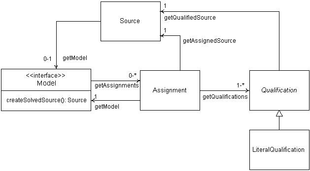

Skip navigation links

<table class="oac_no_warn" data-border="0" data-cellpadding="1" data-cellspacing="0" data-summary="Layout table... probably." width="100%">
<colgroup>
<col style="width: 50%" />
<col style="width: 50%" />
</colgroup>
<tbody>
<tr class="odd">
<td>Overview </td>
<td style="text-align: right;" data-valign="top"><em><strong>Oracle® OLAP Java API Reference 
19c</strong> 
E96404-01</em></td>
</tr>
</tbody>
</table>

------------------------------------------------------------------------

**Model Class Associations**

[Description of the illustration modelrel.jpg](modelreltxteqv.md).

------------------------------------------------------------------------

Copyright © 2002, 2018, Oracle. All rights reserved.
