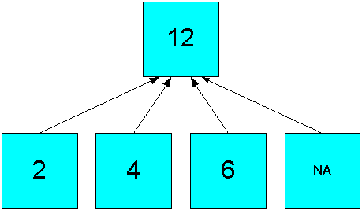
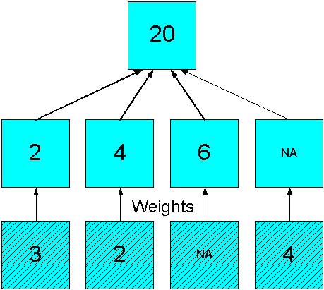
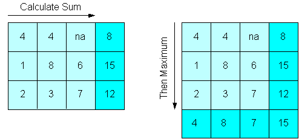
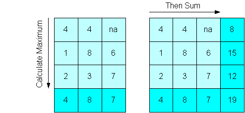
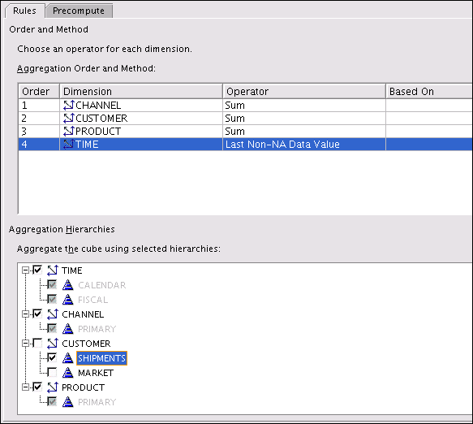
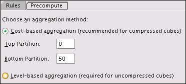

A cube always returns summary data to a query as needed. While the cube may store data at the day level, for example, it can return a result at the quarter or year level without requiring a calculation in the query. This chapter explains how to optimize the unique aggregation subsystem of Oracle OLAP to provide the best performance for both data maintenance and querying.

This chapter contains the following topics:

- What Is Aggregation?

- Aggregation Operators

- When Does Aggregation Order Matter?

- Example: Aggregating the Units Cube

### 9.1 What Is Aggregation?

Aggregation is the process of consolidating multiple values into a single value. For example, data can be collected on a daily basis and aggregated into a value for the week, the weekly data can be aggregated into a value for the month, and so on. Aggregation allows patterns in the data to emerge, and these patterns are the basis for analysis and decision making. When you define a data model with hierarchical dimensions, you are providing the framework in which aggregate data can be calculated.

Aggregation is frequently called summarization, and aggregate data is called summary data. While the most frequently used aggregation operator is Sum, there are many other operators, such as Average, First, Last, Minimum, and Maximum. Oracle OLAP also supports weighted and hierarchical methods. Following are some simple diagrams showing how the basic types of operators work. For descriptions of all the operators, refer to "Aggregation Operators" .

Figure 9-1 shows a simple hierarchy with four children and one parent value. Three of the children have values, while the fourth is empty. This empty cell has a null or `NA` value. The Sum operator calculates a value of (2 + 4 + 6)=12 for the parent value.

Figure 9-1 Summary Aggregation in a Simple Hierarchy

[Description of "Figure 9-1 Summary Aggregation in a Simple Hierarchy"](img_text/agg_sum.md)

The Average operator calculates the average of all real data, producing an aggregate value of ((2 + 4 + 6)/3)=4, as shown in Figure 9-2.

Figure 9-2 Average Aggregation in a Simple Hierarchy

[Description of "Figure 9-2 Average Aggregation in a Simple Hierarchy"](img_text/agg_average.md)

The hierarchical operators include null values in the count of cells. In Figure 9-3, the Hierarchical Average operator produces an aggregate value of ((2 + 4 + 6 +NA)/4)=3.

Figure 9-3 Hierarchical Average Aggregation in a Simple Hierarchy

[Description of "Figure 9-3 Hierarchical Average Aggregation in a Simple Hierarchy"](img_text/agg_haverage.md)

The weighted operators use the values in another measure to generate weighted values before performing the aggregation. Figure 9-4 shows how the simple sum of 12 in Figure 9-1 changes to 20 by using weights ((3\*2) + (2\*4) + (NA\*6) +(4\*NA)).

Figure 9-4 Weighted Sum Aggregation in a Simple Hierarchy

[Description of "Figure 9-4 Weighted Sum Aggregation in a Simple Hierarchy"](img_text/agg_wsum.md)

### 9.2 Aggregation Operators

Analytic workspaces provide an extensive list of aggregation methods, including weighted, hierarchical, and weighted hierarchical methods.

#### 9.2.1 Basic Operators

The following are descriptions of the basic aggregation operators:

- Average: Adds non-null data values, then divides the sum by the number of data values.

- First Non-NA Data Value: Returns the first real data value.

- Last Non-NA Data Value: Returns the last real data value.

- Maximum: Returns the largest data value among the children of each parent.

- Minimum: Returns the smallest non-null data value among the children of each parent.

- Nonadditive: Does not aggregate the data.

- Sum: Adds data values.

#### 9.2.2 Scaled and Weighted Operators

These operators require a measure providing the weight or scale values in the same cube. In a weight measure, an NA (null) is calculated like a `1`. In a scale measure, an NA is calculated like a `0`.

The weighted operators use outer joins, as described in "When Does Aggregation Order Matter?".

These are the scaled and weighted aggregation operators:

- Scaled Sum: Adds the value of a weight object to each data value, then adds the data values.

- Weighted Average: Multiplies each data value by a weight factor, adds the data values, and then divides that result by the sum of the weight factors.

- Weighted First: Multiplies the first non-null data value by its corresponding weight value.

- Weighted Last: Multiplies the last non-null data value by its corresponding weight value.

- Weighted Sum: Multiplies each data value by a weight factor, then adds the data values.

#### 9.2.3 Hierarchical Operators

The following are descriptions of the hierarchical operators. They include all cells identified by the hierarchy in the calculations, whether or not the cells contain data.

Hierarchical Average and the Hierarchical Weighted operators use outer joins.

- Hierarchical Average: Adds data values, then divides the sum by the number of the children in the dimension hierarchy. Unlike Average, which counts only non-null children, hierarchical average counts all of the children of a parent, regardless of whether each child does or does not have a value.

- Hierarchical First Member: Returns the first data value in the hierarchy, even when that value is null.

- Hierarchical Last Member: Returns the last data value in the hierarchy, even when that value is null.

- Hierarchical Weighted Average: Multiplies non-null child data values by their corresponding weight values, then divides the result by the sum of the weight values. Unlike Weighted Average, Hierarchical Weighted Average includes weight values in the denominator sum even when the corresponding child values are null.

- Hierarchical Weighted First: Multiplies the first data value in the hierarchy by its corresponding weight value, even when that value is null.

- Hierarchical Weighted Last: Multiplies the last data value in the hierarchy by its corresponding weight value, even when that value is null.

### 9.3 When Does Aggregation Order Matter?

The OLAP engine aggregates a cube across one dimension at a time. When the aggregation operators are the same for all dimensions, the order in which they are aggregated may or may not make a difference in the calculated aggregate values, depending on the operator.

You should specify the order of aggregation when a cube uses multiple aggregation methods. The only exceptions are that you can combine Sum and Weighted Sum, or Average and Weighted Average, when the weight measure is only aggregated over the same dimension. For example, a weight measure used to calculate weighted averages across Customer is itself only aggregated across Customer.

The weight operators are incompressible for the specified dimension and all preceding dimensions. For a compressed cube, you should list the weighted operators as early as possible to minimize the number of outer joins. For example, suppose that a cube uses Weighted Sum across Customer, and Sum across all other dimensions. Performance is best if Customer is aggregated first.

The following topics describe the ordering of aggregation operators.

- Using the Same Operator for All Dimensions of a Cube

- Example: Mixing Aggregation Operators

#### 9.3.1 Using the Same Operator for All Dimensions of a Cube

The following information provides guidelines for when you must specify the order of the dimensions as part of defining the aggregation rules for a cube.

##### 9.3.1.1 Order Has No Effect

When these operators are used for all dimension of a cube, the order does not affect the results:

- Maximum

- Minimum

- Sum

- Hierarchical First Member

- Hierarchical Last Member

- Hierarchical Average

##### 9.3.1.2 Order Changes the Aggregation Results

Even when these operators are used for all dimensions of a cube, the order can affect the results:

- Average

- First Non-NA Data Value

- Last Non-NA Data Value

- Weighted First

- Weighted Last

- Hierarchical Weighted First

- Hierarchical Weighted Last

- Scaled Sum

##### 9.3.1.3 Order May Be Important

When the following weighted operators are used for all dimensions of a cube, the order affects the results only if the weight measure is aggregated over multiple dimensions:

- Weighted Average

- Weighted Sum

- Hierarchical Weighted Average

#### 9.3.2 Example: Mixing Aggregation Operators

Even though you can use the Sum and Maximum operators alone without ordering the dimensions, you cannot use them together without specifying the order. The following figures show how they calculate different results depending on the order of aggregation. Figure 9-5 shows a cube with two dimensions. Sum is calculated first across one dimension of the cube, then Maximum is calculated down the other dimension.

Figure 9-5 Sum Method Followed by Maximum Method

[Description of "Figure 9-5 Sum Method Followed by Maximum Method"](img_text/sumfirst.md)

Figure 9-6 shows the same cube, except Maximum is calculated first down one dimension of the cube, then Sum is calculated across the other dimension. The maximum value of the sums in Figure 9-5 is 15, while the sum of the maximum values in Figure 9-6 is 19.

Figure 9-6 Max Method Followed by Sum Method

[Description of "Figure 9-6 Max Method Followed by Sum Method"](img_text/maxfirst.md)

### 9.4 Example: Aggregating the Units Cube

This example describes changes to the default aggregation of the Units cube in the `GLOBAL` analytic workspace. These changes take effect in the next data refresh.

#### 9.4.1 Selecting the Aggregation Operators and Hierarchies

Analytic Workspace Manager initially sets all dimensions to use the Sum operator and aggregates all levels of all dimensions. To change these default settings, use the Rules subtab of the Aggregation tab.

Figure 9-7 shows the operators for the Units Cube. Time is now set to Last Non-NA Data Value, and it is aggregated after the other dimensions. For operators like First and Last, the order in which the dimensions are aggregated can change the results.

Another change is that only the Shipments hierarchy of the Customer dimension is aggregated during data maintenance. Because the Market hierarchy is seldom queried, to save maintenance time and storage space the Global DBA chose not to calculate those aggregate values. However, response time is slower for queries that request Market aggregations.

Figure 9-7 Selecting the Aggregation Operators

[Description of "Figure 9-7 Selecting the Aggregation Operators"](img_text/agg_rules_adv.md)

#### 9.4.2 Choosing the Percentage of Precomputed Values

Analytic Workspace Manager initially chooses cost-based aggregation with 35% precomputed values for the bottom partitions and 0% for the top partition. An unpartitioned cube is also set to 35%. This setting means that 35% of the aggregate values is calculated and stored during data maintenance, and 65% is calculated in response to a query. These settings optimize data maintenance.

Increasing the materialization of the bottom partitions improves querying of both the bottom and the top partitions. Increasing the materialization of the top partition improves querying of the most aggregate data and any other hierarchies of the partitioned dimension.

Figure 9-8 shows the settings for the Units Cube. In this case, the Global DBA chose to keep the top partition at 0%, and to increase the bottom partitions from 35 to 50%. This change increases maintenance costs in time and storage space, but improves run-time performance of all partitions.

Figure 9-8 Setting Cost-Based Presummarization

[Description of "Figure 9-8 Setting Cost-Based Presummarization"](img_text/cube_precompute.md)
