This chapter explains how to design a data model and create dimensions and cubes using Analytic Workspace Manager. It contains the following topics:

- Designing a Dimensional Model for Your Data

- Introduction to Analytic Workspace Manager

- Creating a Dimensional Data Store Using Analytic Workspace Manager

- Creating Dimensions

- Creating Cubes

- Choosing a Data Maintenance Method

- Supporting Multiple Languages

- Defining Measure Folders

- Saving and Re-Creating Dimensional Objects with Object Definitions

- Copying and Pasting Dimensional Objects

### 3.1 Designing a Dimensional Model for Your Data

Chapter 1 introduced the dimensional objects: Cubes, measures, dimensions, levels, hierarchies, and attributes. In this chapter, you learn how to define them in Oracle Database, but first you should decide upon the dimensional model you want to create. What are your measures? What are your dimensions? How can you distinguish between a dimension and an attribute in your data? You can design a dimensional model using pencil and paper, a database design software package, or any other method that suits you.

If your source data is in a star or snowflake schema, then you have the elements of a dimensional model:

- Fact tables correspond to cubes.

- Data columns in the fact tables correspond to measures.

- Foreign key constraints in the fact tables identify the dimension tables.

- Dimension tables identify the dimensions.

- Primary keys in the dimension tables identify the base-level dimension members.

- Parent columns in the dimension tables identify the higher level dimension members.

- Columns in the dimension tables containing descriptions and characteristics of the dimension members identify the attributes.

You can also get insights into the dimensional model by looking at the reports currently being generated from the source data. The reports identify the levels of aggregation that interest the report consumers and the attributes used to qualify the data.

While investigating your source data, you may decide to create relational views that more closely match the dimensional model that you plan to create.

**See Also:**

"[Overview of the Dimensional Data Model](overview.md)" for an introduction to dimensional objects

[Designing a Dimensional Model](designing-dimensional-model.md) for a case study of developing a dimensional model for the Global analytic workspace

### 3.2 Introduction to Analytic Workspace Manager

Analytic Workspace Manager is the primary tool for creating, developing, and managing dimensional objects in Oracle Database. Your goal in using Analytic Workspace Manager is to create a dimensional data store that supports business analysis. This data store can stand alone or store summary data as part of a relational data warehouse.

Populating dimensional objects involves a physical transformation of the data. The first step in that transformation is defining the cubes, measures, dimensions, levels, hierarchies, and attributes. Afterward, you can map these dimensional objects to their relational data sources. The data loading process transforms the data from a relational format into a dimensional format.

Using Analytic Workspace Manager, you can:

- Develop a dimensional model of your data.

- Instantiate that model as dimensional objects.

- Load data from relational tables into those objects.

- Define information-rich calculations.

- Create materialized views that can be used by the database refresh system.

- Automatically generate relational views of the dimensional objects.

You can load data from these sources in the database:

- Tables

- Views

- Synonyms

You must have `SELECT` privileges on the relational data sources so you can load the data into the dimensions and cubes. This chapter assumes that you have a star, snowflake, or other relational schema that supports dimensional objects.

Figure 3-1 shows the main window of Analytic Workspace Manager. It contains menus, a toolbar, a navigation tree, and property sheets. When you select an object in the navigation tree, the property sheet to the right provides detailed information about that object. When you right-click an object, you get a choice of menu items with appropriate actions for that object.

Analytic Workspace Manager has a full online Help system, which includes context-sensitive Help.

Figure 3-1 Analytic Workspace Manager Main Window

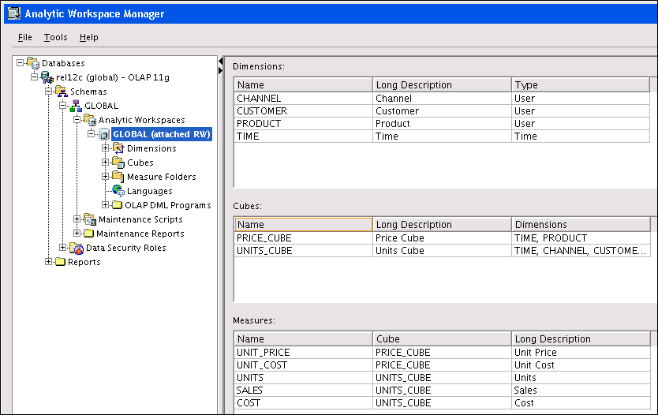
[Description of "Figure 3-1 Analytic Workspace Manager Main Window"](img_text/awm_mod.md)

### 3.3 Creating a Dimensional Data Store Using Analytic Workspace Manager

An analytic workspace is a container for storing related cubes. You create dimensions, cubes, and other dimensional objects within an analytic workspace.

#### To create an analytic workspace:

1.  Open Analytic Workspace Manager and connect to your database instance as the user defined for this purpose.

2.  Create an analytic workspace in the database:

    1.  In the navigation tree, expand the folders until you see the schema where you want to create the analytic workspace.

    2.  Right-click Analytic Workspaces, then click Create Analytic Workspace.

    3.  Complete the Create Analytic Workspace dialog box, then select Create.

        If the Attach Workspace dialog box appears, select the Read Write or Read Write Exclusive attachment mode.

        The analytic workspace appears in the Analytic Workspaces folder for the schema.

3.  Define the dimensions for the data.

    See "Creating Dimensions".

4.  Define the cubes for the data.

    See "Creating Cubes".

5.  Load data into the cubes and dimensions.

    See "Loading Data Into Cubes".

When you have finished, you have an analytic workspace populated with the detail data fetched from relational tables or views. You may also have summarized data and calculated measures.

#### 3.3.1 Adding Functionality to Dimensional Objects

In addition to the basic steps, you can add functionality to the cubes in these ways:

- Develop custom cube scripts to customize the builds.

  See "Creating and Executing Custom Cube Scripts".

- Generate materialized views that support automatic refresh and query rewrite.

  See "Adding Materialized View Capability to a Cube".

- Support multiple languages by adding translations of metadata and attribute values.

  See "Supporting Multiple Languages".

- Define measure folders to simplify access for end users.

  See "Defining Measure Folders".

#### 3.3.2 When Does Analytic Workspace Manager Save Changes?

Analytic Workspace Manager saves changes automatically that you make to the analytic workspace. You do not explicitly save your changes.

Saves occur when you take an action such as these:

- Click OK or the equivalent button in a dialog box.

  For example, when you click Create in the Create Dimension dialog box, the dimension is committed to the database.

- Click Apply in a property sheet.

  For example, when you change the labels on the General property page for an object, the change takes effect when you click Apply.

### 3.4 Creating Dimensions

Dimensions are lists of unique values that identify and categorize data. They form the edges of a cube, and thus of the measures within the cube. In a report, the dimension values (or their descriptive attributes) provide labels for the rows and columns.

You can define dimensions that have any of these common forms:

- Level-based dimensions that use parent-child relationships to group members into levels. Most dimensions are level-based.

- Value-based dimensions that have parent-child relationships among their members, but these relationships do not form meaningful levels.

- List or flat dimensions that have no levels or hierarchies.

You define a dimension as a User, Time, or Measure dimension. Detail-level dimension values typically correspond to the unique keys of a fact table. A measure dimension has measures as dimension members.

This section has the following topics:

- Requirements of a Dimension

- Creating a Dimension

- Creating Levels

- Creating Hierarchies

- Creating Attributes

- Creating Measure Dimensions

- Mapping Dimensions

- Loading Data Into Dimensions

- Displaying the Dimension View

- Displaying the Default Hierarchy

#### 3.4.1 Requirements of a Dimension

Dimensions must meet the following requirements:

- Dimension Members Must Be Unique

- Time Dimensions Have Special Requirements

##### 3.4.1.1 Dimension Members Must Be Unique

Every dimension member must be a unique value. Depending on your data, you can create a dimension that uses either natural keys or surrogate keys from the relational sources for its members. If you have any doubt that the values are unique across all levels, then keep the default choice of surrogate keys.

- Source keys are read from the relational sources without modification. To use the same exact keys as the source data, the values must be unique across levels. Because each level may be mapped to a different relational column, this uniqueness may not be enforced in the source data. For example, a dimension table might have a Day column with values of `1` to `366` and a Week column with values of `1` to `52`. Unless you take steps to assure uniqueness, the values from the Week column overwrite the first 52 Day values.

- Surrogate keys ensure uniqueness by adding a level prefix to the members while loading them into the analytic workspace. For the previous example, surrogate keys create two dimension members named `DAY_1` and `WEEK_1`, instead of a single member named `1`. A dimension that has surrogate keys must be defined with at least one level-based hierarchy.

Analytic Workspace Manager creates surrogate keys unless you specify otherwise.

##### 3.4.1.2 Time Dimensions Have Special Requirements

You can define dimensions as either User or Time dimensions. Business analysis is performed on historical data, so fully defined time periods are vital. A time dimension table must have columns for period end dates and time span. These required attributes support comparisons with earlier or later time periods. If this information is not available, then you can define Time as a User dimension, but it cannot support time-based analysis.

You must define a Time dimension with at least one level to support time-based analysis, such as a custom measure that calculates the difference from the prior period.

#### 3.4.2 Creating a Dimension

This section describes how to create a standard User or Time dimension. See "Creating Measure Dimensions" for information on creating a measure dimension.

##### To create a dimension:

1.  Expand the folder for the analytic workspace.

2.  Right-click Dimensions, then select Create Dimension.

    The Create Dimension dialog box appears.

3.  Complete the General tab.

4.  If the keys in the source table are unique across levels, you can change the default setting on the Implementation Details tab.

5.  Click Create.

    The dimension appears as a subfolder under Dimensions.

Figure 3-2 shows the creation of the Product dimension.

Figure 3-2 Creation of the Product Dimension

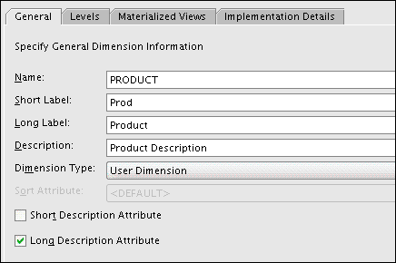
[Description of "Figure 3-2 Creation of the Product Dimension"](img_text/proddim_gen.md)

#### 3.4.3 Creating Levels

For business analysis, data is typically summarized by level. For example, your database may contain daily snapshots of a transactional database. Days are the base level. You might summarize this data at the weekly, quarterly, and yearly levels.

Levels have parent-child or one-to-many relationships, which form a level-based hierarchy. For example, each week summarizes seven days, each quarter summarizes 13 weeks, and each year summarizes four quarters. This hierarchical structure enables analysts to detect trends at the higher levels, then drill down to the lower levels to identify factors that contributed to a trend.

For each level that you define, you must identify a data source for dimension members at that level. Members at all levels are stored in the same dimension. In the previous example, the Time dimension contains members for weeks, quarters, and years.

##### To create a level:

1.  Expand the folder for the dimension.

2.  Right-click Levels, then select Create Level.

    The Create Level dialog box appears.

3.  Complete the General tab of the Create Level dialog box.

4.  Click Create.

    The level appears as an item in the Levels folder.

**Tip:**

Alternatively, you can create levels in the Create Dimension dialog box Levels tab.

Figure 3-3 shows the creation of the Class level for the Product dimension.

Figure 3-3 Creation of the Class Level

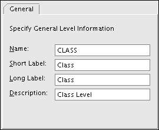
[Description of "Figure 3-3 Creation of the Class Level"](img_text/classlevel_gen.md)

#### 3.4.4 Creating Hierarchies

Dimensions can have one or more hierarchies. They can be level based or value based.

##### Level-Based Hierarchies

Most hierarchies are level based. Analytic Workspace Manager supports these common types of level-based hierarchies:

- Normal hierarchies consist of one or more levels of aggregation. Members roll up into the next higher level in a many-to-one relationship, and these members roll up into the next higher level, and so forth to the top level.

- Ragged hierarchies contain at least one member with a different base, creating a "ragged" base level for the hierarchy. Ragged hierarchies are not supported for cube materialized views.

- Skip-level hierarchies contain at least one member whose parents are multiple levels above it, creating a hole in the hierarchy. An example of a skip-level hierarchy is City-State-Country, where at least one city has a country as its parent (for example, Washington D.C. in the United States).

  In relational source tables, a skip-level hierarchy may contain nulls in the level columns. Skip-level hierarchies are not supported for cube materialized views.

Multiple hierarchies for a dimension typically share the base-level dimension members and then branch into separate hierarchies. They can share the top level if they use all the same base members and use the same aggregation operators. Otherwise, they need different top levels to store different aggregate values. For example, a Customer dimension may have multiple hierarchies that include all base-level customers and are summed to a shared top level. However, a Time dimension with calendar and fiscal hierarchies must aggregate to separate Calendar Year (January to December) and Fiscal Year (July to June) levels, because they use different selections of base-level members.

##### Value-Based Hierarchies

You may also have dimensions with parent-child relations that do not support levels. For example, an employee dimension might have a parent-child relation that identifies each employee's supervisor. However, levels that group first-, second-, and third-level supervisors and so forth may not be meaningful for analysis. Similarly, you might have a line-item dimension with members that cannot be grouped into meaningful levels. In this situation, you can create a value-based hierarchy defined by the parent-child relations, which does not have named levels. You can create value-based hierarchies only for dimensions that use the source keys, because surrogate keys are formed with the names of the levels.

##### To create a hierarchy:

1.  Expand the folder for the dimension.

2.  Right-click Hierarchies, then select Create Hierarchy.

    The Create Hierarchy dialog box appears.

3.  Complete the General tab of the Create Hierarchy dialog box.

    Click Help for information about these choices.

4.  Click Create.

    The hierarchy appears as an item in the Hierarchies folder.

Figure 3-4 shows the creation of the Primary hierarchy for the Product dimension.

Figure 3-4 Creation of the Product Primary Hierarchy

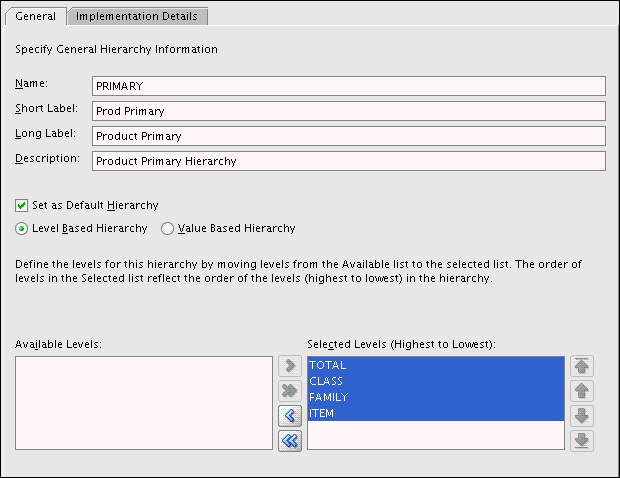
[Description of "Figure 3-4 Creation of the Product Primary Hierarchy"](img_text/prodhier_gen.md)

#### 3.4.5 Creating Attributes

Attributes provide information about the individual members of a dimension. They are used for labeling crosstabular and graphical data displays, selecting data, organizing dimension members, and so forth.

##### 3.4.5.1 Automatically Defined Attributes

Analytic Workspace Manager creates some attributes automatically when creating a dimension. These attributes have a unique type, such as "Long Description."

All dimensions can be created with long and short description attributes. If your source tables include long and short descriptions, then you can map the attributes to the appropriate columns. However, if your source tables include only one set of descriptions, then you can create and map just one description attribute. If you map both the long and short description attributes to the same column, the data is loaded twice.

Time dimensions are created with time-span and end-date attributes. This information must be provided for all Time dimension members.

##### 3.4.5.2 User-Defined Attributes

You can create additional "User" attributes that provide supplementary information about the dimension members, such as the addresses and telephone numbers of customers, or the color and sizes of products.

##### To create an attribute:

1.  Expand the folder for the dimension.

2.  Right-click Attributes, then select Create Attribute.

    The Create Attribute dialog box appears.

3.  Complete the General tab of the Create Attribute dialog box.

    Some attributes apply to all dimension members, and others apply to only one level. Your selection in the Apply Attributes To box controls the mapping of the attribute to one column or to multiple columns.

    Click Help for information about these choices.

4.  To change the data type from the default choice of `VARCHAR2`, complete the Implementation Details tab.

5.  Click Create.

    The attribute appears as an item in the Attributes folder.

Figure 3-5 shows the creation of the Marketing Manager attribute for the Product dimension. Notice that this attribute applies only to the Item level.

Figure 3-5 Creation of the Product Marketing Manager Attribute

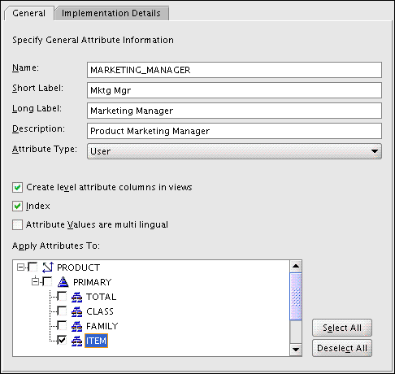
[Description of "Figure 3-5 Creation of the Product Marketing Manager Attribute"](img_text/prodattr_gen.md)

##### 3.4.5.3 Unique Key Attributes

Materialized views require that each dimension of the cube have unique key attributes. These attributes store the original key values of the source dimensions, which may have been changed when creating the embedded total dimensions of the cubes.

Analytic Workspace Manager automatically creates unique key attributes for the dimensions of a cube materialized view. You do not create or manage them manually.

#### 3.4.6 Creating Measure Dimensions

A measure dimension enables you to generate calculated measures for all of the measures in the cube simultaneously. Before creating a measure dimension you must first create a fact view. The fact view pivots a fact table so that the measures identify rows instead of columns.

##### To create a measure dimension:

1.  From the Tools menu, select Create Fact View with Measure Dimension.

    The Create Fact View with Measure Dimension dialog box appears.

2.  Complete the Create Fact View with Measure Dimension dialog box.

    1.  From the Schema list, select a schema.

    2.  From the Object list, select a fact table.

    3.  In the Fact View Name field, keep the default name or enter a different name.

    4.  In the table of the columns of the fact table, select the columns for the measures that you want the measure dimension to have.

    5.  Optional: To automatically create a table for the measure dimension, select the Create Measure Dimension Table option.

    6.  Click Create.

3.  Expand the folder for the analytic workspace.

4.  Right-click Dimensions, then select Create Dimension.

    The Create Dimension dialog box appears.

5.  Complete the General tab. For the Dimension Class Type, be sure to select Measure Dimension.

    A measure dimension is a flat dimension, with no levels or hierarchies.

6.  Click Create.

    The dimension appears as a subfolder under Dimensions.

After creating the measure dimension, create a cube and add the dimension to it.

**Note:**

If you create a new column in the fact table and you want to add it to the measure dimension, then must create the fact view for the fact table again and maintain the measure dimension and the cube.

##### To add a measure to the measure dimension:

1.  From the Tools menu, select Create Fact View with Measure Dimension.

    The Create Fact View with Measure Dimension dialog box appears.

2.  Complete the Create Fact View with Measure Dimension dialog box.

    1.  From the Schema list, select a schema.

    2.  From the Object list, select the fact table that you used to create the measure dimension.

    3.  In the Fact View Name field, keep the default name or enter a different name.

    4.  In the table of the columns of the fact table, select the columns for the measures that you want the measure dimension to have.

    5.  Optional: To automatically create a table for the measure dimension, select the Create Measure Dimension Table option.

    6.  Click Create.

3.  Right-click the measure dimension and then select Maintain Dimension.

4.  Right-click the cube that has the measure dimension and then select Maintain Cube.

**See Also:**

- "Creating Cubes"

#### 3.4.7 Mapping Dimensions

Mapping identifies the relational data source for each dimensional object. After mapping a dimension to a column of a relational table or view, you can load the data. You can create, map, and load each dimension individually, or perform each step for all dimensions before proceeding to the next step.

##### SQL Data Types for Dimensions

You can map dimensions and levels to columns having these SQL data types, which are converted to text during a data load:

- VARCHAR2

- NVARCHAR2

- NUMBER

- INTEGER

- DECIMAL

- CHAR

- NCHAR

- DATE

- TIMESTAMP

- TIMESTAMP WITH TIMEZONE

- TIMESTAMP WITH LOCAL TIMEZONE

You can map attributes to the same data types as cubes and measures, as described in "Data Types".

##### 3.4.7.1 Dimension Mapping Window

The mapping window has a tabular view and a graphical view. You can switch between the two views, using the icons at the top of the canvas.

- Tabular view: Drag-and-drop the names of individual columns from the schema navigation tree to the rows for the dimensional objects.

- Graphical view: Drag-and-drop icons, which represent tables and views, from the schema navigation tree onto the mapping canvas. Then draw lines from the columns to the dimensional objects.

You can use the OLAP expression syntax when mapping dimensions in the tabular view. This capability enables you to create the top level of a dimension without having a source column in the dimension table.

You can also map attributes from different tables. OLAP automatically joins the tables on columns with the same name.

Click Help on the Mapping window for more information.

##### To map a dimension:

1.  In the navigation tree, expand the dimension folder and click Mappings.

    The Mapping window contains a schema navigation tree on the left and a mapping table for the dimension with rows for the levels and their attributes. This is the tabular view.

2.  For normalized dimension tables, select Snowflake Schema for the Type of Dimension Table.

3.  To enlarge the Mapping Window, drag the divider to the left.

4.  In the schema tree, expand the tables, views, or synonyms that contain the dimension members and attributes.

5.  Drag-and-drop the source columns onto the appropriate cells in the mapping table for the dimension.

    Map a measure dimension to the measure dimension table. Specify `measure_id` as the member value.

6.  After you have mapped all levels and attributes, click Apply.

7.  Drag the divider back to the right to reveal the navigation tree.

Figure 3-6 shows the Product dimension mapped in the tabular view. The arrow highlights how the `PRODUCT_DIM.ITEM_BUYER` column maps to the `PRODUCT.ITEM.BUYER` attribute.

Figure 3-6 Product Dimension Mapped in Tabular View

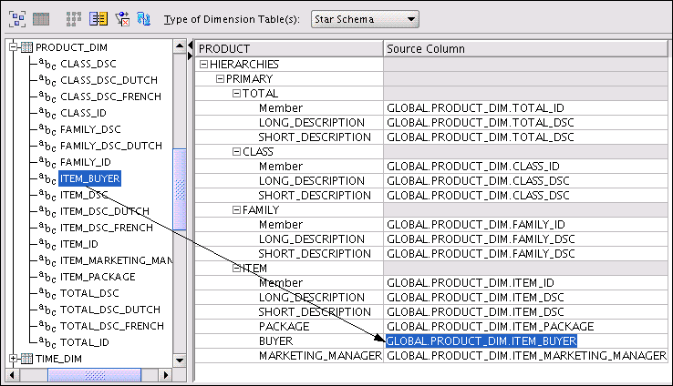
[Description of "Figure 3-6 Product Dimension Mapped in Tabular View"](img_text/maptbl_dim.md)

##### To map a top level without a relational source:

1.  Create the dimension and its levels (including the top level), hierarchies, and attributes.

2.  Map the dimension as described previously for all but the top level.

3.  Enter an expression in the OLAP expression syntax for the top level.

Example 3-1 Creating a Top Level for the Global Time Dimension

This example shows a top level for all years in the Time dimension. The mapping expressions used for a Total level (that is, all years) in the Time dimension might look like this:

    Member: 'TOTAL'
    LONG_DESCRIPTION: 'Total'
    SHORT_DESCRIPTION: 'Total'
    END_DATE: TO_DATE('31-Dec-2007', 'dd-mon-yyyy')
    TIME_SPAN: 3646

`Member`, `LONG_DESCRIPTION`, and `SHORT_DESCRIPTION` are set to literal strings, `END_DATE` uses the `TO_DATE` function, and `TIME_SPAN` is set to a number.

##### 3.4.7.2 Source Data Query

You can view the contents of a particular source column without leaving the mapping window. The information is readily available, eliminating the guesswork when the names are not adequately descriptive.

##### To see the values in a particular source table or view:

1.  Right-click the source object in either the schema tree or the graphical view of the mapping canvas.

2.  Select View Data from the shortcut menu.

Figure 3-7 shows the data stored in the `PRODUCT_DIM` table.

Figure 3-7 Data in the PRODUCT_DIM Table

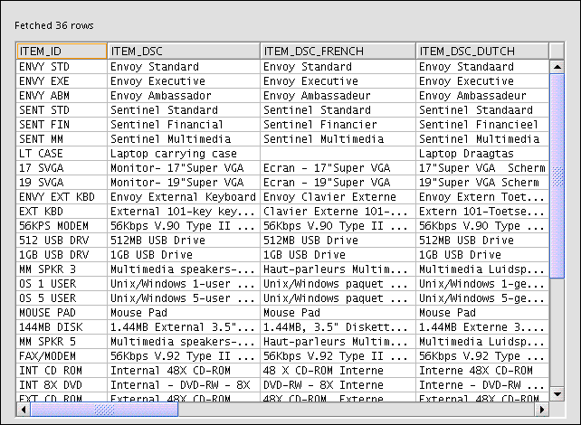
[Description of "Figure 3-7 Data in the PRODUCT_DIM Table"](img_text/prod_data.md)

#### 3.4.8 Loading Data Into Dimensions

Analytic Workspace Manager provides several ways to load data into dimensional objects. The quickest way when developing a data model is using the default choices of the Maintenance Wizard. Other methods may be more appropriate in a production environment than the one shown here. They are discussed in "Choosing a Data Maintenance Method".

##### To load data into the dimensions:

1.  In the navigation tree, right-click the Dimensions folder or the folder for a particular dimension.

2.  Select Maintain Dimension.

    The Maintenance Wizard opens on the Select Objects page.

3.  Select one or more dimensions from Available Target Objects and use the shuttle buttons to move them to Selected Target Objects.

4.  Click Finish to load the dimension values immediately.

    The additional pages of the wizard enable you to create a SQL script or submit the load to the Oracle job queue. To use these options, click Next instead.

5.  Review the build log, which appears when the build is complete. If the log shows that errors occurred, then fix them and run the Maintenance Wizard again.

    Errors are typically caused by problems in the mapping. Check for incomplete mappings or changes to the source objects.

Figure 3-8 shows the first page of the Maintenance Wizard. Only the Product dimension has been selected for maintenance. All the Product dimension members and attributes are fetched from the mapped relational sources.

Figure 3-8 Loading Dimension Values into the Product Dimension

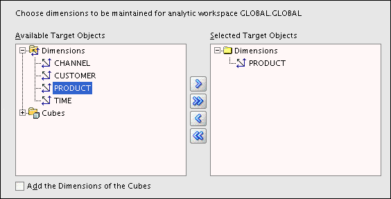
[Description of "Figure 3-8 Loading Dimension Values into the Product Dimension"](img_text/maintwiz_obj.md)

Figure 3-9 shows the Maintenance log for a dimension displayed by Analytic Workspace Manager. It refreshes throughout the build to provide you with the most up-to-date information.

Figure 3-9 Maintenance Log for the Product Dimension

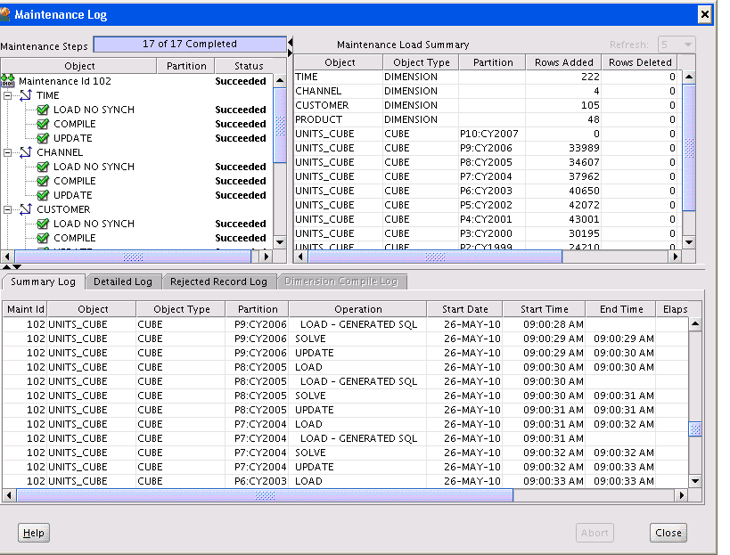
[Description of "Figure 3-9 Maintenance Log for the Product Dimension"](img_text/dim_log.md)

#### 3.4.9 Displaying the Dimension View

The Maintenance Wizard automatically generates relational views of dimensions and hierarchies. [Querying Dimensional Objects](querying-dimensional-objects.md) describes these views and explains how to query them.

Figure 3-10 shows the description of the relational view of the Product Primary hierarchy. You can view the data on the Data tab.

Figure 3-10 Product Primary Hierarchy View

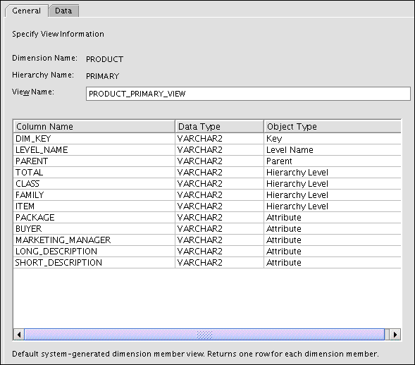
[Description of "Figure 3-10 Product Primary Hierarchy View"](img_text/prod_hierview.md)

#### 3.4.10 Displaying the Default Hierarchy

After loading a dimension, you can display the default hierarchy.

##### To display the default hierarchy:

1.  In the navigation tree, right-click the name of a dimension.

2.  Select View Data.

Figure 3-11 shows the Primary hierarchy of the Product dimension.

Figure 3-11 Displaying the Product Primary Hierarchy

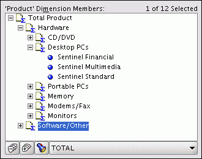
[Description of "Figure 3-11 Displaying the Product Primary Hierarchy"](img_text/product_dim.md)

### 3.5 Creating Cubes

Cubes are informational objects that identify measures with the exact same dimensions and thus are candidates for being processed together at all stages: data loading, aggregation, storage, and querying.

Cubes define the shape of your business measures. They are defined by a set of ordered dimensions. The dimensions form the edges of a cube, and the measures are the cells in the body of the cube.

#### To create a cube:

1.  Expand the folder for the analytic workspace.

2.  Right-click Cubes, then select Create Cube.

    The Create Cube dialog box appears.

3.  On the General tab, enter a name for the cube and select its dimensions.

    Select Enable SQL Expressions to allow Analytic Workspace Manager to create additional calculated measures as needed in processing a calculated measure. Enabling SQL expressions is especially useful if you are using the Oracle Business Intelligence Enterprise Edition (OBIEE) Plug-in for Analytic Workspace Manager to export the cube to OBIEE.

4.  On the Aggregation tab, click the Rules subtab and select an aggregation method for each dimension. If the cube uses multiple methods, then you may need to specify the order in which the dimensions are aggregated to get the desired results.

    You can ignore the bottom of the tab, unless you want to exclude a hierarchy from the aggregation.

    For a measure dimension, the aggregation operator is non-additive.

5.  If you run the advisors after mapping the cube, Oracle OLAP can determine the best partitioning and storage options. Alternatively, to define these options yourself, complete the Partitioning and Storage tabs before creating the cube.

6.  Click Create. The cube appears as a subfolder under Cubes.

Figure 3-12 shows the Rules subtab for the Units cube with the list of operators displayed.

**See Also:**

"[Aggregation Operators](advanced-aggregations.md)" for descriptions of the aggregation operators.

Figure 3-12 Selecting an Aggregation Operator

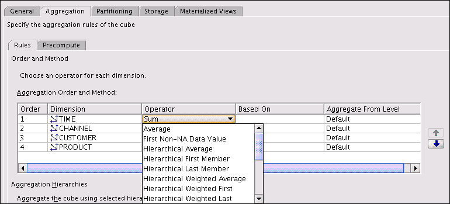
[Description of "Figure 3-12 Selecting an Aggregation Operator"](img_text/cube_rules.md)

#### 3.5.1 Creating Measures

Measures store the facts collected about your business. Each measure belongs to a particular cube, and thus shares particular characteristics with other measures in the cube, such as the same dimensions. The default characteristics of a measure are inherited from the cube.

**Note:**

The cube for a measure dimension has only one measure, which Analytic Workspace Manager creates automatically.

##### To create a measure:

1.  Expand the folder for the cube that has the dimensions of the measure.

2.  Right-click Measures, then select Create Measure.

    The Create Measure dialog box appears.

3.  On the General tab, enter a name for the measure.

4.  Click Create.

    The measure appears in the navigation tree as an item in the Measures folder.

Figure 3-13 shows the General tab of the Create Measure dialog box.

Figure 3-13 Creating the Sales Measure

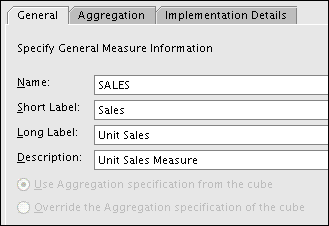
[Description of "Figure 3-13 Creating the Sales Measure"](img_text/meas_gen.md)

#### 3.5.2 Mapping Cubes

You use the same interface to map cubes as you did to map dimensions, as described in "Mapping Dimensions". You can map a cube directly to a single fact table, or you can create more complex mappings using the OLAP expression syntax, which supports expressions, join conditions, and filters.

Although the dimension columns in a fact table typically contain only key values at the detail level, you can also map cubes to summary tables that contain the values from multiple levels. For example, a Time column might contain days, months, quarters, and years; a Geography column might contain cities, states, and countries. When a build rolls up the data in the cube from the detail level, the calculated values overwrite the loaded summary values, thereby correcting any inconsistencies.

##### Data Types

You can map cubes and measures to columns having these SQL data types:

- NUMBER

- INTEGER

- DECIMAL

- BINARY_FLOAT

- BINARY_DOUBLE

- VARCHAR2

- NVARCHAR2

- CHAR

- NCHAR

- DATE

- TIMESTAMP

- TIMESTAMP WITH TIMEZONE

- TIMESTAMP WITH LOCAL TIMEZONE

- INTERVAL YEAR TO MONTH

- INTERVAL DAY TO SECOND

##### Expressions

You can use the OLAP expression syntax when mapping cubes in the tabular view. This capability enables you to perform tasks like these as part of data maintenance, without any intermediate staging of the data:

- Perform calculations on the relational data using any combination of functions and operators available in the OLAP expression syntax.

- Create measures that are more aggregate than their relational sources. For example, suppose the Time dimension has columns for Day, Month, Quarter, and Year, and the fact table for Sales is related to Time by the Day foreign key column. In a basic mapping, you would store data in the cube at the Day level. However, you could aggregate it to the Month level during the data refresh. Using a technique called one-up mapping, you would map the cube to the Month column for Time, and specify a join between the dimension table and the fact table on the Day columns.

**Note:**

You cannot map a measure dimension to an expression. You must map it to a column.

##### Join Conditions

In the tabular view, the mapping for each dimension includes a join condition. In the basic case where you are mapping the foreign keys in a fact table to the primary keys in the related dimension tables, you can leave the join condition blank. Analytic Workspace Manager derives this information from the relational source tables when you save the mapping.

For example, Analytic Workspace Manager provides this join condition for the `TIME` dimension in the `UNITS_CUBE` mapping:

    GLOBAL.TIME_DIM.MONTH_ID = GLOBAL.UNITS_FACT.MONTH_ID

**Note:**

The join condition for a measure dimension must be a simple equijoin.

##### Filters

A filter applies a `WHERE` clause to the query that loads data from the relational source into the cube. You can use a filter to limit the rows to those matching a certain condition. This filter restricts the data to the year 2007:

    GLOBAL.UNITS_FACT.MONTH_ID LIKE '2007%'

You can also use a filter to join two or more tables containing the measures. This filter joins the `UNITS_FACT` and `PRICE_FACT` tables in the Global schema on the Time (`MONTH_ID`) and Product (`ITEM_ID`) dimensions:

    GLOBAL.PRICE_FACT.MONTH_ID=GLOBAL.UNITS_FACT.MONTH_ID AND GLOBAL.PRICE_FACT.ITEM_ID=GLOBAL.UNITS_FACT.ITEM_ID

##### Aggregate Functions

The aggregate function specifies how the fact table data is loaded into the cube. You select an aggregate function from the Group By list. The aggregate functions are the following:

- SUM

- AVG

- MAX

- MIN

- COUNT

##### To map a cube:

1.  In the navigation tree, expand the cube folder and click Mappings.

    The Mapping window contains a schema navigation tree on the left and a mapping table for the cube and its dimensions. This is the tabular view.

    The level of a dimension from which values are aggregated is indicated by the symbol . You specify the level in the Aggregate From Level column on the Rules subtab of the Aggregation tab of the property sheet of a cube.

2.  To enlarge the Mapping window, drag the divider to the left.

3.  In the schema tree, expand the tables, views, or synonyms that contain the data for the measures.

4.  Drag-and-drop the source columns onto the appropriate cells in the mapping table for the cube.

    Map a measure dimension to the measure dimension fact view. See "Creating Measure Dimensions" for information on creating the measure dimension fact view. From the measure dimension fact view columns, specify `MEASURE_VALUE` as the source column for the measure of the cube and specify `MEASURE_DIM` as the source column for the measure dimension of the cube.

5.  Optional: To see the SQL statements for the mapping, click Show SQL. You can save the SQL to a file or to the clipboard.

6.  After you have mapped all dimensions and measures, click Apply.

7.  Drag the divider back to the right to reduce the size of the Mapping window.

Figure 3-14 shows the mapping canvas with the Units cube mapped to columns in the `UNITS_FACT` table. After you save the mappings, Analytic Workspace Manager provides the join conditions for base-level mappings such as the ones shown here.

Figure 3-14 Units Cube Mapped in the Tabular View

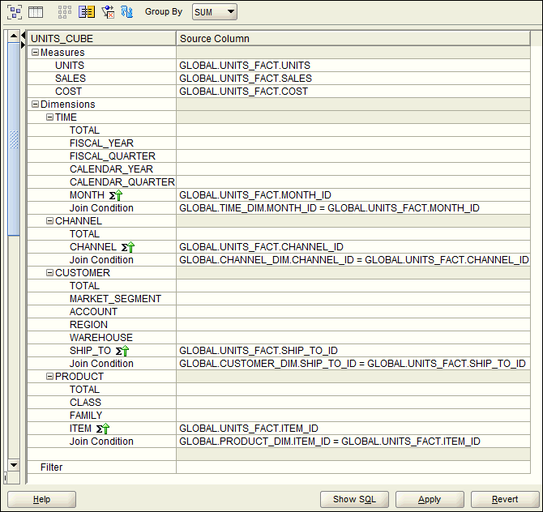
[Description of "Figure 3-14 Units Cube Mapped in the Tabular View"](img_text/map_cube.md)

##### To calculate the facts of a measure as they are loaded into a cube:

1.  Create the cube.

2.  Map all dimensions and measures to the source tables.

3.  Edit the mapping of the measure to include a calculation in the OLAP expression syntax.

    For example, you might change `UNITS_FACT.SALES` to `UNITS_FACT.SALES*1.06`.

    You can use row expressions, column expressions, and conditions, but not nested SQL queries.

##### To map a cube above the detail level:

1.  Create the cube dimensions with the desired levels and map them to the source dimension table.

2.  Create the cube and its measures.

3.  Map each measure to its source column in the fact table.

4.  For dimensions that are not being consolidated, map the detail level to its source column in the fact table, the same as you would in a basic cube mapping.

5.  For dimensions being consolidated:

    1.  Map the dimension to the appropriate column in the dimension table, not to the fact table. In the previous scenario, you would map the Month level of the Time dimension to the Month column of the Time dimension table. For example, you would map Month to time_dim.month_column.

    2.  Enter a join condition between the fact table and the dimension table at the detail level. For example, `time_dim.day_key = fact_tbl.day_foreign_key`.

##### To map measures to different tables:

1.  Create the cube dimensions with the desired levels and map them to the source dimension table.

2.  Create the cube and its measures.

3.  Map each measure to its source column in the appropriate table.

4.  Map the detail level of each of the dimensions to its source column in each of the tables. When you drop the additional source column names, you are asked whether to add or replace the existing mapping. Select Add.

Example 3-2 Mapping Measures to Different Tables

This example maps the two measures of a cube to columns in two different fact tables. The data for `UNIT_PRICE` is in the `UNITS_FACT` table, and the data for `UNITS_SOLD` is in the `PRICE_FACT` table. The following mapping identifies the dimension keys in both tables for `MONTH` and `PRODUCT`.

    UNIT_PRICE: GLOBAL.PRICE_FACT.UNIT_PRICE
    UNITS_SOLD: GLOBAL.UNITS_FACT.UNITS
    MONTH:      GLOBAL.PRICE_FACT.MONTH_ID
                GLOBAL.UNITS_FACT.MONTH_ID
    PRODUCT:    GLOBAL.PRICE_FACT.ITEM_ID
                GLOBAL.UNITS_FACT.ITEM_ID

The next example maps one measure of a cube to columns in two different fact tables. The data for North America is in the `AMERICA` table, and the data for Europe is in the `EMEA` table. The following mapping for the `UNITS_SOLD` measure of `UNION_CUBE` creates a union of the two fact columns.

    UNITS_SOLD: GLOBAL.AMERICA.UNITS
                GLOBAL.EMEA.UNITS
    TIME:       GLOBAL.AMERICA.MONTH_ID
                GLOBAL.EMEA.MONTH_ID
    CHANNEL:    GLOBAL.AMERICA.CHANNEL_ID
                GLOBAL.EMEA.CHANNEL_ID
    CUSTOMER:   GLOBAL.AMERICA.SHIP_TO_ID
                GLOBAL.EMEA.SHIP_TO_ID
    PRODUCT:    GLOBAL.AMERICA.ITEM_ID
                GLOBAL.EMEA.ITEM_ID

#### 3.5.3 Partitioning a Cube

Partitioning is a method of physically storing the measures in a cube. It improves the performance of large measures in the following ways:

- Improves scalability by keeping data structures small. Each partition functions like a smaller measure.

- Keeps the working set of data smaller both for queries and maintenance, since the relevant data is stored together.

- Enables parallel aggregation during data maintenance. Each partition can be aggregated by a separate process.

- Simplifies removal of old data from storage. Old partitions can be dropped, and new partitions can be added.

The number of partitions affects the database resources that can be allocated to loading and aggregating the data in a cube. Partitions can be aggregated simultaneously when sufficient resources have been allocated.

You can select multiple hierarchies and multiple levels of a hierarchy for partitioning.

You select partitions and specify properties of them on the Partitioning tab of the property sheet for a cube. You can also view information about the partitions to help you decide on a partitioning strategy.

**Note:**

Cubes are partitioned by default.

##### To select partitions:

1.  In the navigation tree, select a cube.

2.  In the property sheet, select the Partitioning tab.

    The Partitioning tab appears, as shown in Figure 3-15.

3.  Select Partition Cube and the Select Partitions subtab.

4.  Complete the Select Partitions subtab.

5.  Optional: To view information about the partitions, select the Partition Member Analysis subtab.

6.  To apply the partitioning to the cube, click Apply.

Figure 3-15 Selecting Partitions

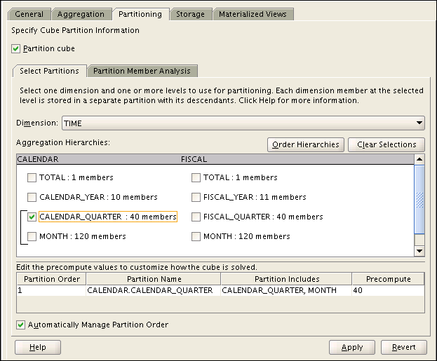
[Description of "Figure 3-15 Selecting Partitions"](img_text/select_partitions.md)

**See Also:**

- Selecting Partitions

- Analyzing Partition Members

##### 3.5.3.1 Selecting Partitions

You select the dimension and levels to be used for partitioning on the Select Partitions subtab. This section describes the following choices you can make on the subtab.

##### Dimension

A dimension for partitioning the cube. The dimension must have at least one level-based hierarchy. In developing a partitioning strategy, you typically want the members to be distributed evenly, such that each partition has about the same amount of data as the others, to support the best performance. You can switch among dimensions without losing your selections in Aggregation Hierarchies, and so you can freely explore your data. By default, partitions are created on a time dimension.

##### Aggregation Hierarchies

From the hierarchies and their levels for the selected dimension, you select the levels for partitioning. If the dimension has multiple hierarchies and you are partitioning on only one of them, choose the one that has the most members; it should be defined as the default hierarchy. After you make a selection, brackets enclose the levels that will be stored in the same partition.

Each dimension member at the selected level is stored in a separate partition, along with its descendants. Any dimension members that are at higher levels or are not in the hierarchy are stored together, unless you select multiple levels for partitioning.

Choose the levels with care to distribute the data evenly across the partitions. For example, if the time dimension has 10 years of data at the year, quarter, month, and day levels, then you might partition at the quarter level. This choice creates 40 partitions, one for each quarter and its descendants (months and days). The 10 members at the year level are stored together in a separate partition. If the data is very sparse, then you might partition by year instead of quarter.

Another example is a time dimension with two hierarchies, calendar and fiscal, with month and day levels in both hierarchies. In this scenario, you might partition on the month, calendar year, and fiscal year levels.

The goal is to create partitions that fit in memory, which optimizes performance. The more memory your computer has, the larger the partitions can be and still achieve this goal.

##### Order Hierarchies

You can change the aggregation order of the hierarchies for the selected dimension.

##### Clear Selections

You can delete all hierarchy selections from the current display. Any selected hierarchies in other dimensions are unaffected.

##### Edit the Precompute Values

You can edit the percentage of values that are calculated and stored during data maintenance. The remaining members are calculated on demand in response to a query. In general, you should precompute the values that are queried most frequently.

A value of 0 does not create any aggregate values; they are calculated at run-time to provide the answer sets to queries. The result of 0% pre-aggregation is the fastest maintenance, the least storage space, but the slowest query response time. A value of 100 creates all of the aggregate values, which are simply fetched in response to queries. The result of 100% pre-aggregation is the longest maintenance, the most storage space, but the fastest query response time. Most DBAs choose values between these two extremes to balance the performance requirements for queries with the limitations of a data maintenance window.

A value of 1 only creates 1% of the aggregate values, but also creates the data structures for storing and tracking the aggregates. Thus, the amount of time to calculate this small percentage is correspondingly longer.

You may want to adjust the percentages over time to balance runtime performance with maintenance restrictions on time and disk space.

- Partition Order: The order in which the partitions are aggregated.

- Partition Name: Name assigned to the partition.

- Partition Includes: Levels included in the partition.

- Precompute: The percentage of precomputed values in this partition. You can edit this value unless Disable Editing of Cube Precompute Values is selected in the Configuration dialog box.

##### Automatically Manage Partition Order

You can enable Oracle OLAP to determine the optimal aggregation order. Do not select this option when the aggregation order changes the results. Order is important for some aggregation operators, such as Average, and when a cube uses multiple aggregation methods, such as Hierarchical Last Member for Time and Sum for all other dimensions.

This option appears only when the Show Automatic Partitioning Order Check Box is selected in the Analytic Workspace Manager Configuration dialog box.

**See Also:**

- "[When Does Aggregation Order Matter?](advanced-aggregations.md)"

##### 3.5.3.2 Analyzing Partition Members

The Partition Member Analysis subtab shows how the members of the selected dimension are distributed among the partitions. Use this information to create a partitioning strategy with approximately an even number of dimension members in each partition.

The information appears in tabular and graphic formats.

##### Table

The table provides this information about the specified partitions:

- Partition Name: Name of the partition, as shown in the Select Partitions subtab.

- Number Partitions: Number of partitions created by partitioning on the selected level.

- Total Members: Total number of dimension members being distributed across the partitions. This number includes the members at the level selected for partitioning and their children at levels included in the partition.

- Minimum Members: Minimum number of dimension members assigned to a partition.

- Maximum Members: Maximum number of dimension members assigned to a partition.

- Average Members: Average number of dimension members assigned to a partition.

- Standard Deviation: Amount of variation among the partitions from the average. A lower standard deviation is better than a high standard deviation.

##### Graph

The graph illustrates the partition selected in the table. It provides a visual representation of the number of members in each partition and their level in the dimension hierarchy.

A tool bar enables you to make temporary changes to the graph. The text tools are disabled. You can use these tools:

- Fill Color: Changes the background color surrounding the graph.

- Graph Type: Provides a variety of standard graph types, as described in Table 3-1.

- Legend: Controls whether the legend is displayed.

- Grid Lines: Controls whether horizontal grid lines are displayed on graphs with an X/Y axis.

- Gradient Effect: Controls whether colored areas appear solid or with a slight variation in color.

- 3-D Effect: Controls whether the graph appears flat or three-dimensional.

Table 3-1 Partitioning Graph Types

| Graph Type     | Usage                                                                                  |
|:---------------|:---------------------------------------------------------------------------------------|
| Bar            | Comparisons (default)                                                                  |
| Horizontal Bar | Comparisons                                                                            |
| Pie            | Percentage or comparisons of percentages; relationship between the parts and the whole |
| Line           | Trends over time; rate of data change                                                  |
| Area           | Trends over time; rate of data change                                                  |
| Combination    | Trends over time; effect of one variable on another                                    |
| Scatter        | Correlations of two or three measures                                                  |
| Stock          | Stock prices over time                                                                 |
| Circular       | Cyclical or directional patterns                                                       |
| Pareto         | Highest and lowest contributors to a total; ranking                                    |
| 3-D            | Three-dimensional comparison                                                           |

#### 3.5.4 Loading Data Into Cubes

You load data into cubes using the same methods as dimensions. However, loading and aggregating the data for your business measures typically takes more time to complete. Unless you are developing a dimensional model using a small sample of data, you may prefer to run the build in one or more background processes.

##### To load data into a cube:

1.  In the navigation tree, right-click the Cubes folder or the name of a particular cube.

2.  Select Maintain Cube.

    The Maintenance Wizard opens on the Select Objects page.

3.  Select one or more cubes from Available Target Objects and use the shuttle buttons to move them to Selected Target Objects. If the dimensions are loaded, you can omit them from Selected Target Objects.

    If you click Next, the Data Refresh Methods page appears.

4.  The Data Refresh Methods page identifies the cubes and dimensions included in the build, the load options, sort order, refresh methods, and the cube script that defines the steps of the build.

    Click Help for information about these choices.

    Figure 3-16 shows the Data Refresh Methods page.

    Figure 3-16 Selecting Build Options

    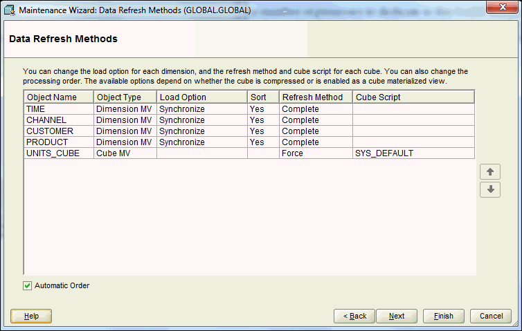
    [Description of "Figure 3-16 Selecting Build Options"](img_text/maintwiz_dataref.md)
    If you click Next, the Processing Options page appears.

5.  On the Processing Options page, you can keep the default values.

    If you click Next, the Scheduling page appears.

6.  On the Scheduling page, you can specify task processing options. You can submit the build to the Oracle job queue or create a SQL script that you can run outside of Analytic Workspace Manager.

    You can also select the number of processes to dedicate to this build. The number of parallel processes is limited by the smallest of these numbers: the number of partitions in the cube, the number of processes dedicated to the build, and the setting of the `JOB_QUEUE_PROCESSES` initialization parameter.

    Click Help for information about these choices.

7.  Click Finish.

Figure 3-17 shows the build submitted immediately to the Oracle job queue.

Figure 3-17 Selecting the Scheduling Options

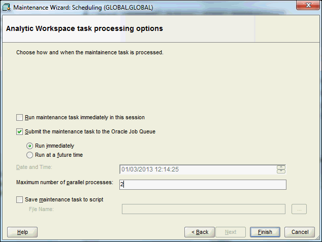
[Description of "Figure 3-17 Selecting the Scheduling Options"](img_text/maintwiz_opt.md)

Figure 3-18 shows the maintenance log displayed by Analytic Workspace Manager for a cube. The log refreshes throughout the build to provide you with the most up-to-date information. The maintenance log appears automatically for maintenance tasks that run immediately in the session. When you submit a job to the Oracle job queue, you can track its progress through the various reports in the Maintenance Reports folder: Jobs Scheduled, Jobs Running, and Jobs History. The reports in Jobs Running and Jobs History are the same as the one shown in Figure 3-18.

Figure 3-18 Maintenance Log for the Units Cube

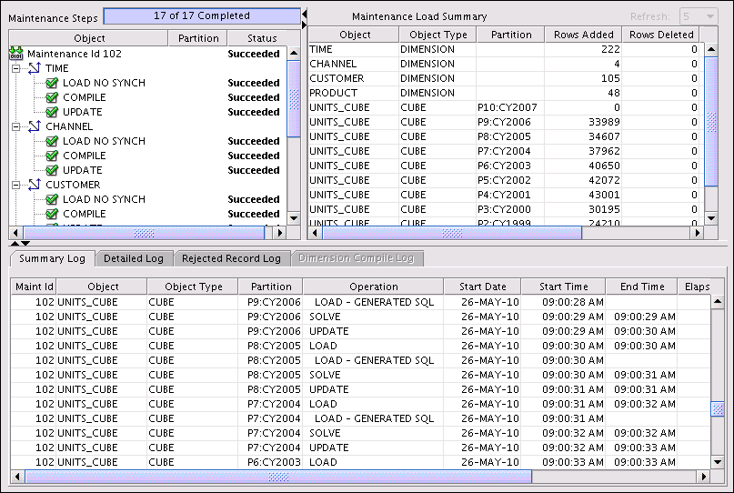
[Description of "Figure 3-18 Maintenance Log for the Units Cube"](img_text/cube_log.md)

#### 3.5.5 Displaying the Data in a Cube

After loading a cube, you can display the data for your business measures in Analytic Workspace Manager.

##### To display the data in a cube:

1.  In the navigation tree, right-click the cube.

2.  Select View Data from the shortcut menu.

The Measure Data Viewer displays the selected measure in a crosstab at the top of the page and a graph at the bottom of the page. On the crosstab, you can expand and collapse the dimension hierarchies that label the rows and columns. You can also change the location of a dimension by pivoting or swapping it. If you want, you can use multiple dimensions to label the columns and rows, by nesting one dimension under another.

##### To change the default display:

- To pivot, drag a dimension from one location and drop it at another location, usually above or below another dimension.

- To swap dimensions, drag and drop one dimension directly over another dimension, so they exchange locations.

To make extensive changes to the selection of data, select Query Builder from the File menu.

Figure 3-19 shows the Units cube in the Measure Viewer.

Figure 3-19 Displaying the Units Cube

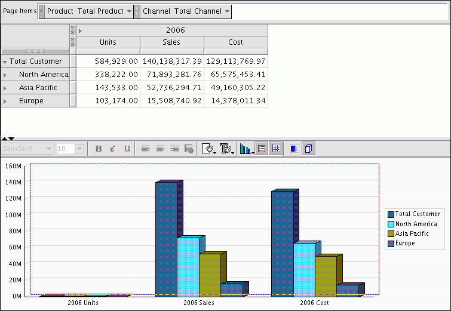
[Description of "Figure 3-19 Displaying the Units Cube"](img_text/meas_view.md)

#### 3.5.6 Displaying the Cube View Descriptions

The Maintenance Wizard automatically generates relational views of a cube. [Querying Dimensional Objects](querying-dimensional-objects.md) describes these views and explains how to query them.

Figure 3-20 shows the description of the relational view of the Units cube.

Figure 3-20 Description of the Units Cube View

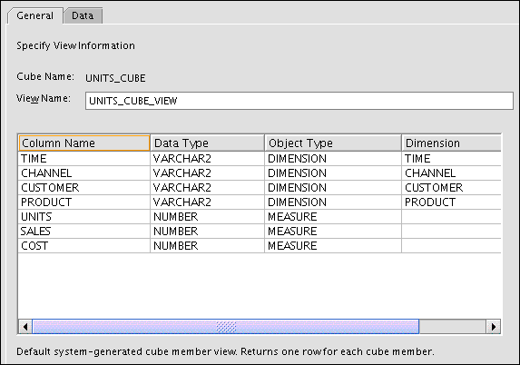
[Description of "Figure 3-20 Description of the Units Cube View"](img_text/cube_view.md)

### 3.6 Choosing a Data Maintenance Method

While developing a dimensional model of your data, mapping and loading each object immediately after you create it is a good idea. That way, you can detect and correct any errors that you made to the object definition or the mapping.

However, in a production environment, you want to perform routine maintenance as quickly and easily as possible. For this stage, you can choose among data maintenance methods.

You can refresh all cubes using the Maintenance Wizard. This wizard enables you to refresh a cube immediately, or submit the refresh as a job to the Oracle job queue, or generate a PL/SQL script. You can run the script manually or using a scheduling utility, such as Oracle Enterprise Manager Scheduler or the `DBMS_SCHEDULER` PL/SQL package.

The generated script calls the `BUILD` procedure of the `DBMS_CUBE` PL/SQL package. You can modify this script or develop one from the start using this package.

The data for a partitioned cube is loaded and aggregated in parallel when multiple processes have been allocated to the build. You are able to see this in the build log.

In addition, each cube can support these data maintenance methods:

- Custom cube scripts

- Maintenance scripts

- Cube materialized views

If you are defining cubes to replace existing materialized views, then you use the materialized views as an integral part of data maintenance. Materialized view capabilities restrict the types of analytics that can be performed by a custom cube script.

**See Also:**

- "[Maintenance Logs](administering-oracle-olap.md)"

- "[Parallelism](administering-oracle-olap.md)"

#### 3.6.1 Creating and Executing Custom Cube Scripts

A cube script is an ordered list of steps that prepare a cube for querying. Each step represents a particular data transformation. By specifying the order in which these steps are performed, you can allow for interdependencies.

You can choose from these step types:

- Clear Data: Clears the data from the entire cube, from selected measures, or from selected portions of the cube. You can clear just the detail data (called leaves) for a fast refresh, just the aggregate data, or both for a complete refresh. Clearing old data values is typically done before loading new values.

- Load: Loads the data from the source tables into the cube. You can load all measures in the cube or just selected measures.

- Aggregation: Generates aggregate values using the rules defined for the cube. You can aggregate the entire cube, selected measures, or selected portions of the cube.

- Analyze: Generates optimizer statistics, which can improve the performance of some types of queries. For more information, see "[Analyzing Cubes and Dimensions](administering-oracle-olap.md)". Generating statistics is typically done immediately after data maintenance.

- OLAP DML: Executes a command or program in the OLAP DML.

- PL/SQL: Executes a PL/SQL command or script. You can run a PL/SQL script, for example, at the beginning of data maintenance to initiate a refresh of the relational source tables.

If a cube is used to support advanced analytics in a cube script, then it cannot be enhanced as a cube materialized view, as described in "Adding Materialized View Capability to a Cube". In this case, you are responsible for detecting when the data in the cube is stale and must be refreshed.

##### 3.6.1.1 Creating Cube Scripts

To create a cube script:

1.  Expand the folder for a cube that is not defined as a cube materialized view.

2.  Right-click Cube Scripts, then select Create Cube Script.

    The Create Cube Script dialog box appears.

3.  On the General tab, enter a name for the cube script.

4.  To create a step, click New Step.

5.  Select the type of step.

    The New Step dialog box appears for that type of step.

6.  Complete the tabs, then click OK.

    The step is listed on the Cube Script General tab.

7.  Click Create.

    The cube script appears as an item in the Cube Script folder.

8.  To run the cube script:

    1.  Right-click the cube script on the navigation tree, and select Run Cube Script.

        The Maintenance Wizard opens.

    2.  Follow the steps of the wizard.

    3.  To view the results, right-click the cube and select View Data.

Figure 3-21 shows the Create Cube Script dialog box, in which several steps have been defined.

Figure 3-21 Creating a Cube Script

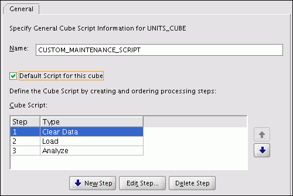
[Description of "Figure 3-21 Creating a Cube Script"](img_text/cube_script.md)

##### 3.6.1.2 Running a Cube Script

Each cube automatically has a default cube script named `LOAD_AND_AGGREGATE` that loads the data and aggregates it using the rules defined on the cube. You can define any number of additional scripts and designate one as the default cube script. All methods of refreshing a cube execute the default cube script. You can execute other cube scripts manually using the Maintenance Wizard.

##### To manually run a custom cube script:

1.  Expand the Cube Scripts folder for the cube.

2.  Right-click the cube script and select Run Cube Script to open the Maintenance Wizard.

3.  Follow the steps of the Maintenance Wizard.

##### To run a custom cube script as the default script:

1.  Expand the Cube Scripts folder for the cube.

2.  Select the cube script so the General tab appears.

3.  Select Default Script For This Cube and click Apply.

4.  Open the Maintenance Wizard anywhere on the navigation tree and select the cube.

5.  Follow the steps of the Maintenance Wizard.

##### To run a cube script as a step in a maintenance script:

1.  Create a maintenance script.

2.  Add the cube script as a step.

3.  Run the maintenance script.

#### 3.6.2 Creating and Executing Maintenance Scripts

A maintenance script is an ordered list of steps for maintaining multiple cubes in a schema. By using a maintenance script, you can manage interdependencies among the cubes.

To load and aggregate a cube or a dimension, add it as a step. For more control over the maintenance of a particular cube or dimension, either create a cube script or enter the individual steps directly into the maintenance script:

- Clear Data

- Load

- Aggregation

- Analyze

- OLAP DML

- PL/SQL

These are the same steps described in "Creating and Executing Custom Cube Scripts".

##### 3.6.2.1 Creating Maintenance Scripts

To create a maintenance script:

1.  In the navigation tree, right-click Maintenance Scripts, then select Create Maintenance Script to display the Create Maintenance Script dialog box.

2.  Enter the name, labels, and description on the General tab.

3.  To create a new step, click Add, then select the type of step from the list.

4.  Create additional steps as desired. You can edit, delete, or re-order the steps at any time.

5.  Click Create. The new maintenance script appears as an object in the Maintenance Scripts folder.

Figure 3-22 shows the General tab of the Create Maintenance Script dialog box.

Figure 3-22 Creating a Maintenance Script

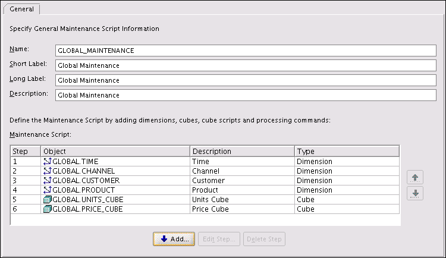
[Description of "Figure 3-22 Creating a Maintenance Script"](img_text/maint_script.md)

##### 3.6.2.2 Running Maintenance Scripts

To run a maintenance script:

1.  Expand the Maintenance Scripts folder.
2.  Right-click the script, then select Run Maintenance Script.
3.  The Maintenance Wizard opens.
4.  Follow the steps of the Maintenance Wizard.

#### 3.6.3 Adding Materialized View Capability to a Cube

Oracle OLAP cubes can be enhanced with materialized view capabilities. Cubes can be incrementally refreshed through the Oracle Database materialized view subsystem, and they can serve as targets for transparent rewrite of queries against the source tables. A cube that has been enhanced in this way is called a cube materialized view.

The OLAP dimensions associated with a cube materialized view are also defined with materialized view capabilities.

A cube must conform to these requirements, before it can be designated as a cube materialized view:

- All dimensions of the cube have at least one level and one level-based hierarchy. Ragged and skip-level hierarchies are not supported. The dimensions must be mapped.

- All dimensions of the cube use the same aggregation operator, which is either `SUM`, `MIN`, or `MAX`.

- The cube has one or more dimensions and one or more measures.

- The cube is fully defined and mapped. For example, if the cube has five measures, then all five are mapped to the source tables.

- The data type of the cube is `NUMBER`, `VARCHAR2`, `NVARCHAR2`, or `DATE`.

- The source detail tables support dimension and rely constraints. If they have not been defined, then use the Relational Schema Advisor on the Materialized Views tab of the cube property sheet to generate a script that defines them on the detail tables.

- The cube is compressed.

- The cube can be enriched with calculated measures, but it cannot support more advanced analytics in a cube script.

**See Also:**

"[Cube Materialized Views](administering-oracle-olap.md)"

##### To add materialized view capabilities:

1.  In the navigation tree, select a cube.

    The property sheets for the cube are displayed.

2.  Select the Materialized Views tab.

3.  Review the checklist and, if some tests failed, fix the cause of the problem.

    You cannot define a cube materialized view until the cube is valid.

4.  For automatic refresh, complete just the top half page. For query rewrite, complete the entire page.

    Click Help for information about the choices on this page.

5.  Click Apply.

The cube materialized views appear in the same schema as the analytic workspace. A materialized view is created for the cube and each of its dimensions. Unlike traditional materialized views, cube materialized views do not use relational tables to store data; the data is stored in the backing cube. A `CB$` prefix identifies the tables as cube materialized views.

The initial state of a new materialized view is invalid, so it does not support query rewrite until after it is refreshed. You can specify the first refresh time on the Materialized View tab of the cube, or you can run the Maintenance Wizard.

Figure 3-23 shows the Materialized View tab of the Units Cube.

Figure 3-23 Defining a Materialized View

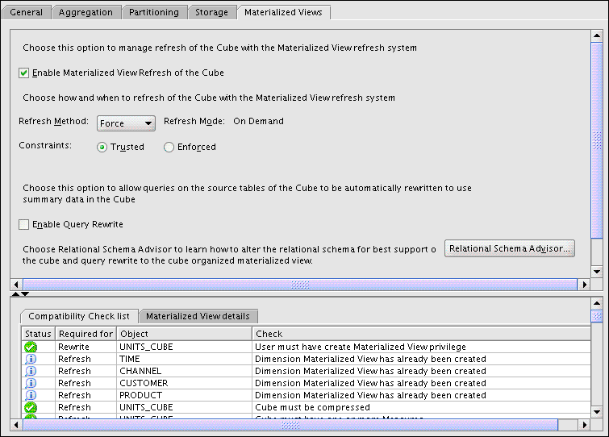
[Description of "Figure 3-23 Defining a Materialized View"](img_text/mv.md)

### 3.7 Supporting Multiple Languages

A single analytic workspace can support multiple languages. This support enables users of OLAP applications and tools to view the metadata in their native languages. For example, you can provide translations for the display names of measures, cubes, and dimensions. You can also map attributes to multiple columns, one for each language.

The number and choice of languages is restricted only by the database character set and your ability to provide translated text. Languages can be added or removed at any time.

#### To add support for multiple languages:

1.  In the navigation tree, expand the folder for the analytic workspace.

2.  Select Languages to display its property page.

3.  On the General tab, click Modify Languages.

4.  On the Modify Languages dialog box, select the languages that the analytic workspace must support. Use the shuttle keys to move them to the Selected Languages box.

5.  Click OK to return to the Languages property page.

6.  Enter the translations of the various labels and descriptions. Each language has a column where you can enter this information.

7.  For each dimension, open the Mappings window. Map the attributes to the source columns for each language.

Figure 3-24 shows the addition of French to the analytic workspace.

Figure 3-24 Adding a Language

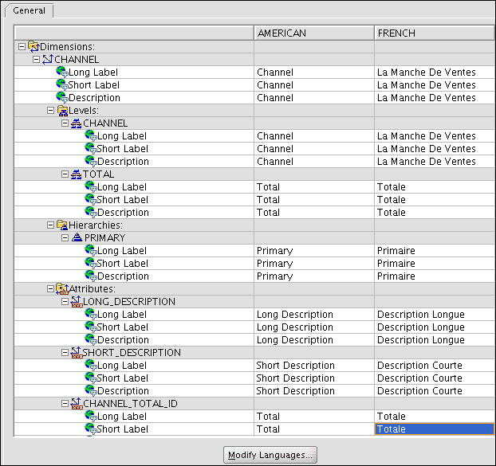
[Description of "Figure 3-24 Adding a Language"](img_text/lang_gen.md)

### 3.8 Defining Measure Folders

Measure folders organize and label groups of measures. Users may have access to several analytic workspaces or relational schemas with measures named Sales or Costs, and measure folders provide a way for applications to differentiate among them.

#### To create a measure folder:

1.  Expand the folder for the analytic workspace.

2.  Right-click Measure Folders, then select Create Measure Folder from the shortcut menu.

3.  Complete the General tab of the Create Measure Folder dialog box.

    Click Help for specific information about these choices.

The measure folder appears in the navigation tree under Measure Folders. You can also create subfolders.

Figure 3-25 shows creation of a measure folder.

Figure 3-25 Creating a Measure Folder

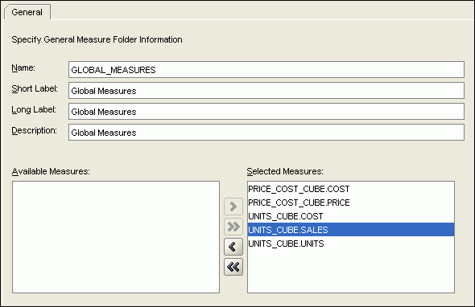
[Description of "Figure 3-25 Creating a Measure Folder"](img_text/meas_folder.md)

### 3.9 Saving and Re-Creating Dimensional Objects with Object Definitions

Analytic Workspace Manager enables you to save all or part of the data model as a template. You can save a template to a file or to a table. The template contains the XML definitions of the dimensional objects, such as dimensions, levels, hierarchies, attributes, and measures. Only the metadata is saved, not the data.

Template files are small, so you can easily distribute them by email or on a website, just as the templates for Global and Sales History are distributed on the Oracle website. A template saved to a table is available to any user of the database who has permission to see it. Oracle OLAP saves templates to the CUBE_TEMPLATES table.

To re-create the dimensional objects, you simply identify the templates in Analytic Workspace Manager.

You can also save an analytic workspace to, or create one from, an [EIF file](glossary.md). EIF files are specially formatted files for copying analytic workspaces. They save the definitions of OLAP DML objects and optionally save the data also.

This section has the following topics:

- Creating Dimensional Objects From XML Templates

- Saving Object Definitions to XML Templates

- Creating Analytic Workspaces from EIF Files

- Saving Analytic Workspaces to EIF Files

**See Also:**

- "Mapping Cubes" for information on saving the SQL statements for a mapping.

#### 3.9.1 Creating Dimensional Objects From XML Templates

You can create all or part of an analytic workspace from a template.

To create dimensional objects from a template:

1.  In the navigation tree, right-click Analytic Workspaces, Dimensions, Cubes, or Measure Folders.
2.  Select Create Object from Template to display the Create Object from Template dialog box.
3.  Select the schema in which to create the objects and click OK.
4.  Complete the Create Object from Template dialog box.
    To overwrite the metadata for an existing object select Modify Existing Objects on the Options tab.

**See Also:**

- "[About XML Templates](administering-oracle-olap.md)"

#### 3.9.2 Saving Object Definitions to XML Templates

You can save the XML descriptions of all the objects in an analytic workspace, or just selected objects, and re-create them later in the same database or in a database on another computer or platform.

To save object definitions in an XML template:

1.  In the navigation tree, right-click an analytic workspace, dimension, cube, or measure folder.
2.  Select Save Object to Template to display the Save Object to Template dialog box.
3.  Select Save to File or Save to Table.
4.  Verify the selection of objects in the Object Selection tab.
5.  To modify the use of the schema name in the template, use the Options tab.
6.  Complete the remaining fields to identify the name and location of the saved template. You can overwrite an existing template.

**See Also:**

- "[About XML Templates](administering-oracle-olap.md)"

#### 3.9.3 Creating Analytic Workspaces from EIF Files

EIF files are specially formatted files for transferring dimensional objects and data.

To create an analytic workspace from an EIF file:

1.  In the navigation tree, right-click Analytic Workspaces and select Create Analytic Workspace From EIF File.
    The Create Analytic Workspace From EIF File dialog box appears.
2.  Specify the directory that contains the EIF file and the name of the file, a name for the new analytic workspace and the tablespace for it, and then click OK.

**See Also:**

- "[About EIF Files](administering-oracle-olap.md)"

#### 3.9.4 Saving Analytic Workspaces to EIF Files

You can save, or export, an analytic workspace to an EIF file.

To save analytic workspace objects to an EIF file:

1.  In the navigation tree, right-click the analytic workspace.
2.  Select Export Analytic Workspace ObjectTo EIF File to display the Export Analytic Workspace Object to EIF File dialog box.
3.  Specify the directory and file name for the EIF file, then click OK.

**See Also:**

- "[About EIF Files](administering-oracle-olap.md)"

### 3.10 Copying and Pasting Dimensional Objects

You can copy a dimensional object and paste it in an appropriate location. The analytic workspace objects that you can copy are the following.

- Analytic workspace

- Dimension

- Cube

- Measure

- Calculated measure

#### To copy a dimensional object:

- In the navigation tree, right-click an analytic workspace, dimension, cubes, measure, or calculated measure.

- Select Copy.

#### To paste a dimensional object:

- In the navigation tree, right-click Analytic Workspaces, Dimensions, Cubes, Measures, or Calculated Measures.

- Select Paste.
