You can use any SQL development tool or application to create reports and dashboards populated with data from OLAP cubes. This chapter shows the basic steps for working with the tools provided with Oracle Database: Oracle Business Intelligence Publisher (BI Publisher) and Oracle Application Express. You can try these tools, or you can apply the methods shown here to your favorite SQL tool.

This chapter contains the following topics:

- Developing OLAP Applications

- Developing a Report Using BI Publisher

- Developing a Dashboard Using Application Express

**See Also:**

[Querying Dimensional Objects](querying-dimensional-objects.md)

### 6.1 Developing OLAP Applications

You can use any SQL query against a cube as the content for a report or dashboard. Both BI Publisher and Application Express contain a Query Builder, which you can use to develop queries against both relational and dimensional objects. You can also cut-and-paste queries from a SQL script or another source, which is the method used in this chapter.

If your goal is to create static reports and dashboards, then you do not need to read any further. You can start developing OLAP applications immediately using your favorite tool. This chapter explains how to create applications with dynamic content. It focuses on ways to leverage the unique capabilities of cubes and dimensions to create drillable reports and graphs using a single query. You will learn how to create two types of drillable interfaces:

- Choice Lists: You can create a drop-down list for each dimension to drill on the dimensions in a report or dashboard.

- Linked Dimension Columns: In Application Express, you can add links to the dimension columns of a crosstab to drill down to the bottom of a hierarchy, and use a Reset button to return to the top level.

These user interfaces set the values of bind variables in the `WHERE` clause of the source query. When a user changes the current selection in a choice list or clicks a link in a crosstab, that action dynamically changes the value of the variable. When the variable changes, so does the condition of the query and the contents of the report or dashboard.

When the variable sets the value of the `PARENT` column of the hierarchy views, users can drill on a parent to view its children.

Example 6-1 shows a basic SQL query against `UNITS_CUBE_VIEW` in the Global sample schema. The query selects the `SALES` measure and three calculated measures that use `SALES` as the basis for the calculations:

- `SALES_PP`: Sales from the prior period.

- `SALES_CHG_PP`: Difference in sales between the current period and the prior period.

- `SALES_PCTCHG_PP`: Percent difference in sales between the current period and the prior period.

This query is used in the sample applications developed in this chapter. The `PARENT` columns for the Product, Customer, and Time dimensions support drilling in these applications. The Channel dimension remains anchored at the Total level.

Example 6-1 SQL Query Against the Sales Cube

    SELECT p.long_description "Product",
         cu.long_description "Customer",
         t.long_description "Time",
         ROUND(f.sales) "Sales",
         ROUND(f.sales_pp) "Prior Period",
         ROUND(f.sales_chg_pp) "Change",
         ROUND(f.sales_pctchg_pp * 100) "Percent Change"
    /* From dimension views and cube view */
    FROM product_primary_view p,
         customer_shipments_view cu,
         time_calendar_view t,
         channel_primary_view ch,
         units_cube_view f
    /* Use parent columns to implement drilling */
    WHERE p.parent = 'TOTAL'
        AND cu.parent = 'TOTAL'
        AND t.parent = 'CY2006'
        AND ch.level_name = 'TOTAL'
    /* Join dimension views to cube view */
        AND p.dim_key = f.product
        AND cu.dim_key = f.customer
        AND t.dim_key = f.time
        AND ch.dim_key = f.channel
    ORDER BY product, customer, t.end_date;

    Product         Customer        Time            Sales Prior Period     Change Percent Change
    --------------- --------------- ---------- ---------- ------------ ---------- --------------
    Hardware        North America   Q1.06        16002175     14493426    1508749             10
    Hardware        North America   Q2.06        16032643     16002175      30469              0
    Hardware        North America   Q3.06        15698208     16032643    -334436             -2
    Hardware        North America   Q4.06        15958791     15698208     260583              2
    Hardware        Asia Pacific    Q1.06        13416447     14273900    -857453             -6
    Hardware        Asia Pacific    Q2.06        14306431     13416447     889984              7
                     .
                     .
                     .
    Software/Other  Asia Pacific    Q4.06          652300       647019       5281              1
    Software/Other  Europe          Q1.06          737523       634293     103230             16
    Software/Other  Europe          Q2.06          678391       737523     -59132             -8
    Software/Other  Europe          Q3.06          499008       678391    -179383            -26
    Software/Other  Europe          Q4.06          710796       499008     211788             42

    24 rows selected.

### 6.2 Developing a Report Using BI Publisher

BI Publisher is an efficient, scalable reporting solution for generating and delivering information through a variety of distribution methods. It reduces the high costs associated with the development and maintenance of business documents, while increasing the efficiency of reports management. BI Publisher generates reports in a variety of formats, including HTML, PDF, and Excel.

If you have not used BI Publisher, you can download the software, tutorials, and full documentation from the Oracle Technology Network at

[`http://www.oracle.com/technetwork/middleware/bi-publisher/overview/index.html`](http://www.oracle.com/technetwork/middleware/bi-publisher/overview/index.html)

Example 6-1 shows a report in PDF format based on the query shown in Example 6-1. When generating a report for distribution, you can select any combination of Products, Customers, and Time Periods from the choice lists. The selection for this report is Hardware products, customers in Europe, and months in Q2-06. This chapter explains how you can create a report like this one using drillable dimensions.

Figure 6-1 Sales Report in BI Publisher

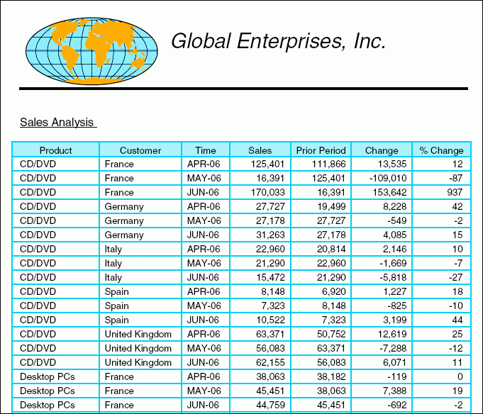
[Description of "Figure 6-1 Sales Report in BI Publisher"](img_text/bipub_report1.md)

#### 6.2.1 Creating an OLAP Report in BI Publisher

A report consists of a report entry, which you create in BI Publisher, and a layout template, which you create using an application such as Microsoft Word or Adobe Acrobat. You can organize your reports in folders.

BI Publisher is a middleware application and can derive data from multiple sources. These procedures assume that you can access one or more cubes from BI Publisher. If you cannot, contact your BI Publisher administrator about defining a data source.

##### To create a report entry:

1.  Open a browser to the BI Publisher home page and log in.

2.  Click My Folders.

3.  Open an existing folder.

    or

    To create a folder:

    1.  Click Create a New Folder.

    2.  Enter a name for the folder in the text box, such as `OLAP Reports`.

    3.  Click Create.

4.  Click the folder to open it.

5.  Create a report:

    1.  Click Create a New Report.

    2.  Enter a report name in the text box.

        This example creates a report named Global Sales.

    3.  Click Create.

    The report appears in the folder, as shown in Figure 6-2.

Figure 6-2 Creating a Report in BI Publisher

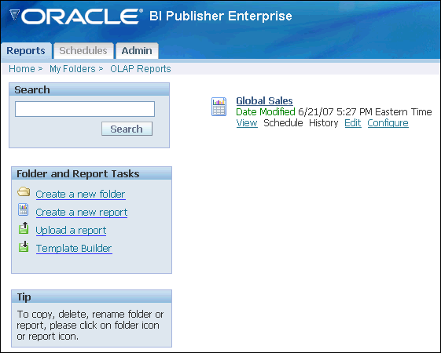
[Description of "Figure 6-2 Creating a Report in BI Publisher"](img_text/bipub_newrep.md)

##### To configure the report entry:

1.  To define the contents of the report, click Edit.

    The Report Editor opens.

2.  For General Settings, enter a description and select a default data source.

    If the list does not include a connection to the database and schema containing your cubes, contact your BI Publisher administrator.

3.  Select Data Model, then click New.

    The Data Set page opens.

4.  Enter a name for the data set and enter a SQL query like the one shown in Example 6-1. Do not use a semicolon.

5.  Click Save.

6.  Click View.

    BI Publisher checks the report definition for errors. If there are none, then it generates the XML for the report.

Figure 6-3 shows the Report Editor with the Data Set page displayed.

Figure 6-3 Creating a Data Model in the BI Publisher Report Editor

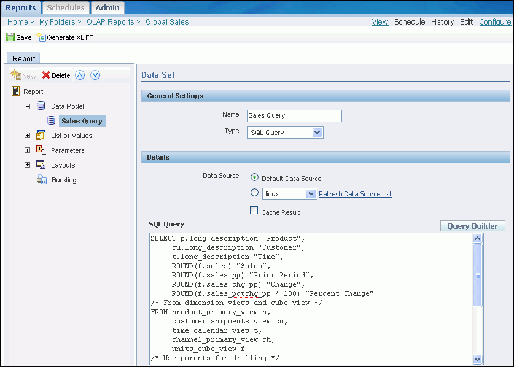
[Description of "Figure 6-3 Creating a Data Model in the BI Publisher Report Editor"](img_text/bipub_rpteditor.md)

#### 6.2.2 Creating a Template in Microsoft Word

BI Publisher does not contain formatting tools. Instead, it enables you to design a report using familiar desktop applications. This example uses Microsoft Word. A report template can contain:

- Static text and graphics that you enter like any other Word document.

- Dynamic fields such as the date and time or page numbers, which are processed by Word.

- Codes that identify the XML tags for your data, which are processed by BI Publisher. When BI Publisher generates a report, it replaces the codes with the data identified by these tags.

You can format all parts of the report template in Word, selecting the fonts, text and background colors, table design, and so forth.

Example 6-2 XML for a SQL Query

This example shows the XML for a row of data returned by the sample query. The tags match the column names in the select list, except that underscores replace the spaces. The tags are `Product`, `Customer`, `Time`, `Sales`, `Prior_Period`, `Change`, and `Percent_Change`. XML tags are case-sensitive. You use the HTML tag names as the codes in the Word document.

    <ROW>
    <Product>Hardware</Product>
    <Customer>North America</Customer>
    <Time>Q1.06</Time>
    <Sales>16002175</Sales>
    <Prior_Period>14493426</Prior_Period>
    <Change>1508749</Change>
    <Percent_Change>10</Percent_Change>
    </ROW>

Figure 6-4 shows the Word document that is used as the template for the sample report. It contains these elements:

- A table used to format the banner, which consists of a graphic, the company name, and a horizontal line. (Static)

- The name of the report. (Static)

- A table for the query results that contains two rows:

  - A heading row. (Static)

  - A body row containing text form fields, which identify the XML tags and the appropriate formatting for the data. BI Publisher replaces these fields with data from the query. The first and last columns contain two fields. The first and last fields identify the range of repeating columns. (Dynamic)

- A date field. Word updates this field with the current date. (Dynamic)

This example uses a blank Word template, but you could use a template with, for example, the banner already defined.

Figure 6-4 Sample Report Template Created in Word for BI Publisher

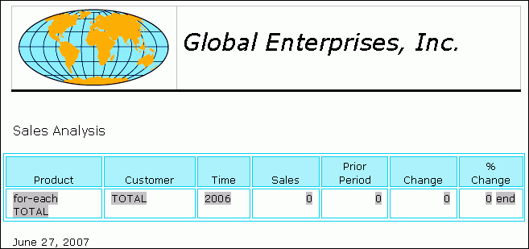
[Description of "Figure 6-4 Sample Report Template Created in Word for BI Publisher "](img_text/bipub_template.md)

The following procedure defines the template manually. Alternatively, you can use a Word plug-in called Oracle BI Publisher Desktop. On the BI Publisher My Folders page, click Template Builder to download the plug-in.

##### To create a BI Publisher template in Word:

1.  Open a new document in Word.

2.  Compose the page according to your preferences.

3.  For the query results, create a table.

    The table shown in Figure 6-4 is very simple. You can use much more elaborate formatting if you want, including nested columns and tables.

4.  From the View menu, select Toolbars, then Forms.

    The Forms toolbar opens.

5.  Enter a field in the body row of each column:

    1.  Position the cursor in the appropriate cell.

    2.  On the Forms toolbar, click the Text Form Field icon.

        The Text Form Field Options dialog box opens.

    3.  Select an appropriate Type, generally Regular Text for dimension labels and Number for measures.

    4.  Enter a default value and a format.

    5.  Click Add Help Text.

        The Form Field Help Text dialog box opens.

    6.  Type the appropriate XML tag in the Type Your Own box, using the format `<?``tag``?>`.

        Enter the tag name exactly as it appears in the XML report. For example, enter `<?Product?>` for the XML tag `<Product>`.

    7.  Click OK to close the Form Field Help dialog box.

    8.  Click OK to close the Text Form Field Options dialog box.

6.  Insert an additional form field at the beginning of the first column:

    1.  In the Text Form Field Options dialog box, enter any default value, such as `For-Each`.

    2.  In the Form Field Help Text dialog box, enter this text:

            <?for-each:ROW?>

7.  Insert an additional form field at the end of the last column:

    1.  In the Text Form Field Options dialog box, enter any default value, such as `End`.

    2.  In the Form Field Help Text dialog box, enter this text:

            <?end for-each?>

8.  Make any additional formatting changes in Word, such as the appropriate justification of the table headings and data columns.

9.  Save the document as an RTF file.

#### 6.2.3 Generating a Formatted Report

After creating a report template in Word, you can upload it to BI Publisher and associate it with your report definition. Then you can generate reports in a variety of formats.

##### To create a report layout:

1.  Open the report editor in BI Publisher.

2.  Select Layouts.

    The Create Layouts page opens.

3.  Click New.

    The Layout page opens.

4.  Enter a name and select RTF for the template type.

5.  Select Layouts again, and select the layout as the default template for this report.

6.  Under Manage Template Files, click Browse. Select the RTF file you created.

7.  Click Upload.

    The uploaded file is listed under Manage Template Files. Whenever you change the file in Word, upload it again. Otherwise, BI Publisher continues to use its copy of the previous version.

8.  Click Save.

9.  Click View.

    The report appears.

10. To change the format, select a format from the list and click View.

    To see the XML, select Data.

Figure 6-5 shows the report in HTML format.

Figure 6-5 BI Publisher Report Displayed in HTML Format

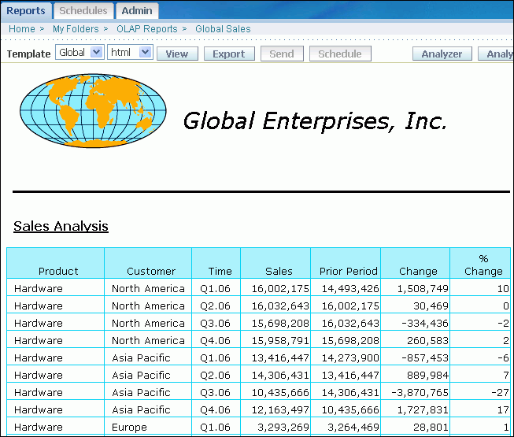
[Description of "Figure 6-5 BI Publisher Report Displayed in HTML Format"](img_text/bipub_html.md)

#### 6.2.4 Adding Dimension Choice Lists in BI Publisher

You can add choice lists for the dimensions to a report. When generating a report, you can change the selection of data without changing the query. To add choice lists, take these steps:

- Create one or more Lists of Values (LOV) to be displayed in the menu.

- Create menus for displaying the LOVs.

- Edit the query to use the bind variables created for the menus.

These steps are described in the following topics:

- Creating a List of Values for a BI Publisher Report

- Creating a Menu

- Editing the Query in BI Publisher

##### 6.2.4.1 Creating a List of Values for a BI Publisher Report

For a list of values, use a SQL query that selects the dimension keys to display. Include the `LONG_DESCRIPTION` and `DIM_KEY` columns from the hierarchy view. This example creates a list for the Product Primary hierarchy:

    SELECT long_description, dim_key
         FROM product_primary_view
         WHERE parent = 'TOTAL'
         OR dim_key = 'TOTAL'
         ORDER BY level_name, long_description

    LONG_DESCRIPTION     DIM_KEY
    -------------------- ------------
    Hardware             HRD
    Software/Other       SFT
    Total Product        TOTAL

##### To create a list of values:

1.  Open the Report Editor in BI Publisher.

2.  Select List of Values, then click New.

    The List of Values page opens.

3.  Define the list:

    1.  Enter a name for the list, such as `Product_LOV`.

    2.  For the type, select SQL Query.

    3.  Enter a query against the dimension hierarchy view, as shown previously.

4.  Click Save.

Repeat these steps for the other dimensions. This example uses lists for Product, Customer, and Time.

##### 6.2.4.2 Creating a Menu

In BI Publisher, a menu is a type of parameter. Creating a parameter automatically creates a bind variable that you can use in the query for the report.

##### To create a menu:

1.  Select Parameters, then click New.

    The Parameter page opens.

2.  Define the parameter:

    1.  For the Identifier, enter a name such as `product`.

        This is the case-sensitive name of the bind variable that you will use in the query.

    2.  Select an appropriate data type, typically String.

    3.  For the Default Value, enter the dimension key used in the `WHERE` clause of the LOV query.

        The menu initially displays this key.

    4.  For the Parameter Type, select Menu.

    5.  Select the appropriate List of Values.

    6.  Clear all options.

3.  Click Save.

Repeat these steps for the other dimensions. This example creates menus for Product, Customer, and Time.

##### 6.2.4.3 Editing the Query in BI Publisher

To activate the menus, you change the `WHERE` clause in the query for the report to use the bind variables. The value of a bind variable is the current menu choice.

This is the format for the conditions of the `WHERE` clause:

    parent_column = :bind_variable

In this example, the `WHERE` clause uses the bind variables for Time, Product, and Customer:

    WHERE  p.parent  = :product
       AND cu.parent = :customer
       AND t.parent  = :time
       AND ch.level_name = 'TOTAL'

##### To edit the query:

1.  Under Data Model, select the data set you defined for this report.

    The Data Set page opens.

2.  In the SQL Query box, edit the `WHERE` clause to use the bind variables created by the parameter definitions.

3.  Click Save.

Figure 6-6 shows a report in HTML format displayed in BI Publisher. The choice lists for Product, Customer, and Time appear across the top. The crosstab lists the months in Q3.06, the Hardware products, and the countries in Europe. To see a different selection of data, you choose a Time Period, Product, and Customer from the menus, then click View. This report was generated by the same report entry, using the same query, as the one shown in Figure 6-1.

You can continue working on this report, adding charts and other tables.

Figure 6-6 Sales Report With Choice Lists in BI Publisher

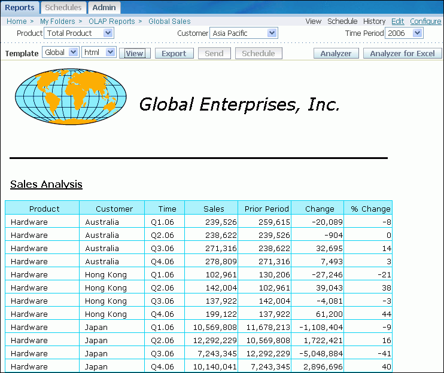
[Description of "Figure 6-6 Sales Report With Choice Lists in BI Publisher"](img_text/bipub_report2.md)

### 6.3 Developing a Dashboard Using Application Express

Oracle Application Express is a rapid web application development tool for Oracle Database. Application Express offers built-in features such as user interface themes, navigational controls, form handlers, and flexible reports, which simplify the development process.

[Overview](overview.md) shows a sophisticated dashboard that extracts analytic data from cubes and presents it in a variety of graphs and reports. You can easily create dashboards from your cubes that display the rich analytical content generated by Oracle OLAP.

If you have not used Application Express, you can download the software, tutorials, and full documentation from the Oracle Technology Network at

[`http://www.oracle.com/technetwork/developer-tools/apex/overview/index.html`](http://www.oracle.com/technetwork/developer-tools/apex/overview/index.html)

Figure 6-7 shows a crosstab with display lists for Product and Customer, and links in all three dimension columns. Choosing a different Product or Customer changes the related column to show the children for the selected key. Clicking a dimension key in any column displays its children. The Reset button refreshes the page with the initial selection of data.

Figure 6-7 Drillable Dimensions in Application Express

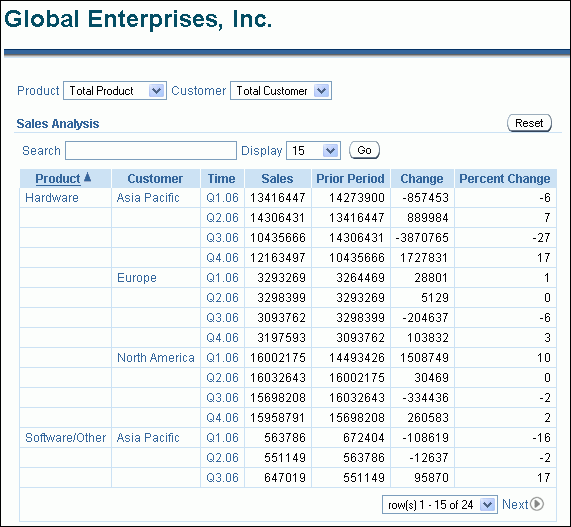
[Description of "Figure 6-7 Drillable Dimensions in Application Express"](img_text/apex_report.md)

#### 6.3.1 Creating an OLAP Application in Application Express

In Application Express, the Administrator creates a workspace in which you can develop your web applications. An application consists of one or more HTML pages, a page consists of regions that identify specific locations on the page, and a region contains a report (crosstab), a chart, or some other item.

Application Express runs in Oracle Database. If your dimensional objects are stored in a different database, then you must use a database link in your queries. The following procedure assumes that you have a workspace and access to at least one cube. It creates an application with one page containing a crosstab.

##### To create a web page from a SQL query:

1.  Open a browser to the Application Express home page and log in.

2.  Click the Application Builder icon.

    The Application Builder opens.

3.  Click Create.

    The Create Application wizard opens.

4.  Select Create Application, then Next.

5.  On the Name page, enter a title for the application such as `Global Dashboard` and select From Scratch.

6.  On the Pages page, select the Report page type, then define the page:

    1.  For Page Source, select SQL Query.

    2.  For Title, enter a name such as `Sales Analysis`.

        This title appears on the page.

    3.  For Query, enter a SQL `SELECT` statement for your cube, like the one shown in Example 6-1. Do not include an `ORDER BY` clause or a semicolon.

    4.  Click Add Page.

        The page definition appears in the Create Application Box.

7.  Click Next, then complete the Create Application wizard according to your own preferences.

    This example was created with no tabs, no shared components, no authentication, and Theme 15 (Light Blue).

8.  On the Confirm page, click Create.

9.  On the Application Builder home page, click the Run Application icon.

**Tip:**

To continue working on this page, click the Edit Page 1 link at the bottom of the display.

Figure 6-8 shows the results of the query displayed in Application Express. Several items are automatically added to the page: breadcrumbs, Search box, Display list, Go button, Reset button, and Spread Sheet link. This application only needs the Reset button, so you can delete the other items if you want.

Figure 6-8 Basic Sales Report in Application Express

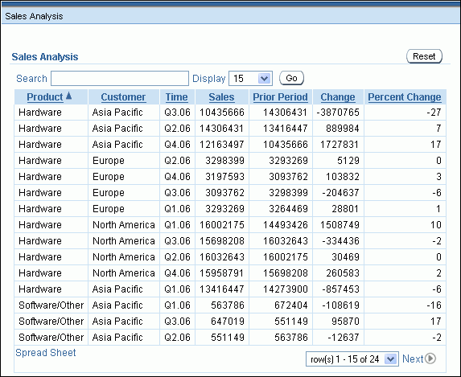
[Description of "Figure 6-8 Basic Sales Report in Application Express"](img_text/apex_report1.md)

#### 6.3.2 Adding Dimension Choice Lists in Application Express

Like BI Publisher, Application Express enables you to drill on the dimensions by adding choice lists of dimension keys. The dashboard user can choose a particular item from the list and dynamically change the selection of data displayed in one or more graphics and crosstabs on the page. To implement a choice list, take these steps:

- Create a region on the page to display the list.

- Create a list of values (LOV).

- Create a list item with a bind variable to display the LOV.

- Create an unconditional branch for the list.

- Edit the query to use the bind variable.

##### To open a Page Definition:

In Application Express, the Page Definition is where you can create and edit pages, including adding and modifying graphical items. The items are organized in three columns: Page Rendering, Page Processing, and Shared Components.

- After running the application, click the Edit Page link at the bottom of the page.

  or

- On the Application home page, click the icon for the page where the report is defined.

Figure 6-9 Application Express Page Definition

This figure shows an area of the Page Definition.

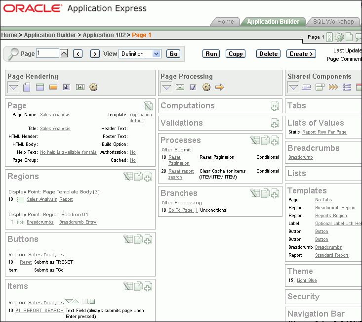
[Description of "Figure 6-9 Application Express Page Definition"](img_text/apex_pagedef.md)

The steps in implementing a choice list are described in the following topics:

- Creating a Region

- Creating a List of Values in Application Express

- Creating the Choice List

- Editing the Query in Application Express

##### 6.3.2.1 Creating a Region

You can create the choice list in a plain HTML area at the top of the page.

##### To create an empty HTML region:

1.  On the Page Definition under Regions, click the Create icon.

    The Create Region wizard opens.

2.  On the Region pages, select HTML, click Next, then select HTML again.

3.  On the Display Attributes page, enter a descriptive title and select an appropriate template and location on the page for the lists.

    For this example, the name is `lov_region`, the template is No Template, and the location is Page Template Body (1 items below template content). The name can be displayed on the rendered page, but it is hidden in this example.

4.  Click Create Region.

    The region appears on the Page Definition under Regions.

##### 6.3.2.2 Creating a List of Values in Application Express

For a list of values, use a SQL query like the one shown here. Include the `LONG_DESCRIPTION` and `DIM_KEY` columns from the hierarchy view. This query creates a list for the Customer Shipments hierarchy:

    SELECT long_description, dim_key
         FROM customer_shipments_view
         WHERE parent = 'TOTAL'
         OR dim_key= 'TOTAL'
         ORDER BY level_name, long_description;

    LONG_DESCRIPTION     DIM_KEY
    -------------------- ----------
    Asia Pacific         APAC
    Europe               EMEA
    North America        AMER
    Total Customer       TOTAL

##### To create a List of Values:

1.  On the Page Definition under List of Values, click the Create icon.

    The Create List of Values wizard opens.

2.  On the Source page, select From Scratch.

3.  On the Name and Type page, enter a descriptive name and select Dynamic.

    This example uses the name `CUSTOMER_LOV`.

4.  On the Query page, enter a query like the one shown previously. Do not use a semicolon.

5.  Click Create List of Values.

    The list of values (LOV) appears in the Page Definition under List of Values.

For additional lists of values (LOVs), repeat these steps. This example creates LOVs for the Product and Customer dimensions.

##### 6.3.2.3 Creating the Choice List

For a choice list, you create a list item that displays the LOV.

##### To create a list item:

1.  On the Page Definition under Items, click the Create icon.

    The Create Item wizard opens.

2.  On the Item Type page, select Select List.

3.  For Control Type, select Select List with Submit.

4.  On the Display Position and Name page:

    - Enter a name that identifies the dimension, such as `P1_CUSTOMER` for the name of the Customer bind variable. `P1` is the page number, and `CUSTOMER` identifies the Customer dimension.

    - Select the new HTML region for the location of the list.

5.  On the List of Values page, set these values:

    - Named LOV to the List Of Values created for this dimension, such as `CUSTOMER_LOV`.

    - Display Null Option to No.

6.  Select the Item attributes according to your own preferences.

7.  On the Source page, enter the name of the top dimension key for the default value.

    For the Global Customer dimension, the value is `TOTAL`.

8.  Click Create Item.

Repeat these steps for other lists. This example creates lists for the Product and Customer dimensions.

##### To activate the list item:

1.  On the Page Definition under Branches, click the Create icon.

    The Edit Branch wizard opens.

2.  On the Point and Type page, accept the default settings.

3.  On the Target page:

    - Set Target to Page in This Application.

    - Set Page to the page with the list item, which is `1` in this example.

    - Select Reset Pagination For This Page.

4.  On the Branch Conditions page, accept the default settings to create an unconditional branch.

5.  Click Apply Changes.

    The Edit Branch page closes, and you return to the Page Definition. The unconditional branch is listed under Branches.

##### 6.3.2.4 Editing the Query in Application Express

This is the format for the dynamic conditions in the `WHERE` clause:

    parent_column = NVL(:bind_variable, 'top dim_key')

The `NVL` function substitutes the name of the top dimension key in the hierarchy for null values. The dimension keys at the top have no parent key.

##### To edit the query:

1.  Open the Page Definition.

2.  Under Regions, click the Edit Region link. In this example, the region is named Sales Report.

    The Edit Region page opens.

3.  Under Source, modify the query:

    - Change the `WHERE` clause to use the bind variables.

    - Delete the outer `SELECT` added by Application Express.

4.  Click Apply Changes.

For this example, the `WHERE` clause now looks like this:

    WHERE p.parent = NVL(:P1_PRODUCT, 'TOTAL')
        AND cu.parent = NVL(:P1_CUSTOMER, 'TOTAL')
        AND t.parent = 'CY2006'
        AND ch.level_name = 'TOTAL'

Figure 6-10 shows the modified page with choice lists for Product and Customer.

Figure 6-10 Dashboard With Choice Lists for Drilling

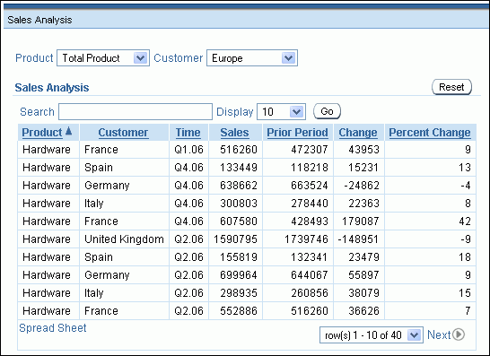
[Description of "Figure 6-10 Dashboard With Choice Lists for Drilling"](img_text/apex_report4.md)

#### 6.3.3 Drilling on Dimension Columns

You can enable users to drill down from the top of a hierarchy to the detail level using a single query. To implement drilling in Application Express, take these steps:

- Create hidden items with bind variables. See Creating Hidden Items.

- Edit the query to use the bind variables. See Editing the Query to Use Bind Variables.

- Add links to the dimension columns of the crosstab. See Adding Links to the Dimension Columns.

The example in these topics adds drilling to all displayed dimensions.

##### 6.3.3.1 Creating Hidden Items

You can create various types of items in Application Express that provide bind variables. They store the session state for a particular element, in this case, the current selection of a parent dimension key.

Each dimension that supports drilling needs a bind variable. In this example, Product and Customer have bind variables created with the list items. Time is the only displayed dimension in the report that does not have a bind variable. Because links in the Time dimension column provide the user interface for changing the session state, Time does not need any other graphical user interface. A hidden item serves the purpose.

##### To create a hidden item:

1.  Open the Page Definition.

2.  Under Items, click the Create icon.

    The Create Item wizard opens.

3.  On the Item Type page, select Hidden.

4.  On the Display Position and Name page:

    - Enter a name that identifies the dimension, such as `P1_TIME` for the name of the Time bind variable.

    - Select the region where the report is defined.

5.  On the Source page, enter the dimension key at the top of the hierarchy.

    `TOTAL` is the top of all hierarchies in the Global schema. For this example, Time is set to `CY2006` to restrict the selection to one year.

6.  Click Create Item.

7.  Repeat these steps for any other dimensions that support drilling only on the column links.

    For this example, a hidden item is defined for Time.

##### 6.3.3.2 Editing the Query to Use Bind Variables

To add column links to a report, you must change two areas of the `SELECT` statement:

- Select list: Application Express manages only those columns that appear in the select list. You can choose to display or hide the columns. For defining the column links, add the `DIM_KEY` and `PARENT` columns in the hierarchy views to the query select list.

- `WHERE` clause: Add the bind variables for the hidden items like you did for the choice lists in "Editing the Query".

Example 6-3 shows the modified sample query.

Example 6-3 Revised Query for Column Links in Application Express

    SELECT p.long_description "Product",
         cu.long_description "Customer",
         t.long_description "Time",
         ROUND(f.sales) "Sales",
         ROUND(f.sales_pp) "Prior Period",
         ROUND(f.sales_chg_pp) "Change",
         ROUND(f.sales_pctchg_pp * 100) "Percent Change",
    /* Add DIM_KEY and PARENT columns for column links */
         p.dim_key product_key,
         p.parent product_parent,
         cu.dim_key customer_key,
         cu.parent customer_parent,
         t.dim_key time_key,
         t.parent time_parent
    /* From dimension views and cube view */
    FROM product_primary_view p,
         customer_shipments_view cu,
         time_calendar_view t,
         channel_primary_view ch,
         units_cube_view f
    /* Use parent columns and bind variables for drilling */
    WHERE p.parent = NVL(:P1_PRODUCT, 'TOTAL')
        AND cu.parent = NVL(:P1_CUSTOMER, 'TOTAL')
        AND t.parent = NVL(:P1_TIME, 'CY2006')
        AND ch.level_name = 'TOTAL'
    /* Join dimension views to cube view */
        AND p.dim_key = f.product
        AND cu.dim_key = f.customer
        AND t.dim_key = f.time
        AND ch.dim_key = f.channel

##### 6.3.3.3 Adding Links to the Dimension Columns

When a dashboard user clicks a linked dimension key in the crosstab, the value of the bind variable changes, causing the crosstab to change also. After drilling down a hierarchy, the user can restore the display to its original selection of data by pressing the Reset button. To implement these column links, you must add the column links and activate the Reset button.

##### To add a link to a dimension column:

1.  Open the Page Definition.

2.  Under Regions, click the Report link.

    The Report Attributes page opens.

3.  Under Column Attributes, modify the report display:

    - Clear the Show check boxes for columns to hide, such as the `DIM_KEY` and `PARENT` columns.

    - Set the Sort and Sort Sequence check boxes for appropriate sorting for the report. In this example, the sort order is `Product` (1), `Customer` (2), and `Time` (3).

4.  Click the Edit icon for a dimension column.

    The Column Attributes page opens.

5.  Under Column Link, define the link as follows:

    - Link Text: Select the dimension name.

    - Page: Enter the page number.

    - Name: List the dimensions in the order they appear in the report. Item is the name of the bind variable. Value is the `DIM_KEY` column for the dimension being defined or the `PARENT` column for the other dimensions.

    Figure 6-11 shows the link definition for the Time dimension.

6.  Click Apply Changes.

    The Column Attributes page closes, and you return to the Report Attributes page.

7.  Define links on the other dimension columns.

8.  Click Apply Changes.

    The Report Attributes page closes, and you return to the Page Definition.

Figure 6-11 Definition of the Time Link

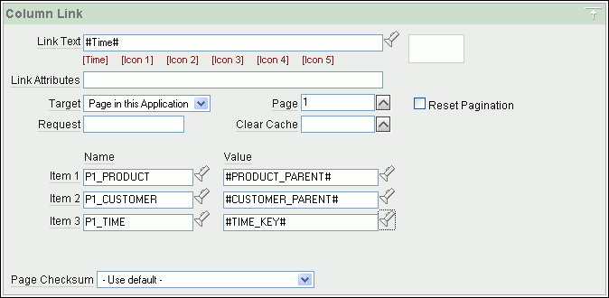
[Description of "Figure 6-11 Definition of the Time Link"](img_text/apex_prodlink.md)

##### To activate the Reset button:

1.  Open the Page Definition.

2.  Under Branches, click the Go to Page conditional link.

    The Reset button was created on the page automatically along with its conditional branch. The Edit Branch page opens.

3.  Under Action, set Clear Cache to the page number (in this example, `1`).

4.  Under Conditions, set When Button Pressed to RESET.

5.  Click Apply Changes.

    The Edit Branch page closes, and you return to the Page Definition.

6.  Click Run to display the page.

Figure 6-12 shows the finished page displaying months in Q3.06. You can continue working on this application, adding more reports and charts to the page. For the SQL queries providing data to those reports and charts, you can reuse the same bind variables for the dimensions.

Figure 6-12 Sales Analysis Report With Column Links in Application Express

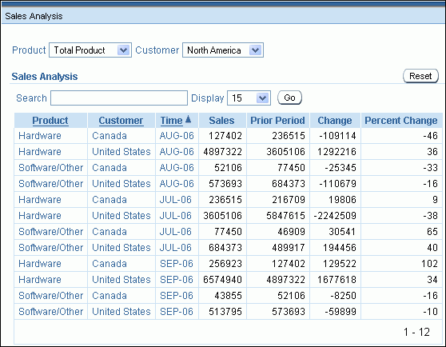
[Description of "Figure 6-12 Sales Analysis Report With Column Links in Application Express"](img_text/apex_report3.md)
