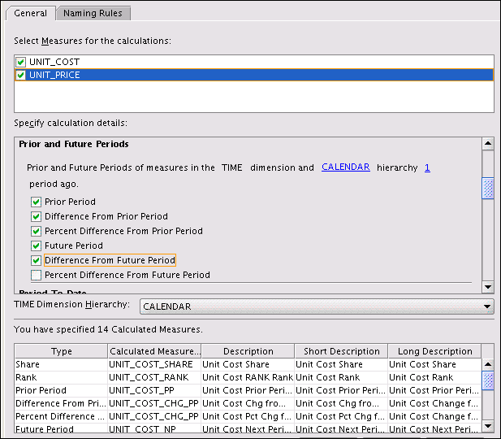
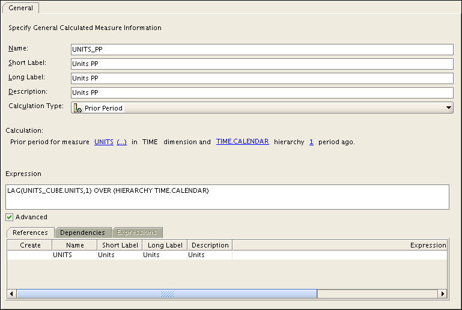
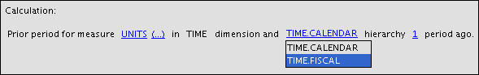
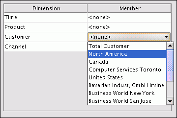
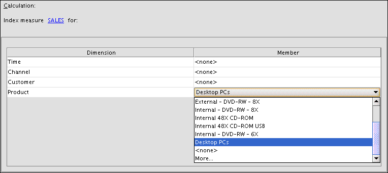
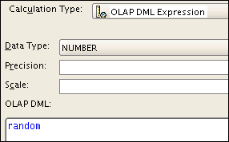
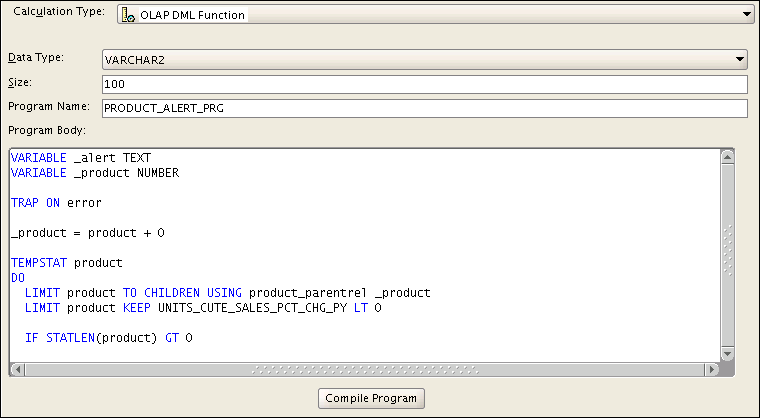

Oracle OLAP provides an extensive set of analytic functions for enhancing your database with information-rich content. This chapter explains how you can use Analytic Workspace Manager to create calculated measures using templates and free-form calculations.

This chapter contains the following topics:

- What Is a Calculated Measure?

- Functions for Defining Calculations

- Creating Calculated Measures

- Using Calculation Templates

- Creating User-Defined Expressions

- Creating Calculated Measures Using the OLAP DML

### 5.1 What Is a Calculated Measure?

Calculated measures return values that are computed at run time from data stored in one or more measures. Like relational views, calculated measures store queries against data stored in other objects. Because calculated measures do not store data, you can create dozens of them without increasing the size of the database. You can use them as the basis for defining other calculated measures, which adds depth to the types of calculations you can create using the templates in Analytic Workspace Manager.

As soon as you create a calculated measure, it appears as a column in a cube view. Because calculated measures do not contain data, they are not associated with a build process. You can create a calculated measure at any time, and it is available immediately for querying by SQL applications.

### 5.2 Functions for Defining Calculations

The library of functions for defining calculated measures contains these basic categories:

- Arithmetic Operators: Perform calculations on the values of two measures.

- Analytic Functions: Perform calculations on an ordered series or a range of values in a single measure or column.

- Single-Row Functions: Perform calculations on a value in a single row.

#### 5.2.1 Arithmetic Operators

You can perform the following arithmetic operations using two measures. The calculations in the cube are performed on a cell-by-cell basis at all levels of the dimension hierarchies.

- Addition: Adds the values of two measures.

- Subtraction: Subtracts the values of one measure from the values of another measure.

- Multiplication: Multiplies the values of two measures.

- Division or Ratio: Divides the values of one measure by the values of another measure.

- Percent Difference: Calculates the percent difference between the values of two measures.

The arithmetic operations are available in Analytic Workspace Manager as templates. as described in "Using Calculation Templates".

#### 5.2.2 Analytic Functions

The analytic functions provide the most powerful computations and fuel the most useful queries for business intelligence and similar applications. They include a variety of rank, share, time series, and other single-column functions. The analytic functions enable analysts and decision makers to make comparisons and identify trends.

Analytic functions provided by Oracle OLAP leverage the knowledge associated with the dimensions about levels and family relationships. Time dimensions have additional information that enables them to support time series methods such as lags, leads, moving and cumulative calculations. Because the knowledge is stored with the dimension, you do not need to specify these relationships when creating a calculated measure.

The analytic functions are available in Analytic Workspace Manager as templates. They are described in "Using Calculation Templates".

#### 5.2.3 Single-Row Functions

Oracle OLAP supports most of the SQL single-row functions including:

- Numeric functions such as `ABS`, `CEIL`, `FLOOR`, `POWER`, `ROUND`, and `TRUNC`.

- Character functions such as `CONCAT`, `LPAD`, `RPAD`, `LTRIM`, `RTRIM`, `REPLACE`, and `SUBSTR`.

- Datetime functions such as `CURRENT_DAY`, `MONTHS_BETWEEN`, `NEXT_DAY`, and `SYSTIMESTAMP`.

- Comparison functions `GREATEST` and `LEAST`.

- Conversion functions such as `TO_CHAR`, `TO_DATE`, `TO_NUMBER`, and `TO_TIMESTAMP`.

You can use these functions to manipulate the data values in a measure, typically as part of a more complex calculation. These functions are not available as templates, but you can use them in free-form calculations, as described in "Creating User-Defined Expressions".

### 5.3 Creating Calculated Measures

Analytic Workspace Manager provides easy-to-use templates for creating calculated measures. You can create them in the same cube with the source measures, or you can create them in a separate cube.

Calculated measures are available for querying as additional columns in a cube view (such as `UNITS_CUBE_VIEW`). They are not available through cube materialized views (such as `CB$UNITS_CUBE`).

The calculated measure generator quickly generates the standard calculated measures for one or more measures of a cube, including rank, share, prior and future periods, period-to-date, parallel period, moving aggregates, and cumulative aggregates. The generator uses naming rules for formulating the names and descriptions. You can customize these rules on the Naming Rules tab.

You can also create individual calculated measures, including user-defined expressions in the OLAP expression syntax or the OLAP DML.

#### To create multiple calculated measures:

1.  In the navigation tree, right-click a cube and select Generate Calculated Measures.

2.  On the Calculations tab, select the measures on which to base the calculated measures.

3.  Scroll down the Calculation Details and select each type of calculated measure you want to create for this selection of measures. Modify the calculations as desired by altering the templates.

4.  Select the Time dimension to use for time series calculations.

5.  Review the list of calculated measures. You can change the generated names by using the Naming Rules tab.

6.  Click Generate Calculations to create the calculated measures.

7.  Repeat this procedure if you want to generate variations of the same basic types of calculations, such as another Share calculation for the same measure but on a different dimension. Change the naming rules to generate new, unique names.

Figure 5-1 shows the Generate Calculated Measures dialog box.

Figure 5-1 Generating Multiple Calculated Measures

[Description of "Figure 5-1 Generating Multiple Calculated Measures"](img_text/calc_gen.md)

#### To create a single calculated measure:

1.  In the navigation tree, expand a cube folder.

2.  Right-click Calculated Measures, then select Create Calculated Measure from the context menu.

    In the Create Calculated Measure dialog box, Enter a descriptive name.

3.  Select a calculation type.

    Your choice of an arithmetic or analytic function dynamically changes the Calculation template.

4.  Modify the calculation template.

5.  Click Create.

    The calculated measure appears in the navigation tree in the Calculated Measures folder.

6.  Select the Advanced option to display the References, Dependencies, and Expressions tabs. The tabs have the following information:

    - The References tab has a table that lists the measures that Analytic Workspace Manager references as it performs the calculations specified by this calculated measure. If the Enable SQL Expressions option is selected for the cube, then the table has a check mark in the Create column for any additional calculated measure that Analytic Workspace automatically creates.

    - The Dependencies tab has a table that lists the other calculated measures that depend on this calculated measure. Analytic Workspace Manager uses this calculated measure as it performs the calculations for the measures in this table.

    - The Expressions tab has a table that lists the expressions used by the calculated measure. This tab appears only if the Enable SQL Expressions option is selected for the cube.

Figure 5-2 displays the Create Calculated Measure dialog box.

Figure 5-2 Creating a Calculated Measure

[Description of "Figure 5-2 Creating a Calculated Measure"](img_text/calcs_lag.md)

#### 5.3.1 Modifying a Template

The calculation that you selected is presented as template, which is a description of the calculation with variable parts that enable you to customize it.

Figure 5-3 shows the template for calculating the prior period. You can view the choice lists by clicking the links.

Figure 5-3 Changing the Variable Parts of a Calculation

[Description of "Figure 5-3 Changing the Variable Parts of a Calculation"](img_text/calcs_measures.md)

You can include all values of a measure in a calculation, or, for some types of calculations, you can filter the measure to include only a selection of values. To limit one or more dimensions to a single dimension member, click the ellipses (`...`) next to the measure. The Qualify Measure dialog box appears, as shown in Figure 5-4.

Figure 5-4 Limiting a Dimension to a Single Member

[Description of "Figure 5-4 Limiting a Dimension to a Single Member"](img_text/calc_qualify.md)

#### 5.3.2 Choosing a Range of Time Periods

Many calculations are performed over time periods at the same level in the hierarchy. In some types of calculations, you can control the range of time periods that are used in the same calculation. For example, you might want to calculate a running total of months for each fiscal year, not a running total that begins with the first month stored in the cube.

You can use the following methods for identifying the range of time periods to calculate together:

- Level: Calculates all time periods at the same level, so that all months in the cube are included in one calculation, all quarters are included in another calculation, and so forth.

- Parent: Calculates all time periods with the same parent, so that all months in Q1-07 are included in one calculation, all months in Q2-07 are included in another calculation, and so forth.

- Ancestor at level: Calculates all time periods with the same ancestor at a specified level. For example, if the specified level is Year in a Year-Quarter-Month hierarchy, then Q1-06 to Q4-06 are included in one calculation, Q1-07 to Q4-07 are included in another calculation, Jan-06 to Dec-06 are included in a third calculation, and so forth. Any levels higher in the hierarchy are not calculated.

- Gregorian periods: The Gregorian periods -- Year, Quarter, Month, and Week -- impose the Gregorian calendar onto the selected hierarchy. This can be useful for analyzing data that uses nonstandard calendar hierarchies. For example, if you use Gregorian Year on a fiscal hierarchy that begins July 1 and ends June 30, then the last half of one fiscal year and the first half of the next fiscal year are calculated together. Time periods higher in the hierarchy than the specified Gregorian period are not calculated.

### 5.4 Using Calculation Templates

Analytic Workspace Manager provides templates for all of the calculations typically in demand for business intelligence applications. The following topics describe the types of calculations available as calculation templates in Analytic Workspace Manager.

- Arithmetic Calculations

- Index

- Prior and Future Periods

- Period to Date

- Share

- Rank

- Parallel Period

- Moving Calculations

- Cumulative Calculations

- Nested Calculations

#### 5.4.1 Arithmetic Calculations

Basic mathematical operations enable you to perform cell-by-cell calculations on two measures, as described in "Arithmetic Operators".

##### Arithmetic Example

This template defines a calculated measure for the Global Price Cube using Percent Difference:

    Percent difference between measure UNIT_PRICE and measure UNIT_COST.

A query against this calculated measure returns results like these. The `PCT_CHG` column shows the percent change between `PRICE` and `COST`, which is calculated as `PRICE-COST/COST`.

    PRODUCT                   PRICE       COST   PCT_DIFF
    -------------------- ---------- ---------- ----------
    Envoy Ambassador           2892       2664        .09
    Envoy Executive            2803       2644        .06
    Envoy Standard             1662       1737       -.04
    Sentinel Financial         1755       1658        .06
    Sentinel Multimedia        1770       1813       -.02
    Sentinel Standard          1552       1410         .1

#### 5.4.2 Index

An index is a mathematical operation calculated on a single measure. An index calculates the percentage difference between the values of a measure and a selected value that serves as a base number.

An index does not use a calculation template. Instead, it provides a list of dimension members for each dimension of the cube, from which you can choose one to use as an index, as shown in Figure 5-5.

Figure 5-5 Calculating a Product Index

[Description of "Figure 5-5 Calculating a Product Index"](img_text/calc_index.md)

##### Index Example

This example creates an index on the Product dimension using `Desktop PCs` as the index.

    PRODUCT                   SALES PROD_INDEX
    -------------------- ---------- ----------
    Desktop PCs            76682955        100
    Portable PCs           18072328         24
    CD/DVD                 17302122         23
    Modems/Fax              5565552          7
    Memory                  5347292          7
    Monitors                3926632          5

#### 5.4.3 Prior and Future Periods

Oracle OLAP provides several calculations for prior or future time periods:

- Prior Period: Returns the value of a measure at an earlier time period.

- Difference From Prior Period: Calculates the difference between values for the current time period and an earlier period.

- Percent Difference From Prior Period: Calculates the percent difference between the values for the current time period and an earlier period.

- Future Period: Returns the value of a measure at a later time period.

- Difference From Future Period: Calculates the difference between the values for the current time period and a later period.

- Percent Difference From Future Period: Calculates the percent difference between the values for the current time period and a later period.

When creating a calculation for prior or future time periods, you choose the measure, the time dimension, the hierarchy, and the number of periods from the current period.

##### Prior Period Example

This template defines a calculated measure using Prior Period:

    Prior period for measure SALES in TIME dimension and TIME.CALENDAR hierarchy 1 period ago.

These are the results of a query against the calculated measure. The `PRIOR_PERIOD` column shows the value of Sales for the preceding period at the same level in the Calendar hierarchy.

    TIME     TIME_LEVEL                SALES PRIOR_PERIOD
    -------- -------------------- ---------- ------------
    2005     CALENDAR_YEAR         136986572    144290686
    2006     CALENDAR_YEAR         140138317    136986572
    Q1.05    CALENDAR_QUARTER       31381338     41988687
    Q2.05    CALENDAR_QUARTER       37642741     31381338
    Q3.05    CALENDAR_QUARTER       32617249     37642741
    Q4.05    CALENDAR_QUARTER       35345244     32617249
    Q1.06    CALENDAR_QUARTER       36154815     35345244
    Q2.06    CALENDAR_QUARTER       36815657     36154815
    Q3.06    CALENDAR_QUARTER       32318935     36815657
    Q4.06    CALENDAR_QUARTER       34848911     32318935

#### 5.4.4 Period to Date

Period-to-date functions perform a calculation over time periods with the same parent up to the current period. These functions calculate period-to-date:

- Period to Date: Calculates the values up to the current time period.

- Period to Date Period Ago: Calculates the data values up to a prior time period.

- Difference From Period to Date Period Ago: Calculates the difference in data values up to the current time period compared to the same calculation up to a prior period.

- Percent Difference From Period To Date Period Ago: Calculates the percent difference in data values up to the current time period compared to the same calculation up to a prior period.

When creating a period-to-date calculation, you can choose from these aggregation methods:

- Sum

- Average

- Maximum

- Minimum

You also choose the measure, the time dimension, and the hierarchy.

##### Period to Date Example

This template defines a calculated measure using Period to Date.

    Gregorian Year to date for SALES in the TIME dimension and TIME.CALENDAR hierarchy. Aggregate using MINIMUM from the beginning of the period.

These are the results of a query against the calculated measure. The `MIN_TO_DATE` column displays the current minimum `SALES` value within the current level and year.

    TIME     TIME_LEVEL                SALES MIN_TO_DATE
    -------- -------------------- ---------- -----------
    Q1.06    CALENDAR_QUARTER       36154815    36154815
    Q2.06    CALENDAR_QUARTER       36815657    36154815
    Q3.06    CALENDAR_QUARTER       32318935    32318935
    Q4.06    CALENDAR_QUARTER       34848911    32318935
    JAN-06   MONTH                  13119235    13119235
    FEB-06   MONTH                  11441738    11441738
    MAR-06   MONTH                  11593842    11441738
    APR-06   MONTH                  11356940    11356940
    MAY-06   MONTH                  13820218    11356940
    JUN-06   MONTH                  11638499    11356940
    JUL-06   MONTH                   9417316     9417316
    AUG-06   MONTH                  11596052     9417316
    SEP-06   MONTH                  11305567     9417316
    OCT-06   MONTH                  11780401     9417316
    NOV-06   MONTH                  10653184     9417316
    DEC-06   MONTH                  12415325     9417316

#### 5.4.5 Share

Share calculates the ratio of a measure's value for the current dimension member to the value for a related member of the same dimension. You can choose whether the related member is:

- Top of hierarchy: Calculates the ratio of each member to the total.

- Member's parent: Calculates the ratio of each member to its parent.

- Member's ancestor at level: Calculates the ratio of each member to its ancestor, that is, a member at a specified level higher in the hierarchy.

When creating a share calculation, you can choose the measure, dimension, and hierarchy. You also have the option of multiplying the results by 100 to get percentages instead of fractions.

##### Share Example

This template defines a calculated measure using `SHARE`:

    Share of measure SALES in PRODUCT.PRIMARY hierarchy of the PRODUCT dimension as a ratio of top of hierarchy.

These are the results of a query against the calculated measure. The `TOTAL_SHARE` column displays the percent share of the total for the selected products.

    PRODUCT              PROD_LEVEL           SALES TOTAL_SHARE
    -------------------- --------------- ---------- -----------
    Total Product        TOTAL            144290686         100
    Hardware             CLASS            130145388          90
    Desktop PCs          FAMILY            78770152          55
    Portable PCs         FAMILY            19066575          13
    CD/DVD               FAMILY            16559860          11
    Software/Other       CLASS             14145298          10
    Accessories          FAMILY             6475353           4
    Operating Systems    FAMILY             5738775           4
    Memory               FAMILY             5430466           4
    Modems/Fax           FAMILY             5844185           4
    Monitors             FAMILY             4474150           3
    Documentation        FAMILY             1931170           1

#### 5.4.6 Rank

Rank orders the values of a dimension based on the values of the selected measure. When defining a rank calculation, you choose the dimension, a hierarchy, and the measure.

You can choose a method for handling identical values:

- Rank: Assigns the same rank to identical values, so there may be fewer ranks than there are members. For example, it may return `1`, `2`, `3`, `3`, `4` for a series of five dimension members.

- Dense Rank: Assigns the same minimum rank to identical values. For example, it may return `1`, `2`, `3`, `3`, `5` for a series of five dimension members.

- Average Rank: Assigns the same average rank to identical values. For example, it may return `1`, `2`, `3.5`, `3.5`, `5` for a series of five dimension members.

You can also choose the group in which the dimension members are ranked:

- Member's level: Ranks members at the same level.

- Member's parent: Ranks members with the same parent.

- Member's ancestor at level: Ranks members with the same ancestor at a specified level higher in the hierarchy.

##### Rank Example

This template defines a calculated measure using Rank:

    Rank members of the PRODUCT dimension and PRODUCT.PRIMARY hierarchy based on measure SALES. Calculate rank using RANK method with member's parent in order lowest to highest. Rank NA (null) values nulls last.

These are the results of a query against the calculated measure in which the products are ordered by `RANK`:

    PRODUCT                   SALES       RANK
    -------------------- ---------- ----------
    Monitors                4474150          1
    Memory                  5430466          2
    Modems/Fax              5844185          3
    CD/DVD                 16559860          4
    Portable PCs           19066575          5
    Desktop PCs            78770152          6

#### 5.4.7 Parallel Period

Parallel periods are at the same level as the current time period, but have different parents in an earlier period. For example, you may want to compare current sales with sales for the prior year at the quarter and month levels.

Oracle OLAP provides several functions for parallel periods:

- Parallel Period: Calculates the value of the parallel period.

- Difference From Parallel Period: Calculates the difference in values between the current period and the parallel period.

- Percent Difference From Parallel Period: Calculates the percent difference in values between the current period and the parallel period.

To identify the parallel period, you specify a level and the number of periods before the current period. You can also decide what happens when two periods do not exactly match, such as comparing daily sales for February (28 days) with January (31 days).

You also choose the measure, the time dimension, and the hierarchy.

##### Parallel Period Example

This template defines a calculated measure using Parallel Period.

    Parallel period for SALES in the TIME dimension and TIME.CALENDAR hierarchy 1 TIME.CALENDAR.QUARTER ago based on position from beginning to ending of period.

These are the results of a query against the calculated measure, which lists the months for two calendar quarters. The parallel month has the same position within the previous quarter. The prior period for `JUL-06` is `APR-06,` for `AUG-06` is `MAY-06`, and for `SEP-06` is `JUN-06`.

    TIME     PARENT          SALES   LAST_QTR
    -------- ---------- ---------- ----------
    APR-06   CY2006.Q2    11356940   13119235
    MAY-06   CY2006.Q2    13820218   11441738
    JUN-06   CY2006.Q2    11638499   11593842
    JUL-06   CY2006.Q3     9417316   11356940
    AUG-06   CY2006.Q3    11596052   13820218
    SEP-06   CY2006.Q3    11305567   11638499

#### 5.4.8 Moving Calculations

Moving calculations are performed over the time periods surrounding the current period. Oracle OLAP provides several aggregation methods for moving calculations:

- Moving Average: Calculates the average value for a measure over a fixed number of time periods.

- Moving Maximum: Calculates the maximum value for a measure over a fixed number of time periods.

- Moving Minimum: Calculates the minimum value for a measure over a fixed number of time periods.

- Moving Total: Returns the total value for a measure over a fixed number of time periods.

You can choose the measure, the time dimension, and the hierarchy. You can also select the range, as described in "Choosing a Range of Time Periods", and the number of time periods before and after the current period to include in the calculation.

##### Moving Calculation Example

This template defines a calculated measure using Moving Minimum.

    Moving minimum of SALES in the TIME dimension and TIME.CALENDAR hierarchy. Include 1 preceding and 1 following members within level.

These are the results of a query against the calculated measure, which displays values for the descendants of calendar year 2004. Each value of Minimum Sales is the smallest among the current value and the values immediately before and after it. The calculation is performed over all members of a level in the cube.

    TIME     TIME_LEVEL                SALES  MIN_SALES
    -------- -------------------- ---------- ----------
    Q1.04    CALENDAR_QUARTER       32977874   32977874
    Q2.04    CALENDAR_QUARTER       35797921   32977874
    Q3.04    CALENDAR_QUARTER       33526203   33526203
    Q4.04    CALENDAR_QUARTER       41988687   31381338
    JAN-04   MONTH                  11477898   10982016
    FEB-04   MONTH                  10982016   10517960
    MAR-04   MONTH                  10517960   10517960
    APR-04   MONTH                  11032057   10517960
    MAY-04   MONTH                  11432616   11032057
    JUN-04   MONTH                  13333248   11432616
    JUL-04   MONTH                  12070352   11108893
    AUG-04   MONTH                  11108893   10346958
    SEP-04   MONTH                  10346958   10346958
    OCT-04   MONTH                  14358605   10346958
    NOV-04   MONTH                  12757560   12757560
    DEC-04   MONTH                  14872522   12093518

#### 5.4.9 Cumulative Calculations

Cumulative calculations start with the first time period and calculate up to the current member, or start with the last time period and calculate back to the current member. Oracle OLAP provides several aggregation methods for cumulative calculations:

- Cumulative Average: Calculates a running average across time periods.

- Cumulative Maximum: Calculates the maximum value across time periods.

- Cumulative Minimum: Calculates the minimum value across time periods.

- Cumulative Total: Calculates a running total across time periods.

You can choose the measure, the time dimension, and the hierarchy. You can also select the range, as described in "Choosing a Range of Time Periods", and whether you want to start the calculation with the first period and calculate forward, or start with the last period and calculate back.

##### Cumulative Calculation Example

This template defines a calculated measure using Cumulative Minimum.

    Cumulative minimum of SALES in the TIME dimension and TIME.CALENDAR hierarchy within ancestor at level TIME.CALENDAR_YEAR. Total from beginning to current member.

These are the results of a query against the calculated measure, which displays values for the descendants of calendar year 2004. The minimum value for quarters begins with Q1-04 and ends with Q4-04, and for months begins with Jan-04 and ends with Dec-04.

    TIME     TIME_LEVEL                SALES  MIN_SALES
    -------- -------------------- ---------- ----------
    Q1.04    CALENDAR_QUARTER       32977874   32977874
    Q2.04    CALENDAR_QUARTER       35797921   32977874
    Q3.04    CALENDAR_QUARTER       33526203   32977874
    Q4.04    CALENDAR_QUARTER       41988687   32977874
    JAN-04   MONTH                  11477898   11477898
    FEB-04   MONTH                  10982016   10982016
    MAR-04   MONTH                  10517960   10517960
    APR-04   MONTH                  11032057   10517960
    MAY-04   MONTH                  11432616   10517960
    JUN-04   MONTH                  13333248   10517960
    JUL-04   MONTH                  12070352   10517960
    AUG-04   MONTH                  11108893   10517960
    SEP-04   MONTH                  10346958   10346958
    OCT-04   MONTH                  14358605   10346958
    NOV-04   MONTH                  12757560   10346958
    DEC-04   MONTH                  14872522   10346958

#### 5.4.10 Nested Calculations

You can extend the variety of functions available through the templates by using a calculated measure as the basis for another calculated measure.

For example, Analytic Workspace Manager has templates for Moving Average and for Difference From Prior Period. You can create a calculated measure that calculates a moving average, then calculate the difference between the current and the previous moving averages.

##### Nested Calculations Example

This template creates a moving average for Units named `UNITS_MOVING_AVG`:

    Moving average of UNITS in the TIME dimension and TIME.CALENDAR hierarchy. Include 1 preceding and 1 following members within level.

The next template creates a Difference From Prior Period calculation from `UNITS_MOVING_AVG`.

    Difference from prior period for UNITS_MOVING_AVG in TIME dimension and TIME.CALENDAR hierarchy 1 period ago.

These are the results of a query against the Units measure and the two calculated measures. The `MOVING_AVG` column shows the moving average, and the `DIFF` column shows the difference between the current moving average and the prior period's.

    TIME     TIME_LEVEL                UNITS MOVING_AVG       DIFF
    -------- -------------------- ---------- ---------- ----------
    JAN-06   MONTH                     47776      48520         66
    FEB-06   MONTH                     47695      48940        419
    MAR-06   MONTH                     51348      48683       -257
    APR-06   MONTH                     47005      50387       1705
    MAY-06   MONTH                     52809      48411      -1976
    JUN-06   MONTH                     45419      48872        461
    JUL-06   MONTH                     48388      47546      -1326
    AUG-06   MONTH                     48830      47857        312
    SEP-06   MONTH                     46354      47532       -326
    OCT-06   MONTH                     47411      46869       -663
    NOV-06   MONTH                     46842      49768       2899
    DEC-06   MONTH                     55052      50947       1179
    2006     CALENDAR_YEAR            584929     575324      -4032
    Q1.06    CALENDAR_QUARTER         146819     145705       2093
    Q2.06    CALENDAR_QUARTER         145233     145208       -497
    Q3.06    CALENDAR_QUARTER         143572     146037        829
    Q4.06    CALENDAR_QUARTER         149305     146439        402

### 5.5 Creating User-Defined Expressions

Among the calculation types is a user-defined expression. Typically, you create calculations using the OLAP expression syntax, which includes the analytic functions, arithmetic operators, and single-row functions described in this chapter. The OLAP syntax is an extension of the SQL syntax. If you have used SQL analytic functions or single-row functions, then this syntax is familiar to you.

**See Also:**

For user-defined OLAP DML expressions, see "Creating Calculated Measures Using the OLAP DML".

#### 5.5.1 Using the OLAP Expression Syntax

The easiest way to formulate an expression in the OLAP expression syntax is to let Analytic Workspace Manager do the work for you. You can use the templates to create a similar calculation, and cut-and-paste the syntax as the basis for a new calculation.

##### To create a user-defined expression in the OLAP expression syntax:

1.  Open the Create Calculated Measure dialog box.

2.  Select the calculation type that most closely matches the one you want to define.

3.  Modify the template as desired.

4.  Cut-and-paste the calculation from the Calculation box into a text editor.

5.  Repeat these steps if your calculation uses two or more functions.

6.  Modify the calculation as desired in the text editor. You can combine numeric operators, analytic functions, and single-row functions in a single calculation.

7.  From the Calculation Types list, select OLAP Expression Syntax.

8.  Cut-and-paste the calculation from the text editor into the Calculation box.

9.  Click Create.

**See Also:**

Analytic Workspace Manager Help for detailed information about the OLAP expression syntax.

#### 5.5.2 Expression Syntax Example Using an Arithmetic Operator

This template for Multiplication generates a calculation using Units Sold and Unit Cost.

    Multiply measure UNITS by measure UNIT_COST.

The template generates this calculation using the multiplication operator (\*). It appears in the Calculation box. Notice that UNITS is in the Units Cube and UNIT_COST is in the Price Cube.

    UNITS_CUBE.UNITS * PRICE_CUBE.UNIT_COST

The syntax of this calculation is so simple that you only need the template to obtain the qualified name of the measure.

Following is a free-form calculation that calculates a 2% increase in units sold:

    UNITS_CUBE.UNITS * 1.02

These are the results of a query against this calculated measure:

    PRODUCT                   UNITS     TARGET
    -------------------- ---------- ----------
    Envoy Ambassador           2116       2158
    Envoy Executive            2481       2531
    Envoy Standard             3300       3366
    Sentinel Financial        30513      31123
    Sentinel Multimedia        7948       8107
    Sentinel Standard          7302       7448

#### 5.5.3 Free-Form Calculation Example Using an Analytic Function

This template for Cumulative Average generates a calculation for the average number of units sold:

    Cumulative average of UNITS in the TIME dimension and TIME.CALENDAR hierarchy within level. Total from beginning to following member.

The template generates this calculation using the `AVG` function.

    AVG(UNITS_CUBE.UNITS) OVER HIERARCHY (TIME.CALENDAR BETWEEN UNBOUNDED PRECEDING AND UNBOUNDED FOLLOWING WITHIN LEVEL)

Following is a free-form calculation that computes the percent difference between current units sold and the cumulative average. It uses the `AVG` function and the subtraction (`-`), division (`/`) and multiplication (`*`) operators.

    ((UNITS_CUBE.UNITS - AVG(UNITS_CUBE.UNITS) OVER HIERARCHY (TIME.CALENDAR BETWEEN UNBOUNDED PRECEDING AND UNBOUNDED FOLLOWING WITHIN LEVEL)) / AVG(UNITS_CUBE.UNITS) OVER HIERARCHY (TIME.CALENDAR BETWEEN UNBOUNDED PRECEDING AND UNBOUNDED FOLLOWING WITHIN LEVEL)) * 100

These are the results of a query against this calculated measure.

    TIME          UNITS    CUM_AVG   PCT_DIFF
    -------- ---------- ---------- ----------
    Q1.06        146819     107965         36
    Q2.06        145233     109062         33
    Q3.06        143572     110048         30
    Q4.06        149305     111138         34

You could also create this calculation using templates:

1.  Calculate the cumulative average of `UNITS` with the Cumulative Average template.

2.  Calculate the percent difference between current `UNITS` and the cumulative average with the Percent Difference template.

#### 5.5.4 Expression Syntax Analytic Functions

Table 5-1 describes the analytic functions that you can use to create free-form calculations using the OLAP expression syntax. For the syntax of these functions, refer to Analytic Workspace Manager Help.

Table 5-1 OLAP Expression Syntax Analytic Functions

| Function                | Description                                                                                                                                                                                              |
|:------------------------|:---------------------------------------------------------------------------------------------------------------------------------------------------------------------------------------------------------|
| `AVERAGE_RANK`          | Orders the members of a dimension based on the values of an expression. The function returns the sequence numbers of the dimension members, and assigns the same average rank to identical values.       |
| `AVG`                   | Returns the average of a selection of values calculated over time.                                                                                                                                       |
| `COUNT`                 | Tallies the number of data values identified by a selection of dimension members.                                                                                                                        |
| `DENSE_RANK`            | Orders dimension members based on the values of an expression. The function returns the sequence numbers of the dimension members, and assigns the same minimum rank to identical values.                |
| `HIER_ANCESTOR`         | Returns an ancestor at a particular level of a hierarchy for either all members in the hierarchy or a particular member.                                                                                 |
| `HIER_CHILD_COUNT`      | Returns the number of children of either all dimension members in a hierarchy or a particular member.                                                                                                    |
| `HIER_DEPTH`            | Returns a number representing the level depth of either all members of a hierarchy or a particular member, where 0 is the top level.                                                                     |
| `HIER_LEVEL`            | Returns the level of either all members of a hierarchy or a particular member.                                                                                                                           |
| `HIER_PARENT`           | Returns the parent of either all dimension members in a hierarchy or a particular member.                                                                                                                |
| `HIER_TOP`              | Returns the topmost ancestor of either all members of a hierarchy or a particular member.                                                                                                                |
| `LAG`                   | Returns the value of an expression at a specified number of time periods before the current period.                                                                                                      |
| `LAG_VARIANCE`          | Returns the difference between values for the current time period and a prior period.                                                                                                                    |
| `LAG_VARIANCE_PERCENT`  | Returns the percent different between values for the current time period and a prior period.                                                                                                             |
| `LEAD`                  | Returns the value of an expression at a specified number of time periods after the current period.                                                                                                       |
| `LEAD_VARIANCE`         | Returns the difference between values for the current time period and a future period.                                                                                                                   |
| `LEAD_VARIANCE_PERCENT` | Returns the percent different between values for the current time period and a future period.                                                                                                            |
| `MAX`                   | Returns the largest of a selection of data values calculated over a particular dimension.                                                                                                                |
| `MIN`                   | Returns the smallest of a selection of data values calculated over a particular dimension.                                                                                                               |
| `OLAP_DML_EXPRESSION`   | Executes an expression in the OLAP DML language.                                                                                                                                                         |
| `RANK`                  | Orders the members of a dimension based on the values of an expression. The function returns the sequence numbers of the dimension members, and assigns the same rank to identical values.               |
| `ROW_NUMBER`            | Orders the members of a dimension based on the values of an expression. The function returns the sequence numbers of the dimension members, and assigns a unique and arbitrary rank to identical values. |
| `SHARE`                 | Calculates the ratio of an expression's value for the current dimension member to the value for a related member of the same dimension.                                                                  |
| `SUM`                   | Returns the total of a selection of values calculated over a particular dimension.                                                                                                                       |

### 5.6 Creating Calculated Measures Using the OLAP DML

The most advanced business calculations, such as forecasts, models, and allocations, are available through the [OLAP DML](glossary.md). The OLAP DML is the internal data definition and manipulation language for analytic workspaces. Its primary data structures are dimensions, variables, formulas, and valuesets. These dimensional objects in an analytic workspace support the high-level dimensional objects in the database, such as cubes, cube dimensions, measures, attributes, and hierarchies.

Several commands in the OLAP DML support dimensional database objects such as cubes, levels, and hierarchies. You can use these commands, as well as the other functions, operators, and so forth in the language.

**See Also:**

"Cube-Aware OLAP DML Statements" in the Oracle OLAP DML Reference

The OLAP DML is a mature language that was developed specifically for creating and managing dimensional objects and for manipulating dimensional data. Although programming in the OLAP DML requires significant skill, the language offers more power and flexibility than any other language.

#### 5.6.1 Selecting an OLAP DML Calculation Type

Analytic Workspace Manager supports two types of user-defined expressions using the OLAP DML:

- OLAP DML Expression: Calculates an OLAP DML expression. Choose this calculation type to execute an existing program, a built-in function, or a single expression. The expression is stored as the EQ statement of a formula in the analytic workspace.

- OLAP DML Function: Executes an OLAP DML program entered in the Program Body field that returns values. Choose this calculation type to develop a new program in the OLAP DML. The name of the program is stored in the EQ statement of a formula in the analytic workspace.

##### To create an OLAP DML Expression:

1.  Open the Create Calculated Measure dialog box.

2.  From the Calculation Types list, select OLAP DML Expression.

3.  For Data Type, select the data type of the return value.

4.  Enter the expression in the OLAP DML field.

5.  Click Compile Expression to check for syntax errors and to save a compiled version of the expression.

6.  Click Create to create the calculated measure.

##### To create an OLAP DML Function:

1.  Open the Create Calculated Measure dialog box.

2.  From the Calculation Types list, select OLAP DML Function.

3.  For Data Type, select the data type of the return value.

4.  Enter a name for the function.

5.  Enter the program in the Program Body field. Omit the `DEFINE`, `PROGRAM`, and `END` commands, because they are generated automatically.

6.  Click Compile Expression to check for syntax errors and to save a compiled version of the program.

7.  Click Create to create the calculated measure.

#### 5.6.2 OLAP DML Expression Examples

The OLAP DML has many built-in functions. This example creates a calculated measure using the `RANDOM` function. Figure 5-6 shows the definition of this simple calculation. The calculated measure generates values in the default range of 0 to 1.

Figure 5-6 Using an OLAP DML Expression

[Description of "Figure 5-6 Using an OLAP DML Expression"](img_text/dml_express.md)

The next example uses an arithmetic operator to calculate a 2% increase in units sold. This example of the OLAP DML is identical to the example in "Expression Syntax Example Using an Arithmetic Operator". However, note the difference in naming convention for the measure.

    units_cube_units * 1.02

These are the results of a query against the two calculated measures created as OLAP DML expressions:

    PRODUCT                   UNITS     TARGET     RANDOM
    -------------------- ---------- ---------- ----------
    Envoy Ambassador           2116       2158      .6467
    Envoy Executive            2481       2531      .0773
    Envoy Standard             3300       3366      .2349
    Sentinel Financial        30513      31123      .6027
    Sentinel Multimedia        7948       8107      .6494
    Sentinel Standard          7302       7448      .5912

#### 5.6.3 OLAP DML Function Example

An OLAP DML program that returns a value is also function.

Example 5-1 OLAP DML Function

The program in this example returns the value `ALERT` when current sales are less than the previous year's. The actual calculation is performed by another calculated measure, UNITS_CUBE_SALES_PCT_CHG_PY, which is the percent change from the prior year for Sales. If sales are greater, then the program returns `OKAY`.

    VARIABLE _alert   TEXT
    VARIABLE _product NUMBER

    TRAP ON error

    _product = product + 0

    TEMPSTAT product
    DO
      LIMIT product TO CHILDREN USING product_parentrel _product
      LIMIT product KEEP UNITS_CUBE_SALES_PCT_CHG_PY LT 0

      IF STATLEN(product) GT 0
        THEN _alert = 'ALERT'
        ELSE _alert = 'OKAY'

    DOEND

    RETURN _alert

    error:
    RETURN 'ERROR'

This figure shows the definition of the program as a calculated measure.

Figure 5-7 Using an OLAP DML Function

[Description of "Figure 5-7 Using an OLAP DML Function"](img_text/dml_function.md)

These are the results of a query against this calculated measure:

    CHANNEL         TIME         PCTCHG STATUS
    --------------- -------- ---------- ------
    Catalog         Q1.06            -1 ALERT
    Catalog         Q2.06            -1 ALERT
    Catalog         Q3.06            -3 ALERT
    Catalog         Q4.06            -7 ALERT
    Direct Sales    Q1.06            -3 ALERT
    Direct Sales    Q2.06            -1 ALERT
    Direct Sales    Q3.06            10 OKAY
    Direct Sales    Q4.06            -4 ALERT
    Internet        Q1.06            29 OKAY
    Internet        Q2.06             3 ALERT
    Internet        Q3.06             0 ALERT
    Internet        Q4.06            16 OKAY
