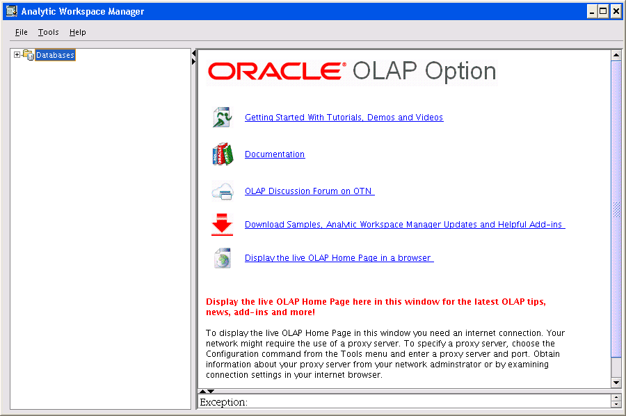
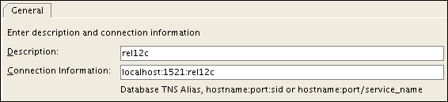

This chapter describes the preliminary steps you should take to use Oracle OLAP. It assumes that you have installed Oracle Database 12c Enterprise Edition. The OLAP option is installed automatically as part of a Basic installation of Oracle Database.

**Note:**

To start querying dimensional objects immediately, install the Global analytic workspace, as described in "Installing the Sample Schema". Then follow the instructions in [Querying Dimensional Objects](querying-dimensional-objects.md).

This chapter includes the following topics:

- Installing the Sample Schema

- Database Management Tasks

- Granting Privileges to DBAs and Application Developers

- Getting Started with Analytic Workspace Manager

- Upgrading Metadata From Oracle OLAP 10g

### 2.1 Installing the Sample Schema

You can download and install the sample Global schema from the Oracle website and use it to try the examples shown throughout this guide:

[`http://www.oracle.com/technetwork/database/enterprise-edition/downloads/global-11g-schema-1-128202.zip`](http://www.oracle.com/technetwork/database/enterprise-edition/downloads/global-11g-schema-1-128202.zip)

Instructions for installing the schema are provided in the `README` file.

### 2.2 Database Management Tasks

You should create undo, permanent, and temporary tablespaces that are appropriate for use by dimensional objects. Follow the recommendations in "[Storage Management](administering-oracle-olap.md)".

### 2.3 Granting Privileges to DBAs and Application Developers

Anyone who must create or manage dimensional objects in Oracle Database needs the necessary privileges. These privileges are different from those needed just to query the data stored in dimensional objects. The security system is discussed in [Security](security.md).

DBAs and application developers need the following roles and privileges.

#### To create dimensional objects in the user's own schema:

- `OLAP_USER` role

- `CREATE SESSION` privilege

#### To create dimensional objects in different schemas:

- `OLAP_DBA` role

- `CREATE SESSION` privilege

#### To administer data security:

- `OLAP_XS_ADMIN` role

#### To create cube materialized views in the user's own schema:

- `CREATE MATERIALIZED VIEW` privilege

- `CREATE DIMENSION` privilege

- `ADVISOR` privilege

#### To create cube materialized views in different schemas:

- `CREATE ANY MATERIALIZED VIEW` privilege

- `CREATE ANY DIMENSION` privilege

- `ADVISOR` privilege

Users also need an unlimited quota on the tablespace in which the dimensional objects are stored. The tablespaces should be defined specifically for OLAP use, as described in [Administering Oracle OLAP](administering-oracle-olap.md).

If the source tables are in a different schema, then the owner of the dimensional objects must have `READ` or `SELECT` object privileges on those tables.

Example 2-1 shows the SQL statements for creating the `GLOBAL` user.

Example 2-1 SQL Statements for Creating the GLOBAL User

    CREATE USER "GLOBAL" IDENTIFIED BY password
       DEFAULT TABLESPACE glo
       TEMPORARY TABLESPACE glotmp
       QUOTA UNLIMITED ON glo
       PASSWORD EXPIRE;

    GRANT OLAP_USER TO GLOBAL;
    GRANT CREATE SESSION TO GLOBAL;
    GRANT OLAP_XS_ADMIN TO GLOBAL;

### 2.4 Getting Started with Analytic Workspace Manager

In this section, you learn how to install Analytic Workspace Manager software and make a connection to Oracle Database.

#### 2.4.1 Installing Analytic Workspace Manager

Analytic Workspace Manager is distributed on the Oracle Database Client installation disk.

If you are installing on the same system as the database, then select a Custom installation and install into the same Oracle home directory as the database. Select OLAP Analytic Workspace Manager and Worksheet from the list of components.

If you are installing on a remote system, then select either an Administrator or a Custom installation. The Administrator choice automatically installs Analytic Workspace Manager on the client.

**See Also:**

The installation guide for your client platform.

#### 2.4.2 Opening Analytic Workspace Manager

Use the appropriate procedure for your platform.

##### On Windows, to open Analytic Workspace Manager:

- From the Start menu, select Oracle - Oracle_home, then Integrated Management Tools, and then OLAP Analytic Workspace Manager and Worksheet.

##### On Linux, to open Analytic Workspace Manager:

- From the shell command line, enter this command:

      $ORACLE_HOME/olap/awm/awm.sh

Figure 2-1 shows the initial display.

Figure 2-1 Opening Analytic Workspace Manager

[Description of "Figure 2-1 Opening Analytic Workspace Manager"](img_text/awm_open.md)

If Analytic Workspace Manager does not have access to the Internet, the property viewer shows links to several useful sites. It also shows an exception, because Analytic Workspace Manager cannot display the OLAP home page. To connect to the Internet, you typically need to identify the proxy server.

##### To identify the proxy server:

1.  From the Tools menu, select Configuration to display the Configuration dialog box.

2.  Under OLAP Home Page Settings, enter the address of the proxy server.

3.  Enter the port number for the proxy server, if it is not default port 80.

4.  Click OK to save these settings. The OLAP Home page appears the next time you start Analytic Workspace Manager.

#### 2.4.3 Defining a Database Connection

You can define a connection to each database that you use for OLAP. After you define a connection, the database instance is listed in the navigation tree for you to access at any time.

##### To define a database connection:

1.  Right-click the top Databases folder in the navigation tree, then select New Database Connection from the shortcut menu.

2.  Complete the New Database Connection dialog box.

Figure 2-2 shows the connection information on the General tab of the New Database Connection dialog box.

Figure 2-2 Defining a Database Connection

[Description of "Figure 2-2 Defining a Database Connection"](img_text/add_db.md)

#### 2.4.4 Opening a Database Connection

##### To connect to a database:

1.  Click the plus icon (+) next to a database connection in the navigation tree.

2.  Supply your database user name and password in the Connect to Database dialog box.

#### 2.4.5 Showing the Analytic Workspace Attachment Modes

You can specify an analytic workspace attachment mode when you open an analytic workspace. The modes are the following:

- Read only

  In this mode a user can view the analytic workspace objects and data but cannot create or change objects. The user can export an object by copying it or saving it as a template. Any number of users can open an analytic workspace in Read Only mode.

- Read Write

  In this mode a user can view the analytic workspace objects and data and create or change objects. The user can export or import an object. Only one user can open an analytic workspace in Read Write mode but any number of other users can open it in Read Only mode. This is the default mode.

- Read Write Exclusive

  In this mode a user has the same access rights as in Read Write mode but no one else can open the analytic workspace. This mode is not available if another user has the analytic workspace open.

##### To specify showing attachment modes:

1.  From the Tools menu, select Configuration.

    The Configuration dialog box opens.

2.  Select Show Analytic Workspace Attachment Options. Click OK.

#### 2.4.6 Installing Plug-ins

Plug-ins extend the functionality of Analytic Workspace Manager. Plug-ins are distributed as JAR files. Any Java developer can create a plug-in. The developer should provide information about what the plug-in does and how to use it.

If you have one or more plug-ins, then you must identify their location to Analytic Workspace Manager.

##### To use plug-ins:

1.  Create a local directory for storing the plug-ins.

2.  Copy the JAR files to that directory.

3.  Open Analytic Workspace Manager.

4.  Select Configuration from the Tools menu.

    The Configuration dialog box opens.

5.  Select Enable Plugins and identify the plug-in directory. Click OK.

6.  Close and reopen Analytic Workspace Manager.

    The functionality provided by the plug-ins is available in the navigator.

##### To see a list of the currently installed plug-ins:

- On the Help menu, click About and then click Plugins.

Some Analytic Workspace Manager plug-ins are available for download from the Oracle Technology Network (OTN).

##### To download plug-ins from OTN:

- In a web browser, go the Oracle OLAP Downloads page at

  [`http://www.oracle.com/technetwork/database/options/olap/olap-downloads-098860.html`](http://www.oracle.com/technetwork/database/options/olap/olap-downloads-098860.html)

### 2.5 Upgrading Metadata From Oracle OLAP 10g

You can upgrade an Oracle OLAP 10g analytic workspace to OLAP 11g or 12c by saving the objects as an XML template and importing the XML into a different schema. The original analytic workspace remains accessible and unchanged by the upgrade process.

#### Prerequisites:

- The OLAP 10g analytic workspace can use OLAP standard form metadata.

- The original relational source data must be available to load into the new analytic workspace. If the data is in a different schema or the table names are different, then you must remap the dimensional objects to the new relational sources after the upgrade.

- You can create the OLAP 12c analytic workspace in the same schema as the OLAP 10g analytic workspace. However, if you choose to create the OLAP 12c analytic workspace in a different schema, you must grant the new user the appropriate privileges as described in "Granting Privileges to DBAs and Application Developers".

#### To upgrade an OLAP 11g analytic workspace:

1.  Open Analytic Workspace Manager for Oracle Database 12c Release 1.

2.  If necessary, create a new database connection to the database instance with the analytic workspace. See "Defining a Database Connection".

3.  Open the database connection. On the Connect to Database dialog box, select OLAP 11g/12c for the Cube Type. See "Opening a Database Connection".

4.  Expand the navigation tree until the name of the analytic workspace appears.

5.  Right-click the analytic workspace and select Create 12c Upgrade Template for 11g Analytic Workspace. Save the XML template to a file.

    The Create 12c Upgrade Template for 12c Analytic Workspace dialog box appears if any subobjects, such as a level and a hierarchy, have the same name.

    Duplicate object names are changed automatically for the upgrade. You cannot edit the names now, but you can change them later.

6.  Click Close to close the dialog box.

7.  Right-click the connection in the tree and select Disconnect Database.

8.  Right-click the connection again and select Connect Database.

9.  On the Connect to Database dialog box, log in with the new user name and select OLAP 11g/12c for the Cube Type.

10. Expand the tree, right-click Analytic Workspaces under the new schema, and select Create Analytic Workspace From Template.

11. Open the upgrade template that you created previously.

    The Correct Duplicate Names From Analytic Workspace Template Import dialog box appears if any objects, such as a cube, dimensions, or the analytic workspace, duplicate object names that already exist in the schema.

12. Enter new names to resolve any conflicts, then click OK.

13. Before loading the data, you may want to browse the dimensional objects and make any changes to the object names, cube partitioning, or aggregation strategy.

14. Load data into the new analytic workspace as described in "[Loading Data Into Cubes](creating-dimensions-and-cubes.md)". Select all objects for maintenance.

**See Also:**

DBMS_CUBE in the [Oracle Database PL/SQL Packages and Types Reference](../arpls/DBMS_CUBE.md) for upgrading in PL/SQL.
