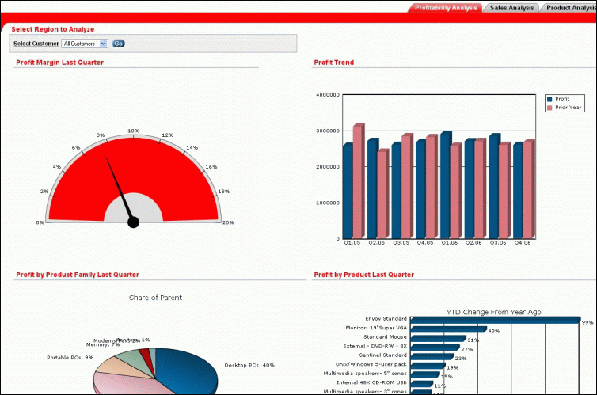
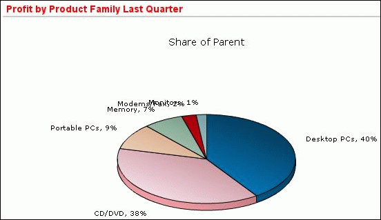
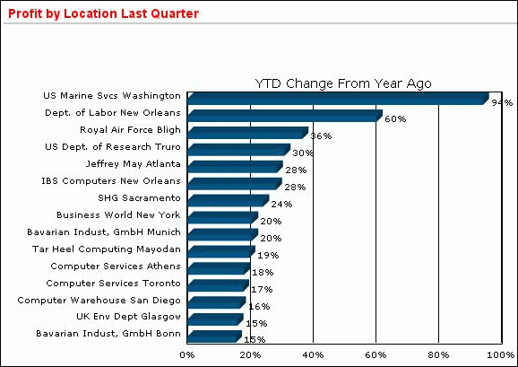
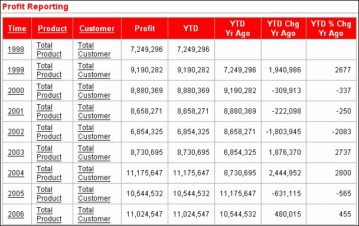
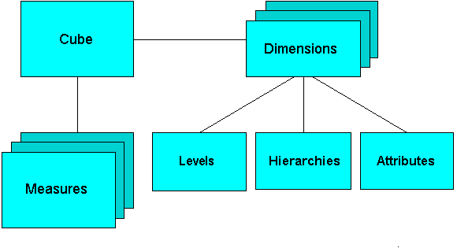

This chapter introduces the powerful analytic resources available in the Oracle Database with the OLAP option. It consists of the following topics:

- OLAP Technology in the Oracle Database

- Developing Reports and Dashboards Using SQL Tools and Application Builders

- Overview of the Dimensional Data Model

### 1.1 OLAP Technology in the Oracle Database

Oracle Database offers the industry's first and only embedded OLAP server. Oracle OLAP provides native multidimensional storage and speed-of-thought response times when analyzing data across multiple dimensions. The database provides rich support for analytics such as time series calculations, forecasting, advanced aggregation with additive and nonadditive operators, and allocation operators. These capabilities make the Oracle database a complete analytical platform, capable of supporting the entire spectrum of business intelligence and advanced analytical applications.

#### 1.1.1 Full Integration of Multidimensional Technology

By integrating multidimensional objects and analytics into the database, Oracle provides the best of both worlds: the power of multidimensional analysis along with the reliability, availability, security, and scalability of the Oracle database.

Oracle OLAP is fully integrated into Oracle Database. At a technical level, this means:

- Cubes and other dimensional objects are first class data objects represented in the Oracle data dictionary.

- Cubes and other dimensional objects are supported by standard SQL syntax in the CREATE, ALTER, DROP, and SELECT statements.

- The OLAP engine runs within the kernel of Oracle Database.

- Dimensional objects are stored in Oracle Database in their native multidimensional format.

- Data security is administered in the standard way, by granting and revoking privileges to Oracle Database users and roles.

The benefits to your organization are significant. Oracle OLAP offers the power of simplicity: One database, standard administration and security, standard interfaces and development tools.

#### 1.1.2 Ease of Application Development

Oracle OLAP makes it easy to enrich your database and your applications with interesting analytic content. Native SQL access to Oracle multidimensional objects and calculations greatly eases the task of developing dashboards, reports, business intelligence (BI) and analytical applications of any type compared to systems that offer proprietary interfaces. Moreover, SQL access means that the power of Oracle OLAP analytics can be used by any database application, not just by the traditional, limited collection of OLAP applications.

#### 1.1.3 Ease of Administration

Because Oracle OLAP is completely embedded in the Oracle database, there is no administration learning curve as is typically associated with standalone OLAP servers. You can leverage your existing DBA staff, rather than invest in specialized administration skills.

A major administrative advantage of Oracle's embedded OLAP technology is automated cube maintenance. With standalone OLAP servers, the burden of refreshing the cube is entirely the responsibility of the administrator. This can be a complex and potentially error-prone job. You must create procedures to extract the changed data from the relational source, move the data from the source system to the system running the standalone OLAP server, load and rebuild the cube. You must take responsibility for the security of the deltas (changed values) during this process as well.

With Oracle OLAP, in contrast, cube refresh is handled entirely by the Oracle database. The database tracks the staleness of the dimensional objects, automatically keeps track of the deltas in the source tables, and automatically applies only the changed values during the refresh process. You simply schedule the refresh at appropriate intervals, and Oracle Database takes care of everything else.

#### 1.1.4 Security

With Oracle OLAP, standard Oracle Database security features are used to secure your multidimensional data.

In contrast, with a standalone OLAP server, administrators must manage security twice: once on the relational source system and again on the OLAP server system. Additionally, they must manage the security of data in transit from the relational system to the standalone OLAP system.

#### 1.1.5 Unmatched Performance and Scalability

Business intelligence and analytical applications are dominated by actions such as drilling up and down hierarchies and comparing aggregate values such as period-over-period, share of parent, projections onto future time periods, and a myriad of similar calculations. Often these actions are essentially random across the entire space of potential hierarchical aggregations. Because Oracle OLAP precomputes or efficiently computes as needed all aggregates in the defined multidimensional space, it delivers unmatched performance for typical business intelligence applications.

Oracle OLAP queries take advantage of Oracle shared cursors, dramatically reducing memory requirements and increasing performance.

When Oracle Database is installed with Real Application Clusters (Oracle RAC), OLAP applications receive the same benefits in performance, scalability, fail over, and load balancing as any other application.

#### 1.1.6 Reduced Costs

All these features add up to reduced costs. Administrative costs are reduced because existing personnel skills can be leveraged. Moreover, the Oracle database can manage the refresh of dimensional objects, a complex task left to administrators in other systems. Standard security reduces administration costs as well. Application development costs are reduced because the availability of a large pool of application developers who are SQL knowledgeable, and a large collection of SQL-based development tools means applications can be developed and deployed more quickly. Any SQL-based development tool can take advantage of Oracle OLAP. Hardware costs are reduced by Oracle OLAP's efficient management of aggregations, use of shared cursors, and Oracle RAC, which enables highly scalable systems to be built from low-cost commodity components.

### 1.2 Developing Reports and Dashboards Using SQL Tools and Application Builders

Analysts can choose any SQL query and analysis tool for selecting, viewing, and analyzing the data. You can use your favorite tool or application, or use a tool supplied with Oracle Database.

Figure 1-1 displays a portion of a dashboard created in Oracle Application Express, which is distributed with Oracle Database. Application Express generates HTML reports that display the results of SQL queries. It only understands SQL; it has no special knowledge of dimensional objects.

This dashboard demonstrates information-rich calculations such as ratio, share, prior period, and cumulative total. Separate tabs on the dashboard present Profitability Analysis, Sales Analysis, and Product Analysis. Each tab presents the data in dials, bar charts, horizontal bar charts, pie charts, and cross-tabular reports. A drop-down list in the upper left corner provides a choice of Customers.

The dial displays the quarterly profit margin. To the right is a bar chart that compares current profits with year-ago profits.

Figure 1-1 Dashboard Created in Oracle Application Express

[Description of "Figure 1-1 Dashboard Created in Oracle Application Express"](img_text/appexp_dash.md)

The pie chart in Figure 1-2 displays the percent share that each product family contributed to the total profits in the last quarter.

Figure 1-2 Contributions of Product Families to Total Profits

[Description of "Figure 1-2 Contributions of Product Families to Total Profits"](img_text/appexp_pie.md)

The horizontal bar chart in Figure 1-3 displays ranked results for locations with the largest gains in profitability from a year ago. Decision makers can see at a glance how each location improved by the last quarter.

Figure 1-3 Ranking of Percent Change in Year-to-Date Profits From Year Ago

[Description of "Figure 1-3 Ranking of Percent Change in Year-to-Date Profits From Year Ago"](img_text/appexp_hbar.md)

Figure 1-4 compares current profits with year-to-date, year-to-date year ago, the change between year-to-date and year-to-date year ago, and percent change between year-to-date and year-to-date year-ago profits. The cross-tabular report features interactive drilling, so that decision makers can easily see the detailed data that contributed to a parent value of interest.

Figure 1-4 Year-to-Date Profits Compared to Year Ago

[Description of "Figure 1-4 Year-to-Date Profits Compared to Year Ago "](img_text/appexp_xtab.md)

### 1.3 Overview of the Dimensional Data Model

Dimensional objects are an integral part of OLAP. Because OLAP is on-line, it must provide answers quickly; analysts pose iterative queries during interactive sessions, not in batch jobs that run overnight. And because OLAP is also analytic, the queries are complex. The dimensional objects and the OLAP engine are designed to solve complex queries in real time.

The dimensional objects include cubes, measures, dimensions, attributes, levels, and hierarchies. The simplicity of the model is inherent because it defines objects that represent real-world business entities. Analysts know which business measures they are interested in examining, which dimensions and attributes make the data meaningful, and how the dimensions of their business are organized into levels and hierarchies.

Figure 1-5 shows the general relationships among dimensional objects.

Figure 1-5 Diagram of the OLAP Dimensional Model

[Description of "Figure 1-5 Diagram of the OLAP Dimensional Model"](img_text/logicalm.md)

The dimensional data model is highly structured. Structure implies rules that govern the relationships among the data and control how the data can be queried. Cubes are the physical implementation of the dimensional model, and thus are highly optimized for dimensional queries. The OLAP engine leverages this innate dimensionality in performing highly efficient cross-cube joins for inter-row calculations, outer joins for time series analysis, and indexing. Dimensions are pre-joined to the measures. The technology that underlies cubes is based on an indexed multidimensional array model, which provides direct cell access.

The OLAP engine manipulates dimensional objects in the same way that the SQL engine manipulates relational objects. However, because the OLAP engine is optimized to calculate analytic functions, and dimensional objects are optimized for analysis, analytic and row functions can be calculated much faster in OLAP than in SQL.

The dimensional model enables Oracle OLAP to support high-end business intelligence tools and applications such as OracleBI Discoverer Plus OLAP, OracleBI Spreadsheet Add-In, OracleBI Suite Enterprise Edition, BusinessObjects Enterprise, and Cognos ReportNet.

#### 1.3.1 Cubes

Cubes provide a means of organizing measures that have the same shape, that is, they have the exact same dimensions. Measures in the same cube can easily be analyzed and displayed together.

A cube usually corresponds to a single fact table or view.

#### 1.3.2 Measures

Measures populate the cells of a cube with the facts collected about business operations. Measures are organized by dimensions, which typically include a Time dimension.

An analytic database contains snapshots of historical data, derived from data in a transactional database, legacy system, syndicated sources, or other data sources. Three years of historical data is generally considered to be appropriate for analytic applications.

Measures are static and consistent while analysts are using them to inform their decisions. They are updated in a batch window at regular intervals: weekly, daily, or periodically throughout the day. Some administrators refresh their data by adding periods to the time dimension of a measure, and may also roll off an equal number of the oldest time periods. Each update provides a fixed historical record of a particular business activity for that interval. Other administrators do a full rebuild of their data rather than performing incremental updates.

A critical decision in defining a measure is the lowest level of detail. Users may never view this detail data, but it determines the types of analysis that can be performed. For example, market analysts (unlike order entry personnel) do not need to know that Beth Miller in Ann Arbor, Michigan, placed an order for a size 10 blue polka-dot dress on July 6, 2006, at 2:34 p.m. But they might want to find out which color of dress was most popular in the summer of 2006 in the Midwestern United States.

The base level determines whether analysts can get an answer to this question. For this particular question, Time could be rolled up into months, the Customer dimension could be rolled up into regions, and the Product dimension could be rolled up into items (such as dresses) with an attribute of color. However, this level of aggregate data could not answer the question: At what time of day are women most likely to place an order? An important decision is the extent to which the data has been aggregated before being loaded into a data warehouse.

Calculated measures return values that are computed at run time from data stored in one or more measures. Like relational views, calculated measures store queries against data stored in other objects. Because calculated measures do not store data, you can create dozens of them without increasing the size of the database. You can use them as the basis for defining other calculated measures, which adds depth to the types of calculations you can create.

#### 1.3.3 Dimensions

Dimensions contain a set of unique values that identify and categorize data. They form the edges of a cube, and thus of the measures within the cube. Because measures are typically multidimensional, a single value in a measure must be qualified by a member of each dimension to be meaningful. For example, the Sales measure has four dimensions: Time, Customer, Product, and Channel. A particular Sales value (43,613.50) only has meaning when it is qualified by a specific time period (Feb-06), a customer (Warren Systems), a product (Portable PCs), and a channel (Catalog).

Base-level dimension values correspond to the unique keys of a fact table.

A measure dimension is a dimension that has measures as dimension members. With a measure dimension, you can generate calculated measures for all of the measures in the cube simultaneously. Also, you do not have to create a new set of calculated measures for each measure that you add to the cube. The existing calculated measures apply to the new measure in the measure dimension. This is especially useful if you create new measures frequently.

#### 1.3.4 Hierarchies and Levels

A hierarchy is a way to organize data at different levels of aggregation. In viewing data, analysts use dimension hierarchies to recognize trends at one level, drill down to lower levels to identify reasons for these trends, and roll up to higher levels to see what affect these trends have on a larger sector of the business.

##### 1.3.4.1 Level-Based Hierarchies

Each level represents a position in the hierarchy. Each level above the base (or most detailed) level contains aggregate values for the levels below it. The members at different levels have a one-to-many [parent-child relation](glossary.md). For example, `Q1-05` and `Q2-05` are the children of `2005`, thus `2005` is the parent of `Q1-05` and `Q2-05`.

Suppose a data warehouse contains snapshots of data taken three times a day, that is, every 8 hours. Analysts might normally prefer to view the data that has been aggregated into days, weeks, quarters, or years. Thus, the Time dimension needs a hierarchy with at least five levels.

Similarly, a sales manager with a particular target for the upcoming year might want to allocate that target amount among the sales representatives in his territory; the allocation requires a dimension hierarchy in which individual sales representatives are the child values of a particular territory.

Hierarchies and levels have a many-to-many relationship. A hierarchy typically contains several levels, and a single level can be included in multiple hierarchies.

Each level typically corresponds to a column in a dimension table or view. The base level is the primary key.

##### 1.3.4.2 Value-Based Hierarchies

Although hierarchies are typically composed of named levels, they do not have to be. The parent-child relations among dimension members may not define meaningful levels. For example, in an employee dimension, each manager has one or more reports, which forms a parent-child relation. Creating levels based on these relations (such as individual contributors, first-level managers, second-level managers, and so forth) may not be meaningful for analysis. Likewise, the line item dimension of financial data does not have levels. This type of hierarchy is called a value-based hierarchy.

#### 1.3.5 Attributes

An attribute provides additional information about the data. Some attributes are used for display. For example, you might have a product dimension that uses Stock Keeping Units (SKUs) for dimension members. The SKUs are an excellent way of uniquely identifying thousands of products, but are meaningless to most people if they are used to label the data in a report or a graph. You would define attributes for the descriptive labels.

You might also have attributes like colors, flavors, or sizes. This type of attribute can be used for data selection and answering questions such as: Which colors were the most popular in women's dresses in the summer of 2005? How does this compare with the previous summer?

Time attributes can provide information about the Time dimension that may be useful in some types of analysis, such as identifying the last day or the number of days in each time period.

Each attribute typically corresponds to a column in dimension table or view.
