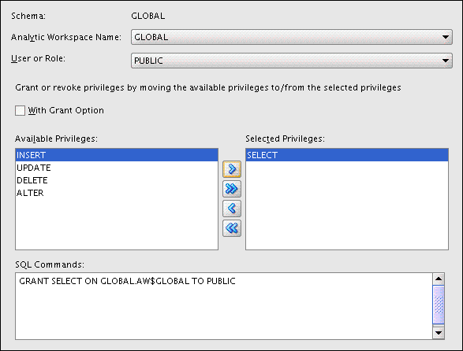
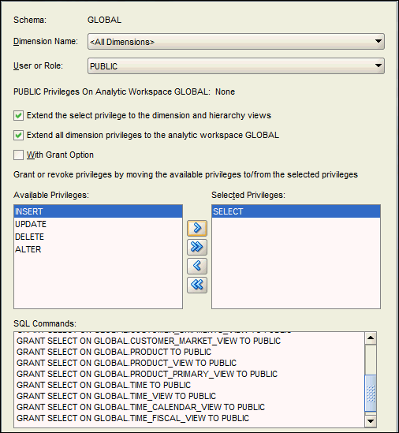
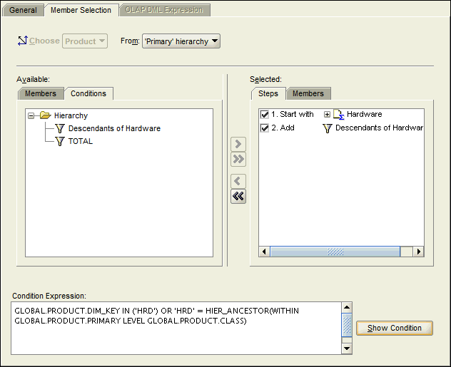

Oracle OLAP secures your data using the standard security mechanisms of Oracle Database.

This chapter contains the following topics:

- Security of Multidimensional Data in Oracle Database

- Setting Object Security

- Creating Data Security Policies on Dimensions and Cubes

- Creating OLAP Data Security Roles

### 8.1 Security of Multidimensional Data in Oracle Database

Your company's data is a valuable asset. The information must be secure, private, and protected. Analytic data is particularly vulnerable because it is highly organized, easy to navigate, and summarized into meaningful units of measurement.

When you use Oracle OLAP, your data is stored in the database. It has the security benefits of Oracle Database, which leads the industry in security. You do not need to expose the data by transferring it to a standalone database. You do not need to administer security on a separate system. And you do not need to compromise your data by storing it in a less secure environment than Oracle Database.

#### 8.1.1 Security Management

Because you have just one system to administer, you do not have to replicate basic security tasks such as these:

- Creating user accounts

- Creating and administering rules for password protection

- Securing network connections

- Detecting and eliminating security vulnerabilities

- Safeguarding the system from intruders

The cornerstone of data security is the administration of user accounts and roles. Users open a connection with Oracle Database with a user name and password, and they have access to both dimensional and relational objects in the same session.

#### 8.1.2 Types of Security

Users by default have no access rights to an analytic workspace or any other data type in another user's schema. The owner or an administrator must grant them, or a role to which they belong, any access privileges.

Oracle OLAP provides two types of security: Object security and data security.

- Object security provides access to dimensional objects. You must set object security before other users can access them. Object security is implemented using SQL `GRANT` and `REVOKE`.

- Data security provides fine-grained control of the data on a cellular level. This type of security is optional. You must define data security policies only when you want to restrict access to specific areas of a cube. Data security is implemented using Oracle Real Application Security.

  **Note:**

  Only the owner of a schema can create data security policies and OLAP data security roles. The data security policies and OLAP data security roles apply only to objects in the schema.

You can administer both data security and object security in Analytic Workspace Manager. For object security, you also have the option of using SQL `GRANT` and `REVOKE`.

#### 8.1.3 About the Privileges

Using both object security and data security, you can grant and revoke the following privileges:

- Alter: Change the definition of a cube or dimension. Users need this privilege to create and modify a dimensional model.

- Delete: Remove old dimension members. Users need this privilege to refresh a dimension.

- Insert: Add new dimension members. Users need this privilege to refresh a dimension.

- Select: Query the cube or dimension. Users need this privilege to query a view of the cube or dimension or to use the `CUBE_TABLE` function. `CUBE_TABLE` is a SQL function that returns the values of a dimensional object.

- Update: Change the data values of a cube or the name of a dimension member. Users need this privilege to refresh a dimension or cube.

Users exercise these privileges either by using Analytic Workspace Manager to create and administer dimensional objects, or by using SQL to query them. They do not issue commands such as SQL `INSERT` and `UPDATE` directly on the cubes and dimensions.

#### 8.1.4 Layered Security

For dimensional objects, you can manage security at these levels:

- Dimension member

- Dimension

- Cube

- Analytic workspace

- View

- Materialized view

The privileges are layered so that, for example, a user with `SELECT` data security on Software products must also have `SELECT` object security on the `PRODUCT` dimension and the Global analytic workspace. Users also need `SELECT` privileges on the views of the dimensional objects.

You administer security on views and materialized views for dimensional objects the same way as for any other views and materialized views in the database.

### 8.2 Setting Object Security

You can use either SQL or Analytic Workspace Manager to set object security. The results are identical. These following topics describe these methods.

- Using SQL to Set Object Security

- Using Analytic Workspace Manager to Set Object Security

#### 8.2.1 Using SQL to Set Object Security

You can set and revoke object privileges on dimensional objects using the SQL `GRANT` and `REVOKE` commands.

##### 8.2.1.1 Setting Object Security on an Analytic Workspace

Object privileges on an analytic workspace simply open the container. You must grant object privileges on the cubes and dimensions for users to be able to access them. The table name is the same as the analytic workspace name, with the addition of an `AW$` prefix.

The following command enables Scott to attach the Global analytic workspace, `AW$GLOBAL`, to a session:

    GRANT SELECT ON aw$global TO scott;

##### 8.2.1.2 Setting Object Security on Dimensions

You can grant privileges on individual dimensions to enable users to query the dimension members and attributes. For users to query a cube, they must have privileges on every dimension of the cube.

The privileges apply to the entire dimension. However, you can set fine-grained access on a dimension to restrict the privileges, as described in "Creating Data Security Policies on Dimensions and Cubes".

Example 8-1 shows the SQL commands that enable Scott to query the Product dimension. They give Scott `SELECT` privileges on the Product dimension, on the Global analytic workspace, and on the Product view.

Example 8-1 Privileges to Query the Product Dimension

    GRANT SELECT ON product TO scott;
    GRANT SELECT ON aw$global TO scott;
    GRANT SELECT ON product_view TO scott;

##### 8.2.1.3 Setting Object Security on Cubes

Privileges on cubes enable users to access business measures and perform analysis. You must also grant privileges on each of the dimensions of the cube.

The privileges apply to the entire cube. However, you can create a data security policy on the cube or on its dimensions to restrict the privileges, as described in "Creating Data Security Policies on Dimensions and Cubes".

Example 8-2 Privileges to Query the Units Cube

This example shows the SQL commands that enable Scott to query the Units cube. They give Scott `SELECT` privileges on the Global analytic workspace, the cube, and all of its dimensions. Scott also gets privileges on the dimension views so that he can query the dimension attributes for formatted reports.

    /* Grant privileges on the analytic workspace */
    GRANT SELECT ON global.aw$global TO scott;

    /* Grant privileges on the cube */
    GRANT SELECT ON global.units_cube TO scott;

    /* Grant privileges on the dimensions */
    GRANT SELECT ON global.channel TO scott;
    GRANT SELECT ON global.customer TO scott;
    GRANT SELECT ON global.product TO scott;
    GRANT SELECT ON global.time TO scott;

    /* Grant privileges on the cube, dimension, and hierarchy views */
    GRANT SELECT ON global.units_cube_view TO scott;
    GRANT SELECT ON global.channel_view TO scott;
    GRANT SELECT ON global.channel_primary_view TO scott;
    GRANT SELECT ON global.customer_view TO scott;
    GRANT SELECT ON global.customer_shipments_view TO scott;
    GRANT SELECT ON global.customer_segments_view TO scott;
    GRANT SELECT ON global.product_view TO scott;
    GRANT SELECT ON global.product_primary_view TO scott;
    GRANT SELECT ON global.time_view TO scott;
    GRANT SELECT ON global.time_calendar_view TO scott;
    GRANT SELECT ON global.time_fiscal_view TO scott;

Example 8-3 Privileges to Use Cube Materialized Views for Query Rewrite

This example shows the SQL commands that give `SCOTT` the privileges to query the relational tables for the detail level data and to use query rewrite to obtain summary data from the Units cube.

    /* Grant privileges on materialized views using query rewrite */
    GRANT GLOBAL QUERY REWRITE TO scott;

    /* Grant privileges on the relational source tables */
    GRANT SELECT ON global.channel_dim TO scott;
    GRANT SELECT ON global.customer_dim TO scott;
    GRANT SELECT ON global.product_dim TO scott;
    GRANT SELECT ON global.time_dim TO scott;
    GRANT SELECT ON global.units_fact TO scott;

    /* Grant privileges on the analytic workspace */
    GRANT SELECT ON global.aw$global TO scott;

    /* Grant privileges on the cube */
    GRANT SELECT ON global.units_cube TO scott;

    /* Grant privileges on the dimensions */
    GRANT SELECT ON global.channel TO scott;
    GRANT SELECT ON global.customer TO scott;
    GRANT SELECT ON global.product TO scott;
    GRANT SELECT ON global.time TO scott;

Example 8-4 Privileges to Modify and Refresh GLOBAL

This example shows the SQL commands that give `SCOTT` the privileges to modify and update all dimensional objects in `GLOBAL` using Analytic Workspace Manager.

**Note:**

The `GRANT ALL` commands encompass more privileges than those discussed in [Security](overview.md). Be sure to review the list of privileges before using `GRANT ALL`.

    /* Grant privilege to use Analytic Workspace Manager */
    GRANT OLAP_USER TO scott;

    /* Grant privileges on the analytic workspace */
    GRANT ALL ON global.aw$global TO scott;

    /* Grant privileges on the cubes */
    GRANT ALL ON global.units_cube TO scott;
    GRANT ALL ON global.price_cost_cube TO scott;

    /* Grant privileges on the dimensions */
    GRANT ALL ON global.channel TO scott;
    GRANT ALL ON global.customer TO scott;
    GRANT ALL ON global.product TO scott;
    GRANT ALL ON global.time TO scott;

#### 8.2.2 Using Analytic Workspace Manager to Set Object Security

Analytic Workspace Manager provides a graphical interface for setting object security. It also displays the SQL commands, so that you can cut-and-paste them into a script.

##### 8.2.2.1 Setting Object Security on an Analytic Workspace

Take these steps to set object security on an analytic workspace in Analytic Workspace Manager:

1.  In the navigation tree, right-click the analytic workspace and select Set Analytic Workspace Object Security.
    The Set Analytic Workspace Object Security dialog box appears.
2.  Complete the dialog box, then click OK.
    Click Help for specific information about the choices.
3.  Grant privileges on one or more cubes and their dimensions.
    Privileges on the analytic workspace do not automatically extend to the cubes and dimensions contained in the analytic workspace.

Figure 8-1 shows the `SELECT` privilege on `GLOBAL` granted to `PUBLIC`.

Figure 8-1 Setting Object Security on GLOBAL

[Description of "Figure 8-1 Setting Object Security on GLOBAL"](img_text/set_privs_aw.md)

##### 8.2.2.2 Setting Object Security on Dimensions

Take these steps to set object security on dimensions in Analytic Workspace Manager:

1.  In the navigation tree, right-click any dimension and select Set Dimension Object Security.
    The Set Dimension Object Security dialog box appears.
2.  Complete the dialog box, then click OK.
    You can set privileges on all of the dimensions simultaneously. You can extend the privileges to the dimension and hierarchy views and to the analytic workspace. Click Help for specific information about the choices.

Figure 8-2 shows the `SELECT` privilege on all dimensions granted to `PUBLIC`.

Figure 8-2 Setting Object Security on Dimensions

[Description of "Figure 8-2 Setting Object Security on Dimensions"](img_text/set_privs_dim.md)

##### 8.2.2.3 Setting Object Security on Cubes

Before setting object security on a cube, set object security on the dimensions that the cube uses. Take these steps to set object security on cubes in Analytic Workspace Manager:

1.  In the navigation tree, right-click any cube and select Set Cube Object Security.
    The Set Cube Object Security dialog box appears.
2.  Complete the dialog box, then click OK.
    You can set privileges on all of the cubes simultaneously. You can extend the privileges to the cube views and to the analytic workspace. Click Help for specific information about the choices.

### 8.3 Creating Data Security Policies on Dimensions and Cubes

Data security policies enable you to grant database users and roles privileges on a selection of dimension members. For example, you might restrict district sales managers to the data for just their own districts instead of all geographic areas. You can create a data security policy on dimensions, cubes, or both:

- Only the owner of a schema can create data security policies for dimensions and cubes in the schema.

- When you create a data security policy on a dimension, the policy extends to all cubes with that dimension. You do not need to re-create the policy for each cube.

- When you create a data security policy on a cube, you select the members for each dimension of the cube. The policy only applies to that cube.

- When you create data security policies on both dimensions and cubes, users have privileges on the most narrowly defined portion of the data, where the policies overlap.

#### Granting Data Privileges

You can apply a policy to one or more database users and roles. You can also apply a policy to an OLAP data security role. An OLAP data security role is a group of database users and roles that you can manage in Analytic Workspace Manager just for use in security policies. You create OLAP data security roles and data security policies in Analytic Workspace Manager.

#### Selecting Data By Criteria

When defining a data security policy, you can select specific dimension members or those that meet certain criteria based on the dimension hierarchy. By using criteria instead of hard-coding specific dimension members, the selection remains valid after a data refresh. You do not need to modify the selection after adding members. For example, a security policy that grants `SELECT` privileges to all Hardware products remains valid when old products are rolled off and new products are added to the `PRODUCT` dimension.

**Note:**

You must have the `OLAP_XS_ADMIN` role to manage data security policies in Analytic Workspace Manager.

#### To create a data security policy:

1.  Expand the folder for a dimension or a cube.

2.  Right-click Data Security and select Create Data Security Policy.

    The Create Data Security Policy dialog box appears.

3.  On the General tab, enter a descriptive name in the Data Security Policy Name field.

4.  Optional: Enter a description in the Description field.

5.  For a dimension, select the method you want to use to select the viewable dimension members, either Member Selection or OLAP DML Expression. The related tab becomes active.

    For a cube, the method is Member Selection.

6.  Click Add Users or Roles.

    The Add Users or Roles dialog box appears.

7.  Select the database users and roles and the OLAP data security role to use this policy. Then click OK to close the dialog box.

    The selected database users and roles and OLAP data security role are now listed in the table on the General tab.

8.  Select the permissions you want to grant to each user or role. You cannot assign permissions to the OLAP data security role because the permissions are part of its definition.

9.  For a cube, complete the Member Selection tab.

    For a dimension, complete the Member Selection tab or the OLAP DML Expression tab, depending on the previously selected method.

10. Click Create to save the data security policy.

    The data security policy appears in the navigation tree in the Data Security folder for the dimension or cube.

11. Grant these users and roles object privileges on the dimension or cube, and on the analytic workspace.

**See Also:**

- "Setting Object Security on an Analytic Workspace"

- "Setting Object Security on Dimensions "

- "Setting Object Security on Cubes "

- "Creating OLAP Data Security Roles"

Figure 8-3 shows the Member Selection tab of the data security policy for `PRODUCT`. Users who have privileges on the `PRODUCT` dimension based on this policy have access to all Hardware products. They do not have access to Software products or Total Product.

Figure 8-3 Restricting Product to Hardware and Descendants

[Description of "Figure 8-3 Restricting Product to Hardware and Descendants"](img_text/hardware_select.md)

#### Disabling and Enabling Data Security

When you create a data security policy, Oracle OLAP enables data security for the dimension or cube. You can disable data security for a dimension or a cube. You can then enable data security for the object again.

#### To disable or enable data security:

1.  Expand the folder for a dimension or a cube.

2.  Right-click Data Security and select Disable Data for Object or Enable Data for Object.

    The Disable Confirmation dialog box or the Enable Confirmation dialog box appears.

3.  Click Yes.

### 8.4 Creating OLAP Data Security Roles

You can create OLAP data security roles to manage a group of users to whom you want to assign the same data access permissions. You can then use the data security role when managing your data security policies, instead of defining the privileges of each individual user. OLAP data security roles are like database roles except they only function within the context of OLAP data security, and they can be created by a user with less powerful database privileges. Only the owner of a schema can create data security roles in the schema.

**Note:**

You must have the `OLAP_XS_ADMIN` privilege to manage data security policies in Analytic Workspace Manager.

To create an OLAP data security role:

1.  In the navigation tree, right-click Data Security Roles and then select Create Data Security Role.
    The Create Data Security Role dialog box appears.
2.  On the General tab, enter a descriptive name in the Data Security Role Name field.
3.  Optional: Enter a description in the Description field.
4.  Click Add Users or Roles.
    The Add Users or Roles dialog box appears.
5.  Select the users and roles that you want to include in this OLAP data security role. Then click OK to close this dialog box.
    The selected users and roles are now listed in the table on the General tab.
6.  Select the permissions you want to grant to each user or role.
7.  Click Create to save the OLAP data security role.
    The new OLAP data security role appears in the navigation tree in the Data Security Roles folder.

**See Also:**

- "Creating Data Security Policies on Dimensions and Cubes"
