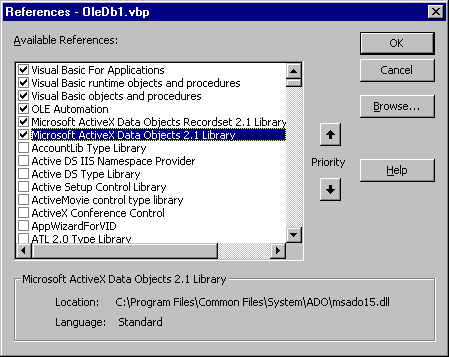
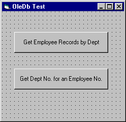
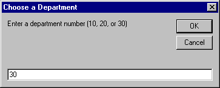
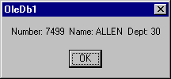

These topics describe components of Oracle Provider for OLE DB (OraOLEDB) and how to use the components to develop OLE DB consumer applications.

- OraOLEDB Provider Specific Features

- Using OraOLEDB with Visual Basic

### OraOLEDB Provider Specific Features

The following sections describe provider-specific features of OraOLEDB:

- Data Source

- OraOLEDB Sessions

- Commands

- Rowsets

- Data Types

- LOB Support

- Unicode Support

- Errors

- OLEDB.NET Data Provider Compatibility

Additional provider-specific information is provided in [Provider-Specific Information](provider-specific-info.md).

#### Data Source

A data source object in OraOLEDB is responsible for establishing the first connection to the Oracle Database. To establish the initial connection, the consumer must use the `CoCreateInstance` function to create an instance of the data source object. This function requires important information about the provider: class ID of the provider and executable context. The class ID of OraOLEDB is `CLSID_OraOLEDB`.

OraOLEDB is an in-process server. When calling `CoCreateInstance`, use the `CLSCTX_INPROC_SERVER` macro. For example:

    // create an instance of OraOLEDB data source object and
    // obtain the IDBInitialize interface
    hr = CoCreateInstance(CLSID_OraOLEDB, NULL,
                          CLSCTX_INPROC_SERVER, IID_IDBInitialize,
                         (void**)&pIDBInitialize);

The code snippet above does not enable OLEDB Services when instantiating the Data Source object. To enable OLEDB services, see "Compatibility with OLE DB Services" below.

**Note:**

OraOLEDB does not support persistent data source objects.

After the successful creation of an instance of a data source object, the consumer application can initialize the data source and create sessions.

OraOLEDB supports connections to Oracle Databases releases. To connect to a specific database, the consumer is required to set the following properties of the `DBPROPSET_DBINIT` property set:

- `DBPROP_AUTH_USERNAME` with the user ID, such as `scott`

- `DBPROP_AUTH_PASSWORD` with the password, such as `tiger`

- `DBPROP_INIT_DATASOURCE` with the net service name, such as `myOraDb`

The consumer could also populate `DBPROP_INIT_PROMPT` with `DBPROMPT_PROMPT` which causes the provider to display a logon box for the user to enter the connect information.

Using `DBPROMPT_NOPROMPT` disables display of the logon box. In this case, incomplete logon information causes the provider to return a logon error. However, if this property is set to `DBPROMPT_COMPLETE` or `DBPROMPT_COMPLETEREQUIRED`, the logon box will be displayed only if the logon information is incomplete.

##### Compatibility with OLE DB Services

OraOLEDB is compatible with OLE DB Services that are available in OLE DB version 2.0 and later. OLE DB Services contains useful services such as automatic transaction enlistment, Client Cursor Engine (CCE), connection and session pooling, which can enhance application performance, and others.

OLE DB Services can be used with OraOLEDB through C++/COM or ADO.

By default, the `OLEDB_SERVICES` registry entry for OraOLEDB is set, under the `CLSID` of OraOLEDB, to `0xffffffff` (that is, `-1`), which enables all services. Certain OLE DB Services can also be disabled or enabled programmatically through the `DBPROP_INIT_OLEDBSERVICES` property setting.

**See Also:**

[`http://msdn.microsoft.com/en-us/library/ms724518(VS.85).aspx`](http://msdn.microsoft.com/en-us/library/ms724518(VS.85).aspx) for more information on OLE DB Services and how to enable or disable specific services

###### ADO Applications with OLE DB Services

ADO automatically enables OLE DB Services. Thus, ADO applications do not need any special code to use OLEDB Services.

###### C++/COM Applications with OLE DB Services

For C++/COM applications, some additional steps are needed to use OLE DB Services.

The following code snippet shows one way that C++/COM applications can enable OLE DB Services. The code shows the OLE DB consumer creating an instance of the `CLSID_MSDAINITIALIZE` class through `CoCreateInstance()`, obtaining the `IDataInitialize` interface from that object, and then creating an OLE DB data source object through that interface.

    // Instantiate the CLSID_MSDAINITIALIZE class and request for the
    // IID_IDataInitialize interface from it
    hr = CoCreateInstance(CLSID_MSDAINITIALIZE, NULL, CLSCTX_INPROC_SERVER,
      IID_IDataInitialize, (void**)&pIDataInitialize);

    // Set properties, datasource name, userid, and password, etc.
    ...

    // Create an OLEDB data source object using the interface obtained from the
    // CLSID_MSDAINITIALIZE class.
    hr = pIDataInitialize->CreateDBInstance(CLSID_OraOLEDB, NULL,
        CLSCTX_INPROC_SERVER, NULL,IID_IDBInitialize,(IUnknown**)&pIDBInitialize);
    ...

    // If connection/session pooling was enabled, pIDBInitialize->Release()
    // releases the connection/session back to the pool.
    // pIDataInitialize->Release() should not be called until the application no
    // longer need to use connection/session pooling and the rest of
    // the OLE DB Services that were enabled for the application.
    //
    pIDBInitialize->Release();

##### Connecting to an Oracle Database

To connect to an Oracle Database using OraOLEDB, the OLE DB connection string must be as follows:

    "Provider=OraOLEDB.Oracle;User ID=user;Password=pwd;Data Source=constr;"

When connecting to a remote database, `Data` `Source` must be set to the correct net service name which is the alias in the `tnsnames.ora` file.

**See Also:**

[Oracle Database Net Services Administrator's Guide](../netag/quick-start-oracle-net-services.md)

##### OraOLEDB-Specific Connection String Attributes

OraOLEDB offers provider-specific connection string attributes, which are set in the same way as the Provider and User ID are set. The provider-specific connection string attributes are:

- `CacheType` - specifies the type of cache used to store the rowset data on the client. See "OraOLEDB-Specific Connection String Attributes for Rowsets".

- `ChunkSize` - specifies the size of `LONG` or `LONG RAW` column data stored in the provider's cache. See "OraOLEDB-Specific Connection String Attributes for Rowsets".

- `DistribTX` - enables or disables distributed transaction enlistment capability. See "Distributed Transactions".

- `FetchSize` - specifies the size of the fetch array in rows. See "OraOLEDB-Specific Connection String Attributes for Rowsets".

- `OLEDB.NET` - enables or disables compatibility with OLEDB.NET Data Provider. See "OLEDB.NET Data Provider Compatibility".

- `OSAuthent` - specifies whether operating system authentication will be used when connecting to an Oracle Database. See "Operating System Authentication".

- `PLSQLRSet` - enables or disables the return of a rowset from [PL/SQL](glossary.md) stored procedures. See "OraOLEDB Custom Properties for Commands".

- `PwdChgDlg` - enables or disables displaying the password change dialog box when the password expires. See "Password Expiration".

- `UseSessionFormat` - specifies whether to use the default NLS session formats or let OraOLEDB override some of these formats for the duration of the session. Valid values are `0` (`FALSE`) and `1` (`TRUE`). The default is `FALSE` which lets OraOLEDB override some of the default NLS session formats. If the value is `TRUE`, OraOLEDB uses the default NLS session formats.

  Note that this connection attribute does not appear under the `\\HKEY_LOCAL_ MACHINE\SOFTWARE\ORACLE\KEY_``HOMENAME``\OLEDB` registry key.

- `VCharNull` - enables or disables the NULL termination of `VARCHAR2 OUT` parameters from stored procedures.

- `SPPrmDefVal` - specifies whether to use the default value or a NULL value if the application has not specified a stored procedure parameter value.

- `NDataType` - specifies whether any of the parameters bound to the command are of N data types, which include `NCHAR`, `NVARCHAR2`, or `NCLOB`. See "NDatatype".

  Note that this connection attribute does not appear under the `\\HKEY_LOCAL_ MACHINE\SOFTWARE\ORACLE\KEY_``HOMENAME``\OLEDB` registry key.

- `SPPrmsLOB` - specifies whether one or more parameters bound to the stored procedures are of LOB data type, which include `CLOB`, `BLOB`, or `NCLOB`. See "SPPrmsLOB".

  Note that this connection attribute does not appear under the `\\HKEY_LOCAL_ MACHINE\SOFTWARE\ORACLE\KEY_``HOMENAME``\OLEDB` registry key.

- `StmtCacheSize` – specifies the maximum number of statements that can be cached. See "Statement Caching".

- `MetaDataCacheSize` - specifies the maximum number of `SELECT` statements for which the metadata can be cached. See "Metadata Caching".

- `DeferUpdChk` - specifies whether or not to defer the updateability check to support updating read-only disconnected rowsets. See `DeferUpdChk` under "OraOLEDB-Specific Connection String Attributes for Rowsets".

- `DBNotifications` - specifies whether or not to subscribe to the high availability events. See "Enhanced Failover Capability".

- `DBNotificationPort` - specifies the port number, which is opened to listen to the Database notifications. See "Enhanced Failover Capability".

##### Default Attribute Values

The default values for these attributes are located under the `\\HKEY_LOCAL_ MACHINE\SOFTWARE\ORACLE\KEY_``HOMENAME``\OLEDB` registry key, where `KEY_``HOMENAME` is the Oracle home.

The registry default values are read by OraOLEDB from the registry when the provider is loaded into memory. If Oracle-specific connection string attributes are not provided at connection time, then the default registry values are used. However, if the attributes are provided, then these new values override the default registry values.

These attributes can be set by setting the `DBPROP_INIT_PROVIDERSTRING` property, provided in the `DBPROPSET_DBINIT` property set. For example:

    "FetchSize=100;CacheType=Memory;OSAuthent=0;PLSQLRSet=1;StmtCacheSize=10;"

##### Distributed Transactions

The `DistribTX` attribute specifies whether sessions are enabled to enlist in distributed transactions. Valid values are `0` (disabled) and `1` (enabled). The default is `1` which indicates that sessions are enabled for distributed transaction enlistments.

Applications using Microsoft Distributed Transaction Coordinator must have `DistribTX` set to `1`, the default.

Sessions enabled for distributed transaction enlistments cannot run statements that use the direct path load and parallel DML capabilities of the Oracle database. Such statements are executed as conventional path serial statements.

##### Enhanced Failover Capability

This feature enhances failover capability.

These connection string attributes support enhanced failover capability.

- `DBNotifications`

  The `DBNotifications` attribute specifies whether or not to subscribe to high availability events. Valid values are `0` (`FALSE`) and `1` (`TRUE`). The default is `FALSE`, which indicates that OraOLEDB does not subscribe to high availability events. If this attribute is not provided at the connection time, then the default registry value is used.

- `DBNotificationPort`

  The `DBNotificationPort` attribute specifies the port number, which is used to listen to the database notifications. The valid value is an unsigned integer.

  `DBNotificationPort` is effective only if the `DBNotifications` attribute is set to `TRUE`, either through the connection string attribute or by registry entry. The default for the `DBNotificationPort` attribute is `0`, which implies that OraOLEDB opens a valid port randomly. OraOLEDB does not validate the port number, so it is the responsibility of the application to specify a valid port number.

##### Enabling Failover Capability Through Registry Entry

- `DBNotifications`

  The `DBNotifications` registry entry specifies whether or not to subscribe to high availability events. Valid values are `0` (`FALSE`) and `1` (`TRUE`). The default value is `FALSE`, OraOLEDB does not subscribe. This registry entry value is used when the `DBNotifications` connection string attribute is not set. It is located under the `\\HKEY_LOCAL_MACHINE\SOFTWARE\ORACLE\``KEY_``HOMENAME``\OLEDB` registry key.

##### Operating System Authentication

The `OSAuthent` attribute specifies whether operating system authentication will be used when connecting to an Oracle Database. Valid values are `0` (disabled) and `1`(enabled). The default is `0`, which indicates that operating system authentication is not used.

Operating system authentication is the feature by which Oracle uses the security mechanisms of the operating system to authorize users.

After the Windows client has been set up properly for operating system authentication, this feature may be enabled by OraOLEDB clients by setting any of the following:

- `DBPROP_AUTH_USERNAME` to `/`

- `DBPROP_INIT_PROVIDERSTRING` to `OSAuthent=1`;

- `OSAuthent` in the registry to `1`

**See Also:**

[Oracle Database Platform Guide for Microsoft Windows](../ntqrf/overview-of-operating-system-authentication-enabled-at-installation.md) for more information on this subject and how to set it up on Windows clients.

##### Password Expiration

Oracle provides a Password Expiration feature which allows database administrators to force users to change their passwords regularly. The `PwdChgDlg` attribute enables or disables the displaying of the password change dialog box, whenever a logon fails due to an expired password. When enabled, the provider displays the dialog box to change the password. When disabled, the logon fails with an error message. The valid values are `0` (disabled) and `1` (enabled). The default is `1` (enabled).

**See Also:**

[Oracle Database Security Guide](../dbseg/configuring-authentication.md) for more information on the Password Expiration feature.

##### Example: Connecting to an Oracle Database Using ADO

The following examples illustrate how to connect to an Oracle Database using OraOLEDB and ADO.

**Note:**

If `Data Source`, `User ID`, and `Password` are provided with the `Open` method, then ADO ignores those `ConnectionString` attributes.

##### Connect Using ConnectionString

    Dim con As New ADODB.Connection
    con.ConnectionString = "Provider=OraOLEDB.Oracle;Data Source=MyOraDb;" & _
                         "User ID=scott;Password=tiger;"
    con.Open

##### Connect Without Using ConnectionString

    Dim con As New ADODB.Connection
    con.Provider = "OraOLEDB.Oracle"
    con.Open "MyOraDb", "scott", "tiger"

##### Connect and Set Provider-specific Attributes

    Dim con As New ADODB.Connection
    con.Provider = "OraOLEDB.Oracle"
    con.ConnectionString = "FetchSize=200;CacheType=Memory;" & _
                           "OSAuthent=0;PLSQLRSet=1;Data Source=MyOraDb;" & _
                           "User ID=scott;Password=tiger;"
    con.Open

##### Operating System-Authenticated Connect Setting User ID to /

    Dim con As New ADODB.Connection
    con.Provider = "OraOLEDB.Oracle"
    con.Open "MyOraDb", "/", ""

##### Operating System-Authenticated Connect Using OSAuthent

    Dim con As New ADODB.Connection
    con.Provider = "OraOLEDB.Oracle"
    con.ConnectionString = "Data Source=MyOraDb;OSAuthent=1;"
    con.Open

##### VCharNull

The `VCharNull` attribute enables or disables the NULL termination of `VARCHAR2 OUT` parameters from stored procedures. Valid values are `0` (disabled) and `1` (enabled). The default is `1`, which indicates that `VARCHAR2 OUT` parameters are NULL terminated. A value of `0` indicates that `VARCHAR2 OUT` parameters are padded with spaces.

The default value for this attribute is located under the `\\HKEY_LOCAL_ MACHINE\SOFTWARE\ORACLE\KEY_``HOMENAME``\OLEDB` registry key, where `HOMENAME` is the Oracle home. If this attribute is not provided at the connection time, then the default registry value is used.

Note that with this connection attribute enabled, applications need to pad the stored procedure `IN` and `IN OUT CHAR` parameters with spaces explicitly, if the parameter is to be used in a `WHERE` clause.

##### SPPrmDefVal

The `SPPrmDefVal` attribute specifies whether to use the default value or a NULL value if the application has not specified a stored procedure parameter value. Valid values are `0` (FALSE) and `1` (TRUE). The default is FALSE, which enables OraOLEDB to pass a NULL value. If the value is TRUE, then OraOLEDB uses the default value.

The default value for this attribute is located under the `\\HKEY_LOCAL_ MACHINE\SOFTWARE\ORACLE\KEY_``HOMENAME``\OLEDB` registry key. If this attribute is not provided at connection time, then the default registry value is used.

#### OraOLEDB Sessions

An OraOLEDB session object represents a single connection to an Oracle Database. The session object exposes the interfaces that allow data access and manipulation.

The first session created on the initialized data source inherits the initial connection established by `IDBInitialize::Initialize()`. Subsequent sessions that are created establish their own independent connections to the particular Oracle Database specified by the data source properties.

Each session object also defines a transaction space for a data source. All command and rowset objects created from a particular session object are part of the transaction of that session.

After all references to the session object are released, the session object is removed from memory and the connection is dropped.

##### Transactions

OraOLEDB supports local and distributed transactions, which provide explicit commit and abort transactional operations.

OraOLEDB does not support nested transactions. In addition, a local transaction cannot be started if the session is currently enlisted in a distributed transaction. This also applies to distributed transactions if the session is currently enlisted in a local transaction.

###### Local Transactions

OraOLEDB supports the `ITransactionLocal` interface for explicit transactions. By default, OraOLEDB is in an autocommit mode, meaning that each unit of work done on the database is automatically or implicitly committed. With the use of the `ITransactionLocal` interface, consumers may explicitly start a transaction for a particular session, allowing a unit of work to be explicitly committed or aborted by the consumer.

OraOLEDB supports the Read Committed (Cursor Stability) isolation level. In this level, the changes made by other transactions are not visible until those transactions are committed.

###### Distributed Transactions

OraOLEDB consumers must install Oracle Services for Microsoft Transaction Server (MTS) release 10.2 or higher to be able to participate in Microsoft Transaction Server (or COM+) transactions or to enlist in a distributed transaction coordinated by Microsoft Distributed Transaction Coordinator (MS DTC).

OraOLEDB ignores `IsoLevel`, `IsoFlags`, and `pOtherOptions` parameters when `ITransactionJoin::JoinTransaction()` is called. These options must be provided when the consumer acquires a transaction object from MS DTC with the `ITransactionDispenser::BeginTransaction()` method call.

However, if `IsoFlags` is nonzero, then `XACT_E_NOISORETAIN` is returned.

**See Also:**

[Oracle Services for Microsoft Transaction Server Developer's Guide for Microsoft Windows](../ntmts/managing-recovery-scenarios.md) for setup and configuration information on Oracle Services for MTS.

#### Commands

OraOLEDB supports ANSI SQL as supported by Oracle Database and the ODBC SQL syntax.

##### Stored Procedures

When executing an Oracle PL/SQL [stored procedure](glossary.md) using a command, use Oracle native syntax or the ODBC procedure call escape sequence in the command text:

- Oracle native syntax: `BEGIN credit_account(123, 40); END;`

- ODBC syntax: {`CALL credit_account(123, 40)}`

##### Preparing Commands

OraOLEDB validates and fetches the metadata only for SELECT SQL statements.

##### Command Parameters

When using Oracle ANSI SQL, parameters in the command text are preceded by a colon. In ODBC SQL, parameters are indicated by a question mark (`?`).

OraOLEDB supports input, output, and input and output parameters for PL/SQL stored procedures and stored functions. OraOLEDB supports input parameters for SQL statements.

**Note:**

OraOLEDB supports only positional binding.

##### OraOLEDB Custom Properties for Commands

OraOLEDB custom properties for commands are grouped under the custom property set `ORAPROPSET_COMMANDS`. It provides these properties:

Table 2-1 Custom Properties for Commands

| For Visual Basic Users | For C++ Users            |
|:-----------------------|:-------------------------|
| `PLSQLRSet`            | `ORAPROP_PLSQLRSet`      |
| `NDatatype`            | `ORAPROP_NDatatype`      |
| `SPPrmsLOB`            | `ORAPROP_SPPrmsLOB`      |
| `AddToStmtCache`       | `ORAPROP_AddToStmtCache` |

##### PLSQLRSet

This property is similar to the `PLSQLRSet` connection string attribute.

The property specifies whether OraOLEDB must return a rowset from the PL/SQL stored procedure. If the stored procedure, provided by the consumer, returns a rowset, `PLSQLRSet` must be set to `TRUE` (enabled). This property should be set to `FALSE` after the command has been run. By default, the property is set to `FALSE` (disabled).

Consumers should use the property over the attribute, as the property can be set at the command object rather than at the session. By setting it at the command object, the consumer is able to set the property only for the command object executing stored procedures which are returning rowsets. With the attribute, the consumer needed to set it even if only one of many stored procedures being executed by the ADO application returned a rowset. The use of this property should provide a performance boost to applications making use of the attribute previously.

##### Example: Setting the Custom Property PLSQLRSet

    Dim objRes As NEW ADODB.Recordset
    Dim objCon As NEW ADODB.Connection
    Dim objCmd As NEW ADODB.Command
    ....
    objCmd.ActiveConnection = objCon
    objCmd.CommandType = adCmdText

    ' Enabling the PLSQLRSet property indicates to the provider
    ' that the command returns one or more rowsets
    objCmd.Properties("PLSQLRSet") = TRUE

    ' Assume Employees.GetEmpRecords() has a REF CURSOR as
    ' one of the arguments
    objCmd.CommandText = "{ CALL Employees.GetEmpRecords(?,?) }"

    ' Execute the SQL
    set objRes = objCmd.Execute

    ' It is a good idea to disable the property after execute as the
    ' same command object may be used for a different SQL statement
    objCmd.Properties("PLSQLRSet") = FALSE

##### NDatatype

This property allows the consumers to specify whether any of the parameters bound to the command are of Oracle's N data types (`NCHAR`, `NVARCHAR2,` or `NCLOB`). This information is required by OraOLEDB to detect and bind the parameters. This property should not be set for commands executing `SELECT` statements. However, this property must be set for all other SQL statements, such as `INSERT`, `UPDATE`, and `DELETE`.

The use of this property should be limited to SQL statements containing parameters of N data type as setting it incurs a processing overhead of at least one round-trip to the database. By default, this property is set to `FALSE`.

**Note:**

OraOLEDB does not support parameters of N data types in the `WHERE` clause of SQL statements.

**Note:**

Consumers are required to use the ODBC procedure call escape sequence to call stored procedures or functions having N data type parameters.

##### Example: Setting the Custom Property NDatatype

    Dim objCon As NEW ADODB.Connection
    Dim objCmd As NEW ADODB.Command
    Dim prEmpno As NEW ADODB.Parameter
    Dim prEname As NEW ADODB.Parameter
    ...
    objCmd.ActiveConnection = objCon
    objCmd.CommandType = adCmdText

    ' Create and append the parameters to the command object
    Set prEmpno = objCmd.CreateParameter("prEmpno", adSmallInt, adParamInput, ,8521)
    ' prEname is bound to a NVARCHAR2 column in the EMP table
    Set prEname = objCmd.CreateParameter("prEname", adBSTR, adParamInput, , "Joe")
    objCmd.Parameters.Append prEmpno
    objCmd.Parameters.Append prEname

    ' Enabling the NDatatype property indicates to the provider
    ' that one or more of the bound parameters is of N datatype
    objCmd.Properties("NDatatype") = TRUE

    ' Assume column ENAME in table EMP is of NVARCHAR2 type
    objCmd.CommandText = "INSERT INTO EMP (EMPNO, ENAME) VALUES (?, ?)"

    ' Execute the SQL
    objCmd.Execute

    ' It is a good idea to disable the property after execute as the same command
    ' object may be used for a different SQL statement
    objCmd.Properties("NDatatype") = FALSE

##### SPPrmsLOB

This property allows the consumer to specify whether one or more of the parameters bound to the stored procedures are of Oracle's LOB data type (`CLOB`, `BLOB`, or `NCLOB`). OraOLEDB requires this property to be set to `TRUE`, to fetch the parameter list of the stored procedure prior to execution. The use of this property limits the processing overhead to stored procedures having one or more LOB data type parameters. This property should be set to `FALSE` after the command has been executed. By default, the property is set to `FALSE`.

**Note:**

Consumers are required to use the ODBC procedure call escape sequence to call stored procedures or functions having LOB data type parameters.

##### Example: Setting the Custom Property SPPrmsLOB

    Dim objCon As NEW ADODB.Connection
    Dim objCmd As NEW ADODB.Command
    Dim prCLOB As NEW ADODB.Parameter
    ...
    objCmd.ActiveConnection = objCon
    objCmd.CommandType = adCmdText

    ' Create and append the parameters to the command object
    Set prCLOB = objCmd.CreateParameter("prCLOB", adLongVarchar, adParamOutput, _
                                                    10000)
    objCmd.Parameters.Append prCLOB

    ' Enabling the SPPrmsLOB property indicates to the provider
    ' that one or more of the bound parameters is of LOB data type
    objCmd.Properties("SPPrmsLOB") = TRUE

    ' Assume the Stored Procedure requires a CLOB parameter
    objCmd.CommandText = "{ call storedproc(?) }"

    'Execute the SQL
    objCmd.Execute

    ' It is a good idea to disable the property after execute as the
    ' same command object may be used for a different SQL statement
    objCmd.Properties("SPPrmsLOB") = FALSE

##### AddToStmtCache

This property allows the consumer to cache the executed statements when the property is set to `TRUE` and statement caching is enabled. If the statement caching is disabled or if this property is set to `FALSE`, then the executed statement is not cached.

This property is ignored if statement caching is disabled. Statement caching can be enabled by setting the `StmtCacheSize` connection string attribute to a value greater than zero. This property provides a way to selectively add statements to the cache when statement caching is enabled. By default, the property is set to `TRUE`.

##### Example: Setting the Custom Property AddToStmtCache

    Dim objCon As NEW ADODB.Connection
    Dim objCmd As NEW ADODB.Command
    ...

    ' Statement caching is enabled by setting the 'StmtCacheSize'
    ' connection string attribute to a value greater than zero
    objCon.ConnectionString = "StmtCacheSize=10;Data Source=MyOraDb;" & _                        "User ID=scott;Password=tiger;"
    objCon.Open
    objCmd.ActiveConnection = objCon
    objCmd.CommandType = adCmdText
    objCmd.CommandText = "SELECT * FROM EMP"

    ' "SELECT * FROM EMP" statement would be added to the statement cache because
    ' StmtCacheSize connection string attribute value is greater than 0 and
    ' AddToStmtCache property value is TRUE by default.
    objCmd.Execute

    ' Do not add "SELECT * FROM DEPT" to the statement cache
    objCmd.CommandText = "SELECT * FROM DEPT"
    objCmd.Properties("AddToStmtCache") = FALSE

    ' "SELECT * FROM DEPT" statement would not be added to the statement cache
    objCmd.Execute

##### Stored Procedures and Functions Returning Rowsets

Oracle Provider for OLE DB allows consumers to execute a PL/SQL stored procedure with an argument of `REF` `CURSOR` type or a stored function returning a `REF` `CURSOR` value.

OraOLEDB returns a rowset for the `REF` `CURSOR` bind variable. Because there is no predefined data type for `REF` `CURSOR` in the OLE DB specification, the consumer must not bind this parameter.

If the PL/SQL stored procedure has one or more arguments of `REF` `CURSOR` type, OraOLEDB binds these arguments and returns a rowset for each argument of `REF` `CURSOR` type.

If the PL/SQL stored function returns a `REF` `CURSOR` or has an argument of `REF` `CURSOR` type, OraOLEDB binds these and returns a rowset for each `REF` `CURSOR` type.

To use this feature, stored procedures or functions must be called in the ODBC procedure call escape sequence.

The stored procedure or function being called could be either standalone or packaged. However, the `REF` `CURSOR` being returned must be explicitly defined in a package in the database.

##### Multiple Rowsets

OraOLEDB supports returning more than one rowset from a stored procedure. Consumers can use this feature to access all the `REF` `CURSOR`s being returned by a stored procedure.

##### Example: Stored Procedure Returning Multiple Rowsets

##### PL/SQL Package

    CREATE OR REPLACE PACKAGE Employees AS
      TYPE empcur IS REF CURSOR;

      PROCEDURE GetEmpRecords(p_cursor OUT empcur,
                              q_cursor OUT empcur,
                              indeptno IN NUMBER,
                              p_errorcode OUT NUMBER);

      FUNCTION GetDept(inempno IN NUMBER,
                       p_errorcode OUT NUMBER)
        RETURN empcur;
    END Employees;

    CREATE OR REPLACE PACKAGE BODY Employees AS

      PROCEDURE GetEmpRecords(p_cursor OUT empcur,
                              q_cursor OUT empcur,
                              indeptno IN NUMBER,
                              p_errorcode OUT NUMBER) IS
      BEGIN
        p_errorcode := 0;
        OPEN p_cursor FOR
          SELECT *
          FROM emp
          WHERE deptno = indeptno
          ORDER BY empno;

    OPEN q_cursor FOR
          SELECT empno
          FROM emp
          WHERE deptno = indeptno
          ORDER BY empno;

      EXCEPTION
        WHEN OTHERS THEN
          p_errorcode:= SQLCODE;

      END GetEmpRecords;

      FUNCTION GetDept(inempno IN NUMBER,
                       p_errorcode OUT NUMBER)
        RETURN empcur IS
          p_cursor empcur;
      BEGIN
        p_errorcode := 0;
        OPEN p_cursor FOR
          SELECT deptno
          FROM emp
          WHERE empno = inempno;
        RETURN (p_cursor);

      EXCEPTION
        WHEN OTHERS THEN
          p_errorcode:= SQLCODE;

      END GetDept;

    END Employees;

##### ADO Program

    Dim Con   As New ADODB.Connection
    Dim Rst1  As New ADODB.Recordset
    Dim Rst2  As New ADODB.Recordset
    Dim Rst3  As New ADODB.Recordset
    Dim Cmd   As New ADODB.Command
    Dim Prm1  As New ADODB.Parameter
    Dim Prm2  As New ADODB.Parameter

    Con.Provider = "OraOLEDB.Oracle"
    Con.ConnectionString = "Data Source=MyOraDb;" & _
                           "User ID=scott;Password=tiger;"
    Con.Open
    Cmd.ActiveConnection = Con

    ' Although Employees.GetEmpRecords() takes four parameters, only
    ' two need to be bound because Ref cursor parameters are automatically
    ' bound by the provider.

    Set Prm1 = Cmd.CreateParameter("Prm1", adSmallInt, adParamInput, , 30)
    Cmd.Parameters.Append Prm1
    Set Prm2 = Cmd.CreateParameter("Prm2", adSmallInt, adParamOutput)
    Cmd.Parameters.Append Prm2

    ' Enable PLSQLRSet property
    Cmd.Properties ("PLSQLRSet") = TRUE

    ' Stored Procedures returning resultsets must be called using the
    ' ODBC escape sequence for calling stored procedures.
    Cmd.CommandText = "{CALL Employees.GetEmpRecords(?, ?)}"

    ' Get the first recordset
    Set Rst1 = Cmd.Execute

    ' Disable PLSQLRSet property
    Cmd.Properties("PLSQLRSet") = FALSE

    ' Get the second recordset
    Set Rst2 = Rst1.NextRecordset

    ' Just as in a stored procedure, the REF CURSOR return value must
    ' not be bound in a stored function.
    Prm1.Value = 7839
    Prm2.Value = 0

    ' Enable PLSQLRSet property
    Cmd.Properties("PLSQLRSet") = TRUE

    ' Stored Functions returning resultsets must be called using the
    ' ODBC escape sequence for calling stored functions.
    Cmd.CommandText = "{CALL Employees.GetDept(?, ?)}"

    ' Get the rowset
    Set Rst3 = Cmd.Execute

    ' Disable PLSQLRSet
    Cmd.Properties ("PLSQLRSet") = FALSE

    ' Clean up
    Rst1.Close
    Rst2.Close
    Rst3.Close

##### Statement Caching

Statement caching eliminates the need to parse each SQL or PL/SQL statement before execution, by caching server cursors created during the initial statement execution. Subsequent executions of the same statement can reuse the parsed information from the cursor, and then execute the statement without reparsing, for better performance.

To see performance gains from statement caching, Oracle recommends caching only those statements that will be repeatedly executed. Furthermore, SQL or PL/SQL statements should use parameters rather than literal values. This will enable you to take full advantage of statement caching. This is because parsed information from parameterized statements can be reused, even if the parameter values change in subsequent executions. However, if the literal values in the statements are different, the parsed information cannot be reused unless the subsequent statements also have the same literal values.

##### StmtCacheSize Connection String Attribute

This attribute enables or disables OraOLEDB statement caching. By default, this attribute is set to `0` (disbled). If it is set to a value greater than `0`, OraOLEDB statement caching is enabled and the value specifies the maximum number of statements that can be cached for a connection.

After a connection has been cached to the specified maximum cache size, the cursor least recently used is freed to make room to cache the newly-created cursor. This value should not be greater than the value of the `OPEN_CURSORS` parameter set in the `init.ora` database configuration file.

##### AddToStmtCache Command Property

This property is relevant only when statement caching is enabled. If statement caching is enabled and this property is set to `true` (default), then statements are added to the cache when they are executed. If statement caching is disabled or if this property is set to `false`, then the executed statement is not cached.

##### Enabling Statement Caching Through the Registry

To enable statement caching by default for all OraOLEDB applications running in a system without changing the application, set the registry key of `\\HKEY_LOCAL_ MACHINE\SOFTWARE\ORACLE\``KEY_``HOMENAME``\OLEDB\StmtCacheSize` to a value greater than `0`. Here, `HOMENAME` refers to the appropriate Oracle home. This value specifies the number of cursors that are to be cached on the server. By default, it is set to `10`.

##### Connections and Statement Caching

Statement caching is managed separately for each connection. Therefore, for running the same statement on different connections, you need to parse once for each connection and cache a separate cursor for each connection.

##### Metadata Caching

This feature minimizes the retrieval of metadata for `SELECT` statements by caching the metadata during the initial statement execution. Subsequent executions of the same statement can reuse the cached metadata information for better performance. To see performance gains from metadata caching, Oracle recommends caching only those statements that are executed repeatedly.

**Note:**

Metadata caching is managed separately for each connection. Therefore, to run the same statement on different connections, the metadata must be cached once for each connection.

###### Enabling Metadata Caching Through the Connection String Attribute

The `MetaDataCacheSize` attribute enables or disables OraOLEDB metadata caching. If it is set to a value greater than `0`, OraOLEDB metadata caching is enabled and the value specifies the maximum number of statements for which the metadata can be cached for a connection. By default, this attribute is set to `10`.

###### Enabling Metadata Caching Through the Registry

To enable metadata caching by default for all OraOLEDB applications running in a system, without changing the application, set the following registry key to a value greater than `0`. By default, it is set to `10`.

`\\HKEY_LOCAL_MACHINE\SOFTWARE\ORACLE\``KEY_``HOMENAME``\ OLEDB\MetaDataCacheSize`

##### Command Timeout and Cancel Method

The `Cancel` method cancels the OraOLEDB command currently being executed. This method can be useful when the application needs to cancel a long running command during times of heavy network traffic or heavy server use.

Alternatively, by using the `CommandTimeout` property, developers can set a limit to the time that a command executes before OraOLEDB attempts to cancel it. OraOLEDB requires setting the `EnableCmdTimeout` registry value to `1` to enable `CommandTimeout`.

When using OLE DB, the default `DPBROP_COMMANDTIMEOUT` is `0` seconds. When using ADO, the default `CommandTimeout` property is `30` seconds.

###### Enabling CommandTimeout Through the Registry

The installation adds a registry value called `EnableCmdTimeout` with the default value set to `0`. Setting it to `0` disables command timeout and setting it to `1` enables it. The `CommandTimeout` property value setting takes effect only when `EnableCmdTimeout` is set to `1`.

The registry value is:

`\\HKEY_LOCAL_MACHINE\SOFTWARE\ORACLE\KEY_``HOMENAME``\OLEDB\EnableCmdTimeout`

#### Rowsets

This section discusses using Rowsets with OraOLEDB.

##### To Create Rowsets

OraOLEDB supports `IOpenRowset::OpenRowset` and `ICommand::Execute` for creating rowsets.

##### To Create Rowsets with IOpenRowset::OpenRowset

When using `IOpenRowset::OpenRowset`, note the following guidelines:

- The `pTableID` parameter must contain a `DBID` structure that specifies a base table or a view.

- The `DBID` structure's `eKind` member must be set to `DBKIND_GUID_NAME`, `DBKIND_NAME`, or `DBKIND_PGUID_NAME`.

- The `DBID` structure's `uName` member must specify the base table or view name as a Unicode character string. It cannot be `NULL`.

- The `pIndexID` parameter of `OpenRowset` must be `NULL`.

##### To Create Rowsets with ICommand::Execute

OraOLEDB supports SQL `SELECT` statements that return rowsets. OraOLEDB also supports returning rowsets from PL/SQL stored procedures and functions.

By default, ADO creates a nonupdatable rowset from a command object. An updatable rowset can be created by setting the `Updatability` and `IRowsetChange` properties on the command object. The `Updatability` property can be set to the following values:

Table 2-2 Possible Values for Updatability Property

| Value | Description                |
|:------|:---------------------------|
| `1`   | update                     |
| `2`   | delete                     |
| `3`   | update and delete          |
| `4`   | insert                     |
| `5`   | insert and update          |
| `6`   | insert and delete          |
| `7`   | insert, delete, and update |

The following ADO code sample sets the `Updatability` property on a command object to allow insert, delete, and update operations on the rowset object.

    Dim Cmd As New ADODB.Command
    Dim Rst As New ADODB.Recordset
    Dim Con As New ADODB.Connection
    ...
    Cmd.ActiveConnection = Con
    Cmd.CommandText = "SELECT * FROM emp"
    Cmd.CommandType = adCmdText
    cmd.Properties("IRowsetChange") = TRUE
    Cmd.Properties("Updatability") = 7
    ' creates an updatable rowset
    Set Rst = cmd.Execute

##### Updatability

OraOLEDB supports both immediate and deferred update mode. However, insert and update operations cannot be deferred when the operation changes a nonscalar column, such as `LONG`, `BLOB`, or `CLOB`. When nonscalar column values are changed in a deferred update mode, the entire row is transmitted to the database as though the operation was in an immediate update mode. In addition, these operations cannot be undone with the `Undo` method (ADO) or `IRowsetUpdate::Undo()`. However, if they are in a transaction, they can be rolled back with `RollbackTrans` method (ADO) or `ITransactionLocal::Abort()`.

Rowsets created using queries with joins are updatable by OraOLEDB only with the Client Cursor Engine enabled. C/C++ OLE DB consumers must enable this service to make these rowsets updatable. ADO consumers must specify the `CursorLocation` as `adUseClient` to make these rowsets updatable.

For example:

    Dim objCon As New ADODB.Connection
    Dim objRst As New ADODB.Recordset

    objCon.Provider = "OraOLEDB.Oracle"
    objCon.Open "MyOraDb", "scott", "tiger"
    objRst.CursorLocation = adUseClient       'ADO Client Cursor
    objRst.Open "select ename, dname " & _
           "from emp, dept " & _
           "where emp.deptno = dept.deptno", _
           objCon, adOpenStatic, adLockOptimistic, adCmdText

    'Recordset created is updatable. Please note that CursorLocation
    'needs to be explicitly set to adUseClient for this join recordset
    'to be updatable.

##### Server Data on Insert Property

If `DBPROP_SERVERDATAONINSERT` (Server Data on Insert) is set to `TRUE` using OraOLEDB, the consumer can obtain defaults, sequences, and triggered column values from newly inserted and updated rows, if the insert and update operations are made through the rowset.

Having `DBPROP_SERVERDATAONINSERT` set to `TRUE` may degrade performance for both insert and update executions using a rowset because OraOLEDB fetches row data from the database for the newly inserted and updated row. However, if `DBPROP_SERVERDATAONINSERT` is set to its default value of `FALSE`, only the explicitly provided values for insert and update operations are returned when column values are requested for those rows.

If the base table from which the rowset was created does not contain any defaults, sequences, or triggers, then it is highly recommended that `DBPROP_SERVERDATAONINSERT` retain its default value of `FALSE`.

The `DBPROP_SERVERDATAONINSERT` property does not affect the performance of insert and update operations using the command object.

##### To Search for Rows with IRowsetFind::FindNext

OraOLEDB only supports searches performed on `CHAR`, `DATE`, `FLOAT`, `NUMBER`, `RAW`, and `VARCHAR2` columns. Otherwise, `DB_E_NOTSUPPORTED` is returned.

When a search is done with a `NULL` value, only the `DBCOMPAREOPS_EQ` and `DBCOMPAREOPS_NE` compare operations are supported. Otherwise, `DB_E_NOTSUPPORTED` is returned.

##### OraOLEDB-Specific Connection String Attributes for Rowsets

OraOLEDB-specific connection string attributes which affect the performance of the rowset are:

- `CacheType` - specifies the type of caching used by the provider to store rowset data. OraOLEDB provides two caching mechanisms:

  - Memory - The provider stores all the rowset data in-memory. This caching mechanism provides better performance at the expense of higher memory utilization. The default is Memory.

  - File - The provider stores all the rowset data on disk. This caching mechanism limits memory consumption at the expense of performance.

- `ChunkSize` - This attribute specifies the size, in bytes, of the data in `LONG` and `LONG RAW` columns fetched and stored in the provider cache. Providing a high value for this attribute improves performance, but requires more memory to store the data in the rowset. Valid values are `1` to `65535`. The default is `100`.

- `FetchSize` - specifies the number of rows the provider will fetch at a time (fetch array). It must be set on the basis of data size and the response time of the network. If the value is set too high, then this could result in more wait time during the execution of the query. If the value is set too low, then this could result in many more round trips to the database. Valid values are `1` to `429`,`496``,` and `296``.` The default is `100`.

- `DeferUpdChk` - The `DeferUpdChk` attribute specifies whether or not to defer the updateability check. This supports updating ADO read-only disconnected rowsets. Valid values are `0` (`FALSE`) and `1` (`TRUE`). The default is `FALSE`, which implies that OraOLEDB does not defer the check. If this attribute is not provided at the connection time, then the default registry value is used.

The default attribute values are set in the registry. The following ADO code example overrides the default attribute values:

    Dim con As ADODB.Connection
    Set con = NEW ADODB.Connection
    con.ConnectionString = "Provider=OraOLEDB.Oracle;User ID=scott;" & _
                              "Password=tiger;Data Source=MyOraDB;" & _
                              "FetchSize=200;CacheType=File;"
    con.Open

**See Also:**

Default Attribute Values for more information about default attribute values.

##### Tips for ADO Programmers

Setting the ADO Rowset property `LockType` to `adLockPessimistic` is not supported by Oracle Provider for OLE DB. If `LockType` is set to `adLockPessimistic`, then OraOLEDB behaves similar to when set as `adLockOptimistic`. This behavior occurs because OraOLEDB does not perform explicit locks on the rows being modified. However, when new data is submitted to the database, the database only performs the update if the rowset data was not already updated by another user, which means that dirty writes are not allowed. `LockType` values `adLockReadOnly`, `adLockBatchOptimistic`, and `adLockOptimistic` are supported by OraOLEDB.

Setting ADO Rowset property `CursorType` to `adOpenKeyset` or `adOpenDynamic` is not supported by Oracle Provider for OLE DB. OraOLEDB does not support either of the two as Oracle supports Statement Level Read Consistency, which ensures that the data returned by a query contains only committed data as of the time the query was executed. `CursorType` values `adOpenStatic` and `adOpenForwardOnly` are supported by OraOLEDB.

##### Schema Rowsets

The schema rowsets available through Oracle Provider for OLE DB are:

- `DBSCHEMA_COLUMNS`

- `DBSCHEMA_INDEXES`

- `DBSCHEMA_SCHEMATA`

- `DBSCHEMA_VIEWS`

- `DBSCHEMA_TABLES`

- `DBSCHEMA_PROVIDER_TYPES` (forward scroll only)

- `DBSCHEMA_FOREIGN_KEYS`

- `DBSCHEMA_PRIMARY_KEYS`

- `DBSCHEMA_PROCEDURES`

- `DBSCHEMA_PROCEDURE_PARAMETERS`

##### Date Formats

The date format for the Oracle session cannot be set using the `ALTER SESSION SET NLS_DATE_FORMAT` command. In Visual Basic, date formats are controlled by the Regional Settings properties in Windows Control Panel. For more information on Visual Basic date formats, refer to your Visual Basic documentation.

For Oracle Provider for OLE DB, if the `Connection` property `UseSessionFormat` is `FALSE`, which is a default value, then `NLS_DATE_FORMAT` is fixed for the session to `'YYYY-MM-DD HH24:MI:SS'` by the provider. If you pass the date to Oracle Database as a string, the date must be in the `'YYYY-MM-DD HH24:MI:SS'` format. If `UseSessionFormat` is `TRUE`, then `NLS_DATE_FORMAT` is not fixed by Oracle Provider for OLE DB and the default session `NLS_DATE_FORMAT` is used. For example:

    SELECT * FROM EMP WHERE HIREDATE > '1981-06-15 17:32:12'

To use a different format, you need to use the SQL function, `TO_DATE()`, to specify the format for dates passed as strings. For example:

    SELECT * FROM EMP WHERE HIREDATE > TO_DATE('15-JUN-81', 'DD-MON-YY')

However, for dates passed as parameters, the date format is controlled by ADO, which is controlled by the Regional Settings in Windows Control Panel. In this case, `TO_DATE()` should not be used. For example:

    Private Sub Command1_Click()
      Dim objCon As New ADODB.Connection
      Dim objCmd As New ADODB.Command
      Dim objRst  As New ADODB.Recordset
      Dim pDate As New ADODB.Parameter

      objCon.Provider = "OraOLEDB.Oracle"
      objCon.Open "MyOraDb", "scott", "tiger"
      Set pDate = objCmd.CreateParameter("pDate", adDate, adParamInput)
      objCmd.Parameters.Append pDate
      objCmd.CommandText = _
             "SELECT * FROM EMP WHERE HIREDATE > ?"
      objCmd.ActiveConnection = objCon
      objCmd.CommandType = adCmdText
      pDate.Value = "06/15/1981"
      Set objRst = objCmd.Execute

        ...
    End Sub

##### Case of Object Names

The names of all objects (tables, columns, views, and so forth) in Oracle Database are case-sensitive. This allows the two objects `EMP` and `emp` to exist in the same namespace in the database.

The query, `SELECT ename FROM emp`, executes correctly even though the table name is `EMP` (all uppercase) in the database. However, if you want to specify object names in mixed case, you can do so by enclosing the name in double quotes. For example:

    SELECT ename FROM "Emp"

will execute successfully if the table name in the database is `Emp`. Double quotes preserve the case of the object names in Oracle Database.

##### Performing a Fast Load with SQL Server Integration Services

OraOLEDB implements the `IRowsetFastLoad` interface when opening a rowset. When used with SQL Server Integration Services (SSIS), this allows an application to perform a fast-load to an OLE DB Destination using Oracle Provider for OLE DB. This can dramatically speed up load times versus using a conventional load. In order to perform a fast-load, set the `AccessMode` property on the OLE DB Destination to `"``OpenRowset` `Using` `FastLoad``"`.

#### Data Types

The data types that OraOLEDB supports are listed in [Table A-1](provider-specific-info.md) with Unicode and NonUnicode mappings.

**See Also:**

For details about these and other data types, and time zones, see [Oracle Database SQL Language Reference](../sqlrf/Basic-Elements-of-Oracle-SQL.md)

##### Binary Data Types

`BINARY_FLOAT` is a single-precision floating point data type (4 bytes), which is mapped to OLE DB `DBTYPE_R4`.

`BINARY_DOUBLE` is a double-precision floating point data type (8 bytes), which is mapped to OLE DB `DBTYPE_R8`.

##### TIMESTAMP Data Types

This section discusses the Timestamp data types and then provides the following:

- Sample data illustrating insertion and retrieval operations using each of the `Timestamp` data types.

- A Visual Basic code example using the `Timestamp` data types.

Timestamp data types are mapped to the OLE DB `DBTYPE_DBTIMESTAMP`. The OLE DB `DBTYPE_DBTIMESTAMP` data type does not have `TIME` `ZONE` information.

The Timestamp data types include:

- `TIMESTAMP`

- `TIMESTAMP` `WITH` `TIME` `ZONE`

- `TIMESTAMP` `WITH` `LOCAL` `TIME` `ZONE`

##### Data Insertion

For data insertion into a `TIMESTAMP` `WITH` `TIME` `ZONE` or `TIMESTAMP` `WITH` `LOCAL` `TIME` `ZONE` column, the time zone setting of the client is used.

OLE DB Timestamp data type cannot provide the time zone information. For insert operations, the default time zone from the client session is added to the `TIMESTAMP` `WITH` `TIME` `ZONE` column data.

##### Data Retrieval

For data retrieval, `TIME` `ZONE` is dropped for `TIMESTAMP` `WITH` `TIME` `ZONE` columns, but `TIME` `ZONE` is used for `TIMESTAMP` `WITH` `LOCAL` `TIME` `ZONE` columns.

The OLE DB `Timestamp` data type cannot store time zone information.

##### Fractional Second

Fractional second is not supported for `TIMESTAMP` data types binding with `Command` objects.

Note that using `ALTER` `SESSION` to change time zone information does not change the time zone information in the new and existing `Recordset`s, which use the client time zone setting from the Regional options of the operating system. The maximum `fractional_seconds_precision` of `TIMESTAMP` is `9` and the default precision is `6`.

##### ADO Consumers

For the Timestamp data types, ADO consumers must specify the value of `CursorLocation` as `adUseServer` and use `Recordset` for DML operations.

##### Examples of Timestamp Insert and Retrieval

The following scenarios assume that the default precision of `6` is used.

##### TIMESTAMP Column

Insert Data: 4/16/2003 11:19:19 AM (No time zone)

Data in DB: 4/16/2003 11.19.19.000000 AM

Data Retrieval: 4/16/2003 11:19:19 AM

##### TIMESTAMP WITH TIME ZONE Column

Insert Data: 4/16/2003 11:19:19 AM (Time zone of the Client session is used)

Data in DB: 4/16/2003 11.19.19.000000 AM -07:00

Data Retrieval: 4/16/2003 11:19:19 AM (Time zone is dropped)

**See Also:**

- "Data Insertion"

- "Data Retrieval"

##### TIMESTAMP WITH LOCAL TIME ZONE Column

The following scenario assumes that the time zone of the client session is `-04:00`, currently on US EDT (Eastern daylight time). For an insert operation, the data in the `TIMESTAMP` `WITH` `LOCAL` `TIME` `ZONE` column does not include time zone displacement, but its `TIMESTAMP` data is normalized to the database time zone `-07:00`, which is the same as US PDT (Pacific daylight time).

For a query, data is returned in the time zone of the client session. The time zone displacement is the difference (in hours and minutes) between the local time and the Coordinated Universal Time (UTC).

Insert Data: 4/16/2003 4:30:23 PM (Client time zone is -04:00)

Data in DB: 4/16/2003 01.30.23.000000 PM (Database time zone -07:00)

Data Retrieval: 4/16/2003 4:30:23 PM (Client time zone is -04:00)

Data Retrieval: 4/16/2003 3:30:23 PM (Client time zone is -05:00)

Data Retrieval: 4/16/2003 2:30:23 PM (Client time zone is -06:00)

Data Retrieval: 4/16/2003 1:30:23 PM (Client time zone is -07:00)

##### Visual Basic Example

    ...
    Dim DT As Date
     DT = Now()
    con.ConnectionString = "Provider=OraOLEDB.Oracle.1;User ID=user_name;" & _
        "Password=pwd;Data Source=Oracle;"
    con.Open
    'Must use adUseServer
    rec.CursorLocation = adUseServer
    rec.ActiveConnection = con
    rec.Open "select timestamp_column from test_table", con, adOpenDynamic,_
        adLockOptimistic
    rec.AddNew Array("timestamp_column"), Array(DT)

    update data
    rec.Update Array("timestamp_column"), Array("07/07/07 07:17:17 AM")
    ...

##### INTERVAL Data Types

The INTERVAL data types are mapped to OLE DB `DBTYPE_STR` data type. The INTERVAL data types include:

- `INTERVAL` `YEAR` `TO` `MONTH`

- `INTERVAL` `DAY` `TO` `SECOND`

For the `INTERVAL` `YEAR` `TO` `MONTH` column, the maximum `year_precision` is `9` and the default is `2`. For `INTERVAL` `DAY` `TO` `SECOND` column, the maximum `day_precision` is `9` and the default is `2` and the maximum `fractional_seconds_precision` is `9`, the default is `6`.

**Note:**

If the sign is not specified, then the default is +.

##### INTERVAL YEAR TO MONTH

Usage: (sign) `years-months`

Examples:

- `2-3`

  2 years and 3 months

- `+2-3`

  2 years and 3 months

- `-2-3`

  negative 2 years and 3 months

##### INTERVAL DAY TO SECOND

Usage: (sign) `days hours:minutes:seconds.second_fraction`

Examples:

- `7` `10:20:30.123456`

  7 days, 10 hours, 20 minutes, and 30.123456 seconds

- `+7` `10:20:30.123456`

  7 days, 10 hours, 20 minutes, and 30.123456 seconds

- `-7` `10:20:30.123456`

  negative 7 days, 10 hours, 20 minutes, and 30.123456 seconds

##### Visual Basic Example

    ...
    con.ConnectionString = "Provider=OraOLEDB.Oracle.1;User ID=user_name;"& _
         "Password=pwd;Data Source=Oracle;"
    con.Open
    'no restriction on using adUseServer or adUseClient
    rec.CursorLocation = adUseServer
    rec.ActiveConnection = con
    rec.Open "select * from test_table2", con, adOpenDynamic, adLockOptimistic
    rec.AddNew Array("year_to_month_column", "day_to_second_column"), _
        Array("8-1", "3 20:30:10.12")

    'update data
    rec.Update Array("year_to_month_column", "day_to_second_column"), _
         Array("2-3", "7 10:20:30.123456")
    ...

#### LOB Support

The `ISequentialStream` interface is supported for all `LONG`, `LONG RAW`, and LOB (`BLOB`, `CLOB`, `NCLOB`, and `BFILE`) columns. The consumer can use this interface to read and write to all the LOB columns, except `BFILE` which is read-only. To have read and write access to these columns, the `SELECT` SQL statement used to create the rowset should not contain a join.

**Note:**

Although most of the LOB columns in an Oracle Database support LOBs over 2 GB of data storage, ADO limits the maximum column size to 2 GB.

Columns having the `BFILE` data type are not updatable in the `Rowset` interface. However, these columns can be updated using the command interface, if the update is limited to modifying the directory and name of the external file pointed to by the `BFILE` column. For example:

    INSERT INTO topomaps (areanum, topomap)
    VALUES (158, BFILENAME('mapdir', 'topo158.tps'))

For more information on LOBs, see [Oracle Database SecureFiles and Large Objects Developer's Guide](../adlob/introduction-to-large-objects.md).

#### Unicode Support

OraOLEDB supports the Unicode character set. Using this feature, consumers can use OraOLEDB to access data in multiple languages on the same client computer. It can be especially useful in creating global Internet applications supporting as many languages as the Unicode standard entails. For example, you can write a single Active Server Page (ASP) application that accesses an Oracle Database to dynamically generate contents in Japanese, Arabic, English, Thai, and so on.

##### Types of Unicode Encoding

The Oracle Databases store the Unicode data in the UTF-8 encoding scheme, which is an ASCII compatible multibyte encoding of Unicode. Microsoft Windows uses the UTF-16 encoding, which is a 2-byte fixed-width encoding scheme. OraOLEDB transparently converts the data between the two encoding schemes allowing the consumers to deal with only UTF-16.

**Note:**

The Unicode support is transparent to ADO consumers. OLE DB consumers using C or C++ need to explicitly specify `DBTYPE_WSTR` in their data type bindings when Unicode data in involved.

##### How Oracle Unicode Support Works

OraOLEDB works in two modes, Unicode mode and nonUnicode mode. When the client character set is not a superset of the server character set or the database character set is a multibyte character set, OraOLEDB automatically enables the Unicode mode. In this mode, OraOLEDB stores the data in its cache in the UTF-16 encoding scheme. The user should ensure that the database's character set is AL32UTF8 to prevent any data loss.

If the client character set is a superset of the server's, then the provider operates in the nonUnicode mode. This mode provides slightly better performance as it does not have to deal with larger character buffers required by the UTF-16 encoding.

The detection of the client's and the server's character set is performed during logon.

**Note:**

OraOLEDB no longer requires the client character set to be set to UTF8 to enable the Unicode mode. The provider still supports such setups but no longer requires it.

See "[Data Type Mappings in Rowsets and Parameters](provider-specific-info.md)" for further information.

##### Unicode Support Setup

To prevent any data loss, the database character set should be AL32UTF8. Other than this, there is no other setup required for Unicode support.

###### Database Setup

You must ensure that the Oracle Database is configured to store the data in the AL32UTF8 character set. The character set configuration is typically specified during database creation. To check the character set setting of your database, execute the following query in SQL\*Plus:

    SQL> SELECT parameter, value FROM nls_database_parameters
         WHERE parameter = 'NLS_CHARACTERSET';

If the character set of your database is not AL32UTF8, you need to create a new database with the AL32UTF8 character set and import your data into it.

**See Also:**

- [Oracle Database Administrator’s Guide](../admin/creating-and-configuring-an-oracle-database.md)

- [Oracle Database Globalization Support Guide](../nlspg/supporting-multilingual-databases-with-unicode.md)

#### Errors

OLE and COM objects report errors through the `HRESULT` return code of the object member functions. An OLE/COM `HRESULT` return code is a bit-packed structure. OLE provides macros that dereference structure members. OraOLEDB exposes `IErrorLookup` to retrieve information about an error.

All objects support extended error information. For this, the consumer must instantiate the OLE DB Extended Error object followed by calling the method `GetErrorDescription()` to get the error text.

    // Instantiate OraOLEDBErrorLookup and obtain a pointer to its
    //   IErrorLookup interface
    CoCreateInstance(CLSID_OraOLEDBErrorLookup, NULL, CLSCTX_INPROC_SERVER,
                     IID_IErrorLookup, (void **)&pIErrorLookup)
    //Call the method GetErrorDescription() to get the full error text
    pIErrorLookup->GetErrorDescription()

The OraOLEDB provider returns the entire error stack in one text block.

For ADO users, the following example applies:

    Dim oerr As ADODB.Error
    For Each oerr in con.Errors
        MsgBox "Error: " & oerr.Description & vbCrLf _
            & "Source: " & oerr.Source
    Next

#### OLEDB.NET Data Provider Compatibility

The OLE DB .NET Data Provider can utilize OraOLEDB as the OLE DB Provider for accessing Oracle Database.

To make OraOLEDB compatible with OLE DB .NET Data Provider, set the connection string attribute `OLEDB.NET` to `True`.

Setting the `OLEDB.NET` attribute to `False` disables .NET compatibility.

**Note:**

The `OLEDB.NET` connection string attribute must not be used in ADO applications.

##### Using the OLEDB.NET Attribute in a Connection String

When using OraOLEDB with the OLE DB .NET Data Provider, the `OLEDB.NET` connection attribute must be set to `True` as shown in the following examples:

    // in VB.NET
    Dim con As New OleDbConnection()
    con.ConnectionString = "Provider=OraOLEDB.Oracle;User Id=scott;" & _
         "Password=tiger;Data Source=Oracle;OLEDB.NET=True;"
    con.Open

    // in C#
    ...
    OleDbConnection con = new OleDbConnection();
    con.ConnectionString = "Provider=OraOLEDB.Oracle;User Id=scott;" +
         "Password=tiger;Data Source=Oracle;OLEDB.NET=true;"
    con.Open();
    ...

##### Using OraOLEDB Custom Properties

ADO allows OraOLEDB provider-specific properties to be set at the object level. The OraOLEDB-specific properties `SPPrmsLOB` and `NDatatype` can be set as connection string attributes as well as at the command-object level. The `StmtCacheSize` property can be set as a connection string attribute and the `AddToStmtCache` property can be set at the command object level. The following example shows the setting of properties at the command level:

    // in VB
    Dim cmd as new ADODB.Command
    ...
    cmd.Properties("SPPrmsLOB") = True
    cmd.Properties("NDatatype") = True
    cmd.Properties("AddToStmtCache") = True
    ...

However, the OLEDB.NET Data Provider cannot expose OLE DB provider-specific properties at the object level. Therefore, the `SPPrmsLOB` and `NDatatype` properties can only be set as connection string attributes and `AddToStmtCache` property is not supported when OraOLEDB is used by OLE DB .NET Data Provider:

    // in VB.NET
    Dim con As New OleDbConnection()
    con.ConnectionString = "Provider=OraOLEDB.Oracle;User Id=scott;" & _
         "Password=tiger;Data Source=Oracle;OLEDB.NET=True;" & _
         "SPPrmsLOB=False;NDatatype=False;"
    con.Open()

Both `SPPrmsLOB` and `NDatatype` connection string attributes are set to `False` by default if they are not specified.

Setting either of these connection string attributes to `True` incurs additional processing overhead when executing commands with parameters.

**See Also:**

OraOLEDB Custom Properties for Commands before setting either attribute to `True`

##### Updating Oracle with DataTable Changes

In order for the `OleDbDataAdapter.Update()` method to properly update Oracle Database with changes made in `DataTable`, which must contain a primary key of a database table. If the database table does not contain a primary key, the `ROWID` must be selected explicitly when populating `DataTable`, so that the `ROWID` can be used to uniquely identify a row when updating a row in the database.

Do not select the `ROWID` from database tables that contains a primary key. If `ROWID` is selected along with a primary key, `ROWID` will be the only column marked as the primary key.

**See Also:**

For further information on using the OLE DB .NET Data Provider

- Microsoft .NET Documentation

- Microsoft .NET Framework Class Library

### Using OraOLEDB with Visual Basic

The following simple example illustrates how to use Oracle Provider for OLE DB with ADO in Visual Basic 6.0 to connect to an Oracle Database and execute PL/SQL stored procedures and functions.

#### Setting Up the Oracle Database

This example assumes that the Oracle Database has the demonstration table `EMP` under the user account `scott`. The `scott` account is included in the Oracle starter database. If the account does not exist on your database, create the account before running the sample program. If your database does not contain the `emp` table, then you can use the `demobld.sql` script to create the demonstration tables.

This example also uses `exampledb` as the database network alias when connecting to the Oracle Database. You must change this network alias to match your system.

##### Step 1: Build the Sample Tables:

1.  Start SQL\*Plus.

2.  Connect as username `scott` with the password `tiger`.

3.  Run the `demobld.sql` script:

        SQL> @ORACLE_BASE\ORACLE_HOME\sqlplus\demo\demobld.sql;

After the `emp` table has been created in the `scott` account, you need to create the PL/SQL package that contains the stored procedure and function that are run in the Visual Basic example.

##### Step 2: Create the PL/SQL package:

1.  Connect as username `scott` with the password `tiger`.
2.  Create the PL/SQL packages shown in PL/SQL Package.
    **Note:**

    When creating PL/SQL packages the `/` character is used as a terminator and must be added on a separate line following each `CREATE` `PACKAGE`...`END` block.

#### Setting Up the Visual Basic Project

After the Oracle Database setup is completed, you can create the Visual Basic 6.0 project.

1.  Start Visual Basic 6.0 and create a new project.
2.  Make sure that the Microsoft ActiveX Data Objects 2.1 Library and Microsoft ActiveX Data Objects Recordset 2.1 Library are included as Project References.
    
    [Description of the illustration vbprjref.gif](img_text/vbprjref.md)
3.  Add two command buttons to the form. One of the buttons will run the code to execute the PL/SQL procedure `GetEmpRecords`. The other will run the code to execute the PL/SQL function `GetDept`.
    
    [Description of the illustration oledbvb1.gif](img_text/oledbvb1.md)
4.  Add the following code to the `Click` subroutine of the button that will run the code to execute the PL/SQL procedure `GetEmpRecords`.
        Dim Oracon As ADODB.Connection
        Dim recset As New ADODB.Recordset
        Dim cmd As New ADODB.Command
        Dim param1 As New ADODB.Parameter
        Dim param2 As New ADODB.Parameter
        Dim objErr As ADODB.Error
        Dim Message, Title, Default, EmpNoValue

        Message = "Enter an employee number (5000 - 9000)"
        Title = "Choose an Employee"
        Default = "7654"

        On Error GoTo err_test

        EmpNoValue = InputBox(Message, Title, Default)
        If EmpNoValue = "" Then Exit Sub
        If EmpNoValue < 5000 Or EmpNoValue > 9000 Then EmpNoValue = 7654

        Set Oracon = CreateObject("ADODB.Connection")
        Oracon.ConnectionString = "Provider=OraOLEDB.Oracle;" & _
                                  "Data Source=exampledb;" & _
                                  "User ID=scott;" & _
                                  "Password=tiger;"

        Oracon.Open
        Set cmd.ActiveConnection = Oracon
        Set param1 = cmd.CreateParameter("param1", adSmallInt, adParamInput, ,
                                         EmpNoValue)
        cmd.Parameters.Append param1
        Set param2 = cmd.CreateParameter("param2", adSmallInt, adParamOutput)
        cmd.Parameters.Append param2

        ' Enable PLSQLRSet property
        Cmd.Properties ("PLSQLRSet") = TRUE

        cmd.CommandText = "{CALL Employees.GetDept(?, ?)}"
        Set recset = cmd.Execute

        ' Disable PLSQLRSet property
        Cmd.Properties ("PLSQLRSet") = FALSE

        MsgBox "Number: " & EmpNoValue & "  Dept: " & recset.Fields("deptno").Value

        Exit Sub

        err_test:
            MsgBox Error$
            For Each objErr In Oracon.Errors
                MsgBox objErr.Description
            Next
            Oracon.Errors.Clear
            Resume Next
5.  Add the following code to the `Click` subroutine of the button that will run the code to execute the PL/SQL function `GetDept`.
        Dim Oracon As ADODB.Connection
        Dim recset As New ADODB.Recordset
        Dim cmd As New ADODB.Command
        Dim param1 As New ADODB.Parameter
        Dim param2 As New ADODB.Parameter
        Dim objErr As ADODB.Error

        Dim Message, Title, Default, DeptValue
        Message = "Enter a department number (10, 20, or 30)"
        Title = "Choose a Department"
        Default = "30"

        On Error GoTo err_test
        DeptValue = InputBox(Message, Title, Default)
        If DeptValue = "" Then Exit Sub
        If DeptValue < 10 Or DeptValue > 30 Then DeptValue = 30

        Set Oracon = CreateObject("ADODB.Connection")
        Oracon.ConnectionString = "Provider=OraOLEDB.Oracle;" & _
                                  "Data Source=exampledb;" & _
                                  "User ID=scott;" & _
                                  "Password=tiger;"
        Oracon.Open
        Set cmd = New ADODB.Command
        Set cmd.ActiveConnection = Oracon
        Set param1 = cmd.CreateParameter("param1", adSmallInt, adParamInput, ,
                                        DeptValue)
        cmd.Parameters.Append param1
        Set param2 = cmd.CreateParameter("param2", adSmallInt, adParamOutput)
        cmd.Parameters.Append param2

        ' Enable PLSQLRSet property
        Cmd.Properties ("PLSQLRSet") = TRUE

        cmd.CommandText = "{CALL Employees.GetEmpRecords(?, ?)}"
        Set recset = cmd.Execute

        ' Disable PLSQLRSet property
        Cmd.Properties ("PLSQLRSet") = FALSE

        Do While Not recset.EOF
           MsgBox "Number: " & recset.Fields("empno").Value & "  Name: " &
           recset.Fields("ename").Value & "  Dept: " & recset.Fields("deptno").Value
           recset.MoveNext
        Loop

        Exit Sub

        err_test:
            MsgBox Error$
            For Each objErr In Oracon.Errors
                MsgBox objErr.Description
            Next
            Oracon.Errors.Clear
            Resume Next
6.  Run the project and check the results. For example, if you choose the Get Employee Records by Dept button, then you would see a dialog box requesting that you enter a department number.
    
    [Description of the illustration oledbvb2.gif](img_text/oledbvb2.md)
    After you have entered a department number and clicked OK, another dialog box displays employee names and numbers from that department.

    
    [Description of the illustration oledbvb3.gif](img_text/oledbvb3.md)
