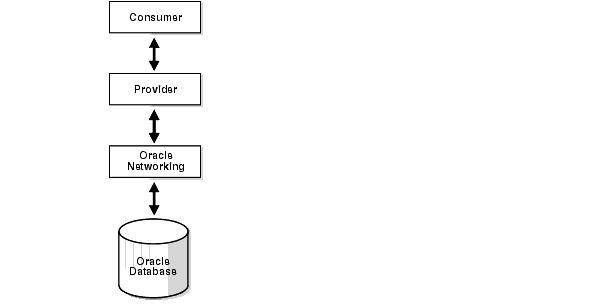

These topics introduce Oracle Provider for OLE DB (OraOLEDB).

- Overview of OLE DB

- Overview of OraOLEDB

- System Requirements

- OraOLEDB Installation

- Component Certifications

- Connecting to Oracle Database Exadata Express Cloud Service

### Overview of OLE DB

OLE DB is an open standard data access methodology which utilizes a set of [Component Object Model (COM)](glossary.md) interfaces for accessing and manipulating different types of data. These interfaces are available from various database providers.

#### OLE DB Design

The design of OLE DB centers around the concept of a [consumer](glossary.md) and a [provider](glossary.md). Figure 1-1 is an illustration of the OLE DB system. The consumer represents the traditional client. The provider places data into a tabular format and returns it to the consumer.

Figure 1-1 OLE DB Flow

[Description of "Figure 1-1 OLE DB Flow"](img_text/oop81002.md)

##### OLE DB Data Providers

OLE DB data providers are a set of COM components that transfer data from a data source to a consumer. An OLE DB Provider places that data in a tabular format in response to calls from a consumer. Providers can be simple or complex. A provider may return a table, it may allow the consumer to determine the format of that table, and it may perform operations on the data.

Each provider implements a standard set of COM interfaces to handle requests from the consumer. A provider may implement optional COM interfaces to provide additional functionality.

With the standard interfaces, any OLE DB consumer can access data from any provider. Because of COM components, consumers can access them in any programming language that supports COM, such as C++, Visual Basic, and Java.

##### OLE DB Data Consumers

The OLE DB data consumer is any application or tool that utilizes OLE DB interfaces of a provider to access a broad range of data.

### Overview of OraOLEDB

Oracle Provider for OLE DB (OraOLEDB) is an OLE DB data provider that offers high performance and efficient access to Oracle data by OLE DB consumers.

In general, this developer's guide assumes that you are using OraOLEDB through OLE DB or ADO.

With the advent of the .NET framework, support has been provided for using the OLEDB.NET Data Provider with OraOLEDB. With the proper connection attribute setting, an OLEDB.NET Data Provider can utilize OraOLEDB to access Oracle Database.

**See Also:**

"[OLEDB.NET Data Provider Compatibility](features-of-oledb.md)" for further information on support for OLEDB.NET Data Provider

### System Requirements

The following items are required on a system to use Oracle Provider for OLE DB:

- Windows Operating System:

  - 64-bit: Windows 8.1 (Pro and Enterprise Editions), Windows 10 x64 (Pro, Enterprise, and Education Editions), Windows Server 2012 R2 x64 (Standard, Datacenter, Essentials, and Foundation Editions), Windows Server 2016 x64 (Standard, Datacenter, and Essentials Editions), or Windows Server 2019 x64 (Standard, Datacenter, and Essentials Editions).

    Oracle supports 32-bit Oracle Provider for OLE DB and 64-bit Oracle Provider for OLE DB for Windows x64 on these operating systems.

- Access to an Oracle Database (Oracle 11.2 or later)

- Oracle Client and Oracle Net Services (included with Oracle Provider for OLE DB installation).

- Redistributable files provided with Microsoft Data Access Components (MDAC) 2.1 or higher are required by the provider. These files are available at the Microsoft Web site:

      http://msdn.microsoft.com/en-us/data/aa937730.aspx

- Oracle Services for Microsoft Transaction Server. This is required for consumers using Microsoft Transaction Server (MTS) or COM+.

### OraOLEDB Installation

Oracle Provider for OLE DB is included as part of your Oracle installation. It contains the features and demos that illustrate how to use this product to solve real-world problems.

During the installation process, the following files are installed on the system. Some files have `ver` in their name to indicate the release version.

Table 1-1 Oracle Provider for OLE DB Files

| File                                                                 | Description                        | Location                                  |
|:---------------------------------------------------------------------|:-----------------------------------|:------------------------------------------|
| `OraOLEDB``ver``.dll`                                                | Oracle Provider for OLE DB         | `ORACLE_BASE\ORACLE_HOME``\bin`           |
| `OraOLEDBrfc``ver``.dll`                                             | Oracle rowset file cache manager   | `ORACLE_BASE\ORACLE_HOME``\bin`           |
| `OraOLEDBrmc``ver``.dll`                                             | Oracle rowset memory cache manager | `ORACLE_BASE\ORACLE_HOME``\bin`           |
| `OraOLEDBrst``ver``.dll`                                             | Oracle rowset                      | `ORACLE_BASE\ORACLE_HOME``\bin`           |
| `OraOLEDBgmr``ver``.dll`                                             | Oracle ODBC SQL parser             | `ORACLE_BASE\ORACLE_HOME``\bin`           |
| `OraOLEDB``lang``ver``.dll` where `lang` is the required language | Language-specific resource DLL     | `ORACLE_BASE\ORACLE_HOME``\bin`           |
| `OraOLEDBpus``ver``.dll`                                             | Property descriptions              | `ORACLE_BASE\ORACLE_HOME``\bin`           |
| `OraOLEDButl``ver``.dll`                                             | OraOLEDB utility DLL               | `ORACLE_BASE\ORACLE_HOME``\bin`           |
| `OraOLEDB``ver``.tlb`                                                | OraOLEDB type library              | `ORACLE_BASE\ORACLE_HOME``\bin`           |
| `OraOLEDB.h`                                                         | OraOLEDB header file               | `ORACLE_BASE\ORACLE_HOME``\oledb\include` |
| `OraOLEDB``ver``.lib`                                                | OraOLEDB library file              | `ORACLE_BASE\ORACLE_HOME``\oledb\lib`     |
| `OraOLEDB``lang``.msb` where `lang` is the required language      | Language-specific message file     | `ORACLE_BASE\ORACLE_HOME``\oledb\mesg`    |
| readme                                                               | Release notes                      | `ORACLE_BASE\ORACLE_HOME\``oledb`         |

**See Also:**

The [Oracle Database Installation Guide for Microsoft Windows](../ntdbi/overview-of-oracle-database-installation.md)for installation instructions

### Component Certifications

Oracle provides support information for components on various platforms, lists compatible client and database versions, and identifies patches and workaround information.

Find the latest certification information at My Oracle Support (formerly OracleMetaLink):

    https://support.oracle.com

### Connecting to Oracle Database Exadata Express Cloud Service

Oracle Provider for OLE DB supports connecting to Oracle Database Exadata Express Cloud Service.

#### Known Restrictions

Oracle Provider for OLE DB does not support the following features when connecting to Oracle Database Exadata Express Cloud Service:

- Any authentication besides username and password

- `IRowsetFastLoad` interface

- Client Result Cache

- Data types:

  - `BFILE`

  - `VARCHAR2` with increased size limit to 32 KB

    **Note:**

    `VARCHAR2` of sizes up to 4 KB is supported

- Distributed transactions
