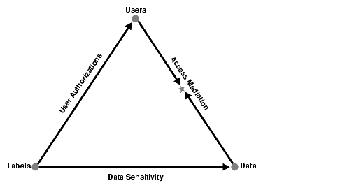
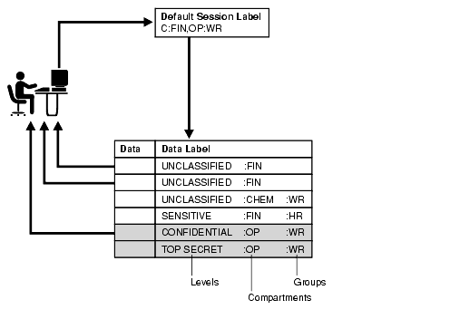
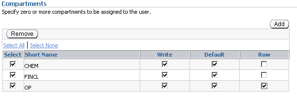
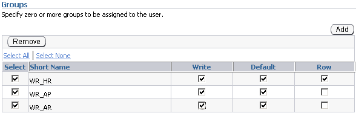
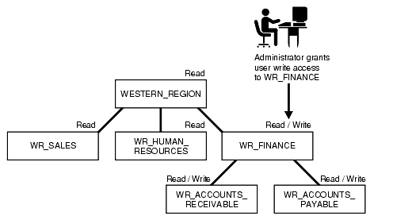
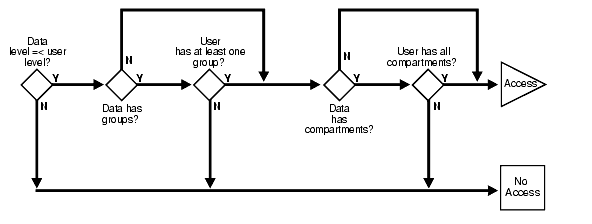
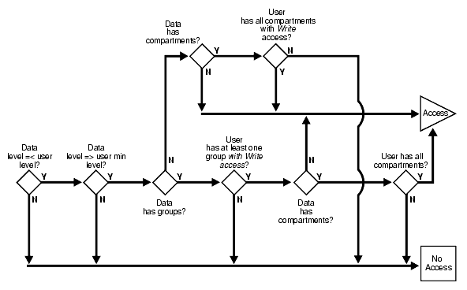
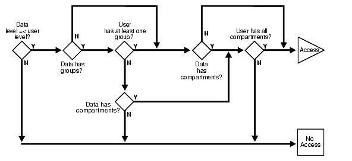
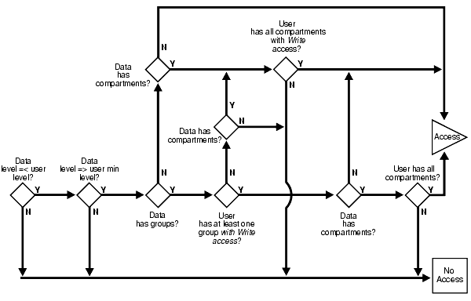
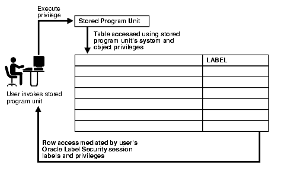

Oracle provides access controls and privileges that determine the type of access users can have to labeled rows.

- Access Mediation
  To access data protected by an Oracle Label Security policy, a user must have authorizations based on the labels defined for the policy.
- How the Session Label and Row Label Work
  It is important to understand session labels and row labels.
- How User Authorizations Work
  Oracle Label Security provides authorizations set by the Oracle Label Security administrator and authorizations set by computed session labels.
- Evaluation of Labels for Access Mediation
  Oracle Label Security evaluates labels by comparing the user’s label components to the row’s label components.
- Oracle Label Security Privileges
  Oracle Label Security provides a set of database and row label privileges.
- Working with Multiple Oracle Label Security Policies
  You can use multiple Oracle Label Security policies in both a single database environments and in a distributed environments.

**Related Topics**

- [Understanding Data Labels and User Labels](understanding-data-labels-and-user-labels.md)

**Parent topic:** [Getting Started with Oracle Label Security](part1.md)

### 3.1 Access Mediation

To access data protected by an Oracle Label Security policy, a user must have authorizations based on the labels defined for the policy.

The following figure illustrates the relationships between users, data, and labels.

- Data labels specify the sensitivity of data rows.

- User labels provide the appropriate authorizations to users.

- Access mediation between users and rows of data depends on users' labels.

Figure 3-1 Relationships Between Users, Data, and Label

[Description of "Figure 3-1 Relationships Between Users, Data, and Label"](img_text/olsag011.md)

**Note:**

Oracle Label Security enforcement options affect how access controls apply to tables and schemas. This chapter assumes that all policy enforcement options are in effect.

**Related Topics**

- [Oracle Label Security Policy Enforcement Options](implementing-policy-enforcement-options-and-labeling-functions.md)

**Parent topic:** Access Controls and Privileges

### 3.2 How the Session Label and Row Label Work

It is important to understand session labels and row labels.

- The Session Label
  Each Oracle Label Security user has authorizations that include special components.
- The Row Label
  When a user writes data without specifying its label, a row label is assigned automatically, using the user's session label.
- Session Label Example
  The session label and the row label can fall anywhere within the range of the user's level, compartment, and group authorizations.

**Parent topic:** Access Controls and Privileges

#### 3.2.1 The Session Label

Each Oracle Label Security user has authorizations that include special components.

- A maximum and minimum level

- A set of authorized compartments

- A set of authorized groups

- For each compartment and group, a specification of read-only access, or read/write access

The administrator also specifies the user's initial session label when setting up these authorizations for the user. The session label is the particular combination of levels, compartments, and groups at which a user works at any given time. The user can change the session label to any combination of components for which the user is authorized.

**Related Topics**

- [SA_SESSION Session Management PL/SQL Package](oracle-label-security-pl-sql-packages.md)

**Parent topic:** How the Session Label and Row Label Work

#### 3.2.2 The Row Label

When a user writes data without specifying its label, a row label is assigned automatically, using the user's session label.

However, the user can set the label for the written row, within certain restrictions on the components of the label he specifies. The level of this label can be set to any level within the range specified by the administrator. For example, it can be set to the level of the user's current session label down to the user's minimum level. However, the compartments and groups for this row's new label are more restricted. The new label can include only those compartments and groups contained in the current session label and, among those, only the ones for which the user has write access.

When the administrator sets up the user authorizations, he or she also specifies an initial default row label.

**See Also:**

- [SA_USER_ADMIN PL/SQL Package](oracle-label-security-pl-sql-packages.md)

- [SA_SESSION Session Management PL/SQL Package](oracle-label-security-pl-sql-packages.md)

**Parent topic:** How the Session Label and Row Label Work

#### 3.2.3 Session Label Example

The session label and the row label can fall anywhere within the range of the user's level, compartment, and group authorizations.

In the following figure, the user's maximum level is `SENSITIVE` and the minimum level is `UNCLASSIFIED`. However, the user's default session label is `C:FIN`,`OP:WR`. In this example, the administrator has set the user's session label so that the user connects to the database at the `CONFIDENTIAL` level.

Similarly, although the user is authorized for compartments `FIN` and `OP`, and group `WR`, the administrator could set the session label so that the user connects with only compartment `FIN` and group `WR`.

Figure 3-2 User Session Label

[Description of "Figure 3-2 User Session Label"](img_text/olsag012.md)

**Related Topics**

- [SA_USER_ADMIN.SET_COMPARTMENTS](oracle-label-security-pl-sql-packages.md)
- [SA_USER_ADMIN.ALTER_COMPARTMENTS](oracle-label-security-pl-sql-packages.md)

**Parent topic:** How the Session Label and Row Label Work

### 3.3 How User Authorizations Work

Oracle Label Security provides authorizations set by the Oracle Label Security administrator and authorizations set by computed session labels.

- Authorizations Set by the Administrator
  The administrator explicitly sets authorizations for levels, compartments, and groups.
- Computed Session Labels
  Oracle Label Security automatically computes a number of labels based on the value of the session label.

**Parent topic:** Access Controls and Privileges

#### 3.3.1 Authorizations Set by the Administrator

The administrator explicitly sets authorizations for levels, compartments, and groups.

- Authorized Levels
  The administrator explicitly sets the level authorization for an Oracle Label Security policy.
- Authorized Compartments
  The administrator specifies the list of compartments that a user can place in his or her session label.
- Authorized Groups
  You must specify a list of groups that a user can place in a session label and grant write access for each group.

**Parent topic:** How User Authorizations Work

##### 3.3.1.1 Authorized Levels

The administrator explicitly sets the level authorization for an Oracle Label Security policy.

Table 3-1 lists authorized levels that the administrator can set.

Table 3-1 Authorized Levels Set by the Administrator

| Authorization          | Meaning                                                                                                                                                    |
|:-----------------------|:-----------------------------------------------------------------------------------------------------------------------------------------------------------|
| User Max Level         | The maximum ranking of sensitivity that a user can access during read and write operations                                                                 |
| User Min Level         | The minimum ranking of sensitivity that a user can access during write operations. The User Max Level must be equal to or greater than the User Min Level. |
| User Default Level     | The level that is assumed by default when connecting to Oracle Database                                                                                    |
| User Default Row Level | The level that is used by default when inserting data into Oracle Database                                                                                 |

For example, in Oracle Enterprise Manager, the administrator might set the following level authorizations for user Joe:

| Type    | Short Name | Long Name          | Description           |
|:--------|:-----------|:-------------------|:----------------------|
| Maximum | `HS`       | `HIGHLY_SENSITIVE` | User's highest level  |
| Minimum | `P`        | `PUBLIC`           | User's lowest level   |
| Default | `C`        | `CONFIDENTIAL`     | User's default level  |
| Row     | `C`        | `CONFIDENTIAL`     | Row level on `INSERT` |

**Parent topic:** Authorizations Set by the Administrator

##### 3.3.1.2 Authorized Compartments

The administrator specifies the list of compartments that a user can place in his or her session label.

The administrator must explicitly give write access to the user for each compartment. A user cannot directly insert, update, or delete a row that contains a compartment that he or she does not have authorization to write.

For example, in Oracle Enterprise Manager, the administrator might set the following compartment authorizations for user Joe:

| Short Name | Long Name     | WRITE | DEFAULT | ROW |
|:-----------|:--------------|:------|:--------|:----|
| `CHEM`     | `CHEMICAL`    | YES   | YES     | NO  |
| `FINCL`    | `FINANCIAL`   | YES   | YES     | NO  |
| `OP`       | `OPERATIONAL` | YES   | YES     | YES |

In Figure 3-3, the row designation indicates whether the compartment should be used as part of the default row label for newly inserted data. Note also that the policy option must be in effect for this setting to be valid.

Figure 3-3 Setting Up Authorized Compartments In Enterprise Manager

[Description of "Figure 3-3 Setting Up Authorized Compartments In Enterprise Manager"](img_text/joe_comps.md)

**Parent topic:** Authorizations Set by the Administrator

##### 3.3.1.3 Authorized Groups

You must specify a list of groups that a user can place in a session label and grant write access for each group.

For example, in Oracle Enterprise Manager, the administrator might set the following group authorizations:

| Short Name | Long Name                | WRITE | DEFAULT | ROW | Parent   |
|:-----------|:-------------------------|:------|:--------|:----|:---------|
| `WR_HR`    | `WR_HUMAN_RESOURCES`     | YES   | YES     | YES | `WR`     |
| `WR_AP`    | `WR_ACCOUNTS_PAYABLE`    | YES   | YES     | NO  | `WR_FIN` |
| `WR_AR`    | `WR_ACCOUNTS_RECEIVABLE` | YES   | YES     | NO  | `WR_FIN` |

In Figure 3-4, the row designation indicates whether the group should be used as part of the default row label for newly inserted data. Note also that the `LABEL_DEFAULT` policy option must be in effect for this setting to be valid.

Figure 3-4 Setting Up Authorized Groups in Enterprise Manager

[Description of "Figure 3-4 Setting Up Authorized Groups in Enterprise Manager"](img_text/joe_groups.md)

**Related Topics**

- [LABEL_DEFAULT: Using the Session's Default Row Label](implementing-policy-enforcement-options-and-labeling-functions.md)

**Parent topic:** Authorizations Set by the Administrator

#### 3.3.2 Computed Session Labels

Oracle Label Security automatically computes a number of labels based on the value of the session label.

Table 3-2 lists the computed session labels.

Table 3-2 Computed Session Labels

| Computed Label      | Definition                                                                                                                                                                                                                                                                                         |
|:--------------------|:---------------------------------------------------------------------------------------------------------------------------------------------------------------------------------------------------------------------------------------------------------------------------------------------------|
| Maximum Read Label  | The user's maximum level combined with any combination of compartments and groups for which the user is authorized.                                                                                                                                                                                |
| Maximum Write Label | The user's maximum level combined with the compartments and groups for which the user has been granted write access.                                                                                                                                                                               |
| Minimum Write Label | The user's minimum level.                                                                                                                                                                                                                                                                          |
| Default Read Label  | The single default level combined with compartments and groups that have been designated as default for the user.                                                                                                                                                                                  |
| Default Write Label | A subset of the default read label, containing the compartments and groups to which the user has been granted write access. The level component is equal to the level default in the read label. This label is automatically derived from the read label based on the user's write authorizations. |
| Default Row Label   | The combination of components between the user's minimum write label and the maximum write label, which has been designated as the default value for the data label for inserted data.                                                                                                             |

**Related Topics**

- [Computed Labels with Inverse Groups](releasability-using-inverse-groups.md)

**Parent topic:** How User Authorizations Work

### 3.4 Evaluation of Labels for Access Mediation

Oracle Label Security evaluates labels by comparing the user’s label components to the row’s label components.

This way, the Oracle Label Security policy can determine whether the user can access the data. This enables Oracle Label Security to evaluate whether the user is authorized to perform the requested operation on the data in the row.

- About Read and Write Access
  Although data labels are stored in a column within data records, information about user authorizations is stored in relational tables.
- How Oracle Label Security Algorithm for Read Access Works
  The `READ_CONTROL` enforcement determines the ability to read data in a row.
- How the Oracle Label Security Algorithm for Write Access Works
  In the context of Oracle Label Security, `WRITE_CONTROL` enforcement determines the ability to insert, update, or delete data in a row.

**Parent topic:** Access Controls and Privileges

#### 3.4.1 About Read and Write Access

Although data labels are stored in a column within data records, information about user authorizations is stored in relational tables.

When a user logs on, the tables are used to dynamically generate user labels for use during the session.

- Difference Between Read and Write Operations
  Two fundamental types of access mediation on Data Manipulation language (DML) operations exist within protected tables: read access and write access.
- Propagation of Read/Write Authorizations on Groups
  When groups are organized hierarchically, a user's assigned groups include all subgroups that are subordinate to the group to which the user belongs.

**Parent topic:** Evaluation of Labels for Access Mediation

##### 3.4.1.1 Difference Between Read and Write Operations

Two fundamental types of access mediation on Data Manipulation language (DML) operations exist within protected tables: read access and write access.

The user has a maximum authorization for the data he or she can read; the user's write authorization is a subset of that. The minimum write level controls the user's ability to disseminate data by lowering its sensitivity. The user cannot write data with a level lower than the minimum level the administrator assigned to this user.

In addition, there are separate lists of compartments and groups for which the user is authorized; that is, for which the user has at least read access. An access flag indicates whether the user can also write to individual compartments or groups.

**Parent topic:** About Read and Write Access

##### 3.4.1.2 Propagation of Read/Write Authorizations on Groups

When groups are organized hierarchically, a user's assigned groups include all subgroups that are subordinate to the group to which the user belongs.

In this case, the user's read/write authorizations on a parent group flow down to all the subgroups.

Consider the parent group `WESTERN_REGION`, with three subgroups as illustrated in Figure 3-5. If the user has read access to `WESTERN_REGION`, then the read access is also granted to the three subgroups. The administrator can give the user write access to subgroup `WR_FINANCE`, without granting write access to the `WESTERN_REGION` parent group (or to the other subgroups). On the other hand, if the user has read/write access on `WESTERN_REGION`, then read/write access is also granted on all of the subgroups subordinate to it in the tree.

Write authorization on a group does not give a user write authorization on the parent group. If a user has read-only access to `WESTERN_REGION` and `WR_FINANCE`, then the administrator can grant write access to `WR_ACCOUNTS_RECEIVABLE`, without affecting the read-only access to the higher-level groups.

Figure 3-5 Subgroup Inheritance of Read/Write Access

[Description of "Figure 3-5 Subgroup Inheritance of Read/Write Access"](img_text/olsag016.md)

**Related Topics**

- [How Inverse Groups Work](releasability-using-inverse-groups.md)

**Parent topic:** About Read and Write Access

#### 3.4.2 How Oracle Label Security Algorithm for Read Access Works

The `READ_CONTROL` enforcement determines the ability to read data in a row.

The following rules are used, in the sequence listed, to determine a user's read access to a row of data:

1.  The user's level must be greater than or equal to the level of the data.

2.  The user's label must include at least one of the groups that belong to the data (or the parent group of one such subgroup).

3.  The user's label must include all the compartments that belong to the data.

If the user's label passes these tests, then it is said to dominate the row's label.

Note that there is no notion of read or write access connected with levels. This is because the administrator specifies a range of levels (minimum to maximum) within which a user can potentially read and write. At any time, the user can read all data equal to or less than the current session level. No privileges (other than `FULL`) allow the user to write below the minimum authorized level.

Figure 3-6 illustrates how the label evaluation process proceeds from levels to groups to compartments. Note that if the data label is null or invalid, then the user is denied access.

Figure 3-6 Label Evaluation Process for Read Access

[Description of "Figure 3-6 Label Evaluation Process for Read Access"](img_text/olsag028.md)

As a read access request comes in, Oracle Label Security evaluates each row to determine the following:

1.  Is the user's level equal to, or greater than, the level of the data?

2.  If so, does the user have access to at least one of the groups present in the data label?

3.  If so, does the user have access to all the compartments present in the data label? (That is, are the data's compartments a subset of the user's compartments?)

If the answer is no at any stage in this evaluation process, then Oracle Label Security denies access to the row and moves on to evaluate the next row of data.

Oracle Label Security policies allow user sessions to read rows at their label and below, which is called reading down. Sessions cannot read rows at labels that they do not dominate.

For example, if you are logged in at `SENSITIVE:ALPHA`,`BETA`, you can read a row labeled `SENSITIVE:ALPHA` because your label dominates that of the row. However, you cannot read a row labeled `SENSITIVE:ALPHA`,`GAMMA` because your label does not dominate that of the row.

Note that the user can gain access to the rows otherwise denied, if she or he has special Oracle Label Security privileges.

**Related Topics**

- Privileges Defined by Oracle Label Security Policies
- [How the Access Control Enforcement Options Work](implementing-policy-enforcement-options-and-labeling-functions.md)

**Parent topic:** Evaluation of Labels for Access Mediation

#### 3.4.3 How the Oracle Label Security Algorithm for Write Access Works

In the context of Oracle Label Security, `WRITE_CONTROL` enforcement determines the ability to insert, update, or delete data in a row.

`WRITE_CONTROL` enables you to control data access with ever finer granularity. Granularity increases when compartments are added to levels. It increases again when groups are added to compartments. Access control becomes even more fine grained when you can manage the user's ability to write the data that he can read.

To determine whether a user can write a particular row of data, Oracle Label Security evaluates the following rules, in the order given:

1.  The level in the data label must be greater than or equal to the user's minimum level and less than or equal to the user's session level.

2.  When groups are present, the user's label must include at least one of the groups with write access that appear in the data label (or the parent of one such subgroup). In addition, the user's label must include all the compartments in the data label.

3.  When no groups are present, the user's label must have write access on all of the compartments in the data label.

To state tests 2 and 3 another way:

- If the label has no groups, then the user must have write access on all the compartments in the label in order to write the data.

- If the label does have groups and the user has write access to one of the groups, she only needs read access to the compartments in order to write the data.

Just as with read operations, the label evaluation process proceeds from levels to groups to compartments. Note that the user cannot write any data below the authorized minimum level, nor above the current session level. The user can always read below the minimum level.

Figure 3-7 illustrates how the process works with `INSERT`, `UPDATE`, and `DELETE` operations. Note that if the data label is null or invalid, then the user is denied access.

Figure 3-7 Label Evaluation Process for Write Access

[Description of "Figure 3-7 Label Evaluation Process for Write Access"](img_text/olsag030.md)

As an access request comes in, Oracle Label Security evaluates each row to determine the following:

1.  Is the data's level equal to, or less than the level of the user?

2.  Is the data's level equal to, or greater than the user's minimum level?

3.  If the data's level falls within the foregoing bounds, then does the user have write access to at least one of the groups present in the data label?

4.  If so, does the user have access to all the compartments with at least read access that are present in the data label?

5.  If there are no groups but there are compartments, then does the user have write access to all of the compartments?

If the answer is no at any stage in this evaluation process, then Oracle Label Security denies access to the row, and moves on to evaluate the next row of data.

Consider a situation in which your session label is `S:ALPHA`,`BETA` but you have write access to only compartment `ALPHA`. In this case, you can read a row with the label `S:ALPHA`,`BETA` but you cannot update it.

In summary, write access is enforced on `INSERT`, `UPDATE` and `DELETE` operations upon the data in the row.

In addition, each user may have an associated minimum level below which the user cannot write. The user cannot update or delete any rows labeled with levels below the minimum, and cannot insert a row with a row label containing a level less than the minimum.

**Related Topics**

- [How the Access Control Enforcement Options Work](implementing-policy-enforcement-options-and-labeling-functions.md)

**Parent topic:** Evaluation of Labels for Access Mediation

### 3.5 Oracle Label Security Privileges

Oracle Label Security provides a set of database and row label privileges.

- Privileges Defined by Oracle Label Security Policies
  Oracle Label Security supports special privileges that allow authorized users to bypass certain parts of the policy.
- Special Access Privileges
  A user's authorizations can be modified with any of four privileges.
- Special Row Label Privileges
  Once the label on a row has been set, Oracle Label Security privileges are required to modify the label.
- System Privileges, Object Privileges, and Policy Privileges
  Oracle Label Security privileges are different from the standard Oracle Database system and object privileges.
- Access Mediation and Views
  Prior to accessing data through a view, the users must have the appropriate system and object privileges on the view.
- Access Mediation and Program Unit Execution
  The privileges with which procedures that are owned by different users are executed differently in Oracle Database and Oracle Label Security.
- Access Mediation and Policy Enforcement Options
  An administrator can choose from among a set of policy enforcement options when applying an Oracle Label Security policy to individual tables.

**Parent topic:** Access Controls and Privileges

#### 3.5.1 Privileges Defined by Oracle Label Security Policies

Oracle Label Security supports special privileges that allow authorized users to bypass certain parts of the policy.

Table 3-3 summarizes the full set of privileges that can be granted to users or trusted stored program units. Each privilege is more fully discussed after the table.

Table 3-3 Oracle Label Security Privileges

| Security Privilege | Explanation                                                                                                                                                                             |
|:-------------------|:----------------------------------------------------------------------------------------------------------------------------------------------------------------------------------------|
| `READ`             | Allows read access to all data protected by the policy                                                                                                                                  |
| `FULL`             | Allows full read and write access to all data protected by the policy                                                                                                                   |
| `COMPACCESS`       | Allows a session access to data authorized by the row's compartments, independent of the row's groups                                                                                   |
| `PROFILE_ACCESS`   | Allows a session to change its labels and privileges to those of a different user                                                                                                       |
| `WRITEUP `         | Allows users to set or raise only the level, within a row label, up to the maximum level authorized for the user. (Active only if `LABEL_UPDATE` is active.)                            |
| `WRITEDOWN`        | Allows users to set or lower the level, within a row label, to any level equal to or greater than the minimum level authorized for the user. (Active only if `LABEL_UPDATE` is active.) |
| `WRITEACROSS`      | Allows a user to set or change groups and compartments of a row label, but does not allow changes to the level. (Active only if `LABEL_UPDATE` is active.)                              |

**Parent topic:** Oracle Label Security Privileges

#### 3.5.2 Special Access Privileges

A user's authorizations can be modified with any of four privileges.

- READ Privilege
  A user with the `READ` privilege can read all data protected by the policy, regardless of the authorizations or session label.
- FULL Privilege
  The `FULL` privilege has the same effect and benefits as the `READ` privilege, with one difference.
- COMPACCESS Privilege
  The `COMPACCESS` privilege allows a user to access data based on the row label's compartments, independent of the row label's groups.
- PROFILE_ACCESS Privilege
  The `PROFILE_ACCESS` privilege allows a session to change its session labels and session privileges to those of a different user.

**Parent topic:** Oracle Label Security Privileges

##### 3.5.2.1 READ Privilege

A user with the `READ` privilege can read all data protected by the policy, regardless of the authorizations or session label.

The user does not even need to have label authorizations.

Note, in addition, that a user with `READ` privilege can write to any data rows for which he or she has write access, based on any label authorizations.

**Note:**

Access mediation is still enforced on `UPDATE`, `INSERT`, and `DELETE` operations.

This privilege is useful for system administrators who need to export data but who should not be allowed to change data. It is also useful for people who must run reports and compile information but not change data. The `READ` privilege enables optimal performance on `SELECT` statements, because the system behaves as though the Oracle Label Security policy were not even present.

**Parent topic:** Special Access Privileges

##### 3.5.2.2 FULL Privilege

The `FULL` privilege has the same effect and benefits as the `READ` privilege, with one difference.

A user with the `FULL` privilege can also write to all the data. For a user with the `FULL` privilege, the `READ` and `WRITE` algorithms are not enforced.

Oracle system and object authorizations are still enforced for users who have been granted the `FULL` privilege. For example, a user must still have the `SELECT` system privilege on the application table. The `FULL` authorization turns off the access mediation check at the individual row level.

**Parent topic:** Special Access Privileges

##### 3.5.2.3 COMPACCESS Privilege

The `COMPACCESS` privilege allows a user to access data based on the row label's compartments, independent of the row label's groups.

If a row label has no compartments, then access is determined by the group authorizations. However, when compartments do exist and access to them is authorized, then the group authorization is bypassed. This allows a privileged user whose label matches all the compartments of the data to access any data in any particular compartment, independent of what groups may own or otherwise be allowed access to the data.

Figure 3-8 shows the label evaluation process for read access with the `COMPACCESS` privilege. Note that if the data label is null or invalid, then the user is denied access.

Figure 3-8 Label Evaluation Process for Read Access with COMPACCESS Privilege

[Description of "Figure 3-8 Label Evaluation Process for Read Access with COMPACCESS Privilege"](img_text/olsag029.md)

Figure 3-9 shows the label evaluation process for write access with `COMPACCESS` privilege. Note that if the data label is null or invalid, then the user is denied access.

Figure 3-9 Label Evaluation Process for Write Access with COMPACCESS Privilege

[Description of "Figure 3-9 Label Evaluation Process for Write Access with COMPACCESS Privilege"](img_text/olsag027.md)

**Parent topic:** Special Access Privileges

##### 3.5.2.4 PROFILE_ACCESS Privilege

The `PROFILE_ACCESS` privilege allows a session to change its session labels and session privileges to those of a different user.

This is a very powerful privilege, because the user can potentially become a user with the `FULL` privilege. This privilege cannot be granted to a trusted stored program unit.

**Parent topic:** Special Access Privileges

#### 3.5.3 Special Row Label Privileges

Once the label on a row has been set, Oracle Label Security privileges are required to modify the label.

Note that the `LABEL_UPDATE` enforcement option must be on for these label modification privileges to be enforced. When a user updates a row label, the new label and old label are compared, and the required privileges are determined.

The special row label privileges include:

- WRITEUP Privilege
  The `WRITEUP` privilege enables the user to raise the level of data within a row, without compromising the compartments or groups.
- WRITEDOWN Privilege
  The `WRITEDOWN` privilege enables the user to lower the level of data within a row, without compromising the compartments or groups.
- WRITEACROSS Privilege
  The `WRITEACROSS` privilege allows the user to change the compartments and groups of data, without altering its sensitivity level.

**Parent topic:** Oracle Label Security Privileges

##### 3.5.3.1 WRITEUP Privilege

The `WRITEUP` privilege enables the user to raise the level of data within a row, without compromising the compartments or groups.

This privilege enables a user to raise the level up to his or her maximum authorized level. You can find the privileges that users have by querying the ALL_SA_USER_PRIVS data dictionary view.

For example, an authorized user can raise the level of a data row that has a level lower than his own minimum level. If a row is `UNCLASSIFIED` and the user's maximum level is `SENSITIVE`, then the row's level can be raised to `SENSITIVE`. It can be raised above the current session level, but it cannot change the compartments.

**Parent topic:** Special Row Label Privileges

##### 3.5.3.2 WRITEDOWN Privilege

The `WRITEDOWN` privilege enables the user to lower the level of data within a row, without compromising the compartments or groups.

The user can lower the level to any level equal to or greater than his or her minimum authorized level. You can find the privileges that have been granted to a user by querying the ALL_SA_USER_PRIVS data dictionary view.

**Parent topic:** Special Row Label Privileges

##### 3.5.3.3 WRITEACROSS Privilege

The `WRITEACROSS` privilege allows the user to change the compartments and groups of data, without altering its sensitivity level.

This guarantees, for example, that `SENSITIVE` data remains at the `SENSITIVE` level, but at the same time enables the data's dissemination to be managed.

It lets the user change compartments and groups to anything that is currently defined as a valid compartment or group within the policy, while maintaining the level. With the `WRITEACROSS` privilege, a user with read access to one group (or more) can write to a different group without explicitly being given access to it.

You can find the privileges that have been granted to a user by querying the ALL_SA_USER_PRIVS data dictionary view.

**Parent topic:** Special Row Label Privileges

#### 3.5.4 System Privileges, Object Privileges, and Policy Privileges

Oracle Label Security privileges are different from the standard Oracle Database system and object privileges.

Table 3-4 Types of Privilege

| Source                | Privileges        | Definition                                                       |
|:----------------------|:------------------|:-----------------------------------------------------------------|
| Oracle Database       | System Privileges | The right to run a particular type of SQL statement              |
| Oracle Database       | Object Privileges | The right to access another user's object                        |
| Oracle Label Security | Policy Privileges | The ability to bypass certain parts of the label security policy |

Oracle Database enforces the discretionary access control privileges that a user has been granted. By default, a user has no privileges except those granted to the `PUBLIC` user group. A user must explicitly be granted the appropriate privilege to perform an operation.

For example, to read an object in Oracle Database, you must either be the object's owner, or be granted the `SELECT` privilege on the object, or be granted the `SELECT` `ANY` `TABLE` system privilege. Similarly, to update an object, you must either be the object's owner, or be granted the `UPDATE` privilege on the object, or be granted the `UPDATE` `ANY` `TABLE` privilege.

**Related Topics**

- [Oracle Database Security Guide](../dbseg/configuring-privilege-and-role-authorization.md)

**Parent topic:** Oracle Label Security Privileges

#### 3.5.5 Access Mediation and Views

Prior to accessing data through a view, the users must have the appropriate system and object privileges on the view.

If the underlying table (on which the view is based) is protected by Oracle Label Security, then the user of the view must have authorization from Oracle Label Security to access specific rows of labeled data.

**Parent topic:** Oracle Label Security Privileges

#### 3.5.6 Access Mediation and Program Unit Execution

The privileges with which procedures that are owned by different users are executed differently in Oracle Database and Oracle Label Security.

For example, in Oracle Database, if `user1` executes a procedure that belongs to `user2`, then the procedure runs with `user2`'s system and object privileges. You can find the privileges that have been granted to a user by querying the DBA_SYS_PRIVS data dictionary view. However, any procedure executed by `user1` runs with `user1`'s own Oracle Label Security labels and privileges. This is true even when `user1` executes stored program units owned by other users.

Figure 3-10 illustrates this process:

- Stored program units run with the DAC privileges of the procedure's owner (`user2`).

- In addition, stored program units accessing tables protected by Oracle Label Security mediate access to data rows based on the label attached to the row, and the Oracle Label Security labels and privileges of the invoker of the procedure (`user1`).

Figure 3-10 Stored Program Unit Execution

[Description of "Figure 3-10 Stored Program Unit Execution"](img_text/olsag017.md)

Stored program units can become trusted when an administrator assigns them Oracle Label Security privileges. A stored program unit can be run with its own autonomous Oracle Label Security privileges rather than those of the user who calls it. For example, if you possess no Oracle Label Security privileges in your own right but run a stored program unit that has the `WRITEDOWN` privilege, then you can update labels. In this case, the privileges used are those of the stored program unit, and not your own.

Trusted program units can encapsulate privileged operations in a controlled manner. By using procedures, packages, and functions with assigned privileges, you may be able to access data that your own labels and privileges would not authorize. For example, to perform aggregate functions over all data in a table, not just the data visible to you, you might use a trusted program set up by an administrator. This way program units can thus perform operations on behalf of users, without the need to grant privileges directly to users.

**Related Topics**

- [Administering and Using Trusted Stored Program Units](administering-and-using-trusted-stored-program-units.md)

**Parent topic:** Oracle Label Security Privileges

#### 3.5.7 Access Mediation and Policy Enforcement Options

An administrator can choose from among a set of policy enforcement options when applying an Oracle Label Security policy to individual tables.

These options enable enforcement to be tailored differently for each database table. In addition to the access controls based on the labels, a SQL predicate can also be associated with each table. The predicate can further define which rows in the table are accessible to the user.

In cases where the label to be associated with a new or updated row should be automatically computed, an administrator can specify a labeling function when applying the policy. That function will thereafter always be invoked to provide the data labels written under that policy, because active labeling functions take precedence over any alternative means of supplying a label.

Except where noted, this guide assumes that all enforcement options are in effect.

**Related Topics**

- [Implementing Policy Enforcement Options and Labeling Functions](implementing-policy-enforcement-options-and-labeling-functions.md)
- [Labeling Functions](implementing-policy-enforcement-options-and-labeling-functions.md)
- [SA_POLICY_ADMIN.APPLY_SCHEMA_POLICY](oracle-label-security-pl-sql-packages.md)

**Parent topic:** Oracle Label Security Privileges

### 3.6 Working with Multiple Oracle Label Security Policies

You can use multiple Oracle Label Security policies in both a single database environments and in a distributed environments.

- Multiple Oracle Label Security Policies in a Single Database
  Several Oracle Label Security policies can protect data in a single database.
- Multiple Oracle Label Security Policies in a Distributed Environment
  In a distributed environment that uses Oracle Label Security, remote connections are controlled by Oracle Label Security.

**Parent topic:** Access Controls and Privileges

#### 3.6.1 Multiple Oracle Label Security Policies in a Single Database

Several Oracle Label Security policies can protect data in a single database.

Each defined policy is associated with a set of labels used only by that policy. Data labels are constrained by the set of defined labels for each policy.

Each policy may protect a different table, but multiple policies can also apply to a single table. To access data, you must have label authorizations for all policies protecting that data. To access any particular row, you must be authorized by all policies protecting the table containing your desired rows. If you require privileges, then you may need privileges for all of the policies affecting your work.

**Parent topic:** Working with Multiple Oracle Label Security Policies

#### 3.6.2 Multiple Oracle Label Security Policies in a Distributed Environment

In a distributed environment that uses Oracle Label Security, remote connections are controlled by Oracle Label Security.

**Related Topics**

- [Using Oracle Label Security with a Distributed Database](using-oracle-label-security-with-a-distributed-database.md)

**Parent topic:** Working with Multiple Oracle Label Security Policies
